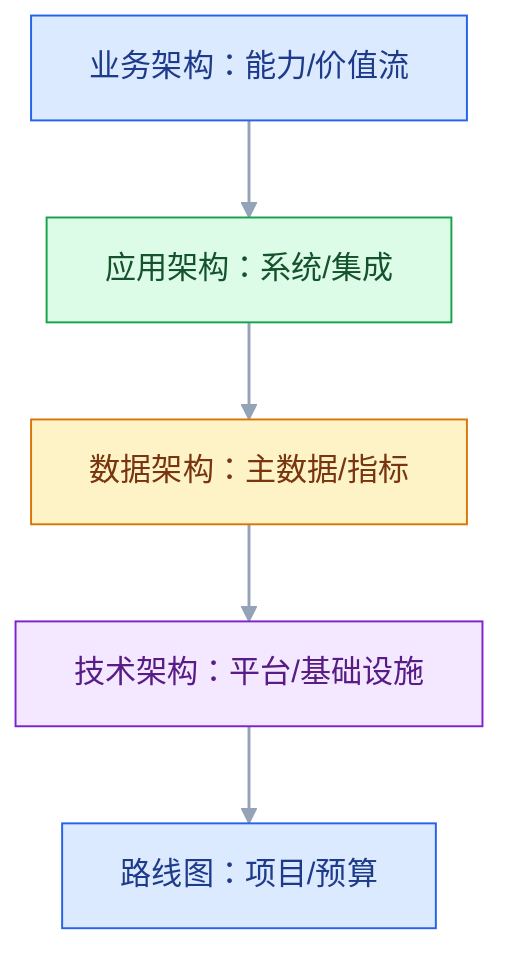

# 企业架构方法与治理

## 一、工程案例：50 套系统、重复建设，怎么用企业架构收敛

**场景**：一家集团有 50 套系统，8 个事业部。收购了两家公司后，系统更多：CRM 有三套，ERP 有两套，工单系统每个事业部各一套。重复建设严重，数据口径不一，IT 预算每年涨 15%，业务还在抱怨“系统不好用”。老板要求：三年内系统数量减少 30%，重复能力合并，IT 预算增长控制在 5%。

**目标**：不做“画一张大图”的企业架构，交付一套能指导投资和收敛的方法：

- 一张业务能力地图；
- 一张应用组合与重复能力分析；
- 一套目标架构与路线图；
- 一套架构原则与治理机制；
- 一张投资/退出决策表；
- 一份验收清单（8 项）。

**为什么必须做**：企业架构的价值不是“文档”，是“在有限预算下，决定做什么、不做什么、先做什么”。没有能力地图和组合管理，IT 就会被需求牵着走。

**动手前确认**：先拿三样东西：IT 预算、系统清单与合同到期时间、业务能力/流程清单。没有这三样，企业架构只能画概念图。下面的数据是示例。

### 1.1 业务能力地图

能力地图按“业务能力”而不是“部门”组织：

| 能力域 | 能力项 | 成熟度 | 系统支撑 |
|---|---|---|---|
| 客户经营 | 线索、商机、合同、服务 | 中 | CRM×3 |
| 订单履约 | 接单、计划、生产、仓储、发运 | 中 | ERP×2、MES×2、WMS×3 |
| 采购供应 | 寻源、采购、供应商 | 低 | SCM×2 |
| 财务核算 | 应收、应付、成本、报表 | 高 | ERP×2 |
| 产品研发 | 设计、BOM、变更 | 中 | PLM×2 |
| 数据决策 | 指标、报表、分析 | 低 | BI×4 |

能力地图要回答：哪些能力是核心、哪些重复、哪些缺失、哪些外包。

### 1.2 应用组合

| 系统 | 能力 | 事业部 | 合同到期 | 决策 |
|---|---|---|---|---|
| CRM-A | 客户经营 | 事业部 1 | 2027 | 保留 |
| CRM-B | 客户经营 | 事业部 2 | 2026 | 合并到 A |
| CRM-C | 客户经营 | 收购公司 | 2028 | 过渡，迁 A |
| ERP-A | 财务/订单 | 集团 | 2029 | 保留 |
| ERP-B | 财务/订单 | 收购公司 | 2027 | 合并到 A |
| BI-A/B/C/D | 报表 | 各事业部 | 不同 | 收敛到统一平台 |

用 TIME 模型分类：

| 分类 | 含义 | 动作 |
|---|---|---|
| Tolerate | 暂时保留 | 维持，不投资 |
| Invest | 战略投资 | 加大投入 |
| Migrate | 迁移 | 迁到目标平台 |
| Eliminate | 淘汰 | 下线/替换 |

### 1.3 目标架构

| 层 | 目标 |
|---|---|
| 业务 | 统一客户、订单、供应链能力 |
| 应用 | CRM 一套、ERP 一套、MES 按工厂、WMS 按区域、BI 一套 |
| 数据 | 统一主数据、指标口径、数据平台 |
| 技术 | 统一云平台、集成平台、身份、可观测 |

目标架构不是“最先进”，是“三年内可落地、可负担”。

### 1.4 路线图

| 阶段 | 目标 | 关键项目 |
|---|---|---|
| 第 1 年 | 主数据统一、CRM 合并 | MDM、CRM 迁移 |
| 第 2 年 | ERP 合并、集成平台 | ERP 迁移、ESB/API |
| 第 3 年 | BI 统一、系统下线 | 数据平台、旧系统退网 |

路线图要按“依赖 + 价值 + 风险”排序，不是按“谁先提需求”。

### 1.5 架构原则

不超过 10 条，能指导决策：

1. 一个能力一个权威系统；
2. 主数据一个来源；
3. 能买不建，能复用不新建；
4. 集成优先标准接口；
5. 数据不落地到无 owner 的系统；
6. 新系统必须接统一身份/监控；
7. 云优先，但核心系统要可退出；
8. 架构决策留 ADR；
9. 技术债有预算；
10. 安全/合规默认满足。

原则要能说“不”，否则只是口号。

### 1.6 治理机制

| 机制 | 作用 |
|---|---|
| 架构委员会 | 跨部门决策 |
| 架构评审 | 重大项目 |
| ADR | 决策记录 |
| 组合管理 | 投资/退出 |
| 技术债 | 预算与跟踪 |
| 架构指标 | 成熟度 |

治理不是审批，是“让投资和架构对齐”。

### 1.7 投资与退出

| 决策 | 依据 |
|---|---|
| 新建 | 能力缺失、无产品可替代 |
| 购买 | 通用能力、成本低 |
| 复用 | 现有系统可扩展 |
| 迁移 | 重复能力、合同到期 |
| 退出 | 低价值、高风险、过时 |

每个决策要有：成本、收益、风险、退出策略。

### 1.8 组织与能力

| 角色 | 职责 |
|---|---|
| 企业架构师 | 能力地图、目标架构、路线图 |
| 业务架构师 | 流程、能力、价值流 |
| 数据架构师 | 主数据、数据平台 |
| 技术架构师 | 平台、基础设施 |
| 架构委员会 | 决策、仲裁 |

企业架构不是一个人，是一组角色 + 机制。

### 1.9 指标

| 指标 | 说明 |
|---|---|
| 系统数量 | 收敛目标 |
| 重复能力 | 合并进度 |
| 主数据一致率 | 数据治理 |
| IT 预算增长 | 成本 |
| 项目交付周期 | 效率 |
| 技术债占比 | 健康度 |
| 架构评审覆盖率 | 治理 |

### 1.10 验收（8 项）

1. 能力地图：覆盖核心业务，业务负责人签字。
2. 应用组合：每个系统有 owner、成本、合同、决策。
3. 重复能力：识别并给出合并/退出计划。
4. 目标架构：业务/应用/数据/技术四层对齐。
5. 路线图：三年、按依赖排序、有预算。
6. 原则：不超过 10 条，能指导决策。
7. 治理：架构委员会/评审/ADR 运行。
8. 指标：系统数量、重复能力、预算、交付周期可跟踪。

## 二、高频问答：会卡住你的地方，也是面试最常问的

### 2.1 企业架构就是画大图

**现场**

怎么判断：拿着这张图问一句——它能指导明年的预算吗？不能就是装饰。

**要点**

- 图只是表达方式，企业架构的核心是能力、投资、路线图和治理。
- 判断标准是能不能回答“做什么、不做什么、先做什么”。
- 只有图没有决策记录的，通常第二年就过期。

**追问**

- 企业架构到底要交付什么？→ 能力地图、应用组合、目标架构、路线图、原则与治理机制。
- 能力地图和组织架构图什么区别？→ 按能力组织，能力要能跨部门复用。
- 那图还要不要画？→ 要，但它是沟通工具，不是交付物本身。

### 2.2 TOGAF 就是考证

**现场**

怎么判断：问用过 ADM 的哪些阶段、产出了什么决策。答不上来就是纸上谈兵。

**要点**

- TOGAF 是方法论和框架，不是考试内容。
- 照搬 ADM 全流程会重流程、轻落地。
- 真正有用的是阶段划分的思路，不是每个交付物都做。

**追问**

- ADM 里最该用哪几段？→ 架构愿景、业务架构、迁移规划，其余按需裁剪。
- 裁剪的标准是什么？→ 组织规模和项目复杂度，小团队做全套是自伤。
- 和敏捷冲突吗？→ 冲突在节奏，做法是把架构决策拆小、随迭代更新。

### 2.3 企业架构是 IT 的事

**现场**

怎么判断：看能力地图和路线图有没有业务 owner 签字。

**要点**

- 企业架构的核心是业务能力和投资，业务不参与就落不了地。
- IT 单方面画的目标架构，业务会用脚投票。
- 业务 owner 签字是把责任绑定的最低要求。

**追问**

- 业务不配合怎么办？→ 从他们的痛点指标切入，比如交付周期、月结天数。
- 架构师需要什么话语权？→ 预算评审和立项的把关权，否则只是顾问。
- 架构委员会主席该是谁？→ 管预算的业务或 IT 高层，不是架构师自己。

### 2.4 架构委员会就是审批

**现场**

怎么判断：看会议议题——是决策还是走流程？只有签字就是形式。

**要点**

- 委员会该做跨部门仲裁、投资取舍、原则制定，不是日常审批。
- 审批窗口化会把委员会变成瓶颈。
- 判断标准是议题里有没有真正的取舍。

**追问**

- 日常审批交给谁？→ 交给架构评审和既定原则，委员会只管例外和跨域冲突。
- 多久开一次？→ 月度级别，急事走异步决议。
- 决议怎么落地？→ 进 ADR，跟项目里程碑绑定。

### 2.5 一个能力一个系统

**现场**

怎么判断：问两句——这个能力需要独立系统吗？现有系统能不能扩展？

**要点**

- 一个系统可以支撑多个能力，一个能力也可以由多个系统协作。
- 真正的约束是权威源和边界，不是系统数量。
- 一律按能力拆系统，会造出一堆重复建设。

**追问**

- 什么情况必须独立系统？→ 能力差异大、合规隔离、供应商不同、迭代节奏完全不同。
- 权威源怎么定？→ 按对象定，一个对象只有一个系统写，其他只读。
- 和能力地图怎么对应？→ 能力地图标支撑系统，重复的进 TIME 模型处理。

### 2.6 买比建好

**现场**

怎么判断：算 TCO 六项——许可、实施、集成、定制、运维、退出。

**要点**

- 买要评估集成、定制、锁定和总成本，不只是许可费。
- 核心差异化能力通常要自建。
- 判断依据是 TCO 和退出成本，不是“成熟产品”四个字。

**追问**

- 买来的系统集成成本为什么常被低估？→ 主数据对接和历史数据迁移往往比许可贵。
- 供应商锁定怎么防？→ 数据可导出、接口标准化、合同写明退出条款。
- 什么能力适合买？→ 通用能力，比如财务、HR、邮件。

### 2.7 全部标准化

**现场**

怎么判断：问这个差异是合规、客户要求，还是历史习惯？前者保留，后者收敛。

**要点**

- 不同事业部、地区有合规、客户、运营差异，过度标准化会损害业务。
- 标准化的重点是数据和接口，不是所有流程。
- 先分清差异的性质，再决定收不收。

**追问**

- 标准化先做哪一层？→ 先主数据和集成契约，流程放最后。
- 合规差异怎么处理？→ 做成系统里的配置项，不写成代码分支。
- 历史习惯怎么收敛不反弹？→ 给迁移期和过渡状态，硬切一定失败。

### 2.8 企业架构一次做完

**现场**

怎么判断：看路线图是否按季度或半年更新。没有就是一次性项目。

**要点**

- 业务在变，架构要迭代，一次做完的蓝图很快过期。
- 路线图按依赖、价值、风险排序，滚动更新。
- 目标架构可以稳定，路径必须可变。

**追问**

- 目标架构多久回顾一次？→ 一年一次，或重大并购、战略调整时触发。
- 迭代和“没规划”怎么区分？→ 看有没有稳定的目标和可验收的里程碑。
- 路线图谁维护？→ 企业架构师维护，业务和财务共同确认预算。

### 2.9 架构治理就是加流程

**现场**

怎么判断：看治理有没有减少重复建设和技术债。只增加流程就是负担。

**要点**

- 治理是让决策可追溯、投资有取舍，不是加审批、加文档、加会议。
- 流程过重会拖慢业务，最后被项目绕过去。
- 判断标准是效果指标，不是流程数量。

**追问**

- 治理怎么轻量化？→ 原则前置，例外才上会，决策进 ADR。
- 技术债怎么进治理？→ 每年固定比例预算，跟项目一起排期。
- 治理失败的典型信号？→ 项目绕开评审先上线，事后补材料。

### 2.10 企业架构没有 ROI

**现场**

怎么判断：看有没有基线、目标、跟踪三项。没有就是无法证明价值。

**要点**

- 可以用系统数量、重复能力、预算、交付周期、故障率来衡量。
- 没有基线就没法证明，先量现状再谈收益。
- ROI 要落到具体动作上，比如下线几套系统、省多少许可。

**追问**

- 收益周期长怎么向老板交代？→ 拆成年度里程碑，每年有可验收的收敛结果。
- 哪个指标最有说服力？→ 预算增长率和系统数量，财务认这两个。
- 架构项目失败通常怎么归因？→ 不是技术，是没业务 owner、没预算绑定。

## 三、核心知识

### 3.1 企业架构的定义

企业架构（Enterprise Architecture）是“业务、应用、数据、技术”的整体蓝图和演进路径，目标是让 IT 与业务战略对齐。

四个视角（4A）：

| 视角 | 内容 |
|---|---|
| 业务架构 | 能力、价值流、组织、流程 |
| 应用架构 | 系统、服务、集成 |
| 数据架构 | 主数据、数据模型、指标 |
| 技术架构 | 平台、基础设施、安全 |

### 3.2 能力地图

能力地图是“企业为了达成目标必须具备的能力”，按能力域/能力项组织。

| 要素 | 说明 |
|---|---|
| 能力域 | 客户、订单、供应链、财务 |
| 能力项 | 线索、报价、履约、结算 |
| 成熟度 | 1～5 |
| 支撑系统 | 哪些系统支撑 |
| Owner | 业务负责人 |

> **面试**：常问「能力地图和组织架构图有什么区别？」答：按能力而不是按部门组织，能力要能跨部门复用，还要标成熟度和支撑系统。

### 3.3 价值流

价值流是“从触发到交付的价值创造过程”，如 L2C、P2P、Plan to Produce。

能力地图看“有什么能力”，价值流看“能力怎么串起来”。

### 3.4 应用组合管理

| 指标 | 说明 |
|---|---|
| 业务价值 | 收入/合规/效率 |
| 技术健康 | 版本、漏洞、维护性 |
| 成本 | 许可、运维、集成 |
| 风险 | 单点、供应商、合规 |
| 生命周期 | 引入/成长/成熟/退出 |

TIME 模型：Tolerate、Invest、Migrate、Eliminate。

> **面试**：常问「TIME 模型怎么用？」答：给每个系统按容忍、投资、迁移、淘汰四类定性，再据此决定预算和退出。

### 3.5 目标架构

目标架构要回答：

- 哪些能力由哪些系统支撑；
- 哪些系统保留/合并/退出；
- 主数据在哪；
- 集成怎么走；
- 技术平台是什么。

目标架构不是“最先进”，是“可落地、可负担、可演进”。

### 3.6 路线图

| 维度 | 内容 |
|---|---|
| 时间 | 1～3 年 |
| 依赖 | 主数据 → 系统 → 集成 |
| 价值 | 先做高价值/低风险 |
| 预算 | 年度/季度 |
| 里程碑 | 可验收 |

### 3.7 架构原则

原则要：

- 少（≤10 条）；
- 能指导决策；
- 有例外流程；
- 定期回顾。

> **面试**：常问「架构原则怎么写才不是口号？」答：不超过十条、能对需求说不、有例外流程、定期回顾。

### 3.8 治理

| 机制 | 作用 |
|---|---|
| 架构委员会 | 跨部门决策 |
| 评审 | 重大项目 |
| ADR | 决策记录 |
| 组合管理 | 投资/退出 |
| 技术债 | 预算 |
| 指标 | 成熟度 |

> **面试**：常问「架构委员会该管什么？」答：跨部门仲裁、投资取舍、原则制定，日常审批交给既定原则和架构评审。

### 3.9 组织

| 角色 | 职责 |
|---|---|
| 企业架构师 | 整体蓝图 |
| 业务架构师 | 能力/流程 |
| 数据架构师 | 数据/指标 |
| 技术架构师 | 平台/基础设施 |
| 产品/项目 | 落地 |

### 3.10 成熟度

| 等级 | 特征 |
|---|---|
| 1 初始 | 无架构，项目驱动 |
| 2 发展 | 有图，无治理 |
| 3 定义 | 有方法、原则、评审 |
| 4 管理 | 有指标、组合管理 |
| 5 优化 | 数据驱动、持续演进 |

## 四、冷门知识汇总

- **TOGAF ADM**：架构开发方法，包含预备、架构愿景、业务/信息系统/技术架构、机会与解决方案、迁移规划、实施治理、变更管理。
- **Zachman 框架**：用 6 个视角 × 6 个问题描述企业架构，强调“不同人看不同视图”。
- **FEAF**：美国联邦企业架构框架，强调参考模型和分段架构。
- **4A**：业务、应用、数据、技术；企业架构常用简化框架。
- **能力基础规划（Capability-Based Planning）**：以业务能力为单元规划投资，而不是按项目。
- **应用组合管理（APM）**：把应用当投资组合管理，评估价值、成本、风险、生命周期。
- **TIME 模型**：Tolerate、Invest、Migrate、Eliminate；Gartner 的应用组合分类。
- **价值流**：从触发到客户价值交付的端到端流程；比部门流程更接近客户。
- **“企业架构不是文档”**：文档只是产出；核心是决策、投资、路线图。
- **架构委员会**：跨部门仲裁机构，不是日常审批窗口。
- **M&A 集成**：并购后的系统/数据/流程整合，是企业架构的高频场景。
- **“一个能力一个系统”是简化**：一个系统可支撑多个能力，一个能力也可多系统协作；关键是权威源。
- **“标准化 vs 本地化”**：合规/客户差异要保留，历史习惯要收敛。
- **技术债预算**：把技术债当投资管理，每年固定比例预算，不是“有空再还”。
- **架构成熟度**：从“项目驱动”到“能力驱动”，需要方法和治理，不是买工具。
- **“架构ROI”**：用系统数量、重复能力、预算、交付周期、故障率衡量；没有基线就无法证明。