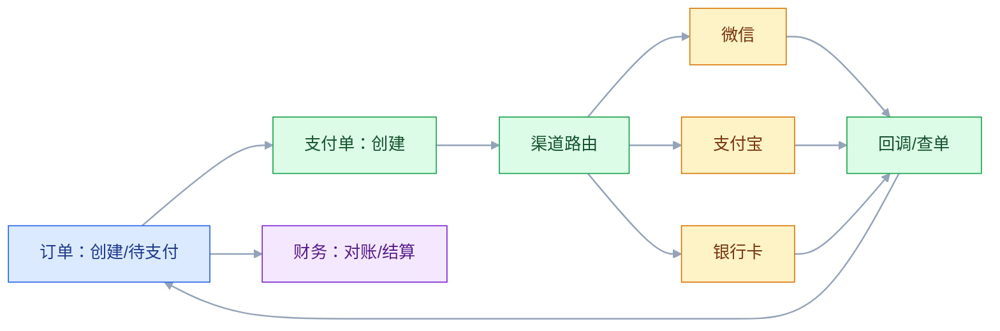
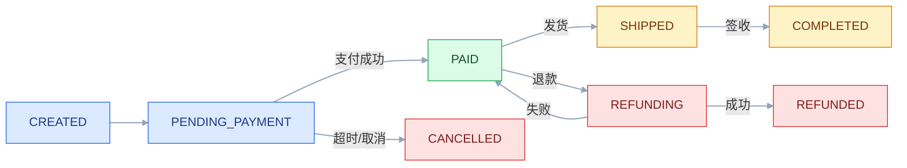

# 订单与支付系统

## 一、工程案例：从下单到退款，设计一条能对账的交易链路

**场景**：一个电商平台，日订单 50 万，峰值 3000 TPS，接了三家支付渠道（微信、支付宝、银行卡）。现在的问题：订单状态用多个字段拼，前端经常显示错；支付回调重复，用户被重复发货；渠道对账每天差几笔，财务手工查；退款要人工在渠道后台操作，状态不同步；大促时支付回调堆积，订单一直“待支付”。

**目标**：不写业务代码，先交付一套可评审、可演练的交易架构：

- 一张订单状态机；
- 一张支付生命周期与渠道路由；
- 一套幂等、回调、补偿规则；
- 一套退款/拒付/对账设计；
- 一张容量与失败矩阵；
- 一份验收清单（8 项）。

**为什么必须做**：订单与支付是“状态 + 账务 + 外部渠道”的组合，任何一处不一致都会导致赔钱或投诉。架构要保证：状态可追、回调可重、退款可逆、账可对。

**动手前确认**：先拉最近 30 天的支付回调、退款、对账差异、渠道超时记录。没有这些，设计只能拍脑袋。下面的数据是示例。

### 1.1 订单状态机

规则：

- 只有 `PENDING_PAYMENT` 能到 `PAID`；
- `PAID` 后重复回调幂等返回；
- `CANCELLED` 后收到支付成功，触发退款；
- 每次迁移写状态日志，带事件 ID、渠道流水号。

### 1.2 支付生命周期

| 状态 | 含义 | 触发 |
|---|---|---|
| INIT | 支付单创建 | 订单提交 |
| PENDING | 等待用户支付 | 调渠道下单 |
| SUCCESS | 支付成功 | 回调/查单 |
| FAILED | 支付失败 | 渠道返回 |
| CLOSED | 关闭 | 超时/订单取消 |
| REFUNDING | 退款中 | 退款申请 |
| REFUNDED | 已退款 | 渠道退款成功 |

支付单和订单是不同对象：一个订单可以多次支付（失败重试），一个支付单只对应一次支付尝试。

### 1.3 渠道路由

| 维度 | 规则 |
|---|---|
| 可用性 | 渠道故障自动切换 |
| 费率 | 按商户/金额/卡类型 |
| 限额 | 单笔/单日 |
| 成功率 | 历史成功率 |
| 合规 | 地区/行业限制 |
| 用户体验 | 支付方式排序 |

路由不是“随机选一个”，要有降级和灰度。新渠道先小流量验证，再放量。

### 1.4 幂等

| 操作 | 幂等键 | 去重 |
|---|---|---|
| 创建订单 | 用户 + 外部请求号 | 唯一索引 |
| 创建支付单 | 订单号 + 支付尝试号 | 唯一索引 |
| 支付回调 | 渠道 + 渠道流水号 | 唯一索引 |
| 退款 | 订单号 + 退款单号 | 唯一索引 |
| 发货 | 订单号 + 发货单号 | 状态机 |

回调幂等三层：唯一索引、状态机、结果回放。

### 1.5 回调与查单

| 机制 | 作用 |
|---|---|
| 异步回调 | 渠道通知 |
| 主动查单 | 回调丢失时补偿 |
| 定时对账 | 日终核对 |
| 重试 | 回调处理失败 |

不能只依赖回调。回调可能丢、可能延迟、可能重复；要“回调 + 查单 + 对账”三保险。

### 1.6 退款

| 类型 | 说明 |
|---|---|
| 全额退款 | 原路退回 |
| 部分退款 | 按行/金额 |
| 异步退款 | 渠道处理中 |
| 拒付/chargeback | 银行侧发起 |

退款要：幂等、状态可追、金额校验、渠道回执、财务对账。退款失败要能重试/人工。

### 1.7 对账

| 对账 | 比较 | 处理 |
|---|---|---|
| 渠道 vs 支付 | 渠道账单 vs 支付流水 | 补单/冲正 |
| 支付 vs 订单 | 支付成功 vs 订单状态 | 补状态/退款 |
| 退款 vs 渠道 | 退款单 vs 渠道回执 | 补退/人工 |
| 结算 | 应收 vs 实收 | 差异挂账 |

对账差异要分类、有 owner、有 SLA，不能只“调平”。

### 1.8 容量

| 指标 | 目标 |
|---|---|
| 下单峰值 | 3000 TPS |
| 支付回调 | 1000 TPS |
| 查单 | 500 QPS |
| P99 下单 | ≤ 300 ms |
| P99 回调 | ≤ 500 ms |
| 对账 | 日终 2 小时内完成 |

容量要按“峰值 + 重试放大”算，不能按日常。

### 1.9 失败矩阵

| 失败 | 影响 | 兜底 |
|---|---|---|
| 渠道超时 | 支付状态未知 | 查单 + 重试 |
| 回调重复 | 重复发货 | 幂等 |
| 回调乱序 | 状态错乱 | 状态机 |
| 回调丢失 | 订单待支付 | 定时查单 |
| 退款失败 | 用户投诉 | 重试/人工 |
| 对账差异 | 财务不平 | 差异分类/补偿 |
| 渠道故障 | 支付失败 | 路由切换 |
| 消息积压 | 状态延迟 | 扩容/降级 |

### 1.10 验收（8 项）

1. 下单：3000 TPS 下 P99 ≤ 300 ms，错误率 ≤ 0.1%。
2. 回调：重复 100 次只处理一次；乱序最终状态正确。
3. 查单：回调丢失 100 笔，定时查单全部补齐。
4. 退款：全额/部分退款各 100 笔，状态与渠道一致。
5. 对账：连续 7 天，渠道/支付/订单差异为 0。
6. 渠道故障：停一家渠道，路由切换，支付成功率 ≥ 95%。
7. 容量：回调积压 10 万，30 分钟内消化。
8. 审计：每笔订单/支付/退款可追到状态、渠道流水、操作人。

## 二、高频问答：会卡住你的地方，也是面试最常问的

### 2.1 订单状态用一个字段

**现场**

怎么判断：问支付成功但未发货、部分退款、售后中这三个场景，怎么用一个字段表达？表达不了就是不够。

**要点**

- 订单、支付、履约、退款是不同生命周期，一个字段表达不了并发状态。
- 订单是交易意图，支付是资金动作，履约是交付动作，要分开建模。
- 各自状态机通过事件关联，状态迁移必须条件更新。

**追问**

- 为什么不能“最后写入者赢”？→ 乱序回调会把已支付改回待支付。
- 条件更新怎么写？→ `update ... where status = 期望的旧值`，看影响行数判断是否迁移成功。
- 部分退款时订单是什么状态？→ 订单仍是已完成，退款是独立单据的独立状态。

### 2.2 支付就是调渠道 API

**现场**

怎么判断：问回调丢了怎么办、重复怎么办、退款怎么对账。答不上来就是没做过支付。

**要点**

- 支付有下单、回调、查单、退款、对账、结算，调通 API 只是开始。
- 支付本质是账务问题，账平、可退、可对才是核心。
- 渠道是外部系统，只能最终一致加补偿。

**追问**

- 支付单和订单为什么要分开？→ 一个订单可以多次支付，一次尝试一个支付单。
- 结算周期影响什么？→ 现金流，T+1 和 T+7 的资金占用完全不同。
- 只做支付不做对账会怎样？→ 差异只能靠财务人工翻账，长期一定赔钱。

### 2.3 回调成功就发货

**现场**

怎么判断：问回调验签了吗、金额校验了吗、重复会重复发货吗。

**要点**

- 回调可能伪造、重复、金额不符，要先验签、幂等、校验金额和状态。
- 顺序是验签 → 查重 → 校验金额和订单 → 更新状态 → 返回成功。
- 记录回调要同步落库，重逻辑可以异步。

**追问**

- 验签覆盖哪些字段？→ 金额、订单号、渠道流水号这些关键字段，不能只签一个时间戳。
- 先返回成功还是先处理？→ 先落库再返回，处理失败靠重试和查单补。
- 回调乱序怎么办？→ 状态机加终态判断，已成功的状态不允许回退。

### 2.4 支付回调不会丢

**现场**

怎么判断：问回调丢失怎么发现。没有查单就是等用户投诉。

**要点**

- 网络、服务重启、处理失败都会丢，必须主动查单补偿。
- 兜底是三保险：回调、查单、日终对账。
- 查单要限流，避免把渠道打挂。

**追问**

- 查单频率怎么定？→ 30 秒、1 分钟、5 分钟递退，之后转日终对账。
- 查单和回调同时到达会重复吗？→ 会，靠幂等键收敛。
- 怎么知道回调丢了？→ 支付单长时间停在 PENDING，用超时告警发现。

### 2.5 退款就是反向调用

**现场**

怎么判断：问退款失败怎么重试、退款中怎么展示、怎么对账。

**要点**

- 退款有异步、部分退款、手续费、拒付、对账，状态可能长时间处理中。
- 退款是独立单据、独立状态机，不是把支付取反。
- 退款失败不能假装成功。

**追问**

- 部分退款怎么保证不超退？→ 累计退款金额与订单金额校验，再加唯一索引。
- 退款中用户看到什么？→ 显示处理中和预计时间，不要提前显示成功。
- 拒付和退款有什么区别？→ 拒付是银行侧发起，要举证申诉，钱可能直接被划走。

### 2.6 订单和支付用同一个事务

**现场**

怎么判断：问渠道超时但实际扣款成功，这个事务能回滚吗？不能，就得靠查单和对账。

**要点**

- 支付是外部渠道，无法加入本地事务，只能最终一致加补偿。
- 超时不等于失败，状态未知时要查单确认。
- 订单和支付之间用状态机加消息，不要硬凑分布式事务。

**追问**

- 本地事务和消息怎么保证一致？→ outbox，状态和消息在同一个事务里落库。
- TCC 适合支付吗？→ 适合内部账户类，外部渠道没有回滚接口。
- 超时后直接标失败行不行？→ 不行，钱可能已经扣了，会造成重复支付。

### 2.7 渠道越多越好

**现场**

怎么判断：看渠道成功率、费率、对账成本。低效渠道要下线。

**要点**

- 每个渠道都有对接、对账、退款、运维成本。
- 渠道太多反而难管理，对账口径成倍增加。
- 判断依据是综合成本和成功率，不是渠道数量。

**追问**

- 多渠道路由按什么选？→ 可用性、费率、限额、成功率、合规、体验。
- 新渠道怎么上？→ 先小流量灰度验证，再放量。
- 渠道故障怎么切？→ 自动降级到备用渠道，同时告警。

### 2.8 支付成功率只看渠道

**现场**

怎么判断：看失败原因分布。渠道只占一部分，剩下的就是自己的问题。

**要点**

- 失败可能是库存、风控、网络、参数、重复下单。
- 要分渠道、分支付方式、分商户看，才能定位。
- 只看渠道会把自身问题算到别人头上。

**追问**

- 怎么区分渠道失败和自身失败？→ 比对错误码分布和渠道侧成功率。
- 重复下单算谁的问题？→ 自己的，幂等键没做好。
- 成功率掉了先看什么？→ 是否集中在某个渠道，或某个版本发布之后。

### 2.9 对账是财务的事

**现场**

怎么判断：问每笔支付有没有渠道流水号、能不能自动对账。不能就是没设计。

**要点**

- 没有渠道流水、本地流水、状态日志，财务只能人工翻账。
- 对账是三方差：渠道、支付、订单。
- 差异要分类、有 owner、有 SLA，不能只调平。

**追问**

- 三方对账分别能发现什么？→ 渠道对支付查漏单，支付对订单查状态不一致。
- 差异怎么分类？→ 金额差、状态差、时间差、重复、缺失。
- 日终对账多久跑完算合格？→ 案例目标是 2 小时内。

### 2.10 大促加机器就行

**现场**

怎么判断：压测看瓶颈在应用、DB、渠道还是消息。只加应用可能更糟。

**要点**

- 支付瓶颈常在渠道限流、数据库锁、回调积压。
- 容量要按峰值加重试放大算，不能按日常。
- 加机器解决不了下游限流，反而会放大冲击。

**追问**

- 回调积压怎么消化？→ 扩容消费者加降级，案例目标是 10 万积压 30 分钟清完。
- 数据库锁怎么定位？→ 看慢查询和锁等待，热点行要拆。
- 大促前必须做什么？→ 压测、限流预案、渠道额度确认。

## 三、核心知识

### 3.1 订单模型

| 对象 | 关键字段 |
|---|---|
| 订单 | 订单号、用户、金额、状态、地址 |
| 订单行 | SKU、数量、单价、优惠 |
| 支付单 | 支付号、渠道、金额、状态 |
| 退款单 | 退款号、订单号、金额、状态 |
| 履约单 | 发货、物流、签收 |

订单是“交易意图”，支付是“资金动作”，履约是“交付动作”，三者分开建模。

### 3.2 状态机

订单、支付、退款各自状态机，通过事件关联。

| 对象 | 状态 |
|---|---|
| 订单 | 待支付、已支付、已发货、已完成、已取消 |
| 支付 | 初始化、待支付、成功、失败、关闭、退款中、已退款 |
| 退款 | 申请、处理中、成功、失败 |

状态迁移必须条件更新，不能“最后写入者赢”。

> **面试**：常问「订单状态为什么不能用一个字段？」答：订单、支付、履约、退款是各自独立的状态机，靠事件关联。

### 3.3 支付渠道

| 角色 | 说明 |
|---|---|
| 商户 | 接入方 |
| 收单机构 | 处理交易 |
| 发卡行 | 扣款 |
| 清算机构 | 结算 |
| 渠道 | 微信/支付宝/银联 |

不同渠道的接口、回调、对账文件、退款规则都不同，要适配层隔离。

### 3.4 幂等

| 层 | 做法 |
|---|---|
| 入口 | 唯一键 |
| 业务 | 状态机 |
| 响应 | 结果回放 |
| 消息 | 去重表 |

幂等键要跨系统稳定：订单号、支付号、渠道流水号。

> **面试**：常问「幂等怎么做才可靠？」答：入口唯一键、业务状态机、响应结果回放三层，键必须跨系统稳定。

### 3.5 回调

| 步骤 | 动作 |
|---|---|
| 验签 | 验证渠道签名 |
| 幂等 | 查重 |
| 校验 | 金额、订单、状态 |
| 处理 | 更新支付/订单 |
| 响应 | 返回成功 |
| 补偿 | 失败重试/查单 |

回调处理要快，重逻辑异步化；但“记录回调”要同步落库。

> **面试**：常问「支付回调处理的关键步骤是什么？」答：验签、幂等查重、校验金额和状态、更新、响应，回调先落库再处理。

### 3.6 查单

| 场景 | 频率 |
|---|---|
| 回调未到 | 30 秒/1 分钟/5 分钟 |
| 支付中 | 定时轮询 |
| 对账差异 | 日终 |

查单要限流，避免把渠道打挂。

### 3.7 退款

| 类型 | 注意 |
|---|---|
| 全额 | 原路退回 |
| 部分 | 金额/行校验 |
| 异步 | 状态轮询 |
| 拒付 | 证据/申诉 |

退款要幂等、可追、可对账；退款失败不能“假装成功”。

### 3.8 对账与结算

| 对账 | 内容 |
|---|---|
| 交易 | 渠道流水 vs 支付单 |
| 退款 | 渠道退款 vs 退款单 |
| 结算 | 应收 vs 实收 |
| 手续费 | 渠道费率 vs 账面 |

结算周期（T+1/T+7）会影响现金流，架构要支持。

> **面试**：常问「对账要对哪几方？」答：渠道、支付、订单三方对齐，才能发现漏单、重复和金额错。

### 3.9 安全

| 风险 | 措施 |
|---|---|
| 伪造回调 | 验签、IP 白名单 |
| 重复支付 | 幂等 |
| 金额篡改 | 服务端校验 |
| 敏感数据 | 加密、脱敏 |
| 拒付 | 风控、证据 |

### 3.10 容量与观测

| 指标 | 说明 |
|---|---|
| 下单 TPS | 峰值 |
| 支付成功率 | 分渠道 |
| 回调延迟 | P99 |
| 对账差异 | 笔数 |
| 退款时长 | P99 |

观测要分渠道、分支付方式、分商户，才能定位问题。

## 四、冷门知识汇总

- **ISO 8583**：银行卡交易报文标准，定义交易类型、域、响应码。传统收单常用。
- **收单/发卡/清算**：收单机构处理商户交易，发卡行扣款，清算机构完成资金结算。
- **3DS**：3-D Secure，卡支付额外验证（短信/APP），降低欺诈，但增加跳转和失败率。
- **Tokenization**：用 token 替代卡号，减少敏感数据存储；支付网关常用。
- **Chargeback（拒付）**：持卡人向银行申诉，资金被退回；商家要提供证据，处理周期长。
- **T+1 结算**：交易次日结算；不同渠道/行业周期不同，影响现金流。
- **双边账/复式记账**：每笔交易有借方和贷方，保证账平；支付系统本质是账务系统。
- **幂等键**：支付/退款的唯一标识，跨系统稳定；不能用随机数/时间戳。
- **outbox**：支付状态和消息同事务，避免“状态改了消息没发”。
- **状态机**：订单/支付/退款各自状态机，不能用一个字段表达。
- **对账三方**：渠道、支付、订单；三方对齐才能发现漏单/重复/金额错。
- **“支付是账务问题”**：接口调通只是开始，账平、可退、可对才是核心。
- **“回调不是可靠消息”**：回调可能丢/重/乱；必须查单 + 对账。
- **“退款不是反向支付”**：退款有独立状态、异步、手续费、拒付；不能简单取反。
- **“渠道成功率不是越高越好”**：费率、限额、合规、用户体验都要平衡。
- **“大促支付瓶颈常在渠道”**：渠道限流、回调延迟、对账文件大小，往往比应用先崩。