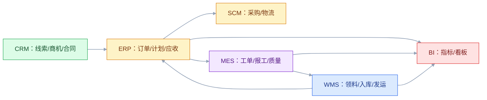

# 从线索到收款：九大系统集成案例

## 一、工程案例：把 CRM、ERP、SCM、MES、WMS、BI 串成一条可验收的链路

**场景**：一家年营收 12 亿的装备制造商，两年前上了 CRM、ERP、MES、WMS、SCM、PLM、BI、OA，车间有 SCADA。系统都有，但老板问“这笔订单现在到哪一步了”，五个部门能给出五个答案。财务月结要 12 天，库存准确率 92%，订单交付周期 45 天。老板下目标：全链路可追溯、月结 5 天、库存准确率 98%、交付周期降到 35 天。

**目标**：这是架构方向的综合演练，不写任何系统的功能手册，只做一件事：**把端到端链路、系统 of record、集成点、失败矩阵、对账规则和迁移路径定清楚**。交付：

- 一张全链路状态机；
- 一张系统 of record 表；
- 一张 14 个集成点清单（含失败处理与对账）；
- 一张失败矩阵；
- 一套迁移步骤与回滚点；
- 一份验收清单（8 项）。

**为什么必须做**：单篇系统笔记讲“某个系统管什么”，这篇讲“一条业务链怎么跑通”。它是架构知识的总验收——边界、一致性、容量、集成、数据治理，全都要在一个案例里对上。

**动手前确认**：先取 30 天真实数据：订单状态、物料编码、库存差异、变更单、工单、发运记录。没有这些，全链路设计只能靠想象。下面的企业数据是示例。

### 1.1 系统 of record

一个对象只能有一个权威源，其他系统只读或引用。这是全链路可追溯的前提。

| 对象 | 权威源 | 只读方 |
|---|---|---|
| 客户/商机 | CRM | ERP、BI |
| 合同 | CRM（意向）到 ERP（履约） | MES、WMS |
| 订单履约 | ERP | MES、WMS、BI |
| 物料/客户/供应商 | ERP（或 MDM） | PLM、MES、WMS、BI |
| 设计 BOM | PLM | ERP、MES |
| 制造 BOM | ERP | MES |
| 工单 | MES | ERP、BI |
| 实物库存 | WMS | ERP、MES |
| 财务库存 | ERP | BI |
| 设备数据 | SCADA | MES、BI |
| 质量记录 | MES/QMS | ERP、BI |
| 应收 | ERP | CRM、BI |

裁决规则：冲突时以权威源为准；权威源缺数据时，先修源头，不改下游。

### 1.2 全链路状态机

订单状态不是“一个字段”，是跨系统的事件聚合。

每个状态必须有：触发事件、负责系统、业务承诺、失败兜底。

| 状态 | 触发 | 系统 | 承诺 | 失败兜底 |
|---|---|---|---|---|
| 合同签订 | CRM 商机赢单 | CRM | 需求完整 | 退回销售补信息 |
| 订单受理 | ERP 建单 | ERP | 订单合法、可履约 | 人工审核 |
| 采购/计划 | MRP 运行 | ERP | 物料到位 | 替代料、紧急采购 |
| 物料到货 | WMS 收货 | WMS | 数量质量合格 | 拒收、退换 |
| 工单执行 | MES 开工 | MES | 按工艺执行 | 冻结、升级 |
| 完工报工 | MES 报工 | MES | 数量准确 | 补报、核对 |
| 成品入库 | WMS 上架 | WMS | 批次完整 | 隔离、重盘 |
| 发运 | WMS 交接 | WMS | 准时发运 | 改期、拆单 |
| 开票/应收 | ERP 开票 | ERP | 金额正确 | 重开、冲正 |
| 回款 | ERP 收款 | ERP | 账实相符 | 对账、催收 |

### 1.3 14 个集成点

| # | 上游到下游 | 内容 | 方式 | 频率 | 失败处理 | 对账 |
|---:|---|---|---|---|---|---|
| 1 | CRM 到 ERP | 客户、合同、订单需求 | API | 准实时 | 暂存重放 | 日 |
| 2 | CRM 到 BI | 商机、预测 | 批量 | 日 | 重跑 | 日 |
| 3 | PLM 到 ERP | 物料、EBOM、变更 | API/消息 | 准实时 | 版本校验、拒绝旧版 | 日 |
| 4 | PLM 到 MES | MBOM、工艺路线 | API/消息 | 准实时 | 工单冻结 | 日 |
| 5 | ERP 到 SCM | 采购订单、预测 | API | 准实时 | 重发 | 日 |
| 6 | SCM 到 WMS | ASN、到货预约 | API | 准实时 | 缺失按普通收货 | 日 |
| 7 | ERP 到 WMS | 入库/出库指令 | API | 准实时 | 重发，幂等键 | 日 |
| 8 | ERP 到 MES | 生产订单、工单 | API/消息 | 准实时 | 重发，幂等键 | 日 |
| 9 | MES 到 WMS | 领料、完工入库 | API/消息 | 准实时 | 重试，缺料告警 | 日 |
| 10 | WMS 到 MES | 发料、齐套状态 | API | 准实时 | 降级排产 | 日 |
| 11 | MES 到 ERP | 报工、物料消耗 | API/消息 | 准实时 | 汇总重报 | 日 |
| 12 | WMS 到 ERP | 收货、发货、库存 | 消息 | 准实时 | 事务重放 | 日 |
| 13 | 各系统到 BI | 交易、执行、库存 | CDC/批量 | 小时/日 | 补跑 | 日 |
| 14 | OA 到 ERP | 审批（价格、合同、付款） | API/消息 | 准实时 | 重试、死信 | 日 |

集成原则：**能批量不实时，能异步不同步，能点对点不建总线**。每加一个实时集成点，就多一个失败点和一个对账口径。

### 1.4 失败矩阵

| 失败 | 影响 | 兜底 |
|---|---|---|
| CRM 订单未到 ERP | 不履约 | 定时补偿 + 人工导入 |
| PLM 变更未到 MES | 按旧版生产 | 工单冻结 + 版本校验 |
| ERP 工单重复下发 | 重复生产 | 工单号幂等 |
| SCM ASN 缺失 | 收货排队 | 普通收货 + 补录 |
| WMS 库存未回传 ERP | 账实不符 | 日对账 + 冲正 |
| MES 报工丢失 | 成本不准 | 定时补偿 + 班后汇总 |
| WMS 发运未回传 | 应收延迟 | 日对账 |
| OA 审批未回调 ERP | 流程停摆 | 超时升级 + 人工 |
| BI 数据延迟 | 看板失真 | 补跑 + 标注 |
| 主数据编码冲突 | 集成错乱 | MDM 裁决 + 映射表 |

每个失败都要有 owner、SLA、告警、演练记录。

### 1.5 对账规则

对账不是月底一次，是每日自动。

| 对账对象 | 比较 | 频率 | 自动补偿 |
|---|---|---|---|
| 订单 | CRM 合同 vs ERP 订单 | 日 | 漏单补建 |
| 物料 | PLM vs ERP vs MES 编码 | 日 | 人工映射 |
| 库存 | WMS 实物 vs ERP 财务 | 日 | 确定性差异冲正 |
| 报工 | MES vs ERP 完工 | 日 | 重复冲正、漏报补 |
| 发运 | WMS vs ERP 应收 | 日 | 漏单补开 |
| 应收 | ERP vs 银行到账 | 日 | 差异挂账人工 |

对账差异要分类、有 owner、有 SLA，不能只“调平”。

### 1.6 指标闭环

全链路的最终目的是指标改善，不是“系统都通了”。

| 指标 | 现状（示例） | 目标 | 责任系统 |
|---|---:|---:|---|
| 订单交付周期 | 45 天 | 35 天 | CRM/ERP/MES/WMS |
| 月结天数 | 12 天 | 5 天 | ERP |
| 库存准确率 | 92% | 98% | WMS/ERP |
| 追溯时间 | 3 天 | 30 分钟 | PLM/MES/WMS |
| 缺料停线 | 16 小时/月 | 4 小时/月 | SCM/ERP |
| 对账差异 | 5 笔/日 | 0 笔/日 | ERP/WMS |

指标要能下钻：订单慢在哪一段、库存差在哪一类 SKU、追溯断在哪一环。

### 1.7 迁移步骤与回滚点

| 阶段 | 动作 | 退出条件 | 回滚点 |
|---|---|---|---|
| 1 主数据 | 编码统一、清洗、导入 | 一致率 ≥ 99% | 保留旧编码映射 |
| 2 集成契约 | 定义 Schema、幂等、版本 | 契约测试通过 | 接口开关 |
| 3 双跑 | 新旧接口并行，只读比对 | 差异 < 0.1% | 一键切回旧链路 |
| 4 灰度 | 按产品线/区域切 5% | 指标无劣化 | 回退到双跑 |
| 5 切流 | 逐步到 100% | 连续 3 天稳定 | 保留旧链路 3 个月 |
| 6 收尾 | 下线旧接口、清理临时表 | 无回访 | 下线前快照 |

每一步都要可回滚。不可回滚的迁移，不建议上线。

### 1.8 验收（8 项）

1. 订单：从 CRM 合同到 ERP 回款，30 分钟给出全链路状态。
2. 追溯：任一台交付产品 30 分钟内追到原料批次、工序、设备、图纸。
3. 集成：14 个集成点每个有 owner、契约、失败处理、对账。
4. 对账：连续 30 天，库存、报工、发运差异为 0。
5. 指标：交付周期 ≤ 35 天、月结 ≤ 5 天、库存准确率 ≥ 98%。
6. 变更：PLM 变更到 MES 生效 ≤ 1 个工作日，旧版本工单被拦截。
7. 演练：每季度一次跨系统故障演练，恢复时间 ≤ 30 分钟。
8. 评审：架构图、契约、失败矩阵、对账规则、ADR 齐全，业务/技术/财务签字。

## 二、高频问答：会卡住你的地方，也是面试最常问的

### 2.1 系统都上线了，链路自然就通了

**现场**

怎么判断：问一笔订单能不能 30 分钟查出全链路状态。查不出就是没打通。

**要点**

- 系统上线是功能可用，链路打通是数据、状态、责任、对账都闭环。
- 判断标准是端到端可追溯，不是接口数量。
- 没有端到端 owner，每个系统都说自己没问题。

**追问**

- 链路打通的最低验收是什么？→ 任一笔订单 30 分钟内给出全链路状态。
- 系统都买了为什么还不通？→ 主数据、契约、责任没人定。
- 先做哪一步？→ 先定系统 of record，再谈接口。

### 2.2 集成就是把接口都连上

**现场**

怎么判断：看每个接口有没有 owner、契约、失败处理、对账。缺一项就是能调通但不可运营。

**要点**

- 接口只解决传输，主数据、幂等、顺序、失败、对账才是集成的主体。
- 能调通和可运营是两件事。
- 每个集成点都要有 owner 和对账口径。

**追问**

- 集成点为什么会翻倍？→ 每加一个实时集成就多一个失败点和一个对账口径。
- 契约里要定什么？→ Schema、幂等键、版本、失败语义。
- 点对点和总线怎么选？→ 能点对点就不建总线，总线本身也是要维护的系统。

### 2.3 主数据以后再治理

**现场**

怎么判断：抽查 100 个物料，PLM、ERP、MES 编码一致率低于 99% 就先治理，别急着推流程。

**要点**

- 主数据不一致，流程越跑越乱，后期清洗成本更高。
- 主数据是全链路的共同语言，要先于流程统一。
- 治理四步：统一编码、明确 owner、分发订阅、一致率对账。

**追问**

- 为什么主数据必须先行？→ 编码不一致，接口接上了数据也是错的。
- 一致率怎么量？→ 抽样比对多系统编码和属性，按日或按周出报表。
- 冲突怎么裁决？→ MDM 裁决加映射表，先修源头不改下游。

### 2.4 全链路状态用一个字段就行

**现场**

怎么判断：问这个状态是谁写的、失败时谁改、历史怎么追。答不上来就是字段不够。

**要点**

- 一个字段无法表达跨系统的阶段、责任、时间和失败。
- 会退化成“最后写入者赢”，状态不可信。
- 业务状态和系统状态要分开，前者面向客户，后者面向运维。

**追问**

- 全链路状态怎么来？→ 各系统事件聚合，不是某个系统写一个字段。
- 要不要存快照？→ 要，事件流加当前态快照，查历史才不用重放。
- 时间怎么记？→ 业务发生时间和系统处理时间都要记。

### 2.5 实时集成越多越好

**现场**

怎么判断：问延迟 1 小时会损失什么。答不上来就改批量。

**要点**

- 实时集成增加耦合、失败面和运维成本。
- 财务、BI、对账用批量更稳。
- 原则是能批量不实时、能异步不同步、能点对点不建总线。

**追问**

- 什么必须实时？→ 订单、工单、库存扣减这类直接影响履约的。
- 批量延迟怎么让业务接受？→ 明确数据时效，看板上标注数据截止时间。
- CDC 算实时还是批量？→ 准实时，适合 BI 和报表，不适合强一致场景。

### 2.6 对账是财务的事

**现场**

怎么判断：问每笔交易有没有渠道流水号、本地流水号、状态日志。三样缺一，对账就是考古。

**要点**

- 没有系统级的流水、唯一键、状态日志，财务只能人工翻账。
- 对账要每日自动，不是月底一次性补。
- 差异要分类、有 owner、有 SLA。

**追问**

- 对账分几层？→ 数据对账、状态对账、业务对账。
- 差异能自动补偿吗？→ 确定性差异可以冲正，不确定的必须人工。
- 对账结果还有什么用？→ 当架构的体检报告，暴露链路断点。

### 2.7 出问题再补补偿

**现场**

怎么判断：看失败矩阵是否覆盖 10 类常见失败。没有就是没设计。

**要点**

- 全链路的成本主要在异常：重复、乱序、丢失、部分成功、回滚。
- 每个失败都要有 owner、SLA、告警、演练记录。
- 补偿不是补丁，是设计的一部分。

**追问**

- 部分成功怎么处理？→ 幂等重试加对账兜底，不能假设全成功或全失败。
- 乱序怎么防？→ 版本号或状态机，旧事件直接丢弃。
- 演练要练什么？→ 跨系统故障，目标是 30 分钟内恢复。

### 2.8 上了中台就解决集成

**现场**

怎么判断：问中台的数据谁负责、冲突怎么裁决、下游怎么订阅。答不上来就是又一个孤岛。

**要点**

- 中台解决复用，不解决主数据归属、契约、补偿。
- 没有治理，中台只是多一个系统。
- 判断标准是责任和数据归属，不是平台名字。

**追问**

- 中台和 MDM 什么关系？→ 中台消费主数据，不能替代主数据的 owner。
- 什么情况适合建中台？→ 多业务线有真实复用需求，而且有治理机制。
- 中台失败常见原因？→ 只建平台不定责任，最后变成又一个数据孤岛。

### 2.9 迁移可以一次性切换

**现场**

怎么判断：看有没有双跑、灰度、回滚点。没有就不要切。

**要点**

- 全链路涉及主数据、库存、在制、应收，切不好会停线、错账。
- 迁移四原则：先主数据后流程、先双跑后切流、先灰度后全量、每步可回滚。
- 回滚不只是切回旧系统，还要回滚数据、消息、库存、应收。

**追问**

- 双跑阶段比什么？→ 新旧接口并行只读比对，差异要小于 0.1%。
- 旧链路保留多久？→ 案例是三个月，覆盖一个完整月结周期。
- 暗数据怎么处理？→ 迁移前盘点 Excel、邮件、纸质单据。

### 2.10 指标改善是业务的事

**现场**

怎么判断：看每个指标能不能下钻到系统、环节、owner。不能就是架构没闭环。

**要点**

- 架构决定链路的边界、数据、失败处理，链路设计不好业务再努力也改善不了。
- 指标要能下钻：订单慢在哪一段、库存差在哪类 SKU、追溯断在哪一环。
- 全链路必须有端到端 owner。

**追问**

- 端到端 owner 该是谁？→ 流程 owner，对交付周期和履约结果负责。
- 指标怎么和系统绑定？→ 每个指标标清责任系统和责任环节。
- 改善从哪开始？→ 先找最大的一段延迟或差异，不要全面铺开。

## 三、核心知识

### 3.1 L2C 的范围

L2C（Lead to Cash，从线索到收款）覆盖：线索、商机、报价、合同、订单、计划、采购、生产、仓储、发运、开票、收款、售后。

它和 O2C（Order to Cash）的区别：O2C 从订单开始，L2C 从线索开始。L2C 更长，跨 CRM 和 ERP 的边界更明显。

### 3.2 全链路设计的四个锚点

| 锚点 | 问题 |
|---|---|
| 业务锚点 | 这条链路承诺什么？交期、质量、回款？ |
| 数据锚点 | 每个对象谁是权威源？冲突怎么裁决？ |
| 事件锚点 | 每个状态由什么事件触发？谁负责？ |
| 失败锚点 | 失败怎么发现、重试、补偿、对账？ |

四个锚点定不下来，接口写得再多也不稳。

> **面试**：常问「全链路设计要先定哪几件事？」答：业务、数据、事件、失败四个锚点，定不下来接口写得再多也不稳。

### 3.3 订单状态机

订单状态机要分“业务状态”和“系统状态”：

- 业务状态：已签约、已排产、生产中、已入库、已发运、已签收、已开票、已回款；
- 系统状态：各系统的处理状态、消息状态、对账状态。

业务状态面向客户和管理层，系统状态面向运维。两者不能混成一个字段。

### 3.4 集成模式选择

| 场景 | 模式 |
|---|---|
| 订单、工单 | API + outbox + 幂等 |
| 库存、报工 | 消息 + 对账 |
| 财务、BI | 批量/CDC |
| 遗留系统 | 文件/视图 + 防腐层 |
| 跨企业 | EDI/API |

选择依据：实时性、一致性、数据量、失败成本、团队能力。

### 3.5 主数据治理

主数据是全链路的“共同语言”。治理四步：

1. 统一编码：物料、客户、供应商、组织；
2. 明确 owner：谁创建、谁维护、谁裁决；
3. 分发订阅：API/消息/批量；
4. 一致率对账：每日/每周。

主数据不一致，链路一定断。

> **面试**：常问「主数据治理的四步是什么？」答：统一编码、明确 owner、分发订阅、一致率对账。

### 3.6 对账体系

对账分三层：

| 层 | 内容 |
|---|---|
| 数据对账 | 数量、金额、编码 |
| 状态对账 | 订单、工单、发运状态 |
| 业务对账 | 合同、库存、应收 |

对账要自动、每日、可分类、可补偿。对账结果是架构的“体检报告”。

> **面试**：常问「对账分哪三层？」答：数据对账、状态对账、业务对账，结果是架构的体检报告。

### 3.7 全链路可观测性

可观测性三件套：

- 指标：订单量、交付周期、库存差异、对账差异；
- 日志：状态变更、接口调用、失败原因；
- 追踪：Trace ID + 业务单号，贯穿全链路。

没有业务单号贯穿，Trace 只能看到技术调用，看不到业务状态。

> **面试**：常问「全链路可观测最常缺什么？」答：缺业务单号贯穿，只有 Trace ID 看不到业务状态。

### 3.8 迁移与回滚

迁移四原则：

- 先主数据，后流程；
- 先双跑，后切流；
- 先灰度，后全量；
- 每一步可回滚。

回滚不只是“切回旧系统”，还要回滚数据、消息、库存、应收。回滚方案要演练。

### 3.9 组织与责任

全链路要有“端到端 owner”，不能只按系统分责任。

| 角色 | 责任 |
|---|---|
| 流程 owner | 交付周期、履约结果 |
| 系统 owner | 系统功能、接口、SLA |
| 数据 owner | 主数据、指标口径 |
| 集成 owner | 接口、消息、对账 |
| 运维 | 监控、告警、恢复 |

没有端到端 owner，出问题就会在部门之间踢皮球。

### 3.10 成熟度评估

| 等级 | 特征 |
|---|---|
| 1 孤岛 | 系统各自为政，手工导入 |
| 2 接口 | 关键系统有接口，无主数据治理 |
| 3 集成 | 主数据统一，链路可追 |
| 4 协同 | 计划、库存、物流联动 |
| 5 智能 | 预测、优化、自动决策 |

大多数企业卡在 2～3 级。先到 3 级，再谈智能。

## 四、冷门知识汇总

- **ATP/CTP**：可承诺量（Available-to-Promise）、可承诺能力（Capable-to-Promise）。ATP 看库存和计划，CTP 还要看产能。CRM 给客户的交期承诺，背后需要 ATP/CTP。
- **DSO**：应收账款周转天数（Days Sales Outstanding）。L2C 的最终指标之一，公式是应收账款 / 日均销售额。
- **OTIF**：准时且完整交付（On Time In Full）。比单看准时率更严格，要求数量和交期都满足。
- **Perfect Order**：完美订单率，通常要求准时、完整、无破损、单据正确。它是全链路质量的综合指标。
- **Drop Ship**：供应商直接发给客户，企业不经过仓库。它缩短交付链，但对库存可视和结算要求更高。
- **Consignment**：寄售，货在供应商名下，用时才结算。它降低库存压力，但账务和税务复杂。
- **3PL**：第三方物流。企业把仓储/运输外包，但仍要对客户承诺交付。
- **Incoterms**：国际贸易术语（EXW、FOB、CIF、DDP 等），定义交货、风险、费用边界。跨境 L2C 必须写清。
- **Quote-to-Cash（Q2C）**：从报价到收款，比 L2C 少了线索，比 O2C 多了报价。不同企业口径不同，报表要标注。
- **订单履约的“承诺日期”与“计划日期”**：对客户承诺的是承诺日期，内部排产的是计划日期。两者混用会导致销售和计划打架。
- **状态机的“补偿状态”**：取消、退货、换货、冲正不是“删除”，是新的状态和逆向流程。没有逆向状态，账永远对不平。
- **全链路的“业务单号”**：订单号、工单号、发运单号、发票号要能互相映射。只有一个技术 Trace ID，业务人员看不懂。
- **数据血缘与业务血缘**：技术血缘看表字段，业务血缘看“订单到回款”的每个状态。两者都要有，才能定位“数字不对”是技术还是业务问题。
- **端到端 owner**：跨系统的链路必须有人对结果负责，否则每个系统都“没问题”，整条链路却交付不了。
- **迁移的“暗数据”**：Excel、邮件、纸质单据里的数据，往往不在系统清单里，但会影响迁移。迁移前要做数据盘点。
- **全链路的“时间戳”**：每个状态要记录“业务发生时间”和“系统处理时间”。只记一个，排查延迟时分不清是业务慢还是系统慢。