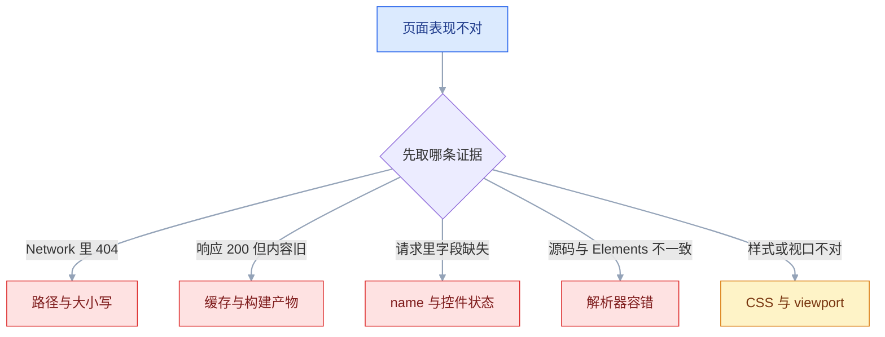

# HTML

## 一、工程案例：把商品列表页做成可访问、可提交的静态页面

**场景**：花店「山野花房」要一个商品列表页：6 个在售商品、按关键词与分类筛选、每件商品能直接发起询价。没有构建工具、没有框架，交付 `index.html` + `base.css` + `assets/`，后端只给两个接口：`GET /search` 与 `POST /api/inquiry`。硬指标是断网、禁用 JS、只用键盘三种情况下页面都还能用。

**为什么必须做**：这一页把 HTML 的五个高风险区一次踩全——文档骨架、语义结构、图片替代文本、表单数据模型、原生校验。任何一处写错都不会报错，只会在上线后变成「搜索抓不到」「手机上字小得看不清」「后端收不到字段」这类没人认领的问题。

**动手前确认**：Node 18+（跑校验器）、Chrome 或 Safari 当前稳定版、一个空目录。先建 `shop/`，后文所有相对路径都以它为根；图片用任意同比例 JPG 占位（复制改名即可），文件名与代码一致。

### 1.1 目录与文档骨架

文件只有三类：`index.html`、`base.css`、`assets/`。`assets/` 里 6 件商品各一对同图不同宽度的 JPG，下文以玫瑰为例：`rose-400.jpg`、`rose-800.jpg`，其余 5 件同理（`lily-400.jpg` 等）。

```html
<!DOCTYPE html>
<html lang="zh-CN">
<head>
  <meta charset="utf-8">
  <meta name="viewport" content="width=device-width, initial-scale=1">
  <title>鲜花预订 | 山野花房</title>
  <meta name="description" content="当季鲜花每周直采，北京同城次日达，支持到店自提。">
  <link rel="stylesheet" href="base.css">
</head>
<body>
  <a class="skip-link" href="#main">跳到主内容</a>
  <!-- header / main / footer 见下面各段 -->
</body>
</html>
```

四个位置不能动：`<!DOCTYPE html>` 在第一行；`charset` 在 `head` 最前面（必须落在文件前 1024 字节内）；`viewport` 紧跟其后；`title` 每页单独写。`lang="zh-CN"` 让读屏选中文语音、让浏览器判断断行与字体，不是装饰。

### 1.2 页头与导航

```html
<header class="site-header">
  <a class="brand" href="/">山野花房</a>
  <nav aria-label="主导航">
    <ul>
      <li><a href="#goods">全部商品</a></li>
      <li><a href="#filter">筛选</a></li>
      <li><a href="#inquiry">询价</a></li>
    </ul>
  </nav>
</header>
```

`nav` 只包主要导航，页脚的小链接组不必再套一个。锚点 `#goods` 的目标必须是页面里真实存在且唯一的 `id`。`aria-label` 在页面有多个导航区时才必要，写上便于以后扩展。

### 1.3 商品列表

```html
<main id="main">
  <h1>当季鲜花</h1>
  <p>每周一凌晨从昆明直采，北京同城次日达。</p>

  <section id="goods" aria-labelledby="goods-title">
    <h2 id="goods-title">本周在售</h2>
    <ul class="goods">
      <li>
        <article class="card">
          
          <h3><a href="/goods/rose">赤霞玫瑰</a></h3>
          <p>20 枝 / 束，花径约 6cm，附带保鲜剂。</p>
          <p><data value="199">¥199</data> <del>¥259</del></p>
        </article>
      </li>
      <!-- 其余 5 张结构相同，只换 src、srcset、alt、标题、价格 -->
    </ul>
  </section>
</main>
```

三处决定成败：`ul > li > article` 是列表的标准结构，`article` 表示「单独拿出来也完整的一张商品卡」；`width` / `height` 写图片的原始像素尺寸，浏览器据此算出宽高比、提前占位，图片慢加载时页面不跳；`alt` 写「看到什么」，纯装饰花纹用 `alt=""` 明确让读屏跳过。

### 1.4 筛选表单：GET 查询

```html
<section id="filter" aria-labelledby="filter-title">
  <h2 id="filter-title">筛选</h2>
  <form action="/search" method="get" role="search">
    <p>
      <label for="q">关键词</label>
      <input type="search" id="q" name="q" placeholder="玫瑰 / 百合 / 满天星" autocomplete="off">
    </p>
    <p>
      <label for="category">分类</label>
      <select id="category" name="category">
        <option value="">全部</option>
        <option value="rose">玫瑰</option>
        <option value="lily">百合</option>
      </select>
    </p>
    <p>
      <label for="max-price">最高价（元）</label>
      <input type="number" id="max-price" name="max_price"
             min="50" max="999" step="10" value="300">
    </p>
    <button type="submit">筛选</button>
    <a href="/">清空条件</a>
  </form>
</section>
```

筛选是「读」操作，用 `GET`：参数进 URL，能收藏、能分享、刷新不重复提交。`role="search"` 让读屏把这块标成搜索区。清空条件用链接回 `/`，不用 `type="reset"`——reset 只回到 HTML 里写的默认值（最高价仍是 300），不是清空。

### 1.5 询价表单：POST 提交

```html
<section id="inquiry" aria-labelledby="inquiry-title">
  <h2 id="inquiry-title">询价</h2>
  <p id="inquiry-hint">提交后 2 小时内回电，仅工作日 9:00–18:00。</p>
  <form action="/api/inquiry" method="post" enctype="multipart/form-data">
    <fieldset>
      <legend>联系方式</legend>
      <p>
        <label for="name">称呼</label>
        <input type="text" id="name" name="name" required maxlength="20" autocomplete="name">
      </p>
      <p>
        <label for="phone">手机号</label>
        <input type="tel" id="phone" name="phone" required
               inputmode="numeric" autocomplete="tel"
               pattern="1[3-9][0-9]{9}" aria-describedby="phone-hint">
        <small id="phone-hint">11 位中国大陆手机号，用于回电</small>
      </p>
    </fieldset>
    <fieldset>
      <legend>需求</legend>
      <p>
        <label for="item">商品</label>
        <select id="item" name="item" required>
          <option value="">请选择</option>
          <option value="rose">赤霞玫瑰</option>
          <option value="lily">白香水百合</option>
        </select>
      </p>
      <p>
        <label for="qty">数量（束）</label>
        <input type="number" id="qty" name="qty" min="1" max="50" step="1" value="1" required>
      </p>
      <p>
        <label for="ref">参考图</label>
        <input type="file" id="ref" name="ref" accept="image/*">
      </p>
      <p>
        <label for="note">备注</label>
        <textarea id="note" name="note" rows="4" maxlength="300"
                  placeholder="卡片留言、忌用花材、配送时间"></textarea>
      </p>
    </fieldset>
    <p>
      <input type="checkbox" id="agree" name="agree" value="yes" required>
      <label for="agree">同意仅将以上信息用于本次询价</label>
    </p>
    <input type="hidden" name="source" value="goods-list">
    <button type="submit">提交询价</button>
    <button type="reset">重填</button>
  </form>
</section>
```

表单四个固定件：`action` 决定去哪、`method` 决定怎么去、`name` 决定字段名、`value` 决定字段值。上传文件必须 `enctype="multipart/form-data"`，否则后端只收到文件名。`required`、`type`、`min` / `max`、`pattern` 由浏览器直接校验，不写 JS 也能拦住空值和格式错误。

### 1.6 规格表与页脚

```html
<section aria-labelledby="spec-title">
  <h2 id="spec-title">花材与养护</h2>
  <table>
    <caption>主要花材保鲜期（室温 20℃、每日换水）</caption>
    <thead>
      <tr><th scope="col">花材</th><th scope="col">瓶插期</th><th scope="col">换水频率</th></tr>
    </thead>
    <tbody>
      <tr><th scope="row">玫瑰</th><td>5–7 天</td><td>每日</td></tr>
      <tr><th scope="row">百合</th><td>7–10 天</td><td>每两日</td></tr>
      <tr><th scope="row">满天星</th><td>10–14 天</td><td>每三日</td></tr>
    </tbody>
  </table>
</section>
<footer>
  <address>
    山野花房 · 北京市朝阳区某某路 1 号 ·
    <a href="tel:+8613800000000">138&#8209;0000&#8209;0000</a> ·
    <a href="mailto:hi@example.com">hi@example.com</a>
  </address>
  <p><small>© 2026 山野花房 · 京 ICP 备 00000000 号</small></p>
</footer>
```

`<caption>` 是表格标题，读屏进入表格会先念它；`scope` 告诉读屏表头在行上还是列上。`<address>` 只用于「最近的文章或整个页面的联系方式」，不是随便的地址文本。号码里的连字符写成 `&#8209;`（不换行连字符）：普通 `-` 会被当成换行点把号码拆开，`html-validate` 的 `tel-non-breaking` 规则也会直接报错。

### 1.7 最小样式与本地运行

`base.css` 只解决可读性与焦点可见，不承担设计：

```css
*, *::before, *::after { box-sizing: border-box; }
body { max-width: 72ch; margin: 0 auto; padding: 24px 16px 64px;
       font: 16px/1.6 system-ui, -apple-system, "PingFang SC", sans-serif; color: #1f2937; }
img { max-width: 100%; height: auto; }
.skip-link { position: absolute; left: 16px; top: -48px; padding: 8px 12px; background: #fff; }
.skip-link:focus { top: 8px; }
:focus-visible { outline: 2px solid #1a73e8; outline-offset: 2px; }
label { display: block; margin-top: 8px; }
```

```bash
cd shop
python3 -m http.server 8000     # 打开 http://localhost:8000
npx --yes html-validate@9.7.1 index.html && echo "exit=$?"
```

`@9.7.1` 写死版本：`html-validate` 的规则集随小版本变化，今天报 0 条不保证半年后还是 0 条，验收要可复现。

必须用 `http://` 打开，不要双击 `file://`：相对路径行为不同，`fetch` 与部分表单提交也会被浏览器拦。

`python3 -m http.server` 只是静态服务器，没有 `/search` 与 `/api/inquiry`：提交筛选后地址栏会变成 `/search?...` 但页面 404，询价提交会得到 501（`POST` 不被支持）。这是预期结果，验收只看 URL 查询串与 Network → Payload；要联调再起一个能响应这两个路径的后端桩。

### 1.8 验收（11 项全过才算交付）

| # | 检查项 | 命令或检查 | 通过标准 |
|---|---|---|---|
| 1 | 语法与嵌套 | `npx --yes html-validate@9.7.1 index.html` | 无错误输出，退出码 0 |
| 2 | 标题层级 | DevTools → Elements，或 HeadingsMap 扩展 | 只有 1 个 `h1`，h1 → h2 → h3 不跳级 |
| 3 | 键盘全流程 | 从地址栏按 Tab，只用 Tab / Shift+Tab / Enter / Space | 跳转链接 → 导航 → 商品链接 → 筛选 → 询价 → 提交，全程可见焦点 |
| 4 | 图片替代文本 | 禁用图片，或看 Accessibility 面板的 `name` | 信息图有具体描述，装饰图 `alt=""`，无「图片」二字 |
| 5 | 表单字段齐全 | 提交后看 Network → Payload | 除 `agree` 未勾选被 `required` 拦截外，每个 `name` 都出现 |
| 6 | 原生校验 | 清空必填项直接提交 | 焦点落到第一个不合格控件，并显示浏览器提示 |
| 7 | label 关联 | 用鼠标点每个 label 文字 | 对应控件获得焦点；复选框被切换 |
| 8 | 表格语义 | 读屏或 Accessibility 面板 | `caption` 被念出，行头列头能对应到数据格 |
| 9 | 编码 | `file -I index.html` 与 Response Headers | `charset=utf-8`，页面无乱码 |
| 10 | 无 JS 可用 | DevTools 设置里禁用 JavaScript 后刷新 | 内容、导航、筛选、校验全部照常 |
| 11 | 可访问性审计 | DevTools → Lighthouse → Accessibility | 分数 ≥ 95，且无 serious 级问题 |

**关键输出**：

```text
$ npx --yes html-validate@9.7.1 index.html && echo "exit=$?"
exit=0
GET /search?q=%E7%8E%AB%E7%91%B0&category=rose&max_price=300
```

提交筛选后地址栏应变成 `/search?q=%E7%8E%AB%E7%91%B0&category=rose&max_price=300`；中文被百分号编码是正常的，后端框架会自动解码。`html-validate` 成功时不打印问题，`exit=0` 说明通过。

> 第 3 项和第 10 项是核心。鼠标能点、开着 JS 能跑，不代表结构正确；键盘走不通，通常是 `div` 冒充按钮或焦点被 CSS 抹掉了。

## 二、高频问答：会卡住你的地方，也是面试最常问的

这些问题基本不抛异常：页面照样打开，错误只表现为「没生效」。先按证据分流，再进对应小节，比逐个试错快。



顺序固定：Network 看请求有没有发对，Response 看服务端返回的是不是这份，Elements 看浏览器最终拿到的结构。跳过任何一步，都会把问题归错层。

### 2.1 改了 HTML，刷新还是旧页面

**现场**

Network 勾 Disable cache 后硬刷新；再绕开浏览器直接问服务端：

```bash
curl -s http://localhost:8000/ | grep 关键词
```

**要点**

- 页面没变先别改标签，先确认「文件有没有被请求、是不是 200、内容是不是新的」。
- 三种常见来源：浏览器缓存副本、编辑的文件不是服务器返回的那份、构建产物没重新生成。
- 核实顺序固定为：文件保存了吗 → 服务器返回的是这份吗 → 浏览器执行的是这份吗，三步各有独立证据。

**追问**

- 硬刷新和普通刷新差在哪？→ 普通刷新可能复用缓存并重发 POST，硬刷新绕过缓存重新请求。
- 为什么改了构建产物还是旧的？→ 构建没重跑，或静态服务器指向的目录不是产物目录。
- 怎么证明浏览器拿到的就是这份？→ 把 Response 内容和 `curl` 的输出逐字对比。

### 2.2 中文全变成乱码

**现场**

`file -I index.html` 看实际编码；Response Headers 看 `Content-Type`；`xxd -l 3 index.html` 看有没有 BOM。

**要点**

- 乱码是「字节 → 字符」的解码错误，和字体渲染无关；字体缺失只会显示方框或替代字形。
- 三个来源：文件实际不是 UTF-8、`meta charset` 不在 `head` 前 1024 字节内、HTTP 响应头覆盖了页面声明。
- HTTP 头的优先级高于 `meta`，两边要一致。

**追问**

- 为什么 `meta` 要放最前面？→ 浏览器要先知道编码才能解码，声明必须落在文件前 1024 字节内。
- 响应头怎么写？→ `Content-Type: text/html; charset=utf-8`。
- BOM 能解决乱码吗？→ 不是必需，反而可能让 PHP 的 `header()` 报「输出已开始」。

### 2.3 图片不显示，路径看起来没错

**现场**

Network 里看那条 404 的完整 URL；`curl -I http://localhost:8000/assets/rose-400.jpg`。

```text
请求: http://localhost:8000/goods/assets/rose-400.jpg
文件: shop/assets/rose-400.jpg
→ 多了一层 /goods/，当前文档在 /goods/ 下，应写 ../assets/
```

**要点**

- 路径看起来对但 404，先看 Network 里请求的完整 URL，而不是文件管理器里的位置。
- 相对路径的基准是当前文档的 URL：`/` 开头从站点根找，不带 `/` 从当前文档所在目录找。
- 其他常见原因：服务器区分大小写、扩展名不符、部署时 `assets/` 没上传。

**追问**

- 为什么本地能显示、部署后 404？→ 本地是 `file://` 或根目录，线上多了路径前缀。
- 用 `/assets/...` 一定对吗？→ 只有部署在域名根目录才对，子路径部署要带前缀。
- `../` 能随便用吗？→ 层级一变就错，稳定做法是统一用站点根路径或构建时注入 base。

### 2.4 表单提交了，后端说一个字段都没收到

**现场**

Network → Payload；控制台 `[...new FormData(document.querySelector("form"))]`（同名字段不会互相覆盖）。

**要点**

- 后端收不到字段，先看 `FormData` 的输出，它最接近浏览器真正提交的内容。
- 只有「成功控件」会被收集：没有 `name`、`disabled`、未勾选的复选框都不提交。
- 控件在 `form` 外、表单嵌套导致内层被浏览器拆掉，也会让字段整体消失。
- `readonly` 与 `disabled` 最常记反：前者照常提交，后者不提交。

**追问**

- 为什么 `disabled` 的字段后端收不到？→ 规范里它不属于成功控件，浏览器直接跳过。
- 同名字段会互相覆盖吗？→ 不会，`FormData` 保留多条，后端通常按数组接收。
- 隐藏字段能存价格吗？→ 不能，用户改一下 DOM 就能改值，可信数据必须服务端算。

### 2.5 点「展开更多」按钮，整个表单被提交了

**现场**

Elements 选中按钮看有没有 `type`；控制台 `document.querySelector("button").type` 返回 `"submit"` 就是它。

```html
<button>展开更多</button>                  <!-- 反例：默认 submit -->
<button type="button">展开更多</button>    <!-- 正例 -->
<button type="submit">提交</button>
```

**要点**

- `<button>` 在表单里不写 `type` 时默认是 `submit`，点一下就提交表单。
- 默认值不可见，代码里没写 `type` 不等于「没有类型」。
- 除真正的提交按钮外，其余一律显式写 `type="button"`。

**追问**

- `type="reset"` 呢？→ 只把控件恢复成 HTML 里的默认值，不是清空。
- 为什么回车也会提交？→ 表单里有提交按钮时会触发隐式提交。
- 用 `div` 加 `onclick` 行不行？→ 没有键盘响应和焦点，优先用 `button type="button"`。

### 2.6 点 label 文字没反应，读屏也念不出控件名

**现场**

点 label 看焦点是否移动；Accessibility 面板看控件的 `name` 是否等于 label 文本。

**要点**

- label 点不动或读屏念不出名字，先查 `for` 与控件 `id` 是否完全一致。
- `for` 只认 `id`，不认 `name`；`name` 是提交字段名，`id` 是文档内唯一标识。
- `id` 重复时浏览器只关联第一个，后面的控件就没有名字。

**追问**

- label 包住控件还要写 `for` 吗？→ 包裹写法可以不写，但显式 `for` + `id` 更稳。
- 为什么读屏念的是 placeholder？→ placeholder 不是可访问名称的可靠来源，label 才是。
- 多个控件能共用一个 label 吗？→ 不能，一个 label 只能关联一个控件。

### 2.7 源码里写的结构，Elements 里变了样

**现场**

查看网页源代码与 Elements 对比；`document.querySelector("p div")` 返回 `null` 就是被改写了。

```html
<p>第一段
  <div>一个块</div>
</p>
<!-- 解析结果：p（只含“第一段”）后面跟一个同级 div，末尾可能多一个空 p -->
```

**要点**

- 源码是输入，DOM 是解析器的输出；CSS 和 JS 都作用于输出。
- 解析器按容错规则自动闭合与搬移：`p` 里遇到 `div` 会先关 `p`，`table` 里的非表格内容被移到表前，`a` 里嵌 `a` 会拆开。
- 校验器报错和浏览器修补的结果可能不同，排查以 Elements 为准。

**追问**

- 为什么 `p` 里不能放 `div`？→ `p` 的内容模型只允许短语内容，遇到块级开始标签会提前闭合。
- `tbody` 我没写，为什么 DOM 里有？→ 解析器会自动补一个。
- 嵌套错了页面还能显示，要不要修？→ 要，显示出来不等于结构正确，选择器和读屏都会错。

### 2.8 手机上页面整体缩小，字小得看不清

**现场**

DevTools 设备模式看 Layout viewport 宽度；控制台查 `document.querySelector('meta[name="viewport"]')`。

```html
<meta name="viewport" content="width=device-width, initial-scale=1">
```

**要点**

- 手机上整页等比缩小，是缺 `viewport`，不是字号小。
- 没有它时移动浏览器先按约 980px 的虚拟视口排版，再整体缩放到屏幕宽。
- 调 `font-size` 只会让桌面端过大；媒体查询也按虚拟宽度判断，`max-width: 768px` 不会命中。

**追问**

- `initial-scale=1` 作用是什么？→ 初始缩放为 1，页面宽度与设备宽度对齐。
- 加了 viewport 字还是小？→ 那才是字号问题，检查是否用固定 `px` 且没跟随用户设置。
- `user-scalable=no` 能加吗？→ 会禁止缩放，损害可访问性，不要用。

### 2.9 表格整体错位，列对不上

**现场**

逐行数有效列数：每个 `td` / `th` 算 1，`colspan="2"` 算 2，总和必须等于表头列数。

**要点**

- 表格的列由单元格数量与跨度算出来，不由 CSS 宽度决定。
- `rowspan` / `colspan` 占过的位置后面不能再写格子，否则整行右移。
- 错位时先数格子再看样式；先改 CSS 只会把错位掩盖成宽度不一致。

**追问**

- `colspan="2"` 那一行要少写几个？→ 少写 1 个；`rowspan` 是下一行少写。
- 为什么表头和内容对不上？→ 多半是某行多写或少写了一个 `td`。
- 能用 CSS Grid 排版表格数据吗？→ 会丢表格语义，读屏无法建立行列关系。

### 2.10 点锚点跳过去，标题被固定顶栏盖住

**现场**

临时把顶栏改成 `position: static`，若标题完整露出就是它。

```css
:target { scroll-margin-top: 64px; }   /* 给被跳转的目标留出顶栏高度 */
html { scroll-padding-top: 64px; }     /* 或统一给滚动容器留边 */
```

**要点**

- `id` 错了会完全不跳；跳了但差一点，说明锚点对，问题在滚动落点。
- 跳转把目标滚到视口顶部，`fixed` / `sticky` 顶栏正好压住标题。
- 用 `scroll-margin-top` 给目标留出顶栏高度，或 `scroll-padding-top` 统一给滚动容器留边。

**追问**

- `scroll-margin-top` 和 `scroll-padding-top` 有什么区别？→ 前者加在目标上，后者加在滚动容器上。
- 顶栏高度会变怎么办？→ 用 CSS 变量存高度，两处引用同一个值。
- 为什么不能用 `padding-top` 代替？→ 会改变布局尺寸，视觉上多出空白。

### 2.11 用户昵称里带一段 HTML，页面弹了窗

**现场**

输入 `` 看是否弹窗；全局搜 `innerHTML`、`v-html`、`dangerouslySetInnerHTML`。

```js
el.innerHTML = user.nickname;   // 反例：字符串被当 HTML 解析
el.textContent = user.nickname; // 正例：只当文本
```

**要点**

- 「只是显示一段文字」不等于安全，危险发生在赋值那一刻。
- 用 `innerHTML` 把用户输入当 HTML 解析，`` 之类会执行脚本，这就是 XSS。
- 主防线是 `textContent` 与服务端输出转义，CSP 只是兜底。

**追问**

- `textContent` 和 `innerHTML` 差在哪？→ 前者只当文本，后者按 HTML 解析并执行。
- 转义了还要 CSP 吗？→ 要，作为纵深防御，挡住漏网的注入点。
- 富文本必须渲染 HTML 怎么办？→ 用可信的白名单清洗库，不要自己写正则。

### 2.12 刷新页面，订单又下了一次

**现场**

Network 勾 Preserve log，刷新看是否又发了一次 `POST /api/order`；订单表看是否出现重复记录。

```text
POST /api/order  →  302 Location: /orders/123
GET  /orders/123 →  200
```

**要点**

- 刷新重发 POST 是 HTTP 语义，不是用户手抖。
- POST 之后直接返回 HTML，浏览器刷新会重发上一次 POST；提交按钮没防连点只是另一半。
- 用 PRG（Post/Redirect/Get）：处理完立刻重定向到结果页，刷新只会重发 GET。
- 前端禁用按钮只是体验优化，挡不住重放；服务端要用幂等 token 兜底。

**追问**

- 302 和 303 选哪个？→ 都行，303 语义更明确地要求改用 GET。
- 幂等 token 怎么用？→ 提交前领一个一次性 token，服务端校验并消费。
- 为什么不能只靠前端防连点？→ 用户可以刷新、重放请求，前端拦不住。

---
## 三、核心知识：从零开始要建立的东西

### 3.1 文档树与解析流程

浏览器拿到的是字节，不是标签。它先按编码解码成字符，再分词成「标签、属性、文本」，然后按规则建节点、连成树。CSS 选择器和 JS 都在树上工作，不在源文件上工作。


| 阶段 | 输入 | 输出 | 出错表现 |
|---|---|---|---|
| 解码 | 字节 | 字符 | 乱码 |
| 分词 | 字符 | 标签 / 文本 token | 标签被当文字显示 |
| 建树 | token | DOM 节点 | 嵌套被改写、节点消失 |
| 布局绘制 | DOM + CSS | 像素 | 位置、尺寸不对 |

解析器是**容错**的：漏闭合、乱嵌套都会尽量修好，页面照样显示。代价是「显示出来」不等于「结构正确」，CSS 和 JS 可能找不到你以为存在的节点。

> **面试**：常问「浏览器从字节到 DOM 经历了什么？」答：按编码解码、分词、建树、布局绘制，解析器容错，CSS 和 JS 都作用在 DOM 上而不是源文件上。

### 3.2 标签、元素与属性

| 术语 | 含义 | 例子 |
|---|---|---|
| 标签 | 尖括号里的标记 | `<a href="/x">`、`</a>` |
| 元素 | 开始标签 + 内容 + 结束标签 | `<a href="/x">详情</a>` |
| 属性 | 开始标签里的附加信息 | `href="/x"` |
| 内容 | 两个标签之间的部分 | `详情` |

空元素没有内容也没有结束标签，常见的有 `img`、`br`、`hr`、`input`、`meta`、`link`、`source`、`track`、`wbr`。HTML5 里 `` 的斜杠合法但无意义，推荐不写。

**布尔属性**只看「有没有」，不看值：

```html
<input disabled>              <!-- 禁用 -->
<input disabled="false">      <!-- 仍然禁用，值是字符串 "false"，不是布尔假 -->
```

同类还有 `checked`、`required`、`selected`、`hidden`、`multiple`、`readonly`、`autofocus`、`novalidate`、`inert`。要去掉就整个不写，不能靠赋 `false`。

### 3.3 内容模型与嵌套规则

每个元素都规定了「里面能放什么」。违反规则时校验器报错，浏览器则按解析规则修补，两者结果可能不同。

| 元素 | 允许的内容 | 常见错误 |
|---|---|---|
| `p` | 短语内容（文字、`a`、`span`、`img`） | 放 `div`、`p`、`ul`，`p` 被提前闭合 |
| `ul` / `ol` | 只能直接放 `li`（及 `script`、`template`） | 直接放 `div`、`a` |
| `table` | `caption`、`colgroup`、`thead`、`tbody`、`tfoot`、`tr` | 直接放 `div`、`form`，内容被移到表前 |
| `a` | 透明内容模型，不能再放交互内容 | 嵌套 `a`、`button`、`input` |
| `button` | 短语内容，不能放交互内容 | 放 `a`、`input`、另一个 `button` |
| `form` | 流内容，不能嵌套 `form` | 表单套表单，内层被忽略 |
| `dl` | `dt` / `dd` 成对出现，可用 `div` 分组 | 只有 `dt` 没有 `dd`，或直接放裸文本 |

两个解析行为值得记住：**表格省略 `tbody` 时浏览器自动补一个**；**`p` 遇到块级开始标签会先闭合自己**。所以「我明明写在 `p` 里」在 Elements 里可能完全不成立。

`div` 与 `span` 没有语义，只负责分组和挂样式。它们不是错误标签，但能用更具体的标签时就不要用。

### 3.4 语义化的收益与边界

语义化的本质是让标签名表达内容的角色，而不是表达外观。默认样式只是副产品，真正的收益在读屏、搜索引擎和后来维护代码的人。

| 元素 | 表达的角色 | 使用条件 |
|---|---|---|
| `header` | 页面或区块的头部 | 可多次出现，每个区块都能有自己的头部 |
| `nav` | 主要导航链接组 | 只包主要导航，不是所有链接 |
| `main` | 页面主内容 | 一页只能一个，不能嵌在 `header` / `footer` / `nav` / `aside` 里 |
| `article` | 可独立成立的内容 | 商品卡、博客、评论 |
| `section` | 有主题的内容分组 | 通常要有标题，没有标题就考虑 `div` |
| `aside` | 与主内容相关的旁支 | 侧栏、相关阅读、广告 |

边界在「语义」与「默认样式」的混淆：`h1` 不因为字大才是标题，`strong` 不因为加粗才是强调。反过来，给 `div` 加 `class="title"` 不会获得标题语义；用 `role="heading"` 补语义还得同时写 `aria-level`，漏了层级读屏就无从判断，焦点与快捷键行为也仍可能与原生元素不同。

### 3.5 元数据区 head 的职责

`head` 里的内容不显示在正文，但决定浏览器和爬虫如何理解整页。

| 标签 | 作用 | 关键点 |
|---|---|---|
| `meta charset` | 声明字符编码 | 必须在前 1024 字节内，放 `head` 第一行最稳 |
| `meta viewport` | 移动端布局视口 | `width=device-width, initial-scale=1` 是响应式前提 |
| `title` | 标签页与搜索结果标题 | 每页唯一，先写具体内容再写站点名 |
| `meta description` | 搜索摘要候选 | 不保证被采用，写清楚能提高点击率 |
| `link rel="canonical"` | 规范 URL | 多 URL 指向同一内容时用；写绝对 URL 最稳，主流搜索引擎都这样建议 |
| `meta name="theme-color"` | 移动浏览器地址栏配色 | 可配 `media` 随深浅色切换 |

`head` 里还能放 `style`、`script`、`link rel="preload"`，顺序有讲究：编码声明必须早，阻塞渲染的样式尽量早，脚本默认阻塞解析（见 3.14）。

### 3.6 链接与资源路径

URL 的解析基准是**当前文档的 URL**，除非页面里写了 `<base href>`。这是所有「路径看起来对但 404」的根源。

| 写法 | 解析结果 | 用途 |
|---|---|---|
| `about.html` / `./about.html` | 当前目录下的文件 | 同目录页面 |
| `../about.html` | 上一级目录 | 子目录页面回退 |
| `/about` | 站点根下的 `/about` | 绝对路径，部署后才有意义 |
| `#skills` | 当前页锚点 | 目标 `id` 必须存在 |
| `?q=html` | 当前路径加查询串 | 筛选、分页 |
| `mailto:` / `tel:` | 交给系统邮件或拨号应用 | 联系方式 |

新窗口打开用 `target="_blank"`。现代浏览器对 `_blank` 已默认加 `noopener`，显式写 `rel="noopener noreferrer"` 仍值得：`noopener` 切断新页面对 `window.opener` 的控制，旧浏览器不默认加；`noreferrer` 额外不发送 Referer，对方拿不到来源页地址。`download` 只对同源资源可靠，跨源时浏览器可能忽略。

`href="#"` 会跳到页首，`href="javascript:void(0)"` 把行为写进链接，两者都在用链接冒充按钮。真正的动作按钮用 `button`。

### 3.7 图片替代文本与尺寸占位

`alt` 不是「图片说明」，是「图片在页面里承担的信息」。加载失败、读屏、搜索引擎都依赖它。

| 图片类型 | `alt` 写法 | 例子 |
|---|---|---|
| 信息性 | 描述传达的信息 | `alt="黑色机械键盘，87 键，白色背光"` |
| 装饰性 | 空字符串 | `alt=""`，读屏直接跳过 |
| 功能性（按钮内） | 描述动作 | `alt="搜索"` |
| 复杂图表 | 短结论 + 附近长描述 | `alt="销售额逐月上升"`，细节放表格 |

尺寸用原始像素写进 `width` / `height`，CSS 再用 `height: auto` 保持比例。浏览器据此算出宽高比，在图片下载完成前预留空间，避免布局抖动（CLS）。

```html

```

`srcset` + `sizes` 让浏览器按视口和像素密度挑文件；`picture` + `source` 用于艺术裁剪或新格式回退。首屏主图不要 `loading="lazy"`，它会把最大内容绘制（LCP）推后，反而应加 `fetchpriority="high"`。CSS 背景图没有 `alt`，承载信息时必须另给可见文字。

### 3.8 表单数据模型

表单提交的本质是：浏览器从控件里收集一组 `name=value`，按 `method` 放进 URL 或请求体。**只有「成功控件」会被收集**。

| 控件状态 | 是否提交 |
|---|---|
| 没有 `name` | 否 |
| `disabled` | 否 |
| `readonly` | 是，值与普通控件一样提交 |
| 未勾选的 `checkbox` / `radio` | 否 |
| 已勾选 | 是，提交 `value`（不写时默认 `"on"`） |
| `select` 没有选中项（如 `multiple` 未选） | 否 |
| `textarea` | 是，提交标签之间的文本 |
| 触发提交的那个 `button` | 是，提交它的 `name` 与 `value` |

| | GET | POST |
|---|---|---|
| 数据位置 | URL 查询串 | 请求体 |
| 可见性 | 地址栏、历史、日志、Referer | 不在 URL，但明文 HTTP 仍可被抓包 |
| 幂等语义 | 应可重复执行 | 通常改变状态 |
| 典型用途 | 搜索、筛选、分页 | 登录、下单、上传 |

`readonly` 与 `disabled` 最常被记反：前者只是不能改，值照常提交；后者连值都不提交。

`enctype` 三种：默认 `application/x-www-form-urlencoded`；有文件时 `multipart/form-data`；`text/plain` 只用于调试。隐藏字段只携带非敏感上下文（来源渠道、表单版本），**不能存价格、权限、用户 ID 这类可信数据**——用户改一下 DOM 就能改值。

> **面试**：常问「为什么 `disabled` 的字段后端收不到？」答：表单只收集成功控件，没有 `name`、`disabled`、未勾选的复选框都不提交；`readonly` 只是不能改，值照常提交。

### 3.9 原生校验机制

浏览器内置约束校验。提交时逐项检查，第一个不合格的控件获得焦点并弹出提示，整个提交被阻止。

| 属性 / 类型 | 约束 | 备注 |
|---|---|---|
| `required` | 必须有值 | 对 `checkbox` 是「必须勾选」 |
| `type="email"` / `type="url"` | 粗略格式 | 不验证域名存在，`url` 必须带协议 |
| `min` / `max` / `step` | 数值或日期范围与步长 | 对 `number`、`date`、`range` 等数值 / 日期类控件有效，对 `text` 无效 |
| `minlength` / `maxlength` | 字符数 | `maxlength` 是硬截断，`minlength` 只在提交时校验 |
| `pattern` | 正则全串匹配 | 不写 `^` `$` 也是整串匹配 |
| `accept` | 文件选择器过滤 | 只是选择提示，**不是校验** |

```html
<input type="text" name="code" required pattern="[A-Z]{2}[0-9]{4}"
       title="两位大写字母加四位数字，例如 AB1234">
```

JS 侧三个入口：`checkValidity()` 返回布尔值，`reportValidity()` 弹提示，`setCustomValidity("…")` 设自定义错误。`:invalid` 在页面刚加载时就可能命中，做红框会显得满屏是错；`:user-invalid` 在用户交互后才命中，更接近直觉。原生校验只负责体验，服务端必须重新校验同样的规则。

### 3.10 表格行列模型

表格由行组成，行由单元格组成。列不是独立对象，而是「每行格子数 + 跨度」推出来的。`caption` 必须是 `table` 的第一个子元素；省略 `tbody` 时浏览器会补。

| 标签 | 作用 | 规则 |
|---|---|---|
| `caption` | 表格标题 | 第一个子元素，读屏先念它 |
| `thead` / `tbody` / `tfoot` | 表头、数据、汇总 | 打印长表时表头可重复 |
| `tr` | 一行 | 只能包含 `th` / `td` |
| `th` / `td` | 表头 / 数据单元格 | `th` 配 `scope` 使用 |
| `colgroup` / `col` | 按列统一设置样式 | 只影响表现，不改变数据结构 |

跨度是「占位」，占过的位置后面不能再写格子：`colspan="2"` 本行少写 1 个格子；`rowspan="2"` 下一行少写 1 个；两者同时用时下一行少写 2 个。简单表格用 `scope="col"` 或 `scope="row"` 就够；复杂多级表头给每个表头 `id`，数据格用 `headers="h1 h2"` 关联。表格只用于二维数据，不用来排版页面。

### 3.11 全局属性

| 属性 | 作用 | 注意 |
|---|---|---|
| `id` | 文档内唯一标识 | 重复时 `getElementById` 只取第一个，label 与锚点会错乱 |
| `class` | 样式类名，空格分隔多个 | 可重复，是 CSS 的主要钩子 |
| `style` | 行内样式 | 优先级高，只适合动态设置或临时调试 |
| `title` | 悬停提示 | 触屏和键盘不可靠，不能承载关键信息 |
| `hidden` | 隐藏元素 | 等价于 `display: none`，但 CSS 可以覆盖 |
| `tabindex` | 键盘顺序 | `0` 加入自然顺序，`-1` 只能脚本聚焦，正值会打乱全页顺序 |
| `inert` | 整块不可交互 | 同时移出 Tab 顺序与可访问性树 |
| `data-*` | 自定义数据 | JS 用 `el.dataset.userId` 读取 |

`hidden` 被 CSS 的 `display: block` 覆盖是常见现象；`hidden="until-found"` 让元素在页内查找命中时自动展开，属于较新特性，用前查当前稳定版支持。`tabindex` 正值几乎总是坏主意，优先调整 DOM 顺序。

### 3.12 字符编码与实体

HTML 文件是一串字节，浏览器必须知道用哪种编码解码。UTF-8 是唯一推荐选择，能覆盖中文、emoji 和绝大多数符号。

```html
<meta charset="utf-8">
```

三条硬规则：声明必须在前 1024 字节内；文件本身要真的存成 UTF-8；HTTP 响应头的 `charset` 优先级高于 `meta`，两边要一致。BOM 不是必需，反而可能让 PHP 的 `header()` 报「输出已开始」。

| 实体 | 显示 | 用在哪 |
|---|---|---|
| `&lt;` / `&gt;` | `<` / `>` | 展示标签代码 |
| `&amp;` | `&` | URL 查询串、正文 |
| `&nbsp;` | 不换行空格 | 防止数字与单位被拆行 |
| `&#8594;` / `&#x2192;` | → | 没有实体名可记的符号 |

`&nbsp;` 不用于首行缩进或撑开间距，那是 CSS 的事。emoji 在 JS 里按 UTF-16 计数，一个 emoji 常算成 2，家庭表情还会更长；做字数限制要按「用户看到的字符」算，用 `Intl.Segmenter` 的 `granularity: "grapheme"`，`Array.from(str).length` 只按码点拆，组合 emoji 仍会多算。

### 3.13 可访问性树与键盘顺序

浏览器在 DOM 之外还会构建一棵可访问性树，读屏、语音控制、自动化测试都读它。每个节点有角色（role）、名称（name）、状态（state）。

| 原生元素 | 自带角色 | 名称来源 |
|---|---|---|
| `button` | button | 元素内文本 |
| `a href` | link | 元素内文本 |
| `img` | img | `alt` |
| `input type="text"` | textbox | 关联的 `label` |
| `input type="checkbox"` | checkbox | 关联的 `label` |
| `h1`–`h6` | heading | 元素内文本 |

`div` 加 `onclick` 不会自动变成按钮：没有角色、没有键盘响应、没有焦点。要么换成 `button`，要么补 `role="button"`、`tabindex="0"` 并处理 Enter / Space——后者更容易漏，优先用原生元素。

Tab 顺序默认跟随 DOM 顺序，`tabindex="0"` 只是把元素加入这个顺序。焦点必须可见：`:focus-visible` 给键盘用户画轮廓，不要为了「好看」全局 `outline: none`。长页面要在 `body` 里放「跳到主内容」链接，位置在第一个可聚焦元素之前，平时移出屏幕，聚焦时出现。`aria-hidden="true"` 只从可访问性树里移除，**不会**移出 Tab 顺序；要两者都移除，用 `inert` 或 `disabled`。ARIA 的第一原则：能用原生语义就不用 ARIA，错的 ARIA 比没有更糟。

> **面试**：常问「`div` 加 `onclick` 为什么不能当按钮用？」答：它没有角色、键盘响应和焦点，读屏念不出是按钮，原生 `button` 这些行为都是自带的。

### 3.14 资源加载与脚本执行

HTML 解析到 `<script>` 会停下来，下载并执行完才继续，所以脚本放 `head` 会拖慢首屏。

| 写法 | 下载 | 执行时机 | 顺序 |
|---|---|---|---|
| `<script src>` | 阻塞解析 | 下载完立即执行 | 按文档顺序 |
| `<script defer src>` | 并行下载 | 解析完成后执行 | 按文档顺序 |
| `<script async src>` | 并行下载 | 下载完就执行 | 不保证 |
| `<script type="module">` | 并行下载 | 默认等同于 `defer` | 按依赖图 |

```html
<link rel="preconnect" href="https://cdn.example.com">
<link rel="preload" href="/fonts/site.woff2" as="font" type="font/woff2" crossorigin>


```

CSS 阻塞渲染：样式没下载完，浏览器不愿先画一版无样式内容。`preload` 是「马上要用，优先下」，滥用会挤占关键请求；`prefetch` 是「下个页面可能要用，空闲时下」；`preconnect` 只提前建连接。`loading="lazy"` 对首屏图有害，对长列表下方的图有益。

> **面试**：常问「`defer` 和 `async` 有什么区别？」答：都并行下载，`defer` 在解析完成后按文档顺序执行，`async` 下载完就执行、顺序不保证。

---

## 四、冷门知识汇总

| 知识点 | 为什么冷门 | 用到时的关键词 |
|---|---|---|
| `dialog` 与 `popover` | 多数项目用组件库的弹层，原生方案少有人手写 | `showModal()`、`::backdrop`、`popovertarget` |
| `details` / `summary` | 折叠面板通常由 JS 组件接管 | 原生手风琴、`open` 属性、`toggle` 事件 |
| `template` / `slot` | 框架生态占据主流，原生组件化落地少 | `content.cloneNode`、`customElements.define` |
| `srcset` 艺术裁剪 | 一般只用单图或 CDN 自动压缩 | `<picture>` + `source media`、DPR 切换 |
| `hidden="until-found"` | 较新，常见于页内搜索场景 | 查找展开、`beforematch` 事件 |
| `contenteditable` | 富文本一般用编辑器库 | `input` 事件、`plaintext-only`、粘贴清洗 |
| `meter` / `progress` | 多数项目用 div 画进度条 | 语义化进度、`value` / `max` |
| 复杂表格的 `headers` | `scope` 已覆盖大多数场景 | 多级表头、`id` + `headers` 关联 |
| `autocomplete` 令牌 | 很多人只写 `autocomplete="off"` | `given-name`、`one-time-code`、`new-password` |
| `inputmode` / `enterkeyhint` | 移动端键盘细节，桌面看不出来 | 数字键盘、搜索键、`type` 与 `inputmode` 分离 |
| `form` 属性跨表单关联 | 表单结构通常很规整 | 控件在 `form` 外、`form="id"`、页脚搜索框 |
| `iframe sandbox` | 嵌入第三方内容时才遇到 | `allow-scripts`、`allow-same-origin`、`srcdoc` |
| 文档分享元信息 | 只影响分享卡片与富媒体结果 | `og:image` 绝对 URL、JSON-LD、`canonical` |
| 框架模板里的属性写法 | 原生写熟后很少对照 | JSX `className`、`htmlFor`、Vue `:class` 与 `v-bind` |

