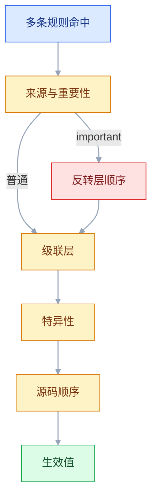
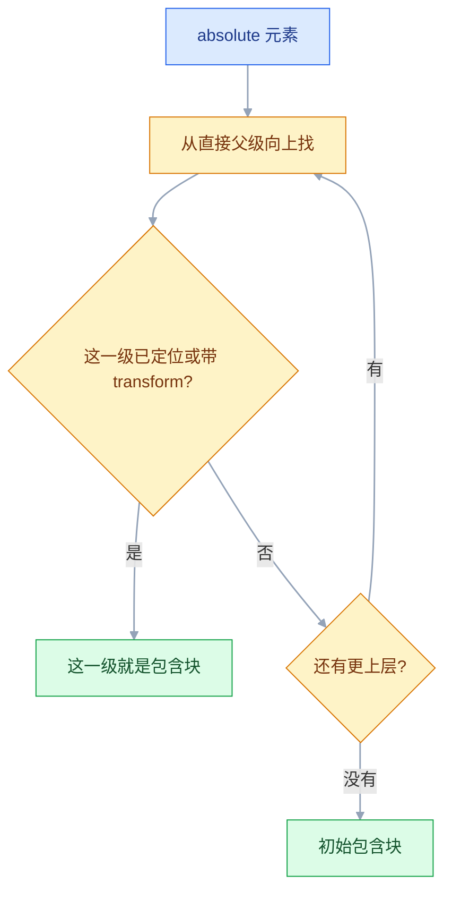

# CSS

## 一、工程案例：把后台仪表盘做成三档响应式、跟随系统深浅色的页面

**场景**：一个 8 人 SaaS 团队的后台首页：顶部栏、左侧菜单、4 张指标卡、一张最近订单表。不用 UI 库、不用框架，交付 `admin.html` + `admin.css`，要求 360px 手机、768px 平板、1440px 桌面三档都成立；跟随系统深浅色；键盘能走完全程；用户开启「减少动态效果」时不做位移动画。

**为什么必须做**：后台页面最容易死在「数据一多就撑破」「手机上表格把整页顶宽」「深色模式下一块白底刺眼」这三件事上。它们都不是某个属性写错，而是布局模型、层叠规则、主题变量没有一起设计。这一节把这三件事一次做完，后面加页面只需复用变量与骨架。

**动手前确认**：Chrome 或 Safari 当前稳定版、DevTools 的设备模式与 Rendering 面板（模拟 `prefers-color-scheme` 与 `prefers-reduced-motion`）。先把内容写进 HTML，再按「骨架 → 区块 → 响应式 → 主题」的顺序加 CSS。

### 1.1 HTML 骨架

```html
<!DOCTYPE html>
<html lang="zh-CN">
<head>
  <meta charset="utf-8">
  <meta name="viewport" content="width=device-width, initial-scale=1">
  <title>AdminPro · 仪表盘</title>
  <link rel="stylesheet" href="admin.css">
</head>
<body>
  <a class="skip-link" href="#main">跳到主内容</a>
  <div class="layout">
    <header class="topbar">
      <div class="topbar__brand">AdminPro</div>
      <h1 class="topbar__title">仪表盘</h1>
      <div class="topbar__user">
        <span class="topbar__avatar">张</span>
        <span class="topbar__name">张伟</span>
      </div>
    </header>
    <aside class="sidebar">
      <nav aria-label="侧边导航">
        <ul class="sidebar__menu">
          <li><a class="sidebar__link is-active" href="#" aria-current="page">仪表盘</a></li>
          <li><a class="sidebar__link" href="#">订单管理</a></li>
          <li><a class="sidebar__link" href="#">用户管理</a></li>
          <li><a class="sidebar__link" href="#">系统设置</a></li>
        </ul>
      </nav>
    </aside>
    <main class="content" id="main">
      <section class="stats" aria-label="关键指标">
        <article class="stat-card"><p class="stat-card__label">今日订单</p><p class="stat-card__value">1,280</p><p class="stat-card__trend stat-card__trend--up">↑ 12.5%</p></article>
        <article class="stat-card"><p class="stat-card__label">销售额</p><p class="stat-card__value">¥86,400</p><p class="stat-card__trend stat-card__trend--up">↑ 8.2%</p></article>
        <article class="stat-card"><p class="stat-card__label">新增用户</p><p class="stat-card__value">312</p><p class="stat-card__trend stat-card__trend--down">↓ 3.1%</p></article>
        <article class="stat-card"><p class="stat-card__label">转化率</p><p class="stat-card__value">4.8%</p><p class="stat-card__trend stat-card__trend--up">↑ 0.6%</p></article>
      </section>
      <section class="table-panel">
        <h2 class="table-panel__title">最近订单</h2>
        <div class="table-wrap">
          <table class="data-table">
            <thead><tr><th>订单号</th><th>客户</th><th>金额</th><th>状态</th><th>时间</th></tr></thead>
            <tbody>
              <tr><td>#20260001</td><td>李娜</td><td>¥1,299</td><td><span class="tag tag--success">已完成</span></td><td>10-11 09:32</td></tr>
              <tr><td>#20260002</td><td>王强</td><td>¥399</td><td><span class="tag tag--pending">待发货</span></td><td>10-11 10:05</td></tr>
              <tr><td>#20260003</td><td>赵敏</td><td>¥2,680</td><td><span class="tag tag--warning">售后中</span></td><td>10-11 10:48</td></tr>
              <tr><td>#20260004</td><td>陈晨</td><td>¥899</td><td><span class="tag tag--success">已完成</span></td><td>10-11 11:12</td></tr>
              <tr><td>#20260005</td><td>周涛</td><td>¥5,299</td><td><span class="tag tag--pending">待发货</span></td><td>10-11 11:40</td></tr>
              <tr><td>#20260006</td><td>吴敏</td><td>¥268</td><td><span class="tag tag--warning">售后中</span></td><td>10-11 12:03</td></tr>
              <tr><td>#20260007</td><td>郑凯</td><td>¥1,680</td><td><span class="tag tag--success">已完成</span></td><td>10-11 12:26</td></tr>
              <tr><td>#20260008</td><td>孙丽</td><td>¥76</td><td><span class="tag tag--pending">待发货</span></td><td>10-11 13:05</td></tr>
            </tbody>
          </table>
        </div>
      </section>
    </main>
  </div>
</body>
</html>
```

以上 HTML 与后面的 CSS 片段合起来就是完整交付：把 1.2–1.9 的代码按编号顺序粘进同一个 `admin.css`，与 `admin.html` 放在同一目录，双击打开或用 `npx --yes serve .` 起一个静态服务即可验收。片段之间有覆盖关系（例如 `.content` 的 `padding` 由断点接管），顺序不能调换。

### 1.2 设计令牌与深色主题

所有颜色、圆角、间距先收进自定义属性。组件只引用变量，不写死颜色，主题切换才有落点。

```css
:root {
    color-scheme: light dark;
    --c-bg: #f3f4f6;      --c-surface: #ffffff;
    --c-text: #1f2937;    --c-muted: #6b7280;
    --c-border: #e5e7eb;  --c-primary: #1a73e8;
    --c-primary-weak: rgba(26, 115, 232, 0.12);
    --c-success: #047857; --c-danger: #b91c1c; --c-warning: #92400e;
    --radius: 10px;
    --shadow: 0 1px 3px rgba(0, 0, 0, 0.08);
    --topbar-h: 56px; --sidebar-w: 220px; --gap: 16px;
}
@media (prefers-color-scheme: dark) {
    :root {
        color-scheme: dark;
        --c-bg: #0f172a;     --c-surface: #1e293b;
        --c-text: #e2e8f0;   --c-muted: #94a3b8;
        --c-border: #334155; --c-primary: #7cb0ff;
        --c-primary-weak: rgba(124, 176, 255, 0.16);
        --c-success: #6ee7b7; --c-danger: #fca5a5; --c-warning: #fcd34d;
        --shadow: 0 1px 3px rgba(0, 0, 0, 0.4);
    }
}
```

`color-scheme` 让滚动条、输入框、日期选择器跟随深浅色；只改自定义属性而不写它，原生控件仍会是白底。

### 1.3 重置与基础排版

```css
*, *::before, *::after { box-sizing: border-box; }
html { -webkit-text-size-adjust: 100%; }
body {
    margin: 0; min-height: 100svh;
    background: var(--c-bg); color: var(--c-text);
    font: 0.875rem/1.6 system-ui, -apple-system, "PingFang SC", "Microsoft YaHei", sans-serif;
}
h1, h2, h3, p, ul { margin: 0; }
ul { padding: 0; list-style: none; }
a { color: inherit; text-decoration: none; }
img, svg { display: block; max-width: 100%; }
button, input, select, textarea { font: inherit; color: inherit; }
:focus-visible { outline: 2px solid var(--c-primary); outline-offset: 2px; }
```

`body` 的 `font` 简写同时设定字号与行高；`button` 不会自动继承字体，必须单独声明，否则按钮文字会变成浏览器默认的 13px 系统字体。

### 1.4 Grid 骨架与三档断点

```css
.layout {
    display: grid;
    grid-template-columns: minmax(0, 1fr);
    grid-template-rows: var(--topbar-h) auto 1fr;
    grid-template-areas: "topbar" "sidebar" "content";
    min-height: 100svh;
}
.topbar  { grid-area: topbar; }
.sidebar {
    grid-area: sidebar;
    background: var(--c-surface); border-bottom: 1px solid var(--c-border);
    overflow-x: auto;
}
.sidebar__menu { display: flex; gap: 4px; padding: 8px 12px; }
.content {
    grid-area: content;
    display: grid; gap: var(--gap); align-content: start;
    padding: 16px;
}

@media (min-width: 768px) {
    .layout {
        grid-template-columns: 180px minmax(0, 1fr);
        grid-template-rows: var(--topbar-h) 1fr;
        grid-template-areas: "topbar topbar" "sidebar content";
    }
    .sidebar { border-right: 1px solid var(--c-border); border-bottom: 0; overflow: visible; }
    .sidebar__menu { flex-direction: column; padding: 12px; }
    .content { padding: 20px; }
}
@media (min-width: 1200px) {
    .layout { grid-template-columns: var(--sidebar-w) minmax(0, 1fr); }
    .content { padding: 28px 32px; gap: 24px; }
}
```

手机端不是把侧栏藏起来，而是把它变成顶栏下方的一排横向滚动菜单——纯 CSS 就可用，不需要一个点了没反应的 ☰ 按钮。`minmax(0, 1fr)` 防止内容的最小宽度把网格列撑破。

### 1.5 顶栏

```css
.topbar {
    display: flex; align-items: center; gap: 12px;
    height: var(--topbar-h); padding: 0 16px;
    background: var(--c-surface); border-bottom: 1px solid var(--c-border);
}
.topbar__brand { font-weight: 700; color: var(--c-primary); letter-spacing: 0.3px; }
.topbar__title { font-size: 0.9375rem; font-weight: 500; color: var(--c-muted); }
.topbar__user  { display: flex; align-items: center; gap: 8px; margin-left: auto; }
.topbar__avatar {
    display: inline-flex; align-items: center; justify-content: center;
    width: 30px; height: 30px; border-radius: 50%;
    background: var(--c-primary); color: var(--c-surface); font-size: 0.8125rem;
}
@media (max-width: 479px) { .topbar__name { display: none; } }
```

`margin-left: auto` 把用户区推到最右，比 `justify-content: space-between` 更灵活：前者只吃左侧剩余空间，后者会把所有项目分成两组推向两端。

顶栏这里不写 `position: sticky`：它只占 56px 的网格行，粘性元素在自己的包含块里没有可移动距离，写了也不会吸顶。确实要固定顶栏，就把它移出 `.layout`，或改用 `position: fixed` 并给内容补上 `padding-top`。

### 1.6 指标卡

```css
.stats {
    display: grid;
    grid-template-columns: repeat(auto-fill, minmax(150px, 1fr));
    gap: 12px;
}
.stat-card {
    padding: 16px; background: var(--c-surface);
    border: 1px solid var(--c-border); border-radius: var(--radius); box-shadow: var(--shadow);
}
.stat-card__label { color: var(--c-muted); font-size: 0.8125rem; }
.stat-card__value { margin: 4px 0; font-size: 1.5rem; font-weight: 700; line-height: 1.3; font-variant-numeric: tabular-nums; }
.stat-card__trend { font-size: 0.75rem; }
.stat-card__trend--up   { color: var(--c-success); }
.stat-card__trend--down { color: var(--c-danger); }

@media (min-width: 1200px) {
    .stats { grid-template-columns: repeat(4, minmax(0, 1fr)); }
}
```

`auto-fill` + `minmax(150px, 1fr)` 让 360px 宽排 2 列、平板排 3 列；桌面在 1200px 断点显式固定四列，因为同样的宽度 `auto-fill` 会排出 5 列。这条覆盖必须写在本节 `.stats` 基础样式之后，否则基础样式反而把它盖掉。`align-content: start` 防止内容不满一屏时被 Grid 拉伸摊开。

### 1.7 表格与状态标签

```css
.table-panel {
    background: var(--c-surface); border: 1px solid var(--c-border);
    border-radius: var(--radius); box-shadow: var(--shadow); overflow: hidden;
}
.table-panel__title { padding: 14px 16px; font-size: 0.9375rem; font-weight: 600; border-bottom: 1px solid var(--c-border); }
.table-wrap { max-height: min(60vh, 360px); overflow: auto; }
.data-table { width: 100%; min-width: 520px; border-collapse: separate; border-spacing: 0; }
.data-table th, .data-table td {
    padding: 12px 16px; text-align: left; white-space: nowrap;
    border-bottom: 1px solid var(--c-border);
}
.data-table thead th {
    position: sticky; top: 0; z-index: 1;
    background: var(--c-bg); color: var(--c-muted);
    font-weight: 500; font-size: 0.8125rem;
}
.data-table tbody tr:hover { background: var(--c-bg); }
.data-table tbody tr:last-child td { border-bottom: 0; }
.tag { display: inline-block; padding: 2px 10px; border-radius: 999px; font-size: 0.75rem; }
.tag--success { background: rgba(16, 185, 129, 0.16); color: var(--c-success); }
.tag--pending { background: var(--c-primary-weak); color: var(--c-primary); }
.tag--warning { background: rgba(217, 119, 6, 0.16); color: var(--c-warning); }
```

`table-wrap` 同时承担两件事：窄屏横向滚动，以及给表头的 `position: sticky` 提供滚动容器。表头必须有**不透明**背景，否则数据行会从下面透出来；表头用 `border-collapse: separate` 配 `border-spacing: 0`，避免 `collapse` 下合并边框由表格绘制、滚动时与单元格错位。`min-width` 取 520px：768px 档的内容区约 548px，正好放得下，360px 档则必然横向滚动。示例给了 8 行数据，容器高度封顶到 360px，所以纵向一定出现滚动，第 6 项验收才有得看。

### 1.8 侧栏菜单

```css
.sidebar__link {
    display: block; padding: 7px 12px; border-radius: 999px;
    color: var(--c-muted); white-space: nowrap;
    transition: background 0.15s ease, color 0.15s ease;
}
.sidebar__link:hover { background: var(--c-bg); color: var(--c-text); }
.sidebar__link.is-active { background: var(--c-primary-weak); color: var(--c-primary); font-weight: 500; }
```

`.sidebar` 与 `.sidebar__menu` 的底色、边框、横排样式放在 1.4 的断点之前，桌面端那两条覆盖才压得住：同特异性下后写的赢，顺序一颠倒，桌面侧栏就会多出一条下边框和横向滚动。

选中态用 `.is-active` 与 `aria-current="page"` 双标记：前者给眼睛，后者给读屏。只改颜色不够，色弱用户可能分不出选中项。

### 1.9 焦点、跳过链接与动效偏好

```css
.skip-link {
    position: fixed; left: 16px; top: -48px; z-index: 100;
    padding: 8px 12px; background: var(--c-surface);
    border: 1px solid var(--c-border); border-radius: 8px;
}
.skip-link:focus { top: 8px; }

@media (prefers-reduced-motion: no-preference) {
    .stat-card { transition: transform 0.18s ease, box-shadow 0.18s ease; }
    .stat-card:hover { transform: translateY(-2px); box-shadow: 0 8px 24px rgba(0, 0, 0, 0.12); }
}
```

把动效写进 `no-preference` 而不是在 `reduce` 里逐个关掉：默认无动画，用户允许时才加。这比 `animation: none !important` 干净，也不会漏掉后来新增的动画。

### 1.10 验收（10 项全过才算交付）

| # | 检查项 | 命令或检查 | 通过标准 |
|---|---|---|---|
| 1 | CSS 语法 | `npx --yes csstree-validator admin.css` | 退出码 0，无报错输出 |
| 2 | 无横向溢出 | 各档宽度下控制台跑 `document.documentElement.scrollWidth <= window.innerWidth` | 360 / 768 / 1440 都返回 `true` |
| 3 | 三档骨架 | DevTools 设备模式看 `grid-template-columns` | 单列 / 180px + 1fr / 220px + 1fr |
| 4 | 卡片列数 | 数每行卡片 | 360px 两列，768px 三列，1200px 起固定四列 |
| 5 | 表格滚动 | 360px 下横向拖表格 | 表格内部滚动，页面本身不被撑宽 |
| 6 | 表头吸顶 | 在表格内向下滚 | 表头贴住容器顶部，数据行从下方滚过 |
| 7 | 深色主题 | Rendering → Emulate `prefers-color-scheme: dark` | 背景、卡片、文字、标签全部切换，无白块残留 |
| 8 | 对比度 | DevTools 取色器看正文与次要文字 | 正文 ≥ 4.5:1，大字 ≥ 3:1 |
| 9 | 键盘焦点 | 从地址栏按 Tab | 跳过链接先出现，之后每个可聚焦元素都有 2px 可见轮廓 |
| 10 | 减少动效 | Rendering → Emulate `prefers-reduced-motion: reduce` | 悬浮卡片不再位移，阴影也不再变化 |

**关键输出**：

```text
$ npx --yes csstree-validator admin.css
（无报错，退出码 0）
> document.documentElement.scrollWidth <= window.innerWidth
true
```

> 第 2 项是响应式验收的底线。只要横向溢出，手机上就会出现「页面能左右晃」的廉价感；先修溢出，再谈列数与留白。

## 二、高频问答：会卡住你的地方，也是面试最常问的

### 2.1 改完 CSS，页面完全没变化

**现场**

Network 里找 css 请求的状态码；Styles 面板顶部是否列出该文件；控制台看 `[...document.styleSheets].map(s => s.href)`。

**要点**

- 样式没生效先确认文件有没有被请求、是不是 200、内容是不是新的。
- 常见来源：`link` 的 `href` 相对文档 URL 解析错、`rel` 拼错、文件没上传、构建把 CSS 抽走。
- 样式文件根本没加载时，改多少属性都不会有反应。

**追问**

- `href="css/style.css"` 为什么 404？→ 相对的是当前文档 URL，子路径页面要多退一级。
- 构建后样式丢了？→ 检查产物里有没有抽出 CSS、HTML 有没有引用新文件名。
- 怎么快速确认加载了哪几个样式表？→ 打印 `document.styleSheets` 的 `href`。

### 2.2 样式写了，但在 Styles 面板里被划掉

**现场**

看删除线定位覆盖者；Computed 面板看最终值来源；`getComputedStyle(el).color`。

**要点**

- 有删除线说明规则合法但输了，是「被覆盖」，不是「不支持」。
- 覆盖者可能是更高特异性、更晚出现的规则、行内样式，或 `!important`。
- 属性名拼错是另一种表现：整条声明不出现或带警告图标，修法是改拼写。

**追问**

- 特异性一样时谁赢？→ 后写的赢。
- `!important` 一定赢吗？→ 同来源下赢，但会被更高层或用户样式反转。
- 行内样式怎么覆盖？→ 只能靠 `!important`，或者别用行内样式。

### 2.3 `width: 200px`，实际占了 242px

**现场**

Computed 的盒模型图；`getComputedStyle(el).width` 返回的是内容宽度。

```css
*, *::before, *::after { box-sizing: border-box; }
/* 之后 width: 200px 就包含 padding 与 border，布局不用心算 */
```

**要点**

- `width` 默认只是内容宽，不是盒子总宽。
- 默认 `box-sizing: content-box`，padding 与 border 另加，`200 + 20×2 + 1×2 = 242`。
- 全局改 `border-box` 最省心，但它也不含 `margin`。

**追问**

- `border-box` 下 `width: 200px` 含什么？→ 含 padding 与 border，不含 margin。
- `getComputedStyle().width` 返回哪个宽？→ 内容宽，不是盒模型总宽。
- 为什么表单控件宽度总对不齐？→ 默认 `box-sizing` 不一致，重置成 `border-box`。

### 2.4 两个元素间距比写的大，或者父元素被顶下来

**现场**

DevTools 高亮 margin；临时给父元素 `overflow: hidden` 或 `padding-top: 1px` 看是否恢复。

**要点**

- 间距比写的大或父元素被顶下来，先怀疑垂直方向的 margin 塌陷。
- 相邻兄弟取较大值；父元素没有 padding / border 时，子元素 `margin-top` 会穿出去。
- 塌陷只发生在普通流的垂直方向，Flex / Grid 项目之间不会。
- 用 `gap` 排间距，或给父元素 `display: flow-root` 建立 BFC。

**追问**

- 为什么加了 `padding-top: 1px` 就好了？→ 父子之间有了隔离，margin 不再穿出。
- `overflow: hidden` 和 `flow-root` 选哪个？→ 后者没有裁剪副作用，首选。
- 水平方向会塌陷吗？→ 不会，只发生在垂直方向。

### 2.5 Flex 子项怎么都不缩，撑破容器

**现场**

给子项加 `min-width: 0` 试；DevTools 看项目的 min-content 宽度。

```css
.flex-item { min-width: 0; overflow-wrap: anywhere; }
/* Grid 项目同理：minmax(0, 1fr) 或 min-width: 0 */
```

**要点**

- Flex 项目缩不下去，不是 `flex-shrink` 失效，是 `min-width` 默认 `auto`。
- 它不能小于内容的 min-content，长单词、`pre`、图片都会顶住。
- 显式写 `min-width: 0` 才能放开收缩；Grid 项目同理用 `minmax(0, 1fr)`。

**追问**

- 为什么 `overflow: hidden` 也能修？→ 它改变了自动最小尺寸的计算。
- `flex-shrink: 0` 有用吗？→ 那是禁止收缩，方向正好相反。
- 为什么表格也会撑破？→ 表格有固有的最小内容宽度，得让外层容器滚动。

### 2.6 `position: absolute` 定位跑到了页面角落

**现场**

在 Elements 里逐级看祖先的 `position` 与 `transform`；临时给预期父元素加 `position: relative`。

**要点**

- 绝对定位找的是最近的已定位祖先，不是 DOM 父元素；没有就退到初始包含块。
- `transform`、`filter`、`contain: paint` 也会改变包含块。
- 角标、下拉菜单、弹层都要先确认这一层。

**追问**

- 为什么加了 `transform` 弹窗就跟着容器跑？→ 它成了新的包含块。
- `fixed` 也受影响吗？→ 会，同样被 `transform` 一类属性截走参照物。
- 怎么让弹层永远相对视口？→ 挂到 `body` 下或用 Portal。

### 2.7 `z-index: 9999` 还是被盖住

**现场**

DevTools 的 Layers 面板；找两个元素的共同祖先，看谁建立了层叠上下文。

**要点**

- `z-index` 不是全局排序，只在同一个层叠上下文里比较。
- 父元素创建了层叠上下文（`opacity < 1`、`transform`、`filter`、`isolation`、定位 + `z-index`），子元素再大也翻不出去。
- 先调 DOM 层级或统一管理层级变量，而不是继续加零。

**追问**

- 为什么 `opacity: 0.99` 就会出问题？→ 它创建了新的层叠上下文。
- `isolation: isolate` 干什么用？→ 显式隔离出一层，不带来其他副作用。
- 两个不同父级的元素怎么比？→ 比它们所属上下文根节点的层级。

### 2.8 手机上 `100vh` 溢出，底部被地址栏挡住

**现场**

真机或设备模式看 `visualViewport.height` 与 `innerHeight` 的差；全屏区块底部是否被遮。

```css
.hero { min-height: 100vh; }    /* 旧浏览器兜底 */
.hero { min-height: 100svh; }   /* 小视口：地址栏展开时也放得下 */
/* 100dvh 会随地址栏收放实时变化，可能引起跳动 */
```

**要点**

- `vh` 对应「大视口」，按地址栏收起时的尺寸算，地址栏展开时可见区域更小。
- 移动端全屏用 `100svh`；`100dvh` 会随地址栏收放实时变化，可能引起跳动。
- 全屏布局还要考虑 `env(safe-area-inset-bottom)`。

**追问**

- `svh` / `dvh` / `lvh` 分别是什么？→ 小、动态、大视口高度。
- 为什么 `height: 100%` 也不行？→ 父级高度不确定时它退化成内容高度。
- iOS 底部安全区怎么处理？→ `padding-bottom: env(safe-area-inset-bottom)`。

### 2.9 `position: sticky` 完全不吸顶

**现场**

逐级检查祖先的 computed `overflow`；临时移除 `overflow` 测试；确认元素能在容器内移动。

```css
.table-wrap { max-height: min(60vh, 360px); overflow: auto; }  /* sticky 的滚动容器 */
.data-table thead th { position: sticky; top: 0; background: var(--c-bg); }
```

**要点**

- `sticky` 不生效，先查祖先有没有 `overflow: hidden / auto / scroll`。
- 有的话它形成了新的滚动容器，粘性只在那里面生效。
- 父元素高度刚好等于元素高度时，也没有可移动距离。
- `overflow: clip` 不创建滚动容器，可以替代 `hidden` 保留吸顶。

**追问**

- 为什么 `overflow: hidden` 会破坏吸顶？→ 它成了滚动容器，sticky 的参照变了。
- `sticky` 和 `fixed` 差在哪？→ 前者占位并受容器限制，后者脱离文档流。
- 表格表头吸顶为什么要不透明背景？→ 否则数据行会从下面透出来。

### 2.10 媒体查询写了却不生效

**现场**

DevTools 看媒体块是否灰掉；控制台 `matchMedia("(min-width: 768px)").matches`。

**要点**

- 媒体查询不生效，先确认它有没有命中，而不是换数值。
- 缺 viewport 时手机上按 980px 判断；`max-width` 写在 `min-width` 后面会互相覆盖。
- 移动优先按 `min-width` 从小到大写，`max-width` 从大到小写，混着写时顺序就是优先级。

**追问**

- 为什么手机不命中 `max-width: 768px`？→ 虚拟视口约 980px。
- `and` 语法写错会怎样？→ 整条查询无效，样式静默不生效。
- 断点该按设备定吗？→ 按内容需要定，设备尺寸只是参考。

### 2.11 用户把字号调大，布局就溢出

**现场**

浏览器设置里把默认字号调到「非常大」；或页面缩放到 200%，看是否裁切、重叠。

**要点**

- 字号是用户的辅助设置，不是设计稿上的固定值。
- `px` 写死字号、`html { font-size: 62.5% }` 让 `1rem` 只有 10px、容器固定 `height`，都会在放大后溢出。
- 容器用 `min-height`，`rem` 跟随用户设置，200% 缩放下内容仍可读（WCAG 1.4.4）。

**追问**

- `62.5%` 不是也跟随用户设置吗？→ 跟随，但把 `1rem` 变成 10px，后续按 10px 写 `px` 等于绕开偏好。
- 什么时候必须用 `px`？→ 边框、图标这类不该随字号缩放的尺寸。
- 怎么验证 200% 缩放？→ 浏览器缩放，或按 WCAG 的文本放大要求测。

---

## 三、核心知识：从零开始要建立的东西

### 3.1 层叠与来源顺序

同一条属性被多条规则命中时，浏览器按固定顺序裁决。先比来源与重要性，再比级联层，再比特异性，最后比源码先后。



| 来源 | 例子 | 相对优先级 |
|---|---|---|
| 浏览器默认 | `h1` 的默认 margin | 最低 |
| 作者普通声明 | `h1 { margin: 0 }` | 高于默认 |
| 动画 | `@keyframes` 中的值 | 高于普通声明 |
| 作者 `!important` | `h1 { margin: 0 !important }` | 高于动画 |
| 过渡 | `transition` 进行中的值 | 最高 |

`@layer` 改变的是「作者普通声明」内部的顺序：后声明的层赢；`!important` 反过来，先声明的层赢。过渡进行中的值优先级最高：同一属性既有 `transition` 又有 `animation` 时，过渡期间看到的是过渡值。

### 3.2 特异性

特异性是三段计数 `(ID, 类/属性/伪类, 元素/伪元素)`，逐位比较，不进位。行内样式单列一档，`!important` 再单列。

| 选择器 | 特异性 | 说明 |
|---|---|---|
| `p` | `(0,0,1)` | 元素 |
| `.card` / `[type="text"]` / `:hover` | `(0,1,0)` | 类、属性、伪类同级 |
| `#main` | `(1,0,0)` | ID |
| `:where(.card)` | `(0,0,0)` | 整段归零，适合做低优先级默认值 |
| `:is(#main, .card)` | 取参数最高 | `:not()` 同理 |

三段是逐段相加的：`a:hover` 是 `(0,1,1)`，`#main .title` 是 `(1,1,0)`，不要只数类名。

```css
.card .title { color: #333; }      /* (0,2,0) */
#main .title { color: #999; }      /* (1,1,0)，赢 */
/* 不想打架：统一用单层类，靠 .btn--primary 这种修饰类扩展 */
```

特异性只在「同来源、同层」内比较。用 ID 写样式会让后续覆盖非常难受，项目里以类选择器为主。

> **面试**：常问「两个选择器都能选中同一个元素，谁生效？」答：先比来源与重要性，再比级联层、特异性，最后比源码顺序。

### 3.3 继承与值处理

继承是「父元素的计算值传给子元素」，只对部分属性生效。理解它就不必给每个子元素重复写字体和颜色。

| 会继承 | 不继承 |
|---|---|
| `color`、`font-*`、`line-height`、`letter-spacing` | `margin`、`padding`、`border`、`background` |
| `visibility`、`cursor`、`list-style` | `width`、`height`、`display`、`position` |

```css
.child { color: inherit; }        /* 显式继承 */
.reset { all: unset; }            /* 清空所有属性，谨慎使用 */
.btn { border-color: currentColor; }  /* currentColor = 当前 color 值 */
```

`initial` 回到属性初始值（不是继承值），`unset` 对可继承属性等同 `inherit`、其余等同 `initial`，`revert` 回退到浏览器默认。`all` 不包含 `direction` 与 `unicode-bidi`。

### 3.4 盒模型

每个元素是一个矩形盒子，从内到外是 content → padding → border → margin。`width` / `height` 默认只指 content。

| 层 | 是否计入 `width`（content-box） | 是否计入 `border-box` |
|---|---|---|
| content | 是 | 是 |
| padding | 否 | 是 |
| border | 否 | 是 |
| margin | 否 | 否 |

```css
*, *::before, *::after { box-sizing: border-box; }
.card { width: 200px; padding: 20px; border: 1px solid; }  /* 总宽仍是 200px */
```

`padding` 与 `margin` 的百分比**都按包含块的宽度**计算，上下方向也一样。`border-box` 不包含 `margin`；`min-width` / `max-width` 在 `border-box` 下同样把 padding 与 border 算进去。

### 3.5 格式化上下文与 margin 塌陷

普通流里的块级盒子在垂直方向会发生 margin 塌陷：相邻兄弟取较大值；父子之间在没有 border / padding / 行内内容时，子元素的 `margin-top` 会穿出去。

| 阻断塌陷的写法 | 副作用 |
|---|---|
| `display: flow-root` | 无副作用，首选 |
| `overflow: hidden` / `auto` | 会裁剪溢出内容，可能影响 sticky |
| `float: left` / `right` | 元素浮动，需要额外清除 |
| `position: absolute` / `fixed` | 脱离普通流 |
| Flex / Grid 容器 | 容器与子元素之间、项目彼此之间都不塌陷 |

```css
.parent { display: flow-root; }   /* 包住子元素，阻止 margin 穿出 */
.stack  { display: flex; flex-direction: column; gap: 16px; }  /* 用 gap 代替 margin */
```

Flex 与 Grid 容器会建立新的格式化上下文，与子元素之间、项目彼此之间都不发生 margin 塌陷，所以现代布局优先用 `gap`。只有普通流的块级兄弟才需要操心这件事。

> **面试**：常问「margin 塌陷怎么解决？」答：给父元素 `display: flow-root` 建 BFC，或改用 Flex / Grid 的 `gap` 排间距；水平方向不会塌陷。

### 3.6 显示类型与普通流

`display` 同时决定「对外如何参与布局」和「对内如何排列子元素」。`block` / `inline` 是外层类型，`flex` / `grid` 是内层类型。

| 取值 | 对外 | 对内 | 典型用途 |
|---|---|---|---|
| `block` | 独占一行 | 普通流 | `div`、`p`、`section` |
| `inline` | 随文字排列 | 普通流 | `span`、`a` |
| `inline-block` | 随文字排列 | 块级盒子 | 按钮、标签，可设宽高 |
| `flow-root` | 独占一行 | 建立 BFC | 包住浮动或 margin |
| `contents` | 盒子消失 | 子元素照常 | 语义容器不想要盒子时 |
| `none` | 不生成盒子 | 不渲染 | 彻底隐藏 |

`img`、`video`、`input` 是替换元素：`inline` 但可以设宽高，尺寸由资源或控件决定。`display: contents` 会让元素本身不生成盒子，某些辅助技术的语义支持并不完美，用在关键结构前要实测。

### 3.7 定位与包含块

`position` 改变元素的参照物与是否占位。绝对定位的参照物是「最近的已定位祖先」，没有就退到初始包含块。

| 取值 | 参照物 | 是否占位 | 典型用途 |
|---|---|---|---|
| `static` | 无 | 是 | 默认 |
| `relative` | 自己原来的位置 | 是 | 微调、给子元素做参照 |
| `absolute` | 最近的已定位祖先 | 否 | 角标、下拉、弹层 |
| `fixed` | 视口（除非祖先有 transform 等） | 否 | 固定导航、浮层 |
| `sticky` | 最近滚动容器 + `top` 等阈值 | 是 | 吸顶表头、吸底操作栏 |

`inset` 是 `top/right/bottom/left` 的简写；同时写 `top` 与 `bottom` 会把元素拉伸。`transform`、`filter`、`perspective`、`contain: paint` 会让 `fixed` 改为相对该祖先定位——这是「弹窗跟着容器跑」的常见原因。

给 `absolute` 找参照物时，按下面的顺序从直接父级往上判断：



`fixed` 不看 `position` 祖先，只被 `transform` 一类属性截走参照物。

### 3.8 层叠上下文与 z-index

层叠上下文是一棵独立的排序子树。子元素的 `z-index` 只在所属上下文内比较，无法越过父级整体。

| 创建方式 | 例子 |
|---|---|
| 根元素 | `html` |
| `position: fixed` / `sticky` | 不需要 `z-index` 也会创建 |
| 定位 + `z-index` 非 auto | `position: relative; z-index: 1` |
| `opacity < 1` | `opacity: 0.99` |
| `transform` / `filter` / `perspective` | `transform: translateZ(0)` |
| `will-change` / `backdrop-filter` | `will-change: transform` |
| `isolation: isolate` | 显式隔离，无其他副作用 |
| `contain: layout` / `paint` | 性能优化时顺带创建 |

绘制顺序大致是：背景与边框 → 负 `z-index` 子级 → 普通流块 → 浮动 → 行内内容 → `z-index: 0` 与定位元素 → 正 `z-index`。弹窗被盖住时，先找共同祖先，再用 `isolation: isolate` 划出独立上下文，比不断加数字有效。

> **面试**：常问「`z-index: 9999` 为什么还被盖住？」答：`z-index` 只在同一个层叠上下文里比较，父级整体在下面，子级再大也翻不出去。

### 3.9 Flex 布局

Flex 是一维布局：先定主轴方向，再把剩余空间分配给项目。`justify-content` 管主轴，`align-items` 管交叉轴；`flex-direction: column` 后两者管的方向互换。

| 属性 | 作用 | 常用值 |
|---|---|---|
| `flex-direction` | 主轴方向 | `row`、`column` |
| `justify-content` | 主轴对齐与分配 | `center`、`space-between` |
| `align-items` | 交叉轴对齐 | `center`、`stretch` |
| `flex-wrap` | 是否换行 | `nowrap`、`wrap` |
| `gap` | 项目间距 | `12px`，替代 margin |

```css
.bar   { display: flex; align-items: center; gap: 12px; }
.grow  { flex: 1; }              /* 1 1 0%：吃掉剩余空间 */
.fixed { flex: 0 0 240px; }      /* 不长大、不缩小 */
```

`flex: 1` 的 `flex-basis` 是 `0%`，所以各项目从零开始平分；`flex: auto` 是 `1 1 auto`，会先按内容宽度分配。项目默认 `min-width: auto`，长内容会阻止收缩（见 2.5）。

### 3.10 Grid 布局

Grid 是二维布局：先划轨道，再把项目放进单元格。`fr` 表示剩余空间的份数，`minmax()` 限定轨道范围。

| 写法 | 含义 |
|---|---|
| `repeat(3, 1fr)` | 三等分 |
| `200px 1fr` | 左固定、右自适应 |
| `repeat(auto-fill, minmax(240px, 1fr))` | 一行能放几列放几列 |
| `repeat(auto-fit, ...)` | 同上，但会折叠空轨道 |
| `minmax(0, 1fr)` | 允许缩到 0，防止内容撑破 |

```css
.cards { display: grid; grid-template-columns: repeat(auto-fill, minmax(240px, 1fr)); gap: 20px; }
.page  { display: grid; grid-template-areas: "head head" "side main" "foot foot"; }
```

`1fr` 的最小值默认是 `auto`，长单词或表格仍会撑破；需要真正可缩时写 `minmax(0, 1fr)`。`auto-fill` 保留空轨道，`auto-fit` 把空轨道压成 0，卡片少时后者会拉宽现有卡片。

### 3.11 单位体系

| 单位 | 相对什么 | 典型用途 |
|---|---|---|
| `px` | 绝对像素 | 边框、图标、固定尺寸 |
| `rem` | 根元素字号 | 字号、间距，尊重用户设置 |
| `em` | 当前元素字号 | 组件内随字号缩放，注意累乘 |
| `%` | 包含块的尺寸 | 流式宽度；高度百分比需父级高度确定 |
| `vw` / `vh` | 视口宽 / 高 | 全屏区块，移动端慎用 |
| `svh` / `dvh` | 小 / 动态视口高 | 移动端全屏，替代 `vh` |
| `ch` | 字符 `0` 的宽度 | 控制正文行宽，如 `65ch` |

`rem` 应相对浏览器默认字号，不要把 `html` 的字号固定成 `px`；`62.5%` 虽然仍随用户设置缩放，但把 `1rem` 变成 10px，后续容易按 10px 写 `px`，等于绕开用户偏好。`em` 适合「整体随字号缩放」的组件，但嵌套多层会累乘。`%` 的宽高算法不同：宽度按包含块的宽度，高度要求包含块高度确定，否则按内容撑开。

> **面试**：常问「`rem` 和 `em` 有什么区别？」答：`rem` 相对根元素字号，`em` 相对当前元素字号且嵌套会累乘。

### 3.12 字体与行高

字体栈从左到右找第一个可用字体，最后必须落到通用族。中文要显式给苹方、微软雅黑等兜底，否则可能落到衬线字体。

```css
body {
    font-family: system-ui, -apple-system, "PingFang SC", "Microsoft YaHei", sans-serif;
    font-size: 1rem; line-height: 1.6;
}
.title { font-size: 1.5rem; line-height: 1.25; }
```

`line-height` 用无单位数字，继承的是倍数，子元素会按自己的字号重算；写 `26px` 或 `1.6em` 继承的是算好的固定值，子元素字号一变就歪。正文行宽控制在 `45–75ch`，长文本更易读。

### 3.13 颜色与背景

| 写法 | 例子 | 特点 |
|---|---|---|
| 十六进制 | `#1a73e8`、`#1a73e880` | 最常见，8 位时后两位是 alpha |
| `rgb()` / `hsl()` | `rgb(26 115 232 / 0.8)` | 带 alpha 通道，调明暗直观 |
| 命名色 / `transparent` | `red`、`transparent` | 调试够用，不做设计令牌 |

```css
.box { background: #fff url(bg.png) no-repeat center / cover; }
/* 简写里 size 必须紧跟 position，并用斜杠分隔 */
.ghost { color: var(--c-primary); border: 1px solid currentColor; }
```

`background` 简写会重置未写的子属性（包括 `background-color`），覆盖组件样式时优先用 `background-color` / `background-image` 单属性。渐变是图片，不是颜色，不能用在只接受颜色的属性上。主题切换靠自定义属性：`--brand` 定义在 `:root`，组件用 `var(--brand)` 引用；`var(--x, 兜底值)` 在变量缺失时生效，拼错变量名会让整条声明失效。`oklch()` 与 `color-mix()` 这类新写法放在第四节查即可。

### 3.14 过渡与动画

`transition` 负责「两个状态之间的平滑」，需要触发（hover、类名变化）；`animation` 配合 `@keyframes` 自动播放，可循环。

```css
.btn { transition: background 0.2s ease, transform 0.15s ease; }
.btn:hover { background: #1557b0; transform: scale(1.03); }
@keyframes fade-up { from { opacity: 0; transform: translateY(12px); } to { opacity: 1; transform: none; } }
.hero { animation: fade-up 0.5s ease-out both; }
```

只动画 `transform` 与 `opacity` 能走合成层，避免重排重绘；动画 `width`、`top`、`margin` 会触发布局。`will-change` 只在确有性能问题时少量使用，长期挂着会占显存。尊重 `prefers-reduced-motion`。

### 3.15 响应式：媒体查询与容器查询

移动优先：默认样式写给最窄屏，再用 `min-width` 逐档增强。断点按内容需要定，不要为每款手机单独适配。

```css
.cards { grid-template-columns: 1fr; container-type: inline-size; }
@media (min-width: 768px)  { .cards { grid-template-columns: repeat(2, minmax(0, 1fr)); } }
@media (min-width: 1200px) { .cards { grid-template-columns: repeat(4, minmax(0, 1fr)); } }
@container (min-width: 320px) { .card__body { display: flex; } }
```

媒体查询看视口，容器查询看父容器宽度（父元素需 `container-type: inline-size`）；组件库适配未知容器时后者更合适。流式字号可用 `clamp(1rem, 2vw, 1.5rem)`，但正文不要小于 `1rem`。任何断点方案都要在 200% 缩放与真实手机上验证。

---

## 四、冷门知识汇总

| 知识点 | 为什么冷门 | 用到时的关键词 |
|---|---|---|
| `@layer` 级联层 | 多数项目靠命名约定，不重排层 | `@layer reset, base, components` |
| `:has()` 父选择器 | 习惯用 JS 加类，忘了 CSS 也能选父级 | `card:has(img)`、表单校验态 |
| `:where()` 零特异性 | 只在做可覆盖的默认样式时有用 | 重置样式、组件库底座 |
| 容器查询 | 页面级用媒体查询就够，组件要适配未知容器才用它 | `container-type`、`@container` |
| 逻辑属性 | 只做中文站点时用不到 | `margin-inline`、`padding-block`、`writing-mode` |
| 新颜色空间 | 设计稿仍以 hex 为主 | `oklch()`、`color-mix()`、`color(display-p3 …)` |
| `@property` 注册变量 | 变量一般只当颜色、尺寸用，不需要类型 | `@property`、`syntax: "<color>"`、`inherits` |
| `scroll-snap` | 轮播一般用组件库 | `scroll-snap-type`、`scroll-snap-align` |
| 表单伪类 | 只写 `:focus` 就够用的场景多 | `:user-invalid`、`:placeholder-shown` |
| 原生嵌套 | 预处理器用户习惯 Sass | `&`、嵌套媒体查询 |
| `@supports` 兜底 | 兼容性普遍变好后很少写 | `@supports (display: grid)` |
| 性能隔离 | 页面不卡就不会想到 | `contain`、`content-visibility: auto` |


