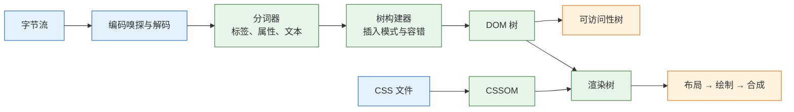
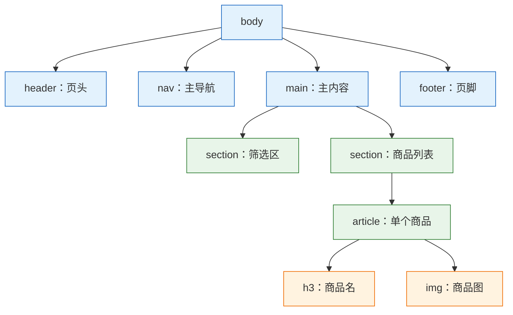
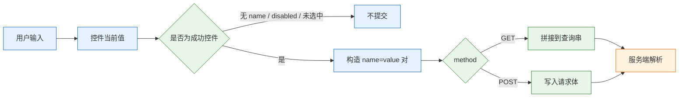

# HTML

---

## 一、HTML 是什么

### 1.1 核心概念

> **版本现状（2026-10）**：HTML 是 WHATWG 维护的活标准，没有版本号，以当前浏览器的稳定实现为准；本文不使用 `<font>`、`<center>` 这类已废弃的表现元素。

HTML（HyperText Markup Language，超文本标记语言）是描述网页内容结构与含义的标记语言。它用元素给文本、图片、表单控件标注角色：哪一段是标题，哪一块是导航，哪个输入框收集邮箱。浏览器读取标记后构建 DOM 树，CSS 据此排版，JavaScript 据此操作，读屏软件据此朗读。

HTML 不是编程语言，没有变量、分支和循环；也不是样式表，不负责颜色、间距和位置。它交付两样东西：一棵带语义的节点树，以及一套把用户输入变成 HTTP 请求的表单数据模型。

四个概念要先分清：

- **元素**：文档的基本单位，由开始标签、内容和结束标签组成，如 `<p>正文</p>`。
- **标签**：尖括号里的名字，`` 这类不能包含内容的元素没有结束标签。
- **属性**：写在开始标签内，形如 `name="value"`，为元素提供配置，如 `href`、`src`、`alt`。
- **内容模型**：每种元素规定可以包含什么。`ul` 的直接子元素只能是 `li`，`p` 不能包含 `div`，`a` 不能嵌套另一个 `a`。

| 概念 | 含义 | 代码形态 | 作用 |
|---|---|---|---|
| 元素 | 结构单位 | `<p>文字</p>` | 表达一类内容 |
| 属性 | 元素的配置 | `href="/about"` | 提供地址、名称、状态 |
| 内容模型 | 允许的嵌套规则 | `ul > li` | 保证树结构可预测 |
| 文档 | 完整的 HTML 文件 | `<!DOCTYPE html>…` | 交给浏览器解析 |

HTML 承担四类职责：声明文档编码与语言；用标题、段落、列表、表格表达内容层次；用导航、主内容、文章等元素标注区域；用表单控件定义字段名、取值和校验规则。它不承担视觉布局、交互逻辑、数据存储和权限判断，这四件事分别属于 CSS、JavaScript、后端与安全策略。

判断一份 HTML 是否合格，有个简单标准：**去掉 CSS、禁用 JavaScript、只用键盘和读屏，内容仍然可读、可操作**。样式丢失时标题仍是标题，表单仍能提交，链接仍能跳转，说明结构写对了。反过来，用 `div` 堆出来的页面在缺样式时只剩一堵文字墙，读屏也拿不到任何导航信息。

### 1.2 与相邻技术的关系

HTML、CSS、JavaScript 的分工常被概括为“结构、表现、行为”，但三者并不是互不相干的三层，它们通过固定接口耦合。

- **CSS** 通过元素名、类名、属性选择器命中节点。语义元素提供稳定的钩子，`.site-header` 比 `body > div:nth-child(2)` 更难被结构变动打断。
- **JavaScript** 通过 DOM API 读写节点、绑定事件、调用 `checkValidity()`、`showModal()` 等原生能力。HTML 负责给出初始结构，JS 负责增强。
- **HTTP** 负责传输。表单的 `action`、`method`、`enctype` 直接决定请求长什么样；`link`、`script`、`img` 的地址决定资源怎么加载。
- **浏览器渲染引擎** 把字节流解析成 DOM，再与 CSSOM 合并成渲染树。可访问性树同样以 DOM 为输入，ARIA 只是在这棵树上打补丁。
- **框架与服务端模板** 最终都输出 HTML。JSX、Vue 模板、服务端渲染只是生成方式不同，浏览器收到的仍是标签、属性和文本。

| 技术 | 职责 | 与 HTML 的接口 | 边界 |
|---|---|---|---|
| CSS | 布局与视觉 | 选择器、类名、属性 | 不改变文档语义 |
| JavaScript | 交互与状态 | DOM API、事件、原生方法 | 不替代结构 |
| HTTP | 传输与缓存 | 表单提交、资源请求 | 不解释标签 |
| 框架 | 组件化生成 | 模板编译、水合 | 输出仍是 HTML |
| 辅助技术 | 朗读与导航 | 可访问性树、ARIA | 依赖正确结构 |

> **注意**：框架模板里的 `className`、`htmlFor` 是框架语法，不是 HTML 属性。它们编译后仍产出 `class`、`for`；排查浏览器问题时，要看 DevTools 里的最终 DOM，而不是模板源码。

### 1.3 解析与渲染机制

浏览器拿到 HTML 字节后，不是“边读边显示”，而是先走一条固定的解析流水线。理解这条流水线，才能解释乱码、脚本阻塞、DOM 与源码不一致这三类现象。



**第一步是确定编码。** 浏览器按 BOM、HTTP 响应头 `Content-Type` 的 `charset`、`<meta charset>`、默认编码的顺序嗅探。`<meta charset>` 必须完整出现在文档前 1024 字节内，因为解析器要在读到正文前完成预扫描。编码判断错了，后面的分词全在错误字符上进行，中文会变成乱码，且无法用 CSS 修复。

**第二步是分词。** 分词器是一个状态机，把字符流切成开始标签、结束标签、属性、文本、注释、DOCTYPE 等 token。属性名在 HTML 中不区分大小写，属性值可以用双引号、单引号或裸写；实体如 `&amp;`、`&lt;` 在文本和属性值中会被解码。

**第三步是树构建。** 树构建器维护一个打开元素栈，按“插入模式”决定新 token 挂到哪个节点。HTML 的容错规则就写在这一步：遇到多数块级开始标签时自动闭合未关闭的 `p`；表格缺少 `tbody` 时自动补一个；`table` 里混入非表格内容时用 foster parenting 移到表格前；嵌套的 `form` 开始标签被忽略。最终得到的 DOM 可能和源文件结构相差很远。

**脚本与样式会改变解析节奏。** 普通 `<script>` 在解析到它的位置时同步下载并执行，期间解析暂停；`defer` 让脚本在文档解析完成后按顺序执行；`async` 让脚本下载完立即执行，顺序不确定；`type="module"` 默认具有 defer 行为。CSS 不阻塞 DOM 构建，但阻塞渲染，也会阻塞其后脚本的执行，因为脚本可能读取计算样式。

| 阶段 | 处理内容 | 可观察结果 |
|---|---|---|
| 解码 | BOM、HTTP 头、meta | 乱码或正常中文 |
| 分词 | 标签、属性、实体 | 属性值被解码 |
| 树构建 | 嵌套、自动闭合、补节点 | DOM 与源码不同 |
| 脚本执行 | 同步、defer、async | 首屏时机差异 |
| 渲染 | DOM + CSSOM | 布局、绘制、合成 |

`DOMContentLoaded` 在文档解析完成、defer 脚本执行完毕后触发；`load` 要等图片、样式、iframe 等全部资源加载完成。把初始化逻辑挂在 `load` 上，会让首屏交互明显变慢。

> **注意**：DevTools 的 Elements 面板展示的是解析后的 DOM，不是源文件。表格里多出的 `tbody`、被拆开的 `p`、被浏览器修正的嵌套，都在这一步产生。排查结构问题要以 DOM 为准。

---

## 二、最小可运行文档

### 2.1 文档骨架与必需声明

一份能直接双击打开、也能通过校验的最小文档如下。每一行都不是装饰，缺一处就会在某个环境下出问题。

```html
<!DOCTYPE html> <!-- 触发标准模式，缺失会进入怪异模式 -->
<html lang="zh-CN"> <!-- 文档语言，影响朗读、断行与翻译 -->
<head>
  <meta charset="utf-8"> <!-- 必须位于文档前 1024 字节内 -->
  <meta name="viewport" content="width=device-width, initial-scale=1">
  <title>最小文档</title> <!-- 标签页与搜索结果的标题 -->
</head>
<body>
  <h1>最小文档</h1>
  <p>这段文字在禁用 CSS 和 JavaScript 后仍然可读。</p>
</body>
</html>
```

`<!DOCTYPE html>` 是标准模式开关。它不指向某个 DTD，只是一个约定。缺失时浏览器进入怪异模式，盒模型计算、百分比高度、表格字体继承等行为与标准模式不同，同一份 CSS 会得到不同结果。

`head` 与 `body` 的开始、结束标签在语法上可以省略，浏览器会自动补全，但不要依赖这种省略。显式写出能让结构清晰，也能避免模板拼接时把元数据插到错误位置。

| 声明 | 位置 | 作用 | 缺失后果 |
|---|---|---|---|
| `<!DOCTYPE html>` | 文件首行 | 标准模式 | 怪异模式，盒模型异常 |
| `charset` | `head` 开头 | 指定解码 | 中文乱码 |
| `viewport` | `head` | 移动端布局宽度 | 按 980px 虚拟屏缩放 |
| `lang` | `html` | 朗读语音、断行 | 读屏用错误语音 |
| `title` | `head` | 页面标题 | 标签页显示文件名 |

### 2.2 字符编码与语言声明

编码由三个来源共同决定，优先级从高到低是 BOM、HTTP 响应头、`<meta charset>`。本地双击打开文件时没有 HTTP 头，`meta` 就是主要依据；部署到服务器后，若响应头声明了 `text/html; charset=iso-8859-1`，它会盖过页面里的 `utf-8`，此时改 HTML 没有用，要改服务端配置。

保存文件时选择 UTF-8 且不带 BOM。带 BOM 的文件在 PHP 等语言里可能导致“headers already sent”，也会让某些拼接场景多出不可见字符。

`lang="zh-CN"` 不是给搜索引擎看的标签。读屏软件据此选择中文语音库；浏览器据此决定断行规则、标点挤压和翻译提示；CSS 的 `:lang()` 选择器也依赖它。页面中夹有英文术语或外文引文时，可在局部元素上再写 `lang="en"`。

从右向左书写的语言需要 `dir="rtl"`；方向不确定的用户生成内容用 `dir="auto"`，浏览器按首个强字符判断方向。布局要用逻辑属性（`margin-inline-start`）而不是物理属性（`margin-left`），否则阿拉伯语页面会左右颠倒。

```html
<html lang="zh-CN">
  <body>
    <p>产品代号 <span lang="en">Aurora</span>，文档见下方。</p>
    <p dir="auto">用户输入的一段文字</p>
  </body>
</html>
```

| 属性 | 取值 | 作用 | 常见错误 |
|---|---|---|---|
| `lang` | `zh-CN`、`en` | 语音、断行、翻译 | 写 `zh` 但内容是方言 |
| `dir` | `ltr`、`rtl`、`auto` | 书写方向 | 全站写死 `ltr` |
| `charset` | `utf-8` | 解码方式 | 放在 1024 字节之后 |
| `translate` | `yes`、`no` | 是否允许翻译 | 品牌名未标 `no` |

> **注意**：在 DevTools 里手动改 `charset` 不会修复乱码，因为解码已经完成。乱码只能通过改文件字节、改响应头或重新以正确编码保存来解决。

### 2.3 元数据与资源加载顺序

`head` 里的资源按出现顺序参与加载，但不同类型的阻塞行为不同。样式表阻塞渲染，脚本按 `defer`、`async`、`module` 的规则调度，预加载提示只影响优先级。

```html
<head>
  <meta charset="utf-8">
  <meta name="viewport" content="width=device-width, initial-scale=1">
  <title>商品列表</title>
  <meta name="description" content="按关键词与分类筛选本周在售花材。">

  <!-- 样式先于脚本：脚本可能读取布局结果 -->
  <link rel="stylesheet" href="/assets/app.css">

  <!-- 模块脚本默认 defer，不阻塞解析 -->
  <script type="module" src="/assets/app.js"></script>

  <!-- 关键图片资源提前发现，避免被脚本拖后 -->
  <link rel="preload" as="image" href="/assets/hero.avif" fetchpriority="high">
</head>
```

`description` 不参与排名算法，但会出现在搜索结果摘要里，写成一句能独立说明页面内容的话即可。`viewport` 的 `width=device-width` 让布局视口等于设备宽度，`initial-scale=1` 设定初始缩放；不要加 `user-scalable=no`，它阻止用户放大，属于可访问性缺陷。

| 元素 | 用途 | 加载影响 | 使用建议 |
|---|---|---|---|
| `link rel=stylesheet` | 引入样式 | 阻塞渲染 | 放 `head`，关键样式内联 |
| `script defer` | 延迟脚本 | 解析完成后按序执行 | 需要 DOM 的初始化 |
| `script async` | 异步脚本 | 下载完立即执行 | 独立统计、埋点 |
| `script type=module` | 模块脚本 | 默认 defer | 现代工程入口 |
| `link rel=preload` | 提前发现资源 | 提高优先级 | 只用于首屏关键资源 |

---

## 三、内容结构与语义元素

### 3.1 区块语义与标题层级

语义元素的价值在于给辅助技术提供地标（landmark）。读屏用户可以按地标在页头、导航、主内容、页脚之间跳转，不必从头逐字朗读。



几个元素的隐含角色和生效条件必须记准：`header` 在 `body` 下映射为 banner，嵌在 `article` 或 `section` 内则是普通分组；`footer` 同理映射为 contentinfo；`main` 每页只应有一个；`aside` 映射为 complementary；`section` 只有在拥有可访问名称（`aria-labelledby` 或 `aria-label`）时才映射为 region，否则只是一个普通容器；`form` 也需要名称才成为地标。

| 元素 | 隐含角色 | 生效条件 | 典型用途 |
|---|---|---|---|
| `header` | banner | 不在 article/section 内 | 站点页头 |
| `nav` | navigation | 主要链接组 | 全站导航、目录 |
| `main` | main | 每页一个 | 主体内容 |
| `section` | region | 有可访问名称 | 有主题的区块 |
| `article` | article | 可独立分发 | 文章、商品卡、评论 |
| `aside` | complementary | 与主内容弱相关 | 侧栏、提示 |
| `footer` | contentinfo | 不在 article/section 内 | 站点页脚 |

标题层级是另一条独立线索。`h1` 到 `h6` 表达嵌套关系，不表达字号；字号交给 CSS。浏览器没有实现基于 `section` 自动生成大纲的算法，读屏软件也不依赖它，实际导航靠的是标题级别本身。因此不要为了视觉大小选择 `h4`，也不要在一页里堆多个 `h1` 来充当卡片标题。

> **注意**：用 `div class="h2"` 加粗放大，看起来像标题，但在可访问性树里只是文本。读屏的“按标题跳转”找不到它，搜索引擎也少一条结构信号。

### 3.2 列表、表格与引用结构

常用的列表有三种：无序列表 `ul`、有序列表 `ol`、描述列表 `dl`。导航、商品列表、步骤、标签集合都用列表，因为读屏会播报“列表，共 5 项”，用户知道边界在哪里。

```html
<!-- 有序列表：start 指定起始序号，reversed 表示倒序 -->
<ol start="3" reversed>
  <li>核对库存</li>
  <li>确认地址</li>
  <li>生成订单</li>
</ol>

<!-- 描述列表：术语与解释成对出现 -->
<dl>
  <dt>花期</dt>
  <dd>盛开后五到七天</dd>
  <dt>配送</dt>
  <dd>市区当日达</dd>
</dl>
```

表格只用于二维数据。读屏需要知道每个单元格属于哪一行、哪一列，这靠 `th` 与 `scope` 建立关联，而不是靠加粗。

```html
<table>
  <caption>本周排班</caption> <!-- 表格标题，读屏会先读它 -->
  <thead>
    <tr>
      <th scope="col">日期</th>
      <th scope="col">早班</th>
      <th scope="col">晚班</th>
    </tr>
  </thead>
  <tbody>
    <tr>
      <th scope="row">周一</th> <!-- 行头，标明这一行是什么 -->
      <td>小林</td>
      <td>小周</td>
    </tr>
  </tbody>
</table>
```

合并单元格会破坏“第几行第几列”的简单对应，复杂表格要给每个 `th` 加 `id`，再在 `td` 上用 `headers` 列出关联的表头 id。宽表格需要横向滚动时，外层容器加 `tabindex="0"`、`role="region"` 和 `aria-label`，键盘用户才能用方向键滚动。

引用与代码各有专用元素：`blockquote` 表示块引用，`cite` 表示作品名而不是作者；`q` 表示行内引用并由浏览器加引号；`pre` 保留空白，`code` 标记代码片段，两者常嵌套使用；`time datetime="2026-10-29"` 给出机器可读时间；`data value="199"` 把展示值与机器值分开。

| 结构 | 元素 | 用途 | 常见误用 |
|---|---|---|---|
| 无序列表 | `ul > li` | 导航、卡片集合 | 用 `div` 模拟 |
| 有序列表 | `ol > li` | 步骤、排名 | 手写序号 |
| 描述列表 | `dl > dt + dd` | 术语、键值 | 用表格排版 |
| 数据表格 | `table` + `th` | 二维数据 | 页面布局 |
| 引用 | `blockquote`、`q` | 引文 | 用引号字符冒充 |

### 3.3 链接、按钮与交互元素的选择

交互元素的选择只有一条判断：**这个操作会导航到另一个 URL，还是在本页执行动作**。会导航就用 `a href`，不会就用 `button`。选错会同时丢失键盘行为、右键菜单和读屏语义。

| 行为 | 元素 | 获得的能力 |
|---|---|---|
| 跳到另一个地址 | `<a href>` | 新开、复制、历史、抓取 |
| 提交表单 | `<button type="submit">` | 回车触发、表单语义 |
| 页内动作 | `<button type="button">` | 可聚焦、读屏报按钮 |
| 展开收起 | `details` + `summary` | 原生键盘与状态 |
| 模态对话框 | `dialog` + `showModal()` | 焦点限制、Esc 关闭 |

`a` 没有 `href` 时只是“占位链接”，不可聚焦、不可点击，不能当按钮。`button` 在表单内默认 `type="submit"`，忘记写 `type="button"` 会让“删除”按钮提交整个表单，这是列表页和弹窗里最常见的意外刷新。

```html
<!-- 导航：有真实地址，能新开、能复制 -->
<a href="/goods/rose">查看玫瑰详情</a>

<!-- 页内动作：必须是 button，并写明 type -->
<button type="button" id="toggle-filter">展开筛选</button>

<!-- 原生折叠：不写一行 JavaScript -->
<details>
  <summary>配送说明</summary>
  <p>市区当日达，偏远地区次日达。</p>
</details>
```

`dialog` 需要脚本调用 `showModal()`，但焦点限制、Esc 关闭、`::backdrop` 遮罩由浏览器提供，比自己用 `div` 加 `z-index` 可靠。用 `div role="button" tabindex="0"` 冒充按钮，则要自己补 Enter 与 Space 处理、焦点样式、禁用状态和读屏角色，任何一项漏掉都是缺陷。

> **安全警告**：不要写 `onclick="doSomething()"` 或 `href="javascript:void(0)"`。内联事件处理器是 XSS 的注入点，也会被严格的 CSP 策略拦截；事件绑定放在外部脚本里，用 `addEventListener` 完成。

---

## 四、表单与数据提交模型

### 4.1 控件命名与提交编码

表单是 HTML 里唯一自带数据模型的部分。浏览器提交时只收集“成功控件”：有 `name`、未被禁用、在当前状态下有值。没有 `name` 的输入框输得再对也不会出现在请求里，这是后端“收不到字段”的第一大原因。



具体规则如下：`disabled` 的控件不提交；`readonly` 的控件照常提交；未勾选的复选框和单选按钮不提交；`select` 只提交选中项；多选 `select` 和同名复选框会产生多组同名参数；文件输入在 `multipart/form-data` 下提交文件名与内容，在 urlencoded 下只有文件名；提交按钮只有触发提交的那个才带上自己的 `name` 和 `value`。

`GET` 把参数拼进 URL，能收藏、能分享、刷新不重复提交，适合“读”操作。`POST` 把参数放进请求体，适合“写”操作，刷新会触发重新提交确认。默认方法是 `GET`，默认编码是 `application/x-www-form-urlencoded`，文件上传必须改成 `multipart/form-data`。

| 方法与编码 | 参数位置 | 适用场景 | 限制 |
|---|---|---|---|
| `GET` | URL 查询串 | 搜索、筛选、分页 | 长度受限、进历史与日志 |
| `POST` + urlencoded | 请求体 | 登录、创建、修改 | 需防 CSRF |
| `POST` + multipart | 请求体分段 | 文件上传 | 边界解析成本高 |
| `POST` + text/plain | 请求体纯文本 | 调试 | 服务端难解析 |

```html
<!-- 读操作：参数进 URL，可收藏、可刷新 -->
<form action="/search" method="get">
  <label for="q">关键词</label>
  <input id="q" name="q" type="search">
  <button type="submit">搜索</button>
</form>

<!-- 写操作 + 文件：必须 multipart，否则只收到文件名 -->
<form action="/upload" method="post" enctype="multipart/form-data">
  <label for="cover">封面图</label>
  <input id="cover" name="cover" type="file" accept="image/*">
  <button type="submit">上传</button>
</form>
```

多个复选框共用同一个 `name`，提交为 `tag=a&tag=b`，后端按数组解析。控件可以写在 `form` 外面，用 `form="form-id"` 关联；提交按钮可以用 `formaction`、`formmethod` 覆盖表单默认值。

> **注意**：空文本框也会提交为空值，地址栏会出现 `?q=`。判断“用户是否填写”要看值是否为空字符串，不能看参数是否存在。

### 4.2 输入类型与原生校验

`type` 不只是校验开关，它还决定手机键盘布局、自动填充类别和读屏提示。用 `type="text"` 收邮箱，等于把这些能力全部丢掉。

| `type` | 移动端键盘 | 原生校验 | 典型用途 |
|---|---|---|---|
| `text` | 全键盘 | 无 | 普通文本 |
| `email` | 带 `@` | 格式检查 | 邮箱 |
| `tel` | 数字键盘 | 无 | 电话 |
| `url` | 带 `/` | 需协议 | 网址 |
| `number` | 数字键盘 | 范围与步长 | 数量、金额 |
| `date` | 日期选择器 | 日期范围 | 日期 |
| `search` | 带搜索键 | 无 | 搜索框 |
| `password` | 全键盘 | 无 | 密码 |

约束校验属性包括 `required`、`minlength`、`maxlength`、`min`、`max`、`step`、`pattern`。`pattern` 按整串匹配，不需要自己加 `^` 和 `$`。表单提交时浏览器先跑一遍校验，不通过就阻止提交并聚焦第一个错误控件，提示文案随浏览器语言变化。

```html
<form action="/signup" method="post">
  <p>
    <label for="email">邮箱</label>
    <input id="email" name="email" type="email"
           autocomplete="email" required>
  </p>
  <p>
    <label for="code">邀请码（6 位数字）</label>
    <input id="code" name="code" type="text"
           inputmode="numeric" pattern="[0-9]{6}"
           aria-describedby="code-hint" required>
    <span id="code-hint">由六位数字组成</span>
  </p>
  <button type="submit">注册</button>
</form>
```

`inputmode="numeric"` 只改键盘，不改变取值类型，适合邀请码、验证码这类需要前导零的字段。反过来，`type="number"` 在部分浏览器里会因滚轮误触改值，也不适合身份证号、银行卡号这类长数字。

原生校验是用户体验，不是安全边界。请求可以绕过页面直接发出，服务端必须用同一套规则重新校验。需要自定义提示时用 `setCustomValidity()`，需要临时关闭校验时在表单上加 `novalidate`，或在某个提交按钮上加 `formnovalidate`。

> **安全警告**：客户端校验、`maxlength`、`accept` 都只是提示，攻击者可以全部绕过。文件类型要在服务端按内容嗅探判断，长度和格式要在服务端再校验一次。

### 4.3 表单关联、分组与文件上传

每个控件都要有可访问名称。最稳妥的写法是 `label` 的 `for` 指向控件的 `id`；也可以把控件包进 `label`，但多个控件混排时容易点错。占位符 `placeholder` 不能替代标签，它会在输入后消失，对比度也通常不足。

| 关联方式 | 写法 | 适用 | 注意 |
|---|---|---|---|
| `for` + `id` | `<label for="q">` | 绝大多数控件 | `id` 全页唯一 |
| 包裹 | `<label>…<input></label>` | 单个复选框 | 避免包多个控件 |
| `aria-labelledby` | 指向可见文本 | 复合控件 | 文本需真实存在 |
| `aria-describedby` | 指向提示文本 | 格式说明、错误 | 可指向多个 id |

单选框组和复选框组用 `fieldset` 加 `legend` 分组，读屏会在每个选项前播报组名。`fieldset` 加 `disabled` 会禁用组内全部控件，适合“整组不可用”的场景。

```html
<fieldset>
  <legend>配送时段</legend>
  <p>
    <input id="am" name="slot" type="radio" value="am" checked>
    <label for="am">上午 9:00–12:00</label>
  </p>
  <p>
    <input id="pm" name="slot" type="radio" value="pm">
    <label for="pm">下午 14:00–18:00</label>
  </p>
</fieldset>
```

错误提示要同时具备视觉标记和程序可读关联：控件加 `aria-invalid="true"`，错误文本放在带 `id` 的元素里，再用 `aria-describedby` 关联。提交失败后把焦点移到错误摘要或第一个错误控件，读屏用户才知道发生了什么。

文件上传有三个硬约束：表单必须是 `multipart/form-data`；`accept` 只过滤文件选择对话框里的类型，不阻止用户切到“所有文件”；`input.value` 不能被脚本赋值，出于安全原因只能由用户选择。上传进度和分片需要 JavaScript，但基础结构仍应是原生 `input type="file"`。

---

## 五、媒体、嵌入与资源加载

### 5.1 响应式图片与尺寸声明

图片占用带宽、影响布局稳定性，也承担信息表达。`srcset` 与 `sizes` 让浏览器按视口宽度和像素密度挑文件，`width` 与 `height` 提供宽高比，避免加载时页面跳动。

```html

```

`w` 描述符表示文件真实宽度，必须配合 `sizes` 告诉浏览器“图片将占多宽”；只写 `srcset` 不写 `sizes`，默认按 `100vw` 计算，选出来的文件往往偏大。固定显示尺寸的场景可以用 `1x`、`2x` 密度描述符，两种描述符不能混用。

`width` 与 `height` 写原始像素。浏览器据此提前算出 `400 / 300` 的宽高比，即使 CSS 后来写 `width: 100%; height: auto`，比例信息仍保留，图片未加载时也占住位置。

| 属性 | 作用 | 注意 |
|---|---|---|
| `srcset` | 候选文件与宽度 | 与 `sizes` 配套 |
| `sizes` | 布局宽度条件 | 描述显示宽度而非文件宽度 |
| `width` / `height` | 固有宽高比 | 写原始像素 |
| `loading="lazy"` | 延后加载 | 首屏大图不要用 |
| `alt` | 替代文本 | 装饰图用空值 |

`alt` 的写法取决于图片角色：信息图写图中传达的信息，不写“图片”“玫瑰花图片”；功能图（图标按钮）写动作，如“关闭”；装饰图写 `alt=""`，让读屏跳过。链接里只有一张图时，`alt` 就是链接的可访问名称。

需要按格式或艺术方向切换时用 `picture`：浏览器按 `type` 跳过不支持的格式，按 `media` 选择裁剪版本，都不匹配时回退到 `img`。

```html
<picture>
  <source type="image/avif" srcset="hero.avif">
  <source type="image/webp" srcset="hero.webp">
  
</picture>
```

> **注意**：`loading="lazy"` 会推迟首屏最大内容绘制图片的加载，反而拉低性能分数。首屏主图应正常加载，可加 `fetchpriority="high"`；折叠线以下的图片才用懒加载。

### 5.2 音视频与字幕轨道

`video` 与 `audio` 用 `source` 提供多个格式，浏览器选第一个能播放的。`controls` 给出原生控制条，`poster` 指定视频未播放时的封面，`preload` 控制预加载策略。

```html
<video controls width="640" poster="demo-poster.jpg" preload="metadata">
  <source src="demo.mp4" type="video/mp4">
  <source src="demo.webm" type="video/webm">
  <track kind="captions" src="demo.zh.vtt" srclang="zh" label="中文字幕" default>
  <p>浏览器不支持视频播放，<a href="demo.mp4">下载视频</a>。</p>
</video>
```

字幕轨道不是可选装饰。`kind="captions"` 面向听障用户，包含环境音与说话人；`kind="subtitles"` 面向语言翻译；`kind="descriptions"` 为视障用户描述画面；`kind="chapters"` 提供章节导航。`default` 表示默认开启，`srclang` 必须是合法语言标签。

自动播放受浏览器策略限制：带声音的自动播放通常被拦截，必须加 `muted` 才允许，iOS 还需要 `playsinline` 防止全屏接管。自动播放的视频不应携带重要信息，也不能突然发出声音。

| 元素/属性 | 作用 | 使用条件 |
|---|---|---|
| `controls` | 原生控制条 | 几乎所有场景 |
| `poster` | 未播放时的封面 | 视频 |
| `preload` | 预加载策略 | `none`、`metadata`、`auto` |
| `track kind=captions` | 听障字幕 | 有对白的视频 |
| `muted` + `playsinline` | 允许自动播放 | 静音背景视频 |

### 5.3 iframe 与第三方嵌入的安全边界

`iframe` 把另一个浏览上下文嵌进当前页面。它与父页面之间受同源策略约束，但“嵌入”本身就是一次信任决策：对方页面能收集用户输入、能发起请求、能诱导点击。

```html
<iframe
  src="https://player.example.com/embed/123"
  title="产品演示视频"
  width="640" height="360"
  loading="lazy"
  sandbox="allow-scripts allow-presentation"
  allow="fullscreen"
  referrerpolicy="strict-origin-when-cross-origin"
></iframe>
```

`title` 是给读屏用户的框架名称，缺失时读屏只能播报“框架”，用户无法判断里面是什么。`sandbox` 默认禁止脚本、表单、弹窗、同源访问和顶层导航，再按需逐项放开；`allow` 控制全屏、摄像头、麦克风等权限；`loading="lazy"` 让折叠线以下的框架延后加载。

| `sandbox` 令牌 | 放开的能力 | 风险 |
|---|---|---|
| `allow-scripts` | 执行脚本 | 配合同源可越权 |
| `allow-same-origin` | 保留源身份 | 可读写同源存储 |
| `allow-forms` | 提交表单 | 可构造请求 |
| `allow-popups` | 打开新窗口 | 可弹广告 |
| `allow-top-navigation` | 导航顶层页面 | 可劫持整页 |

> **安全警告**：对不可信内容同时给出 `allow-scripts` 和 `allow-same-origin`，等于让框架保留自身源身份并执行脚本，沙箱的隔离基本失效；若内容与父页面同源，还能反向操作父页面。自家页面要防被第三方嵌套时，用响应头 `Content-Security-Policy: frame-ancestors 'self'` 或 `X-Frame-Options`，不要只靠前端脚本判断。

---

## 六、完整页面示例：可访问的商品列表页

### 6.1 页面结构与内容组织

下面这份页面把前五节的结构落到一处：跳转链接、页头、导航、主内容、筛选表单、商品列表、分页、页脚。保存为 `index.html`，同目录放一份 `style.css` 即可直接打开。

```html
<!DOCTYPE html>
<html lang="zh-CN">
<head>
  <meta charset="utf-8">
  <meta name="viewport" content="width=device-width, initial-scale=1">
  <title>本周在售 · 花材店</title>
  <meta name="description" content="按关键词与分类筛选本周在售花材。">
  <link rel="stylesheet" href="style.css">
</head>
<body>
  <!-- 键盘用户第一个 Tab 就能跳过导航 -->
  <a class="skip-link" href="#main">跳到主内容</a>

  <header class="site-header">
    <a class="brand" href="/">花材店</a>
    <nav aria-label="主导航">
      <ul class="nav-list">
        <li><a href="/" aria-current="page">在售</a></li>
        <li><a href="/about">关于</a></li>
      </ul>
    </nav>
  </header>

  <main id="main">
    <h1>本周在售</h1>

    <section class="no-print" aria-labelledby="filter-title">
      <h2 id="filter-title">筛选</h2>
      <form action="/" method="get">
        <p>
          <label for="q">关键词</label>
          <input id="q" name="q" type="search"
                 minlength="2" placeholder="玫瑰 / 百合">
        </p>
        <p>
          <label for="category">分类</label>
          <select id="category" name="category">
            <option value="">全部</option>
            <option value="rose">玫瑰</option>
            <option value="lily">百合</option>
          </select>
        </p>
        <button type="submit">应用筛选</button>
      </form>
    </section>

    <section aria-labelledby="list-title">
      <h2 id="list-title">商品</h2>
      <ul class="goods">
        <li>
          <article class="goods__item">
            <!-- 宽高写原始像素，图未加载也占住比例 -->
            
            <h3><a href="/goods/rose">赤霞玫瑰</a></h3>
            <p class="price"><data value="199">¥199</data> / 束</p>
            <p>花期为盛开后五到七天，适合室内摆放。</p>
          </article>
        </li>
        <li>
          <article class="goods__item">
            
            <h3><a href="/goods/lily">香水百合</a></h3>
            <p class="price"><data value="129">¥129</data> / 束</p>
            <p>香气浓，建议放在通风处。</p>
          </article>
        </li>
      </ul>

      <nav aria-label="分页">
        <ul class="pager">
          <li><a href="?page=1" aria-current="page">1</a></li>
          <li><a href="?page=2">2</a></li>
        </ul>
      </nav>
    </section>
  </main>

  <footer class="site-footer">
    <p>价格含包装，配送范围见下单页。</p>
  </footer>
</body>
</html>
```

示例引用两张本地图片，未放置时会显示替代文本，这正好可以观察 `alt` 的兜底效果。样式只负责排版，不参与结构表达：

```css
/* 演示样式：删掉整段，页面仍应可读可提交 */
:root { --ink: #1f2937; --muted: #4b5563; --line: #d1d5db; --accent: #1d4ed8; }
*, *::before, *::after { box-sizing: border-box; }
body { margin: 0; font-family: system-ui, sans-serif; line-height: 1.6; color: var(--ink); }
a { color: var(--accent); }

/* 跳转链接移出视口，聚焦时回到左上角 */
.skip-link { position: absolute; left: -999px; }
.skip-link:focus { left: 1rem; top: 1rem; background: #fff; padding: .5rem; }

.site-header { display: flex; gap: 1.5rem; align-items: center;
  padding: 1rem; border-bottom: 1px solid var(--line); }
.nav-list { display: flex; gap: 1rem; list-style: none; margin: 0; padding: 0; }

main { width: min(100% - 2rem, 64rem); margin-inline: auto; padding-block: 1.5rem; }
form p { display: flex; gap: .5rem; align-items: center; }

.goods { display: grid; gap: 1rem; list-style: none; padding: 0;
  grid-template-columns: repeat(auto-fit, minmax(16rem, 1fr)); }
.goods__item { border: 1px solid var(--line); border-radius: .5rem; padding: 1rem; }
.goods__item img { width: 100%; height: auto; border-radius: .25rem; }
.price { font-weight: 600; }
.pager { display: flex; gap: .5rem; list-style: none; padding: 0; }
.site-footer { padding: 1rem; border-top: 1px solid var(--line); color: var(--muted); }

/* 打印：去掉导航、表单与分页，卡片不跨页 */
@media print {
  .site-header, .site-footer, .no-print, .pager { display: none; }
  .goods__item { break-inside: avoid; }
}
```

启动静态服务器后访问 `http://127.0.0.1:8000/`：

```bash
python3 -m http.server 8000 --bind 127.0.0.1
```

### 6.2 键盘与读屏验证

结构写得对不对，靠操作验证，不靠目测。按下面的顺序走一遍，每项都能在浏览器里直接观察。

| 检查项 | 操作 | 预期结果 |
|---|---|---|
| 跳转链接 | 打开页面按一次 Tab | 出现“跳到主内容”，回车后焦点进入 `main` |
| Tab 顺序 | 连续按 Tab | 依次经过导航、搜索框、分类、按钮、商品链接 |
| 焦点可见 | 观察当前焦点 | 有清晰轮廓，不被 `outline: none` 抹掉 |
| 标题导航 | 读屏按标题列表 | 依次为 h1、两个 h2、两个 h3 |
| 表单名称 | 聚焦输入框 | 读屏播报“关键词，搜索框” |
| 图片替代 | 用读屏浏览商品卡 | 图片读出描述，链接读出商品名，不重复 |
| 当前页 | 聚焦导航项 | 播报“当前页” |
| 缩放 | 浏览器放大到 200% | 内容不重叠、不截断 |

### 6.3 降级与打印

同一个页面要在资源缺失时仍然可用。依次做三次降级，观察结构是否兜住：

| 降级方式 | 操作 | 应保留的能力 |
|---|---|---|
| 禁用 JavaScript | DevTools 关闭脚本 | 筛选表单可提交，商品链接可跳转 |
| 移除样式 | 删除 `link` 或禁用 CSS | 标题层级、列表、表单仍可读 |
| 打印预览 | `Cmd/Ctrl + P` | 正文完整，导航与按钮不占纸面 |

禁用 CSS 后页面会变成单列文本流，这是正常的。只要顺序合理、标签正确，内容就没有丢失；如果此时出现大段无标题文字、表单控件没有说明，说明结构依赖了样式。

---

## 七、兼容性与可访问性

### 7.1 解析容错与浏览器差异

HTML 的树构建算法由标准统一，现代浏览器对同一份标记生成的 DOM 基本一致。真正的差异集中在三处：表单控件的默认外观、新属性的支持程度、媒体格式的支持范围。

| 差异来源 | 表现 | 处理方式 |
|---|---|---|
| 新属性 | 旧浏览器忽略 | 特性检测 + 回退 |
| 表单控件 | 外观与默认样式不同 | CSS 统一，保留原生语义 |
| 媒体格式 | 某格式无法播放 | `source` 多格式回退 |
| 字体 | 系统字体缺失 | 字体栈回退 |
| 解析容错 | 错误嵌套被自动修正 | 写合法结构，用校验器 |

特性检测针对的是能力，不是浏览器品牌。例如判断图片懒加载是否可用，可以检查 `'loading' in HTMLImageElement.prototype`；不支持时属性被忽略，图片立即加载，功能不缺失。`srcset`、`picture`、`details` 都属于“不支持就退化”的结构，不需要写分支。

不要用 User-Agent 判断浏览器。UA 字符串可以被修改，版本号也长期冻结，按它分支只会积累无法维护的例外。

### 7.2 ARIA 的使用边界

ARIA 是一组补充语义的属性，不是“让 div 变成按钮”的魔法。第一原则是：**能用原生元素就用原生元素**。原生 `button` 自带键盘激活、焦点管理、禁用状态和读屏角色；`div role="button"` 需要逐项补齐，漏一项就是缺陷。

| 场景 | 写法 | 说明 |
|---|---|---|
| 图标按钮无文字 | `aria-label="关闭"` | 提供可访问名称 |
| 区域由标题命名 | `aria-labelledby="id"` | 复用可见标题 |
| 补充说明 | `aria-describedby="id"` | 读名称后再读描述 |
| 动态提示 | `role="status"` | 礼貌播报，不打断 |
| 错误摘要 | `role="alert"` | 立即播报，少用 |
| 当前导航项 | `aria-current="page"` | 不只靠颜色 |
| 展开状态 | `aria-expanded="true"` | 与可见状态同步 |
| 装饰图标 | `aria-hidden="true"` | 内部不能有可聚焦元素 |

`aria-label` 不要覆盖可见文字。语音控制用户看到“关闭”，说“关闭”却点不到，因为可访问名称被改成了“关闭对话框”。WCAG 的“标签包含名称”要求可见文本出现在可访问名称里；需要补充语境时，用 `aria-describedby` 而不是替换名称。

> **安全警告**：`aria-hidden="true"` 只影响可访问性树，不会把元素移出 Tab 顺序。隐藏含链接或按钮的区域，要同时用 `inert`、`hidden` 或从 DOM 移除，否则键盘焦点会落进“读屏看不见”的区域。

### 7.3 渐进增强与内容安全

HTML 的渐进增强有两层含义：结构先成立，样式和脚本只做增强；新能力先检测，缺失时退回可用状态。表单先能原生提交，再用 JS 做无刷新筛选；折叠先用 `details`，再考虑动画。这样脚本加载失败时，页面仍然是完整的。

内容安全方面，HTML 是 XSS 的主要落点。任何把用户输入拼进 `innerHTML`、属性值或 URL 的代码，都可能把文本变成标签或脚本。

| 风险 | 错误写法 | 正确做法 |
|---|---|---|
| 文本注入 | `el.innerHTML = input` | `el.textContent = input` |
| 属性注入 | 拼接 `href` | 校验协议，用 `URL` 解析 |
| 内联事件 | `onclick="..."` | `addEventListener` |
| 脚本 URL | `href="javascript:..."` | 只允许 `http`、`https`、相对路径 |
| 新窗口 | `target="_blank"` 无 `rel` | 加 `rel="noopener"` |
| 第三方 HTML | 直接插入 | 服务端或 DOMPurify 白名单清洗 |

> **安全警告**：`innerHTML` 不执行插入的 `<script>`，但会执行 `onerror`、`onload` 这类事件属性，也会加载 `img src` 指向的地址。不要因为“脚本没跑”就认为插入安全；富文本必须走白名单清洗，并配合 CSP 限制内联脚本。

服务端渲染的页面还要注意表单的 CSRF 防护：写操作使用 `POST`，配合 SameSite Cookie 与一次性令牌；令牌放在隐藏字段里，随表单一起提交。HTML 只负责承载字段，校验与签发仍在服务端。

---

## 八、常见错误与排查

### 8.1 故障对照表

| 现象 | 最可能原因 | 处理 |
|---|---|---|
| 点按钮页面刷新 | `button` 默认 `type="submit"` | 非提交按钮写 `type="button"` |
| 后端收不到字段 | 控件缺 `name` 或被 `disabled` | 补 `name`，只读改用 `readonly` |
| 上传只收到文件名 | 表单缺 `enctype` | 加 `multipart/form-data` |
| 点文字不聚焦输入框 | `label` 未绑定 | `for` 指向 `id`，或包裹控件 |
| 中文乱码 | 编码声明缺失或响应头冲突 | 首行加 `charset`，核对 HTTP 头 |
| 手机页面缩小 | 缺 `viewport` | 加 `width=device-width, initial-scale=1` |
| 表单行为异常 | 嵌套 `form` 被解析器忽略 | 拆成多个表单，或用 `form` 属性 |
| 读屏读不出图片 | `alt` 缺失或写成“图片” | 写图中信息，装饰图用空 `alt` |
| 点 `div` 无反应 | 用 `div` 冒充按钮 | 改用 `button` 或 `a` |
| 锚点跳转失败 | `id` 重复或不存在 | 全页 `id` 唯一 |
| 表格选择器失配 | 浏览器自动插入 `tbody` | 选择器包含 `tbody` 或改用类名 |
| 脚本拿不到元素 | 脚本在元素之前执行 | 用 `defer` 或 `type="module"` |

### 8.2 排查顺序

出现问题时按固定顺序检查，避免一上来就怀疑后端：

1. **看 DOM**：在 Elements 面板确认最终结构，而不是源文件。重点看嵌套是否被修正、`tbody` 是否自动补出。
2. **看网络**：在 Network 面板确认请求方法、URL、状态码和 Form Data，判断字段有没有发出、编码是否正确。
3. **看控制台**：检查 CSP 拦截、脚本报错、表单校验提示，区分“没发请求”和“请求被拒”。
4. **看可访问性**：在 Accessibility 面板检查名称、角色、标题层级，确认键盘能到达每个交互元素。
5. **跑校验**：用 Nu HTML Checker 检查标记合法性，再回到浏览器验证修复结果。

结构问题优先在 DOM 层解决，数据问题优先在网络层定位，交互问题优先在控制台找证据。把这三层分开，绝大多数“页面没反应”都能在几分钟内收敛到具体元素或具体请求。
