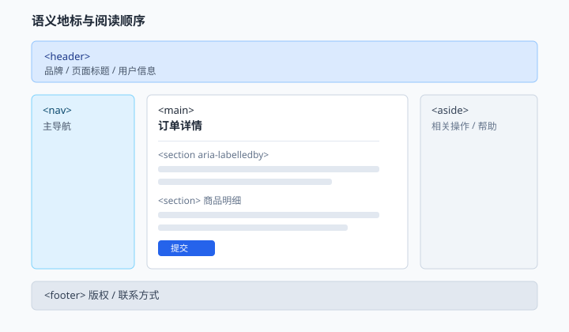
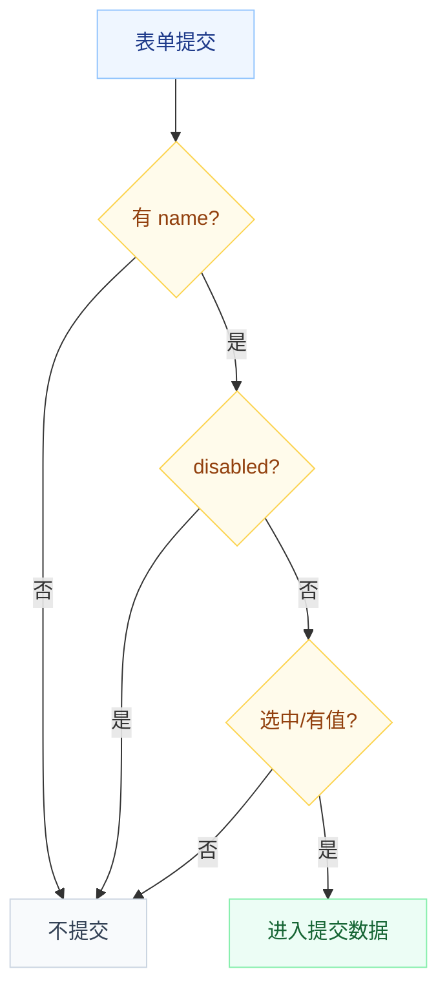
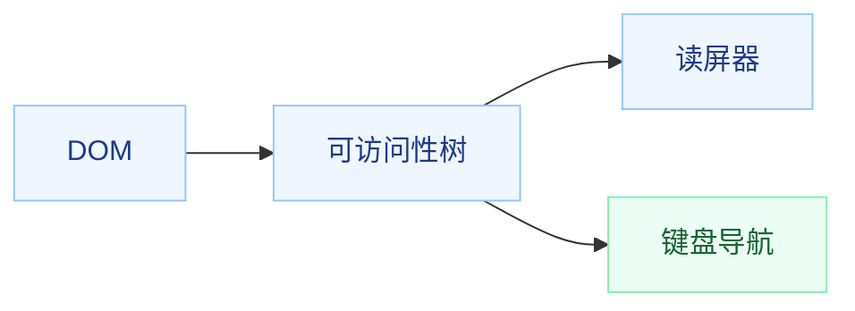
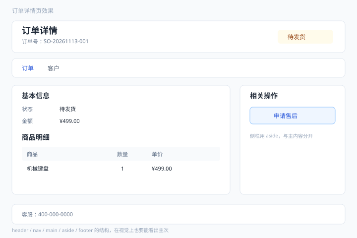

# HTML5与语义化

> 这篇从 HTML 的职责讲起，经过文档骨架、语义地标、表单与成功控件、媒体和 ARIA，最后落到 SEO 与可访问性排障。
>
> 学完能写出语义化、可键盘操作、读屏器能理解的页面。

## 一、HTML 的职责

HTML 负责**结构和含义**，CSS 负责表现，JavaScript 负责行为。用 `div` 堆出来的页面也能显示，但浏览器、搜索引擎、读屏器和自动化测试无法理解它的结构。

判断标准：

- 去掉 CSS 后，页面是否仍然有合理的阅读顺序？
- 键盘能否完成主要操作，焦点是否可见？
- 读屏器能否说清“这是什么区域、这是什么控件、现在是什么状态”？

先选语义元素，再考虑 `div` 和 `span`；原生 HTML 能做的，不要用 ARIA 模拟；表单的 `label`、`name`、`type` 决定它能不能被正确提交和操作。

## 二、文档骨架与最小页面

一个合法的 HTML5 页面至少包含文档类型、根元素、语言、字符集、视口和标题。

```html
<!doctype html> <!-- 触发标准模式，漏写会进入怪异模式 -->
<html lang="zh-CN"> <!-- 告诉浏览器和读屏器页面语言 -->
<head>
  <meta charset="utf-8"> <!-- 字符编码，必须在 title 之前 -->
  <meta name="viewport" content="width=device-width, initial-scale=1"> <!-- 移动端布局基准 -->
  <title>订单详情 - 企业后台</title> <!-- 页面标题，不要所有页面复用同一个 -->
  <meta name="description" content="查看订单状态、商品明细和操作记录">
</head>
<body>
  <h1>订单详情</h1>
  <p>订单号：SO-20261113-001</p>
</body>
</html>
```

| 声明 | 作用 | 常见错误 |
|---|---|---|
| `<!doctype html>` | 触发标准模式 | 漏写导致怪异模式 |
| `lang="zh-CN"` | 告诉浏览器和读屏器语言 | 写成 `zh` 或漏写 |
| `meta charset="utf-8"` | 字符编码 | 放在 `<title>` 之后 |
| `viewport` | 移动端布局基准 | 用 `user-scalable=no` 禁止缩放 |
| `<title>` | 页面标题 | 所有页面用同一个标题 |

> 边界：`user-scalable=no` 会阻止用户缩放，属于可访问性问题；除非有特殊理由，不要禁用缩放。

## 三、语义地标

语义地标让页面有“区域”，读屏器可以按区域跳转，搜索引擎也能理解内容主次。

| 元素 | 含义 | 使用建议 |
|---|---|---|
| `<header>` | 页头或区块头部 | 一个页面可以有多个，但页面级通常一个 |
| `<nav>` | 主要导航 | 只给主要导航，不要把所有链接都包进去 |
| `<main>` | 页面主内容 | 一个页面只用一个，且不要嵌套 |
| `<section>` | 有主题的内容分组 | 通常需要标题 |
| `<article>` | 可独立分发的内容 | 文章、帖子、卡片 |
| `<aside>` | 与主内容间接相关 | 侧栏、相关推荐 |
| `<footer>` | 页脚或区块底部 | 版权、联系方式 |



### 3.1 标题层级

标题按 `h1 → h2 → h3` 逐级使用，不跳级。一个页面通常只有一个 `h1`。

```html
<main> <!-- 一个页面只用一个 main，表示主内容 -->
  <h1>订单详情</h1>

  <section aria-labelledby="basic-title"> <!-- 用标题给 section 命名 -->
    <h2 id="basic-title">基本信息</h2>
    <dl>
      <dt>订单号</dt><dd>SO-20261113-001</dd>
      <dt>状态</dt><dd>待发货</dd>
    </dl>
  </section>

  <section aria-labelledby="items-title">
    <h2 id="items-title">商品明细</h2>
    <table>
      <thead> <!-- scope="col" 让表头和数据列建立关联 -->
        <tr><th scope="col">商品</th><th scope="col">数量</th><th scope="col">单价</th></tr>
      </thead>
      <tbody>
        <tr><td>机械键盘</td><td>1</td><td>499.00</td></tr>
      </tbody>
    </table>
  </section>
</main>
```

> 边界：`<section>` 不是“带样式的 div”。没有标题、没有主题的内容分组，用 `<div>` 更合适。

## 四、表单与成功控件

表单是 HTML 中最容易出可访问性和提交问题的地方。

### 4.1 标签与控件

```html
<form action="/orders" method="post">
  <fieldset> <!-- fieldset + legend 把相关字段分组 -->
    <legend>收货信息</legend>

    <label for="receiver">收货人</label> <!-- for 必须等于 input 的 id -->
    <input id="receiver" name="receiver" type="text" autocomplete="name" required>

    <label for="phone">手机号</label>
    <input id="phone" name="phone" type="tel" inputmode="tel"
           autocomplete="tel" pattern="1[3-9]\d{9}" required> <!-- type=tel 唤起数字键盘 -->

    <label for="address">地址</label>
    <textarea id="address" name="address" rows="3" required></textarea>
  </fieldset>

  <button type="submit">提交订单</button>
  <button type="button">保存草稿</button> <!-- 不写 type 会默认提交表单 -->
</form>
```

| 要点 | 说明 |
|---|---|
| `label for` 对应 `input id` | 点击标签能聚焦控件，读屏器能读出名称 |
| `name` | 没有 `name` 的控件不会提交 |
| `type` | 决定键盘、校验和语义；不要所有输入都用 `text` |
| `autocomplete` | 帮助浏览器自动填充，提升可用性 |
| `required` / `pattern` | 浏览器原生校验，但不能替代服务端校验 |
| `button type` | 默认是 `submit`；普通按钮必须写 `type="button"` |

> 边界：`disabled` 的控件不会提交，也不会获得焦点；需要提交但暂不可编辑的字段，用 `readonly` 而不是 `disabled`。

### 4.2 成功控件

成功控件（successful controls）是表单提交时会被发送的控件。规则：

- 有 `name`；
- 没有 `disabled`；
- 复选框/单选框被选中；
- 提交按钮只发送被点击的那个；
- 文件输入需要有文件。



> 边界：用 JavaScript 收集表单时，仍然要遵守成功控件规则，否则会出现“页面看起来有值，后端收不到”的问题。

## 五、媒体与嵌入

| 场景 | 推荐写法 | 注意 |
|---|---|---|
| 普通图片 | `` | `alt` 描述图片内容；装饰图用 `alt=""` |
| 响应式图片 | `<picture><source media></picture>` | 提供不同尺寸/格式，`img` 是兜底 |
| 视频 | `<video controls>` | 提供字幕、封面和多种格式 |
| 音频 | `<audio controls>` | 不要自动播放 |
| 第三方嵌入 | `<iframe sandbox>` | 限制权限，设置 `title` |

```html
<!-- alt 描述图片表达的信息，不是文件名；装饰图用 alt="" -->


<!-- title 让读屏器知道 iframe 是什么；sandbox 只开必要权限 -->
<iframe src="https://example.com/map"
        title="配送地图"
        sandbox="allow-scripts"
        loading="lazy"></iframe>
```

> 边界：`iframe` 的 `sandbox` 会限制脚本、表单、弹窗等能力；不要把 `allow-scripts` 和 `allow-same-origin` 同时授予不可信内容，否则可能绕过沙箱。

## 六、ARIA 与可访问性

ARIA（Accessible Rich Internet Applications）用于补充原生 HTML 无法表达的角色、状态和属性。

**第一条规则：能用原生 HTML，就不要用 ARIA。**



| 场景 | 原生写法 | ARIA 补充 |
|---|---|---|
| 按钮 | `<button>` | 不要用 `div role="button"` |
| 导航 | `<nav>` | 可用 `aria-label` 区分多个导航 |
| 当前页 | `<a aria-current="page">` | 不要只靠颜色 |
| 展开/收起 | `<button aria-expanded="true">` | 同步更新状态 |
| 错误提示 | `aria-describedby` | 关联错误文本 |
| 图标按钮 | `<button aria-label="关闭">` | 图标本身对读屏器无意义 |

### 6.1 键盘与焦点

- 所有可操作元素都能用 Tab 到达；
- 焦点顺序与视觉顺序一致；
- 焦点样式可见，不要全局 `outline: none`；
- 弹窗打开后焦点进入弹窗，关闭后回到触发按钮；
- 提供“跳到主内容”的 skip link。

```html
<a class="skip-link" href="#main">跳到主内容</a>
<!-- ... -->
<main id="main">...</main>
```

```css
.skip-link {
  position: absolute;
  left: -9999px;
}
.skip-link:focus {
  left: 16px;
  top: 16px;
  z-index: 100;
  background: #fff;
  padding: 8px 12px;
}
```

> 边界：ARIA 只改变语义，不改变行为。给 `div` 加 `role="button"` 不会自动获得键盘和点击行为，仍需自己实现，容易出错。

## 七、SEO 与排障

语义化的直接收益：标题层级、地标、链接文本、图片替代文本都能被搜索引擎理解。不要为了 SEO 堆关键词，先把结构和内容写清楚。

| 现象 | 最可能原因 | 第一条检查 |
|---|---|---|
| 点击标签不聚焦输入框 | `for` 与 `id` 不匹配 | 检查两个值是否完全一致 |
| 点普通按钮表单被提交 | 按钮默认 `type="submit"` | 加 `type="button"` |
| 读屏器跳过主内容 | 缺少 `<main>` 或标题层级乱 | 检查地标和 `h1–h3` |
| 图片信息读不出来 | `alt` 缺失或写“图片” | 写清图片表达的信息 |
| 自定义 div 按钮键盘不可用 | 没有 `tabindex` 和键盘事件 | 改用 `<button>` |
| iframe 被安全策略拦截 | `sandbox` 权限不足 | 按最小权限逐项放开 |

## 八、最佳实践案例

### 8.1 案例背景

某订单详情页原来全部用 `div`，点击区域用 `div + onclick`，图片没有 `alt`，表单没有 `label`。键盘用户无法完成“查看订单→提交售后”，读屏器只能读出一串无意义的文本。

目标是改成语义化页面，并让键盘和读屏器都能完成主流程。

### 8.2 案例实操

```html
<!doctype html>
<html lang="zh-CN">
<head>
  <meta charset="utf-8">
  <meta name="viewport" content="width=device-width, initial-scale=1">
  <title>订单详情 - 企业后台</title>
</head>
<body>
  <!-- 页头：标题和订单号 -->
  <header>
    <h1>订单详情</h1>
    <p>订单号：SO-20261113-001</p>
  </header>

  <!-- 主导航：aria-current 标记当前页 -->
  <nav aria-label="主导航">
    <a href="/orders" aria-current="page">订单</a>
    <a href="/customers">客户</a>
  </nav>

  <main>
    <!-- 基本信息：用 dl 表达键值对 -->
    <section aria-labelledby="basic-title">
      <h2 id="basic-title">基本信息</h2>
      <dl>
        <dt>状态</dt><dd>待发货</dd>
        <dt>金额</dt><dd>¥499.00</dd>
      </dl>
    </section>

    <!-- 表格：caption 说明主题，scope 绑定表头 -->
    <section aria-labelledby="items-title">
      <h2 id="items-title">商品明细</h2>
      <table>
        <caption>订单商品</caption>
        <thead>
          <tr><th scope="col">商品</th><th scope="col">数量</th><th scope="col">单价</th></tr>
        </thead>
        <tbody>
          <tr><td>机械键盘</td><td>1</td><td>¥499.00</td></tr>
        </tbody>
      </table>
    </section>
  </main>

  <!-- 侧栏：与主内容间接相关的操作 -->
  <aside aria-label="相关操作">
    <a href="/orders/SO-20261113-001/refund">申请售后</a>
  </aside>

  <footer><p>客服：400-000-0000</p></footer>
</body>
</html>
```



### 8.3 案例结果

axe 严重问题从 6 个降到 0（示例）；Tab 键可以完成“查看订单→申请售后”的主流程；读屏器可以按 header、nav、main、aside、footer 跳转；表格有 caption，表头有 scope。

复盘：语义化不是“多用几个标签”，而是让结构、控件和状态都能被机器和辅助技术理解。最容易被忽略的是按钮类型、表单 label 和焦点顺序。
