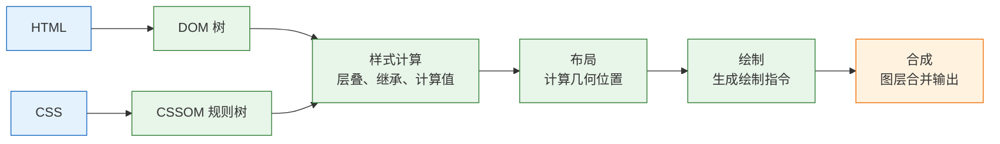
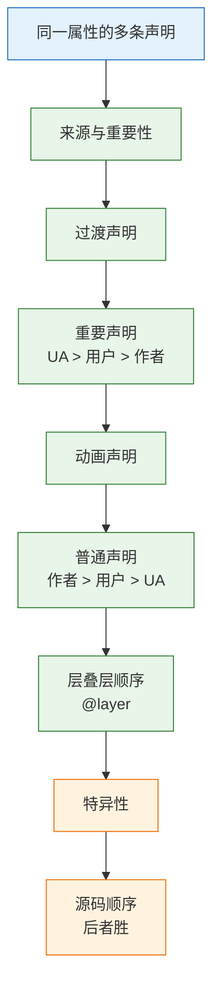
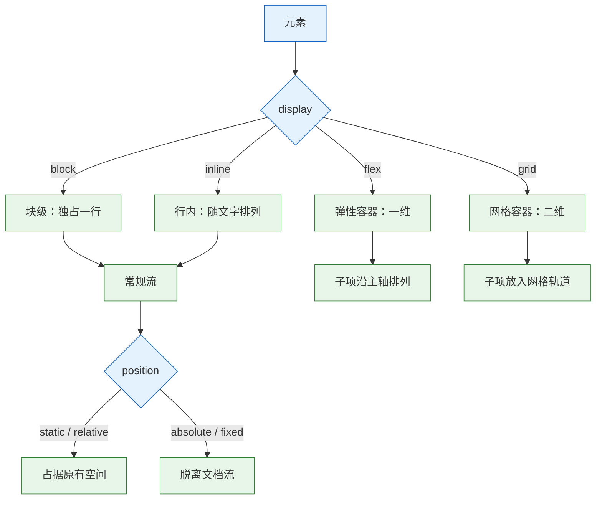

# CSS

---

## 一、CSS 是什么

### 1.1 核心概念

> **版本现状（2026-10）**：容器查询、`:has()`、`@layer`、原生嵌套已进入当前稳定浏览器；需要兼容旧环境时用 `@supports` 降级。

CSS（Cascading Style Sheets，层叠样式表）是描述文档如何呈现的样式表语言。它把“内容是什么”和“内容长什么样”分开：HTML 负责结构，CSS 负责尺寸、颜色、间距、排版和状态表现。

一条 CSS 规则由两部分组成：选择器决定“作用在谁身上”，声明块决定“改成什么样”。声明是 `属性: 值` 的形式，多条声明用分号分隔。浏览器把所有规则收集起来，对每个元素的每个属性做一次竞争，最终得到计算值。

```css
/* 选择器：所有带 card 类的元素 */
.card {
  padding: 1rem;              /* 声明：属性 + 值 */
  border: 1px solid #e5e7eb;
  border-radius: 0.5rem;
}
```

四个机制支撑整套体系：

- **层叠（cascade）**：同一属性有多条声明时，按来源、重要性、层、特异性、顺序决出胜者。
- **继承（inheritance）**：可继承属性从父元素传给子元素，如 `color`、`font-family`。
- **盒模型（box model）**：每个元素生成矩形盒子，由内容、内边距、边框、外边距组成。
- **布局（layout）**：常规流、弹性、网格、定位共同决定盒子的位置与尺寸。

| 概念 | 含义 | 代码形态 |
|---|---|---|
| 规则 | 选择器加声明块 | `.card { … }` |
| 选择器 | 匹配元素的条件 | `.card > h2` |
| 声明 | 一条属性赋值 | `color: #111` |
| at-rule | 带 `@` 的规则 | `@media`、`@layer` |
| 计算值 | 层叠后的最终结果 | DevTools Computed |

CSS 不是编程语言，没有循环和条件分支，也不保存业务状态。它解决呈现问题：把文档排成页面、按视口调整、表达悬停与焦点、支持主题与打印。它不解决内容结构、数据请求和业务逻辑；把这些塞进样式表，会让样式无法复用，也让状态来源变得模糊。

声明式是 CSS 最重要的特性。开发者描述“标题应该是 1.75 倍根字号、行高 1.25”，而不是命令浏览器“先取到标题，再把字号设成多少”。浏览器负责匹配元素、处理冲突、安排计算顺序，并在视口变化时重新求值。代价是结果依赖上下文：同一条 `width: 100%` 在不同包含块里可以得到完全不同的像素值，所以读样式不能只看声明本身，还要看它落在哪棵树上、被哪些规则竞争。

### 1.2 与相邻技术的关系

CSS 与 HTML、JavaScript、构建工具、设计系统都存在固定接口，边界清楚才能各司其职。

- **HTML** 提供钩子：元素类型、类名、属性、状态伪类。语义结构越稳定，选择器越不需要依赖层级。
- **JavaScript** 通过 `classList` 切换状态类、通过自定义属性传值、通过 Web Animations API 控制动画。JS 应改变“状态”，而不是逐个写内联样式。
- **预处理器** Sass、Less 提供变量、嵌套、混入。原生自定义属性、原生嵌套、`@layer` 已覆盖大部分需求，新项目不必默认引入预处理器。
- **框架** React、Vue 只决定样式如何被组织：CSS Modules 做局部作用域，Tailwind 生成工具类，CSS-in-JS 在运行时注入。最终产物仍是浏览器能读的 CSS。
- **设计系统** 用设计令牌统一颜色、间距、字号。令牌落地为自定义属性，组件只引用变量。

| 技术 | 职责 | 与 CSS 的接口 | 边界 |
|---|---|---|---|
| HTML | 结构与语义 | 元素、类、属性 | 不决定视觉 |
| JavaScript | 状态与交互 | 类名、自定义属性 | 不逐条写样式 |
| Sass / Less | 编译期增强 | 变量、嵌套、混入 | 产物仍是 CSS |
| Tailwind | 原子类生成 | 工具类名 | 不替代设计令牌 |
| CSS-in-JS | 组件级样式 | 运行时注入 | 有运行开销 |

> **注意**：内联 `style` 属性的优先级高于普通选择器，临时调试方便，长期使用会让主题、暗色模式和媒体查询全部失效。状态变化用类名表达，不要用脚本改 `style.color`。

### 1.3 解析与渲染机制

浏览器拿到 CSS 后先解析成 CSSOM（CSS Object Model），再与 DOM 合并，经过样式计算、布局、绘制、合成四个阶段输出像素。理解这条链路，才能判断一次改动是“只重绘”还是“整页重排”。



**解析阶段有明确的容错规则。** 选择器写错，整条规则被丢弃；某条声明写错，只丢这一条，其余声明照常生效；未知属性被忽略，所以新属性可以直接写，旧浏览器不会报错。`@supports` 用来显式判断“属性加值”是否被支持，而不是猜浏览器版本。

**样式计算阶段做三件事。** 先收集所有匹配规则，再按层叠顺序排序，最后把相对值转成计算值：`em` 转成像素、`currentColor` 解析成具体颜色、`var()` 完成替换。继承属性在这一步从父元素取值；未声明且不可继承的属性取初始值。

**布局阶段计算几何。** 浏览器从根元素开始，按格式化上下文逐个确定盒子的位置和大小。改变 `width`、`height`、`margin`、`padding`、`font-size`、`display` 会触发布局，代价最高。改变 `color`、`background`、`box-shadow` 只触发重绘。改变 `transform`、`opacity` 可以只走合成，代价最低。

| 阶段 | 输入 | 输出 | 典型触发属性 |
|---|---|---|---|
| 解析 | CSS 文本 | CSSOM | 仅加载时发生 |
| 样式计算 | DOM + CSSOM | 计算值 | 类名变化 |
| 布局 | 计算值 | 几何信息 | 宽高、间距、字体 |
| 绘制 | 几何信息 | 绘制指令 | 颜色、阴影、背景 |
| 合成 | 图层 | 屏幕像素 | `transform`、`opacity` |

样式表会阻塞渲染：浏览器必须等 CSSOM 就绪才敢画第一帧，否则会闪出无样式内容。放在 `head` 的 `<link>` 是正确做法；把大段样式放到 `body` 末尾，会先闪出无样式内容，再触发一次重排。

---

## 二、最小可运行样式表

### 2.1 引入方式与加载顺序

CSS 有四种引入方式，优先级和加载行为各不相同。外部样式表最常用，内联 `style` 只适合临时覆盖，`@import` 会形成串行请求，应尽量避免。

| 方式 | 写法 | 加载行为 | 适用场景 |
|---|---|---|---|
| 外部样式表 | `<link rel="stylesheet">` | 可缓存、阻塞渲染 | 生产环境 |
| 内部样式表 | `<style>` | 随文档到达 | 首屏关键样式 |
| 行内样式 | `style="…"` | 无额外请求 | 动态计算值 |
| `@import` | `@import url(…)` | 串行、晚发现 | 不推荐 |

```html
<head>
  <!-- 外部样式：可缓存，浏览器预加载扫描器能提前发现 -->
  <link rel="stylesheet" href="/assets/app.css">

  <!-- 首屏关键样式内联，减少一次往返 -->
  <style>
    .hero { min-height: 60dvh; display: grid; place-items: center; }
  </style>
</head>
```

多个样式表按文档顺序层叠，同一特异性下后出现的胜出。因此“基础样式在前、组件样式在后、工具类最后”是可靠的组织方式。`<link media="print">` 在不打印时不阻塞渲染，但仍会下载。

外部样式表可以按用途拆分，但请求数不宜过多：每个 `link` 都是一次往返，HTTP/2 能复用连接，却仍要等齐所有阻塞渲染的样式。关键样式内联进 `head`，其余样式合并成一个文件，是内容站点常用的折中。需要切换主题样式表时，用 `link.disabled` 控制，比删除再插入节点更稳定。

> **注意**：`@import` 必须写在样式表最前面（除 `@charset` 和 `@layer` 语句外），否则整条导入失效。它会推迟发现时间，形成请求链，生产环境用构建工具合并或直接多写几个 `link`。

### 2.2 规则结构与语法

一条规则由选择器列表和声明块组成。选择器列表里任何一个选择器无效，整条规则都会被丢弃，因此不要把实验性选择器和稳定选择器写在同一个列表里。

```css
/* 选择器列表：逗号分隔，任一命中即应用 */
h1, h2, .section-title {
  line-height: 1.25;
  text-wrap: balance;        /* 新属性，旧浏览器忽略，不影响其余声明 */
}

/* at-rule：带条件的规则组 */
@media (min-width: 48rem) {
  .layout { grid-template-columns: 15rem minmax(0, 1fr); }
}

/* 原生嵌套：& 代表父选择器 */
.card {
  padding: 1rem;

  & .card__title { margin-block: 0 0.5rem; }

  &:hover { border-color: #94a3b8; }
}
```

注释只有 `/* … */` 一种，不能嵌套。自定义属性名区分大小写，普通属性名不区分。声明缺少分号时，解析器会尝试把下一行拼进来，往往导致一条正常声明被吞掉，这是压缩代码后最难查的错误之一。

简写属性与长写属性共享同一组底层属性，顺序决定结果。`background: #fff` 会重置 `background-image`、`background-position` 等所有子属性；先写 `background-image` 再写 `background`，图片会被清掉。`font` 简写更严格，未写出的子属性一律回到初始值，连 `line-height` 也会被重置。混用时把简写放在前面、长写放在后面，或全程只用长写。

| 语法成分 | 写法 | 说明 |
|---|---|---|
| 规则 | `选择器 { 声明 }` | 最外层结构 |
| at-rule | `@media`、`@layer` | 带条件或分组 |
| 嵌套 | `& .child` | 原生支持，展开为后代 |
| 注释 | `/* … */` | 不可嵌套 |
| 自定义属性 | `--brand: #1d4ed8` | 区分大小写 |

选择器从右向左匹配：浏览器先找到所有 `p`，再向上检查祖先是否满足 `.card`。这意味着最右侧的选择器决定了候选集大小，`div div div p` 这类写法既难读，也让匹配成本变高。扁平的一两个类名通常比深层后代选择器更快，也更容易覆盖。

### 2.3 最小示例与验证

新建两个文件，`index.html` 引入 `style.css`。用静态服务器打开，避免 `file://` 下的路径差异。

```html
<!DOCTYPE html>
<html lang="zh-CN">
<head>
  <meta charset="utf-8">
  <meta name="viewport" content="width=device-width, initial-scale=1">
  <title>最小样式表</title>
  <link rel="stylesheet" href="style.css">
</head>
<body>
  <h1>最小样式表</h1>
  <p class="lead">样式表只改变呈现，不改变内容。</p>
</body>
</html>
```

```css
/* 类型选择器：命中所有 h1 */
h1 {
  font-size: 1.75rem;   /* 跟随根字号，尊重用户的字号设置 */
  line-height: 1.25;
}

/* 类选择器：可复用，优先级适中 */
.lead {
  color: #4b5563;
  max-width: 40rem;     /* 控制行宽，长行难以阅读 */
}
```

```bash
python3 -m http.server 8000 --bind 127.0.0.1
```

打开 `http://127.0.0.1:8000/`，在 DevTools 的 Computed 面板核对结果：

| 检查项 | 预期值 | 说明 |
|---|---|---|
| `h1` 字号 | 28px | 根字号 16px 时 `1.75rem` |
| `h1` 行高 | 35px | 1.25 × 28px |
| `.lead` 颜色 | `rgb(75, 85, 99)` | 十六进制转 RGB |
| `.lead` 宽度 | 不超过 640px | `40rem` |

这些值都是计算值，不是源码里的字面量。把浏览器默认字号调到 20px，`h1` 会变成 35px，说明 `rem` 生效；若写死 `px`，页面不会跟随用户设置。

---

## 三、选择器与层叠机制

### 3.1 选择器分类与特异性

选择器决定规则命中哪些元素，特异性决定同一属性冲突时谁赢。特异性写成三元组 `(ID, 类/属性/伪类, 元素/伪元素)`，逐位比较，高位大者胜，与选择器长度无关。

| 选择器 | 特异性 | 说明 |
|---|---|---|
| `p` | `0,0,1` | 类型选择器 |
| `.card` | `0,1,0` | 类选择器 |
| `[type="text"]` | `0,1,0` | 属性选择器算类 |
| `a:hover` | `0,1,1` | 伪类算类 |
| `::before` | `0,0,1` | 伪元素算元素 |
| `#main .card p` | `1,1,1` | ID 最高 |
| `:where(.card) p` | `0,0,1` | `:where()` 清零 |
| `:is(.card, #main) p` | `1,0,1` | `:is()` 取最高 |

组合符 `>`、`+`、`~`、空格本身不增加特异性。`:not()`、`:has()`、`:is()` 取参数中特异性最高的那个；`:where()` 恒为 0。`:nth-child()` 算一个类，括号里的 `of` 选择器也参与计算。

```css
/* 组件默认样式：低特异性，方便覆盖 */
:where(.btn) {
  padding: 0.5rem 1rem;
  border: 1px solid currentColor;
}

/* 变体：普通类选择器，稳定胜出 */
.btn--primary {
  background: #1d4ed8;
  color: #fff;
}

/* 状态：伪类加类，优先级更高 */
.btn--primary:hover {
  background: #1e40af;
}
```

ID 选择器几乎无法被普通类覆盖，组件库里不要写 `#app .btn`。`!important` 会跳过正常比较，只在工具类和第三方样式覆盖时使用，且要写注释说明原因。

### 3.2 层叠来源与 @layer

层叠先比较来源与重要性，再比较层、特异性、顺序。很多“样式不生效”不是选择器不够长，而是排在了更低的来源或更早的层里。



`@layer` 把“顺序”从选择器长度里解放出来。先声明层顺序，再往层里写规则；层与层之间按声明顺序比较，后声明的层优先。层内的规则仍按特异性比较。

```css
/* 先固定层的优先级：越靠后越高 */
@layer reset, base, layout, components, utilities;

@layer base {
  .btn { color: #1f2937; background: #fff; }
}

@layer components {
  /* 只多一个类，但在更高的层，稳定胜出 */
  .btn.primary { color: #fff; background: #2563eb; }
}

@layer utilities {
  .text-center { text-align: center; }
}
```

未分层的普通声明优先于所有分层声明；`!important` 会反转这个关系，分层的重要声明反而优先于未分层的重要声明，且靠前的层优先。这个反转经常让人误判，所以项目里要么统一用层，要么统一不用。

| 声明类型 | 分层与未分层 | 胜负 |
|---|---|---|
| 普通 | 未分层 vs 分层 | 未分层胜 |
| 普通 | 层 A vs 层 B | 后声明层胜 |
| 重要 | 未分层 vs 分层 | 分层胜 |
| 重要 | 层 A vs 层 B | 靠前层胜 |

### 3.3 继承、初始值与自定义属性

继承只发生在可继承属性上。文本相关属性大多继承，盒模型相关属性大多不继承。理解这一点，能解释“为什么给父元素设了 `padding`，子元素没变”和“为什么改 `body` 的颜色，整页都变了”。

| 属性类别 | 是否继承 | 例子 |
|---|---|---|
| 文本 | 是 | `color`、`font-family`、`line-height`、`text-align` |
| 列表 | 是 | `list-style`、`list-style-position` |
| 盒模型 | 否 | `margin`、`padding`、`border` |
| 布局 | 否 | `display`、`position`、`width` |
| 自定义属性 | 是 | `--brand`、`--space-1` |

关键字用来显式控制取值：`inherit` 强制继承父值，`initial` 取属性初始值，`unset` 对可继承属性等同 `inherit`、对不可继承属性等同 `initial`，`revert` 回退到浏览器默认样式。`all: unset` 可以一次性清除继承与默认值，但会连 `display` 一起重置，谨慎使用。

自定义属性是运行时传递设计令牌的主要手段。它默认继承，可以带 fallback，也可以被 `@property` 声明类型后参与动画。

```css
:root {
  --brand: #1d4ed8;
  --space: 1rem;
}

.card {
  /* 第二个参数是回退值：变量未定义时使用 */
  padding: var(--space, 1rem);
  border-inline-start: 3px solid var(--brand);
}

/* 声明类型后，浏览器知道它是长度，可参与过渡 */
@property --gap-size {
  syntax: "<length>";
  inherits: false;
  initial-value: 1rem;
}
```

> **注意**：`var()` 不能用于媒体查询条件，如 `@media (min-width: var(--bp))` 无效。断点值要写在 `@media` 里，或由构建工具生成；自定义属性的替换发生在计算值阶段，晚于媒体查询求值。

---

## 四、盒模型与文档流

### 4.1 盒模型与 box-sizing

每个元素生成一个矩形盒子，从内到外是内容区、内边距、边框、外边距。默认 `box-sizing: content-box`，`width` 只算内容区；加上 `padding` 和 `border` 后，盒子实际占用变大。

```css
/* 全局改成边框盒：width 包含 padding 与 border */
*, *::before, *::after {
  box-sizing: border-box;
}

.panel {
  width: 100%;
  padding: 1rem;        /* 不再撑破父容器 */
  border: 1px solid #e5e7eb;
  margin-block: 1rem;   /* 外边距始终不计入 width */
}
```

`border-box` 不包含 `margin`。`width: 100%` 加左右 `margin` 仍会溢出，这是另一种常见横向滚动来源。百分比 `padding` 无论横竖都按包含块的内联尺寸计算，因此可以用它做固定比例占位，但 `aspect-ratio` 更直观。

| 属性 | 是否计入 `width` | 说明 |
|---|---|---|
| `content` | 是 | 内容区 |
| `padding` | `border-box` 时计入 | 内边距 |
| `border` | `border-box` 时计入 | 边框 |
| `margin` | 否 | 外边距，始终在盒外 |

`outline` 不占布局空间，适合焦点框；`box-shadow` 也不占空间，适合悬浮层。`min-width`、`max-width` 会覆盖 `width`，在弹性布局里经常是溢出的真正原因。

百分比的内边距有一个反直觉规则：无论 `padding-top` 还是 `padding-left`，都按包含块的内联尺寸（横排时的宽度）计算。因此 `padding-top: 56.25%` 可以做出 16:9 的占位框，但同一百分比在宽屏和窄屏上得到的高度完全不同。现在直接用 `aspect-ratio` 更清楚：

```css
img.cover {
  width: 100%;
  aspect-ratio: 16 / 9;   /* 先占住比例，内容加载不跳动 */
  object-fit: cover;      /* 替换元素填满裁切，不拉伸 */
}
```

`aspect-ratio` 只提供比例约束，显式写出的宽高仍然优先；替换元素还要注意 `object-fit`：`cover` 填满并裁切，`contain` 完整显示并留白，默认的 `fill` 会拉伸变形。

### 4.2 格式化上下文与外边距合并

常规流里，块级盒子自上而下排列，行内盒子从左到右排。两件事会打破直觉：外边距合并，以及脱离文档流。



**外边距合并**发生在三种情况：相邻兄弟的上下外边距取较大值；父子之间没有边框、内边距、行内内容或清除浮动时，子元素的上外边距会跑到父元素外面；空块元素自己的上下外边距合并。合并只发生在块级、同一格式化上下文中，弹性项和网格项的外边距不合并。

用 `display: flow-root` 创建 BFC（块格式化上下文）来隔离父子合并，比 `overflow: hidden` 更明确，不会顺带裁掉溢出内容。BFC 还能包住浮动子元素，让父容器高度不再塌陷。

| 触发 BFC 的方式 | 副作用 | 推荐度 |
|---|---|---|
| `display: flow-root` | 无 | 高 |
| `overflow: hidden` | 裁切溢出、影响 sticky | 中 |
| `float: left/right` | 自身脱离常规流 | 低 |
| `position: absolute/fixed` | 脱离文档流 | 低 |
| `contain: layout` | 限制布局范围 | 中 |

`float` 原本用于文字环绕图片，现在只在这类场景保留。用浮动做多列布局会遇到清除浮动、等高列、顺序等问题，直接用 flex 或 grid。

### 4.3 定位与层叠上下文

`position` 决定盒子是否脱离常规流，以及以什么为参照。绝对定位的参照物不是父元素，而是最近的、`position` 不为 `static` 的祖先；没有这样的祖先时参照初始包含块。

| `position` | 参照物 | 是否占位 | 典型用途 |
|---|---|---|---|
| `static` | 无 | 是 | 默认 |
| `relative` | 自身原位置 | 是 | 微调、给子元素做参照 |
| `absolute` | 最近定位祖先 | 否 | 角标、下拉、提示 |
| `fixed` | 视口 | 否 | 全局浮层、回到顶部 |
| `sticky` | 最近滚动容器 | 是 | 吸顶表头、侧栏目录 |

`fixed` 的参照物通常是视口，但祖先带 `transform`、`filter`、`perspective` 时，参照物会变成该祖先，这是浮层位置错乱的常见原因。

`sticky` 要生效必须同时满足：设置了 `top`、`bottom` 等阈值；元素在滚动容器内且有可滚动距离；没有被祖先的 `overflow: hidden/auto` 截断。三者缺一，表现与 `static` 相同。

`z-index` 只在定位元素、弹性项、网格项上生效，而且只在同一个层叠上下文内比较。父级一旦有 `transform`、`filter`、`opacity` 小于 1、`will-change: transform`、`isolation: isolate`，就会创建新的层叠上下文，子元素的 `9999` 也盖不过上下文外的元素。

> **注意**：排查“`z-index` 不生效”时，先看元素是否定位，再沿祖先链找创建层叠上下文的属性。把 `z-index` 不断调大通常无效，正确做法是把浮层移到共同的层叠上下文根部。

层叠上下文可以嵌套，比较只在同一个上下文内部进行。父上下文整体压在另一个上下文之上，子元素再大的 `z-index` 也改变不了父上下文的相对位置。需要主动隔离时用 `isolation: isolate`，它不产生视觉效果，只创建一个新的层叠上下文，比给父级加 `transform` 更干净。

---

## 五、布局系统

### 5.1 Flex 一维布局

Flex 适合一行或一列的排列：导航、工具栏、卡片内部、表单行。容器设 `display: flex`，子项沿主轴排列，主轴方向由 `flex-direction` 决定。

```css
.toolbar {
  display: flex;
  flex-wrap: wrap;          /* 空间不足时换行，而不是压缩到不可读 */
  gap: 0.75rem;
  align-items: center;      /* 交叉轴居中 */
}

.toolbar__search {
  flex: 1 1 16rem;          /* 可长可短，基准 16rem */
  min-width: 0;             /* 允许收缩到内容宽度以下 */
}
```

`flex: 1` 是 `flex: 1 1 0%` 的简写：可放大、可收缩、基准为 0。子项默认 `min-width: auto`，长单词、`pre`、表格会把容器撑宽；加 `min-width: 0` 或 `overflow: hidden` 才能正常省略。

| 属性 | 作用 | 常见取值 |
|---|---|---|
| `flex-direction` | 主轴方向 | `row`、`column` |
| `justify-content` | 主轴对齐 | `flex-start`、`space-between` |
| `align-items` | 交叉轴对齐 | `center`、`stretch` |
| `flex` | 放大、收缩、基准 | `1`、`0 0 auto` |
| `gap` | 子项间距 | 长度值 |

`order` 只改变视觉顺序，不改变 DOM 顺序和 Tab 顺序。用 `order` 把“删除”按钮排到视觉末尾，键盘用户仍会先聚焦它，操作预期被打乱。需要改变顺序时，优先改结构。

`flex-basis` 与 `width` 同时存在时，主轴上的基准优先取 `flex-basis`；`flex-basis: auto` 才回退到 `width`。子项设了 `width: 200px` 又写 `flex: 1`，基准会被 `0%` 覆盖，宽度不再生效。理解这三个子属性，比记住“`flex: 1` 就是平均分”更可靠：放大分配剩余空间，收缩处理空间不足，基准决定分配起点。

### 5.2 Grid 二维布局

Grid 同时控制行和列，适合页面骨架、卡片网格、表单对齐。轨道用 `fr` 分配剩余空间，用 `minmax()` 设上下限，用 `repeat()` 批量生成。

```css
.shell {
  display: grid;
  grid-template-columns: 15rem minmax(0, 1fr);
  grid-template-rows: auto 1fr;
  grid-template-areas:
    "sidebar header"
    "sidebar main";
  min-height: 100dvh;
  gap: 1rem;
}

.shell__header  { grid-area: header; }
.shell__sidebar { grid-area: sidebar; }
.shell__main    { grid-area: main; min-width: 0; }
```

`1fr` 的最小值是 `auto`，内部宽表格会把整列撑破；`minmax(0, 1fr)` 把最小值压到 0，是“grid 子项溢出”的标准解法。`auto-fit` 与 `auto-fill` 的区别在于空轨道是否折叠：`auto-fit` 会把空轨道收掉，让现有卡片撑满；`auto-fill` 保留空轨道。

| 写法 | 作用 | 注意 |
|---|---|---|
| `repeat(3, 1fr)` | 三等分 | 子项内容可能撑破 |
| `minmax(0, 1fr)` | 可收缩的等分 | 溢出首选 |
| `repeat(auto-fit, minmax(16rem, 1fr))` | 自适应列数 | 卡片网格常用 |
| `grid-column: span 2` | 跨两列 | 需轨道足够 |
| `subgrid` | 继承父网格轨道 | 现代浏览器支持 |

`grid-template-areas` 要求每个命名区域构成矩形，写错形状整条声明失效。它让响应式改版只需重写区域布局，不必逐个改子项位置。

需要精确控制时用网格线编号：`grid-column: 1 / 3` 表示从第 1 条列线跨到第 3 条列线，占两列；`grid-column: 2 / span 2` 表示从第 2 条线起跨两列。负数从末尾倒数，`-1` 是最右侧的线。命名线比数字更可读：`grid-template-columns: [full-start] 1fr [content-start] minmax(0, 72rem) [content-end] 1fr [full-end];`，子项写 `grid-column: content` 即可。

### 5.3 响应式布局与容器查询

响应式优先用流式布局，其次容器查询，最后才是媒体查询。媒体查询按视口判断，适合页面级断点；容器查询按父容器宽度判断，适合组件在侧栏、主栏、弹窗中自动变形。

```css
/* 流式：宽度随容器伸缩，永远不超过上限 */
.wrapper {
  width: min(100% - 2rem, 72rem);
  margin-inline: auto;
}

/* 流体字号：小屏 1.5rem，大屏 2.5rem，中间线性过渡 */
.title {
  font-size: clamp(1.5rem, 1rem + 2vw, 2.5rem);
}

/* 容器查询：组件自己决定列数 */
.cards { container-type: inline-size; }

.cards__grid {
  display: grid;
  gap: 1rem;
  grid-template-columns: minmax(0, 1fr);
}

@container (min-width: 40rem) {
  .cards__grid {
    grid-template-columns: repeat(3, minmax(0, 1fr));
  }
}
```

容器查询要求祖先声明 `container-type: inline-size`，`@container` 按最近容器的内联尺寸判断。组件被放进侧栏时自动变单列，不需要知道视口多宽，也不需要为每个使用位置写覆盖规则。

断点不应照搬设备尺寸。选在“内容开始拥挤”的位置：一行文字超过约 70 个字符、卡片开始被压扁、导航项换行，这些才是断点依据。移动优先用 `min-width` 逐级增强，桌面优先用 `max-width` 逐级收窄，同一套样式里不要混用两种方向，否则断点区间会重叠，覆盖顺序难以推理。

| 手段 | 判断依据 | 适用层级 | 优先级 |
|---|---|---|---|
| 流式布局 | 容器自身宽度 | 任意 | 高 |
| 容器查询 | 最近容器宽度 | 组件 | 中 |
| 媒体查询 | 视口宽度 | 页面 | 低 |
| 脚本测量 | 运行时尺寸 | 兜底 | 最低 |

> **注意**：移动端 `100vh` 不包含浏览器地址栏收起后的高度，全屏布局会被裁切。用 `100dvh` 跟随动态视口，`100svh` 取最小视口，`100lvh` 取最大视口；不支持 `dvh` 的旧浏览器会回退到前一条 `vh` 声明。

---

## 六、完整页面示例：自适应后台骨架

### 6.1 页面结构与分层

示例由 `index.html` 与 `style.css` 两个文件组成，包含页头、侧栏、主内容与卡片网格。结构部分只负责语义，样式按 `reset → base → layout → components → utilities` 五层组织。

```html
<!DOCTYPE html>
<html lang="zh-CN">
<head>
  <meta charset="utf-8">
  <meta name="viewport" content="width=device-width, initial-scale=1">
  <title>任务台</title>
  <link rel="stylesheet" href="style.css">
</head>
<body>
  <div class="shell">
    <header class="shell__header panel">
      <h1>任务台</h1>
    </header>

    <nav class="shell__sidebar panel" aria-label="侧栏">
      <ul class="side-nav">
        <li><a href="#all" aria-current="page">全部</a></li>
        <li><a href="#done">已完成</a></li>
      </ul>
    </nav>

    <main class="shell__main">
      <section class="cards" aria-labelledby="cards-title">
        <h2 id="cards-title">进行中</h2>
        <div class="cards__grid">
          <article class="card panel">写周报</article>
          <article class="card panel">修登录超时</article>
          <article class="card panel">补接口文档</article>
        </div>
      </section>
    </main>
  </div>
</body>
</html>
```

### 6.2 样式实现

```css
/* 先声明层顺序：越靠后优先级越高 */
@layer reset, base, layout, components, utilities;

@layer reset {
  *, *::before, *::after { box-sizing: border-box; }
  body { margin: 0; }
  img { display: block; max-width: 100%; }
}

@layer base {
  :root {
    color-scheme: light dark;       /* 让原生控件跟随主题 */
    --bg: #f8fafc;
    --surface: #ffffff;
    --fg: #111827;
    --muted: #4b5563;
    --line: #e5e7eb;
    --accent: #1d4ed8;
    --space-1: 0.25rem;
    --space-2: 0.5rem;
    --space-3: 1rem;
    --space-4: 1.5rem;
    --radius: 0.5rem;
  }

  @media (prefers-color-scheme: dark) {
    :root {
      --bg: #0f172a;
      --surface: #1e293b;
      --fg: #e2e8f0;
      --muted: #94a3b8;
      --line: #334155;
      --accent: #93c5fd;
    }
  }

  body {
    font-family: system-ui, -apple-system, "Segoe UI", sans-serif;
    line-height: 1.6;
    color: var(--fg);
    background: var(--bg);
  }

  a { color: var(--accent); }
}

@layer layout {
  .shell {
    display: grid;
    grid-template-columns: 15rem minmax(0, 1fr);
    grid-template-rows: auto 1fr;
    grid-template-areas:
      "sidebar header"
      "sidebar main";
    min-height: 100dvh;
    gap: var(--space-3);
    padding: var(--space-3);
  }

  .shell__header  { grid-area: header; }
  .shell__sidebar { grid-area: sidebar; }
  .shell__main    { grid-area: main; min-width: 0; }

  /* 窄屏改为单列，侧栏移到页头下方 */
  @media (max-width: 48rem) {
    .shell {
      grid-template-columns: minmax(0, 1fr);
      grid-template-rows: auto auto 1fr;
      grid-template-areas:
        "header"
        "sidebar"
        "main";
    }
  }
}

@layer components {
  .panel {
    background: var(--surface);
    border: 1px solid var(--line);
    border-radius: var(--radius);
    padding: var(--space-3);
  }

  .side-nav { list-style: none; margin: 0; padding: 0; }
  .side-nav li + li { margin-block-start: var(--space-2); }

  .cards { container-type: inline-size; }
  .cards__grid {
    display: grid;
    gap: var(--space-3);
    grid-template-columns: minmax(0, 1fr);
  }

  /* 容器宽于 40rem 时排三列，与视口无关 */
  @container (min-width: 40rem) {
    .cards__grid {
      grid-template-columns: repeat(3, minmax(0, 1fr));
    }
  }
}
```

启动服务：`python3 -m http.server 8000 --bind 127.0.0.1`，打开 `http://127.0.0.1:8000/`。

### 6.3 验证与调试

| 视口宽度 | 布局结果 | 原因 |
|---|---|---|
| 1200px | 左侧 240px 侧栏，右侧内容，卡片三列 | 容器宽于 40rem |
| 800px | 侧栏仍在左，卡片单列 | 主区约 512px，容器查询不触发 |
| 375px | 页头、侧栏、主内容依次堆叠 | 媒体查询命中 `48rem` |

在 DevTools 中依次核对：选中 `.shell`，Layout 面板确认 grid 区域；选中 `.cards__grid`，看 `grid-template-columns` 是否随容器变化；选中 `.panel`，Computed 面板确认 `padding` 为 16px、`background` 为变量解析后的值；把系统切换到暗色，确认 `--bg`、`--fg` 同时变化。

出现横向滚动时，在 Console 执行一段扫描，比肉眼找元素快：

```js
// 找出内容宽度超过可视宽度的元素
[...document.querySelectorAll("body *")].filter(
  (el) => el.scrollWidth > el.clientWidth + 1
);
```

结果通常指向固定宽度、未收缩的 flex 子项、`minmax` 没写 0 的 grid 列，或负外边距。修完再扫一次，直到数组为空。这个检查在 320px 宽度下做一遍，能覆盖大多数移动端溢出。

---

## 七、兼容性与可访问性

### 7.1 特性检测与渐进增强

CSS 的兼容策略不是按浏览器品牌写分支，而是按能力分层：先写所有浏览器都能懂的基础声明，再用新语法覆盖，最后用 `@supports` 明确判断。

```css
/* 基础：所有浏览器都能理解 */
.grid { display: flex; flex-wrap: wrap; }

/* 增强：支持 grid 时覆盖，不支持则保留 flex */
@supports (display: grid) {
  .grid {
    display: grid;
    grid-template-columns: repeat(auto-fit, minmax(16rem, 1fr));
  }
}
```

同一属性写两次也是常用手法，旧浏览器丢弃不认识的第二条：

```css
.card {
  background: #ffffff;                    /* 回退 */
  background: color-mix(in oklab, #fff, #eef2ff 40%); /* 支持则生效 */
}
```

| 特性 | 检测方式 | 不支持时的降级 |
|---|---|---|
| Grid | `@supports (display: grid)` | Flex 或浮动 |
| 容器查询 | `@supports (container-type: inline-size)` | 媒体查询 |
| `:has()` | `@supports selector(:has(a))` | 加状态类 |
| `color-mix()` | `@supports (color: color-mix(in oklab, red, blue))` | 预设颜色 |
| `dvh` | `@supports (height: 100dvh)` | `vh` |

构建工具的 browserslist 决定要不要加厂商前缀、要不要转译新语法。前缀只对真正需要的老版本有意义，盲目添加会让样式表膨胀，也会掩盖应做的降级。

渐进增强的检查点是“关掉新特性后页面是否还能用”，而不是“旧浏览器是否长得一样”。基础样式写在 `@supports` 之外，条件块只放增强声明；这样无论判断结果如何，页面都有一份可用的基础样式。

### 7.2 焦点、对比度与动效偏好

可访问性不是额外功能，而是样式表的默认职责。四类问题最常见：焦点不可见、对比度不足、动效引发不适、视觉顺序与 DOM 顺序不一致。

| 问题 | 错误写法 | 正确做法 |
|---|---|---|
| 焦点不可见 | `outline: none` | `:focus-visible` 自定义轮廓 |
| 对比度不足 | 浅灰字配白底 | 正文至少 4.5:1 |
| 动效过量 | 长动画无降级 | `prefers-reduced-motion` |
| 顺序错乱 | `order` 改视觉顺序 | 调整 DOM 结构 |
| 隐藏但可聚焦 | `opacity: 0` | `hidden`、`inert` 或移出 DOM |

```css
/* 只在键盘聚焦时显示轮廓，鼠标点击不留下焦点框 */
:where(a, button, input, select, textarea):focus-visible {
  outline: 2px solid var(--accent);
  outline-offset: 2px;
}

/* 尊重系统的减少动效设置 */
@media (prefers-reduced-motion: reduce) {
  *, *::before, *::after {
    animation-duration: 0.01ms !important;
    animation-iteration-count: 1 !important;
    transition-duration: 0.01ms !important;
    scroll-behavior: auto !important;
  }
}
```

用 `:where()` 把焦点样式特异性降到 0，组件自己的 `outline` 仍能覆盖。`visibility: hidden` 和 `display: none` 会把元素移出可访问性树与 Tab 顺序；`opacity: 0` 不会，元素仍然可点、可聚焦。

只给屏幕阅读器看的文本，用“视觉隐藏”而不是 `display: none`：

```css
.visually-hidden {
  position: absolute;
  width: 1px;
  height: 1px;
  padding: 0;
  margin: -1px;
  overflow: hidden;
  clip-path: inset(50%);
  white-space: nowrap;
  border: 0;
}
```

### 7.3 打印样式与主题切换

打印是一套独立的呈现环境：没有悬停、没有滚动、纸张宽度固定。用 `@media print` 去掉导航与按钮，保留正文与链接地址。

```css
@media print {
  .site-header, .site-footer, .no-print { display: none; }

  body { color: #000; background: #fff; font-size: 12pt; }

  a[href^="http"]::after {
    content: " (" attr(href) ")";   /* 打印后仍能看到链接地址 */
    font-size: 0.85em;
  }

  .card { break-inside: avoid; }     /* 避免卡片被拆到两页 */
}

@page { margin: 2cm; }
```

主题切换用自定义属性，不要在脚本里逐个改样式。`color-scheme: light dark` 让滚动条、表单控件、默认背景一起切换；只改 `background` 会出现白底白字的原生控件。

```css
:root { color-scheme: light dark; --bg: #fff; --fg: #111; }

@media (prefers-color-scheme: dark) {
  :root { --bg: #0f172a; --fg: #e2e8f0; }
}

/* 用户手动选择主题时，用属性覆盖系统偏好 */
[data-theme="dark"] { --bg: #0f172a; --fg: #e2e8f0; }
[data-theme="light"] { --bg: #fff; --fg: #111; }
```

> **安全警告**：不要把用户输入直接拼进 `style` 属性或 `<style>` 标签。CSS 注入可以覆盖页面元素、加载外部图片泄露信息，配合宽松的 CSP 还可能升级为脚本执行；动态样式只接受白名单内的值。

---

## 八、常见错误与排查

### 8.1 故障对照表

| 现象 | 最可能原因 | 处理 |
|---|---|---|
| 页面横向滚动 | 固定宽度、`100vw`、padding 未计入 | `border-box`，宽度用 `min(100% - 2rem, …)` |
| `height: 100%` 无效 | 父元素没有确定高度 | 用 `min-height: 100dvh` 或给父级高度 |
| flex 子项被撑破 | 默认 `min-width: auto` | 子项加 `min-width: 0` |
| grid 列被宽表格撑破 | `1fr` 最小值为 `auto` | 改 `minmax(0, 1fr)` |
| `z-index` 调大仍被盖 | 祖先创建了层叠上下文 | 查 `transform`、`opacity`、`filter` |
| `sticky` 不生效 | 祖先 `overflow` 截断或没设阈值 | 去掉祖先 overflow，补 `top` |
| 移动端 `100vh` 被裁 | `vh` 不含动态工具栏 | 改 `100dvh` |
| 上下 `margin` 不生效 | 外边距合并 | 父级 `flow-root` 或改用 `gap` |
| 样式改了不生效 | 缓存、特异性、层顺序 | 看 DevTools 被划掉的声明 |
| 容器查询不触发 | 祖先没设 `container-type` | 加 `container-type: inline-size` |
| 暗色下白底白字 | 只改了背景未改前景 | 同时切 `--bg` 与 `--fg`，加 `color-scheme` |
| 打印出现大片空白 | 固定高度或未设分页规则 | 打印样式改 `height: auto`，加 `break-inside` |

### 8.2 排查顺序

1. **确认样式表已加载**：Network 面板看 CSS 请求状态，Sources 面板看实际文件内容，排除缓存与构建产物未更新。
2. **确认规则命中元素**：在 Styles 面板看规则是否出现、是否被划掉；被划掉时看划掉原因，是来源、层、特异性还是顺序。
3. **确认最终值**：在 Computed 面板看计算值，区分“未声明”“被覆盖”“继承而来”“初始值”。
4. **确认布局结构**：用 Layout 面板看盒模型、grid 区域、flex 轴线，定位溢出与对齐问题。
5. **确认层叠上下文**：浮层遮挡问题沿祖先链检查 `transform`、`opacity`、`filter`、`isolation`。
6. **最后怀疑构建工具**：前缀、压缩、作用域、按需加载都可能改变最终 CSS，直接看浏览器收到的文件最可靠。

按“加载 → 命中 → 计算 → 布局 → 层叠”的顺序走，每一步都有可观察的证据，不需要靠不断加 `!important` 试错。样式问题一旦定位到具体声明，修复通常只有一行。
