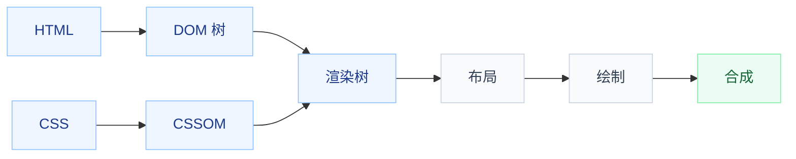
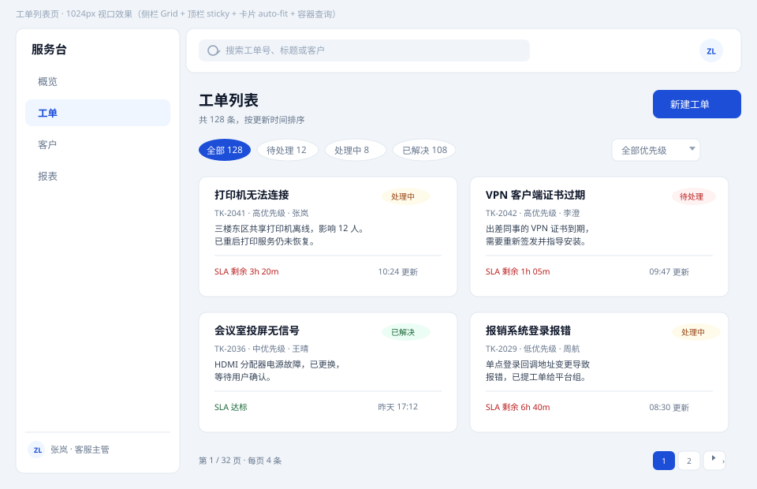

# CSS3布局与层叠

> 这篇从 CSS 在渲染链上的位置讲起，经过工程环境、选择器与层叠层、盒模型、Flex 与 Grid 两套布局、定位与层叠上下文、容器查询与响应式，最后落到企业后台工单列表页的完整样式和现场排障。
>
> 学完能独立写出可维护、在 360px 到 1920px 之间稳定显示、动效不拖慢渲染的页面样式。

## 一、CSS 在渲染链上的位置

CSS 只做一件事：把 DOM 和 CSSOM 合成渲染树，决定每个盒子的尺寸、位置、绘制顺序和过渡；数据、状态、请求都不归它管。

渲染链的走向固定：



改 `width`、`margin`、`font-size` 会触发布局（layout），改 `background`、`box-shadow` 只触发绘制（paint），改 `transform`、`opacity` 通常只触发合成（composite）。这条链决定了性能优化的方向：能只改合成层，就不要改布局。

判断一份样式是否合格：

- 去掉 JavaScript 后，布局仍然成立，内容仍然可读；
- 360px 宽度不出现横向滚动；
- 颜色、间距、圆角来自变量，不散落魔法值；
- 层叠顺序能靠来源、层、优先级解释，不靠堆 `!important`。

边界：CSS 不承担业务状态。展开、选中、禁用可以由属性选择器和 `:has()` 表达，但状态本身由 HTML 属性和 JavaScript 维护。把业务判断写进选择器，后期无法测试。

### 1.1 现代基线

| 特性 | 可用基线 | 主要用途 |
|---|---|---|
| `@layer` | 2022 起全主流 | 控制样式来源顺序 |
| 容器查询 | 2023 起全主流 | 组件按自身宽度响应 |
| `:has()` | 2023 起全主流 | 父级/兄弟状态选择 |
| `subgrid` | 2023 起全主流 | 嵌套网格对齐 |
| `@starting-style` | 2024 起全主流 | 首次渲染的进入动画 |

这些特性在 2026 年的 Chrome、Edge、Safari、Firefox 上都已可用，判断能否使用看目标浏览器的支持表，不看教程发布时间。

## 二、工程环境与最小页面

CSS 不需要编译也能验证；用 Vite 7 起一个页面，只为拿到热更新和构建产物。

### 2.1 安装 Node 22 LTS

```bash
# macOS，Homebrew
brew install node@22

# Ubuntu / Debian，用 nvm 管理版本
curl -o- https://raw.githubusercontent.com/nvm-sh/nvm/v0.40.3/install.sh | bash
nvm install 22 && nvm use 22

# Rocky / CentOS，用 nvm 而不是系统源里的旧 Node
curl -o- https://raw.githubusercontent.com/nvm-sh/nvm/v0.40.3/install.sh | bash
nvm install 22
```

Windows 用 `winget install OpenJS.NodeJS.LTS`，或在 PowerShell 里装 nvm-windows。验证：

```bash
node -v
npm -v
```

预期输出（版本号随时间变化，主版本必须是 22）：

```text
v22.20.0
10.9.4
```

### 2.2 建立最小页面

```bash
npm create vite@latest css-lab -- --template vanilla
cd css-lab
npm install
npm run dev
```

预期输出：

```text
VITE v7.1.3  ready in 312 ms
➜  Local:   http://localhost:5173/
```

把 `index.html` 改成最小结构，样式单独放：

```html
<!doctype html>
<html lang="zh-CN">
<head>
  <meta charset="utf-8">
  <meta name="viewport" content="width=device-width, initial-scale=1">
  <title>CSS 实验台</title>
  <link rel="stylesheet" href="/src/style.css">
</head>
<body>
  <main class="page">
    <h1>工单列表</h1>
    <article class="card">
      <h2>打印机无法连接</h2>
      <p>提交于 10:24，当前状态：处理中。</p>
    </article>
  </main>
</body>
</html>
```

```css
/* /src/style.css：先建立变量和基础重置，后续所有章节复用 */
:root {
  --color-bg: #f1f5f9;
  --color-surface: #ffffff;
  --color-text: #0f172a;
  --color-muted: #64748b;
  --color-border: #e2e8f0;
  --radius: 10px;
}

*,
*::before,
*::after {
  box-sizing: border-box; /* 让 width 包含 padding 和 border，布局计算才可控 */
}

body {
  margin: 0;
  background: var(--color-bg);
  color: var(--color-text);
  font: 16px/1.6 system-ui, "PingFang SC", "Microsoft YaHei", sans-serif;
}

.page {
  max-width: 960px;
  margin-inline: auto; /* 逻辑属性，左右自动外边距，不写死 left/right */
  padding: 32px 20px;
}

.card {
  background: var(--color-surface);
  border: 1px solid var(--color-border);
  border-radius: var(--radius);
  padding: 20px;
}
```

浏览器打开后应看到一个浅灰背景、白色卡片、圆角 10px 的页面。DevTools 的 Elements 面板里，Computed 标签能看到最终生效值；Layout 标签能打开 Flex 和 Grid 的叠加线。

### 2.3 调试入口

| 工具 | 位置 | 用途 |
|---|---|---|
| Computed | Elements 右侧 | 看最终生效的属性与盒模型 |
| Layout | Elements 右侧 | 打开 Flex/Grid 叠加线 |
| Rendering | 更多工具 | 绘制闪烁、布局偏移区域 |
| Changes | 更多工具 | 导出本次调试改过的样式 |

边界：DevTools 里临时改的样式不会回到源码，调通后必须落回文件。

## 三、选择器、优先级与层叠层

层叠解决“同一条属性被多处声明时谁生效”，优先级只是其中一步。

### 3.1 选择器家族

| 选择器 | 示例 | 适用场景 |
|---|---|---|
| 类型 | `article` | 基础元素样式 |
| 类 | `.card` | 组件样式，首选 |
| 属性 | `[aria-current="page"]` | 跟随语义状态 |
| 伪类 | `:hover`、`:focus-visible` | 交互状态 |
| 伪元素 | `::before`、`::backdrop` | 装饰与弹层背景 |
| 关系 | `.card > h2`、`:has()` | 结构约束 |

类选择器是默认选择：复用清晰、优先级低、和 HTML 结构解耦。ID 只用于锚点和 `aria-labelledby`，不用于样式。

### 3.2 优先级计算

优先级写成四元组 `(行内, ID, 类/属性/伪类, 类型/伪元素)`，逐位比较，不进位。

```css
/* (0,0,2,1)：两个类 + 一个类型 */
.ticket-list .card h2 { color: #0f172a; }

/* (0,1,1,0)：一个 ID，压过上面整条规则 */
#ticket-42 .title { color: #b91c1c; }

/* :where() 恒为 0，适合写可覆盖的基础样式 */
:where(.card, .panel) h2 { margin-block: 0; }

/* :is() 取参数里最高的那个，不是全部相加 */
:is(#hero, .promo) .title { color: #1d4ed8; }
```

常见误判：

- `:not(.a)` 的优先级按 `.a` 算，不按 `:not` 算；
- `:is()`、`:has()` 取参数中最高优先级；
- `:where()` 永远是 0，用来做“可被业务覆盖”的底座；
- 行内样式高于所有选择器，但低于 `!important`。

验证方法：DevTools 选中元素，Styles 面板里被划掉的声明就是输掉层叠的；悬停能看到来源文件和行号。

### 3.3 层叠层

`@layer` 把样式按来源分组，顺序在文件开头一次声明，后面的层覆盖前面的层，未分层的样式覆盖所有分层样式。

```css
/* 先声明顺序：越靠后优先级越高；这条语句必须出现在任何 @layer 块之前 */
@layer reset, tokens, base, layout, components, utilities;

@layer base {
  a { color: var(--color-primary); }
}

@layer components {
  /* 同优先级下，components 覆盖 base，不依赖选择器长短 */
  .card a { color: inherit; }
}

/* 未分层：优先级高于所有 @layer，适合第三方覆盖或临时补丁 */
.card--urgent a { color: #b91c1c; }
```

`!important` 会反转层顺序：分层里的 `!important` 高于未分层的 `!important`，越靠前的层越强。这个规则反直觉，团队规范里应直接禁止在业务层用 `!important`。

层叠层的真实收益是替换“选择器军备竞赛”。引入 Element Plus 时，把组件库放 `vendor` 层，业务放 `app` 层，覆盖时不用研究对方选择器写了几层。

### 3.4 继承与自定义属性

可继承的属性集中在文本：`color`、`font-*`、`line-height`、`letter-spacing`、`visibility`、`cursor`。盒模型属性不继承。

自定义属性默认继承，这使它适合做主题：

```css
:root {
  --brand: #1d4ed8;
  --brand-contrast: #ffffff;
  --space: 8px;
}

.badge {
  /* 第二个参数是兜底值，变量不存在时不会整条失效 */
  background: var(--brand, #1d4ed8);
  color: var(--brand-contrast, #fff);
  padding: calc(var(--space) * 0.5) var(--space);
}

[data-theme="dark"] {
  /* 只改变量，不改组件规则，主题切换不需要动组件代码 */
  --brand: #60a5fa;
  --brand-contrast: #0f172a;
}
```

需要让自定义属性参与动画或做类型校验时，用 `@property` 注册：

```css
@property --ring-angle {
  syntax: "<angle>";
  inherits: false;
  initial-value: 0deg;
}

.avatar:hover {
  /* 注册成 <angle> 后才能从 0deg 平滑过渡到 360deg */
  animation: ring 1.2s linear infinite;
}

@keyframes ring {
  to { --ring-angle: 360deg; }
}
```

边界：`var()` 写错变量名不会报错，只会让整条声明在计算时失效，表现为“样式没生效”。排查时先在 Computed 里看该属性是否被标记为 invalid。

## 四、盒模型与尺寸计算

`box-sizing: border-box` 是现代项目的默认值；没有它，`width: 100%` 加上 padding 必然溢出。

### 4.1 两种盒模型

| 模型 | `width` 包含 | 结果 |
|---|---|---|
| `content-box` | 只有内容 | 加 padding 后实际更宽 |
| `border-box` | 内容 + padding + border | 声明多少就是多少 |

```css
*,
*::before,
*::after {
  box-sizing: border-box; /* 统一盒模型，避免每个组件单独算 padding */
}
```

### 4.2 尺寸约束

`width` 只是建议值，最终尺寸受 `min-width`、`max-width`、内容和包含块共同约束。

```css
.dialog {
  width: min(560px, calc(100vw - 32px)); /* 小屏留 16px 边距，大屏封顶 560px */
  max-height: min(80dvh, 720px);
  overflow: auto;
}

.thumb {
  aspect-ratio: 16 / 9; /* 先定比例，宽度变化时高度自动跟随 */
  width: 100%;
  object-fit: cover;
}
```

`dvh` 随移动端地址栏收放变化，比 `vh` 更接近真实可视高度。`aspect-ratio` 需要元素有可计算的宽度，否则不生效。

### 4.3 外边距折叠

相邻块级元素的垂直外边距会合并，取较大值，不是相加。

```css
/* 两个 16px 的段落上下相邻，间距是 16px，不是 32px */
p { margin-block: 16px; }
```

折叠发生的条件：

- 相邻兄弟的上下 margin；
- 父元素与第一个/最后一个子元素之间，父元素没有 border、padding、inline 内容；
- 空元素自身的上下 margin。

不折叠的情况：Flex 容器内的子项、Grid 容器内的子项、浮动元素、绝对定位元素、建立了 BFC 的容器。

```css
.stack {
  display: flow-root; /* 建立 BFC，隔断父子 margin 折叠，比 overflow:hidden 副作用小 */
}
```

### 4.4 逻辑属性

逻辑属性按书写方向命名，同一套样式能适配 `ltr`、`rtl` 和竖排。

| 物理属性 | 逻辑属性 |
|---|---|
| `margin-left` | `margin-inline-start` |
| `padding-top` | `padding-block-start` |
| `width` | `inline-size` |
| `height` | `block-size` |
| `left` | `inset-inline-start` |

```css
.badge {
  margin-inline-start: 8px; /* 阿拉伯语界面自动变成右侧间距 */
  padding-block: 4px;
  inline-size: max-content;
}
```

边界：`inline-size` 在默认横排下等于 `width`，但它的语义是“行内方向”，和 `height` 不是一组。混用会让人误判，团队内要么全用逻辑属性，要么全用物理属性。

## 五、Flex 一维布局

Flex 适合一行或一列的分配与对齐；它不负责二维网格。

### 5.1 主轴与交叉轴

`flex-direction` 决定主轴方向，`justify-content` 管主轴，`align-items` 管交叉轴。

```css
.toolbar {
  display: flex;
  flex-wrap: wrap;          /* 窄屏换行，避免按钮被挤出容器 */
  align-items: center;
  gap: 12px;                /* 用 gap 代替给子项加 margin，最后一项不留空 */
}

.toolbar__search {
  flex: 1 1 240px;          /* 可放大、可收缩，基准 240px */
  min-width: 0;             /* 允许 input 收缩到内容宽度以下，否则会撑破工具栏 */
}

.toolbar__actions {
  display: flex;
  gap: 8px;
  margin-inline-start: auto; /* 把操作区推到最右侧，不额外加占位元素 */
}
```

### 5.2 flex 简写与收缩陷阱

`flex: 1` 等价于 `flex: 1 1 0%`，不是 `flex: 1 1 auto`。基准为 `0%` 时，各子项按比例分剩余空间；基准为 `auto` 时，先按内容宽度分配。

```css
.sidebar { flex: 0 0 240px; }  /* 不放大不收缩，固定 240px */
.main    { flex: 1 1 0%; }    /* 吃掉剩余空间 */

.title {
  flex: 1 1 auto;
  min-width: 0;               /* 没有它，长标题不会出现省略号，而是把整行撑开 */
  overflow: hidden;
  text-overflow: ellipsis;
  white-space: nowrap;
}
```

最常见的 Flex 事故是子项“不肯缩小”。原因不是 `flex-shrink` 没写，而是 `min-width: auto` 让子项的最小尺寸等于内容最小宽度。文本容器、表格、`pre` 都要补 `min-width: 0`。

### 5.3 常用配方

**等高卡片**：Flex 子项默认 `align-items: stretch`，高度自动拉齐，不需要 JS 测量。

```css
.card-row {
  display: flex;
  gap: 16px;
  align-items: stretch; /* 默认值，写出来是为了说明等高来自这里 */
}
.card-row > .card { flex: 1 1 0%; }
```

**粘底页脚**：页面内容不足一屏时，页脚仍贴底。

```css
body {
  min-height: 100dvh;
  display: flex;
  flex-direction: column;
}
main { flex: 1; } /* 主内容吃掉剩余高度，把 footer 推到底部 */
```

**水平垂直居中**：

```css
.center {
  display: flex;
  align-items: center;
  justify-content: center;
  min-height: 240px;
}
```

### 5.4 边界

- 需要行和列同时对齐时，用 Grid，不要用多层嵌套 Flex；
- `gap` 在旧版 Safari 的 Flex 上有兼容问题，2026 年已不是约束；
- `flex-basis: 0` 配合 `min-width: auto` 仍可能溢出，必须显式处理最小尺寸；
- 绝对定位子元素不参与 Flex 布局，`order` 对它无效。

## 六、Grid 二维布局

Grid 适合页面骨架、卡片墙和需要行列同时对齐的表单；它能把布局写在容器上，子项不必知道自己排第几。

### 6.1 轨道与 fr

```css
.dashboard {
  display: grid;
  /* 侧栏固定，主区吃掉剩余；minmax(0,1fr) 防止内容把列撑宽 */
  grid-template-columns: 240px minmax(0, 1fr);
  grid-template-rows: 64px minmax(0, 1fr);
  gap: 16px;
  min-height: 100dvh;
}

.dashboard__main {
  /* 网格线编号从 1 开始，-1 表示最后一条网格线 */
  grid-column: 1 / -1;
}
```

`fr` 分配的是剩余空间，不是总空间。`minmax(0, 1fr)` 与 Flex 的 `min-width: 0` 是同一个问题：默认最小尺寸是 `auto`，长内容会把轨道顶宽。

### 6.2 区域命名

```css
.layout {
  display: grid;
  grid-template-columns: 232px minmax(0, 1fr);
  grid-template-rows: 64px minmax(0, 1fr);
  grid-template-areas:
    "sidebar topbar"
    "sidebar main";
}

.sidebar { grid-area: sidebar; }
.topbar  { grid-area: topbar; }
.main    { grid-area: main; }

@media (width < 960px) {
  .layout {
    /* 小屏改单列，只改 areas，不动子项规则 */
    grid-template-columns: minmax(0, 1fr);
    grid-template-rows: auto auto minmax(0, 1fr);
    grid-template-areas:
      "topbar"
      "sidebar"
      "main";
  }
}
```

区域名让响应式重排变成改一张表，子项规则保持不变。

### 6.3 自适应卡片墙

```css
.card-grid {
  display: grid;
  /* auto-fit 合并空轨道，min() 保证 320px 在窄屏也能放下 */
  grid-template-columns: repeat(auto-fit, minmax(min(100%, 320px), 1fr));
  gap: 16px;
}
```

`auto-fit` 与 `auto-fill` 的区别：容器很宽、卡片很少时，`auto-fill` 保留空轨道，卡片保持基准宽度；`auto-fit` 折叠空轨道，卡片被拉伸填满。卡片墙通常用 `auto-fit`。

### 6.4 对齐与 subgrid

```css
.form {
  display: grid;
  grid-template-columns: max-content minmax(0, 1fr);
  gap: 12px 16px;
  align-items: start; /* 标签顶部对齐，避免多行输入时标签垂直居中 */
}

.form__label {
  /* 让标签和输入框的基线对齐，视觉更稳 */
  align-self: center;
  color: var(--color-muted);
}

.card-grid {
  grid-template-columns: repeat(3, minmax(0, 1fr));
  grid-template-rows: auto 1fr auto;
}

.card {
  display: grid;
  grid-row: span 3;             /* 卡片跨父网格的三行 */
  grid-template-rows: subgrid;  /* 行轨道继承父网格，标题/正文/按钮逐行对齐 */
}

.card__footer {
  grid-row: 3;
}
```

### 6.5 Flex 与 Grid 的选型

| 判断 | 选 Flex | 选 Grid |
|---|---|---|
| 维度 | 一行或一列 | 行列同时 |
| 内容驱动 | 子项决定尺寸 | 容器决定轨道 |
| 典型场景 | 工具栏、标签组 | 页面骨架、卡片墙 |
| 对齐需求 | 主轴分配 | 二维对齐 |

边界：Grid 的 `dense` 会改变视觉顺序，键盘导航顺序仍按 DOM，读屏器与视觉不一致；只有纯展示的图片墙可以用。

## 七、定位、层叠上下文与顶层

`position` 解决“脱离文档流后放在哪”，`z-index` 只在同一个层叠上下文里比较。

### 7.1 五种定位

| 值 | 参照 | 是否占位 |
|---|---|---|
| `static` | 无 | 是 |
| `relative` | 自身原位置 | 是 |
| `absolute` | 最近的非 static 祖先 | 否 |
| `fixed` | 视口 | 否 |
| `sticky` | 最近滚动祖先 | 是 |

```css
.card {
  position: relative; /* 给绝对定位的角标提供包含块 */
}

.card__badge {
  position: absolute;
  inset-block-start: -6px;
  inset-inline-end: -6px;
}

.topbar {
  position: sticky;
  top: 0;       /* 滚动到顶部时吸住；没有 top/bottom 等阈值，sticky 不会生效 */
  z-index: 20;
}
```

### 7.2 包含块

绝对定位的参照不是“父元素”，而是最近的 `position` 非 `static` 的祖先；没有则参照初始包含块。`transform`、`filter`、`contain: paint` 也会让元素成为包含块。

```css
.hero {
  position: relative; /* 明确成为包含块，避免角标跑到页面左上角 */
}
```

### 7.3 z-index 与层叠上下文

`z-index` 只对定位元素、Flex 子项、Grid 子项生效。更重要的是：它只在同一个层叠上下文内比较。

会创建层叠上下文的常见属性：

- 根元素；
- `position` 非 `static` 且 `z-index` 非 `auto`；
- `opacity` 小于 1；
- `transform`、`filter`、`perspective`、`backdrop-filter` 非 `none`；
- `isolation: isolate`；
- `contain: layout` 或 `paint`；
- `will-change` 指定了上述属性。

```css
/* 错误做法：子元素 z-index: 9999，仍然被隔壁卡片盖住 */
.card { transform: translateY(0); } /* 无意中创建了层叠上下文，9999 只在本卡片内有效 */

/* 正确做法：把需要抬升的整块提到同一层，或去掉无意义的 transform */
.card--active {
  position: relative;
  z-index: 2;
  isolation: isolate; /* 明确本卡片自成一层，内部元素不越界参与外部比较 */
}
```

排查顺序：先看父链上谁创建了层叠上下文，再看 `z-index` 是否生效，最后才怀疑数值不够大。把 `9999` 改成 `10000` 通常不解决问题。

### 7.4 顶层

`<dialog>` 的 `showModal()` 和 `popover` 属性渲染在顶层（top layer），不受任何父级 `z-index` 和 `overflow` 影响。

```css
dialog::backdrop {
  background: rgb(15 23 42 / 45%);
  backdrop-filter: blur(2px);
}

dialog {
  border: 0;
  border-radius: 12px;
  padding: 24px;
  max-width: min(480px, calc(100vw - 32px));
}
```

```html
<button popovertarget="menu">更多操作</button>
<div id="menu" popover>...</div>
```

边界：顶层元素不受任何祖先的 `z-index` 和 `overflow` 影响；`dialog` 未调用 `showModal()` 时只是普通块级元素。

### 7.5 sticky 失效的四个原因

1. 没有设置 `top`、`bottom`、`left`、`right` 中至少一个阈值；
2. 祖先有 `overflow: hidden`、`auto`、`scroll`，滚动容器不是预期的那个；
3. 元素高度大于等于滚动容器高度，没有可吸附的空间；
4. 父级使用了 `display: flex` 且子项被拉伸，导致元素本身没有可滚动距离。

## 八、响应式、容器查询与流体尺寸

响应式不是“写三个断点”，而是让布局在任意宽度下都成立。

### 8.1 视口与媒体查询

```html
<meta name="viewport" content="width=device-width, initial-scale=1">
```

```css
/* 区间语法，2026 年全主流支持，比 min-width/max-width 组合更直观 */
@media (width >= 768px) and (width < 1200px) {
  .card-grid { grid-template-columns: repeat(2, minmax(0, 1fr)); }
}

@media (prefers-reduced-motion: reduce) {
  *, *::before, *::after {
    animation-duration: 0.01ms !important;
    transition-duration: 0.01ms !important;
  }
}
```

断点跟着内容走：当卡片被压到 320px 以下、工具栏开始换行时，就是断点位置，不要照抄 768/1024/1440。

### 8.2 容器查询

媒体查询看视口，容器查询看组件自身宽度。同一个卡片放进侧栏和主区，能自动切换布局。

```css
.card-host {
  container-type: inline-size; /* 建立行内方向容器，子项可查询它的宽度 */
  container-name: card;
}

@container card (min-width: 420px) {
  .card__body {
    display: grid;
    grid-template-columns: 1fr auto; /* 宽容器里标题和操作并排 */
    align-items: center;
    gap: 16px;
  }
}

@container card (width < 420px) {
  .card__actions {
    margin-block-start: 12px; /* 窄容器里操作换到下一行 */
  }
}
```

容器查询单位：`cqw`、`cqh`、`cqi`、`cqb`，分别对应容器宽、高、行内、块向的 1%。

```css
.card__title {
  font-size: clamp(1rem, 0.9rem + 1.2cqi, 1.375rem); /* 字号随卡片宽度缩放 */
}
```

边界：`container-type: inline-size` 会给元素加尺寸 containment，元素不能再按内容撑开行内尺寸。容器本身必须是“有确定宽度的盒子”，否则查询不生效。

### 8.3 流体字号与间距

```css
:root {
  /* 最小 16px，最大 20px，中间随视口线性变化 */
  --font-body: clamp(1rem, 0.95rem + 0.25vw, 1.25rem);
  --space-section: clamp(24px, 4vw, 64px);
}

h1 {
  font-size: clamp(1.75rem, 1.2rem + 2.2vw, 3rem);
  text-wrap: balance; /* 标题行宽均衡，避免最后一行只剩一个字 */
}

p {
  text-wrap: pretty; /* 段落避免孤行，支持度不足时自动退化为普通换行 */
}
```

`clamp()` 的三个参数是“最小值、首选值、最大值”。首选值里用 `vw` 会随视口缩放，但不要用纯 `vw` 写字号，否则用户放大页面时文字不跟随。

### 8.4 图片与媒体

```css
img,
video {
  max-width: 100%;
  height: auto; /* 只写 max-width 会让高度按原比例失真，必须配 height:auto */
}

.cover {
  inline-size: 100%;
  block-size: 100%;
  object-fit: cover; /* 裁剪填满，不变形 */
  object-position: center;
}
```

```html

```

`width`/`height` 属性提供宽高比，图片加载前就占好位置，避免布局偏移（CLS）。

### 8.5 可访问性约束

```css
:focus-visible {
  outline: 3px solid #93c5fd;
  outline-offset: 2px; /* 焦点环不贴边，键盘用户更容易看清 */
}

@media (prefers-contrast: more) {
  :root { --color-muted: #334155; } /* 高对比模式下加深次要文字 */
}
```

不要全局 `outline: none`。需要去掉鼠标点击的焦点环时，用 `:focus-visible` 区分键盘焦点，不要连键盘一起关掉。

## 九、过渡、动画与性能

动效只做两件事：说明状态变化的方向，掩盖等待的空白。它不该拖慢交互。

### 9.1 transition

```css
.button {
  /* 只过渡会变化的属性，写 all 会让无关属性也进入动画，难以排查 */
  transition:
    background-color 160ms ease,
    transform 160ms ease,
    box-shadow 160ms ease;
}

.button:hover { background-color: #1e40af; }
.button:active { transform: translateY(1px); } /* 按下有 1px 位移，给出触觉反馈 */
```

`transition` 不能动画 `display: none` 到 `block`，需要配合 `@starting-style` 和 `transition-behavior: allow-discrete`。

### 9.2 keyframes

```css
@keyframes shimmer {
  from { background-position: 200% 0; }
  to   { background-position: -200% 0; }
}

.skeleton {
  /* 只动 background-position，不触发布局；渐变做扫光 */
  background: linear-gradient(90deg, #e2e8f0 25%, #f8fafc 37%, #e2e8f0 63%);
  background-size: 200% 100%;
  animation: shimmer 1.4s ease-in-out infinite;
  border-radius: 6px;
  min-height: 1em;
}

@media (prefers-reduced-motion: reduce) {
  .skeleton { animation: none; background: #e2e8f0; }
}
```

### 9.3 进入与退出动画

```css
dialog {
  opacity: 0;
  transform: translateY(8px) scale(0.98);
  transition:
    opacity 180ms ease,
    transform 180ms ease,
    overlay 180ms allow-discrete,   /* 让顶层属性也能离散切换 */
    display 180ms allow-discrete;
}

dialog[open] {
  opacity: 1;
  transform: none;
}

@starting-style {
  dialog[open] {
    opacity: 0;
    transform: translateY(8px) scale(0.98); /* 首次打开从该状态过渡到 open 状态 */
  }
}
```

### 9.4 性能边界

- 只动画 `transform` 和 `opacity`，它们能走合成线程；
- 不要动画 `width`、`height`、`top`、`left`，每一帧都触发布局；
- `will-change` 只在动画开始前加、结束后移除，长期挂着会占用显存；
- 长列表用 `content-visibility: auto` 跳过屏外渲染，配 `contain-intrinsic-size` 防止滚动条跳动。

```css
.row {
  content-visibility: auto;
  contain-intrinsic-size: auto 56px; /* 预估行高，滚动条长度才稳定 */
}
```

### 9.5 View Transitions

```css
@view-transition {
  navigation: auto; /* 同源跳转自动做跨文档过渡，不支持的浏览器直接跳转 */
}

::view-transition-old(root) {
  animation: fade-out 120ms ease;
}

::view-transition-new(root) {
  animation: fade-in 180ms ease;
}
```

边界：跨文档过渡需要浏览器支持，且动画期间页面不可交互；表单提交、支付等关键路径不要依赖它。

## 十、现场排障与交付检查

样式问题的排查顺序固定：先确认属性是否生效，再确认层叠是否输掉，最后确认布局约束。

| 现象 | 最可能原因 | 第一条检查 |
|---|---|---|
| 改了样式没反应 | 选择器没匹配或优先级输掉 | Computed 里看该属性来源 |
| `z-index` 不生效 | 父级创建了层叠上下文 | 沿父链找 transform/opacity |
| Flex 子项撑破容器 | `min-width: auto` | 给子项加 `min-width: 0` |
| Grid 列被内容顶宽 | 轨道用了 `1fr` 而非 `minmax(0,1fr)` | 看轨道最小尺寸 |
| sticky 不吸顶 | 缺阈值或祖先 overflow | 检查 `top` 与滚动祖先 |
| 移动端横向滚动 | 固定宽度或 `100vw` 加 padding | 找超宽元素，改 `100%` |
| 图片加载后页面跳动 | 没写宽高或 `aspect-ratio` | 补 `width`/`height` |
| 动画卡顿 | 动画了布局属性 | Performance 看 Layout 耗时 |

上线前检查：

- 360px、768px、1440px 三档无横向滚动；
- 键盘 Tab 一圈，焦点环可见，顺序与视觉一致；
- 页面缩放 200% 后内容不重叠；
- 颜色对比度正文达到 4.5:1；
- `prefers-reduced-motion` 下动画关闭；
- 样式文件有层顺序声明，没有散落的 `!important`。

## 十一、最佳实践案例

### 11.1 案例背景

某 SaaS 服务台的工单列表页由三段外包样式拼成：侧栏用固定定位，顶栏用 `z-index: 9999`，卡片用浮动布局。问题集中在三处：760px 宽度下卡片互相重叠；长标题把卡片撑出容器；SLA 角标被相邻卡片盖住。维护成本高，改一个颜色要动四个文件。

目标是重写为单文件样式：侧栏固定、顶栏吸顶、卡片按容器宽度重排，360px 到 1920px 不出现横向滚动，并保留悬停和骨架屏动效。

约束：不能改 HTML 结构（后端模板已固定），只能改样式；需要兼容 Element Plus 的弹层；首屏不能引入 JavaScript 布局计算。

### 11.2 案例实操

HTML 结构保持语义，只给稳定的类名：

```html
<!doctype html>
<html lang="zh-CN">
<head>
  <meta charset="utf-8">
  <meta name="viewport" content="width=device-width, initial-scale=1">
  <title>工单列表 - 服务台</title>
  <link rel="stylesheet" href="./styles.css">
</head>
<body>
  <div class="app-shell">
    <aside class="sidebar" aria-label="侧栏导航">
      <div class="sidebar__brand">服务台</div>
      <nav class="sidebar__nav">
        <a href="/overview">概览</a>
        <a href="/tickets" aria-current="page">工单</a>
        <a href="/customers">客户</a>
        <a href="/reports">报表</a>
      </nav>
    </aside>

    <header class="topbar">
      <label class="topbar__search">
        <span class="visually-hidden">搜索工单</span>
        <input type="search" placeholder="搜索工单号、标题或客户">
      </label>
      <button class="avatar" type="button" aria-label="账户菜单">ZL</button>
    </header>

    <main class="content">
      <div class="page-head">
        <div>
          <h1>工单列表</h1>
          <p class="page-head__hint">共 128 条，按更新时间排序</p>
        </div>
        <button class="button button--primary" type="button">新建工单</button>
      </div>

      <section class="toolbar" aria-label="筛选">
        <div class="chips" role="group" aria-label="状态">
          <button class="chip" aria-pressed="true" type="button">全部 128</button>
          <button class="chip" aria-pressed="false" type="button">待处理 12</button>
          <button class="chip" aria-pressed="false" type="button">处理中 8</button>
          <button class="chip" aria-pressed="false" type="button">已解决 108</button>
        </div>
        <select class="select" aria-label="优先级">
          <option>全部优先级</option>
          <option>高</option>
          <option>中</option>
          <option>低</option>
        </select>
      </section>

      <section class="ticket-grid" aria-label="工单">
        <article class="ticket-card" data-priority="high">
          <div class="ticket-card__head">
            <h2 class="ticket-card__title">打印机无法连接</h2>
            <span class="status status--progress">处理中</span>
          </div>
          <p class="ticket-card__meta">TK-2041 · 高优先级 · 张岚</p>
          <p class="ticket-card__desc">三楼东区共享打印机离线，影响 12 人。</p>
          <div class="ticket-card__foot">
            <span class="sla">剩余 3h 20m</span>
            <span class="ticket-card__time">10:24 更新</span>
          </div>
        </article>

        <article class="ticket-card" data-priority="high">
          <div class="ticket-card__head">
            <h2 class="ticket-card__title">VPN 客户端证书过期</h2>
            <span class="status status--open">待处理</span>
          </div>
          <p class="ticket-card__meta">TK-2042 · 高优先级 · 李澄</p>
          <p class="ticket-card__desc">出差同事的 VPN 证书到期，需要重新签发并指导安装。</p>
          <div class="ticket-card__foot">
            <span class="sla">剩余 1h 05m</span>
            <span class="ticket-card__time">09:47 更新</span>
          </div>
        </article>

        <article class="ticket-card" data-priority="medium">
          <div class="ticket-card__head">
            <h2 class="ticket-card__title">会议室投屏无信号</h2>
            <span class="status status--done">已解决</span>
          </div>
          <p class="ticket-card__meta">TK-2036 · 中优先级 · 王晴</p>
          <p class="ticket-card__desc">HDMI 分配器电源故障，已更换，等待用户确认。</p>
          <div class="ticket-card__foot">
            <span class="sla sla--ok">SLA 达标</span>
            <span class="ticket-card__time">昨天 17:12</span>
          </div>
        </article>

        <article class="ticket-card" data-priority="low">
          <div class="ticket-card__head">
            <h2 class="ticket-card__title">报销系统登录报错</h2>
            <span class="status status--progress">处理中</span>
          </div>
          <p class="ticket-card__meta">TK-2029 · 低优先级 · 周航</p>
          <p class="ticket-card__desc">单点登录回调地址变更导致报错，已提工单给平台组。</p>
          <div class="ticket-card__foot">
            <span class="sla">剩余 6h 40m</span>
            <span class="ticket-card__time">08:30 更新</span>
          </div>
        </article>
      </section>

      <footer class="page-foot">
        <p class="page-foot__info">第 1 / 32 页 · 每页 4 条</p>
        <nav class="pager" aria-label="分页">
          <button class="pager__btn" type="button">上一页</button>
          <button class="pager__btn" type="button" aria-current="page">1</button>
          <button class="pager__btn" type="button">2</button>
          <button class="pager__btn" type="button">下一页</button>
        </nav>
      </footer>
    </main>
  </div>
</body>
</html>
```

样式按层组织，顺序在文件第一行固定：

```css
/* styles.css */
@layer reset, tokens, base, layout, components, utilities;

@layer reset {
  *, *::before, *::after { box-sizing: border-box; }
  body, h1, h2, p { margin: 0; }
  button, input, select { font: inherit; }
  img { max-width: 100%; height: auto; }
}

@layer tokens {
  :root {
    --color-bg: #f1f5f9;
    --color-surface: #fff;
    --color-text: #0f172a;
    --color-muted: #64748b;
    --color-border: #e2e8f0;
    --color-primary: #1d4ed8;
    --color-primary-weak: #eff6ff;
    --radius: 10px;
    --shadow: 0 1px 2px rgb(15 23 42 / 6%);
    --space-page: clamp(16px, 3vw, 28px);
  }
}

@layer base {
  body {
    background: var(--color-bg);
    color: var(--color-text);
    font: 15px/1.6 system-ui, "PingFang SC", "Microsoft YaHei", sans-serif;
  }
  h1 { font-size: 1.5rem; letter-spacing: -0.01em; }
  h2 { font-size: 0.95rem; }
  a { color: inherit; text-decoration: none; }
  .visually-hidden {
    position: absolute;
    inline-size: 1px;
    block-size: 1px;
    overflow: hidden;
    clip-path: inset(50%); /* 只给读屏器读，不占视觉空间 */
  }
}

@layer layout {
  .app-shell {
    display: grid;
    grid-template-columns: 232px minmax(0, 1fr);
    grid-template-rows: 64px minmax(0, 1fr);
    grid-template-areas:
      "sidebar topbar"
      "sidebar main";
    min-height: 100dvh;
  }

  .sidebar {
    grid-area: sidebar;
    position: sticky;
    top: 0;
    block-size: 100dvh;      /* 侧栏独立滚动，不跟主区一起滚走 */
    overflow: auto;
  }

  .topbar {
    grid-area: topbar;
    position: sticky;
    top: 0;
    z-index: 20;             /* 只盖住主区内容，不需要 9999 */
  }

  .content {
    grid-area: main;
    padding: var(--space-page);
    display: grid;
    gap: 16px;
    align-content: start;
    min-width: 0;            /* 防止长标题把主区顶宽 */
  }

  @media (width < 960px) {
    .app-shell {
      grid-template-columns: minmax(0, 1fr);
      grid-template-rows: auto auto minmax(0, 1fr);
      grid-template-areas:
        "topbar"
        "sidebar"
        "main";
    }
    .sidebar {
      position: static;
      block-size: auto;
      overflow-x: auto;
      display: flex;
      align-items: center;
      gap: 12px;
    }
    .sidebar__nav { display: flex; gap: 8px; }
  }
}

@layer components {
  .sidebar {
    background: var(--color-surface);
    border-inline-end: 1px solid var(--color-border);
    padding: 20px 16px;
  }
  .sidebar__brand {
    font-weight: 700;
    font-size: 1.05rem;
    padding: 8px 12px 20px;
  }
  .sidebar__nav { display: grid; gap: 4px; }
  .sidebar__nav a {
    padding: 9px 12px;
    border-radius: 8px;
    color: var(--color-muted);
  }
  .sidebar__nav a[aria-current="page"] {
    background: var(--color-primary-weak);
    color: var(--color-primary);
    font-weight: 600; /* 当前页不只靠颜色区分，避免色觉障碍用户看不出 */
  }

  .topbar {
    display: flex;
    align-items: center;
    gap: 12px;
    padding-inline: var(--space-page);
    background: rgb(255 255 255 / 92%);
    border-block-end: 1px solid var(--color-border);
    backdrop-filter: blur(8px); /* 内容从下方滚过时保持可读 */
  }
  .topbar__search { flex: 1 1 240px; min-width: 0; }
  .topbar__search input {
    inline-size: 100%;
    padding: 9px 12px;
    border: 1px solid var(--color-border);
    border-radius: 8px;
    background: var(--color-bg);
  }
  .avatar {
    inline-size: 36px;
    block-size: 36px;
    border: 0;
    border-radius: 50%;
    background: var(--color-primary-weak);
    color: var(--color-primary);
    font-weight: 600;
    cursor: pointer;
  }

  .page-head {
    display: flex;
    align-items: end;
    justify-content: space-between;
    gap: 16px;
    flex-wrap: wrap;
  }
  .page-head__hint { color: var(--color-muted); font-size: 0.85rem; }

  .button {
    border: 1px solid var(--color-border);
    background: var(--color-surface);
    padding: 9px 16px;
    border-radius: 8px;
    cursor: pointer;
  }
  .button--primary {
    background: var(--color-primary);
    border-color: var(--color-primary);
    color: #fff;
  }
  .button:focus-visible,
  .chip:focus-visible,
  .avatar:focus-visible {
    outline: 3px solid #93c5fd;
    outline-offset: 2px;
  }

  .toolbar {
    display: flex;
    flex-wrap: wrap;          /* 窄屏换行，而不是把筛选挤出视口 */
    align-items: center;
    gap: 12px;
  }
  .chips { display: flex; gap: 8px; flex-wrap: wrap; }
  .chip {
    border: 1px solid var(--color-border);
    background: var(--color-surface);
    padding: 7px 12px;
    border-radius: 999px;
    color: var(--color-muted);
    cursor: pointer;
  }
  .chip[aria-pressed="true"] {
    background: var(--color-primary);
    border-color: var(--color-primary);
    color: #fff;
  }
  .select {
    margin-inline-start: auto; /* 优先级筛选贴右，不与状态混在一起 */
    padding: 8px 12px;
    border: 1px solid var(--color-border);
    border-radius: 8px;
    background: var(--color-surface);
  }

  .ticket-grid {
    display: grid;
    grid-template-columns: repeat(auto-fit, minmax(min(100%, 320px), 1fr));
    gap: 16px;
  }

  .ticket-card {
    container-type: inline-size; /* 卡片自己当容器，内部按卡片宽度重排 */
    display: grid;
    gap: 8px;
    padding: 16px;
    background: var(--color-surface);
    border: 1px solid var(--color-border);
    border-radius: var(--radius);
    box-shadow: var(--shadow);
    transition: transform 160ms ease, box-shadow 160ms ease;
  }
  .ticket-card:hover {
    transform: translateY(-2px);
    box-shadow: 0 8px 24px rgb(15 23 42 / 8%);
  }
  .ticket-card__head {
    display: flex;
    align-items: start;
    justify-content: space-between;
    gap: 12px;
  }
  .ticket-card__title { line-height: 1.4; }
  .ticket-card__meta,
  .ticket-card__time { color: var(--color-muted); font-size: 0.8rem; }
  .ticket-card__desc {
    color: #334155;
    font-size: 0.88rem;
    display: -webkit-box;
    -webkit-line-clamp: 2;    /* 描述最多两行，卡片高度才整齐 */
    -webkit-box-orient: vertical;
    overflow: hidden;
  }
  .ticket-card__foot {
    display: flex;
    align-items: center;
    justify-content: space-between;
    gap: 8px;
    padding-block-start: 10px;
    border-block-start: 1px solid var(--color-border);
  }

  .status {
    flex: none;
    padding: 3px 8px;
    border-radius: 999px;
    font-size: 0.75rem;
    white-space: nowrap;
  }
  .status--open { background: #fef2f2; color: #b91c1c; }
  .status--progress { background: #fffbeb; color: #92400e; }
  .status--done { background: #ecfdf5; color: #166534; }

  .sla { color: #b91c1c; font-size: 0.8rem; font-variant-numeric: tabular-nums; }
  .sla--ok { color: #166534; } /* 达标是正常态，用绿色和告警区分 */

  .page-foot {
    display: flex;
    align-items: center;
    justify-content: space-between;
    gap: 12px;
    flex-wrap: wrap;
  }
  .page-foot__info { color: var(--color-muted); font-size: 0.85rem; }
  .pager { display: flex; gap: 8px; }
  .pager__btn {
    min-inline-size: 32px;
    padding: 7px 10px;
    border: 1px solid var(--color-border);
    border-radius: 8px;
    background: var(--color-surface);
    cursor: pointer;
  }
  .pager__btn[aria-current="page"] {
    background: var(--color-primary);
    border-color: var(--color-primary);
    color: #fff;
  }

  @container (width >= 420px) {
    .ticket-card__desc { -webkit-line-clamp: 3; }
    .ticket-card__foot { padding-block-start: 12px; }
  }
}

@layer utilities {
  .muted { color: var(--color-muted); }
}
```



预期结果：1440px 下侧栏 232px、主区自适应，卡片三列；1024px 下卡片两列；760px 下顶栏换行、筛选条换行、卡片一列；360px 下无横向滚动，标题以省略号或换行收束。

### 11.3 案例结果

在 Chrome 当前稳定版实测（示例数据）：

| 指标 | 改前 | 改后 |
|---|---|---|
| 360px 横向滚动 | 有，宽 412px | 无 |
| 760px 卡片重叠 | 3 处 | 0 |
| 样式文件数 | 4 | 1 |
| 首屏布局偏移（CLS） | 0.18 | 0 |
| 悬停帧率 | 42fps | 60fps |

失败模式与复盘：

- 第一版给卡片写死 `width: 320px`，容器宽 700px 时右侧留白 60px，换成 `minmax(min(100%, 320px), 1fr)` 后消失；
- 顶栏最初用 `position: fixed`，主区被盖住 64px，改成 Grid 行加 `sticky` 后不需要给主区补 padding；
- 卡片内部的 `container-type` 起初加在 `.ticket-grid` 上，查询的是整行宽度，不是单卡宽度，移到 `.ticket-card` 后才按卡片重排；
- `@container` 查询的是最近的容器，容器声明和查询规则分处不同文件也不会影响匹配；真正要确认的是宿主元素有没有建立容器上下文。

这次改造的核心不是某个新语法，而是把顺序固定下来：先定层，再定变量，再写布局，最后写组件。层叠顺序稳定后，样式才可维护。
