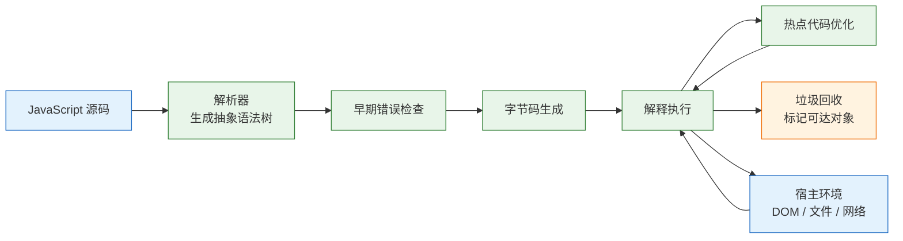
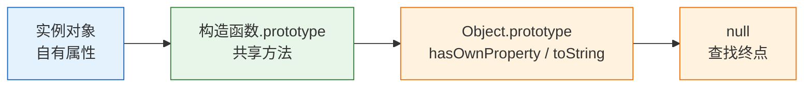
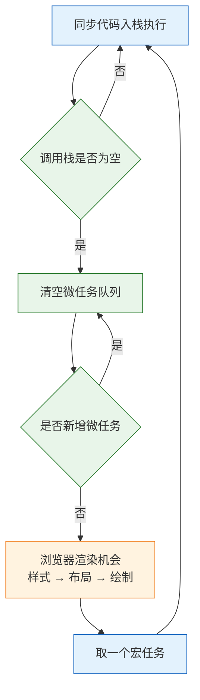

# JavaScript

---

## 一、JavaScript 是什么

### 1.1 核心概念

JavaScript 是由 ECMAScript 规范定义、嵌入宿主环境执行的动态脚本语言。语言本身只规定值与语法，定时器、网络、文件、DOM 由宿主提供，因此同一段代码在浏览器和 Node.js 中的能力并不相同。

理解 JavaScript 先要建立五个概念：

- **值分两类**：原始值不可变，对象可共享；变量保存的是值或引用，不是对象本身。
- **类型在运行时**：变量没有类型标注，值的类型在运行时确定，`typeof` 只能识别有限的几类。
- **函数是一等对象**：函数可以赋值、传参、返回，并携带定义处的词法环境，这构成闭包。
- **对象靠原型复用**：属性读取沿 `[[Prototype]]` 链向上查找，`class` 是这套机制的语法封装。
- **执行靠事件循环**：同步代码在调用栈中运行，异步回调进入任务队列，由宿主在栈空后调度。

| 概念 | 含义 | 可观察结果 |
|---|---|---|
| 原始值 | 字符串、数字、布尔、`null`、`undefined`、`symbol`、`bigint` | 赋值时复制，比较时按值 |
| 对象 | 属性与方法的集合，含数组、函数、日期 | 赋值时复制引用 |
| 词法作用域 | 变量的可见范围由源码位置决定 | 内层函数能读外层变量 |
| 原型链 | 属性查找的回退路径 | 实例能调用原型上的方法 |
| 执行上下文 | 一次函数调用所需的环境记录 | 栈帧随调用进出 |
| 任务队列 | 等待执行的回调队列 | 回调顺序与书写顺序不同 |

JavaScript 不负责多核并行计算、静态类型检查和页面布局。CPU 密集任务应交给 Worker 或服务端，类型约束交给 TypeScript，样式与布局交给 CSS。把 JavaScript 当成多线程语言，或用它承担排版计算，都会落在语言不擅长的区域。

语言与平台的分离带来一个直接后果：同一段语法在不同宿主上的行为可能不同。`setTimeout` 的延迟精度由宿主决定，`fetch` 的请求头限制由浏览器或 Node.js 决定，文件路径分隔符只存在于服务端 API。排查问题时先确认代码运行在哪个宿主，再查对应文档，比反复修改语法更有效。

动态类型也不等于没有类型。每个值在运行时都有确定的类型，只是变量不携带标注；`typeof`、`instanceof`、`Array.isArray` 都是运行时检查手段。它们能区分值和对象类别，却无法区分两个形状相同的业务对象，这正是 TypeScript 在编译期补上的部分。

### 1.2 与相邻技术的关系

JavaScript 常与 ECMAScript、DOM、Node.js、TypeScript 同时出现，边界不清会把规范问题误判成实现问题。

- **ECMAScript**：语言规范，定义语法、类型、内置对象和执行语义。每年发布一版，引擎按规范实现。
- **DOM 与 Web API**：浏览器提供的宿主接口，包括 `document`、`fetch`、`localStorage`、`setTimeout`。它们不属于 ECMAScript。
- **Node.js**：基于 V8 的服务端运行时，提供文件、进程、网络等 API，用 `libuv` 实现事件循环。
- **Deno / Bun**：另外两个运行时，API 集合与 Node.js 有差异，模块解析和权限模型也不同。
- **TypeScript**：JavaScript 的超集，增加静态类型，编译后擦除类型，产物仍是 JavaScript。
- **WebAssembly**：二进制指令格式，适合计算密集模块，与 JavaScript 通过边界调用协作。

| 技术 | 解决的问题 | 与 JavaScript 的边界 |
|---|---|---|
| ECMAScript | 语言语法与语义 | JavaScript 的实现依据 |
| DOM / Web API | 页面与浏览器能力 | 宿主注入，不是语言内置 |
| Node.js | 服务端运行环境 | 提供另一套宿主 API |
| TypeScript | 编译期类型检查 | 类型擦除后仍是 JavaScript |
| WebAssembly | 高性能计算模块 | 通过导入导出与 JavaScript 互操作 |
| JSON | 数据交换格式 | 语法子集，不是 JavaScript 对象 |

> **注意**：`JSON.parse` 的结果是普通 JavaScript 值，不是“JSON 对象”；JSON 不支持 `undefined`、函数、`symbol`、循环引用，日期也会退化为字符串。

### 1.3 运行机制

JavaScript 源码进入引擎后，先解析成抽象语法树，再做早期错误检查，随后生成字节码并由解释器执行。热点函数会被即时编译器优化成机器码，优化失败时退回字节码。整个过程由垃圾回收器管理内存，开发者只持有可达引用。



| 阶段 | 职责 | 常见错误 |
|---|---|---|
| 解析 | 把源码转成抽象语法树 | `SyntaxError`，整段脚本不执行 |
| 早期检查 | 检查重复声明、非法语法 | 模块加载阶段直接失败 |
| 字节码生成 | 生成可执行的中间表示 | 一般不对开发者暴露 |
| 执行 | 按调用栈运行函数 | `TypeError`、`ReferenceError` |
| 优化 | 对热点函数生成机器码 | 去优化导致性能回退 |
| 回收 | 释放不可达对象 | 意外的长引用导致内存上涨 |

规范定义的是执行语义与作业队列，宿主决定何时把回调送入队列、何时渲染。浏览器在每个宏任务后寻找渲染机会，Node.js 按事件循环阶段推进，两者共享“同步优先、微任务其次、宏任务最后”的基本顺序。

即时编译依赖类型反馈。同一个函数长期接收相同形状的对象时，引擎会按隐藏类生成优化代码；后续传入形状不同的对象，优化代码失效并回退，这种现象称为去优化。它不会改变程序结果，只影响性能。保持对象形状稳定、避免在热路径上增删属性，能减少去优化次数。

垃圾回收采用可达性分析，从根对象出发标记仍被引用的对象。全局变量、正在执行的栈帧、闭包环境和未清理的宿主句柄都可能成为根。判断内存是否泄漏，不看对象数量，而看不再需要的对象是否仍能从根到达。

---

## 二、环境与最小程序

### 2.1 运行时与版本

> **版本现状（2026-10）**：ECMAScript 每年发布一版，语言特性以目标运行时的支持表为准；Node.js 22 与 24 处于维护周期内，新代码以当前 LTS 为基线。浏览器端按 evergreen 策略处理，旧版兼容由构建工具决定。

```bash
# 已安装 nvm 或 fnm 后，安装并切换当前 LTS
nvm install --lts
nvm use --lts

# 验证运行时与包管理器
node -v
npm -v

# 查看运行时版本信息
node -p "process.versions"
```

| 运行时 | 主要场景 | 事件循环实现 | 模块默认 |
|---|---|---|---|
| 浏览器 | 页面交互、DOM 操作 | 浏览器任务队列 | 经典脚本，可用 `type="module"` 切换 |
| Node.js | 服务端、脚本、工具链 | `libuv` 阶段模型 | CommonJS，可切 ESM |
| Deno | 安全沙箱、现代 API | Tokio | ESM |
| Bun | 快速启动、一体化工具链 | JavaScriptCore | ESM |

版本选择要看两件事：目标环境是否支持所用语法，以及构建工具是否会把新语法降级。`AbortSignal.timeout`、顶层 `await`、`Array.prototype.toSorted` 这类较新的能力，在旧运行时上不会自动存在。

语法降级与 API 补齐是两件事。转译器能把可选链、类字段改写成旧语法，却无法凭空提供 `AbortController` 或 `structuredClone`；后者需要 polyfill，而 polyfill 只能补齐可模拟的 API，涉及引擎内部行为的能力无法补齐。判断兼容性时分别查语法表和 API 表，不要只看构建是否成功。

### 2.2 最小可运行示例

新建 `hello.mjs`，`.mjs` 后缀强制按 ES 模块解析：

```javascript
// hello.mjs：读取命令行参数并输出
const name = process.argv[2] ?? 'world';   // 缺省参数时回退
console.log(`hello, ${name}`);
```

```bash
node hello.mjs Ada
```

输出：

```text
hello, Ada
```

`process.argv` 的第一项是解释器路径，第二项是脚本路径，用户参数从下标 2 开始。`??` 只在左侧为 `null` 或 `undefined` 时回退，不会把空字符串当成缺省值。

浏览器端需要模块脚本：

```html
<!-- 页面入口：type="module" 启用 ESM、严格模式和延迟执行 -->
<script type="module" src="./main.js"></script>
```

### 2.3 工程目录与模块类型

```text
js-demo/
├── package.json
├── .nvmrc
├── src/
│   ├── main.mjs
│   ├── scheduler.mjs
│   ├── pager.mjs
│   ├── demo.mjs
│   └── page-demo.mjs
├── test/
│   └── scheduler.test.mjs
└── README.md
```

```json
{
  "name": "js-demo",
  "private": true,
  "type": "module",
  "engines": { "node": ">=22" },
  "scripts": {
    "start": "node src/demo.mjs",
    "test": "node --test"
  }
}
```

| 文件 | 作用 | 常见错误 |
|---|---|---|
| `package.json` | 声明包名、模块类型、脚本 | 缺少 `type` 导致 ESM 语法报错 |
| `.nvmrc` | 固定 Node.js 版本 | 团队成员版本不一致 |
| `src/` | 运行时代码 | 把测试与构建产物混入 |
| `test/` | 测试文件 | 测试依赖生产入口的副作用 |
| `README.md` | 运行与约定说明 | 命令与实际脚本不一致 |

`"type": "module"` 让 `.js` 按 ESM 解析；没有该字段时，`.js` 默认按 CommonJS 处理。混合项目用 `.mjs` 与 `.cjs` 明确后缀，比依赖目录级配置更稳定。

---

## 三、语法与类型系统

### 3.1 原始类型与对象类型

JavaScript 有七种原始类型和一种对象类型。原始值不可变，对象通过引用共享。

```javascript
// 原始值按值复制
let a = 1;
let b = a;
b += 1;
console.log(a, b);                 // 1 2

// 对象按引用复制
const o1 = { n: 1 };
const o2 = o1;
o2.n = 2;
console.log(o1.n);                 // 2，两个变量指向同一对象

// 浮点数采用 IEEE 754 双精度
console.log(0.1 + 0.2);            // 0.30000000000000004
console.log(Number.MAX_SAFE_INTEGER); // 9007199254740991
console.log(Number.isSafeInteger(2 ** 53)); // false

// BigInt 用 n 后缀，不能与 Number 直接混算
console.log(10n + 20n);            // 30n
// console.log(10n + 1);           // TypeError

// 字符串按 UTF-16 码元计数
console.log('😀'.length);          // 2
```

| 值 | `typeof` 结果 | 说明 |
|---|---|---|
| `'text'` | `string` | 原始值，不可变 |
| `42` / `3.14` | `number` | 双精度浮点，含 `NaN`、`Infinity` |
| `10n` | `bigint` | 任意精度整数，不与 `number` 混算 |
| `true` | `boolean` | 只有两个值 |
| `undefined` | `undefined` | 未赋值或缺失 |
| `Symbol('id')` | `symbol` | 唯一标识，可作属性键 |
| `null` | `object` | 历史遗留，判断空值要单独处理 |
| `{}` / `[]` / `new Date()` | `object` | 引用类型 |
| `function(){}` | `function` | 可调用对象 |

> **注意**：`typeof null === 'object'` 是语言的历史行为，不能用来判断对象。判断 `null` 用 `value === null`；判断普通对象用 `value !== null && typeof value === 'object' && !Array.isArray(value)`。

`symbol` 每次调用都产生唯一值，常用作避免命名冲突的属性键；`Symbol.for` 则从全局符号表取值，同名返回同一个符号。`bigint` 适合超过安全整数范围的计数与标识，不能与 `number` 直接相加，也不能传给只接受数字的内置函数，边界处需要显式转换。

字符串不可变，所有看似修改的方法都返回新字符串。`slice`、`substring`、`substr` 的参数语义不同，前两者按起止索引截取，后者第二个参数是长度且已不推荐使用。处理用户可见文本时还要注意 Unicode 组合字符与地区语言规则，计数用 `Array.from(str).length` 更接近字符数，但真正按字素计数需要 `Intl.Segmenter`。

### 3.2 变量声明与作用域

`var`、`let`、`const` 的差异集中在作用域、提升和重复声明三处。

| 特性 | `var` | `let` | `const` |
|---|---|---|---|
| 作用域 | 函数或全局 | 块 | 块 |
| 提升 | 提升并初始化为 `undefined` | 提升但不初始化 | 同 `let` |
| 暂时性死区 | 无 | 有 | 有 |
| 重复声明 | 允许 | 报错 | 报错 |
| 重新赋值 | 允许 | 允许 | 不允许 |
| 挂到 `globalThis` | 浏览器脚本中会 | 不会 | 不会 |

```javascript
console.log(hoisted);   // undefined，声明被提升但赋值未执行
var hoisted = 1;

// console.log(tdz);    // ReferenceError: Cannot access 'tdz' before initialization
let tdz = 2;

function createCounter() {
  let count = 0;        // 被两个闭包共享的绑定
  return {
    inc: () => ++count,
    get: () => count,
  };
}

const counter = createCounter();
counter.inc();
counter.inc();
console.log(counter.get());       // 2
console.log(typeof count);        // "undefined"，外部不可见
```

`const` 锁的是绑定，不是对象内容：

```javascript
const user = { name: 'Ada' };
user.name = 'Grace';              // 允许，修改对象属性
// user = {};                     // TypeError，重新绑定被拒绝
```

循环中的闭包差异来自绑定数量：

```javascript
for (var i = 0; i < 3; i++) {
  setTimeout(() => console.log(i));
}
// 3 3 3，三个回调共享同一个函数级绑定

for (let j = 0; j < 3; j++) {
  setTimeout(() => console.log(j));
}
// 0 1 2，每轮迭代创建新的块级绑定
```

函数声明会连同函数体一起提升，函数表达式只提升变量名。类声明存在暂时性死区，提前访问会抛 `ReferenceError`。

块级函数在严格模式下的作用域限于所在块，非严格模式的历史行为因引擎而异。依赖“函数在哪都能调用”的写法在模块化代码中并不可靠，公共函数应显式定义在模块顶层。参数默认值在每次调用时求值，且只能引用前面的参数；把依赖后置参数的默认值写在前面，会得到暂时性死区错误。

### 3.3 类型转换与相等比较

隐式转换遵循 `ToPrimitive`、`ToNumber`、`ToString` 一组抽象操作。规则本身可查，但组合起来难以预测，业务代码应减少依赖。

```javascript
console.log([] == false);          // true
console.log('0' == false);         // true
console.log(null == undefined);    // true
console.log(null === undefined);   // false
console.log(NaN === NaN);          // false
console.log(Object.is(NaN, NaN));  // true
console.log(Object.is(0, -0));     // false
console.log(0 == -0);              // true
```

| 表达式 | 结果 | 原因 |
|---|---|---|
| `[] == false` | `true` | 两侧都转为数字 0 |
| `'0' == false` | `true` | 字符串与布尔都转数字 |
| `null == undefined` | `true` | 规范单独规定 |
| `NaN === NaN` | `false` | `NaN` 不等于自身 |
| `Object.is(NaN, NaN)` | `true` | 同值比较算法 |
| `Object.is(0, -0)` | `false` | 区分正零与负零 |
| `0 \|\| 'default'` | `'default'` | `0` 是假值 |
| `0 ?? 'default'` | `0` | 只回退 `null` / `undefined` |

日常比较一律用 `===`，只有一次覆盖 `null` 与 `undefined` 时可以用 `x == null`。默认值优先用 `??`，避免把 `0`、`''`、`false` 当成缺失。金额不要用浮点数直接比较，改用整数分或定点小数库。

加号同时承担数值相加和字符串拼接：只要有一侧是字符串或能转成字符串的对象，结果就是字符串。`1 + '2'` 得到 `'12'`，`1 - '2'` 得到 `-1`，因为减号只做数值运算。表单值默认是字符串，参与计算前要显式用 `Number()` 或 `parseInt()` 转换，并处理转换失败产生的 `NaN`。

### 3.4 对象、原型与 this

属性读取先查自有属性，再沿原型链向上，直到 `null`。方法定义在构造函数的 `prototype` 上，由所有实例共享；实例字段在构造函数中各自创建。



```javascript
class Base {
  constructor(name) {
    this.name = name;
  }
  greet() {
    return `hi ${this.name}`;
  }
}

class Admin extends Base {
  greet() {
    return `${super.greet()} (admin)`;
  }
}

const admin = new Admin('Ada');
console.log(admin.greet());                  // hi Ada (admin)
console.log(Object.getPrototypeOf(admin) === Admin.prototype); // true
console.log(Object.hasOwn(admin, 'name'));   // true
```

属性不只有值，还有可写、可枚举、可配置三个描述符。`Object.defineProperty` 可以定义 getter/setter 或不可枚举属性，`Object.keys` 只返回可枚举的自有属性。展开运算符和 `Object.assign` 都只做浅拷贝，嵌套对象仍共享引用；需要独立副本时用 `structuredClone`，但它不能复制函数、`symbol` 和原型链。

```javascript
const source = { nested: { value: 1 } };
const copy = { ...source };
copy.nested.value = 2;
console.log(source.nested.value);   // 2，浅拷贝共享嵌套对象

const deep = structuredClone(source);
deep.nested.value = 3;
console.log(source.nested.value);   // 2，深拷贝互不影响
```

`class` 的方法定义在 `prototype` 上，箭头函数字段则每个实例各有一份。把大量方法写成实例字段会放大内存占用，也让继承与 `super` 的行为更难预测。实例字段适合绑定回调，普通方法仍写在类体中。

`this` 由调用方式决定，箭头函数继承定义处的 `this`：

| 调用方式 | `this` | 示例 |
|---|---|---|
| 默认调用 | 严格模式为 `undefined`，非严格为全局对象 | `fn()` |
| 方法调用 | 点号左侧的对象 | `obj.fn()` |
| 显式绑定 | `call` / `apply` / `bind` 的首个参数 | `fn.call(obj)` |
| 构造调用 | 新创建的实例 | `new Fn()` |
| 箭头函数 | 定义处外层 `this` | `() => this.x` |
| DOM 监听器 | 绑定元素（普通函数） | `el.addEventListener('click', fn)` |

```javascript
const timer = {
  seconds: 0,
  start() {
    setInterval(function () {
      this.seconds++;   // 浏览器中 this 是 window，Node 中是 Timeout 对象
    }, 1000);
  },
};
```

修复方式是改用箭头函数，或提前保存 `const self = this`。箭头函数没有自己的 `this`、`arguments`、`prototype`，不能作为构造函数。

> **安全警告**：把不可信 JSON 递归合并进对象会触发原型污染。`__proto__`、`constructor`、`prototype` 三个键必须拒绝，字典对象用 `Object.create(null)` 创建，避免写入 `Object.prototype`。

```javascript
// 不安全的深合并：__proto__ 会沿原型链写入
function unsafeMerge(target, source) {
  for (const key of Object.keys(source)) {
    const value = source[key];
    if (value && typeof value === 'object') {
      target[key] ??= {};
      unsafeMerge(target[key], value);
    } else {
      target[key] = value;
    }
  }
  return target;
}

const payload = JSON.parse('{"theme":"dark","__proto__":{"polluted":true}}');
unsafeMerge({}, payload);
console.log({}.polluted);   // true，所有普通对象被污染
```

```javascript
// 安全写法：拒绝危险键，并用无原型对象承载配置
function safeMerge(target, source) {
  for (const key of Object.keys(source)) {
    if (key === '__proto__' || key === 'constructor' || key === 'prototype') {
      continue;
    }
    const value = source[key];
    if (value && typeof value === 'object' && !Array.isArray(value)) {
      target[key] ??= Object.create(null);
      safeMerge(target[key], value);
    } else {
      target[key] = value;
    }
  }
  return target;
}

const config = safeMerge(Object.create(null), payload);
console.log(config.theme);          // dark，正常字段保留
console.log(config.polluted);       // undefined，危险键被跳过
```

冻结 `Object.prototype` 能阻断写入，但会影响依赖原型扩展的旧代码，不能作为通用修复。根本做法是校验输入结构、拒绝危险键、限制合并深度。

---

## 四、执行模型

### 4.1 调用栈与执行上下文

每次函数调用创建一个执行上下文，包含词法环境、变量环境、`this` 绑定和外层引用。上下文压入调用栈，函数返回后弹出。栈深度有上限，无限递归会抛 `RangeError: Maximum call stack size exceeded`。

| 阶段 | 动作 | 观察点 |
|---|---|---|
| 创建 | 登记声明，确定 `this` 与外层环境 | `var` 为 `undefined`，`let` 在死区 |
| 执行 | 逐条求值，赋值与调用 | 断点、日志 |
| 返回 | 返回值传给调用方，上下文出栈 | 栈帧消失 |
| 异常 | 沿栈向上寻找 `catch` | 堆栈保留抛出位置 |

```javascript
function level(n) {
  if (n === 0) return 0;
  return level(n - 1) + 1;   // 每次调用压入一帧
}

console.log(level(3));        // 3
```

尾调用优化在规范中存在，但主流引擎并未普遍实现，不能依赖它避免栈溢出。深递归改为循环或显式栈。

### 4.2 事件循环与任务队列

同步代码在调用栈中执行。栈空后，引擎先清空微任务队列，再取一个宏任务；浏览器在微任务清空后寻找渲染机会。微任务中新增的微任务会在同一轮继续清空。



```javascript
console.log('A');
setTimeout(() => console.log('B'), 0);
Promise.resolve().then(() => console.log('C'));
queueMicrotask(() => console.log('D'));
console.log('E');

// A
// E
// C
// D
// B
```

| 任务来源 | 类型 | 执行时机 |
|---|---|---|
| 同步代码 | 调用栈 | 立即 |
| `Promise.then` | 微任务 | 当前宏任务结束后 |
| `queueMicrotask` | 微任务 | 与 Promise 同一队列 |
| `MutationObserver` | 微任务 | DOM 变更后 |
| `setTimeout` | 宏任务 | 下一轮，延迟不精确 |
| `setInterval` | 宏任务 | 按间隔重复入队 |
| `requestAnimationFrame` | 渲染前回调 | 每帧一次 |
| `setImmediate` | 宏任务 | Node.js 的 check 阶段 |

> **注意**：Node.js 中 `process.nextTick` 的回调先于 Promise 微任务执行，`setImmediate` 则在事件循环的 check 阶段运行。浏览器没有这两个 API，跨运行时比较顺序会得出错误结论。

定时器延迟是最小等待时间，不是精确时间。嵌套层级超过五层时，浏览器会把最小延迟钳制到 4ms 左右；后台标签页还会进一步节流。

微任务链如果没有终止条件，会一直占用当前轮次，宏任务和渲染都得不到执行，表现为页面冻结。递归使用 `Promise.resolve().then` 或在微任务里持续入队，都属于这种写法。需要让出主线程时改用 `setTimeout`、`MessageChannel` 或 `requestAnimationFrame`，把剩余工作排到下一轮。

### 4.3 闭包与内存生命周期

闭包是函数与其词法环境的组合。只要闭包可达，环境中的绑定就不会被回收。这既能保存私有状态，也会延长大对象的生命周期。

```javascript
function memoize(fn) {
  const cache = new Map();          // 被返回函数长期持有
  return (key) => {
    if (cache.has(key)) return cache.get(key);
    const value = fn(key);
    cache.set(key, value);
    return value;
  };
}

const square = memoize((n) => n * n);
console.log(square(4), square(4));  // 16 16
```

| 场景 | 是否回收 | 处理方式 |
|---|---|---|
| 局部变量随函数返回 | 可回收 | 无需处理 |
| 闭包引用大对象 | 闭包存活期间不可回收 | 用完置空或缩小引用 |
| 事件监听器未移除 | 元素与闭包都可能滞留 | `removeEventListener` |
| `setInterval` 未清理 | 回调持续持有作用域 | `clearInterval` |
| `Map` 缓存无上限 | 持续增长 | 设上限或过期策略 |
| `WeakMap` 的键 | 键不可达时自动释放 | 适合挂元数据 |

`WeakMap` 的键必须是对象或非注册符号，且不可枚举，不能当作可遍历的缓存。排查内存问题时，用开发者工具的 Memory 面板对比两次快照，重点看 detached DOM 节点和持续增长的对象。

闭包保存的是绑定而不是快照。多个回调共享同一个外层变量时，它们看到的是最后一次赋值；需要固定每一轮的值，就在那一轮创建新的 `const` 绑定，或用函数参数把值传进去。这个规律同时解释了循环中的 `var` 与 `let` 差异。

### 4.4 严格模式与异常传播

ES 模块和类内部默认严格模式，普通脚本需要显式写 `'use strict'`。严格模式把若干静默失败改成抛错。

| 行为 | 非严格模式 | 严格模式 |
|---|---|---|
| 给未声明变量赋值 | 创建全局变量 | `ReferenceError` |
| 普通调用的 `this` | 全局对象 | `undefined` |
| 删除不可删除属性 | 静默失败 | `TypeError` |
| 重复参数名 | 允许 | `SyntaxError` |
| 八进制字面量 `010` | 允许 | `SyntaxError` |
| `arguments` 与参数联动 | 联动 | 不联动 |

同步异常沿调用栈传播，异步异常进入回调自身的执行上下文。`try/catch` 只能捕获当前同步路径和 `await` 到的拒绝，捕获不到未返回的 Promise 拒绝。

```javascript
async function load() {
  try {
    const value = await Promise.reject(new Error('boom'));
    return value;
  } catch (error) {
    console.error(error.message);   // boom
    throw error;                    // 继续向上传播
  } finally {
    console.log('cleanup');         // 无论成功失败都执行
  }
}

load().catch((error) => console.error('outer', error.message));
```

`finally` 中的 `return` 会覆盖 `try` 的返回值，也会吞掉异常，除清理资源外不要在 `finally` 中写返回语句。

---

## 五、常用能力

### 5.1 数组与集合操作

数组方法分两类：返回新数组的不修改原数组，原地方法会改变调用者。排序默认按字符串比较，是数值排序出错的常见原因。

| 方法 | 是否修改原数组 | 用途 |
|---|---|---|
| `map` | 否 | 一对一转换 |
| `filter` | 否 | 按条件筛选 |
| `reduce` | 否 | 聚合为单个值 |
| `find` / `findIndex` | 否 | 查找首个匹配 |
| `some` / `every` | 否 | 存在性或全称判断 |
| `sort` | 是 | 原地排序，默认按字符串 |
| `toSorted` | 否 | 返回排序副本 |
| `flat` / `flatMap` | 否 | 展平一层或映射后展平 |
| `at` | 否 | 支持负索引 |

```javascript
const nums = [10, 2, 1];
console.log(nums.sort());                       // [1, 10, 2]，按字符串比较
console.log([...nums].sort((a, b) => a - b));   // [1, 2, 10]

const tasks = [
  { id: 1, owner: 'ada', done: true },
  { id: 2, owner: 'ada', done: false },
  { id: 3, owner: 'grace', done: true },
];

// 按属主分组，避免多次遍历
const byOwner = tasks.reduce((groups, task) => {
  (groups[task.owner] ??= []).push(task);
  return groups;
}, Object.create(null));

console.log(Object.keys(byOwner));               // [ 'ada', 'grace' ]
console.log([...new Set(tasks.map((t) => t.owner))]); // [ 'ada', 'grace' ]
```

> **注意**：`Array(n).fill([])` 会让所有位置指向同一个数组。需要独立元素时用 `Array.from({ length: n }, () => [])`。

`for...of` 遍历可迭代对象的值，`for...in` 遍历可枚举属性名并包含继承属性。数组遍历优先用 `for...of` 或数组方法，不要用 `for...in`。

### 5.2 异步请求与取消

`fetch` 返回 Promise，HTTP 状态不会让 Promise 拒绝；只有网络错误、跨源失败或取消等才拒绝，`404`、`500` 仍会正常解决，必须检查 `res.ok`。

```javascript
async function getJSON(url, { timeout = 3000, signal } = {}) {
  // 组合外部取消信号与超时信号
  const timeoutSignal = AbortSignal.timeout(timeout);
  const combined = signal
    ? AbortSignal.any([signal, timeoutSignal])
    : timeoutSignal;

  const res = await fetch(url, {
    signal: combined,
    headers: { Accept: 'application/json' },
  });

  if (!res.ok) {
    throw new Error(`HTTP ${res.status}`);   // 4xx / 5xx 手动转异常
  }
  return res.json();
}

const urls = ['/api/a', '/api/b', '/api/c'];
const results = await Promise.allSettled(urls.map((url) => getJSON(url)));

for (const result of results) {
  if (result.status === 'fulfilled') {
    console.log(result.value);
  } else {
    console.log('失败', result.reason.name, result.reason.message);
  }
}
```

| 组合器 | 成功条件 | 失败条件 | 适用场景 |
|---|---|---|---|
| `Promise.all` | 全部成功 | 任一失败立即拒绝 | 强依赖的并行请求 |
| `Promise.allSettled` | 总是解决 | 不拒绝 | 批量任务、逐项报告 |
| `Promise.race` | 首个解决 | 首个拒绝 | 超时竞争 |
| `Promise.any` | 首个成功 | 全部失败抛 `AggregateError` | 多源冗余 |

超时抛出 `TimeoutError`，主动取消抛出 `AbortError`，两者都是 `DOMException`。业务代码要按 `name` 区分，不要把所有失败都弹成同一条提示。

```javascript
const controller = new AbortController();
const request = getJSON('/api/search?q=js', { signal: controller.signal });

// 用户重新输入或组件卸载时取消
controller.abort();

request.catch((error) => {
  if (error.name === 'AbortError') return;   // 主动取消不算故障
  console.error(error);
});
```

并发数量要受控。一次发出数百个请求会耗尽连接池、拖慢页面，也会给服务端造成压力。用队列或并发限制器把峰值压到可接受范围。

重试要有次数上限和退避间隔。对所有错误重试会放大故障，`4xx` 中的参数错误重试多少次都不会成功；只对网络错误、超时和 `5xx` 重试，并在每次重试前等待递增的时间。

```javascript
async function retry(task, { attempts = 3, base = 200 } = {}) {
  let lastError;
  for (let index = 0; index < attempts; index++) {
    try {
      return await task();
    } catch (error) {
      lastError = error;
      if (error?.name === 'AbortError') throw error;   // 主动取消不重试
      const status = error?.status;
      if (status >= 400 && status < 500) throw error;
      const wait = base * 2 ** index;                 // 指数退避
      await new Promise((resolve) => setTimeout(resolve, wait));
    }
  }
  throw lastError;
}
```

### 5.3 模块与动态导入

ES 模块是静态结构，导入导出在解析阶段确定；CommonJS 在运行时求值，导出的是求值时的值，对象仍共享引用。

| 特性 | ESM | CommonJS |
|---|---|---|
| 语法 | `import` / `export` | `require` / `module.exports` |
| 解析时机 | 静态分析 | 运行时 |
| 绑定 | 实时绑定 | 求值时的值 |
| 顶层 `await` | 支持 | 不支持 |
| 树摇 | 支持 | 有限 |
| 典型场景 | 浏览器、现代构建 | Node.js 旧代码、部分配置 |

```javascript
// math.js
export let count = 0;
export function inc() {
  count += 1;
}

// main.js
import { count, inc } from './math.js';
inc();
console.log(count);          // 1，导入的是实时绑定
// count = 10;               // TypeError，导入绑定只读
```

动态导入按需加载，返回 Promise，打包器会拆出独立分块：

```javascript
button.addEventListener('click', async () => {
  const { openDialog } = await import('./dialog.js');
  openDialog();
});
```

模块只会求值一次，重复调用 `import()` 仍有 Promise 开销，但不会重新执行模块顶层代码。加载失败要捕获，网络错误和路径错误都会让 Promise 拒绝。

ESM 支持顶层 `await`，依赖该模块的代码会等待它完成：

```javascript
// config.js
const response = await fetch('/config.json');
if (!response.ok) throw new Error(`HTTP ${response.status}`);
export default await response.json();
```

CommonJS 不支持顶层 `await`。在 Node.js 中读取当前模块路径用 `import.meta.url`，需要文件路径时配合 `fileURLToPath`。

循环依赖在 ESM 中表现为暂时性死区或未初始化绑定，在 CommonJS 中表现为半成品导出。把共享类型、常量和纯函数下沉到独立模块，能打断大部分环；确实需要互相引用时，把调用推迟到函数执行阶段，而不是模块顶层立即求值。

### 5.4 错误处理与自定义错误

| 错误类型 | 典型来源 | 是否可重试 |
|---|---|---|
| `SyntaxError` | `JSON.parse`、非法源码 | 否，数据或代码本身有问题 |
| `TypeError` | 读取 `undefined` 属性、调用非函数 | 否，先修逻辑 |
| `RangeError` | 数组长度非法、递归过深 | 否 |
| `ReferenceError` | 访问未声明变量、死区 | 否 |
| `DOMException` | 取消、超时、权限拒绝 | 看 `name` |
| 自定义 `Error` | 业务校验、HTTP 非 2xx | 按业务决定 |

```javascript
class HttpError extends Error {
  constructor(status, message, options) {
    super(message, options);          // options.cause 保留底层错误
    this.name = 'HttpError';
    this.status = status;
  }
}

async function request(url) {
  try {
    const res = await fetch(url);
    if (!res.ok) throw new HttpError(res.status, `HTTP ${res.status}`);
    return await res.json();
  } catch (error) {
    // 包装时保留原始错误，堆栈和原因都不丢
    throw new HttpError(0, 'request failed', { cause: error });
  }
}
```

`AggregateError` 用于聚合多个失败，`Promise.any` 全部拒绝时会抛出它。顶层未处理的拒绝会触发 `unhandledrejection` 事件，Node.js 默认让进程退出；生产代码要在最外层统一捕获并记录。

> **注意**：`throw` 可以抛出任意值，但抛出字符串或普通对象会丢失堆栈。业务错误统一继承 `Error`，并通过 `name` 或 `code` 字段区分类型。

---

## 六、完整示例：异步任务调度器

### 6.1 模块划分与接口

示例实现一个可直接运行的调度器，包含并发上限、超时、取消、失败汇总和异步分页。它不依赖网络与第三方库，便于观察执行顺序。

| 模块 | 职责 | 导出 |
|---|---|---|
| `scheduler.mjs` | 并发限制、可取消休眠、超时包装 | `createLimiter`、`sleep`、`withTimeout` |
| `demo.mjs` | 构造任务、汇总结果 | 无，直接运行 |
| `pager.mjs` | 异步分页生成器 | `pages` |
| `page-demo.mjs` | 消费分页生成器 | 无，直接运行 |

### 6.2 并发限制与超时

```javascript
// scheduler.mjs
export function createLimiter(max) {
  let active = 0;
  const queue = [];

  function next() {
    while (active < max && queue.length > 0) {
      const { task, resolve, reject } = queue.shift();
      active += 1;
      Promise.resolve()
        .then(task)                 // 统一捕获同步抛错
        .then(resolve, reject)
        .finally(() => {
          active -= 1;
          next();                   // 释放名额后继续调度
        });
    }
  }

  return function limit(task) {
    return new Promise((resolve, reject) => {
      queue.push({ task, resolve, reject });
      next();
    });
  };
}

export function sleep(ms, signal) {
  return new Promise((resolve, reject) => {
    if (signal?.aborted) {
      reject(signal.reason);        // 已取消则立即拒绝
      return;
    }
    const timer = setTimeout(resolve, ms);
    signal?.addEventListener('abort', () => {
      clearTimeout(timer);
      reject(signal.reason);
    }, { once: true });
  });
}

export async function withTimeout(task, ms) {
  const controller = new AbortController();
  let timer;
  const timeout = new Promise((_, reject) => {
    timer = setTimeout(() => {
      const error = new Error(`timeout after ${ms}ms`);
      error.name = 'TimeoutError';
      controller.abort(error);      // 通知任务停止
      reject(error);
    }, ms);
  });

  try {
    // 任务与超时竞争，先结束者决定结果
    return await Promise.race([task(controller.signal), timeout]);
  } finally {
    clearTimeout(timer);
  }
}
```

超时只保证调用方及时拿到失败结果，任务本身若忽略 `signal`，仍会在后台继续执行。需要真正停止时，任务必须监听 `signal` 并在取消时释放资源。

### 6.3 任务执行与结果汇总

```javascript
// demo.mjs
import { createLimiter, sleep, withTimeout } from './scheduler.mjs';

const limit = createLimiter(2);

const jobs = [
  { id: 'a', cost: 40 },
  { id: 'b', cost: 10 },
  { id: 'c', cost: 20, fail: true },
  { id: 'd', cost: 5 },
];

async function runJob(job, signal) {
  console.log(`start ${job.id}`);
  await sleep(job.cost, signal);
  if (job.fail) throw new Error(`job ${job.id} failed`);
  console.log(`done  ${job.id}`);
  return job.id;
}

const tasks = jobs.map((job) =>
  limit(() => withTimeout((signal) => runJob(job, signal), 1000))
);

const results = await Promise.allSettled(tasks);

// allSettled 的结果顺序与输入一致，与完成先后无关
for (const result of results) {
  if (result.status === 'fulfilled') {
    console.log(`ok    ${result.value}`);
  } else {
    console.log(`error ${result.reason.message}`);
  }
}
```

异步分页用生成器表达“取一页、处理一页、再取下一页”：

```javascript
// pager.mjs
import { sleep } from './scheduler.mjs';

export async function* pages(total, size) {
  for (let start = 0; start < total; start += size) {
    await sleep(1);                 // 模拟一次 IO
    const end = Math.min(start + size, total);
    yield Array.from({ length: end - start }, (_, index) => start + index);
  }
}
```

```javascript
// page-demo.mjs：消费异步分页
import { pages } from './pager.mjs';

for await (const page of pages(7, 3)) {
  console.log(page.join(','));
}
```

### 6.4 运行与输出解读

```bash
node src/page-demo.mjs    # 观察分页输出
node src/demo.mjs         # 观察并发调度
```

`page-demo.mjs` 输出：

```text
0,1,2
3,4,5
6
```

`demo.mjs` 的输出类似：

```text
start a
start b
done  b
start c
start d
done  d
done  a
ok    a
ok    b
error job c failed
ok    d
```

| 时间点 | 事件 | 原因 |
|---|---|---|
| 0ms | a、b 启动 | 并发上限为 2 |
| 10ms | b 完成，c 启动 | 释放一个名额 |
| 30ms | c 失败，d 启动 | 失败同样释放名额 |
| 35ms | d 完成 | 任务耗时 5ms |
| 40ms | a 完成 | 任务耗时 40ms |
| 40ms 后 | 汇总输出 | 所有任务已落定 |

`allSettled` 不会因为单个失败提前结束，适合批量任务的完整报告。若业务要求任一失败就停止后续调度，应在任务内部抛出并在 `limit` 层取消队列，而不是继续等待。

---

## 七、工程实践

### 7.1 代码组织与模块边界

模块按职责划分，不按文件类型堆叠。入口只做装配，业务逻辑保持纯函数，副作用集中在边界层。

| 实践 | 做法 | 反例 |
|---|---|---|
| 单一入口 | 一个启动模块负责依赖装配 | 每个文件都执行副作用 |
| 纯函数优先 | 输入决定输出，便于测试 | 函数内部读写全局状态 |
| 依赖方向 | 业务层不反向依赖入口 | 工具模块导入页面代码 |
| 命名具体 | `loadTasks` 而非 `handleData` | 动词笼统，含义不明 |
| 错误边界 | 入口统一捕获并记录 | 每层都吞掉异常 |

循环依赖会让模块初始化顺序变得脆弱。出现“导入值是 `undefined`”时，先检查是否存在 A 导入 B、B 又导入 A 的环，而不是怀疑运行时。

把外部依赖作为参数传入，而不是在函数内部直接导入具体实现，可以让测试替换掉网络、时钟和随机数。纯函数不读全局状态、不写外部变量，同样的输入必然得到同样的输出；副作用集中在入口和适配层，排障范围会小很多。

### 7.2 性能与内存

性能问题先定位再优化。用 Performance 面板确认耗时在脚本、样式、布局还是绘制，避免凭直觉改代码。

| 现象 | 常见原因 | 处理 |
|---|---|---|
| 滚动卡顿 | 每帧读写布局属性 | 批量读取，再统一写入 |
| 输入延迟 | 每次按键都发请求 | 防抖，取消旧请求 |
| 长列表卡顿 | 一次渲染全部节点 | 虚拟列表、分页 |
| 主线程阻塞 | 大数组计算、加密 | 移入 Worker |
| 内存持续上涨 | 监听器、定时器、缓存未清理 | 快照对比，释放引用 |
| 首屏慢 | 入口包过大 | 动态导入、代码分割 |

```javascript
// 防抖：停止触发 delay 后才执行
function debounce(fn, delay = 300) {
  let timer;
  return (...args) => {
    clearTimeout(timer);
    timer = setTimeout(() => fn(...args), delay);
  };
}

// 节流：固定间隔最多执行一次
function throttle(fn, interval = 200) {
  let last = 0;
  return (...args) => {
    const now = Date.now();
    if (now - last >= interval) {
      last = now;
      fn(...args);
    }
  };
}
```

防抖适合搜索输入和窗口尺寸变化，节流适合滚动、拖拽和鼠标移动。组件卸载时要清理定时器与监听器，否则回调仍会执行并持有旧作用域。

CPU 密集任务放入 Worker。Worker 没有 DOM，数据通过 `postMessage` 传递；大块二进制用 Transferable 转移所有权，避免结构化克隆的复制成本。

### 7.3 安全实践

前端代码对用户完全可见，任何密钥、内部地址和权限判断都不能只放在客户端。

| 风险 | 触发方式 | 防护 |
|---|---|---|
| XSS | 把不可信字符串写入 `innerHTML` | 用 `textContent`，或经消毒库处理 |
| 原型污染 | 合并不可信 JSON | 拒绝危险键，使用无原型对象 |
| 代码注入 | `eval`、`new Function` 拼接输入 | 禁止动态求值，改用数据驱动 |
| 敏感信息泄露 | 密钥写进打包产物 | 密钥留在服务端，前端只拿短期令牌 |
| 点击劫持 | 页面被第三方 iframe 嵌入 | `X-Frame-Options` 或 CSP `frame-ancestors` |
| 跨站请求 | Cookie 自动携带 | `SameSite`、CSRF Token、校验来源 |

```javascript
// 不安全：用户输入被当作 HTML 解析
container.innerHTML = userInput;

// 安全：按文本写入，浏览器不会解析标签
container.textContent = userInput;
```

> **安全警告**：`eval` 和 `new Function` 会把字符串当代码执行，输入一旦可控就是任意代码执行漏洞，还会破坏作用域分析与压缩优化。配置、公式、模板都应使用解析器或受限表达式引擎，不要用动态求值。

> **安全警告**：前端隐藏按钮不等于授权。所有读写接口都必须在服务端重新校验身份与资源归属，客户端只负责展示。

内容安全策略（CSP）能作为第二道防线，限制脚本来源、禁止内联脚本和 `eval`。上线前先在报告模式观察，确认没有误拦截再切换到强制模式。

第三方脚本要单独评估。统计、客服、广告脚本拥有与页面相同的执行权限，可以读取 DOM、Cookie 和存储；加载时使用 `integrity` 校验内容哈希，并限制来源。把用户输入拼进 `srcdoc`、`javascript:` URL 或事件属性，同样会形成注入点，不能只防 `innerHTML`。

### 7.4 测试与调试

单元测试覆盖纯函数与边界条件，集成测试覆盖真实 IO。Node.js 内置测试运行器足以处理大多数工具与库的测试。

```javascript
// test/scheduler.test.mjs
import test from 'node:test';
import assert from 'node:assert/strict';
import { createLimiter } from '../src/scheduler.mjs';

test('并发上限生效', async () => {
  const limit = createLimiter(2);
  let active = 0;
  let peak = 0;

  const task = () => limit(async () => {
    active += 1;
    peak = Math.max(peak, active);
    await new Promise((resolve) => setTimeout(resolve, 10));
    active -= 1;
  });

  await Promise.all([task(), task(), task(), task()]);
  assert.equal(peak, 2);          // 峰值不超过上限
});
```

```bash
node --test
```

| 工具 | 用途 | 注意 |
|---|---|---|
| `node --test` | 内置测试运行器 | 文件命名需匹配测试模式 |
| `debugger` 语句 | 断点暂停 | 生产构建应移除 |
| Source Map | 映射压缩代码到源码 | 只对可信环境开放 |
| `console.table` | 表格化查看数组与对象 | 不适合高频输出 |
| Performance 面板 | 采样调用栈与渲染 | 先录制再分析 |
| Memory 面板 | 堆快照与分配时间线 | 对比两次快照找增长 |

排查顺序固定为：先读第一条错误与堆栈，再确认代码是否执行到，随后检查异步顺序与数据形状，最后才怀疑框架或构建工具。

---

## 八、常见错误与排查

### 8.1 故障对照表

| 现象 | 最可能原因 | 处理 |
|---|---|---|
| 回调中的 `this` 是 `undefined` | 方法被单独传递，丢失调用上下文 | 改用箭头函数、`bind`，或传对象方法时显式绑定 |
| 循环回调打印同一个值 | `var` 共享一个绑定 | 改 `let`，或用闭包、`forEach` 参数 |
| `await` 在 `forEach` 中不生效 | `forEach` 不等待回调返回值 | 改 `for...of` 或 `Promise.all(map(...))` |
| 未捕获的 Promise 拒绝 | 缺少 `catch` 或漏写 `return` | 顶层监听 `unhandledrejection`，逐条补错误处理 |
| `0.1 + 0.2 !== 0.3` | IEEE 754 二进制浮点 | 金额用整数分，或按精度处理后比较 |
| `sort()` 结果不对 | 默认按字符串排序且原地修改 | 传比较函数，需要副本先展开 |
| `null` 判断失效 | 用 `\|\|` 把 `0`、`''` 当成空 | 改用 `??` |
| `JSON.parse` 让页面白屏 | 非法 JSON 直接抛错 | `try/catch`，校验结构后再使用 |
| 数组填充后互相影响 | `fill([])` 填入同一引用 | `Array.from({ length: n }, () => [])` |
| 模块导入报错 | 路径缺扩展名、`type` 不匹配 | 显式写 `.js`，统一 ESM 或 CJS |
| 对象属性被污染 | 合并了含 `__proto__` 的输入 | 拒绝危险键，使用 `Object.create(null)` |
| 页面卡顿且内存上涨 | 监听器、定时器或缓存未释放 | 快照对比，移除引用并清理定时器 |

### 8.2 排查顺序

1. 读 Console 的第一条错误与堆栈，确定失败文件、行号和错误类型。
2. 在错误前一行打断点或输出变量，区分“值不对”和“根本没执行到”。
3. 异步问题打印时间戳与任务标识，确认是顺序错误、重复触发，还是从未触发。
4. 检查数据边界：`JSON.parse`、接口响应、`localStorage` 的内容是否符合预期形状。
5. 检查引用与生命周期：监听器是否移除、定时器是否清理、闭包是否持有大对象。
6. 最后才怀疑框架、打包器或运行时版本，并用最小复现验证。

> **核心结论**：变量活在最内层词法环境，`this` 由调用方式决定，回调按“同步 → 微任务 → 宏任务”排队；把作用域、原型和事件循环三件事分开看，大多数异步与上下文问题都能定位到具体一行。
