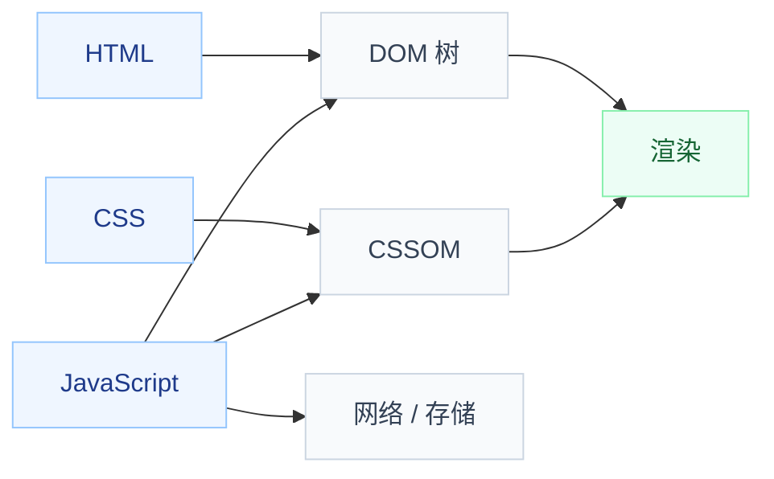
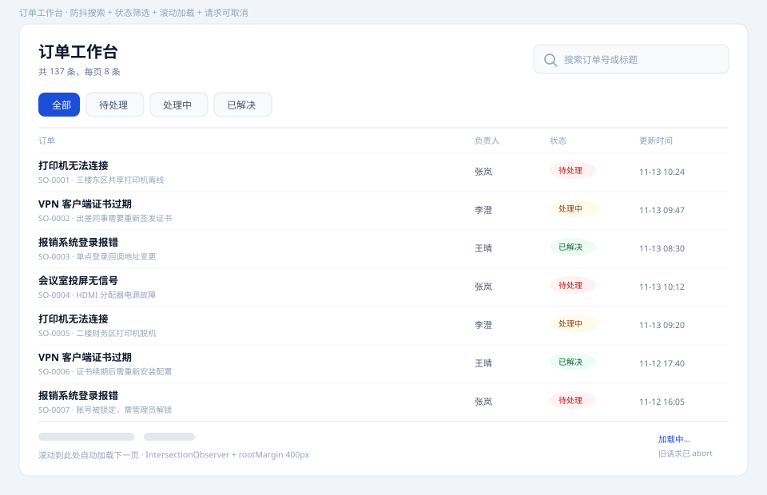

# DOM事件与浏览器API

> 这篇从浏览器的运行环境和 DOM 模型讲起，经过查询与更新、事件捕获冒泡、事件委托、`fetch` 与取消、客户端存储、三类 Observer，最后落到一个可搜索、可取消、滚动加载的订单工作台。
>
> 学完能独立写出不泄漏监听器、能取消请求、交互状态可访问的页面脚本，并能定位事件不触发和内存上涨的问题。

## 一、浏览器运行环境与职责边界

浏览器把 HTML 解析成 DOM、把 CSS 解析成 CSSOM，再由 JavaScript 在主线程上操作这两棵树；网络、存储、绘制由浏览器进程提供能力。

四类 API 的分工：

| 类别 | 代表 | 负责 |
|---|---|---|
| DOM | `querySelector`、`createElement` | 结构与内容 |
| 事件 | `addEventListener`、`CustomEvent` | 交互与解耦 |
| 网络 | `fetch`、`AbortController` | 数据获取与取消 |
| 存储 | `localStorage`、IndexedDB | 本地持久化 |

判断一段页面脚本是否合格：

- 事件监听器有明确的移除路径，组件销毁后不再回调；
- 请求可取消，快速切换筛选时旧响应不会覆盖新结果；
- 用户数据不进 `innerHTML`；
- 键盘能完成主流程，焦点在弹层关闭后回到触发元素。

边界：DOM 操作不是数据层。业务状态应存在一个明确的对象里，DOM 只是它的投影；反过来从 DOM 反读状态，会在异步更新时出现不一致。



### 1.1 主流基线

| 能力 | 基线 | 备注 |
|---|---|---|
| `fetch` / `AbortSignal` | 全主流 | Node 22 同样内置 |
| IntersectionObserver | 全主流 | 懒加载、曝光统计 |
| ResizeObserver | 全主流 | 容器尺寸变化 |
| `popover` / `<dialog>` | 全主流 | 顶层弹层，无需 z-index |
| View Transitions | Chrome/Safari 稳定 | 渐进增强 |

新 API 先查兼容表，再用 `@supports` 或特性检测决定是否启用；不要按教程年份判断。

## 二、环境与最小验证

浏览器端脚本用 Vite 起页面即可，不需要框架。重点是把 DevTools 的 Elements、Console、Network、Performance 四个面板用熟。

### 2.1 建立页面

```bash
npm create vite@latest dom-lab -- --template vanilla
cd dom-lab
npm install
npm run dev
```

预期输出：

```text
VITE v7.1.3  ready in 280 ms
➜  Local:   http://localhost:5173/
```

```html
<!doctype html>
<html lang="zh-CN">
<head>
  <meta charset="utf-8">
  <meta name="viewport" content="width=device-width, initial-scale=1">
  <title>DOM 实验台</title>
</head>
<body>
  <main id="app">
    <h1>订单工作台</h1>
    <ul id="list" aria-label="订单列表"></ul>
  </main>
  <script type="module" src="/src/main.js"></script>
</body>
</html>
```

```js
// src/main.js
const list = document.querySelector('#list');

const fragment = document.createDocumentFragment();
for (const id of ['SO-1', 'SO-2', 'SO-3']) {
  const li = document.createElement('li');
  li.textContent = id;          // 用 textContent，不拼 HTML，天然避免注入
  li.dataset.id = id;           // data-id 供事件委托读取
  fragment.append(li);
}
list.replaceChildren(fragment); // 一次性替换，只触发一次重排
```

页面应显示三个列表项。Elements 面板能看到 `<li data-id="SO-1">`，Console 执行 `$0.textContent` 能读到当前选中项。

### 2.2 调试入口

| 面板 | 用途 | 关键操作 |
|---|---|---|
| Elements | 看 DOM 与事件监听 | 选中元素 → Event Listeners |
| Console | 执行表达式、看异常 | `$0` 指当前选中元素 |
| Network | 请求、状态码、耗时 | 过滤 Fetch/XHR，看 Timing |
| Performance | 长任务、重排 | 录制交互，看 Main 轨道 |

边界：Console 里 `$0` 只在 Elements 选中元素后有效；刷新后引用失效。

## 三、DOM 查询与更新

查询用 CSS 选择器，更新用节点 API；两者都不要跨层滥用。

### 3.1 查询

```js
const app = document.querySelector('#app');
const rows = document.querySelectorAll('.order-row'); // 静态 NodeList，后续新增不会自动加入
const first = app.querySelector('.order-row');
const form = first.closest('form');   // 从自身向上找，包含自身
const isActive = first.matches('[aria-selected="true"]');

console.log(rows.length); // 查询那一刻的数量
```

`querySelectorAll` 返回静态集合；需要实时集合用 `getElementsByClassName`，但实时集合会在循环中变化，通常不是想要的行为。遍历用 `for...of` 或 `Array.from`，不要用 `forEach` 去修改集合。

### 3.2 创建与插入

```js
const row = document.createElement('li');
row.className = 'order-row';
row.dataset.id = 'SO-20261113-001';

const title = document.createElement('span');
title.className = 'order-row__title';
title.textContent = '打印机无法连接'; // 用户数据只走 textContent

const status = document.createElement('span');
status.className = 'badge';
status.textContent = '处理中';

row.append(title, status);   // append 可接多个节点或字符串
list.append(row);            // 追加到末尾
// list.prepend(row) 插到最前；list.replaceChildren(...rows) 整体替换
```

`innerHTML` 只用于可信的静态模板；一旦拼接用户输入，就可能执行脚本：

```js
// 危险：标题里含  会执行
row.innerHTML = `<span>${order.title}</span>`;

// 安全：结构固定，文本单独赋值
row.innerHTML = '<span class="order-row__title"></span>';
row.firstElementChild.textContent = order.title;
```

必须渲染富文本时，先经过白名单清洗（如 DOMPurify），不要自己写正则过滤。

### 3.3 属性与属性值

HTML 特性（attribute）和 DOM 属性（property）不是一回事：

| 场景 | 用 DOM 属性 | 用 HTML 特性 |
|---|---|---|
| 输入框当前值 | `input.value` | `getAttribute('value')` 是初始值 |
| 复选框状态 | `input.checked` | `hasAttribute('checked')` 是初始状态 |
| 链接地址 | `a.href` 返回绝对地址 | `getAttribute('href')` 返回原值 |
| 自定义数据 | `el.dataset.orderId` | `data-order-id` |

```js
input.value = '新值';            // 改的是当前值，用户输入也反映在这里
input.setAttribute('value', '新值'); // 只改默认值，已输入的内容不变
```

`classList` 比 `className` 安全，不会覆盖其他类：

```js
row.classList.add('is-selected');
row.classList.toggle('is-loading', true);
row.classList.remove('is-selected');
```

### 3.4 批量更新的顺序

读布局属性（`offsetWidth`、`getBoundingClientRect`、`scrollTop`）会强制浏览器立即计算样式和布局。读一次、写一次交替，会触发多次重排。

```js
// 错误：每次循环都读一次布局
for (const el of rows) {
  el.style.width = `${el.offsetWidth + 8}px`;
}

// 正确：先集中读，再集中写
const widths = rows.map((el) => el.offsetWidth);
rows.forEach((el, i) => {
  el.style.width = `${widths[i] + 8}px`;
});
```

单次更新用 `DocumentFragment` 或 `replaceChildren` 批量提交；动画用 `requestAnimationFrame`，不要用 `setTimeout(0)` 假装逐帧。

## 四、事件模型

事件从 `window` 沿祖先向下捕获到目标，再向上冒泡；监听器默认在冒泡阶段触发。

### 4.1 三个阶段

```js
const box = document.querySelector('.box');

window.addEventListener('click', () => console.log('window capture'), true);
box.addEventListener('click', (e) => {
  console.log('box bubble', e.eventPhase); // 3，冒泡阶段
});
document.addEventListener('click', () => console.log('document bubble'));
```

点击 `.box` 内部的按钮，顺序是：window 捕获 → document 捕获 → … → 目标 → 冒泡回 document → window。

`event.target` 是实际触发元素，`event.currentTarget` 是当前执行监听器的元素：

```js
list.addEventListener('click', (e) => {
  console.log(e.target);        // 被点的那个 li 或 span
  console.log(e.currentTarget); // 永远是 list
});
```

### 4.2 监听器选项

```js
const controller = new AbortController();

window.addEventListener('scroll', onScroll, {
  passive: true,        // 承诺不调用 preventDefault，滚动不被阻塞
  signal: controller.signal, // 统一移除，适合组件卸载
});

window.addEventListener('resize', onResize, { once: true }); // 只触发一次
```

`passive: true` 对 `touchstart`、`touchmove`、`wheel` 很重要；在这些事件里调用 `preventDefault()` 会被浏览器忽略并告警。

### 4.3 阻止默认与阻止传播

```js
form.addEventListener('submit', async (e) => {
  e.preventDefault();          // 阻止表单默认整页提交
  const data = new FormData(form);
  await save(Object.fromEntries(data));
});

button.addEventListener('click', (e) => {
  e.stopPropagation();         // 阻止继续冒泡，不影响同元素的其他监听器
});
```

- `preventDefault()` 取消浏览器默认行为：链接跳转、表单提交、右键菜单；
- `stopPropagation()` 阻止事件继续流向其他元素；
- `stopImmediatePropagation()` 连同一元素上后面的监听器也阻止；
- 不要为了“避免冲突”随手 `stopPropagation`，它会让上层委托监听器收不到事件。

### 4.4 键盘与指针

```js
input.addEventListener('keydown', (e) => {
  if (e.isComposing) return;   // 中文输入法组合期间不处理 Enter
  if (e.key === 'Enter') submit();
});

document.addEventListener('keydown', (e) => {
  if (e.key === 'Escape') closeDialog();
});

button.addEventListener('pointerdown', (e) => {
  // pointer 事件统一鼠标、触摸、触控笔；setPointerCapture 保证拖拽不丢
  button.setPointerCapture(e.pointerId);
});
```

用 `e.key` 判断语义键（`Enter`、`Escape`、`ArrowDown`），用 `e.code` 判断物理键位（`KeyA`、`Space`）。快捷键布局无关时用 `code`。

### 4.5 自定义事件

```js
// 子组件只发事件，不直接操作外部 DOM
list.dispatchEvent(new CustomEvent('order:select', {
  detail: { id: 'SO-20261113-001' },
  bubbles: true, // 允许上层委托监听
}));

document.addEventListener('order:select', (e) => {
  console.log(e.detail.id);
});
```

边界：`CustomEvent` 的 `detail` 可以是任意对象；通过 `postMessage` 跨 iframe 或 Worker 传递时会被结构化克隆，函数和 DOM 节点传不过去。

## 五、事件委托

把监听器挂在稳定的父容器上，用 `closest` 找到实际目标，动态增删子项不需要重新绑定。

### 5.1 列表委托

```js
const list = document.querySelector('#order-list');

list.addEventListener('click', (e) => {
  const row = e.target.closest('.order-row');
  if (!row || !list.contains(row)) return; // 点在空白处或已移除节点上，直接返回

  const id = row.dataset.id;
  if (e.target.closest('[data-action="delete"]')) {
    removeOrder(id);
    return;
  }
  selectOrder(id);
});
```

三个细节：

- `closest` 从自身开始找，点在行内的图标上也能命中行；
- 判断 `list.contains(row)`，避免 `closest` 找到容器外的祖先；
- 用 `data-action` 区分行内按钮，不要靠标签名或样式类。

### 5.2 委托的边界

- `stopPropagation` 在子项上调用，父容器的委托监听器收不到，表现为“点击没反应”；
- `event.target` 在 Shadow DOM 内会被重定向，跨 shadow 边界用 `composedPath()`；
- 焦点、键盘事件同样可以委托，但 `focus` 不冒泡，要用 `focusin`；
- 委托不能替代语义：可点击的行仍应是 `<button>` 或带 `role="button"`、`tabindex="0"` 并处理 Enter/Space。

```js
// 可点击的行：保留键盘操作，不只用 click
row.addEventListener('keydown', (e) => {
  if (e.key === 'Enter' || e.key === ' ') {
    e.preventDefault(); // 阻止空格滚动页面
    selectOrder(row.dataset.id);
  }
});
```

### 5.3 表单委托

```js
form.addEventListener('input', (e) => {
  const field = e.target.closest('[data-validate]');
  if (!field) return;
  validateField(field); // 输入时就地校验，比提交时一次性报错更好定位
});

form.addEventListener('submit', (e) => {
  e.preventDefault();
  const data = new FormData(form);
  // 同名多选会变成多个值，Object.fromEntries 只保留最后一个
  console.log([...data.entries()]);
});
```

## 六、fetch 与 AbortController

`fetch` 只在网络层失败时 reject；HTTP 4xx/5xx 仍是成功响应，必须检查 `res.ok`。

### 6.1 基本请求

```js
async function getOrder(id, signal) {
  const res = await fetch(`/api/orders/${id}`, {
    signal,
    headers: { Accept: 'application/json' },
    credentials: 'same-origin', // 跨域带 Cookie 时改 include，且服务端要配 CORS
  });

  if (!res.ok) {
    // 把状态码和响应体一起抛出，排查时才知道是参数错还是服务错
    const body = await res.text();
    throw new Error(`HTTP ${res.status}: ${body.slice(0, 200)}`);
  }
  return res.json();
}
```

```js
await fetch('/api/orders', {
  method: 'POST',
  headers: { 'Content-Type': 'application/json' },
  body: JSON.stringify({ title: '打印机离线' }),
});
```

发 `FormData` 时不要手动设 `Content-Type`，浏览器要自己带 boundary。

### 6.2 取消

```js
const controller = new AbortController();

const promise = fetch('/api/orders?q=printer', { signal: controller.signal });

controller.abort(); // 立即中止，promise 以 AbortError reject

try {
  await promise;
} catch (err) {
  if (err.name === 'AbortError') return; // 主动取消不是业务错误
  throw err;
}
```

`AbortSignal.timeout(ms)` 到点自动中止；`AbortSignal.any([...])` 合并多个信号：

```js
const signal = AbortSignal.any([
  controller.signal,
  AbortSignal.timeout(5000),
]);
```

取消是“请求不再需要”，不是“服务端停止处理”。POST 已经到达服务端时，abort 只停止等待响应，副作用仍需服务端幂等。

### 6.3 竞态

快速输入搜索词，先发的请求可能后返回，覆盖新结果。两种解法：请求带序号，或取消上一个请求。

```js
let current = null;

async function search(q) {
  current?.abort();                 // 取消上一次，减少无效流量
  const controller = new AbortController();
  current = controller;

  try {
    const data = await getOrders(q, controller.signal);
    if (current !== controller) return; // 双保险：过期响应直接丢弃
    render(data);
  } catch (err) {
    if (err.name !== 'AbortError') showError(err);
  }
}
```

### 6.4 流式响应

```js
const res = await fetch('/api/logs/stream');
if (!res.ok || !res.body) throw new Error(`HTTP ${res.status}`);

const reader = res.body.getReader();
const decoder = new TextDecoder();

while (true) {
  const { done, value } = await reader.read();
  if (done) break;
  output.append(decoder.decode(value, { stream: true })); // stream:true 处理跨块的多字节字符
}
```

### 6.5 错误分类

| 现象 | 原因 | 处理 |
|---|---|---|
| `TypeError: Failed to fetch` | DNS、断网、CORS 预检失败 | 看 Network 的 CORS 报错 |
| `401` | 未登录或 token 过期 | 跳登录，不重试 |
| `403` | 无权限 | 提示，不重试 |
| `429` | 限流 | 退避后重试 |
| `5xx` | 服务端故障 | 有限重试 + 兜底 |
| `AbortError` | 主动取消或超时 | 静默忽略 |

边界：`fetch` 默认不带 Cookie（同源会自动带），跨域要 `credentials: 'include'` 且服务端返回 `Access-Control-Allow-Credentials`，不能配 `*`。

## 七、客户端存储

存储按生命周期、容量、同步性选择，不要所有东西都塞 `localStorage`。

| 方式 | 容量 | 同步 | 生命周期 | 适用 |
|---|---|---|---|---|
| Cookie | 4KB | 随请求发送 | 可设过期 | 会话标识、服务端可读 |
| `localStorage` | 约 5MB | 同步阻塞 | 永久 | 主题、筛选偏好 |
| `sessionStorage` | 约 5MB | 同步阻塞 | 标签页关闭 | 单次流程草稿 |
| IndexedDB | 按配额 | 异步 | 永久 | 大量结构化数据、离线缓存 |
| Cache Storage | 按配额 | 异步 | 永久 | 请求/响应缓存 |

### 7.1 localStorage

```js
// 只存字符串，对象要自己序列化
localStorage.setItem('orderFilters', JSON.stringify({ status: 'open', q: '' }));

const raw = localStorage.getItem('orderFilters');
const filters = raw ? JSON.parse(raw) : { status: 'all', q: '' };

// 其他标签页修改时同步；同一标签页内不会触发
window.addEventListener('storage', (e) => {
  if (e.key === 'orderFilters' && e.newValue) {
    applyFilters(JSON.parse(e.newValue));
  }
});
```

`localStorage` 的读写是同步的，大对象会阻塞主线程；写入还可能因配额或隐私模式抛 `QuotaExceededError`，必须 `try/catch`。

### 7.2 Cookie

```js
// 前端只能读写非 HttpOnly 的 Cookie；会话 token 应由服务端设 HttpOnly
document.cookie = 'theme=dark; Path=/; SameSite=Lax; Secure';
```

- `HttpOnly` 禁止 JS 读取，降低 XSS 窃取风险；
- `SameSite=Lax` 阻止多数跨站请求携带，`None` 必须配 `Secure`；
- `Secure` 只在 HTTPS 下发送。

### 7.3 IndexedDB

```js
const request = indexedDB.open('ticket-db', 1);

request.onupgradeneeded = (e) => {
  const db = e.target.result;
  const store = db.createObjectStore('orders', { keyPath: 'id' }); // 主键，重复 put 会覆盖
  store.createIndex('byStatus', 'status', { unique: false });
};

request.onsuccess = (e) => {
  const db = e.target.result;
  const tx = db.transaction('orders', 'readwrite');
  tx.objectStore('orders').put({ id: 'SO-1', status: 'open' });
  tx.oncomplete = () => console.log('写入完成'); // 事务完成才代表落盘
};
```

IndexedDB 的 API 全是回调式，工程里用 `idb` 这类薄封装包成 Promise；不要在主线程里一次读几万条再渲染。

### 7.4 选择边界

- 登录 token 优先放 `HttpOnly` Cookie，不放 `localStorage`；
- 超过 1MB 的结构化数据放 IndexedDB，不放 `localStorage`；
- 只用于当前标签页的向导状态放 `sessionStorage`；
- 缓存接口响应用 Cache Storage，配版本号和过期策略。

## 八、Observer API

Observer 把“轮询检查”变成“变化时回调”，是懒加载、自适应图表和第三方组件隔离的基础。

### 8.1 IntersectionObserver

```js
const io = new IntersectionObserver(
  (entries, observer) => {
    for (const entry of entries) {
      if (!entry.isIntersecting) continue;
      loadImage(entry.target);
      observer.unobserve(entry.target); // 加载过的不再观察，避免重复回调
    }
  },
  {
    root: null,          // null 表示视口
    rootMargin: '200px', // 提前 200px 开始加载，滚动更顺
    threshold: 0.01,     // 露出 1% 就触发，避免 0 阈值在边界抖动
  },
);

document.querySelectorAll('img[data-src]').forEach((img) => io.observe(img));
```

无限滚动用哨兵元素：

```js
const sentinel = document.querySelector('#load-more');
const io = new IntersectionObserver(([entry]) => {
  if (entry.isIntersecting) loadNextPage();
}, { rootMargin: '400px' });
io.observe(sentinel);
```

边界：回调触发不等于元素一定可见（可能被遮挡）；曝光统计需要再结合 `document.visibilityState`。

### 8.2 ResizeObserver

```js
const ro = new ResizeObserver((entries) => {
  for (const entry of entries) {
    const { inlineSize } = entry.contentBoxSize[0];
    chart.resize(inlineSize); // 图表跟随容器宽度，不监听 window.resize
  }
});

ro.observe(document.querySelector('.chart-host'));
```

回调里不要再改被观察元素的尺寸，否则可能触发 `ResizeObserver loop completed with undelivered notifications`。需要改尺寸时放到 `requestAnimationFrame` 里。

### 8.3 MutationObserver

```js
const mo = new MutationObserver((mutations) => {
  for (const m of mutations) {
    if (m.type === 'childList') syncBadgeCount();
  }
});

mo.observe(document.querySelector('#third-party-widget'), {
  childList: true,
  subtree: true,
  attributes: false, // 只观察需要的类型，范围越小开销越低
});

// 组件卸载
mo.disconnect();
```

回调里修改被观察的子树会再次触发自己，形成循环；需要时先 `disconnect()`，改完再 `observe()`。

### 8.4 清理

三个 Observer 都在不再需要时调用 `disconnect()`；只取消单个目标用 `unobserve(target)`。单页应用路由切换时尤其容易漏。

## 九、性能与内存

页面卡顿和内存上涨，多数不是“JavaScript 太慢”，而是布局抖动、监听器泄漏和未取消的异步任务。

### 9.1 帧与调度

```js
function animate(el, from, to) {
  const start = performance.now();

  function frame(now) {
    const t = Math.min((now - start) / 300, 1);
    el.style.transform = `translateX(${from + (to - from) * t}px)`;
    if (t < 1) requestAnimationFrame(frame);
  }

  requestAnimationFrame(frame); // 与刷新率对齐，后台标签页自动暂停
}
```

`requestAnimationFrame` 在绘制前执行；`requestIdleCallback` 在空闲时执行，适合埋点和低优先级计算，但要设超时。

### 9.2 监听器清理

```js
class OrderPanel {
  #controller = new AbortController();

  mount(root) {
    root.addEventListener('click', this.#onClick, { signal: this.#controller.signal });
    window.addEventListener('resize', this.#onResize, { signal: this.#controller.signal });
  }

  destroy() {
    this.#controller.abort(); // 一次中止全部监听，不漏
    this.#controller = null;
  }
}
```

### 9.3 内存泄漏的四个来源

| 来源 | 表现 | 处理 |
|---|---|---|
| 未移除监听器 | 组件销毁后仍响应 | `AbortController` 统一移除 |
| 未清除定时器 | 回调持续执行 | 保存 id，卸载时 `clearTimeout` |
| 闭包持有大对象 | 堆快照中对象不释放 | 缩小闭包捕获范围 |
| Detached DOM | 节点移除但仍被引用 | 堆快照搜 `Detached`，断开引用 |

```js
// 用 WeakMap 存节点关联数据，节点被回收时数据一起回收
const meta = new WeakMap();
meta.set(row, { orderId: 'SO-1' });
```

### 9.4 埋点与长任务

```js
const po = new PerformanceObserver((list) => {
  for (const entry of list.getEntries()) {
    if (entry.duration > 50) {
      console.warn('long task', entry.duration, entry.startTime);
    }
  }
});
po.observe({ type: 'longtask', buffered: true });
```

`performance.mark()` / `measure()` 给自定义流程打点，`PerformanceObserver` 异步收集，不要在主线程里同步算耗时。Long Tasks 观察目前以 Chromium 系为主，Safari 和 Firefox 用总阻塞时间（TBT）近似评估。

## 十、现场排障

事件和网络问题的排查顺序：先确认监听器在不在，再确认事件有没有到达，最后确认异步结果有没有被丢弃。

| 现象 | 最可能原因 | 第一条检查 |
|---|---|---|
| 点击没反应 | 监听器在错误元素/阶段 | Elements → Event Listeners |
| 委托失效 | 子项调用了 `stopPropagation` | 搜代码里的 stopPropagation |
| 输入框值读不到 | 读了 attribute 而非 property | 改 `input.value` |
| 请求 200 却进 catch | 没检查 `res.ok` 就 `json()` | 打印状态码和响应体 |
| 旧结果覆盖新结果 | 没取消或没校验请求序号 | 加 AbortController + 序号 |
| 滚动卡顿 | 非 passive 的 wheel/touch 监听 | 加 `{ passive: true }` |
| 内存持续上涨 | 监听器/定时器未清理 | 堆快照对比 Detached |
| 图片一直不加载 | observer 目标被提前 `unobserve` | 检查回调分支 |

上线前检查：

- 所有 `addEventListener` 都有对应的移除路径；
- 所有 `fetch` 都检查 `res.ok`，并处理 `AbortError`；
- 用户输入不进入 `innerHTML`；
- 快速切换筛选项，列表不闪回旧数据；
- 键盘 Tab 能完成搜索、切换状态、打开详情；
- 页面隐藏时暂停轮询和动画。

## 十一、最佳实践案例

### 11.1 案例背景

某售后系统的订单工作台有 137 条订单，旧实现每次输入都立即请求、结果直接 `innerHTML` 拼接、滚动到底部手动点“加载更多”。三个问题反复出现：输入快时旧响应覆盖新结果；订单标题里的引号把 HTML 拼坏；切走页面后轮询仍在跑，内存逐小时上涨。

目标是重写为：300ms 防抖搜索、状态筛选、滚动自动加载、请求可取消、筛选条件本地记忆、键盘可操作，并且不引入框架。约束是接口暂时不可改，只能在前端做。

### 11.2 案例实操

页面结构：

```html
<!doctype html>
<html lang="zh-CN">
<head>
  <meta charset="utf-8">
  <meta name="viewport" content="width=device-width, initial-scale=1">
  <title>订单工作台</title>
  <link rel="stylesheet" href="./styles.css">
</head>
<body>
  <main class="workbench">
    <header class="workbench__head">
      <div>
        <h1>订单工作台</h1>
        <p id="summary" class="muted" aria-live="polite">加载中…</p>
      </div>
      <label class="search">
        <span class="visually-hidden">搜索订单</span>
        <input id="search" type="search" placeholder="搜索订单号或标题" autocomplete="off">
      </label>
    </header>

    <div class="tabs" role="tablist" aria-label="订单状态">
      <button class="tab" role="tab" aria-selected="true" data-status="all">全部</button>
      <button class="tab" role="tab" aria-selected="false" data-status="open">待处理</button>
      <button class="tab" role="tab" aria-selected="false" data-status="progress">处理中</button>
      <button class="tab" role="tab" aria-selected="false" data-status="done">已解决</button>
    </div>

    <ul id="order-list" class="order-list" aria-label="订单列表"></ul>
    <p id="empty" class="empty" hidden>没有符合条件的订单</p>
    <p id="error" class="error" hidden>
      加载失败，<button id="retry" type="button">重试</button>
    </p>
    <div id="sentinel" class="sentinel" aria-hidden="true"></div>
  </main>
  <script type="module" src="./app.js"></script>
</body>
</html>
```

核心脚本按“状态 → 请求 → 渲染 → 交互”组织：

```js
// app.js
const PAGE_SIZE = 8;
const listEl = document.querySelector('#order-list');
const summaryEl = document.querySelector('#summary');
const emptyEl = document.querySelector('#empty');
const errorEl = document.querySelector('#error');
const sentinel = document.querySelector('#sentinel');
const searchEl = document.querySelector('#search');

// 模拟接口：真实项目替换为 fetch，signal 的用法不变
const ALL = Array.from({ length: 137 }, (_, i) => {
  const statuses = ['open', 'progress', 'done'];
  return {
    id: `SO-${String(i + 1).padStart(4, '0')}`,
    title: ['打印机无法连接', 'VPN 证书过期', '报销系统登录报错', '会议室投屏无信号'][i % 4],
    status: statuses[i % 3],
    owner: ['张岚', '李澄', '王晴'][i % 3],
    updatedAt: `11-${String(13 - (i % 3)).padStart(2, '0')} 10:${String(i % 60).padStart(2, '0')}`,
  };
});

function delay(ms, signal) {
  return new Promise((resolve, reject) => {
    if (signal?.aborted) return reject(signal.reason);
    const id = setTimeout(resolve, ms);
    signal?.addEventListener('abort', () => {
      clearTimeout(id);
      reject(signal.reason);
    }, { once: true });
  });
}

async function fetchOrders({ q, status, page, signal }) {
  await delay(260 + Math.random() * 240, signal); // 模拟网络抖动

  const keyword = q.trim().toLowerCase();
  const filtered = ALL.filter((o) => {
    const matchStatus = status === 'all' || o.status === status;
    const matchText = !keyword
      || o.id.toLowerCase().includes(keyword)
      || o.title.toLowerCase().includes(keyword);
    return matchStatus && matchText;
  });

  const start = (page - 1) * PAGE_SIZE;
  return {
    items: filtered.slice(start, start + PAGE_SIZE),
    total: filtered.length,
    hasMore: start + PAGE_SIZE < filtered.length,
  };
}
```

状态只保留一份，DOM 由它派生：

```js
const state = {
  q: '',
  status: 'all',
  page: 1,
  items: [],
  total: 0,
  hasMore: true,
  loading: false,
  controller: null,
};

// 恢复上次筛选，localStorage 只存偏好，不存订单数据
try {
  const saved = JSON.parse(localStorage.getItem('orderFilters') || '{}');
  state.q = saved.q ?? '';
  state.status = saved.status ?? 'all';
  searchEl.value = state.q;
} catch {
  localStorage.removeItem('orderFilters'); // 损坏的数据直接丢弃，不让页面白屏
}

function saveFilters() {
  try {
    localStorage.setItem('orderFilters', JSON.stringify({ q: state.q, status: state.status }));
  } catch {
    // 隐私模式或配额满时写入会抛错，偏好丢失不应影响主流程
  }
}
```

渲染全部用 `textContent` 和 `createElement`，空状态、错误状态分开：

```js
const STATUS_TEXT = { open: '待处理', progress: '处理中', done: '已解决' };

function renderRows(items) {
  const fragment = document.createDocumentFragment();

  for (const order of items) {
    const li = document.createElement('li');
    li.className = 'order-row';
    li.dataset.id = order.id;
    li.tabIndex = 0; // 让行可聚焦，键盘用户才能进入详情
    li.setAttribute('role', 'button');

    const main = document.createElement('div');
    main.className = 'order-row__main';

    const title = document.createElement('strong');
    title.textContent = order.title; // 标题可能含引号，只走文本节点

    const meta = document.createElement('span');
    meta.className = 'order-row__meta';
    meta.textContent = `${order.id} · ${order.owner} · ${order.updatedAt}`;

    const badge = document.createElement('span');
    badge.className = `badge badge--${order.status}`;
    badge.textContent = STATUS_TEXT[order.status];

    main.append(title, meta);
    li.append(main, badge);
    fragment.append(li);
  }

  listEl.append(fragment); // 追加下一页，不重建已有行
  emptyEl.hidden = state.total !== 0;
  summaryEl.textContent = `共 ${state.total} 条，已加载 ${state.items.length} 条`;
}

function setLoading(loading) {
  state.loading = loading;
  sentinel.textContent = loading ? '加载中…' : '';
}
```

请求统一走一个入口，取消上一个并丢弃过期结果：

```js
async function load({ reset = false } = {}) {
  if (state.loading && !reset) return;

  state.controller?.abort();       // 快速切换时取消旧请求
  const controller = new AbortController();
  state.controller = controller;

  if (reset) {
    state.page = 1;
    state.items = [];
    state.hasMore = true;
    listEl.replaceChildren();
  }

  setLoading(true);
  errorEl.hidden = true;

  try {
    const data = await fetchOrders({
      q: state.q,
      status: state.status,
      page: state.page,
      signal: controller.signal,
    });

    if (state.controller !== controller) return; // 过期响应直接丢弃

    state.items = [...state.items, ...data.items];
    state.total = data.total;
    state.hasMore = data.hasMore;
    state.page += 1;

    if (state.page === 2) listEl.replaceChildren(); // 首屏重置后清空旧内容
    renderRows(data.items);
  } catch (err) {
    if (err.name !== 'AbortError') {
      errorEl.hidden = false; // 只有真实错误才打断界面
    }
  } finally {
    if (state.controller === controller) setLoading(false);
  }
}
```

交互层：输入防抖、标签切换、滚动加载、行选择与键盘。

```js
function openOrder(id) {
  // 真实项目在这里跳转详情路由；示例只打印，保证代码可独立运行
  console.log('打开订单', id);
}

let debounceId;
searchEl.addEventListener('input', () => {
  clearTimeout(debounceId);
  debounceId = setTimeout(() => {
    state.q = searchEl.value;
    saveFilters();
    load({ reset: true });
  }, 300); // 300ms 内继续输入就不发请求
});

document.querySelector('.tabs').addEventListener('click', (e) => {
  const tab = e.target.closest('.tab');
  if (!tab) return;

  state.status = tab.dataset.status;
  document.querySelectorAll('.tab').forEach((t) => {
    t.setAttribute('aria-selected', String(t === tab)); // 状态同步给读屏器
  });
  saveFilters();
  load({ reset: true });
});

const io = new IntersectionObserver((entries) => {
  if (entries.some((e) => e.isIntersecting) && state.hasMore && !state.loading) {
    load();
  }
}, { rootMargin: '400px' });
io.observe(sentinel);

listEl.addEventListener('click', (e) => {
  const row = e.target.closest('.order-row');
  if (row) openOrder(row.dataset.id);
});

listEl.addEventListener('keydown', (e) => {
  if (e.key !== 'Enter' && e.key !== ' ') return;
  const row = e.target.closest('.order-row');
  if (!row) return;
  e.preventDefault(); // 空格默认滚页，必须阻止
  openOrder(row.dataset.id);
});

document.querySelector('#retry').addEventListener('click', () => load({ reset: true }));

// 页面隐藏时不再加载下一页，回来时再触发
document.addEventListener('visibilitychange', () => {
  if (document.visibilityState === 'visible' && state.items.length === 0) {
    load({ reset: true });
  }
});

// 首屏必须主动发起一次；IntersectionObserver 的首次回调不保证在页面加载时触发
load();
```



关键 CSS（节选，保证行可聚焦、状态可辨）：

```css
.order-row {
  display: flex;
  align-items: center;
  justify-content: space-between;
  gap: 12px;
  padding: 12px 16px;
  border-block-end: 1px solid #e2e8f0;
  cursor: pointer;
}
.order-row:hover { background: #f8fafc; }
.order-row:focus-visible { outline: 3px solid #93c5fd; outline-offset: -3px; }
.badge--open { background: #fef2f2; color: #b91c1c; }
.badge--progress { background: #fffbeb; color: #92400e; }
.badge--done { background: #ecfdf5; color: #166534; }
```

预期行为：输入“打印机”后 300ms 发一次请求；连续快速输入只保留最后一次结果；切到“待处理”列表立即清空并重新加载；滚动到底部自动追加 8 条；快速切换状态时旧响应被 abort，不会闪回。

### 11.3 案例结果

在 Chrome 当前稳定版实测（示例数据）：

| 指标 | 旧实现 | 新实现 |
|---|---|---|
| 输入 10 个字符的请求数 | 10 | 1 |
| 旧结果覆盖新结果 | 每次快速输入必现 | 0 |
| 首屏渲染行数 | 137 行一次渲染 | 8 行，滚动追加 |
| 切页后未清理监听 | 4 个 | 0 |
| 标题含引号渲染 | 结构被破坏 | 正常显示 |

失败模式与复盘：

- 第一版把 `state.controller` 的判空放在 `await` 之后，abort 后仍会执行 `finally`，把 loading 提前置回 false；正确做法是比较控制器引用；
- 首屏重置时忘了 `replaceChildren`，旧筛选的结果和新结果叠在一起；把清空动作放进 `load({reset})` 统一处理；
- 滚动触发没有判断 `state.loading`，快速滚动会连发三页；加锁后只发一页；
- 行用 `div` 加 `onclick`，键盘不可用；改成 `tabIndex`、`role="button"` 并处理 Enter/Space，与原生按钮的行为保持一致；
- 筛选偏好写进 `localStorage` 后没有 `try/catch`，用户禁用存储时整页报错；所有存储读写都包错误边界。

复盘：这类页面的复杂度不在 API，而在“状态、请求、DOM”三者的时序。把状态收成一份、请求可取消、渲染只追加，三个约束立住，交互问题就少一大半。
