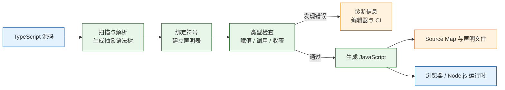
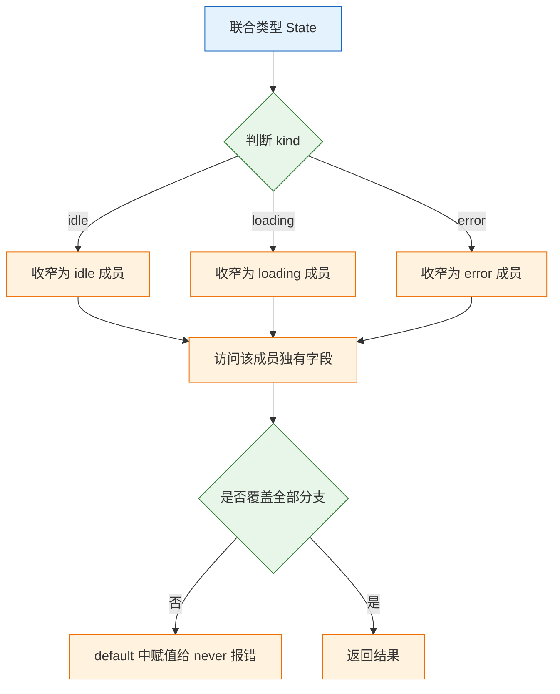

# TypeScript

---

## 一、TypeScript 是什么

### 1.1 核心概念

TypeScript 是在 JavaScript 之上增加静态类型层的语言。类型在开发与构建阶段检查，编译后被擦除，产物仍是普通 JavaScript。它约束的是代码之间的契约：参数形状、返回值、可空性、字段名和分支覆盖，而不是运行时数据的真实内容。

五个概念构成类型系统的主干：

- **类型标注与推导**：可以显式写出类型，也可以让编译器从初始值和使用方式推导。
- **结构化类型**：兼容性由成员形状决定，不要求显式继承或实现。
- **控制流收窄**：联合类型在条件分支中被逐步缩小为具体成员。
- **泛型**：用类型参数表达输入与输出之间的关系，避免重复声明。
- **声明文件**：用 `.d.ts` 描述没有类型信息的 JavaScript 模块与全局对象。

| 概念 | 作用 | 典型语法 |
|---|---|---|
| 类型标注 | 明确变量、参数、返回值的契约 | `const id: number` |
| 类型推导 | 从初始化表达式推断类型 | `const id = 1` |
| 结构化类型 | 按成员兼容判断可赋值性 | `{ x: number }` |
| 联合类型 | 表示多种可能形状 | `A \| B` |
| 泛型 | 建立输入输出的类型关系 | `<T>(items: T[]) => T` |
| 类型收窄 | 在分支中排除不可能成员 | `if (x.kind === 'error')` |
| 声明合并 | 扩展已有接口 | `interface Window` |

TypeScript 解决三类问题：重命名字段时找出所有不兼容调用点；在编译期发现可能为空的访问；把接口契约写成可检查的声明。它不解决运行时数据校验、业务逻辑正确性和性能问题。接口返回的 JSON 即使声明成 `Task`，运行时仍可能是任意结构，边界校验不能省。

类型系统的收益随代码规模增长。几十行的脚本里，标注成本高于收益；多人维护的公共模块、状态机、表单协议和跨服务接口，类型能把隐含约定变成可检查的契约。判断是否值得引入类型，看改动一个字段时需要人工搜索多少处，以及错误是在编辑器里发现还是在线上发现。

### 1.2 与相邻技术的关系

TypeScript 位于 JavaScript 之上，周围还有转译器、打包器、运行时校验库和代码检查工具，各自负责不同阶段。

- **JavaScript**：目标语言。TypeScript 新增的语法最终都要转成 JavaScript，运行时不知道类型存在。
- **`tsc`**：官方编译器，既做类型检查，也负责生成 JavaScript 和声明文件。
- **Babel / esbuild / SWC**：只做语法转译，不检查类型。它们速度快，但类型错误不会让构建失败。
- **ESLint**：检查代码风格与部分逻辑问题，不替代类型检查；类型感知规则需要配置 TypeScript 解析器。
- **Zod / Valibot**：运行时 schema 校验，负责把 `unknown` 收窄为可信类型。
- **JSDoc + `checkJs`**：在 JavaScript 中通过注释获得部分类型检查，适合渐进迁移。

| 技术 | 介入阶段 | 是否检查类型 | 与 TypeScript 的关系 |
|---|---|---|---|
| `tsc` | 编译期 | 是 | 官方编译器与类型检查器 |
| Babel | 转译期 | 否 | 擦除类型，需另行跑 `tsc` |
| esbuild / SWC | 转译期 | 否 | 追求速度，类型检查交给编辑器或 CI |
| ESLint | 静态检查 | 部分 | 规则检查，不替代类型系统 |
| Zod | 运行时 | 是（数据） | 校验外部数据并推导类型 |
| JSDoc | 编译期 | 是（注释） | 让 JavaScript 获得类型提示 |

> **注意**：打包成功不代表类型正确。Vite、esbuild、SWC 默认只转译不检查，CI 中必须单独执行 `tsc --noEmit`，否则类型错误会随产物一起上线。

### 1.3 编译机制

TypeScript 编译器先扫描源码生成抽象语法树，再建立符号表，由类型检查器验证赋值、调用与分支，最后输出 JavaScript。开启 `declaration` 时还会生成 `.d.ts`，开启 `sourceMap` 时生成映射文件。



| 阶段 | 产物 | 是否影响运行时 |
|---|---|---|
| 解析 | 抽象语法树 | 否 |
| 绑定 | 符号与作用域表 | 否 |
| 检查 | 诊断信息 | 否 |
| 生成 | JavaScript | 是 |
| 声明生成 | `.d.ts` | 否 |
| Source Map | `.js.map` | 仅调试时使用 |

类型检查与代码生成可以分离。`noEmit` 只检查不写文件，适合 CI；`emitDeclarationOnly` 只生成声明，适合发布类型包。编辑器使用的 TypeScript 版本可能与项目依赖不同，团队应在工作区固定版本，避免“本地通过、CI 报错”。

诊断分三类：语法错误让文件无法解析；语义错误来自类型不兼容、缺少成员或调用参数不符；配置错误来自 `tsconfig` 选项冲突或模块解析失败。三类错误的修复方向不同，先看错误码和文件位置，再决定是改代码、补声明还是调配置。

---

## 二、环境与最小程序

### 2.1 安装与版本

> **版本现状（2026-10）**：TypeScript 7.x 为当前稳定系列，本文涉及的擦除模型、`strict` 配置与 `satisfies` 在该系列可用；具体补丁版本以 `npx tsc --version` 为准。

```bash
# 初始化工程
mkdir ts-demo && cd ts-demo
npm init -y

# 安装编译器与 Node.js 类型声明
npm i -D typescript @types/node

# 安装运行时校验库，第 6 节示例使用
npm i zod

# 确认使用项目内的编译器，而不是全局版本
npx tsc --version
```

| 安装方式 | 命令 | 适用场景 |
|---|---|---|
| 项目依赖 | `npm i -D typescript` | 团队协作、CI 可复现 |
| 全局安装 | `npm i -g typescript` | 临时试验，不推荐用于项目 |
| 包管理器托管 | `pnpm add -D typescript` | 使用 pnpm 的工程 |
| 编辑器内置 | 编辑器自带版本 | 仅语法提示，不保证与项目一致 |

`npx tsc` 优先使用 `node_modules/.bin` 下的版本。全局版本与项目版本不一致时，同一个文件可能得到不同诊断，排查类型问题前先确认版本。

### 2.2 最小可运行示例

```json
{
  "compilerOptions": {
    "target": "ES2022",
    "module": "NodeNext",
    "moduleResolution": "NodeNext",
    "strict": true,
    "rootDir": "src",
    "outDir": "dist",
    "sourceMap": true,
    "skipLibCheck": true
  },
  "include": ["src"]
}
```

```json
{
  "name": "ts-demo",
  "private": true,
  "type": "module"
}
```

```typescript
// src/main.ts
type Task = { id: number; title: string; done?: boolean };

function toggle(task: Task): Task {
  return { ...task, done: !task.done };
}

const task: Task = { id: 1, title: '写文档', done: false };
const count: number = toggle(task).title;   // 类型不匹配
console.log(count);
```

```bash
npx tsc
```

输出类似：

```text
src/main.ts(8,7): error TS2322: Type 'string' is not assignable to type 'number'.
```

把 `count` 的类型改为 `string`，即写成 `const count: string = toggle(task).title`，再次执行 `npx tsc`，退出码为 0，并在 `dist/` 生成 `main.js` 与 `main.js.map`：

```bash
node dist/main.js
```

```text
写文档
```

产物中没有任何类型声明，`type Task` 已被完全擦除。在 ESM 下，`NodeNext` 要求相对导入写 `.js` 扩展名，因为编译后的路径按 JavaScript 解析，而不是按 TypeScript 源文件解析。

这条规则常让迁移者困惑：源文件是 `./schema.ts`，导入却写 `./schema.js`。原因是编译后 `schema.ts` 变成 `schema.js`，模块说明符必须指向运行时的真实文件。前端打包项目使用 `bundler` 解析时，通常允许省略扩展名，由打包器补齐；服务端直接运行产物时没有这层补齐，必须写全。

### 2.3 工程结构与配置

```text
ts-demo/
├── package.json
├── tsconfig.json
├── src/
│   ├── main.ts
│   ├── schema.ts
│   └── domain.ts
├── test/
│   └── domain.test.ts
└── dist/
```

| 文件 | 作用 | 关键配置 |
|---|---|---|
| `tsconfig.json` | 编译范围与检查强度 | `strict`、`target`、`module` |
| `src/` | 源码目录 | `rootDir` 指向此处 |
| `dist/` | 编译产物 | `outDir`，不提交仓库 |
| `test/` | 测试代码 | 单独 `tsconfig` 或排除 |
| `package.json` | 依赖与脚本 | `type`、`scripts`、`engines` |

```json
{
  "compilerOptions": {
    "target": "ES2022",
    "module": "NodeNext",
    "moduleResolution": "NodeNext",
    "strict": true,
    "noUncheckedIndexedAccess": true,
    "exactOptionalPropertyTypes": true,
    "noImplicitOverride": true,
    "verbatimModuleSyntax": true,
    "isolatedModules": true,
    "declaration": true,
    "sourceMap": true,
    "skipLibCheck": true,
    "outDir": "dist",
    "rootDir": "src"
  },
  "include": ["src"]
}
```

`target` 决定输出语法，`module` 决定模块格式，`moduleResolution` 决定如何查找依赖。三者要匹配运行环境：Node.js 用 `NodeNext`，前端打包项目常用 `ESNext` 加 `bundler`。只改 `target` 不改 `module`，容易出现产物能编译但运行时报模块错误。

---

## 三、类型系统与语法

### 3.1 原始类型与对象类型

基础类型与 JavaScript 的运行时值一一对应，此外还有字面量、联合、交叉和工具类型等只存在于编译期的构造。

```typescript
// 原始类型
let title: string = '文档';
let count: number = 1;
let done: boolean = false;
let id: symbol = Symbol('id');
let big: bigint = 10n;
let empty: null = null;
let missing: undefined = undefined;

// 数组与元组
let tags: string[] = ['ts', 'js'];
let pair: [number, string] = [1, 'a'];

// 字面量类型与只读数组
let status: 'todo' | 'done' = 'todo';
const routes = ['/', '/tasks'] as const;   // readonly ['/', '/tasks']

// 特殊类型
let anything: any = JSON.parse('{}');      // 关闭检查
let safe: unknown = JSON.parse('{}');      // 使用前必须收窄
function fail(message: string): never {
  throw new Error(message);                // 永不正常返回
}
function log(message: string): void {
  console.log(message);                    // 返回 undefined
}
```

| 类型 | 示例 | 运行时 `typeof` |
|---|---|---|
| `string` | `'text'` | `string` |
| `number` | `42` | `number` |
| `boolean` | `true` | `boolean` |
| `bigint` | `10n` | `bigint` |
| `symbol` | `Symbol()` | `symbol` |
| `null` | `null` | `object` |
| `undefined` | `undefined` | `undefined` |
| `object` | `{}`、`[]` | `object` |
| `never` | 抛错函数返回值 | 不存在运行时值 |
| `unknown` | 任意值 | 取决于实际值 |

`any` 会关闭检查并沿调用链传播，`unknown` 保留不确定性，强制在使用前判断。`never` 表示不可能出现的值，常用于穷尽检查和永不返回的函数。`void` 表示忽略返回值，不等于 `undefined` 类型。

字面量类型有拓宽规则：`let` 声明会把 `'todo'` 拓宽为 `string`，`const` 保留字面量，对象属性则取决于是否使用 `as const`。需要把一组常量保留为精确联合时，用 `as const` 固定；需要可变容器时，接受拓宽并显式标注更宽的类型。混淆这两者，会导致“看起来是常量，推导却是字符串”。

### 3.2 结构化类型与兼容性

TypeScript 采用结构化类型：只要成员兼容，就认为可赋值，不要求显式 `implements`。

```typescript
type Point = { x: number; y: number };

const source = { x: 1, y: 2, z: 3 };
const p: Point = source;                    // 可以，多余字段不报错
// const q: Point = { x: 1, y: 2, z: 3 };   // 报错，字面量多余属性检查
```

最后一条是多余属性检查，只对直接写在字面量里的字段生效。先赋给变量再传，检查就不会触发。这是精确性与灵活性的折中，不是类型系统漏检。

| 特性 | `interface` | `type` |
|---|---|---|
| 对象形状 | 支持 | 支持 |
| 联合、交叉、元组 | 不能直接定义联合 | 支持 |
| 声明合并 | 支持 | 不支持 |
| 扩展方式 | `extends` | `&` |
| 实现 | `class implements` | `class implements` |
| 适用场景 | 公共 API、可扩展对象 | 联合、映射、工具类型 |

```typescript
interface Task {
  readonly id: number;
  title: string;
  done?: boolean;
}

type TaskPatch = Partial<Omit<Task, 'id'>>;

const patch: TaskPatch = { done: true };
// patch.id = 2;                            // 报错，TaskPatch 中已排除 id
```

`done?: boolean` 的读类型是 `boolean | undefined`。开启 `exactOptionalPropertyTypes` 后，`{ done: undefined }` 不再允许赋给 `done?: boolean`，需要显式写成 `done?: boolean | undefined`。`readonly` 只阻止通过该引用赋值，不阻止对象内部变化，也不是运行时冻结。

索引签名用于描述动态键：

```typescript
type Scores = Record<string, number>;
const scores: Scores = { ada: 1, grace: 2 };
const first = scores['missing'];   // 开 noUncheckedIndexedAccess 后为 number | undefined
```

> **注意**：索引签名会把所有键都视为存在，`scores.missing` 在类型上是 `number`，运行时却是 `undefined`。开启 `noUncheckedIndexedAccess` 能让编译器提醒这一点。

当一个类型的所有属性都是可选的，编译器会启用弱类型检测：传入的对象若与目标没有任何共同属性，就报错。这个检查能拦住拼错字段名，空对象是例外。需要表达“任意键”时用索引签名或 `Record`，不要用一堆可选属性模拟字典。

类与接口的兼容同样看实例成员。私有成员来自不同声明时，即使结构相同也不兼容；只有继承同一个基类、共享同一份私有声明，才会被视为兼容。这是少数需要显式继承的场景。

### 3.3 联合、交叉与类型收窄

联合类型表示“可能是其中之一”，交叉类型表示“同时满足”。联合类型进入分支后，编译器根据判断排除不可能成员，这个过程叫收窄。



| 判断方式 | 收窄结果 | 注意事项 |
|---|---|---|
| `typeof x === 'string'` | 原始类型 | `typeof null === 'object'` |
| `x instanceof Date` | 类实例 | 跨 iframe 时原型不同 |
| `'error' in x` | 含该属性的分支 | 只检查属性存在 |
| `x.kind === 'error'` | 判别联合 | 最可靠，优先使用 |
| `if (x)` | 排除 `null`、`undefined` 与假值字面量 | 普通 `string` 不会排除空串 |
| `Array.isArray(x)` | 数组 | 不区分元素类型 |
| `x === null` | 精确排除 `null` | 不影响 `undefined` |

```typescript
type State =
  | { kind: 'idle' }
  | { kind: 'loading' }
  | { kind: 'error'; message: string };

function label(state: State): string {
  switch (state.kind) {
    case 'idle':
      return '待开始';
    case 'loading':
      return '加载中';
    case 'error':
      return state.message;
    default: {
      const exhaustive: never = state;   // 新增分支时此处报错
      return exhaustive;
    }
  }
}
```

给 `State` 增加 `{ kind: 'done' }` 后，`default` 中的赋值立即失败，编译器强制处理新分支。这是类型系统最有价值的能力之一：把“漏处理一种情况”从运行时故障提前到编译期。

收窄在回调中可能失效，因为回调执行时机晚于判断：

```typescript
function load(user: { name?: string } | null) {
  if (!user) return;
  setTimeout(() => {
    // console.log(user.name.toUpperCase());  // 报错，user 可能为 null
    const name = user.name;                  // 提前取出稳定值
    console.log(name?.toUpperCase());
  }, 100);
}
```

把收窄后的值存入 `const`，或在回调内重新判断。闭包捕获的是变量绑定，不是判断那一刻的类型事实。

相等比较也能收窄，但只在参与比较的是字面量或可区分类型时可靠。`x === null` 排除 `null`，`x === 'error'` 收窄字面量联合；`x === someVariable` 通常不足以让编译器排除其他成员。`in` 操作符只证明属性存在，不证明属性类型，收窄后仍需检查字段内容。

穷尽检查依赖联合类型完整。若状态来自外部字符串，先把它解析为有限联合，再进入 `switch`；直接把 `string` 当状态，`never` 检查永远不会触发，类型系统也无法阻止未知值。

### 3.4 泛型与工具类型

泛型用类型参数表达输入与输出的关系。约束用 `extends`，默认值用 `=`，多个参数按调用时的实际类型推导。

```typescript
function first<T>(items: T[]): T | undefined {
  return items[0];
}

const n = first([1, 2, 3]);        // number | undefined
const s = first(['a', 'b']);       // string | undefined

function pluck<T, K extends keyof T>(items: T[], key: K): T[K][] {
  return items.map((item) => item[key]);
}

const tasks = [{ id: 1, title: 'a' }, { id: 2, title: 'b' }];
const titles = pluck(tasks, 'title');   // string[]
// pluck(tasks, 'missing');             // 报错，键不在 T 中
```

| 工具类型 | 作用 | 典型用途 |
|---|---|---|
| `Partial<T>` | 全部属性可选 | 更新补丁 |
| `Required<T>` | 全部属性必填 | 配置补全 |
| `Pick<T, K>` | 选取字段 | 列表项 |
| `Omit<T, K>` | 排除字段 | 创建入参 |
| `Record<K, V>` | 构造键值映射 | 字典 |
| `ReturnType<F>` | 函数返回类型 | 包装函数 |
| `Awaited<T>` | 解开 Promise | 异步结果 |
| `Exclude` / `Extract` | 联合筛选 | 状态子集 |

```typescript
type Task = { id: number; title: string; done: boolean };
type NewTask = Omit<Task, 'id' | 'done'>;

function create(input: NewTask): Task {
  return { ...input, id: Date.now(), done: false };
}

const task = create({ title: '写文档' });
console.log(task.id > 0);           // true
```

`keyof T` 取得属性名联合，`T[K]` 取得索引访问类型，`typeof value` 取得值的类型。三者组合可以写出与实现同步的派生类型，避免手写重复声明。

泛型参数可以带默认值，调用方省略时使用默认类型；默认值必须是已声明的参数或具体类型。约束过宽会让函数内部无法安全访问成员，约束过窄会让调用方频繁断言。合适的约束只要求实现真正用到的成员，而不是整个对象形状。

```typescript
type Box<T = string> = { value: T };

const text: Box = { value: 'a' };       // T 取默认 string
const count: Box<number> = { value: 1 };

function pick<T extends object, K extends keyof T>(source: T, key: K): T[K] {
  return source[key];
}

const title = pick({ title: 'a', id: 1 }, 'title');   // string
```

---

## 四、类型层与运行时层

### 4.1 类型擦除

类型擦除意味着所有类型构造只存在于编译期。运行时无法判断一个值是 `Task` 还是 `User`，只能判断它是对象、字符串或某个类的实例。

| 构造 | 编译后是否保留 | 说明 |
|---|---|---|
| `type`、`interface` | 否 | 完全擦除 |
| 类型标注、泛型 | 否 | 不产生代码 |
| `as` 断言 | 否 | 只影响检查 |
| `enum` | 是 | 数字枚举生成双向映射，字符串枚举只生成值映射 |
| `const enum` | 通常内联 | 跨文件需编译器支持 |
| `class` | 是 | 生成构造函数与原型方法 |
| 装饰器 | 是 | 生成包装代码，依配置而定 |

```typescript
interface User {
  id: number;
}

const user = { id: 1 } as User;

console.log(typeof user);            // object
console.log('id' in user);           // true
// console.log(user instanceof User); // 报错，interface 没有运行时值
```

`enum` 是少数会生成运行时代码的类型构造：

```typescript
enum Status {
  Todo = 'todo',
  Done = 'done',
}

console.log(Status.Todo);            // todo
console.log(Object.keys(Status));    // [ 'Todo', 'Done' ]
```

`const enum` 会在使用处内联成员值，减少运行时对象。它与 `isolatedModules` 的单文件转译模型冲突，打包器项目通常改用字符串联合或 `as const` 对象。选择哪种写法取决于是否需要运行时枚举对象，而不是个人偏好。

`enum` 的运行时对象可以被修改，也可能被外部代码当作普通对象遍历。对外暴露的协议值优先用字符串联合加 `as const` 映射，既保留字面量类型，又避免生成额外对象；确实需要反向映射时再使用数字枚举。类型擦除之后，任何依赖 `enum` 对象存在的代码都要确认产物中确实生成了它。

### 4.2 边界数据的运行时校验

后端返回的数据，TypeScript 一概不知。正确做法是运行时校验加类型推导，用同一份 schema 同时产出校验逻辑和类型。


```typescript
import { z } from 'zod';

const TaskSchema = z.object({
  id: z.number().int(),
  title: z.string().min(1),
  done: z.boolean().default(false),
});

type Task = z.infer<typeof TaskSchema>;

async function fetchTasks(): Promise<Task[]> {
  const res = await fetch('/api/tasks');
  if (!res.ok) throw new Error(`HTTP ${res.status}`);

  const raw: unknown = await res.json();
  const parsed = z.array(TaskSchema).safeParse(raw);

  if (!parsed.success) {
    console.error(parsed.error.issues);
    throw new Error('响应格式不符合约定');
  }
  return parsed.data;
}
```

| 校验点 | 为什么需要 | 常用手段 |
|---|---|---|
| HTTP 响应 | 服务端字段可能缺失或改名 | schema `safeParse` |
| `localStorage` | 旧版本数据可能残留 | 版本号加 schema |
| URL 参数 | 全部是字符串 | 解析后校验范围 |
| 表单输入 | 用户可提交任意内容 | 前端 schema 加服务端复核 |
| 消息队列 | 生产者和消费者版本不一致 | 消息版本与 schema |

`res.json()` 返回 `any`，立刻标成 `unknown`，逼自己校验。`safeParse` 不抛异常，返回成功或失败对象；`parse` 失败会抛。`z.infer` 让类型从 schema 推导，避免“类型写一份、校验写另一份”。

代价是运行时开销和包体积。只在校验边界做，不要在内部每个函数都套一层。校验失败要记录字段路径和原因，但不要把完整原始数据写进日志，里面可能含个人信息。

schema 也需要版本管理。服务端新增可选字段通常兼容，删除字段或改变类型则要同步升级校验规则；客户端遇到未知字段时，严格对象校验可能拒绝整条数据，宽松校验则可能把问题推迟到使用处。选择严格还是宽松，取决于该字段是否影响业务，而不是 schema 库的默认值。

### 4.3 声明文件与模块扩展

第三方库没有类型，或静态资源需要导入时，用 `.d.ts` 补声明。

```typescript
// src/types/assets.d.ts
declare module '*.svg' {
  const src: string;
  export default src;
}
```

```typescript
// src/types/some-lib.d.ts
import 'some-lib';

declare module 'some-lib' {
  interface Options {
    timeout?: number;
  }
}
```

| 场景 | 写法 | 注意 |
|---|---|---|
| 无类型模块 | `declare module 'name'` | 声明要与实际导出一致 |
| 扩展已有接口 | 模块增强 | 只能扩展 `interface` |
| 全局对象 | `declare global` | 文件必须是模块，需有 `export {}` |
| 静态资源 | 通配模块声明 | 与打包器规则匹配 |
| 全局类型包 | `tsconfig.types` | 显式列出，避免冲突 |

模块扩展只能扩展 `interface`，不能改已有类型别名。扩展前先确认库本身没有提供类型，重复声明会让维护者困惑。`declare global` 必须放在模块文件里，否则声明本身会被当成全局脚本，污染范围更大。

`tsconfig` 的 `types` 字段决定加载哪些全局声明包。不写时默认加载 `node_modules/@types` 下的全部包，可能出现同名全局冲突；大型项目建议显式列出 `node`、测试框架等必要项。

`typeRoots` 决定从哪里查找类型包，`types` 决定实际加载哪些。只改 `typeRoots` 不写 `types`，仍可能把目录下所有包都加载进来；两者要配合使用。工作区使用软链接或 monorepo 时，类型包可能被提升到根目录，此时检查解析路径比反复重启编辑器更有效。

### 4.4 编译期与运行时的分工

| 问题 | 编译期 | 运行时 |
|---|---|---|
| 字段名拼错 | 能查 | 不能 |
| 字段类型不符 | 能查（基于声明） | 需 schema |
| 接口少返回字段 | 不能 | 需 schema |
| 数组越界 | 开 `noUncheckedIndexedAccess` 可查 | 需判断 |
| 方法是否存在 | 能查（基于类型） | 需判断 |
| 枚举值是否合法 | 能查（基于声明） | 需校验 |
| 除零、空字符串 | 不能 | 需业务校验 |
| 业务规则 | 不能 | 需测试与校验 |

编译期证明的是“在声明的假设下，调用关系自洽”；运行时证明的是“数据真的符合假设”。两者缺一不可。把 `any` 从边界一路传到内部，等于放弃第一层；只写类型不做校验，等于放弃第二层。

---

## 五、常用能力

### 5.1 函数类型与重载

函数类型可以直接声明，参数名不影响兼容，参数个数和类型决定调用约束。

```typescript
type Handler = (event: { type: string }) => void;

const onClick: Handler = (event) => {
  console.log(event.type);
};

// 可选参数、默认参数与剩余参数
function request(url: string, options: { signal?: AbortSignal } = {}): Promise<Response> {
  return fetch(url, { method: 'GET', ...options });
}

function sum(...values: number[]): number {
  return values.reduce((total, value) => total + value, 0);
}
```

需要“同一函数、不同参数返回不同类型”时用重载，但实现签名对外不可见：

```typescript
function parse(input: string): number;
function parse(input: string[]): number[];
function parse(input: string | string[]): number | number[] {
  return Array.isArray(input) ? input.map(Number) : Number(input);
}

const one = parse('42');            // number
const many = parse(['1', '2']);     // number[]
```

| 能力 | 语法 | 适用场景 |
|---|---|---|
| 可选参数 | `arg?: T` | 可省略的调用参数 |
| 默认参数 | `arg: T = value` | 有稳定默认值 |
| 剩余参数 | `...args: T[]` | 数量不定的参数 |
| 函数重载 | 多个声明加一个实现 | 稳定的公共 API |
| 泛型函数 | `<T>(arg: T) => T` | 输入输出有关联 |
| `this` 参数 | `function f(this: T)` | 约束方法调用上下文 |

重载适合稳定的公共 API；内部逻辑用联合类型加收窄更简单。重载写多了会让调用方难以理解，优先考虑泛型或判别联合。

重载按声明顺序匹配，第一个兼容的签名胜出，因此更具体的签名要写在前面。实现签名只对编译器内部可见，调用方看不到；实现参数必须覆盖所有重载声明的参数范围，否则编译报错。重载之间的返回类型差异要在实现里通过运行时判断保证，类型系统不会验证实现是否真的按输入返回了对应类型。

`strictFunctionTypes` 下，函数类型（方法声明除外）的参数按逆变检查：接受更宽参数的函数可以替代更窄的。返回值是协变的。数组是协变的，这并不健全：`Dog[]` 可以赋给 `Animal[]`，往里塞 `Cat` 时运行时不报错。类型系统能阻止大部分误用，但不能替代运行时边界检查。

### 5.2 类型守卫与断言函数

类型守卫把运行时判断的结果告诉编译器。返回类型写成 `value is T`，调用后联合类型就被收窄。

```typescript
type Task = { id: number; title: string };

function isTask(value: unknown): value is Task {
  return (
    typeof value === 'object' &&
    value !== null &&
    'id' in value &&
    'title' in value &&
    typeof (value as Task).id === 'number' &&
    typeof (value as Task).title === 'string'
  );
}

function assertTask(value: unknown): asserts value is Task {
  if (!isTask(value)) {
    throw new TypeError('not a task');
  }
}

const input: unknown = JSON.parse('{"id":1,"title":"a"}');
if (isTask(input)) {
  console.log(input.title);          // 已收窄为 Task
}

assertTask(input);
console.log(input.id);               // 断言函数之后视为 Task
```

| 形式 | 作用 | 注意 |
|---|---|---|
| `value is T` | 返回布尔值的守卫 | 判断逻辑必须真的成立 |
| `asserts value is T` | 失败时抛错 | 函数必须显式抛错 |
| `in` 操作符 | 检查属性存在 | 不检查属性类型 |
| `typeof` | 原始类型判断 | 无法区分对象形状 |
| `instanceof` | 类实例判断 | 跨 realm 可能失效 |

`satisfies` 在保留字面量类型的同时检查形状：

```typescript
const ROUTES = {
  home: '/',
  tasks: '/tasks',
} as const satisfies Record<string, `/${string}`>;

type Route = (typeof ROUTES)[keyof typeof ROUTES];   // "/" | "/tasks"
```

写成 `const ROUTES: Record<string, string>` 会把字面量拓宽成 `string`，路由联合类型就丢了；`satisfies` 不会。

类型守卫的返回值由实现决定，编译器完全信任 `value is T` 这个声明。守卫内部漏检字段，调用方仍会按 `T` 访问，运行时错误照样发生。守卫要覆盖所有必需成员和关键类型，复杂结构交给 schema 生成，不要手写一套不完整的检查。

> **安全警告**：`as` 是断言，不是转换。`JSON.parse(text) as Task` 不会检查任何字段，数据缺字段时运行时照样崩溃。跨边界的数据必须先用 schema 或类型守卫验证，断言只能用于编译器已知事实、但表达不出来的场景。

### 5.3 映射类型与模板字面量类型

映射类型遍历属性名生成新类型，模板字面量类型在字符串层面拼接，条件类型按兼容性选择分支。

```typescript
// 把每个属性变成 getter 方法名
type Getters<T> = {
  [K in keyof T as `get${Capitalize<string & K>}`]: () => T[K];
};

type Entity = { id: number; title: string };
type EntityGetters = Getters<Entity>;
// { getId: () => number; getTitle: () => string }

// 提取数组元素类型
type ElementType<T> = T extends readonly (infer U)[] ? U : never;
type Item = ElementType<string[]>;   // string

// 事件名与处理器
type EventName<T extends string> = `on${Capitalize<T>}`;
type Handlers = { [K in EventName<'click' | 'focus'>]: () => void };
// { onClick: () => void; onFocus: () => void }
```

| 类型操作 | 语法 | 用途 |
|---|---|---|
| 映射 | `{ [K in keyof T]: ... }` | 批量改写属性 |
| 键重映射 | `as \`get${...}\`` | 生成方法名 |
| 模板字面量 | `` `on${T}` `` | 拼接字符串类型 |
| 条件类型 | `T extends U ? X : Y` | 按兼容性分支 |
| `infer` | `T extends (infer U)[] ? U : never` | 提取内部类型 |
| 索引访问 | `T[K]` | 取属性类型 |
| `keyof` | `keyof T` | 取键联合 |

类型编程的边界是“是否防止真实会发生的错误”。把 `string` 限制为二十个合法路由值值得写；为了炫技堆两百行泛型，报错难读、编译变慢，通常不值得，改用运行时 schema 更好维护。

条件类型作用于裸类型参数时会按联合成员分发：`T extends U ? X : Y` 在 `T` 为联合时逐个成员计算，再合并结果。需要整体判断时用 `[T] extends [U]` 阻止分发。递归类型能表达树与深层结构，但递归深度有上限，过深的展开会让编译变慢甚至报错；复杂结构优先用接口递归或运行时校验。

### 5.4 异步类型与 Promise

`async` 函数的返回类型总是 `Promise<T>`，即使函数体直接返回 `T`。抛出异常等价于返回被拒绝的 Promise。

```typescript
type RemoteTask = { id: number; title: string };

async function loadTask(id: number): Promise<RemoteTask> {
  const res = await fetch(`/api/tasks/${id}`);
  if (!res.ok) throw new Error(`HTTP ${res.status}`);
  return res.json() as Promise<RemoteTask>;   // 边界仍需运行时校验
}

type TaskResult = Awaited<ReturnType<typeof loadTask>>;   // RemoteTask

async function loadPair(): Promise<[RemoteTask, RemoteTask]> {
  const [a, b] = await Promise.all([loadTask(1), loadTask(2)]);
  return [a, b];                        // 元组位置类型得到保留
}
```

| 类型 | 含义 | 用途 |
|---|---|---|
| `Promise<T>` | 未来得到 `T` 或拒绝 | 异步返回值 |
| `Awaited<T>` | 递归解开 Promise | 取异步结果类型 |
| `Promise.all` | 结果元组 | 并行且全部成功 |
| `Promise.allSettled` | `PromiseSettledResult<T>[]` | 批量报告 |
| `Promise.race` | 首个落定 | 超时竞争 |
| `Promise.any` | 首个成功 | 多源冗余 |

`Promise.all` 在类型层面保留元组长度和每项类型，`allSettled` 的每项是判别联合，读取 `value` 前要先判断 `status`。`async` 函数中 `return` 一个 Promise 会被展开，不需要手写 `return await`，除非要在当前函数内捕获拒绝。

`strict` 下 `catch` 变量是 `unknown`，不能直接读 `message`：

```typescript
try {
  await loadTask(1);
} catch (error) {
  if (error instanceof Error) {
    console.error(error.message);      // 已收窄为 Error
  } else {
    console.error('未知错误', error);
  }
}
```

不要用 `catch (error: any)` 绕过。跨 realm 时 `instanceof Error` 可能失效，可改用 `typeof error === 'object' && error !== null && 'message' in error` 再读取。错误类型越靠近边界越具体，进入业务层后统一转换为带 `code` 的领域错误，调用方才能稳定判断。

---

## 六、完整示例：类型安全的任务接口

### 6.1 领域模型与 schema

示例用 Zod 定义边界 schema，从 schema 推导类型，再用判别联合表达任务状态。所有代码可在本地编译运行。

| 字段 | 类型 | 约束 |
|---|---|---|
| `id` | `number` | 正整数 |
| `title` | `string` | 至少一个字符 |
| `state.kind` | 字面量联合 | `todo`、`doing`、`done`、`failed` |
| `state.startedAt` | `string` | `doing` 时必填 |
| `state.finishedAt` | `string` | `done` 时必填 |
| `state.reason` | `string` | `failed` 时必填 |

```typescript
// src/schema.ts
import { z } from 'zod';

export const TaskStateSchema = z.discriminatedUnion('kind', [
  z.object({ kind: z.literal('todo') }),
  z.object({ kind: z.literal('doing'), startedAt: z.string().min(1) }),
  z.object({ kind: z.literal('done'), finishedAt: z.string().min(1) }),
  z.object({ kind: z.literal('failed'), reason: z.string().min(1) }),
]);

export const TaskSchema = z.object({
  id: z.number().int().positive(),
  title: z.string().min(1),
  state: TaskStateSchema,
});

export type Task = z.infer<typeof TaskSchema>;
export type TaskState = Task['state'];
```

类型从 schema 推导，字段改名时校验与类型同步变化，不会出现两份定义漂移。`discriminatedUnion` 让每个状态只携带自己的字段，`todo` 不会有 `startedAt`，`done` 必须有 `finishedAt`。

这里采用 schema 优先而不是接口优先：先写运行时必须成立的规则，再让类型从规则推导。反过来先写接口、再手写校验，字段一多就会漂移，而且校验容易漏掉新字段。若团队已有接口定义，也可以从接口生成 schema，但生成器必须能处理可选字段与判别联合。

### 6.2 状态迁移与穷尽检查

```typescript
// src/domain.ts
import type { Task, TaskState } from './schema.js';

export function label(state: TaskState): string {
  switch (state.kind) {
    case 'todo':
      return '待开始';
    case 'doing':
      return `进行中 ${state.startedAt}`;
    case 'done':
      return `已完成 ${state.finishedAt}`;
    case 'failed':
      return `失败 ${state.reason}`;
    default: {
      const exhaustive: never = state;   // 新增状态时编译失败
      return exhaustive;
    }
  }
}

export function start(task: Task, startedAt: string): Task {
  if (task.state.kind !== 'todo') {
    throw new Error(`task ${task.id} 不能从 ${task.state.kind} 开始`);
  }
  return { ...task, state: { kind: 'doing', startedAt } };
}

export function finish(task: Task, finishedAt: string): Task {
  if (task.state.kind !== 'doing') {
    throw new Error(`task ${task.id} 不能从 ${task.state.kind} 完成`);
  }
  return { ...task, state: { kind: 'done', finishedAt } };
}
```

每个迁移函数先检查当前状态，再返回新对象。展开运算符保留其他字段，状态字段被完整替换。`label` 的 `default` 分支使用 `never`，确保新增状态时不会静默漏掉。

| 迁移 | 允许的起始状态 | 结果 |
|---|---|---|
| `start` | `todo` | `doing`，写入 `startedAt` |
| `finish` | `doing` | `done`，写入 `finishedAt` |
| 其他调用 | 任意不匹配状态 | 抛错，不产生非法对象 |

### 6.3 边界校验与入口

```typescript
// src/main.ts
import { TaskSchema } from './schema.js';
import { finish, label, start } from './domain.js';

const samples: unknown[] = [
  { id: 1, title: '写文档', state: { kind: 'todo' } },
  { id: 2, title: '', state: { kind: 'todo' } },
  { id: 3, title: '评审', state: { kind: 'doing', startedAt: '2026-10-29T08:00:00Z' } },
];

for (const sample of samples) {
  const parsed = TaskSchema.safeParse(sample);
  if (!parsed.success) {
    const issue = parsed.error.issues[0];
    console.log(`invalid: ${issue?.path.join('.')}`);
    continue;
  }

  try {
    const started = start(parsed.data, '2026-10-29T09:00:00Z');
    const done = finish(started, '2026-10-29T10:00:00Z');
    console.log(`valid: ${done.id} ${label(done.state)}`);
  } catch (error) {
    if (error instanceof Error) {
      console.log(`rejected: ${error.message}`);
    }
  }
}
```

`parsed.data` 的类型由 schema 推导，进入 `start` 时已经是 `Task`，不需要断言。非法输入在边界被拦截，非法状态迁移在领域函数中被拒绝，两类错误不会混在一起。

### 6.4 编译运行与结果验证

```bash
# 类型检查与生成
npx tsc

# 运行产物
node dist/main.js
```

输出：

```text
valid: 1 已完成 2026-10-29T10:00:00Z
invalid: title
rejected: task 3 不能从 doing 开始
```

| 输入 | 校验结果 | 领域结果 | 观察点 |
|---|---|---|---|
| 合法 `todo` | 通过 | 迁移为 `done` | 类型与运行时一致 |
| `title` 为空 | 失败 | 未进入领域函数 | schema 拦截 |
| 初始状态为 `doing` | 通过 | `start` 抛错 | 状态机约束生效 |
| 缺少 `state` | 失败 | 未进入领域函数 | 判别联合拒绝 |

再执行 `npx tsc --noEmit`，确认没有类型错误。若删除 `label` 中某个 `case`，`default` 的 `never` 赋值会立即报错；若把 `title` 改成 `number`，schema 推导与调用点会同时报错。这两处正是类型系统承担的主要工作。

---

## 七、工程实践

### 7.1 严格模式与迁移顺序

`strict` 是一组选项的集合，包含 `strictNullChecks`、`noImplicitAny`、`strictFunctionTypes`、`strictBindCallApply` 等。新项目直接开启，老项目分阶段收紧。

| 选项 | 作用 | 迁移风险 |
|---|---|---|
| `strict` | 打开全部严格检查 | 一次性开启会产生大量错误 |
| `strictNullChecks` | `null` 与 `undefined` 进入类型系统 | 空值访问集中暴露 |
| `noImplicitAny` | 禁止隐式 `any` | 未标注参数的函数全部报错 |
| `strictFunctionTypes` | 函数参数逆变检查 | 回调类型需要调整 |
| `noUncheckedIndexedAccess` | 索引访问加 `undefined` | 数组与字典读取需判空 |
| `exactOptionalPropertyTypes` | 可选属性不允许显式 `undefined` | 对象构造需区分缺省与未定义 |

迁移顺序通常是：先让 `tsc --noEmit` 能跑通，再逐个目录替换 `any`，随后开启 `strictNullChecks`，最后收紧索引访问与可选属性。每步都保持构建可运行，避免几百个错误堆在一起无人修复。

大型仓库可以为不同目录配置不同的 `tsconfig`，用 `extends` 共享基础选项，再逐目录提高严格度。迁移完成的目录加入严格列表，未完成的目录保持宽松并记录负责人。这样既能持续推进，又不会因为一次全局开关让所有开发停摆。

### 7.2 构建与类型检查分离

现代构建工具用 esbuild、SWC 或 Babel 转译，速度远快于 `tsc`，但它们不检查类型。正确分工是：构建工具负责产出，`tsc --noEmit` 负责检查，两者在 CI 中都要执行。

| 任务 | 工具 | 命令 |
|---|---|---|
| 类型检查 | `tsc` | `tsc --noEmit` |
| 生成产物 | 打包器 | `vite build` / `esbuild` |
| 生成声明 | `tsc` | `tsc --emitDeclarationOnly` |
| 增量检查 | `tsc` | `tsc -b` |
| 单文件转译 | 打包器 | 需开 `isolatedModules` |

开启 `isolatedModules` 后，每个文件必须能独立转译，`const enum`、仅类型再导出等写法会受限。`verbatimModuleSyntax` 要求类型导入显式写 `import type`，避免打包器把类型当值保留。两者配合使用，可以让“打包器转译”和“`tsc` 检查”得出接近的结果。

多包仓库用项目引用拆分编译单元：每个包有自己的 `tsconfig`，根配置通过 `references` 关联，`tsc -b` 只重建变化的部分。项目引用要求被引用包开启 `composite` 并输出声明，否则跨包类型无法复用。配置正确时，类型检查与增量构建都能按依赖图执行；配置错误时，常见表现是找不到声明或重复检查整棵树。

### 7.3 类型声明与依赖管理

| 材料 | 来源 | 管理方式 |
|---|---|---|
| 库自带类型 | 包内 `.d.ts` | 随包升级 |
| 社区类型 | `@types/*` | 与库主版本匹配 |
| 本地补充 | `src/types/*.d.ts` | 只声明缺失部分 |
| 全局类型 | `tsconfig.types` | 显式列出，避免污染 |
| 声明产物 | `declaration: true` | 随包发布 |

重复的 `@types` 版本会让同名类型不兼容。用 `npm ls @types/react` 查看依赖树，把版本统一到一处；`skipLibCheck` 能跳过 `.d.ts` 内部检查、加快构建，但不会解决两个包之间的类型冲突，只是把报错延后。

发布库时，`package.json` 的 `types` 字段要指向声明入口，`exports` 中每个条件分支都应提供对应类型。类型入口与运行入口不一致，会让使用方在编辑器里看到错误签名。

声明文件要随包的公开 API 稳定。内部模块不应出现在导出路径里，否则使用方会依赖实现细节。一个包同时支持 ESM 与 CommonJS 时，两套入口都要有声明，并用 `typesVersions` 或 `exports` 的 `types` 条件区分；只给其中一个入口配类型，使用另一种模块格式的项目就会退化为 `any`。

### 7.4 类型断言的边界

| 写法 | 是否检查 | 适用场景 |
|---|---|---|
| `as T` | 只做兼容性检查 | 编译器已知、表达受限 |
| `as unknown as T` | 绕过兼容性检查 | 极少数迁移场景，需注释 |
| `value!` | 去掉 `null` / `undefined` | 已由外部逻辑保证非空 |
| `satisfies T` | 检查形状并保留字面量 | 配置对象、路由表 |
| `@ts-expect-error` | 预期报错 | 测试类型错误，需写明原因 |
| schema 校验 | 运行时检查 | 所有外部数据 |

> **安全警告**：`as unknown as T` 是类型断言逃逸，编译期不再校验，运行时也没有转换。它把错误从编译期推迟到线上，只能用于确有依据的迁移代码，并写明原因与移除条件。外部数据一律用 schema 或类型守卫收窄。

`@ts-expect-error` 与 `@ts-ignore` 的区别在于前者要求下一行确实有错误，错误消失后注释本身会报错，能防止过期抑制。任何抑制都应附带原因和跟踪编号，不能作为常规修复手段。

非空断言 `value!` 同样不做运行时检查。它适合紧跟在显式校验之后、编译器无法追踪的场景，例如先判断 `if (!value) throw`，再在回调里使用；不适合用来消除“可能为空”的提示。断言越少，类型系统保留的信息越多，后续重构才有可靠依据。

---

## 八、常见错误与排查

### 8.1 故障对照表

| 现象 | 最可能原因 | 处理 |
|---|---|---|
| `Object is possibly 'undefined'` | 未处理 `null` / `undefined` | 提前返回、可选链加默认值 |
| `Property does not exist on type` | 联合类型未收窄 | 加判别字段，先判断再访问 |
| `any` 越写越多 | 参数或返回值未标注，或 `JSON.parse` | 边界用 `unknown` 加 schema |
| `as` 之后运行时报错 | 断言不校验数据 | 改运行时校验，或先做类型守卫 |
| 回调中丢失收窄 | 回调执行晚于判断 | 提前存 `const`，或回调内重新判断 |
| 索引访问报隐式 `any` | 对象缺少索引签名 | 定义 `Record<string, T>` |
| `enum` 与 `isolatedModules` 冲突 | `const enum` 需要跨文件内联 | 改字符串联合或 `as const` |
| 类型导入进入产物 | 未使用 `import type` | 开 `verbatimModuleSyntax` |
| 改了类型但构建不报错 | 只跑了打包器，未跑 `tsc` | CI 单独执行 `tsc --noEmit` |
| 第三方类型冲突 | 重复的 `@types` 版本 | `npm ls @types/*` 查重并统一 |
| 声明文件不生效 | `include` 未覆盖或 `types` 未加载 | 检查 `include`、`typeRoots`、`types` |
| 编译通过但运行缺字段 | 只写类型未校验 | 边界加 schema |

### 8.2 排查顺序

1. 读完整诊断，确认错误码、文件、行号，以及“哪个类型不能赋给哪个类型”。
2. 把鼠标悬停在变量上，查看编译器实际推导的类型，不要只看手写标注。
3. 用 `type Debug = ...` 把中间类型展开，定位是哪一步被拓宽或收窄失败。
4. 检查收窄是否跨了回调、异步边界或函数调用，必要时提前保存稳定值。
5. 检查模块解析：`module`、`moduleResolution`、扩展名、`type` 字段是否与运行环境一致。
6. 最后才用 `as`、`!` 或 `@ts-expect-error`，并写明原因与移除条件。

> **核心结论**：类型只在编译期存在，运行时数据必须单独校验；结构化类型看形状，联合类型靠判别字段收窄，`never` 负责穷尽检查；`any` 关闭检查，`unknown` 强制收窄，`satisfies` 在保留字面量的同时验证形状。
