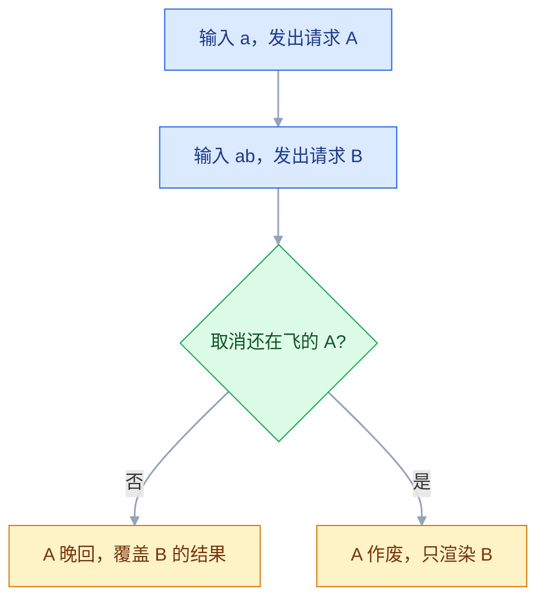
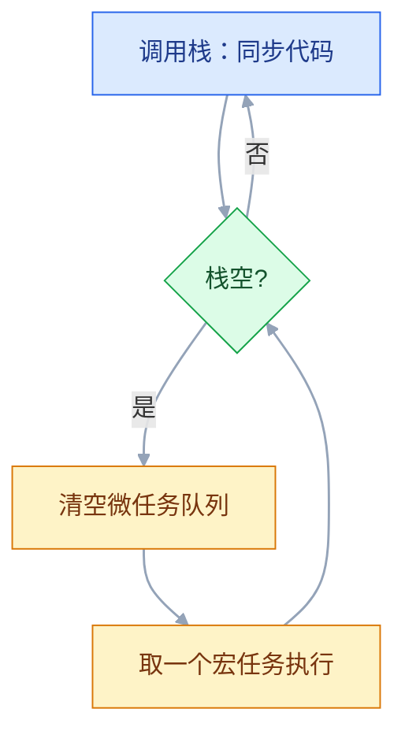

# JavaScript

## 一、工程案例：给商品搜索页接一个带超时、取消与重试的接口

**场景**：一个只有 HTML/CSS 的商品列表页，需要接后端搜索接口。真实接口不会总是成功：用户连续输入会产生竞态，弱网会拖到十几秒，后端会返回 500，刷新页面后还得保留上次关键词。这一节把这四件事一次做完，产出一个能直接运行的页面。

**接口约定**：

| 项 | 内容 |
|---|---|
| 请求 | `GET /api/products?q=<关键词>&page=<页码>` |
| 成功 | `200`，`{ items: [{ id, name, priceCents }], total, page }` |
| 业务错误 | `500`，`{ message: "库存服务异常" }` |
| 超时模拟 | `q=slow` 延迟 9 秒返回 |
| 报错模拟 | `q=boom` 立即返回 500 |

### 1.1 模拟接口（`server.mjs`）

```js
import { createServer } from "node:http";
import { readFile } from "node:fs/promises";
import { extname, join } from "node:path";

const ROOT = process.cwd();
const MIME = { ".html": "text/html; charset=utf-8", ".js": "text/javascript; charset=utf-8" };
const ALL = Array.from({ length: 23 }, (_, i) => ({
  id: i + 1, name: `商品 ${i + 1}`, priceCents: (i + 1) * 1990,
}));

createServer(async (req, res) => {
  const url = new URL(req.url, "http://localhost:8787");
  if (url.pathname === "/api/products") {
    const q = (url.searchParams.get("q") ?? "").trim();
    const page = Math.max(1, Number(url.searchParams.get("page") ?? "1") || 1);
    if (q === "boom") {
      res.writeHead(500, { "Content-Type": "application/json; charset=utf-8" });
      return res.end(JSON.stringify({ message: "库存服务异常" }));
    }
    const hit = ALL.filter((p) => p.name.includes(q));
    const items = hit.slice((page - 1) * 8, page * 8);
    const delay = q === "slow" ? 9000 : 120;
    return setTimeout(() => {
      res.writeHead(200, { "Content-Type": "application/json; charset=utf-8" });
      res.end(JSON.stringify({ items, total: hit.length, page }));
    }, delay);
  }
  const file = url.pathname === "/" ? "index.html" : url.pathname.slice(1);
  try {
    const body = await readFile(join(ROOT, file));
    res.writeHead(200, { "Content-Type": MIME[extname(file)] ?? "application/octet-stream" });
    res.end(body);
  } catch {
    res.writeHead(404).end("404");
  }
}).listen(8787, () => console.log("http://localhost:8787"));
```

### 1.2 请求层（`api.js`）

```js
const TIMEOUT_MS = 8000;

export class ApiError extends Error {
  constructor(message, { status = 0, code = "unknown", cause } = {}) {
    super(message, { cause });
    this.name = "ApiError";
    this.status = status;     // HTTP 状态码；网络层失败时为 0
    this.code = code;         // http | parse | timeout | network
  }
}

export async function request(path, { signal, ...init } = {}) {
  const ctrl = new AbortController();
  const timer = setTimeout(() => ctrl.abort(new DOMException("请求超时", "TimeoutError")), TIMEOUT_MS);
  const onAbort = () => ctrl.abort(signal.reason);
  if (signal?.aborted) ctrl.abort(signal.reason);          // 外部已经取消，直接转发
  else signal?.addEventListener("abort", onAbort, { once: true });

  try {
    const res = await fetch(path, { ...init, signal: ctrl.signal });
    if (!res.ok) {
      const body = await res.json().catch(() => null);
      throw new ApiError(body?.message ?? `HTTP ${res.status}`, {
        status: res.status, code: "http",
      });
    }
    if (res.status === 204) return null;
    return await res.json();
  } catch (err) {
    if (err.name === "AbortError") throw err;
    if (err.name === "TimeoutError") {
      throw new ApiError("请求超时，请重试", { code: "timeout", cause: err });
    }
    if (err instanceof ApiError) throw err;
    if (err instanceof SyntaxError) {
      throw new ApiError("响应不是合法 JSON", { code: "parse", cause: err });
    }
    throw new ApiError("网络不可用，请检查连接", { code: "network", cause: err });
  } finally {
    clearTimeout(timer);
    signal?.removeEventListener("abort", onAbort);
  }
}
```

| 设计 | 原因 |
|---|---|
| 手动判断 `res.ok` | `fetch` 只在网络失败和取消时 reject；404/500 也会正常 resolve |
| 内部 `AbortController` 做超时 | `fetch` 没有 timeout 选项；Abort 同时能中断连接 |
| 外部 `signal` 转发到内部 `ctrl` | 切换关键词时要取消旧请求，又不能覆盖内部超时 |

### 1.3 页面层（`app.js`）

```js
import { ApiError, request } from "./api.js";

const KEY = "shop:keyword";
const state = { keyword: "", page: 1, items: [], total: 0, status: "idle", error: "" };
const els = {
  form: document.querySelector("#search-form"), input: document.querySelector("#keyword"),
  status: document.querySelector("#status"), list: document.querySelector("#list"),
  more: document.querySelector("#more"),
};
let inflight = null;

function debounce(fn, delay = 300) {
  let timer = null;
  const wrapped = (...args) => {
    clearTimeout(timer);
    timer = setTimeout(() => fn(...args), delay);
  };
  wrapped.cancel = () => clearTimeout(timer);
  return wrapped;
}

function render() {
  const text = { idle: "输入关键词开始搜索", loading: "加载中…", error: state.error, success: `共 ${state.total} 条` };
  els.status.textContent = text[state.status];
  els.status.dataset.state = state.status;
  const frag = document.createDocumentFragment();
  for (const p of state.items) {
    const li = document.createElement("li");
    li.className = "card";
    const name = document.createElement("span");
    name.textContent = p.name;
    const price = document.createElement("span");
    price.textContent = `¥${(p.priceCents / 100).toFixed(2)}`;
    li.append(name, price);
    frag.append(li);
  }
  els.list.replaceChildren(frag);
  els.more.hidden = state.items.length >= state.total;
}

async function load({ append = false } = {}) {
  inflight?.abort();
  const ctrl = new AbortController();
  inflight = ctrl;
  state.status = "loading";
  render();
  try {
    const query = new URLSearchParams({ q: state.keyword, page: String(state.page) });
    const data = await request(`/api/products?${query}`, { signal: ctrl.signal });
    state.items = append ? [...state.items, ...data.items] : data.items;
    state.total = data.total;
    state.status = "success";
  } catch (err) {
    if (err.name === "AbortError") return;
    if (append) state.page -= 1;    // 追加失败回退页码，重试不跳页
    state.status = "error";
    state.error = err instanceof ApiError && err.code === "timeout" ? "请求超时，点这里重试" : err.message;
  } finally {
    if (inflight === ctrl) inflight = null;
    render();
  }
}

function runSearch() {
  state.page = 1;
  state.keyword = els.input.value.trim();
  localStorage.setItem(KEY, state.keyword);
  load();
}
const debouncedSearch = debounce(runSearch);

els.form.addEventListener("submit", (e) => { e.preventDefault(); debouncedSearch.cancel(); runSearch(); });
els.input.addEventListener("input", debouncedSearch);
els.status.addEventListener("click", () => { if (state.status === "error") load(); });
els.more.addEventListener("click", () => { state.page += 1; load({ append: true }); });

state.keyword = localStorage.getItem(KEY) ?? "";
els.input.value = state.keyword;
load();
```

```html
<!doctype html>
<html lang="zh-CN">
<head>
  <meta charset="utf-8">
  <title>商品搜索</title>
  <style>
    #list { list-style: none; padding: 0; display: grid; gap: 8px; }
    .card { display: flex; justify-content: space-between; padding: 8px 12px; border: 1px solid #ddd; border-radius: 6px; }
    #status[data-state="error"] { color: #b91c1c; cursor: pointer; }
  </style>
</head>
<body>
<form id="search-form">
  <input id="keyword" type="search" placeholder="输入商品名" autocomplete="off">
  <button type="submit">搜索</button>
</form>
<p id="status" data-state="idle" aria-live="polite"></p>
<ul id="list"></ul>
<button id="more" type="button" hidden>加载更多</button>
<script type="module" src="./app.js"></script>
</body>
</html>
```

**运行**：`index.html`、`api.js`、`app.js`、`server.mjs` 放同一目录，执行 `node server.mjs`，打开 `http://localhost:8787`。

### 1.4 关键输出

```text
GET /api/products?q=%E5%95%86%E5%93%81&page=1     200   120 ms
GET /api/products?q=boom&page=1                   500   118 ms
GET /api/products?q=slow&page=1                   (canceled)
```

```text
ApiError: 库存服务异常
    at request (api.js:19:13)
    at async load (app.js:41:18)
  name: "ApiError" / code: "http" / status: 500
```

> 竞态被取消时，Network 里显示 `(canceled)`，控制台不应该出现红色报错。取消是正常控制流，不是异常。上面栈里的行号为示意，以实际运行为准。

### 1.5 验收表

| # | 检查项 | 命令或检查 | 通过标准 |
|---|---|---|---|
| 1 | 服务启动 | `node server.mjs` | 终端有启动提示，首页出现 8 张卡片 |
| 2 | 输入防抖 | 连续快速输入「商品 1」 | 输入过程中不发请求，停止 300ms 后只发 1 条 |
| 3 | 竞态取消 | 先输入「slow」，等 Network 出现该请求后再改成「商品 2」 | 前一条显示 `(canceled)`，列表与最后一个关键词一致 |
| 4 | 取消不报错 | 观察状态栏与控制台 | 不出现 `AbortError`，不进入错误态 |
| 5 | 空结果 | 搜「不存在」 | 显示「共 0 条」，列表为空，无异常 |
| 6 | 业务错误 | 搜「boom」 | 显示「库存服务异常」，状态栏可点击重试 |
| 7 | 超时 | 搜「slow」并等 8 秒 | 显示超时提示；点击后重新发起请求 |
| 8 | 分页 | 搜「商品 1」后点「加载更多」 | 追加剩余 3 条，不重复，按钮隐藏 |
| 9 | 关键词记忆 | 刷新页面 | 输入框保留上次关键词并自动请求 |
| 10 | XSS | 把模拟数据名称改成 ``，重启 `node server.mjs` | 按纯文本显示，不弹窗 |
| 11 | 全局错误 | 走完以上流程 | 控制台没有 `Uncaught`，没有未处理的 Promise 拒绝 |

---

## 二、高频问答：会卡住你的地方，也是面试最常问的

### 2.1 元素明明存在，`querySelector` 却返回 `null`

**现场**

脚本第一行打印 `document.readyState`；不是 `interactive` / `complete` 就是时机问题。

```html
<script src="app.js" defer></script>
```

**要点**

- 选择器没错，是执行时机错了：脚本跑的时候 DOM 里还没有这个元素。
- `<script>` 在 `head` 里同步执行会阻塞解析，后面的 HTML 还没建出来。
- 把脚本移到 `</body>` 前，或加 `defer`，`null` 立刻消失。

**追问**

- `defer` 和 `async` 差在哪？→ 都并行下载，前者保证顺序且在解析后执行。
- 模块脚本还要 `defer` 吗？→ 不用，`type="module"` 默认就是 defer。
- `DOMContentLoaded` 里拿就一定安全吗？→ 是，但更推荐直接 `defer`。

### 2.2 方法作为回调传走，`this` 变成 `undefined`

**现场**

在方法里打印 `this`，看是 `undefined`、`window` 还是目标对象。

```js
const user = { name: "张伟", greet() { return this.name; } };
const fn = user.greet;
fn();                        // 模块或严格模式下 this 是 undefined，抛 TypeError
setTimeout(user.greet, 0);   // 同样丢 this
```

**要点**

- 方法体没变，变的是调用点；`this` 由调用方式决定。
- `const fn = obj.method; fn()` 已经和 `obj` 断开，模块或严格模式下 `this` 是 `undefined`。
- 改成 `obj.method()`、箭头函数包一层，或用 `bind(obj)`。

**追问**

- 箭头函数为什么没有这个问题？→ 它没有自己的 `this`，用定义处外层的。
- `setTimeout(obj.method, 0)` 怎么修？→ 包成 `() => obj.method()` 或 `bind`。
- 严格模式和非严格模式差在哪？→ 普通调用时前者 `undefined`，后者 `window`。

### 2.3 表单一点提交，页面就刷新

**现场**

Network 里出现一条文档请求；地址栏参数变了或页面白了一下。

**要点**

- 这是 HTML 的默认行为，不是接口问题：表单默认导航到 `action`。
- `<button>` 默认 `type="submit"`，按回车也会触发隐式提交。
- 在 `submit` 处理函数第一行加 `e.preventDefault()`，刷新停止就确认了。

**追问**

- 为什么回车也会提交？→ 表单里有提交按钮时的隐式提交机制。
- `preventDefault` 和 `return false` 差在哪？→ 后者只在特定绑定方式下有效，别依赖。
- 不想刷新又想提交怎么办？→ 拦截后走 `fetch`，或者让表单正常 POST 走 PRG。

### 2.4 忘了 `await`，拿到的是 Promise

**现场**

`console.log(res)` 显示 `Promise {<pending>}`；下一行报 `res.json is not a function`。

```js
const res = fetch("/api/user");     // ❌ 少了 await
const data = res.json();            // TypeError: res.json is not a function
```

**要点**

- 拿到的是 Promise 对象本身，不是数据：数据还没到，代码已经往下走了。
- `fetch` 和 `res.json()` 都返回 Promise，两层都要 `await`。
- 在赋值后打印 `value instanceof Promise` 就能确认。

**追问**

- 为什么 `res.json()` 也要 await？→ 响应体是流，解析本身是异步的。
- `await` 会阻塞页面吗？→ 只暂停当前函数，不阻塞主线程。
- `forEach(async () => await f())` 为什么没用？→ `forEach` 不等待回调返回的 Promise。

### 2.5 `fetch` 遇到 404 / 500 不抛错

**现场**

打印 `res.status` 和 `res.ok`；404 时 `ok` 是 `false`，但代码没有进 `catch`。

```js
const res = await fetch("/api/not-exist");
console.log(res.status, res.ok);    // 404 false，但没有抛错
if (!res.ok) throw new Error(`HTTP ${res.status}`);
```

**要点**

- `fetch` 只在网络层失败、跨域被拦、主动取消时 reject。
- HTTP 错误状态仍然算「请求成功」，`res.ok` 才是判断依据。
- `await fetch` 后立刻检查 `res.ok`，不 ok 自己抛。

**追问**

- 什么时候 `fetch` 才会进 `catch`？→ DNS 失败、断网、CORS 被拦、`abort()`。
- 为什么 500 还能拿到 body？→ 响应完整到达了，只是状态码表示业务失败。
- 封装时怎么统一处理？→ 在请求层判断 `res.ok` 并抛自定义错误。

### 2.6 给列表项绑了事件，新增的项没反应

**现场**

刷新后点旧项有反应、点新增项没反应；或在控制台数一数绑定次数。

**要点**

- 监听器只绑到了当时存在的元素，后来 `append` 的新节点没有。
- 把监听器移到父容器，用 `e.target.closest()` 找具体项，新增项立刻生效。
- 这就是事件委托，靠冒泡统一处理。

**追问**

- 为什么绑在父容器就能管到新节点？→ 事件冒泡到父级，父级监听器一直在。
- `e.target` 和 `e.currentTarget` 差在哪？→ 前者是实际触发的元素，后者是绑监听的那个。
- 委托有什么代价？→ 层级深时 `closest` 有开销，还要处理非元素节点。

### 2.7 循环里 `setTimeout` 全部打印最后一个值

**现场**

把 `var` 换成 `let`，输出立刻变成 `0 1 2`。

```js
for (var i = 0; i < 3; i++) setTimeout(() => console.log(i), 0);   // 3 3 3
for (let j = 0; j < 3; j++) setTimeout(() => console.log(j), 0);   // 0 1 2
```

**要点**

- `var` 是函数作用域，三个回调闭包共享同一个 `i`，循环结束时 `i` 已经是 3。
- 回调执行时读的是变量当时的值，不是注册时的值。
- `let` 每次迭代创建新的绑定，所以能保留各自的值。

**追问**

- 不用 `let` 怎么修？→ 用 IIFE 包一层传参，或 `setTimeout(fn.bind(null, i))`。
- 为什么输出是 3 不是 2？→ 循环条件是 `i < 3`，结束时 `i` 已经加到 3。
- 闭包在这里起了什么作用？→ 让回调记住定义时的作用域，而不是复制值。

### 2.8 `||` 把 `0` 和空字符串当成「没填」

**现场**

输入 `0` 看结果是不是默认值；换成 `??` 再试。

```js
const qty = input.quantity || 10;    // quantity = 0 → 10，错误
const qty2 = input.quantity ?? 10;   // quantity = 0 → 0，正确
```

**要点**

- `||` 判断真假值，`0`、`""`、`false`、`NaN` 都会被替换成默认值。
- 想要的是「只有 `null` / `undefined` 才用默认值」，这时用 `??`。
- 数量、价格、开关这类合法取 0 / false 的字段最容易踩。

**追问**

- `??` 和 `||` 能混用吗？→ 不能直接混，必须加括号，否则语法错误。
- `??=` 是什么？→ 只在左值为 null / undefined 时赋值。
- 可选链和 `??` 怎么配合？→ `obj?.x ?? 默认值` 是常见组合。

### 2.9 `sort()` 把数字按字符串排

**现场**

`[10, 9, 100, 1].sort()` 得到 `[1, 10, 100, 9]`，这就是字符串顺序。

```js
[10, 9, 100, 1].sort();                    // [1, 10, 100, 9]
[10, 9, 100, 1].sort((a, b) => a - b);     // [1, 9, 10, 100]
const sorted = list.toSorted((a, b) => a - b);   // 不改原数组
```

**要点**

- 不传比较函数时，`sort()` 把元素转成字符串，按 UTF-16 码元比较。
- 数字排序必须传 `(a, b) => a - b`，降序反过来。
- `sort()` 改原数组，不想改就用 `toSorted()`。

**追问**

- 为什么 `[1, 10, 100, 9]` 是这个顺序？→ 逐字符比较，`"10"` 排在 `"9"` 前。
- 中文字符串怎么排？→ 用 `localeCompare`，别依赖默认顺序。
- `sort` 稳定吗？→ 稳定，ES2019 起规范要求相同键保持原顺序。

### 2.10 改了一个对象，另一个对象也跟着变

**现场**

`a === b` 为 `true`；嵌套对象 `a.list === c.list` 也为 `true`。

```js
const a = { list: [1, 2] };
const b = a;
b.list.push(3);
console.log(a.list);        // [1, 2, 3]

const c = { ...a };
c.list.push(4);
console.log(a.list);        // [1, 2, 3, 4] —— 浅拷贝仍然共享 list
```

**要点**

- 赋值复制的是引用，两个变量指向同一个对象。
- 展开运算符只复制第一层，嵌套对象仍然共享。
- 要彻底隔离用 `structuredClone()`，但它不能克隆函数和 DOM 节点。

**追问**

- `JSON.parse(JSON.stringify())` 有什么坑？→ 丢 `undefined`、函数，`Date` 变字符串，`BigInt` 抛错。
- 为什么改 state 必须返回新对象？→ React 用 `Object.is` 比较引用。
- 深拷贝越深越好吗？→ 有成本，数据量大时按层更新。

### 2.11 `JSON.parse(localStorage.getItem(...))` 之后取属性报错

**现场**

Application 面板看这个键是否存在；打印 `raw` 和解析结果。

```js
const raw = localStorage.getItem("cart");
const cart = JSON.parse(raw);     // 无数据时 cart 是 null
cart.items.push(item);            // TypeError: Cannot read properties of null
```

**要点**

- 键不存在时 `getItem` 返回 `null`，`JSON.parse(null)` 得到 `null`，再读 `.items` 就是空值取属性。
- 把「没有数据」当成「有合法数据」是根因。
- 解析后先判空，再给默认结构。

**追问**

- 为什么 `JSON.parse(null)` 不报错？→ 规范会先把参数转成字符串 `"null"`，解析出 `null`。
- 还有什么会抛？→ 存进去的不是合法 JSON，比如手动改过或写了一半。
- 怎么封装更稳？→ `try/catch` + 默认值 + 结构校验。

### 2.12 一个长循环让页面整段卡死

**现场**

Performance 面板出现几百毫秒的 Long Task；点击延迟与循环时长一致。

```js
const start = performance.now();
while (performance.now() - start < 300) {}   // 这 300ms 内页面不响应
```

**要点**

- JS 是单线程，长任务执行期间点击、计时器、渲染都只能排队。
- 不是浏览器性能差，是这段同步代码一直占着调用栈。
- 拆成小块用 `setTimeout` / `requestIdleCallback` 让出主线程，或移到 Web Worker。

**追问**

- 为什么 `setTimeout(fn, 0)` 能让页面喘口气？→ 它把后续工作排到宏任务，先让渲染和事件插进来。
- Web Worker 适合什么？→ 纯计算、不碰 DOM 的任务。
- 多久算长任务？→ 超过 50ms 就会影响交互响应。

### 2.13 快速切换筛选，旧请求的结果盖掉了新结果

**现场**

Network 面板里慢的那条响应时间落在快的之后；把网络限速成 Slow 3G 更容易复现。



**要点**

- 发请求的顺序不等于响应落地的顺序，先发的可能后回。
- 每次请求带一个自增序号，回来时比对，不是最新就丢弃。
- 更稳的是用 `AbortController` 取消旧请求，让它根本不会落地。

```js
let seq = 0;
async function load(q) {
  const id = ++seq;
  const data = await request(`/api/products?q=${encodeURIComponent(q)}`);
  if (id !== seq) return;       // 已有更新的请求发出，这次结果丢弃
  state.items = data.items;
  render();
}
```

**追问**

- 为什么序号方案还要保留？→ 取消有兼容和时机问题，双保险更稳。
- 防抖能解决吗？→ 只能减少请求数，不能保证响应顺序。
- 服务端要不要管？→ 读请求不用，写请求要靠幂等键。

### 2.14 页面越用越卡，监听器和定时器没清

**现场**

Memory 面板拍两次堆快照，对比 Detached DOM 节点数量是不是只增不减。

```js
function mount(el) {
  const onResize = () => fit(el);
  const timer = setInterval(() => sync(el), 1000);
  window.addEventListener("resize", onResize);
  return () => {                       // 卸载时调用
    window.removeEventListener("resize", onResize);
    clearInterval(timer);
  };
}
```

**要点**

- 内存涨了但页面还在跑，不会报错，只会越来越慢。
- 组件卸载时没移除监听、没清定时器、没断开 `ResizeObserver`，闭包会把 DOM 和大对象一起留住。
- 挂监听的地方同时返回清理函数，卸载时调用。

**追问**

- 为什么移除监听就能释放？→ 闭包引用断了，DOM 才能被回收。
- `ResizeObserver` 也要断吗？→ 要，`disconnect()`，否则一直持有目标元素。
- 怎么确认泄漏？→ 反复挂载卸载后看 Detached 节点是否持续增长。

---

## 三、核心知识：从零开始要建立的东西

### 3.1 运行环境与脚本加载时机

浏览器边下载边解析 HTML，构建 DOM 树。脚本能否找到元素，取决于它在这一步的哪个位置执行。

| 写法 | 执行时机 | 顺序 | 适用 |
|---|---|---|---|
| `<script>` | 下载完立刻执行，阻塞解析 | 文档顺序 | 极少量、必须尽早跑的代码 |
| `<script defer>` | 解析完成后、`DOMContentLoaded` 前 | 文档顺序 | 依赖 DOM 的业务脚本 |
| `<script async>` | 下载完立刻执行 | 不保证 | 独立统计脚本 |
| `<script type="module">` | 默认 defer，严格模式，独立作用域 | 依赖图顺序 | 现代项目 |

**边界**：模块脚本走 CORS 规则，跨源加载需要对方返回正确的 CORS 头；直接双击 `file://` 打开会被拦，必须经由 HTTP 服务。

### 3.2 变量声明与作用域

`var` 属于函数作用域，`let` / `const` 属于块作用域。`let` / `const` 也会提升，但声明语句执行前处于**暂时性死区**（TDZ），访问会抛 `ReferenceError`，而不是得到 `undefined`。

| | `var` | `let` | `const` |
|---|---|---|---|
| 作用域 | 函数 | 块 | 块 |
| 重复声明 | 允许 | 报错 | 报错 |
| 声明前访问 | `undefined` | `ReferenceError` | `ReferenceError` |
| 重新赋值 | 可以 | 可以 | 不可以 |

**边界**：`const` 锁的是绑定，不是值。`const user = {}` 之后仍可改 `user.name`，只是不能 `user = {}`。

### 3.3 原始类型与相等判断

7 种原始类型：`string`、`number`、`boolean`、`null`、`undefined`、`bigint`、`symbol`；其余都是对象。原始类型按值比较，对象按引用比较。

| 表达式 | 结果 | 说明 |
|---|---|---|
| `typeof null` | `"object"` | 历史遗留，不能用来判断 null |
| `typeof []` | `"object"` | 数组判断用 `Array.isArray` |
| `{} === {}` | `false` | 两个不同的对象 |
| `NaN === NaN` | `false` | 用 `Number.isNaN()` |
| `Object.is(NaN, NaN)` | `true` | `Object.is` 规则不同 |
| `Object.is(0, -0)` | `false` | `===` 认为它们相等 |

**假值只有 8 个**：`false`、`0`、`-0`、`0n`、`""`、`null`、`undefined`、`NaN`。其余在条件里都为真，包括 `"0"`、`[]`、`{}`。业务代码统一用 `===` / `!==`。

### 3.4 引用语义与拷贝

变量里存的是「指向对象的引用」。赋值、传参、放进数组，复制的都是这个引用。

```js
const origin = { name: "张伟", address: { city: "北京" } };
const shallow = { ...origin };          // 只复制第一层
shallow.name = "李娜";                  // 不影响 origin
shallow.address.city = "上海";          // 影响 origin

const deep = structuredClone(origin);   // 连嵌套一起复制
deep.address.city = "广州";             // 不影响 origin
```

| 方式 | 层级 | 限制 |
|---|---|---|
| `{ ...obj }` / `[...arr]` | 浅 | 嵌套引用共享 |
| `structuredClone()` | 深 | 不能克隆函数、DOM 节点、Symbol；自定义类实例丢原型 |
| `JSON.parse(JSON.stringify())` | 深 | 丢 `undefined`、函数；`Date` 变字符串；`BigInt` 抛错 |

**边界**：不可变更新能避开大量「谁改了数据」的问题，但深层数据每次全量复制有成本；数据量大时按层更新，而不是每层都深拷贝。

### 3.5 数组方法与衍生数据

数组方法分两类：**改原数组**和**返回新数组**。混用是 bug 的主要来源。

| 目的 | 方法 | 改原数组 |
|---|---|---|
| 首尾增删 | `push` / `pop` / `unshift` / `shift` | 是 |
| 截取、插入、删除 | `splice` | 是 |
| 反转、排序 | `reverse` / `sort` | 是 |
| 映射、过滤 | `map` / `filter` | 否 |
| 查找、判断 | `find` / `includes` / `some` / `every` | 否 |
| 折叠 | `reduce` | 否 |

**边界**：`forEach` 不能用 `break` 提前结束；需要短路就用 `some` / `every` 或 `for...of`。ES2023 起有 `toSorted` / `toReversed` / `toSpliced` / `with`，需要不改原数组时优先用它们。

### 3.6 函数形态与 `this` 绑定

`this` 不看函数在哪定义，只看**怎么调用**。箭头函数没有自己的 `this`，直接用外层作用域的。

| 调用形式 | `this` |
|---|---|
| `obj.fn()` | `obj` |
| `fn()`（严格模式 / 模块） | `undefined` |
| `fn()`（非严格脚本） | `window` |
| `fn.call(x)` / `apply(x)` / `bind(x)()` | `x` |
| `new Fn()` | 新实例 |
| 箭头函数 | 外层作用域的 `this` |

**边界**：回调优先用箭头函数；需要动态 `this` 的对象方法不要改成箭头函数，否则它捕获的是定义处的 `this`（模块顶层就是 `undefined`）。

> **面试**：常问「`this` 到底指向什么？」答：只看怎么调用，`obj.fn()` 指 `obj`，普通调用在严格模式或模块里是 `undefined`。

### 3.7 闭包与私有状态

闭包是「函数 + 它定义时所在的作用域」。函数被返回或传走之后，仍然能读写那个作用域里的变量。

```js
function createCounter() {
  let count = 0;
  return () => ++count;
}
const next = createCounter();
next();   // 1
next();   // 2
```

**边界**：闭包会阻止变量被回收。挂到全局事件、定时器、缓存里的闭包如果一直不释放，会连同引用的 DOM 和大对象一起留在内存里。取消监听、清定时器是释放的前提。

### 3.8 DOM 与渲染成本

DOM 操作的成本不在改属性，而在改完之后重新计算布局、重绘、合成。读布局属性（`offsetHeight`、`getBoundingClientRect`）会强制浏览器立刻结算，读一次写一次最容易触发**布局抖动**。

```js
// ❌ 循环里反复读布局，触发同步计算
for (const item of items) item.style.width = `${list.offsetWidth}px`;

// ✅ 读一次，批量写
const width = list.offsetWidth;
const frag = document.createDocumentFragment();
for (const item of items) {
  item.style.width = `${width}px`;
  frag.append(item);
}
list.append(frag);
```

**边界**：`innerHTML` 拼接写起来最短，但用户输入会被当成 HTML 解析，存在 XSS；`textContent` 和 `createElement` 更安全。数据量大时再考虑虚拟列表。

### 3.9 事件传播与事件委托

事件从 `window` 往目标走是捕获，从目标往回流是冒泡。第三个参数为 `true` 时监听捕获阶段；不传时默认监听冒泡。

```js
outer.addEventListener("click", () => console.log("outer 捕获"), true);
outer.addEventListener("click", () => console.log("outer 冒泡"));
inner.addEventListener("click", () => console.log("inner"));
// 点击 inner：outer 捕获 → inner → outer 冒泡
```

**委托**：监听器绑在父容器，靠冒泡统一处理，新增的子元素自动生效。

```js
list.addEventListener("click", (e) => {
  if (!(e.target instanceof Element)) return;
  const btn = e.target.closest("[data-action]");
  if (!btn) return;
  console.log(btn.dataset.action, btn.closest("li")?.dataset.id);
});
```

**边界**：`stopPropagation()` 只阻止继续传播，不阻止同一元素上的其它监听器；要连同一元素上的后续监听器一起停，用 `stopImmediatePropagation()`。高频事件可加 `{ passive: true }`。

### 3.10 Promise 与 `async` / `await`

Promise 只有 `pending`、`fulfilled`、`rejected` 三种状态，且只能从 `pending` 变一次。`then` 返回新 Promise，所以可以链式调用。

| 组合 | 何时结束 | 失败策略 |
|---|---|---|
| `Promise.all` | 全部成功 | 任意一个失败就整体失败 |
| `Promise.allSettled` | 全部结束 | 不 reject，逐项看 `status` |
| `Promise.race` | 第一个结束 | 第一个失败就失败 |
| `Promise.any` | 第一个成功 | 全部失败才 reject，错误是 `AggregateError` |

```js
// 串行：总耗时是两者之和
const user = await getUser(1);
const orders = await getOrders(user.id);

// 并行：总耗时接近较慢的那个
const [user2, orders2] = await Promise.all([getUser(1), getOrders(1)]);
```

**边界**：`async` 函数总是返回 Promise；`await` 只暂停当前函数，不阻塞页面。`forEach(async () => { await f(); })` 不会等待，改用 `for...of` 或 `Promise.all(array.map(f))`。

> **面试**：常问「`Promise.all` 和 `Promise.allSettled` 有什么区别？」答：前者任一失败就整体失败，后者等全部结束，再逐项看 `status`。

### 3.11 事件循环与任务队列

调用栈空了之后，先清空**微任务**队列，再取一个**宏任务**执行，如此循环。Promise 回调、`queueMicrotask` 是微任务；定时器、I/O、用户事件是宏任务。



```js
console.log("1");
setTimeout(() => console.log("2"), 0);
Promise.resolve().then(() => console.log("3"));
console.log("4");
// 输出：1 → 4 → 3 → 2
```

**边界**：微任务里再注册微任务会一直排在当前队列，可能饿死渲染；`setTimeout(fn, 0)` 不是「立刻」，浏览器有最小延迟，后台标签页还会被节流。长时间占用调用栈会阻塞所有队列。

> **面试**：常问「为什么这段代码输出 1 → 4 → 3 → 2？」答：先跑完同步代码，调用栈空了清微任务（Promise），最后才取一个宏任务（定时器）。

### 3.12 网络请求与取消语义

`fetch` 的语义容易记反：**HTTP 错误不 reject，网络错误才 reject**。响应体是流，只能读一次。

| 情况 | `fetch` 行为 |
|---|---|
| 200 / 204 | resolve |
| 400 / 401 / 404 / 500 | resolve，`res.ok === false` |
| DNS 失败、断网、CORS 被拦 | reject，通常是 `TypeError` |
| 调用 `abort()` | reject，`AbortError` |
| 响应体已读 | 再读抛 `TypeError` |

**边界**：`credentials` 默认是 `same-origin`——同源请求会带 Cookie，跨域默认不带，要带就显式设 `include`，同时服务端得返回正确的 CORS 头。上传进度只有 `XMLHttpRequest.upload` 有现成事件，`fetch` 没有。

> **面试**：常问「`fetch` 遇到 404 会 reject 吗？」答：不会，只有网络失败、跨域被拦和主动取消才 reject，404 / 500 要自己判断 `res.ok`。

### 3.13 浏览器存储的边界

| | `localStorage` | `sessionStorage` | Cookie | IndexedDB |
|---|---|---|---|---|
| 生命周期 | 一直保留 | 关闭标签页失效 | 可设过期时间 | 一直保留 |
| 容量 | 约 5MB | 约 5MB | 约 4KB | 按磁盘配额 |
| 同步 / 异步 | 同步 | 同步 | 随请求发送 | 异步 |
| 能否存对象 | 只能字符串 | 只能字符串 | 只能字符串 | 可以存结构化数据 |

上表的容量和配额由浏览器实现决定，以官方当前规范为准。

**边界**：`localStorage` 是同步 API，读写大 JSON 会阻塞主线程；同源共享，任何同源脚本都能读，**不能存敏感凭证**。Cookie 的 `HttpOnly` 能挡住 JS 读取，`SameSite` 能缓解 CSRF。

### 3.14 ES 模块与依赖边界

ES 模块是静态的：`import` / `export` 在解析阶段就能确定依赖图，因此支持 tree-shaking 和顶层 `await`；循环依赖按依赖图顺序处理，不会卡死。

```js
// math.js
export const PI = 3.14159;
export default function add(a, b) { return a + b; }
```

```js
// app.js
import add, { PI } from "./math.js";
const lazy = await import("./heavy.js");   // 动态导入，按需加载
```

| 特性 | 说明 |
|---|---|
| 作用域 | 每个模块独立，不污染全局 |
| 严格模式 | 默认开启 |
| 执行时机 | 默认 defer |
| 绑定 | 导出的是活绑定，值变了导入方能观察到 |
| 路径 | 浏览器里必须写完整扩展名 |

**边界**：模块必须通过 HTTP 访问；循环依赖能运行，但某一方在初始化阶段可能拿到未完成的值，设计上应尽量避免。

---

## 四、冷门知识汇总

| 知识点 | 为什么冷门 | 用到时的关键词 |
|---|---|---|
| `Proxy` / `Reflect` | 业务代码几乎不直接写，主要藏在框架响应式里 | `new Proxy(target, handler)`、`Reflect.get`、`track` / `trigger` |
| 原型链与 `instanceof` | 日常写 `class` 就够，排查继承与框架实现时才需要 | `Object.getPrototypeOf`、`prototype`、`__proto__` |
| 生成器与迭代器 | 异步编程被 `async/await` 取代后很少手写 | `function*`、`yield`、`Symbol.iterator`、`next()` |
| `Symbol` 作为唯一键 | 日常对象用字符串键就够了 | `Symbol("id")`、`Symbol.for`、隐藏属性 |
| 属性描述符 | 框架和库内部用，业务里少见 | `Object.defineProperty`、`writable`、`enumerable`、`get` / `set` |
| 标签模板 | 只有样式库、SQL 模板这类库在用 | `String.raw`、`` tag`...` ``、转义控制 |
| 正则具名分组 | 简单正则用捕获组就够 | `(?<name>...)`、`groups.name`、`d` 标志 |
| `Intl` | 多数项目直接用日期库或手写格式化 | `Intl.NumberFormat`、`Intl.DateTimeFormat`、`timeZone` |
| `ArrayBuffer` / `TypedArray` | 普通业务不碰二进制 | `Uint8Array`、`DataView`、`Blob.arrayBuffer()` |
| `WeakMap` / `WeakRef` | 只在做缓存、避免内存泄漏时用 | 弱引用、`FinalizationRegistry`、私有数据 |
| `BroadcastChannel` | 多标签页同步是低频需求 | `postMessage`、`storage` 事件、`onmessage` |
| `requestIdleCallback` | 只在空闲时段执行，浏览器支持不如 `requestAnimationFrame` 普遍，以官方当前规范为准 | 空闲调度、后台任务、`timeout` 选项 |
| `AbortSignal.timeout()` | 多数人仍手写 `AbortController` + 定时器 | `AbortSignal.any`、`signal.reason`、超时组合 |
| `structuredClone` 的转移 | 普通深拷贝用不到「转移所有权」 | `transfer`、`ArrayBuffer`、`DataCloneError` |
| `Object.groupBy` / `Map.groupBy` | ES2024 加入，旧项目仍用 `reduce` 分组 | 分组、`Record`、`Map` |
| 尾调用优化 | 规范里有，主流引擎并未普遍实现 | 递归、栈溢出、改为循环 |
