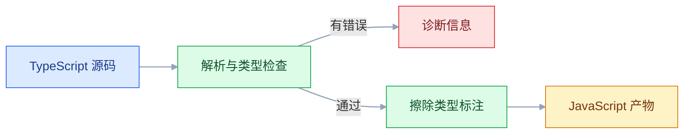
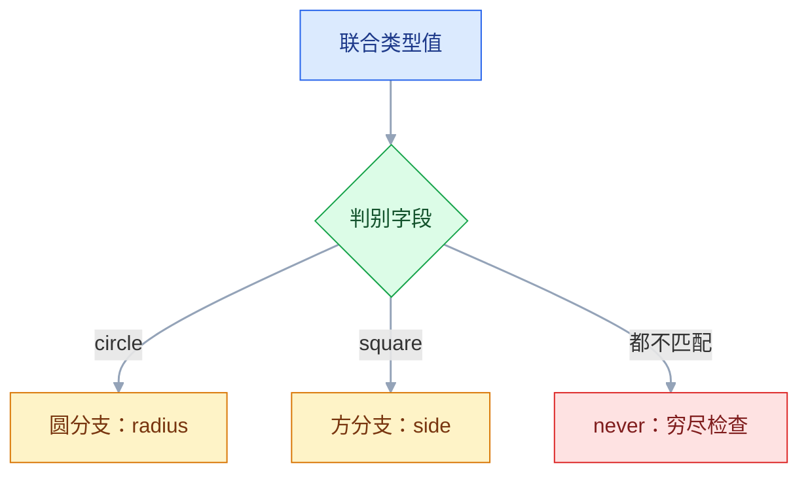
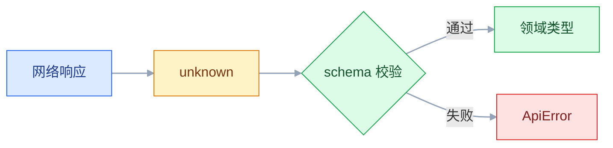

# TypeScript

## 一、工程案例：给接口请求模块补齐类型与错误处理，让 `tsc --noEmit` 零报错

**改造前**：项目里有一个能跑但到处是 `any` 的请求函数。

```ts
// src/api/request.ts —— 改造前
export async function request(path: string, init?: RequestInit) {
  const res = await fetch(path, init);
  const json = await res.json();          // any
  if (json.code !== 0) throw new Error(json.message);
  return json.data;                       // any
}
```

```ts
const user = await request("/api/users/1");
console.log(user.userName);   // 编辑器没有补全；拼错也不报错
```

| 问题 | 后果 |
|---|---|
| 返回 `any` | 调用方写错字段、把 `null` 当字符串用，编译期全部放行 |
| 错误只有 `Error` | 调用方无法区分超时、网络失败、业务错误、响应格式错误 |
| `JSON.parse` / `res.json()` 直接断言 | 后端字段改名或返回空对象时，线上才炸 |
| 没有超时与取消 | 弱网下请求挂十几秒，页面切走后旧响应仍会覆盖新状态 |

**目标**：四处源码与一份 `tsconfig.json` 改完，`npx tsc --noEmit` 无输出；字段拼错、空值未处理、错误码写错都在编译期被拦住。

### 1.1 类型与错误（`src/api/types.ts`）

```ts
export interface ApiEnvelope<T> {
  code: number;
  message: string;
  data: T;
  requestId: string;
}
export interface User {
  id: number;
  username: string;
  email: string | null;
  createdAt: string;
}
export interface Page<T> {
  items: T[];
  total: number;
  page: number;
  pageSize: number;
}

export type Parser<T> = (data: unknown) => T;

export type ApiErrorCode =
  | "http" | "business" | "parse" | "timeout" | "network" | "aborted";

export class ApiError extends Error {
  readonly code: ApiErrorCode;
  readonly status: number;
  readonly requestId?: string | undefined;

  constructor(message: string, options: {
    code: ApiErrorCode; status?: number;
    requestId?: string | undefined; cause?: unknown;
  }) {
    super(message, { cause: options.cause });
    this.name = "ApiError";
    this.code = options.code;
    this.status = options.status ?? 0;
    this.requestId = options.requestId;
  }
}
```

### 1.2 请求层（`src/api/request.ts`）

```ts
import { ApiError, type ApiEnvelope, type Parser } from "./types.js";

const TIMEOUT_MS = 8000;

function isEnvelope(value: unknown): value is ApiEnvelope<unknown> {
  if (typeof value !== "object" || value === null) return false;
  const v = value as Record<string, unknown>;
  return typeof v.code === "number" && typeof v.message === "string"
    && typeof v.requestId === "string" && "data" in v;
}

export async function request<T>(
  path: string,
  parse: Parser<T>,
  init: RequestInit = {},
): Promise<T> {
  const ctrl = new AbortController();
  const timer = setTimeout(() => ctrl.abort(new DOMException("请求超时", "TimeoutError")), TIMEOUT_MS);
  const onAbort = () => ctrl.abort(init.signal?.reason);
  init.signal?.addEventListener("abort", onAbort, { once: true });
  // 监听器挂上之前 signal 已经取消时，abort 事件不会再触发
  if (init.signal?.aborted) ctrl.abort(init.signal.reason);

  try {
    const res = await fetch(path, { ...init, signal: ctrl.signal });
    if (res.status === 204) return parse(undefined);
    let body: unknown;
    try { body = await res.json(); } catch { body = null; }

    if (!res.ok) {
      const message = isEnvelope(body) ? body.message : `HTTP ${res.status}`;
      throw new ApiError(message, {
        code: "http", status: res.status,
        requestId: isEnvelope(body) ? body.requestId : undefined,
      });
    }
    if (!isEnvelope(body)) {
      throw new ApiError("响应结构不符合约定", { code: "parse", status: res.status });
    }
    if (body.code !== 0) {
      throw new ApiError(body.message, {
        code: "business", status: res.status, requestId: body.requestId,
      });
    }
    return parse(body.data);
  } catch (err) {
    if (err instanceof ApiError) throw err;
    if (err instanceof DOMException && err.name === "AbortError") {
      throw new ApiError("请求已取消", { code: "aborted", cause: err });
    }
    if (err instanceof DOMException && err.name === "TimeoutError") {
      throw new ApiError("请求超时", { code: "timeout", cause: err });
    }
    throw new ApiError("网络不可用", { code: "network", cause: err });
  } finally {
    clearTimeout(timer);
    init.signal?.removeEventListener("abort", onAbort);
  }
}
```

| 设计 | 原因 |
|---|---|
| `body: unknown` | `res.json()` 的类型是 `any`，先降级成 `unknown` 才能强制校验 |
| `Parser<T>` 作为参数 | `T` 不是调用方口头承诺，而是由校验函数当场产出 |
| 错误统一成 `ApiError` | 调用方按 `code` 分支，不用猜 `message` 里写了什么 |
| 先判断 `init.signal.aborted` | 已经取消的 signal 不会再触发 `abort` 事件，只挂监听会漏掉这次取消 |
| `res.status === 204` 直接交给 parser | 204 没有响应体，`res.json()` 会抛语法错 |
| `finally` 清定时器与监听 | 成功、失败、取消三条路径都不会留下悬挂的计时器 |

### 1.3 运行时校验（`src/api/users.ts`）

```ts
import { ApiError, type Page, type Parser, type User } from "./types.js";

function asRecord(value: unknown, label: string): Record<string, unknown> {
  if (typeof value !== "object" || value === null) throw new ApiError(`${label}格式错误`, { code: "parse" });
  return value as Record<string, unknown>;
}

export function parseUser(data: unknown): User {
  const u = asRecord(data, "用户");
  const { id, username, createdAt } = u;
  if (typeof id !== "number" || typeof username !== "string" || typeof createdAt !== "string") {
    throw new ApiError("用户字段缺失或类型错误", { code: "parse" });
  }
  let email: string | null;
  if (u.email === null) email = null;
  else if (typeof u.email === "string") email = u.email;
  else throw new ApiError("email 字段类型错误", { code: "parse" });
  return { id, username, email, createdAt };
}

export function parsePage<T>(parseItem: Parser<T>) {
  return (data: unknown): Page<T> => {
    const p = asRecord(data, "分页数据");
    if (!Array.isArray(p.items) || typeof p.total !== "number"
      || typeof p.page !== "number" || typeof p.pageSize !== "number") {
      throw new ApiError("分页字段缺失或类型错误", { code: "parse" });
    }
    return { items: p.items.map(parseItem), total: p.total, page: p.page, pageSize: p.pageSize };
  };
}
```

> 两处 `as Record<string, unknown>` 都紧跟在 `typeof` / `null` 检查之后：不是骗编译器，是把已验证的条件告诉它。

### 1.4 调用方（`src/main.ts`）

```ts
import { ApiError } from "./api/types.js";
import { request } from "./api/request.js";
import { parseUser } from "./api/users.js";

async function loadUser(id: number) {
  const user = await request(`/api/users/${id}`, parseUser);
  console.log(user.username.toUpperCase());   // 有补全
  // console.log(user.userName);              // TS2551: Did you mean 'username'?
  // console.log(user.email.toUpperCase());   // TS18047: 'user.email' is possibly 'null'
  if (user.email) console.log(user.email.toLowerCase());
  return user;
}

async function main() {
  try {
    await loadUser(1);
  } catch (err) {
    if (err instanceof ApiError && err.code === "timeout") {
      console.warn("超时，稍后重试");
    } else if (err instanceof ApiError) {
      console.error(err.code, err.status, err.message, err.requestId);
    } else {
      throw err;   // 不是 ApiError 的错误继续往上抛
    }
  }
}
void main();
```

### 1.5 配置与输出

`typescript` 装在 `devDependencies`（`npm i -D typescript`），再把检查命令固定到 `package.json`，本地与 CI 都走它：

```json
{
  "scripts": { "typecheck": "tsc --noEmit" }
}
```

`tsconfig.json` 只做检查，不产出文件：

```json
{
  "compilerOptions": {
    "target": "ES2022", "lib": ["ES2022", "DOM", "DOM.Iterable"],
    "module": "ESNext", "moduleResolution": "bundler",
    "strict": true, "noUncheckedIndexedAccess": true,
    "exactOptionalPropertyTypes": true, "verbatimModuleSyntax": true,
    "skipLibCheck": true, "noEmit": true
  },
  "include": ["src"]
}
```

> `noEmit` 让 `tsc` 只做检查，产物交给 Vite 等构建工具；其余检查项按团队约定补充。

正常状态应当没有任何输出：

```text
$ npx tsc --noEmit
$ echo $?
0
```

把 1.4 中两行反例取消注释，才会得到下面两条（行号与输出格式随版本调整）：

```text
$ npx tsc --noEmit
src/main.ts(8,20): error TS2551: Property 'userName' does not exist on type 'User'. Did you mean 'username'?
src/main.ts(9,15): error TS18047: 'user.email' is possibly 'null'.
```

接口返回 500 且响应体带 `message`、`requestId` 时，1.4 的 `catch` 打印：

```text
http 500 用户服务异常 req_8f2c
```

### 1.6 验收表

| # | 检查项 | 命令或检查 | 通过标准 |
|---|---|---|---|
| 1 | 编译通过 | `npx tsc --noEmit` | 无输出，退出码 0 |
| 2 | 字段拼错 | 调用处写 `user.userName` | TS2551，并提示 `Did you mean 'username'` |
| 3 | 空值未处理 | 写 `user.email.toUpperCase()` | TS18047，提示可能为 `null` |
| 4 | catch 变量 | `catch (e) { e.message }` | 先报 TS18046，收窄后才能访问 |
| 5 | 错误码拼错 | `err.code === "timout"` | TS2367，两个类型没有重叠 |
| 6 | `any` 审计 | `rg -n ':\s*any\b' src` | 0 处 |
| 7 | 断言审计 | `rg -n '\bas\s+[A-Z]' src` | 只剩 `request.ts`、`users.ts` 各一处 `as Record` |
| 8 | 业务错误 | 让接口返回 500 与 `message` | `ApiError`，`code=http`、`status=500` |
| 9 | 超时 | 让接口延迟超过 8 秒（`TIMEOUT_MS`） | `code=timeout`，调用方可单独提示 |
| 10 | 结构异常 | 让接口返回 `{}` | `code=parse`，而不是把 `undefined` 传下去 |
| 11 | 取消 | 调用时传 `{ signal: ctrl.signal }`，响应回来前执行 `ctrl.abort()` | `code=aborted`，不显示为业务失败 |
| 12 | CI 一致 | `npm run typecheck` | 与本地 `tsc --noEmit` 结果相同 |

---

## 二、高频问答：会卡住你的地方，也是面试最常问的

### 2.1 开了 `strict`，满屏 `possibly undefined`

**现场**

悬停看类型；把 `noUncheckedIndexedAccess` 打开，`arr[0]` 也会变成 `T | undefined`。

```ts
const user = users.find((u) => u.id === id);
if (!user) return;          // ✅ 先收窄
console.log(user.name);     // 这里才是 User

const el = document.querySelector("#app")!;   // ❌ 元素不存在时仍是 null
```

**要点**

- 类型没有误报：`find`、`querySelector`、数组下标、可选字段本来就可能是空值。
- `!` 只在编译期删掉 `null` / `undefined`，运行时该空还是空。
- 先收窄再使用，让编译器知道这个分支里它一定存在。

**追问**

- `!` 和 `as` 差在哪？→ 前者只去掉空值，后者直接换类型，都不做运行时检查。
- 为什么 `querySelector` 返回 `Element | null`？→ 选择器可能匹配不到。
- 空值分支怎么处理更好？→ 提前 `return`、给默认值，或抛带上下文的错误。

### 2.2 `JSON.parse` 和 `res.json()` 的 `any` 一路扩散

**现场**

悬停看变量类型；把响应改成 `{}`，代码仍然编译通过。

```ts
const data: any = JSON.parse(raw);   // ❌ any
const name: string = data.user.name; // 编译通过，运行时可能炸

const safe: unknown = JSON.parse(raw);   // ✅ 先 unknown
if (isUser(safe)) console.log(safe.name);
```

**要点**

- `JSON.parse` 与 `Response.json()` 返回 `any`，`any` 会静默传染给赋值、参数、返回值。
- 编译期没有检查，运行时也没有校验，错误会拖到很深处才爆。
- 先落到 `unknown`，用类型谓词或 schema 校验后再进业务类型。

**追问**

- `any` 和 `unknown` 差在哪？→ 前者随便用，后者必须先收窄。
- 为什么不能直接 `as User`？→ 那只是骗编译器，运行时字段可能缺。
- 接口字段多怎么办？→ 用 zod 这类 schema 库，一份定义同时给校验和类型。

### 2.3 装完库报 `Could not find a declaration file`

**现场**

看 `package.json` 有没有 `types` / `exports.types`；查 `@types/<包名>` 是否存在。

**要点**

- 报错是这个包本身没带类型，也没有对应的 `@types` 包。
- 关掉 `noImplicitAny` 等于放弃这个库的所有类型；`declare module "*"` 会把所有未知模块变成 `any`。
- 缺类型时先装社区包，没有就写精确的本地声明，只声明实际用到的签名。

**追问**

- 怎么快速判断有没有类型？→ `npm view <包名> types`，或看包内有没有 `.d.ts`。
- 自己写的 `.d.ts` 放哪？→ `include` 覆盖的目录，通常 `src/types`。
- `declare module "*"` 为什么危险？→ 它让所有未知模块都静默变成 `any`。

> 没有官方类型时，写精确的本地声明：只声明实际用到的函数签名，而不是整个模块 `any`。

### 2.4 编辑器不报错，CI 一跑全是错

**现场**

两边都执行 `npx tsc -v` 与 `npx tsc --showConfig`，对比 `version`、`include`、`strict`。

**要点**

- 编辑器只保证「它自己那套配置下没错误」，CI 用的是项目安装的那套。
- 版本、`tsconfig`、工作区根目录三者任一不同，结果就会不同。
- 在项目根目录跑一次 `npx tsc --noEmit`，这就是 CI 看到的结果。

**追问**

- 为什么编辑器会用另一套 TS？→ VS Code 自带一个版本，没切到 workspace 版本。
- `--showConfig` 看什么？→ 最终合并后的 `compilerOptions` 和文件列表。
- 怎么让两边一致？→ 锁定依赖版本，CI 与本地用同一条 `npm run typecheck`。

> VS Code 里执行「TypeScript: Select TypeScript Version」→「Use Workspace Version」，让编辑器用项目安装的版本。

### 2.5 改了 `tsconfig.json` 却完全没生效

**现场**

`npx tsc --showConfig` 看最终合并结果，重点看 `files` / `include` / 被覆盖的项。

```bash
npx tsc --showConfig | head -40
npx tsc --noEmit          # 不要写成 npx tsc src/main.ts
```

**要点**

- 你看的是源文件，真正生效的是合并后的配置。
- 文件不在 `include` 里、被 `extends` 覆盖、或跑了 `tsc foo.ts` 单文件模式，都会让配置看起来没生效。
- `--showConfig` 输出的 `compilerOptions` 才是准的。

**追问**

- 为什么 `tsc foo.ts` 不读配置？→ 指定文件时进入单文件模式，`tsconfig` 被忽略。
- `extends` 谁覆盖谁？→ 子配置覆盖父配置，数组项整体替换。
- 怎么确认某个文件被包含？→ `--showConfig` 的 `files` 列表里找。

### 2.6 `NodeNext` 下相对导入必须写 `.js`

**现场**

看报错码 TS2835；`--showConfig` 里的 `moduleResolution` 是不是 `nodenext` / `node16`。

**要点**

- 报错不是编译器 bug：`nodenext` 按 Node 的 ESM 规则解析。
- 运行时加载的是编译后的 `.js`，所以源码里的相对导入要写 `.js`。
- 源码文件名和运行时模块名不是一回事。

**追问**

- 为什么 Vite 里不用写？→ `moduleResolution: "bundler"` 允许省略扩展名。
- 写 `.ts` 行不行？→ 不行，`nodenext` 下会报找不到模块。
- 类型导入也要 `.js` 吗？→ 要，路径规则一致。

> `moduleResolution: "bundler"`（Vite、webpack 等）允许省略扩展名；纯 Node ESM 项目按 `nodenext` 的规则写。

### 2.7 `as` 断言让空值检查失效

**现场**

删掉目标元素或让接口返回 `null`，看是否在断言处之后才崩。

**要点**

- `as` 只改变编译期看到的类型，不产生任何运行时检查。
- 「编译器不说话」不等于「运行时安全」。
- 断言后打印实际值，或用返回 `null` 的 mock 跑一遍。

**追问**

- `as` 和类型谓词差在哪？→ 谓词函数体真的做判断，`as` 什么都不做。
- `as unknown as T` 什么时候能用？→ 极少数跨类型边界，必须写注释。
- 断言该集中在哪？→ 数据入口，越靠近业务越不该出现。

### 2.8 对象字面量多一个字段就报错

**现场**

报错码 TS2353；把字面量先赋给变量再传入，报错会消失，但那只是绕过了检查。

**要点**

- 这是新鲜对象字面量的多余属性检查，不是类型定义漏了字段。
- 多出来的字段通常是拼写错误，比如 `passwrod`。
- 确实需要扩展就改类型定义，不要靠中间变量绕过。

**追问**

- 为什么先赋给变量就不报了？→ 只有新鲜字面量做多余属性检查。
- 这个检查能关吗？→ 不建议，它挡住的多数是真 bug。
- 和索引签名冲突怎么办？→ 用具名属性或 `Record`，别用宽泛索引签名兜。

### 2.9 开了 `noUncheckedIndexedAccess`，`arr[0]` 变成可能为空

**现场**

空数组取 `[0]`；或看悬停类型是不是 `T | undefined`。

**要点**

- 下标可能越界，`arr[0]` 在运行时确实可能是 `undefined`。
- 关掉选项只是让类型说谎，运行时该崩还是崩。
- 先判断 `length`、用 `for...of`，或对 `arr[0]` 做空值分支。

**追问**

- 为什么默认不开？→ 对现有代码改动大，会有大量报错。
- `for...of` 为什么安全？→ 它只遍历存在的元素。
- 元组也受影响吗？→ 定长元组的下标在范围内，不受影响。

### 2.10 泛型被推断成 `never` 或 `{}`

**现场**

悬停看 `T` 的实际类型；给函数加显式类型参数再对比。

**要点**

- `never` / `{}` 是推断结果，不是 bug：推断只看实参。
- 空数组没有元素类型，所以是 `never[]`；空对象字面量是 `{}`。
- 传一个带元素的数组，或显式写 `foo<User>([])`。

**追问**

- `{}` 为什么不是「空对象」？→ 它表示「除 null / undefined 外的任意值」。
- `const` 类型参数解决什么？→ 保留字面量与只读推断。
- 什么时候该显式标注？→ 推断不出或想固定公共 API 时。

### 2.11 `const enum` 在 Vite / esbuild 下不按 `tsc` 的方式内联

**现场**

构建工具是不是 Vite / esbuild / SWC；对比 `tsc` 与构建产物里枚举成员的写法。

```ts
export const ORDER_STATUS = { Pending: "pending", Paid: "paid" } as const;
export type OrderStatus = typeof ORDER_STATUS[keyof typeof ORDER_STATUS];
```

**要点**

- `const enum` 靠跨文件内联，esbuild、SWC 这类单文件转译器看不到别的文件。
- 开 `isolatedModules` 时，环境声明（`declare const enum`）还会报 TS2748。
- `tsc` 全量编译能内联，不代表构建链也能。

**追问**

- 为什么单文件转译器不能内联？→ 它一次只看到一个文件，拿不到枚举定义。
- 替代方案是什么？→ `as const` 对象加 `typeof` 取联合类型。
- 普通 `enum` 也有问题吗？→ 会生成运行时对象，tree-shaking 不友好。

---

## 三、核心知识：从零开始要建立的东西

### 3.1 编译流程与类型擦除

TypeScript 先做类型检查，再把类型标注全部擦除，产出普通 JavaScript。运行时没有任何类型信息，包体积也不会因为类型多而变大。



**边界**：`enum` 不是纯类型，会生成运行时对象；`const enum` 默认被内联，但依赖整个程序可见，跨文件构建链里并不可靠，工程上更常用 `as const` 对象。

> **面试**：常问「TypeScript 运行时还有类型信息吗？」答：没有，类型在编译时全部擦除，产物是普通 JavaScript，包体积也不因类型变多而变大。

### 3.2 类型检查的开关体系

`strict: true` 是一组检查的合集，不是单一开关。新项目建议直接打开，老项目逐项开启更现实。

| 选项 | 作用 |
|---|---|
| `strictNullChecks` | `null` / `undefined` 不再属于所有类型 |
| `noImplicitAny` | 推断不出类型时报错，而不是默默用 `any` |
| `strictFunctionTypes` | 函数参数按逆变检查 |
| `strictPropertyInitialization` | 类字段必须在构造函数里初始化 |
| `useUnknownInCatchVariables` | `catch` 变量是 `unknown` |
| `noUncheckedIndexedAccess` | 下标访问结果可能是 `undefined`（不在 `strict` 内） |
| `exactOptionalPropertyTypes` | 可选属性不接受显式 `undefined`（不在 `strict` 内） |

**边界**：这些开关只覆盖类型层面；后端字段缺失、数组越界仍然要靠运行时校验。

### 3.3 类型推断与注解

类型推断覆盖大部分变量和返回值；**函数参数**没有初始值可依据，必须标注。对外暴露的函数建议显式写返回类型，相当于一份不会过期的契约。

```ts
const name = "张伟";                 // "张伟" 字面量类型
let count = 0;                       // number

function double(n: number) { return n * 2; }   // 返回值自动推断
export function parse(raw: string): User { /* ... */ }   // 对外承诺
```

**取舍**：注解越多，改动时维护点越多；注解越少，公共 API 的意图越模糊。默认靠推断，边界与公共接口显式标注。

### 3.4 原始类型、数组与元组

原始类型用小写：`string`、`number`、`boolean`、`bigint`、`symbol`、`null`、`undefined`。大写的是包装对象类型，业务里几乎不用。

| 写法 | 含义 |
|---|---|
| `number[]` / `Array<number>` | 同类型元素数组 |
| `readonly string[]` | 只读数组，不能 `push` |
| `[number, number]` | 定长、定型元组 |
| `[string, number?]` | 可选尾元素 |
| `[name: string, age: number]` | 带标签的元组，报错更可读 |

**边界**：元组适合坐标、`[key, value]` 对、返回多个值；元素多、含义杂时用对象，字段名比位置更好维护。

### 3.5 对象类型与 `interface` / `type`

```ts
interface User { readonly id: number; name: string; email?: string }
type Point = { x: number; y: number };
type ID = string | number;
```

| | `interface` | `type` |
|---|---|---|
| 描述对象 | 可以 | 可以 |
| 扩展 | `extends` | `&` 交叉 |
| 声明合并 | 可以 | 不可以 |
| 联合 / 元组 / 原始类型别名 | 不可以 | 可以 |
| 报错信息 | 通常更友好 | 复杂类型可能展开很长 |

**口径**：对象形状优先 `interface`；联合、映射、条件类型用 `type`。两者多数场景可互换，不必纠结。

### 3.6 联合、交叉与字面量

`|` 是「或」，`&` 是「且」。字面量联合把取值范围收窄到几个常量，是前端最实用的类型工具。

```ts
type Status = "idle" | "loading" | "success" | "error";
type WithId = { id: number } & { name: string };

const ROUTES = { home: "/", about: "/about" } as const;
type Route = typeof ROUTES[keyof typeof ROUTES];   // "/" | "/about"
```

**边界**：不加 `as const`，对象属性的类型会被拓宽成 `string`，字面量约束失效。`satisfies` 能在保留字面量类型的同时做校验。

### 3.7 类型收窄与判别联合

收窄是在某个分支里证明变量的具体类型。`typeof` 管原始类型，`instanceof` 管类实例，`in` 管属性存在，判别联合靠一个共同的字面量字段。



```ts
type Shape =
  | { kind: "circle"; radius: number }
  | { kind: "square"; side: number };

function area(shape: Shape): number {
  switch (shape.kind) {
    case "circle": return Math.PI * shape.radius ** 2;
    case "square": return shape.side ** 2;
    default: { const never: never = shape; return never; }   // 新增成员时立刻报错
  }
}
```

**边界**：判别联合要求数据里真的带判别字段；外部数据进来时，先校验这个字段，再交给业务逻辑。

> **面试**：常问「判别联合怎么做到穷尽检查？」答：用共同的字面量字段分支，`default` 里把值赋给 `never`，新增成员时编译立刻报错。

### 3.8 泛型与约束

泛型是类型层面的参数，表达「输入什么类型，输出就跟着什么类型」。约束 `extends` 让你在函数体里安全访问某些属性。

```ts
function first<T>(list: T[]): T | undefined { return list[0]; }
function longest<T extends { length: number }>(a: T, b: T): T {
  return a.length >= b.length ? a : b;
}
function get<T, K extends keyof T>(obj: T, key: K): T[K] {
  return obj[key];
}
```

| 写法 | 用途 |
|---|---|
| `<T>` | 推断或显式指定类型参数 |
| `<T extends U>` | 约束 T 必须满足 U |
| `<K extends keyof T>` | 键必须存在于 T |
| `<T = unknown>` | 默认类型参数 |
| `<const T>` | 保留字面量与只读推断 |

**边界**：泛型不是越多越好。只有一个调用点的泛型，往往可以直接写具体类型。

### 3.9 工具类型

工具类型从一个类型算出另一个类型，避免重复定义。

| 工具类型 | 作用 | 典型场景 |
|---|---|---|
| `Partial<T>` | 全部属性可选 | 局部更新入参 |
| `Required<T>` | 全部属性必选 | 校验后的完整数据 |
| `Readonly<T>` | 全部属性只读 | 常量配置 |
| `Pick<T, K>` | 挑出几个属性 | 列表项视图模型 |
| `Omit<T, K>` | 去掉几个属性 | 创建参数去掉 `id` |
| `Record<K, V>` | 构造键值映射 | 权限表、文案表 |
| `Exclude<T, U>` / `Extract<T, U>` | 联合类型做减法 / 交集 | 状态筛选 |
| `ReturnType<typeof fn>` | 取函数返回类型 | 避免重复声明 |

```ts
type UserCreate = Omit<User, "id">;
type UserPatch = Partial<UserCreate>;
type UserCard = Pick<User, "id" | "name">;
```

**边界**：`Omit` 与 `Pick` 对联合类型不是分布式的——`keyof (A | B)` 只保留公共键，`Omit<Shape, "kind">` 可能退化成 `{}`。需要逐分支处理时手写分布式版本（`T extends unknown ? Omit<T, K> : never`），并用悬停确认展开结果。

> **面试**：常问「`Partial` 和 `Omit` 分别做什么？」答：`Partial` 把全部属性变可选，`Omit` 去掉指定键，常用于创建参数去掉 `id`。

### 3.10 类型断言与类型谓词

断言 `as` 只改编译期视图，不做运行时检查；非空断言 `!` 只是删掉 `null` / `undefined`。类型谓词 `value is T` 则要求函数体真的做判断。

```ts
function isUser(value: unknown): value is User {
  if (typeof value !== "object" || value === null) return false;
  const u = value as Record<string, unknown>;
  return typeof u.id === "number" && typeof u.username === "string";
}
```

| 写法 | 运行时效果 | 适用 |
|---|---|---|
| `value as T` | 无 | 已通过外部手段确认 |
| `value!` | 无 | 已用代码证明非空，但 TS 推断不出 |
| `value as unknown as T` | 无 | 极少数跨类型边界，必须写注释 |
| `value is T` | 有，函数体执行判断 | 外部数据、联合类型收窄 |

**边界**：`as` 用得多，说明类型设计或数据边界有问题。断言集中在入口处，越靠近业务越不该出现。

### 3.11 声明文件与第三方类型

`.d.ts` 描述 JavaScript 的形状，不产生运行时代码。流行库通常自带类型，或提供 `@types` 包。

```ts
// src/types/global.d.ts
declare const APP_VERSION: string;
declare module "*.svg" { const content: string; export default content; }

interface Window { __APP_CONFIG__: { apiBase: string } }
```

**边界**：`declare module "*"` 会把所有未知模块变成 `any`，等于关闭检查；只在临时迁移时用，并尽快替换成精确声明。

### 3.12 模块解析与 `import type`

| `moduleResolution` | 扩展名 | 适用 |
|---|---|---|
| `bundler` | 可省略 | Vite、webpack、Rollup |
| `node16` / `nodenext` | 必须写 `.js` | 纯 Node ESM |
| `node10` / `classic` | 旧规则 | 老项目兼容 |

```ts
import type { User } from "./types.js";        // 只导入类型，产物里消失
import { ApiError } from "./types.js";         // 值导入
```

**边界**：`verbatimModuleSyntax` 要求类型导入必须写 `import type`，否则单文件转译器可能保留一条无用的运行时导入。路径别名只在类型层生效，构建工具要单独配置。

### 3.13 外部数据边界

类型系统管不到网络、`localStorage`、`postMessage`、URL 参数。所有外部输入先当 `unknown`，校验之后再进入业务类型。



```ts
const raw: unknown = await res.json();
const user = UserSchema.parse(raw);   // zod / valibot 等运行时校验
```

**边界**：手写类型谓词适合小接口；字段多、嵌套深时用 schema 库，让「校验」和「类型」来自同一份定义。

> **面试**：常问「接口返回的数据能直接 `as User` 吗？」答：不能，`as` 不做运行时检查；先当 `unknown`，校验通过后再进入业务类型。

### 3.14 工程集成与类型共享

| 做法 | 适合 |
|---|---|
| 手写 `interface` | 接口少、变化慢 |
| 共享类型包 | 前后端都使用 TypeScript 的团队 |
| OpenAPI 生成 | 接口多、后端已有规范文档 |
| 全栈框架（tRPC 等） | 新项目，前后端同一仓库 |

**边界**：生成类型只保证「结构对得上」，不保证后端真的按文档返回；运行时校验仍然要做。CI 的 `typecheck` 脚本固定为 `tsc --noEmit`。

---

## 四、冷门知识汇总

| 知识点 | 为什么冷门 | 用到时的关键词 |
|---|---|---|
| `satisfies` | 多数人只用 `as` 和注解，不知道它能「校验但不拓宽」 | `satisfies T`、字面量保留、配置对象 |
| 映射类型 | 业务里直接用 `Partial` / `Pick`，很少手写 | `[K in keyof T]`、`+?`、`-readonly` |
| 条件类型与 `infer` | 工具类型的底层机制，日常被封装好了 | `T extends U ? X : Y`、`infer R` |
| 模板字面量类型 | 只在路由、事件名、CSS 变量这类场景出现 | `` `on${Capitalize<K>}` ``、`Uppercase` |
| 键重映射 | 写库和做类型体操时才用 | `as` 子句、`` `get${Capitalize<K & string>}` `` |
| 递归类型 | JSON、树形结构、深层只读才需要 | `type Json = ...`、递归条件类型 |
| 协变与逆变 | 函数参数赋值报错时才注意到 | `strictFunctionTypes`、`in` / `out` |
| 断言函数 | 类型谓词用得多，断言函数用得少 | `asserts value is T`、`asserts value` |
| `const` 类型参数 | 较新版本才有（以官方当前稳定版为准），旧代码里少见 | `<const T>`、字面量推断、只读元组 |
| 装饰器 | 前端业务少，NestJS / Angular 用得多 | Stage 3 装饰器、`experimentalDecorators` |
| 枚举的反向映射 | 数字枚举独有，字符串枚举没有 | `OrderStatus[0]`、`const enum`、`isolatedModules` |
| 项目引用 | 小项目不需要，大仓库才体现价值 | `composite`、`references`、`tsbuildinfo` |
| 路径别名 | 类型层能配，运行时还要构建工具配合 | `baseUrl`、`paths`、`vite-tsconfig-paths` |
| 类型测试 | 多数团队只测行为，不测类型 | `expectTypeOf`、`tsd`、`// @ts-expect-error` |
| 声明打包 | 发布库时才涉及 | `declaration`、`declarationMap`、`exports.types` |
| 类型检查性能 | 只有大型仓库会专门优化 | `--extendedDiagnostics` 的 `Check time` / `Types` / `Instantiations`、`skipLibCheck`、`references` |
