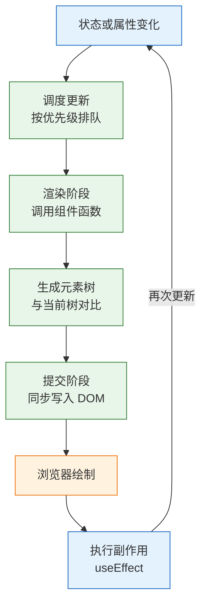
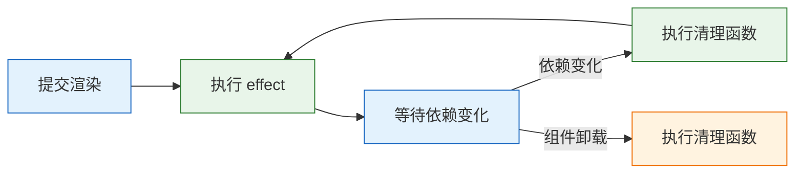
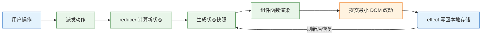

# React 核心

---

## 一、React 是什么

### 1.1 核心概念

React 是构建用户界面的 JavaScript 库，官方定位只有视图层。它不提供路由、数据请求、全局状态和构建工具，这些能力由生态补齐。

React 的基本假设是：**界面是状态的函数**。给定相同的 props 和 state，组件必须返回相同的元素树。开发者描述“当前状态下界面应该是什么样”，运行时负责把差异写进 DOM。命令式 DOM 操作要同时维护数据、节点、事件三份状态，任何一处漏改都会出现界面与数据不一致；声明式模型把同步工作收归框架，业务代码只表达结果。

五个概念构成最小认知：

- **元素（Element）**：描述界面的不可变普通对象，不是 DOM 节点，也没有任何 DOM 方法。
- **组件（Component）**：返回元素的函数，首字母大写，可以嵌套和复用。
- **属性（Props）**：父组件传给子组件的只读输入，子组件不得修改。
- **状态（State）**：组件自己持有、变化时触发重渲染的数据。
- **单向数据流**：数据从父到子，子组件通过回调向父组件通知变更。

| 概念 | 作用 | 常见载体 |
|---|---|---|
| 元素 | 描述某一帧的界面 | `jsx()` 的返回值 |
| 组件 | 复用界面与逻辑 | 函数组件 |
| 属性 | 父级传入的只读数据 | 函数参数 |
| 状态 | 组件内部的可变数据 | `useState`、`useReducer` |
| 单向数据流 | 数据向下、事件向上 | props 与回调 |

React 不负责全局状态管理、服务端数据缓存、路由和样式方案。把这些职责塞进组件，会让视图层承担它没有承诺的能力，也会让状态来源变得不可追踪。

### 1.2 与相邻技术的关系

React 经常与 DOM、JSX、构建工具、元框架、状态库同时出现，边界不清会导致重复抽象。

- **原生 DOM**：React 最终仍调用 `createElement`、`appendChild`、`setAttribute` 等 DOM API，只是把调用时机交给协调器。需要直接测量节点、控制滚动或接入第三方控件时，仍然要用 ref 回到 DOM。
- **JSX**：JSX 是语法扩展，由编译器转换成函数调用，不是模板字符串，也没有运行时解析。浏览器不认识 JSX，Vite 或 Babel 在构建阶段完成转换。
- **构建工具**：Vite 提供开发服务器、模块热替换和生产打包，React 不绑定任何构建工具。Webpack、Rspack、Parcel 同样可以承载 React。
- **元框架**：Next.js、React Router 框架模式在 React 之上补路由、服务端渲染、数据加载和构建约定。React 19 的 Server Components 需要框架或打包器配合，纯客户端项目不会自动获得。
- **状态与数据层**：Zustand、Redux 管理客户端状态，TanStack Query、SWR 管理服务端数据。它们都建立在 React 的渲染模型之上，不替代 React。
- **Web Components**：自定义元素可以通过 ref 和事件与 React 互操作。React 19 改进了自定义元素的属性传递和事件绑定，但两套组件模型不混淆使用。

| 技术 | 解决的问题 | 与 React 的边界 |
|---|---|---|
| 原生 DOM | 节点创建与修改 | React 的下层实现 |
| JSX | 用表达式描述元素树 | 编译期语法，不是运行时 |
| Vite | 开发服务与打包 | 独立工具，可替换 |
| Next.js | 路由、SSR、RSC | 以 React 为视图层 |
| TanStack Query | 服务端数据缓存 | 不替代组件状态 |
| Web Components | 跨框架组件标准 | 通过 ref 与事件互操作 |

> **注意**：JSX 不是 HTML。`class` 要写成 `className`，`for` 要写成 `htmlFor`，内联样式接收对象而不是字符串，标签必须闭合。把 HTML 片段直接粘进组件，通常先报编译错误。

### 1.3 渲染架构

一次更新要经过调度、渲染、协调、提交、副作用五个阶段。渲染阶段可以被打断、暂停甚至重新开始，提交阶段必须同步完成，这样用户不会看到半更新的界面。



- **调度**：`setState` 不会立刻改 DOM，而是把更新放入队列。事件处理、输入框输入属于高优先级，过渡更新属于低优先级。
- **渲染**：React 调用组件函数，得到新的元素树。这一步可能执行多次，因此组件函数必须是纯函数，不能发请求、写全局变量或修改 DOM。
- **协调**：比较新旧树。类型相同就复用节点并更新属性，类型不同就卸载整棵子树重建。列表靠 `key` 判断元素身份。
- **提交**：把变更一次性写入 DOM，同步执行 layout effect，然后浏览器绘制。
- **副作用**：`useEffect` 通常在绘制后执行，适合订阅、定时器、请求和日志上报。

内部用 Fiber 节点保存组件、DOM、优先级和副作用信息，当前树与工作中的树交替复用，这就是并发渲染能够中断和恢复的基础。开发者不需要操作 Fiber，但理解“渲染可重入”能解释很多现象。

并发渲染不是多线程。JavaScript 仍然单线程执行，React 只是把一次大树渲染拆成多个可中断的小任务，在浏览器需要响应输入时让出主线程。因此组件函数依然不能有副作用：被中断的那次渲染可能整体作废，写在里面的请求或全局修改无法回滚。

| 阶段 | 是否可中断 | 允许做的事 |
|---|---|---|
| 调度 | 是 | 计算优先级、合并更新 |
| render | 是 | 调用组件函数、创建元素 |
| commit | 否 | 修改 DOM、执行 layout effect |
| effect | 否 | 订阅、请求、定时器 |

`StrictMode` 在开发环境故意把组件函数调用两次，并对 effect 执行“挂载、卸载、再挂载”，用来暴露不纯的代码和缺失的清理。生产构建不会重复执行。看到请求发两次，应检查 effect 的清理与请求去重，而不是关闭 `StrictMode`。

---

## 二、环境与最小应用

### 2.1 版本与工具链

> **版本现状（2026-10）**：React 19.x 为当前稳定线，函数组件、Hooks、并发渲染是默认模型。`<Context value>`、ref 作为普通 prop、`useActionState` 等能力需要 React 19 及以上；类组件主要保留在错误边界等场景。

```bash
# 确认 Node 版本：Vite 7 要求 Node 20.19+ 或 22.12+
node -v
npm -v

# 创建 React + TypeScript 项目
npm create vite@latest react-demo -- --template react-ts

cd react-demo

# 安装依赖并启动开发服务器
npm install
npm run dev
```

| 工具 | 作用 | 本项目版本 |
|---|---|---|
| Node.js | 运行构建工具与开发服务器 | 22 LTS |
| Vite | 开发服务器、热更新、生产构建 | 7.x |
| React | 视图层与运行时 | 19.x |
| TypeScript | 静态类型检查 | 5.x |

开发服务器默认监听 `http://localhost:5173/`。端口被占用时 Vite 会自动递增，以终端输出为准。

### 2.2 最小可运行应用

入口文件只做三件事：找到挂载节点、创建根、渲染根组件。

```jsx
// src/main.tsx
import { StrictMode } from 'react';
import { createRoot } from 'react-dom/client';
import App from './App';
import './index.css';

// 显式判空，容器缺失时给出可定位的错误
const container = document.getElementById('root');
if (!container) throw new Error('找不到 #root 挂载容器');

createRoot(container).render(
  // 开发期启用严格检查，生产构建自动失效
  <StrictMode>
    <App />
  </StrictMode>,
);
```

```jsx
// src/App.tsx
import { useState } from 'react';

export default function App() {
  const [count, setCount] = useState(0);

  return (
    <main>
      <h1>计数器</h1>
      <p>当前值：{count}</p>
      {/* 函数式更新，避免连续点击读到同一个旧快照 */}
      <button onClick={() => setCount(c => c + 1)}>增加</button>
    </main>
  );
}
```

保存后页面立即刷新，点击按钮数字递增。浏览器控制台不应出现 key 或受控组件的警告；出现警告说明结构或数据流有问题，先处理再继续。

`createRoot` 接管容器后，不要再用手写 DOM 操作修改同一棵子树，否则 React 的下一轮提交会覆盖这些改动。

### 2.3 工程目录结构

```text
react-demo/
├── index.html              # 唯一 HTML 入口，包含 #root
├── package.json            # 依赖与脚本
├── vite.config.ts          # 构建与开发服务器配置
├── tsconfig.json           # TypeScript 配置
└── src/
    ├── main.tsx            # 应用入口
    ├── App.tsx             # 根组件
    ├── components/         # 可复用展示组件
    ├── hooks/              # 自定义 Hook
    ├── lib/                # 请求、格式化等纯逻辑
    └── index.css           # 全局样式
```

| 目录 | 放什么 | 不放什么 |
|---|---|---|
| `components` | 无业务依赖的通用组件 | 页面级数据请求 |
| `hooks` | 可复用的状态与副作用 | JSX |
| `lib` | 纯函数、请求封装 | React 状态 |
| `pages` | 路由对应的页面组件 | 底层通用组件 |

目录按职责划分，不按文件类型堆平。组件超过三百行或同时处理请求、表单、展示时，就该拆分。

---

## 三、JSX 与组件

### 3.1 JSX 的编译与表达式

JSX 在编译后变成对 `jsx()` 的调用。下面的写法由自动运行时转换为一个普通对象，React 再根据对象创建或更新 DOM。

```jsx
// 源码
const button = <button className="primary" onClick={save}>保存</button>;

// 编译结果（自动运行时，省略导入）
jsx('button', {
  className: 'primary',
  onClick: save,
  children: '保存',
});
```

花括号内可以放任何表达式：变量、运算、三元、函数调用、`map` 结果。语句不能直接放进去，需要先算出变量。

| JSX 写法 | HTML 写法 | 说明 |
|---|---|---|
| `className` | `class` | 避免与 JavaScript 保留字冲突 |
| `htmlFor` | `for` | 关联 label 与表单控件 |
| `style={{ color: 'red' }}` | `style="color:red"` | 接收对象，属性名小驼峰 |
| `{condition && <A />}` | 无对应 | 条件渲染 |
| `<></>` | 无对应 | Fragment，不产生额外节点 |

> **注意**：`condition && <A />` 在 `condition` 为 `0` 时会渲染出数字 0。计数可能为 0 时，用 `condition > 0 && <A />` 或三元表达式。

React 会自动转义文本内容，但不会净化 HTML 字符串。需要渲染富文本时：

```jsx
// 只有内容来自可信编辑器且经过服务端净化时才可使用
<article dangerouslySetInnerHTML={{ __html: sanitizedHtml }} />
```

> **安全警告**：`dangerouslySetInnerHTML` 会绕过 React 的转义，把字符串当作 HTML 执行。任何来自用户、URL 参数或第三方接口的内容都必须先经过白名单净化（如 DOMPurify），否则就是存储型 XSS。能用文本节点和组件表达的内容，不要用它。

### 3.2 组件的定义与属性

组件就是函数，返回值是元素。组件名必须大写，React 据此区分“组件”与“原生标签”。

```jsx
// 属性只读，不要在子组件里修改
function TaskItem({ task, onToggle, onRemove }) {
  return (
    <li>
      <label>
        <input
          type="checkbox"
          checked={task.done}
          onChange={() => onToggle(task.id)}
        />
        <span style={{ textDecoration: task.done ? 'line-through' : 'none' }}>
          {task.title}
        </span>
      </label>
      <button onClick={() => onRemove(task.id)} aria-label={`删除 ${task.title}`}>
        删除
      </button>
    </li>
  );
}
```

属性是父组件的数据快照，子组件通过回调请求修改，而不是直接改 `task.done`。直接改对象属性不会触发重渲染，因为引用没有变化，还会让数据流向变得双向。

默认值和属性校验用函数参数默认值与 TypeScript 表达，不再使用旧的 `defaultProps` 与 `propTypes`。

```jsx
function Badge({ tone = 'neutral', children }) {
  return <span className={`badge badge-${tone}`}>{children}</span>;
}
```

### 3.3 条件渲染与列表 key

条件渲染是普通 JavaScript：`if`、三元、逻辑与。列表渲染用 `map`，每一项必须有稳定的 `key`。

```jsx
function TaskList({ tasks, filter }) {
  const visible = tasks.filter(task => {
    if (filter === 'active') return !task.done;
    if (filter === 'done') return task.done;
    return true;
  });

  if (visible.length === 0) {
    return <p>没有符合条件的任务</p>; // 提前返回，避免渲染空列表
  }

  return (
    <ul>
      {visible.map(task => (
        // key 必须在 map 的直接返回元素上，且在同级中唯一
        <li key={task.id}>{task.title}</li>
      ))}
    </ul>
  );
}
```

`key` 是 React 判断“这一项还是不是原来那一项”的依据。插入、删除、排序时，稳定 id 能让组件状态跟随数据走；用数组下标当 key，React 会把原位置的组件状态错配到新数据上，表现为输入框内容跑到另一行、动画错乱、未受控状态串位。

| 场景 | 推荐 key | 后果 |
|---|---|---|
| 数据库实体列表 | 实体 id | 状态跟随实体 |
| 静态常量列表 | 固定字符串 | 稳定复用 |
| 可排序、可插入列表 | 稳定 id | 避免状态错配 |
| 纯展示且永不重排 | 下标可接受 | 风险最低 |

`key` 只在兄弟节点之间唯一，不需要全局唯一。把 `key` 传给子组件当属性使用是错误的，React 会消费它，子组件读不到。

### 3.4 组件组合与插槽

React 没有继承式复用，组合就是传节点、传组件、传函数。`children` 是最基本的插槽。

```jsx
function Card({ title, actions, children }) {
  return (
    <section className="card">
      <header>
        <h2>{title}</h2>
        {actions}
      </header>
      <div className="card-body">{children}</div>
    </section>
  );
}

// 使用时把节点放进标签内部
<Card title="本周任务" actions={<button>新建</button>}>
  <TaskList tasks={tasks} filter="all" />
</Card>
```

| 方式 | 传递内容 | 适用 |
|---|---|---|
| `children` | 节点 | 布局容器、弹窗、卡片 |
| 具名属性 | 节点或组件 | 多个插槽 |
| render function | 返回节点的函数 | 需要向调用方暴露内部状态 |
| 自定义 Hook | 逻辑 | 复用状态与副作用 |

组合的边界是“调用方是否需要控制内部结构”。只需要换内容，用 `children`；需要换渲染方式，用函数；需要复用逻辑，用 Hook。把所有差异做成布尔属性，会得到一个难维护的巨型组件。

判断是否抽取组件，可以看三个条件：这段界面是否在别处出现、它是否有独立的状态、它的变化原因是否与父级不同。三个条件都不满足时，抽出来只会增加属性传递。反过来，一个组件同时处理请求、表单、列表和弹窗，即使只有一百行，也应该按变化原因拆开。

---

## 四、状态与副作用

### 4.1 状态快照与批处理

状态变量是某一次渲染的常量。事件处理函数闭包捕获的是那次渲染的值，`setState` 只是预约下一次渲染。

```jsx
function Counter() {
  const [count, setCount] = useState(0);

  function handleClick() {
    setCount(count + 1);
    setCount(count + 1);
    console.log(count); // 仍是本次渲染的旧值
  }

  return <button onClick={handleClick}>计数：{count}</button>;
}
```

一次点击只加 1，因为两次更新都基于同一个 `count` 快照。需要基于上一次结果累加时，传函数：

```jsx
setCount(c => c + 1);
setCount(c => c + 1); // 加 2
```

React 18 起，事件处理、Promise 回调、`setTimeout`、原生事件监听里的更新都会自动批处理，多次调用只产生一次渲染。同一轮事件循环内的更新会合并；跨过 `await` 的更新通常与之前的更新分属不同批次。

| 写法 | 读取的值 | 结果 |
|---|---|---|
| `setCount(count + 1)` | 当前渲染快照 | 连续调用只加一次 |
| `setCount(c => c + 1)` | 队列中的最新值 | 连续调用正确累加 |
| 事件中读 `count` | 当前渲染快照 | 读到渲染时的旧值 |

### 4.2 状态设计规则

状态设计的目标是“只有一个真相”。能由现有数据算出的值不存，能从 URL 得到的值不复制，能放在最近公共父级的不放到全局。

| 规则 | 反例 | 正解 |
|---|---|---|
| 能算的不存 | 同时存 `items` 和 `count` | `const count = items.length` |
| 不存重复来源 | 同时存 `fullName` 与 `firstName` | 渲染时拼接 |
| 结构尽量扁平 | 三层嵌套对象改一个字段 | 用 id 索引或拆分状态 |
| 提升到最近公共父级 | 两个兄弟各存一份筛选条件 | 父级持有，props 下发 |

派生值直接在渲染中计算，不要用 effect 同步：

```jsx
// 不必要：多一次渲染，还可能出现短暂不一致
const [visible, setVisible] = useState(tasks);
useEffect(() => {
  setVisible(tasks.filter(t => !t.done));
}, [tasks]);

// 直接计算
const visible = tasks.filter(t => !t.done);
```

只有计算确实昂贵、且能通过 Profiler 证实时，才用 `useMemo` 缓存。它是性能优化，不改变语义。

需要“属性变化时重置子组件状态”时，用 `key` 重建，而不是在 effect 里同步：

```jsx
// userId 变化时，Profile 的内部状态整体重置
<Profile key={userId} userId={userId} />
```

### 4.3 useReducer 与复杂状态

多个字段总是一起变化，或者下一个状态依赖上一个状态时，`useReducer` 把变更收敛到一个纯函数里，事件处理只负责派发动作。

```jsx
// 状态与动作集中定义，reducer 必须是纯函数
const initialState = { tasks: [], filter: 'all', error: null };

function reducer(state, action) {
  switch (action.type) {
    case 'added':
      // 返回新数组，不修改原状态
      return { ...state, tasks: [...state.tasks, action.task] };
    case 'toggled':
      return {
        ...state,
        tasks: state.tasks.map(t =>
          t.id === action.id ? { ...t, done: !t.done } : t,
        ),
      };
    case 'removed':
      return { ...state, tasks: state.tasks.filter(t => t.id !== action.id) };
    case 'filterChanged':
      return { ...state, filter: action.filter };
    default:
      throw new Error(`未知动作：${action.type}`);
  }
}

function useTasks() {
  const [state, dispatch] = useReducer(reducer, initialState);
  return { state, dispatch };
}
```

| 维度 | `useState` | `useReducer` |
|---|---|---|
| 适合 | 独立、简单的值 | 多字段联动、状态机 |
| 更新逻辑 | 分散在事件处理里 | 集中在 reducer |
| 可测试性 | 需要渲染组件 | 纯函数直接测试 |
| 模板成本 | 低 | 需要定义动作类型 |

`default` 分支抛错，能在开发期暴露拼错的动作名。生产环境可以把未知动作记录后返回原状态，避免整页崩溃。

### 4.4 useEffect 的同步语义

`useEffect` 的语义是“渲染提交后，把某个外部系统同步到当前状态”，不是生命周期钩子。依赖变化时，先执行上一次的清理，再执行新的 effect。

```jsx
useEffect(() => {
  // 订阅外部系统
  const id = setInterval(() => setSeconds(s => s + 1), 1000);

  // 清理必须与建立对称
  return () => clearInterval(id);
}, []);
```



`useEffect` 通常在浏览器绘制后运行，不阻塞首屏；需要读取布局并在绘制前同步修改时，用 `useLayoutEffect`。后者会阻塞绘制，只用于测量、滚动定位等必须同步的场景。

effect 的常见合法用途集中在几类：订阅 WebSocket、绑定全局事件、启动定时器、同步 `document.title`、与非 React 控件集成、上报分析。用户点击触发的请求应写在事件处理里，因为事件已经知道发生了什么。

| 场景 | 不该用 effect 的原因 | 做法 |
|---|---|---|
| 由 props 计算派生值 | 多一次渲染，可能短暂不一致 | 渲染时直接计算 |
| 点击后发起请求 | 事件已知道用户意图 | 写在事件处理函数里 |
| prop 变化时重置状态 | 会先渲染一次旧状态 | 用 `key` 重建组件 |
| 同步两个 state | 容易出现中间态 | 合并成一个状态 |

### 4.5 依赖数组与清理

依赖数组不是“选择何时执行”的开关，而是声明 effect 读取了哪些响应式值。漏写会读到旧闭包，多写会造成多余执行。

| 依赖写法 | 执行时机 | 常见问题 |
|---|---|---|
| 不写 | 每次渲染后 | 几乎总是错误 |
| `[]` | 仅挂载后 | 读到初始值，后续更新不可见 |
| `[a, b]` | 挂载后及 a、b 变化时 | 漏依赖导致陈旧闭包 |
| `[obj]` | 每次 obj 引用变化 | 每次渲染新建对象导致循环 |

对象和数组依赖每次渲染都是新引用，会让 effect 每次都跑；如果 effect 里又 `setState`，就形成死循环。

```jsx
// 错误：options 每次渲染都是新对象
useEffect(() => {
  load(options);
}, [options]);

// 正确：依赖具体字段，让 effect 内部构造对象
useEffect(() => {
  load({ page, size });
}, [page, size]);
```

异步请求还要处理竞态和卸载。输入变化快时，旧请求可能后返回并覆盖新结果；组件卸载后 `setState` 虽然不再警告，但依然浪费资源。

```jsx
useEffect(() => {
  const controller = new AbortController();

  async function load() {
    try {
      const res = await fetch(`/api/tasks?q=${encodeURIComponent(query)}`, {
        signal: controller.signal, // 清理时中断请求
      });
      if (!res.ok) throw new Error(`HTTP ${res.status}`);
      setTasks(await res.json());
    } catch (err) {
      if (err.name === 'AbortError') return; // 取消不是业务错误
      setError(err.message);
    }
  }

  load();
  return () => controller.abort(); // 依赖变化或卸载时取消
}, [query]);
```

> **注意**：不要用 `mounted` 布尔标记掩盖问题。标记只能阻止更新，不能取消已发出的请求，也无法解决旧响应覆盖新响应。`AbortController` 同时解决取消与竞态。

### 4.6 ref 与自定义 Hook

ref 用于保存“不需要触发渲染”的值，或者指向 DOM 节点。修改 `ref.current` 不会重渲染。

```jsx
function SearchBox({ onSearch }) {
  const inputRef = useRef(null);
  const timerRef = useRef(0);

  function handleChange(event) {
    clearTimeout(timerRef.current); // 防抖句柄不需要渲染
    const value = event.target.value;
    timerRef.current = window.setTimeout(() => onSearch(value), 300);
  }

  return (
    <>
      <input ref={inputRef} onChange={handleChange} />
      <button onClick={() => inputRef.current?.focus()}>聚焦</button>
    </>
  );
}
```

React 19 起，函数组件可以直接把 `ref` 当作普通 prop 接收，不再需要 `forwardRef`。ref 回调支持返回清理函数，适合在节点挂载与卸载时成对注册。

至此涉及的 Hook 可以按职责归类，是否触发渲染是最直接的区分：

| Hook | 用途 | 是否触发渲染 |
|---|---|---|
| `useState` | 保存简单状态 | 是 |
| `useReducer` | 聚合多字段状态 | 是 |
| `useEffect` | 同步外部系统 | 否 |
| `useRef` | 保存可变值或 DOM 节点 | 否 |
| `useMemo` | 缓存计算结果 | 否 |
| `useCallback` | 缓存函数引用 | 否 |

自定义 Hook 把“状态 + 副作用”打包复用，但每次调用都得到独立状态，不是共享单例。

```jsx
function useDebounced(value, delay = 300) {
  const [debounced, setDebounced] = useState(value);

  useEffect(() => {
    const id = setTimeout(() => setDebounced(value), delay);
    return () => clearTimeout(id);
  }, [value, delay]);

  return debounced;
}
```

Hook 只能在组件或自定义 Hook 的顶层调用，不能放进条件、循环或普通函数。React 依靠调用顺序匹配状态，顺序变化会让状态错位。命名以 `use` 开头，便于 lint 规则识别。

---

## 五、渲染性能

### 5.1 重渲染的触发条件

重渲染不等于 DOM 更新。组件函数会重新执行，但协调器可能发现元素没有变化，不产生任何 DOM 操作。优化目标是减少昂贵组件的执行和提交，而不是追求“零渲染”。

| 触发源 | 影响范围 | 说明 |
|---|---|---|
| 自身 `setState` | 当前组件及其子树 | 状态变化必然重渲染 |
| 父组件重渲染 | 未记忆化的子组件 | props 未变也会执行 |
| Context value 变化 | 所有消费者 | 与层级无关 |
| `useReducer` dispatch | 当前组件及其子树 | reducer 返回新状态 |
| 外部 store 订阅 | 订阅该切片的组件 | 取决于选择器 |

父组件重渲染时，子组件默认也会重渲染。这与 props 是否变化无关，因为 React 不知道子组件的输出是否依赖父组件的其他状态。`memo` 的作用是在 props 浅比较相等时跳过子树。

重渲染的成本分为两段：组件函数执行与元素树比较发生在 render 阶段，DOM 写入发生在 commit 阶段。一个每分钟更新一次的时钟导致整页组件函数重新执行，只要元素结构稳定，commit 仍然很轻；反过来，一个频繁改变列表顺序的表格即使组件很少，也可能因为大量 DOM 移动而卡顿。判断优化点时要把两段分开看。

### 5.2 记忆化手段

```jsx
import { memo, useCallback, useMemo, useState } from 'react';

// 只在 props 浅比较不等时重渲染
const TaskItem = memo(function TaskItem({ task, onToggle }) {
  return (
    <li>
      <input
        type="checkbox"
        checked={task.done}
        onChange={() => onToggle(task.id)}
      />
      {task.title}
    </li>
  );
});

function TaskList({ tasks, setTasks }) {
  const [keyword, setKeyword] = useState('');

  // 稳定回调引用，配合 memo 才有意义
  const handleToggle = useCallback(id => {
    setTasks(prev => prev.map(t => (t.id === id ? { ...t, done: !t.done } : t)));
  }, [setTasks]);

  // 缓存昂贵计算，依赖变化时才重算
  const visible = useMemo(
    () => tasks.filter(t => t.title.includes(keyword)),
    [tasks, keyword],
  );

  return (
    <>
      <input value={keyword} onChange={e => setKeyword(e.target.value)} />
      <ul>
        {visible.map(task => (
          <TaskItem key={task.id} task={task} onToggle={handleToggle} />
        ))}
      </ul>
    </>
  );
}
```

| 手段 | 解决的问题 | 代价 |
|---|---|---|
| `memo` | 跳过 props 未变的子树 | 浅比较成本，引用不稳时失效 |
| `useMemo` | 缓存昂贵计算 | 内存与依赖比较 |
| `useCallback` | 稳定函数引用 | 依赖写错会读到旧值 |
| 状态下沉 | 缩小重渲染范围 | 需要重新划分组件边界 |
| 虚拟列表 | 只渲染可视区域 | 需要固定行高或测量 |
| React Compiler | 构建期自动插入记忆化 | 需要构建配置，边界仍需验证 |

`useCallback(fn, [])` 配合 `memo` 才有效；如果子组件没有记忆化，稳定引用不会带来收益。`useMemo` 也不保证一定缓存，React 可以在内存紧张时丢弃缓存，因此不能把副作用写进计算函数。

> **注意**：不要给所有组件套 `memo`、给所有函数套 `useCallback`。这会让代码充满依赖数组，还会因为浅比较本身产生开销。先用 Profiler 找到真正慢的组件，再决定优化点。

### 5.3 并发特性与代码分割

并发渲染把更新分成不同优先级：输入、点击保持响应，列表过滤和大树渲染可以被打断。`useTransition` 标记非紧急更新，`useDeferredValue` 让某个值晚一拍生效。

```jsx
import { useDeferredValue, useState, useTransition } from 'react';

function Search() {
  const [query, setQuery] = useState('');
  const [results, setResults] = useState([]);
  const [isPending, startTransition] = useTransition();
  const deferredQuery = useDeferredValue(query);

  // 模拟本地过滤，实际可替换为服务端请求
  const search = q => (q ? [`${q} 的结果`] : []);

  function handleChange(event) {
    const value = event.target.value;
    setQuery(value); // 输入框立即更新
    startTransition(() => {
      setResults(search(value)); // 列表更新可被中断
    });
  }

  return (
    <div>
      <input value={query} onChange={handleChange} />
      {isPending && <span>更新中…</span>}
      <p>结果对应：{deferredQuery}</p>
      <ul>{results.map(r => <li key={r}>{r}</li>)}</ul>
    </div>
  );
}
```

| 工具 | 解决的问题 | 边界 |
|---|---|---|
| `useTransition` | 标记非紧急更新 | 不能包裹受控输入的值本身 |
| `useDeferredValue` | 让派生结果延迟更新 | 结果可能短暂落后于输入 |
| `Suspense` | 声明加载边界 | 需要 fallback 与错误边界 |
| `lazy` | 路由级代码分割 | 默认导出，加载失败要兜底 |

```jsx
import { Component, lazy, Suspense } from 'react';

// 打包器把 Chart 拆成独立 chunk，首次渲染时才下载
const Chart = lazy(() => import('./Chart'));

// 错误边界仍然是类组件，负责接住子树渲染期的异常
class ErrorBoundary extends Component {
  state = { error: null };

  static getDerivedStateFromError(error) {
    return { error };
  }

  render() {
    if (this.state.error) {
      return <p role="alert">页面出错了，请刷新重试</p>;
    }
    return this.props.children;
  }
}

function Dashboard() {
  return (
    <ErrorBoundary>
      <Suspense fallback={<p>图表加载中…</p>}>
        <Chart />
      </Suspense>
    </ErrorBoundary>
  );
}
```

错误边界捕获渲染、生命周期和构造函数中的异常，不捕获事件处理、异步回调、服务端渲染以及边界自身的错误。事件处理里的异常要自己 `try/catch` 并转成状态，否则会冒到全局错误处理器，界面停在半坏状态。

代码分割按路由和重组件切分。把首屏不需要的编辑器、图表、地图拆出去，比压缩几 KB 的公共依赖更有效。拆得太碎会增加请求数，按“首次可见”与“交互后才需要”划界。

### 5.4 性能测量

优化前先测量。React DevTools Profiler 记录一次交互中每个组件的渲染耗时和原因，火焰图能区分“渲染次数多”和“单次渲染慢”。

| 指标 | 含义 | 优化方向 |
|---|---|---|
| 提交耗时 | 一次更新写 DOM 的总时间 | 拆分大树、虚拟列表 |
| 组件渲染耗时 | 单个组件函数执行时间 | 缓存计算、简化结构 |
| 渲染次数 | 同一交互内的重复执行 | 稳定引用、状态下沉 |
| 交互延迟 | 输入到画面更新的时间 | 过渡更新、减少同步工作 |

浏览器 Performance 面板用来看长任务、布局抖动和绘制开销。React Profiler 显示某组件很慢，但总提交时间不长时，优先检查是否在渲染期做了本可延后的事。

---

## 六、完整示例：任务面板

### 6.1 数据模型与状态设计

示例包含新增、勾选、删除、筛选、搜索和本地持久化，不依赖后端，可以直接运行。状态放在一个 reducer 中，搜索词留在组件内，初始值用惰性初始化读取，持久化通过 effect 完成。

```javascript
// src/taskReducer.js
export const initialTasks = [
  { id: 't1', title: '整理渲染流程笔记', done: false },
  { id: 't2', title: '补充依赖数组示例', done: true },
  { id: 't3', title: '检查列表 key', done: false },
];

export function taskReducer(tasks, action) {
  switch (action.type) {
    case 'added':
      // 新任务放在末尾，id 由调用方生成
      return [...tasks, action.task];
    case 'toggled':
      return tasks.map(t => (t.id === action.id ? { ...t, done: !t.done } : t));
    case 'removed':
      return tasks.filter(t => t.id !== action.id);
    default:
      throw new Error(`未知动作：${action.type}`);
  }
}
```



单向环路的每一步都可以单独观察：动作在 DevTools 中可见，reducer 是纯函数可直接测试，状态快照决定渲染结果，effect 只负责存储同步。任何一步出错，都能从边界切断，而不必在整页代码里猜。

### 6.2 组件实现

```jsx
// src/App.jsx
import { memo, useCallback, useEffect, useReducer, useState } from 'react';
import { initialTasks, taskReducer } from './taskReducer';

const STORAGE_KEY = 'react-demo-tasks';

// 子组件只在 task 或回调变化时重渲染
const TaskItem = memo(function TaskItem({ task, onToggle, onRemove }) {
  return (
    <li>
      <label>
        <input
          type="checkbox"
          checked={task.done}
          onChange={() => onToggle(task.id)}
        />
        <span className={task.done ? 'done' : ''}>{task.title}</span>
      </label>
      <button onClick={() => onRemove(task.id)} aria-label={`删除 ${task.title}`}>
        删除
      </button>
    </li>
  );
});

// 惰性初始化：首次渲染前读取一次，避免先渲染空列表再替换
function loadTasks() {
  try {
    const raw = localStorage.getItem(STORAGE_KEY);
    const parsed = raw ? JSON.parse(raw) : null;
    // 只接受数组，避免旧版本或手改数据导致渲染崩溃
    return Array.isArray(parsed) ? parsed : initialTasks;
  } catch {
    // 数据损坏时回到初始值，不让页面白屏
    return initialTasks;
  }
}

export default function App() {
  const [tasks, dispatch] = useReducer(taskReducer, undefined, loadTasks);
  const [filter, setFilter] = useState('all');
  const [keyword, setKeyword] = useState('');
  const [draft, setDraft] = useState('');

  // 任务变化时写回；写入是幂等的，不需要清理函数
  useEffect(() => {
    localStorage.setItem(STORAGE_KEY, JSON.stringify(tasks));
  }, [tasks]);

  // dispatch 本身稳定，回调可以安全地只创建一次
  const toggleTask = useCallback(id => dispatch({ type: 'toggled', id }), []);
  const removeTask = useCallback(id => dispatch({ type: 'removed', id }), []);

  function addTask(event) {
    event.preventDefault();
    const title = draft.trim();
    if (!title) return; // 空标题不生成任务
    dispatch({
      type: 'added',
      task: { id: crypto.randomUUID(), title, done: false },
    });
    setDraft('');
  }

  const visible = tasks.filter(task => {
    const matchFilter =
      filter === 'all' || (filter === 'done' ? task.done : !task.done);
    const matchKeyword = task.title.toLowerCase().includes(keyword.toLowerCase());
    return matchFilter && matchKeyword;
  });

  const remaining = tasks.filter(t => !t.done).length;

  return (
    <main>
      <h1>任务面板</h1>

      <form onSubmit={addTask}>
        <label htmlFor="draft">新任务</label>
        <input
          id="draft"
          value={draft}
          onChange={event => setDraft(event.target.value)}
          placeholder="输入后回车"
        />
        <button type="submit">添加</button>
      </form>

      <div role="group" aria-label="筛选">
        {['all', 'active', 'done'].map(value => (
          <button
            key={value}
            aria-pressed={filter === value}
            onClick={() => setFilter(value)}
          >
            {{ all: '全部', active: '未完成', done: '已完成' }[value]}
          </button>
        ))}
      </div>

      <label htmlFor="search">搜索</label>
      <input
        id="search"
        value={keyword}
        onChange={event => setKeyword(event.target.value)}
      />

      <p>剩余 {remaining} 项</p>

      {visible.length === 0 ? (
        <p>没有符合条件的任务</p>
      ) : (
        <ul>
          {visible.map(task => (
            <TaskItem
              key={task.id}
              task={task}
              onToggle={toggleTask}
              onRemove={removeTask}
            />
          ))}
        </ul>
      )}
    </main>
  );
}
```

这里的每个渲染期变量都由现有状态计算，没有冗余状态。`filter` 与 `keyword` 是 UI 状态，`tasks` 是领域状态，`draft` 是输入草稿，三者生命周期不同，分开存放比合并成一个大对象更容易维护。

### 6.3 搜索竞态与请求取消

本地搜索不需要请求。如果搜索改为调用后端，就要处理防抖、取消和旧响应覆盖。下面的 Hook 把这三件事封装在一起。

```javascript
// src/hooks/useSearch.js
import { useEffect, useState } from 'react';

export function useSearch(query) {
  const [items, setItems] = useState([]);
  const [status, setStatus] = useState('idle');

  useEffect(() => {
    if (query.trim().length < 2) {
      setItems([]);
      setStatus('idle');
      return;
    }

    const controller = new AbortController();
    // 防抖：300ms 内继续输入会清掉上一个定时器
    const timer = setTimeout(async () => {
      setStatus('loading');
      try {
        const res = await fetch(`/api/search?q=${encodeURIComponent(query)}`, {
          signal: controller.signal,
        });
        if (!res.ok) throw new Error(`HTTP ${res.status}`);
        setItems(await res.json());
        setStatus('idle');
      } catch (err) {
        if (err.name === 'AbortError') return; // 主动取消不算失败
        setStatus('error');
      }
    }, 300);

    return () => {
      clearTimeout(timer);
      controller.abort();
    };
  }, [query]);

  return { items, status };
}
```

三个动作缺一不可：防抖减少请求数，`AbortController` 取消在途请求，忽略 `AbortError` 避免把取消显示成错误。只做防抖不做取消，快速输入时仍可能出现旧响应后到。

### 6.4 运行与验证

```bash
# 在项目根目录启动
npm run dev

# 生产构建，检查是否有类型或打包错误
npm run build

# 本地预览构建产物
npm run preview
```

| 操作 | 预期结果 | 验证点 |
|---|---|---|
| 添加空任务 | 列表不变 | 提交前 trim 校验 |
| 勾选任务 | 样式变化，剩余数减一 | reducer 返回新数组 |
| 删除任务 | 对应行消失 | key 稳定，无错位 |
| 刷新页面 | 任务保留 | effect 持久化生效 |
| 搜索两个字符以上 | 列表过滤 | 派生值即时计算 |
| 快速输入 | 只保留最终结果 | 防抖与取消生效 |

开发环境下 `StrictMode` 会重复调用初始化函数与 effect。`loadTasks` 是只读且幂等的，重复执行不会改变结果；写回 effect 也只是用同一份状态覆盖同一个键。若把初始化改成“向列表追加”，重复执行就会产生重复数据，这正是初始化函数与 effect 必须保持纯的典型原因。

---

## 七、工程实践

### 7.1 组件边界与目录组织

组件拆分的依据是“变化原因”，不是行数。展示组件只接收数据与回调，容器组件负责请求和状态，页面组件负责路由参数与布局。

| 层次 | 职责 | 依赖 |
|---|---|---|
| 展示组件 | 渲染、交互回调 | 只依赖 props |
| 容器组件 | 取数、状态编排 | Hook、请求函数 |
| 页面组件 | 路由参数、布局 | 容器与展示组件 |
| 布局组件 | 导航、插槽 | children |

一个组件同时做请求、表单、列表和弹窗时，任何需求变化都会改动它。拆开后，展示组件可以单独测试，请求逻辑可以复用，样式也不会互相污染。

React 适合状态驱动、组件组合、交互复杂的界面；以静态内容为主、几乎无交互的页面，用服务端模板或静态站点更省。是否引入状态库，判断标准是是否存在跨路由、跨模块且频繁变化的本地状态，而不是组件数量。

### 7.2 类型、Lint 与构建

TypeScript 负责属性与状态的形状，ESLint 负责 Hook 调用规则和常见错误，构建负责死代码消除与代码分割。

```bash
# 类型检查：按项目引用执行，Vite 开发态不做完整类型检查
npx tsc -b

# ESLint 检查，重点保留 react-hooks 规则
npx eslint src

# 生产构建
npm run build
```

| 工具 | 关键规则 | 作用 |
|---|---|---|
| TypeScript | 属性与联合类型 | 编译期发现结构错误 |
| ESLint | `rules-of-hooks` | 阻止条件调用 Hook |
| ESLint | `exhaustive-deps` | 提示遗漏依赖 |
| 构建 | 代码分割 | 控制首屏体积 |

`exhaustive-deps` 的提示不应盲目接受。把对象整体放进依赖可能造成循环，正确做法是拆分字段、把函数移出组件，或用 ref 保存最新回调后在 effect 中读取；直接禁用规则会把问题留到运行时。

### 7.3 测试策略

测试关注用户可见行为，不测试实现细节。组件测试用 Testing Library 查询角色和文本，网络用 MSW 拦截，端到端用 Playwright 覆盖关键流程。

```jsx
import { render, screen } from '@testing-library/react';
import userEvent from '@testing-library/user-event';
import { expect, test } from 'vitest';
import App from './App';

test('添加任务后出现在列表中', async () => {
  const user = userEvent.setup();
  render(<App />);

  await user.type(screen.getByLabelText('新任务'), '写测试');
  await user.click(screen.getByRole('button', { name: '添加' }));

  expect(screen.getByText('写测试')).toBeInTheDocument();
});
```

| 测试层 | 工具 | 覆盖内容 |
|---|---|---|
| 纯函数 | Vitest | reducer、格式化、校验 |
| 组件 | Testing Library | 交互、可访问名称、状态 |
| 网络 | MSW | 成功、失败、空数据 |
| 流程 | Playwright | 登录、跨页跳转 |

不要对快照测试寄予过高期望。整页快照会把错误结构一起冻结，评审时也很难看出差异；针对关键文本和角色断言更稳定。

### 7.4 安全边界

React 的自动转义只覆盖文本和属性，不覆盖 `dangerouslySetInnerHTML`、`javascript:` 链接和第三方脚本。前端没有能力保守秘密，所有放入构建的变量都会出现在产物里。

```bash
# Vite 只会把 VITE_ 前缀的变量注入客户端代码
VITE_API_BASE_URL=https://api.example.com
```

> **安全警告**：`VITE_` 变量会被明文打包进 JavaScript，任何访问者都能读到。API 密钥、数据库口令、签名私钥绝不能放在前端环境变量里；需要调用第三方服务时，通过自己的后端代理并在服务端保管凭据。

用户输入进入 `href` 或 `src` 前要校验协议，只允许 `http`、`https`、`mailto` 等白名单，阻止 `javascript:`。富文本必须服务端净化后再渲染，前端净化只能作为第二道防线。

---

## 八、常见错误与排查

### 8.1 故障对照表

| 现象 | 最可能原因 | 处理 |
|---|---|---|
| 改了对象状态界面不变 | 原地修改，引用未变 | 返回新对象或新数组 |
| 连续 `setState` 只生效一次 | 读取同一渲染快照 | 改用函数式更新 |
| effect 无限循环 | 依赖中有每次新建的对象或函数 | 拆分字段，函数移出组件 |
| 请求发送两次 | StrictMode 双挂载，或依赖变化 | 补取消与去重，不关闭 StrictMode |
| 列表重排后输入框串位 | 使用数组下标作 key | 改用稳定 id |
| Context 一变全页重渲染 | provider value 每次新建 | 缓存 value，拆分 context |
| `useState(props.x)` 不跟随 | 初始值只在首次渲染使用 | 用 key 重建或改为受控 |
| 卸载后仍然更新状态 | 异步回调未取消 | effect 清理中 abort |
| 条件中调用 Hook 报错 | Hook 调用顺序变化 | 移到组件顶层 |
| 组件渲染抛错导致白屏 | 缺少错误边界 | 在路由或区块外层包 `ErrorBoundary` |
| 受控输入无法输入 | value 有值但未提供 onChange | 补 onChange 或改非受控 |
| 渲染出数字 0 | `count && <X />` 遇到 0 | 用三元或 `count > 0` |
| hydration 不匹配 | 服务端与客户端首屏输出不同 | 首屏不用随机数、时间、浏览器 API |

### 8.2 排查顺序

1. 用 React DevTools 查看组件的 props 与 state，确认数据是否到达、引用是否变化。
2. 在组件函数顶部记录渲染次数与触发源，区分“重复渲染”和“渲染结果错误”。
3. 检查事件处理是否读取旧快照，状态更新是否返回新对象。
4. 检查 effect 依赖与清理，确认每次执行都有对称的取消或退订。
5. 用 Profiler 定位耗时组件，最后才添加 `memo`、`useMemo`、`useCallback`。
6. 涉及服务端渲染时，对比服务端与客户端首屏 HTML，排查时间、随机数和浏览器 API。

> **核心结论**：界面是状态的函数，渲染必须纯；状态是渲染的快照，连续更新用函数式；effect 用于同步外部系统，依赖要完整、清理要对称；性能优化从测量开始，不以记忆化代替设计。
