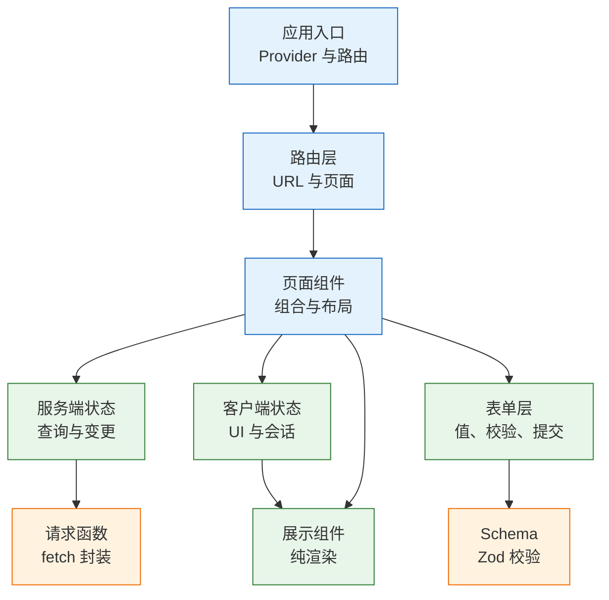
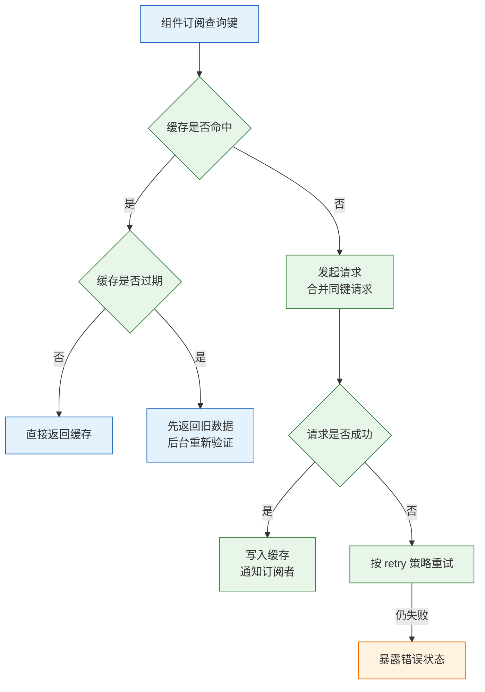
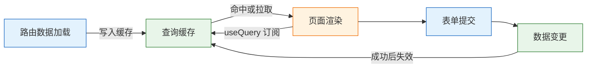

# React 生态

---

## 一、React 生态是什么

### 1.1 核心概念

React 只提供视图层。真实应用还要回答五个问题：URL 如何映射到页面、服务端数据如何缓存与失效、客户端状态放在哪里、表单如何校验、样式与组件如何复用。生态库分别承接这些横切职责。组件、JSX、状态与副作用的原理见《React 核心》，本篇聚焦生态各层的职责与协作。

生态选型的核心不是“哪个库功能最多”，而是**一份状态只有一个来源**。路由库持有 URL，数据请求库持有远端数据，状态库持有本地 UI 状态，表单库持有正在编辑的临时值。两个库同时保存同一份数据，就必然要写同步逻辑；同步一旦有延迟，界面就会出现两个真相。

| 职责 | 数据的真相在哪 | 代表工具 |
|---|---|---|
| 路由 | 浏览器地址栏 | React Router、TanStack Router |
| 服务端状态 | 远端接口 | TanStack Query、SWR |
| 客户端状态 | 浏览器内存 | Context、Zustand、Redux |
| 表单 | 当前编辑会话 | React Hook Form、Zod |
| 样式与组件 | 设计系统 | Tailwind、CSS Modules、Radix |

生态不是越多越好。每引入一个库，就多一套概念、一份配置和一个升级路径。判断标准是它消除的重复工作是否大于维护成本。

### 1.2 与相邻技术的关系

- **React**：负责组件渲染与状态更新。路由、请求、状态库都运行在 React 的渲染模型之上，不能绕过 Hooks 规则。
- **React Router 7**：同时提供声明式路由、数据加载、错误边界和框架模式。它替代的是手写路径匹配，不替代数据缓存。
- **TanStack Query**：管理服务端数据的生命周期，包括去重、重试、缓存、失效和分页。它不负责客户端 UI 状态。
- **Zustand / Redux**：管理跨组件共享的客户端状态。它们不保存接口返回的列表，否则要持续同步远端变化。
- **React Hook Form**：用非受控输入降低表单重渲染，负责值、校验、提交态。它不负责 schema 定义，通常与 Zod 配合。
- **Next.js**：在 React 之上提供文件路由、服务端渲染、Server Components 和构建约定。需要 SEO 或首屏直出时，它替代的是纯 SPA 的渲染模式，不只是路由库。
- **Tailwind / CSS Modules**：解决样式作用域与设计令牌。组件库解决交互与无障碍，两者可以叠加。

| 技术 | 解决的问题 | 不应承担的职责 |
|---|---|---|
| React Router | URL 与页面映射 | 服务端数据缓存 |
| TanStack Query | 远端数据同步 | 本地弹窗开关 |
| Zustand | 跨模块本地状态 | 接口列表副本 |
| React Hook Form | 表单值与校验 | 全局会话状态 |
| Next.js | 渲染模式与路由约定 | 组件内部状态 |
| Tailwind | 样式组合与令牌 | 复杂交互行为 |

> **注意**：把接口数据复制进 Zustand 或 Redux，是生态混用中最常见的错误。写入时看似方便，读取时就要处理“store 有旧数据、Query 有新数据”的冲突，最后往往靠 effect 双向同步，引入闪烁和竞态。

### 1.3 分层架构

一个中型应用的依赖方向应当自上而下：页面组合路由与数据，数据层调用请求函数，展示组件只接收属性。反向依赖会让底层组件知道路由和接口，难以复用与测试。



| 层 | 输入 | 输出 |
|---|---|---|
| 应用入口 | 配置、Provider | 可渲染的根 |
| 路由层 | URL | 页面与加载状态 |
| 页面组件 | 路由数据、store | 组合后的界面 |
| 数据层 | 查询键、参数 | 缓存数据与状态 |
| 展示组件 | props | 元素树 |

层与层之间通过明确的接口通信：页面不直接拼 `fetch`，展示组件不读全局 store，请求函数不依赖 React。这样每一层都能独立替换和测试。

---

## 二、环境与最小应用

### 2.1 版本与依赖

> **版本现状（2026-10）**：React 19.x 为当前稳定线；React Router 7、TanStack Query 5、Zustand 5、React Hook Form 7、Zod 4、Tailwind CSS 4 为各自当前稳定系列。安装前核对库的 peer 依赖是否声明支持 React 19，不要用 `--force` 绕过冲突。

```bash
# 创建 TypeScript 项目
npm create vite@latest eco-demo -- --template react-ts
cd eco-demo
npm install

# 路由、服务端状态、客户端状态
npm i react-router @tanstack/react-query zustand

# 表单与 schema 校验
npm i react-hook-form zod @hookform/resolvers
```

| 依赖 | 作用 | 引入时机 |
|---|---|---|
| `react-router` | 路由、数据加载、错误边界 | 多页面应用 |
| `@tanstack/react-query` | 服务端数据缓存 | 有远端接口 |
| `zustand` | 跨模块本地状态 | Context 不够用时 |
| `react-hook-form` | 表单值与提交态 | 表单字段较多 |
| `zod` | 运行时 schema 校验 | 需要复用校验规则 |

只做静态展示的单页应用，引入路由和 Query 只会增加包体。依赖按实际职责添加，不按“以后可能用到”预装。

### 2.2 最小可运行应用

入口负责创建缓存客户端、装配 Provider，并把路由树交给 `RouterProvider`。React Router 7 中，`createBrowserRouter` 来自 `react-router`，DOM 版的 `RouterProvider` 来自 `react-router/dom`。

```jsx
// src/main.tsx
import { StrictMode } from 'react';
import { createRoot } from 'react-dom/client';
import { QueryClient, QueryClientProvider } from '@tanstack/react-query';
import { RouterProvider } from 'react-router/dom';
import { router } from './router';
import './index.css';

const queryClient = new QueryClient({
  defaultOptions: {
    queries: {
      staleTime: 30_000, // 30 秒内视为新鲜，不重复请求
      retry: 1,          // 失败只重试一次
    },
  },
});

const container = document.getElementById('root');
if (!container) throw new Error('找不到 #root 挂载容器');

createRoot(container).render(
  <StrictMode>
    {/* QueryClientProvider 必须在任何 useQuery 之上 */}
    <QueryClientProvider client={queryClient}>
      <RouterProvider router={router} />
    </QueryClientProvider>
  </StrictMode>,
);
```

```jsx
// src/router.jsx
import { createBrowserRouter } from 'react-router';
import { AppLayout } from './AppLayout';
import { TaskPage } from './TaskPage';
import { RouteError } from './RouteError';

export const router = createBrowserRouter([
  {
    path: '/',
    element: <AppLayout />,       // 布局通过 Outlet 渲染子路由
    errorElement: <RouteError />, // 捕获本分支的加载与渲染错误
    children: [
      { index: true, element: <TaskPage /> },
      { path: 'tasks/:id', element: <TaskPage /> },
    ],
  },
]);
```

启动后访问 `/` 与 `/tasks/42` 都能命中同一个页面组件，刷新不会 404；访问不存在的路径由 `errorElement` 接住。路由对象在模块加载时创建一次，不要放进组件状态，否则每次渲染都会重建路由。

### 2.3 目录结构

```text
src/
├── main.tsx                # Provider 与根渲染
├── router.jsx              # 路由表
├── AppLayout.jsx           # 布局与导航
├── pages/                  # 路由页面
├── features/tasks/         # 按业务聚合的组件与查询
├── components/             # 通用展示组件
├── lib/
│   ├── queryClient.js      # 缓存客户端单例
│   ├── queries.js          # queryOptions 定义
│   └── api.js              # fetch 封装
└── stores/                 # Zustand store
```

| 目录 | 放什么 | 依赖方向 |
|---|---|---|
| `pages` | 路由页面与布局 | 可依赖 features |
| `features` | 业务组件、查询、schema | 可依赖 components、lib |
| `components` | 无业务语义的通用组件 | 只依赖 props |
| `lib` | 请求、缓存、纯函数 | 不依赖 React 组件 |
| `stores` | 跨模块 UI 状态 | 不保存服务端数据 |

按业务聚合而不是按文件类型铺平。一个任务的查询、表单、列表放在同一目录，修改时不需要在五个文件夹之间跳转。

---

## 三、路由与 URL 状态

### 3.1 路由模型

路由的本质是把 URL 当作状态容器。路径决定渲染哪棵组件树，查询参数决定筛选、分页和排序。刷新、分享、前进后退都能还原界面，前提是这些信息确实写进了 URL。

| 信息 | 存放位置 | 理由 |
|---|---|---|
| 当前页面 | 路径 | 可直接访问与分享 |
| 资源标识 | 动态段 `:id` | 语义清晰，可校验 |
| 筛选与排序 | 查询参数 | 可刷新、可回退 |
| 弹窗开关 | 查询参数或状态 | 需要分享时放 URL |
| 输入草稿 | 组件状态 | 高频变化，不必进历史 |

把筛选条件只放在组件状态里，刷新后回到默认值，用户无法分享当前视图；把每次输入都写进 URL，又会污染历史记录。判断标准是“这个状态是否需要被还原或分享”。

浏览器历史是用户可感知的状态。筛选、分页这类高频操作使用 `replace`，避免后退键要按十几次才能离开页面；从列表进入详情使用默认的 `push`，让后退能回到原来的筛选结果。历史记录设计错乱，比缺少 URL 状态更难修复。

### 3.2 路由配置与嵌套布局

```jsx
// src/AppLayout.jsx
import { NavLink, Outlet } from 'react-router';

export function AppLayout() {
  return (
    <div className="layout">
      <nav>
        <NavLink to="/" end>任务</NavLink>
      </nav>
      <main>
        {/* 子路由在这里渲染 */}
        <Outlet />
      </main>
    </div>
  );
}
```

```jsx
// src/router.jsx
import { createBrowserRouter } from 'react-router';
import { AppLayout } from './AppLayout';
import { TaskPage } from './pages/TaskPage';
import { TaskDetail } from './pages/TaskDetail';
import { RouteError } from './pages/RouteError';
import { fetchTask } from './lib/api';

export const router = createBrowserRouter([
  {
    path: '/',
    element: <AppLayout />,
    errorElement: <RouteError />,
    children: [
      { index: true, element: <TaskPage /> },
      {
        path: 'tasks/:id',
        element: <TaskDetail />,
        // 渲染前取数，组件内用 useLoaderData 读取
        loader: ({ params }) => fetchTask(Number(params.id)),
      },
    ],
  },
]);
```

`NavLink` 会根据当前路径自动添加激活类名，`end` 让根路径只在精确匹配时激活。嵌套路由让布局只渲染一次，子页面切换时导航和侧栏不重新挂载。

### 3.3 数据加载与错误处理

React Router 的 `loader` 在渲染前执行，数据就绪后才渲染组件；组件挂载后再请求则是“先渲染骨架，再补数据”。两种模型都能用，区别在于首屏是否需要等待数据。

```jsx
// src/pages/TaskDetail.jsx
import { useLoaderData, useNavigation } from 'react-router';

export function TaskDetail() {
  const task = useLoaderData();
  const navigation = useNavigation();

  // 导航进行中，可显示顶部进度条
  if (navigation.state === 'loading') return <p>加载中…</p>;

  return (
    <article>
      <h1>{task.title}</h1>
      <p>{task.description}</p>
    </article>
  );
}
```

```jsx
// src/pages/RouteError.jsx
import { isRouteErrorResponse, useRouteError } from 'react-router';

export function RouteError() {
  const error = useRouteError();

  if (isRouteErrorResponse(error)) {
    // loader 主动抛 Response 时，保留状态码
    return <p role="alert">{error.status} {error.statusText}</p>;
  }

  return <p role="alert">页面加载失败，请稍后重试</p>;
}
```

| 机制 | 执行时机 | 适用 |
|---|---|---|
| `loader` | 渲染前 | 详情页、需要数据的首屏 |
| `action` | 表单提交时 | 创建、更新、删除 |
| `errorElement` | 本分支出错时 | 路由级兜底 |
| `useNavigation` | 导航状态变化 | 进度条、禁用提交 |

`loader` 抛出的错误由最近的 `errorElement` 捕获，不会冒到根组件。没有 `errorElement` 时，React Router 会使用默认错误页，直接显示原始错误信息，既不美观也可能泄露内部细节。

> **注意**：`loader` 中不要调用只能在组件内使用的 Hook。它运行在 React 渲染之外，需要的数据通过参数、模块级函数或 `queryClient` 获取。

### 3.4 搜索参数与 URL 同步

```jsx
import { useSearchParams } from 'react-router';

export function TaskFilters() {
  const [params, setParams] = useSearchParams();

  // URL 参数天然是字符串，读出后要校验并给默认值
  const rawPage = Number(params.get('page'));
  const page = Number.isInteger(rawPage) && rawPage > 0 ? rawPage : 1;
  const rawStatus = params.get('status');
  const status = ['all', 'active', 'done'].includes(rawStatus) ? rawStatus : 'all';

  function update(next) {
    // 保留 q、sort 等其他参数，只覆盖本次变化的字段
    const merged = { ...Object.fromEntries(params), page: String(page), status, ...next };
    // replace 避免每次筛选都新增历史记录
    setParams(merged, { replace: true });
  }

  return (
    <div>
      <select value={status} onChange={e => update({ status: e.target.value, page: '1' })}>
        <option value="all">全部</option>
        <option value="active">未完成</option>
        <option value="done">已完成</option>
      </select>
      <button onClick={() => update({ page: String(page + 1) })}>下一页</button>
    </div>
  );
}
```

| 参数 | 校验 | 默认值 |
|---|---|---|
| `page` | 正整数，超出范围回退 | `1` |
| `status` | 枚举白名单 | `all` |
| `q` | 长度上限、去空白 | 空字符串 |
| `sort` | 枚举白名单 | `createdAt` |

搜索参数要当作不可信输入：不合法时回退到默认值，而不是把 `NaN` 传给接口。筛选变化时把页码重置为 1，否则会出现“第 5 页没有结果”的假空态。

---

## 四、服务端状态与缓存

### 4.1 服务端状态的特征

服务端数据由远端拥有，本地只是副本。它会过期、需要去重、写后要失效，还可能被其他客户端修改。`useEffect` 加 `fetch` 只解决了“发一次请求”，其余问题都要手写。

| 特征 | 手写实现的问题 | Query 的处理 |
|---|---|---|
| 远端拥有 | 本地副本逐渐过期 | 聚焦、重连时重新验证 |
| 需要去重 | 多组件重复请求 | 相同 key 合并请求 |
| 会失败 | 每个页面各写重试 | 统一重试策略 |
| 写后失效 | 手动刷新列表 | `invalidateQueries` |
| 分页缓存 | 自己维护页码映射 | key 中带分页参数 |

服务端状态和客户端状态的生命周期不同。前者以请求为单位，后者以会话或组件为单位；混在一个 store 里，必然要处理两套失效逻辑。

缓存也不是数据库。Query 的缓存存在内存中，刷新页面即丢失，多标签页之间也不共享。需要跨会话保留的数据由服务端负责，前端只做短期加速；把缓存当持久层使用，会在刷新后出现“数据消失”的错觉。

### 4.2 查询配置与生命周期

```jsx
// src/lib/queries.js
import { queryOptions } from '@tanstack/react-query';
import { fetchTasks } from './api';

export const tasksQuery = (filter = 'all', page = 1) => queryOptions({
  // key 必须包含所有影响结果的参数
  queryKey: ['tasks', filter, page],
  queryFn: () => fetchTasks({ filter, page }),
  staleTime: 30_000,
});
```

```jsx
// src/features/tasks/TaskList.jsx
import { useQuery } from '@tanstack/react-query';
import { tasksQuery } from '../../lib/queries';

export function TaskList({ filter }) {
  const { data, isPending, isError, error, refetch } = useQuery(tasksQuery(filter));

  if (isPending) return <p>加载中…</p>;
  if (isError) {
    return (
      <button onClick={() => refetch()}>
        加载失败：{error.message}，重试
      </button>
    );
  }
  if (data.length === 0) return <p>没有符合条件的任务</p>;

  return <ul>{data.map(t => <li key={t.id}>{t.title}</li>)}</ul>;
}
```

| 状态 | 含义 | 界面处理 |
|---|---|---|
| `isPending` | 还没有任何数据 | 骨架或加载提示 |
| `isError` | 请求失败且无可用数据 | 错误提示与重试 |
| `isFetching` | 正在后台刷新 | 顶部进度条，不清空旧数据 |
| `isSuccess` | 已有数据 | 正常渲染 |

| 选项 | 作用 | 常见误用 |
|---|---|---|
| `staleTime` | 多久内不重新请求 | 当成缓存有效期 |
| `gcTime` | 无订阅后多久删除缓存 | 设太短导致返回白屏 |
| `retry` | 失败重试次数 | 对 4xx 也重试，放大错误 |
| `refetchOnWindowFocus` | 窗口聚焦时重新验证 | 关闭后数据长期不更新 |



`isPending` 与 `isFetching` 要分开。前者表示没有数据可显示，后者表示正在验证旧数据；后台刷新时清空列表会让界面闪烁。

### 4.3 缓存键的设计

`queryKey` 是缓存的地址。设计原则是从宽到窄：`['tasks']` 表示全部任务，`['tasks', filter]` 表示某个筛选，`['tasks', filter, page]` 表示某页。失效宽 key 会前缀匹配所有子 key。

| key | 含义 | 失效影响 |
|---|---|---|
| `['tasks']` | 任务根命名空间 | 所有任务查询 |
| `['tasks', 'active']` | 未完成任务 | 该筛选 |
| `['tasks', 'active', 2]` | 第 2 页 | 该页 |
| `['task', 42]` | 单条详情 | 该详情 |

```jsx
// 错误：切换筛选取不到新数据
useQuery({ queryKey: ['tasks'], queryFn: () => fetchTasks({ filter, page }) });

// 正确：参数进入 key，缓存与请求一一对应
useQuery({
  queryKey: ['tasks', filter, page],
  queryFn: () => fetchTasks({ filter, page }),
});
```

对象参数要先稳定化再进 key，否则每次渲染都是新引用，缓存永远命中不了。常见做法是把参数拆成基本类型，或对对象排序后序列化。

### 4.4 变更、失效与乐观更新

```jsx
import { useMutation, useQueryClient } from '@tanstack/react-query';
import { createTask } from '../../lib/api';

export function useCreateTask() {
  const queryClient = useQueryClient();

  return useMutation({
    mutationFn: createTask,
    onSuccess: () => {
      // 写成功后让所有任务列表失效，后台重新拉取
      queryClient.invalidateQueries({ queryKey: ['tasks'] });
    },
  });
}
```

```jsx
// 组件内：queryClient 来自 useQueryClient()，toggleTask 为请求函数
// 乐观更新：先改缓存，失败时回滚
const mutation = useMutation({
  mutationFn: toggleTask,
  onMutate: async id => {
    await queryClient.cancelQueries({ queryKey: ['tasks'] });
    const previous = queryClient.getQueryData(['tasks']);
    queryClient.setQueryData(['tasks'], old =>
      (old ?? []).map(t => (t.id === id ? { ...t, done: !t.done } : t)),
    );
    return { previous }; // 交给 onError 回滚
  },
  onError: (_error, _id, context) => {
    queryClient.setQueryData(['tasks'], context.previous);
  },
  onSettled: () => {
    // 无论成功失败都重新同步，最终以服务端为准
    queryClient.invalidateQueries({ queryKey: ['tasks'] });
  },
});
```

| 策略 | 何时使用 | 风险 |
|---|---|---|
| 成功后失效 | 大多数写操作 | 列表短暂显示旧值 |
| 乐观更新 | 切换、点赞等低风险操作 | 失败回滚会闪动 |
| 直接写缓存 | 已知服务端返回完整对象 | 容易与后续刷新冲突 |
| 不做处理 | 几乎不用 | 列表长期过期 |

乐观更新只用于失败代价低、回滚可接受的交互。涉及金额、库存、权限的写操作，应等待服务端确认后再更新界面。

### 4.5 分页与预取

分页用 `placeholderData` 保留上一页数据，避免翻页时整块白屏；预取在用户悬停或进入视口时提前加载下一页。

```jsx
const pageQuery = useQuery({
  queryKey: ['tasks', filter, page],
  queryFn: () => fetchTasks({ filter, page }),
  // 翻页时先展示上一页，新数据到达后替换
  placeholderData: previous => previous,
});

// 鼠标悬停“下一页”时预取
queryClient.prefetchQuery(tasksQuery(filter, page + 1));
```

预取不是越多越好。提前请求用户不会访问的页面会浪费带宽，还会挤占首屏请求。只对高概率的下一步操作预取，并设置合理的 `staleTime`。

SWR 的 `useSWR(key, fetcher)` 更轻，适合读多写少、团队不想引入完整 Query 的场景；缓存、聚焦重取和乐观更新都有，但 mutation 生态与调试工具不如 Query 完整。

---

## 五、客户端状态与 store

### 5.1 状态归属判断

客户端状态是浏览器本地拥有、不来自接口的数据：侧栏开合、主题、当前选中的行、未提交的草稿。它变化频繁，通常只影响局部界面。

| 状态 | 归属 | 理由 |
|---|---|---|
| 登录用户资料 | 服务端状态 | 由接口返回，会过期 |
| 主题偏好 | 客户端状态 | 本地拥有，可持久化 |
| 侧栏开合 | 组件或 store | 跨布局共享 |
| 表单输入 | 表单库 | 高频、临时 |
| 筛选条件 | URL | 需要刷新还原 |
| 弹窗开关 | 组件状态 | 通常不跨页面 |

判断顺序是：能从 URL 得到就放 URL，能从接口得到就交给 Query，能由现有状态算出就直接计算，剩下的才是客户端状态。

### 5.2 Context 的适用边界

Context 解决逐层传参，不是状态管理库。它的 value 变化会让所有消费者重渲染，与组件层级无关。

```jsx
import { createContext, useContext, useMemo, useState } from 'react';

const ThemeContext = createContext({ theme: 'light', setTheme: () => {} });

export function ThemeProvider({ children }) {
  const [theme, setTheme] = useState('light');

  // value 每次新建对象会让所有消费者重渲染
  const value = useMemo(() => ({ theme, setTheme }), [theme]);

  return <ThemeContext value={value}>{children}</ThemeContext>;
}

export function useTheme() {
  return useContext(ThemeContext);
}
```

React 19 允许直接把 `<Context value>` 当作 provider，不必写 `<Context.Provider>`。Context 适合主题、语言、当前用户这类低频、广覆盖的值；高频变化的大对象应改用支持选择器订阅的 store。

### 5.3 Zustand 的订阅模型

```javascript
// src/stores/uiStore.js
import { create } from 'zustand';

export const useUI = create(set => ({
  sidebarOpen: true,
  theme: 'light',
  toggleSidebar: () => set(s => ({ sidebarOpen: !s.sidebarOpen })),
  setTheme: theme => set({ theme }),
}));
```

```jsx
// 只订阅 sidebarOpen，其他字段变化不会触发本组件重渲染
const open = useUI(s => s.sidebarOpen);
const toggle = useUI(s => s.toggleSidebar);
```

```jsx
// 一次取多个字段时，用 useShallow 做浅比较
import { useShallow } from 'zustand/react/shallow';

const { open, toggle } = useUI(
  useShallow(s => ({ open: s.sidebarOpen, toggle: s.toggleSidebar })),
);
```

直接 `const state = useUI()` 会订阅整个 store，任何字段变化都重渲染。选择器返回新对象时，默认的 `Object.is` 比较永远不相等，必须配合 `useShallow` 或拆成多个选择器。

> **注意**：Zustand 的 store 是模块级单例。在服务端渲染中，多个请求共享同一个 Node 进程，模块级 store 会串数据；每个请求应创建独立 store，通过 Provider 注入。

### 5.4 Redux Toolkit 的适用场景

Redux Toolkit 提供强约束的 action、reducer、中间件和 DevTools 时间旅行。它适合多人协作、状态变更需要审计、异步流程复杂的大型应用；小团队只共享一个弹窗开关时，引入它只会增加模板代码。

| 方案 | 适用规模 | 主要成本 |
|---|---|---|
| `useState` | 组件内部 | 跨层要逐级传递 |
| Context | 低频全局值 | value 变化全量重渲染 |
| Zustand | 中小型跨模块状态 | 需要约定 store 边界 |
| Jotai | 细粒度派生状态 | 原子组织成本 |
| Redux Toolkit | 大团队、强约束 | 概念与模板代码 |
| RTK Query | 已有 Redux 的数据层 | 与 Query 二选一 |

同一份状态不要同时放进两个 store。需要拆分时按“变化频率”和“使用范围”切，不按页面切；按页面切会让跨页共享的状态无处安放。

store 的文件数量也应受控。一个 store 对应一块内聚的领域，例如“界面偏好”或“编辑器草稿”；把用户、权限、通知、弹窗全部塞进一个 store，会让任何字段变化都可能触发无关组件，选择器也失去意义。

---

## 六、表单与校验

### 6.1 受控与非受控

受控输入的值由 React 状态驱动，每次输入都触发重渲染；非受控输入的值留在 DOM 中，通过 ref 或表单提交读取。字段少、需要即时联动时用受控；字段多、校验复杂时用非受控更省性能。

| 维度 | 受控 | 非受控 |
|---|---|---|
| 值来源 | React 状态 | DOM 节点 |
| 每次输入 | 触发重渲染 | 不触发 |
| 即时校验 | 容易 | 需要订阅 |
| 动态联动 | 容易 | 较麻烦 |
| 适用 | 少量字段、强交互 | 大表单、提交时校验 |

```jsx
// 受控：value 与 onChange 必须成对出现
<input value={title} onChange={e => setTitle(e.target.value)} />
```

只给 `value` 不给 `onChange` 会得到只读输入框，控制台同时给出警告。需要“有默认值但随后自由编辑”时，用 `defaultValue` 而不是 `value`。

### 6.2 React Hook Form 的注册模型

React Hook Form 通过 `register` 把输入注册到内部 store，输入过程不触发组件重渲染，只在错误或提交态变化时更新。

```jsx
import { useForm } from 'react-hook-form';
import { zodResolver } from '@hookform/resolvers/zod';
import { z } from 'zod';

const schema = z.object({
  title: z.string().trim().min(1, '标题必填').max(80, '标题不能超过 80 字'),
  priority: z.enum(['low', 'normal', 'high']),
});

export function TaskForm({ onCreate }) {
  const {
    register,
    handleSubmit,
    reset,
    formState: { errors, isSubmitting },
  } = useForm({
    resolver: zodResolver(schema),
    defaultValues: { title: '', priority: 'normal' },
  });

  async function submit(values) {
    try {
      await onCreate(values);
      reset(); // 提交成功后清空，保留 defaultValues
    } catch {
      // 错误由调用方展示；这里保证 isSubmitting 能复位
    }
  }

  return (
    <form onSubmit={handleSubmit(submit)}>
      <label htmlFor="title">标题</label>
      <input
        id="title"
        {...register('title')}
        aria-invalid={errors.title ? 'true' : 'false'}
        aria-describedby={errors.title ? 'title-error' : undefined}
      />
      {errors.title && <p id="title-error" role="alert">{errors.title.message}</p>}

      <label htmlFor="priority">优先级</label>
      <select id="priority" {...register('priority')}>
        <option value="low">低</option>
        <option value="normal">普通</option>
        <option value="high">高</option>
      </select>

      <button disabled={isSubmitting}>{isSubmitting ? '提交中…' : '创建'}</button>
    </form>
  );
}
```

`register` 返回 `name`、`onChange`、`onBlur`、`ref`，展开到原生输入上即可。错误提示通过 `aria-describedby` 与输入关联，读屏用户才能听到具体原因。

### 6.3 Zod schema 与类型推导

Zod 在运行时校验，同时推导静态类型。同一份 schema 可以用于表单、接口响应和本地存储解析，避免三处各写一套规则。

```javascript
import { z } from 'zod';

export const taskSchema = z.object({
  id: z.uuid(),
  title: z.string().min(1).max(80),
  done: z.boolean(),
  priority: z.enum(['low', 'normal', 'high']).default('normal'),
});

// 类型从 schema 推导，不重复声明
export const parseTask = input => taskSchema.parse(input);
```

| 校验位置 | 目的 | 失败处理 |
|---|---|---|
| 表单提交前 | 即时反馈 | 字段级错误提示 |
| 接口响应后 | 防止结构变化 | 记录日志并兜底 |
| 本地存储读取 | 防止脏数据 | 丢弃并使用默认值 |
| 服务端 | 最终边界 | 返回 400 与字段错误 |

前端校验只改善体验，不能替代服务端校验。请求可以被绕过，服务端必须重新验证每一条规则。

### 6.4 异步默认值与提交态

`defaultValues` 只在首次渲染时读取。数据异步到达时，直接传值不会更新表单，需要在数据就绪后 `reset`，或者等数据到了再挂载表单。

```jsx
// schema 与 6.2 中的定义相同
function EditTask({ task }) {
  const form = useForm({ resolver: zodResolver(schema) });

  useEffect(() => {
    if (task) form.reset(task); // 数据到达后同步到表单
  }, [task, form]);

  // 用 key 保证切换任务时表单整体重建
  return <TaskFields key={task.id} form={form} />;
}
```

| 现象 | 原因 | 处理 |
|---|---|---|
| 默认值不显示 | 数据晚于首次渲染 | `reset(data)` 或条件挂载 |
| 切换记录后仍是旧值 | 组件复用，默认值不重读 | 外层加 `key` |
| 提交按钮一直禁用 | `isSubmitting` 未复位 | 确保提交函数最终结束 |
| 校验错误不消失 | 未触发重新校验 | 修改后 `trigger` 或默认模式 |

提交函数失败时要让错误冒出来，由调用方提示；吞掉异常会让 `isSubmitting` 正常结束但用户不知道失败。

服务端返回的字段错误应回填到表单，而不是只弹一条通用提示。React Hook Form 提供 `setError`，把接口返回的字段名与消息写入对应输入；无法映射到字段的错误再作为表单级错误展示。这样用户能直接看到是哪一项不合法，减少反复提交。

---

## 七、样式、组件库与测试

### 7.1 样式方案对比

| 方案 | 机制 | 适合 | 注意 |
|---|---|---|---|
| CSS Modules | 构建时生成局部类名 | 普通 CSS、精细控制 | 动态主题配 CSS 变量 |
| Tailwind CSS 4 | 工具类，CSS-first 配置 | 组件密集、令牌统一 | 类名较长，需约定顺序 |
| CSS-in-JS | 运行时或编译时生成 | 动态主题、组件库 | SSR 与运行时开销 |
| 原生 CSS 变量 | 浏览器级令牌 | 主题切换 | 需要自己组织作用域 |

Tailwind 4 默认用 CSS 声明配置，不再必须写 `tailwind.config.js`：

```css
/* src/index.css */
@import "tailwindcss";

@theme {
  /* 设计令牌直接成为工具类，如 bg-brand-500 */
  --color-brand-500: #2563eb;
  --radius-card: 0.75rem;
}
```

样式方案要统一。同一个项目里混用四套写法，最终无法判断某个颜色来自哪里，主题切换也会漏改。

### 7.2 组件库选型

组件库先看交互与无障碍，再看主题定制。弹窗是否锁定焦点、下拉是否支持方向键、表格是否暴露排序状态，这些行为很难靠改样式补齐。

| 库 | 形态 | 适合 | 代价 |
|---|---|---|---|
| shadcn/ui | 源码复制，基于 Radix | 需要长期掌控 | 升级靠手动合并 |
| MUI | 完整组件库 | 快速交付、Material 风格 | 深度定制受限 |
| Ant Design | 完整组件库 | 中后台、表格表单密集 | 包体较大 |
| Radix Primitives | 无样式原语 | 自建设计系统 | 需要自己写样式 |

选择“源码复制”方案时，要把组件目录当作项目代码维护，升级前先比对上游变更；把它当 npm 依赖，会在下一次升级时丢失本地修改。

### 7.3 测试分层

| 层 | 工具 | 测什么 |
|---|---|---|
| 纯函数与 schema | Vitest | 校验规则、格式化、reducer |
| 组件 | Testing Library | 用户可见行为与可访问名称 |
| 网络 | MSW | 成功、失败、空数据 |
| 页面流程 | Playwright | 登录、跳转、跨页状态 |

```jsx
// src/features/tasks/TaskForm.test.jsx
import { render, screen } from '@testing-library/react';
import userEvent from '@testing-library/user-event';
import { expect, test, vi } from 'vitest';
import { TaskForm } from './TaskForm';

test('空标题提交时显示校验错误', async () => {
  const user = userEvent.setup();
  const onCreate = vi.fn();

  render(<TaskForm onCreate={onCreate} submitting={false} />);
  await user.click(screen.getByRole('button', { name: '创建' }));

  // 校验未通过，不调用提交回调，错误通过 role=alert 暴露给读屏
  expect(await screen.findByText('标题必填')).toBeInTheDocument();
  expect(onCreate).not.toHaveBeenCalled();
});
```

不要给 `useQuery` 本身写单元测试，那是库的责任。测自己的组件在加载、失败、空数据、有数据四种状态下渲染什么；测试里关闭重试，否则失败用例要等完整的重试间隔。

网络层用 MSW 在 `fetch` 与 XHR 层拦截，组件发出的仍是真实请求，因此请求参数、序列化和错误分支都能被覆盖。Node 环境没有页面地址，相对路径的请求要解析为绝对地址，测试配置里应提供 `baseUrl` 或在请求封装中读取环境变量。断言失败时先看未处理的请求警告，它通常说明 key 或路径写错，而不是组件渲染有问题。

---

## 八、完整示例：任务管理界面

### 8.1 结构与依赖

示例把路由、查询、变更、表单串成一条完整链路，后端接口用占位地址表示。需要的最小依赖是 `react-router`、`@tanstack/react-query`、`react-hook-form`、`zod` 和 `@hookform/resolvers`。

```text
src/
├── main.tsx
├── router.jsx
├── lib/
│   ├── queryClient.js
│   ├── queries.js
│   └── api.js
├── pages/
│   ├── TaskListPage.jsx
│   └── RouteError.jsx
└── features/tasks/
    ├── TaskForm.jsx
    └── taskSchema.js
```

### 8.2 路由与数据层

```jsx
// src/lib/queryClient.js
import { QueryClient } from '@tanstack/react-query';

// 单例：路由 loader 与组件共享同一份缓存
export const queryClient = new QueryClient({
  defaultOptions: {
    queries: { staleTime: 30_000, retry: 1 },
  },
});
```

```jsx
// src/lib/queries.js
import { queryOptions } from '@tanstack/react-query';
import { fetchTasks } from './api';

export const taskListQuery = queryOptions({
  queryKey: ['tasks'],
  queryFn: fetchTasks,
});
```

```jsx
// src/router.jsx
import { createBrowserRouter } from 'react-router';
import { queryClient } from './lib/queryClient';
import { taskListQuery } from './lib/queries';
import { TaskListPage } from './pages/TaskListPage';
import { RouteError } from './pages/RouteError';

export const router = createBrowserRouter([
  {
    path: '/',
    element: <TaskListPage />,
    errorElement: <RouteError />,
    // 渲染前确保缓存有数据；已有新鲜缓存时不会重复请求
    loader: () => queryClient.ensureQueryData(taskListQuery),
  },
]);
```

`ensureQueryData` 与组件里的 `useQuery` 使用同一个 key，loader 拉到的数据直接进入缓存，组件不会二次请求。这是路由数据加载与 Query 协作的关键。



链路中只有一份缓存：loader 写入、组件订阅、mutation 失效，三者通过查询键对齐。任何一环换成独立状态，都会破坏这个闭环。

### 8.3 列表、表单与变更

```jsx
// src/pages/TaskListPage.jsx
import { useQuery, useMutation, useQueryClient } from '@tanstack/react-query';
import { taskListQuery } from '../lib/queries';
import { createTask } from '../lib/api';
import { TaskForm } from '../features/tasks/TaskForm';

export function TaskListPage() {
  const queryClient = useQueryClient();
  const { data, isPending, isError, error, refetch } = useQuery(taskListQuery);

  const create = useMutation({
    mutationFn: createTask,
    onSuccess: () => {
      // 写后失效，列表在后台重新拉取
      queryClient.invalidateQueries({ queryKey: ['tasks'] });
    },
  });

  if (isPending) return <p>加载中…</p>;
  if (isError) {
    return <button onClick={() => refetch()}>失败：{error.message}，重试</button>;
  }

  return (
    <main>
      <h1>任务</h1>

      <TaskForm
        onCreate={values => create.mutateAsync(values)}
        submitting={create.isPending}
      />

      {/* 变更失败时给出可恢复的提示 */}
      {create.isError && <p role="alert">创建失败：{create.error.message}</p>}

      {data.length === 0 ? (
        <p>还没有任务</p>
      ) : (
        <ul>
          {data.map(task => <li key={task.id}>{task.title}</li>)}
        </ul>
      )}
    </main>
  );
}
```

```jsx
// src/features/tasks/TaskForm.jsx
import { useForm } from 'react-hook-form';
import { zodResolver } from '@hookform/resolvers/zod';
import { taskInputSchema } from './taskSchema';

export function TaskForm({ onCreate, submitting }) {
  const {
    register,
    handleSubmit,
    reset,
    formState: { errors },
  } = useForm({
    resolver: zodResolver(taskInputSchema),
    defaultValues: { title: '', priority: 'normal' },
  });

  async function submit(values) {
    try {
      await onCreate(values); // 失败时抛出，由父组件展示错误
      reset();                // 只有成功才清空表单
    } catch {
      // 错误已记录在父级的 mutation 状态，这里阻止未处理的 Promise 拒绝
    }
  }

  return (
    <form onSubmit={handleSubmit(submit)}>
      <label htmlFor="title">标题</label>
      <input id="title" {...register('title')} aria-invalid={!!errors.title} />
      {errors.title && <p role="alert">{errors.title.message}</p>}

      <label htmlFor="priority">优先级</label>
      <select id="priority" {...register('priority')}>
        <option value="low">低</option>
        <option value="normal">普通</option>
        <option value="high">高</option>
      </select>

      <button disabled={submitting}>{submitting ? '创建中…' : '创建'}</button>
    </form>
  );
}
```

```javascript
// src/features/tasks/taskSchema.js
import { z } from 'zod';

export const taskInputSchema = z.object({
  title: z.string().trim().min(1, '标题必填').max(80, '标题过长'),
  priority: z.enum(['low', 'normal', 'high']),
});
```

### 8.4 运行与验证

```bash
# 启动开发服务器
npm run dev

# 类型检查与生产构建
npx tsc -b
npm run build

# 预览构建产物
npm run preview
```

| 操作 | 预期 | 覆盖点 |
|---|---|---|
| 直接访问 `/` | 列表直接出现，无二次加载 | loader 与缓存共享 |
| 提交空标题 | 字段下方提示必填 | Zod 校验 |
| 创建成功 | 列表出现新任务 | 变更后失效 |
| 断网后创建 | 显示创建失败 | mutation 错误态 |
| 刷新页面 | 数据重新拉取 | 缓存不持久化 |
| 访问未知路径 | 路由错误页 | `errorElement` |

构建产物部署到静态服务器时，需要把所有未知路径回退到 `index.html`，否则直接访问 `/tasks/42` 会得到服务器 404。这是 SPA 部署最常见的配置遗漏。

---

## 九、工程实践

### 9.1 选型矩阵

| 场景 | 路由 | 服务端状态 | 客户端状态 |
|---|---|---|---|
| 静态展示页 | 不需要 | 不需要 | 组件状态 |
| 中小型后台 | React Router | TanStack Query | Zustand |
| 大型多人协作 | React Router | TanStack Query | Redux Toolkit |
| 需要 SEO | Next.js | 框架数据层或 Query | 按需 |

选型按层决定，不按“团队熟悉哪个”一把梭。路由、数据、状态、表单各自有独立边界，替换其中一层不应影响其他层。

### 9.2 包体与依赖治理

```bash
# 分析构建产物，定位大模块
npx vite build --mode production
npx vite-bundle-visualizer
```

| 手段 | 效果 | 代价 |
|---|---|---|
| 路由级 `lazy` | 首屏只加载当前页面 | 切页多一次请求 |
| 按路径导入 | 避免整库打入 | 需要确认导出路径 |
| 依赖替换 | 去掉重复能力 | 迁移成本 |
| 预取 | 降低切页等待 | 可能浪费带宽 |

`import { format } from 'date-fns'` 在现代打包器下可以摇树；`import _ from 'lodash'` 会把整库带入，应改为 `lodash-es` 的按路径导入。引入新依赖前先确认现有依赖是否已经提供同等能力。

依赖重复比单个库过大更常见。两个库各自依赖不同版本的同一工具包，打包器可能同时保留两份实现，体积和状态都会翻倍。用包管理器的去重与 `overrides` 收敛版本，升级前先看依赖树，而不是只看 `package.json` 的顶层列表。

> **安全警告**：前端环境变量（Vite 的 `VITE_*`）会被明文写入构建产物，任何访问者都能读取。第三方 API 密钥、签名私钥、管理接口令牌必须留在服务端，通过后端代理调用；把令牌放进浏览器存储同样会被 XSS 读取。

### 9.3 边界约定与目录

| 约定 | 做法 | 反例 |
|---|---|---|
| 状态单一来源 | 服务端数据只进 Query | store 再存一份列表 |
| 页面不直接请求 | 请求收敛到 `lib/api` | 组件里散落 `fetch` |
| schema 共用 | 表单与接口共用 Zod | 两套校验规则 |
| 组件不读路由 | 页面注入参数 | 展示组件用 `useParams` |

边界写进目录与评审清单，比写在文档里更有效。新代码放错层时，评审应直接指出，而不是等运行期出现循环依赖。

### 9.4 升级与兼容

生态库升级要按依赖顺序：先升 React，再升路由与数据层，最后升组件库。每步都跑类型检查、单元测试和关键流程，确认 peer 依赖没有告警。

| 升级对象 | 风险 | 验证重点 |
|---|---|---|
| React 大版本 | Hooks 行为、StrictMode | 全量组件测试 |
| React Router | 导入路径、loader 签名 | 深链接与错误页 |
| TanStack Query | 选项重命名、状态字段 | 缓存与失效 |
| 组件库 | 样式与交互变更 | 表单、弹窗、键盘 |

不要跨多个大版本一次升级。分步升级能在出问题时定位到具体依赖，回滚成本也更低。

锁文件要一并提交，且不要在升级时删除后重装。`package-lock.json` 或 `pnpm-lock.yaml` 记录了整棵依赖树，删除后可能解析出不同的次版本，把一次小升级变成不可复现的变更。peer 依赖告警必须逐条处理，`--force` 只是让安装继续，运行时仍可能因 API 缺失而崩溃。

---

## 十、常见错误与排查

### 10.1 故障对照表

| 现象 | 最可能原因 | 处理 |
|---|---|---|
| 切换筛选列表不更新 | `queryKey` 缺少筛选参数 | 参数进入 key |
| 写完列表仍是旧数据 | 未调用 `invalidateQueries` | 成功后失效相关 key |
| 返回页面白屏一下 | `gcTime` 太短，缓存已回收 | 调大 `gcTime` 或加骨架 |
| store 与接口数据不一致 | 服务端数据复制进 store | 远端数据归 Query |
| Context 一改全页卡顿 | value 每次新建对象 | 缓存 value 或拆分 |
| 路由参数当数字用 | URL 参数天然是字符串 | 显式转换并校验 |
| `useQuery` 在 Provider 外报错 | 组件树缺少 Provider | 入口包一层 |
| 安装后类型冲突 | 库未声明支持 React 19 | 升级库，不用 `--force` |
| 首屏包体过大 | 整库导入、无路由分割 | 按路径导入并 `lazy` |
| 表单默认值不生效 | 数据异步到达 | `reset(data)` 或条件挂载 |
| 刷新深链接 404 | 静态服务器未回退 | 配置 SPA fallback |
| 开发环境请求两次 | StrictMode 双挂载 | 保留 StrictMode，补去重 |

### 10.2 排查顺序

1. 用 React DevTools 查看组件树与 props，确认数据到达了哪一层。
2. 打开 Query Devtools，检查 key、状态、数据更新时间和失效标记。
3. 查看 Network 面板：请求是否发出、参数是否正确、响应状态与结构是否符合预期。
4. 检查路由匹配：路径、动态段、`errorElement` 是否命中正确的分支。
5. 检查表单：`defaultValues` 是否在数据到达前读取，提交异常是否被吞掉。
6. 最后才怀疑库版本与配置；升级前先看迁移说明和 peer 依赖。

排查过程中先确定状态归属，再看具体库的行为。数据本应来自接口却被放进 store，问题就不在 Query 的配置；URL 参数没有进入查询键，调大 `staleTime` 也不会让列表更新。归属判断正确，库的调试工具才有意义。

> **核心结论**：路由管 URL，Query 管服务端数据，store 管本地状态，表单管编辑会话；一份状态只有一个来源。查询键要包含全部参数，写后要让相关缓存失效，选型按层落地而不是堆叠依赖。
