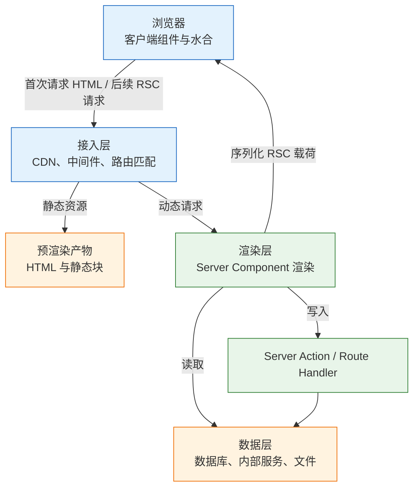
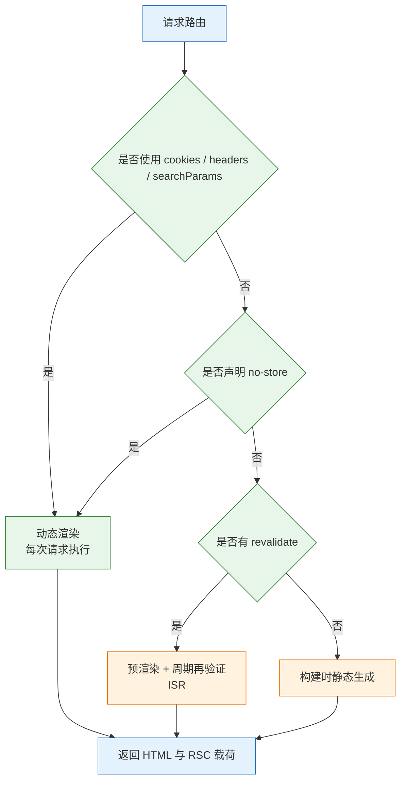
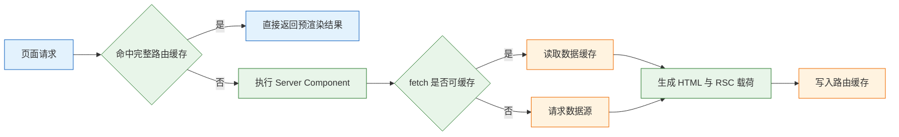

# Next.js

---

## 一、Next.js 是什么

### 1.1 核心概念

Next.js 是构建在 React 之上的应用框架，补全了纯 React 项目缺少的四件事：路由、渲染方式、数据获取约定、构建与部署产物。它的价值不在于多了一套组件写法，而在于把“哪段代码在服务器执行、哪段代码进入浏览器包”变成项目里可设计、可检查的结构。

纯客户端 React 应用的 HTML 只有一个空的挂载节点。浏览器必须先下载 JS、执行框架、发起接口请求，才能看到内容，由此产生三个直接后果：首屏白屏时间受网络与包体积影响；爬虫拿到的是空壳；每个项目都要自行拼装路由、代码分割和预取。Next.js 把这些能力收进框架约定，同时给出服务端渲染与服务端组件的落地方式。

| 能力 | 载体 | 解决的问题 |
|---|---|---|
| 文件路由 | `app/` 目录结构 | 免去手写路由表与代码分割 |
| 服务端渲染 | Server Component、SSR | 首屏返回带内容的 HTML |
| 数据获取 | `async` 组件、`fetch` 扩展 | 服务端直连数据源，少一层 HTTP |
| 缓存与再验证 | `revalidate`、`revalidatePath` | 静态化与内容更新兼得 |
| 构建产物 | `next build`、standalone 输出 | 部署形态可预期 |

它不解决数据库设计、鉴权方案、业务状态管理，也不替项目决定缓存策略。框架提供的是请求进入后的渲染与缓存管线，业务边界仍要自己划。判断一个需求是否属于 Next.js 的职责，可以看它是否影响“请求如何被渲染成响应”；不影响的部分应该留给数据层或独立服务。

### 1.2 与相邻技术的关系

Next.js 经常与 React、Vite、React Router、Nuxt、Node 服务同时出现在选型讨论里，边界不清会导致重复建设或错误迁移。

- **React**：视图库，负责组件模型与状态更新。Next.js 是框架，决定组件在何处执行、路由如何匹配、构建产出什么。React 19 的 `useActionState`、`use` 等能力是 Next.js 表单与服务端交互的基础。
- **Vite + React Router**：纯客户端单页应用方案，构建快、部署简单，适合登录后使用的内部系统。它没有服务端渲染与服务端组件，首屏与 SEO 需要另行处理。
- **React Router 数据路由**：以 loader、action 组织数据，运行在浏览器或自建服务端。Next.js 用 Server Component 与 Server Action 达到类似目的，但组件树本身在服务端执行，模型不同。
- **Nuxt**：Vue 生态的对应框架，同样提供文件路由与服务端渲染，但渲染模型是 Vue 的响应式系统，没有 React Server Components。
- **Node 服务 / Express**：Next.js 自带 HTTP 服务，只承载自身路由、静态资源与图片优化。需要独立网关、长连接或非 HTTP 协议时，仍要单独部署服务。
- **CDN 与边缘网络**：缓存静态资源与可缓存的 HTML，缩短首字节时间。它不替代应用内的数据缓存，两者的失效机制彼此独立。

| 技术 | 解决的问题 | 与 Next.js 的边界 |
|---|---|---|
| React | 组件与状态模型 | Next.js 在其上增加运行时与约定 |
| Vite SPA | 纯浏览器渲染 | 无 SSR、无 Server Component |
| React Router | 客户端路由与数据加载 | Next.js 用文件路由替代 |
| Nuxt | Vue 的全栈框架 | 生态对应，渲染模型不同 |
| Express | 通用 HTTP 服务 | Next.js 只服务自身路由 |
| CDN | 静态资源与 HTML 缓存 | 不参与组件渲染与数据再验证 |

> **注意**：把 Next.js 当成“带 SSR 的 Create React App”会反复遇到同一类问题。它的默认组件在服务端执行，浏览器 API、`useState`、事件处理都不在默认能力范围内；迁移旧项目时先划分组件边界，再改路由。

### 1.3 架构组成

Next.js 的运行时可以分成四层：浏览器层、接入层、渲染层、数据层。开发阶段还有一个编译器负责把文件路由、服务端组件与客户端组件拆成不同产物。



| 组件 | 职责 | 观察方式 |
|---|---|---|
| 文件路由 | 把目录映射为 URL 与布局树 | 构建输出的路由清单 |
| 编译器 | 拆分服务端与客户端模块 | 客户端包体积、构建日志 |
| 渲染器 | 执行 Server Component、生成 RSC 载荷 | 服务端日志、响应头 |
| 缓存层 | 保存数据缓存与预渲染结果 | 构建标记、再验证日志 |
| 图片与字体管线 | 按需转码、自托管字体 | 请求路径、构建产物 |

编译期与运行期的分工要分清：`next build` 决定哪些路由可以预渲染、客户端包包含哪些模块；运行时决定命中缓存还是重新渲染。多数“开发环境正常、上线后不更新”的问题，根因都在编译期已经静态化，而开发者只在 `next dev` 里观察过行为。

---

## 二、环境与最小应用

### 2.1 版本与运行环境

> **版本现状（2026-10）**：Next.js 16 为当前稳定版，App Router 是默认且推荐的模型。`cacheComponents` 等新配置仍在演进，启用前以官方迁移文档为准。

运行环境要求 Node.js 20 LTS 或更高版本，包管理器用 npm、pnpm、yarn 均可，团队内统一即可。TypeScript 建议开启，路由参数、`Metadata`、Server Action 的返回值都依赖类型提示；不开启也能运行，但边界错误只能在运行时暴露。

| 项目 | 建议 | 说明 |
|---|---|---|
| Node.js | 20 LTS 及以上 | 构建与运行时共用同一大版本 |
| 包管理器 | 与锁文件一致 | 混用会产生重复依赖 |
| TypeScript | 开启 | 路由参数与 props 可校验 |
| 代码检查 | ESLint | `create-next-app` 可一并生成 |
| 样式方案 | Tailwind 或 CSS Modules | 与渲染模式无关 |

> **注意**：构建机与运行机的 Node 大版本要一致。用 22 构建、用 20 运行，原生模块与部分语法可能不兼容，表现为启动即报错而不是页面异常。

### 2.2 创建项目与目录结构

```bash
# 创建项目，交互式选择 TypeScript、App Router、Tailwind
npx create-next-app@latest next-demo

cd next-demo

# 启动开发服务器，默认 http://localhost:3000
npm run dev
```

生成的目录以 `app/` 为根。选择 `src` 目录时，路径整体变为 `src/app/`，其余约定不变。

```text
next-demo/
├── app/
│   ├── layout.tsx       根布局，必须包含 html 与 body
│   ├── page.tsx         首页 /
│   ├── globals.css      全局样式
│   └── favicon.ico
├── public/              原样发布的静态文件
├── next.config.ts       框架配置
├── package.json
└── tsconfig.json        路径别名 @/* 指向项目根
```

`public/` 下的文件按原路径直接暴露，不经过构建；需要哈希文件名与长期缓存的资源应放在 `app/` 内通过 `import` 引入，交给打包器处理。路径别名 `@/` 由 `tsconfig.json` 的 `paths` 定义，改目录时同步修改，否则构建期解析失败。

### 2.3 最小可运行页面

根布局是唯一必须存在的文件，它渲染 `<html>` 与 `<body>`，所有路由都挂在它下面。

```tsx
// app/layout.tsx
import type { Metadata } from 'next';
import './globals.css';

// 静态元信息参与服务端渲染，爬虫可直接读取
export const metadata: Metadata = {
  title: { default: '任务台', template: '%s | 任务台' },
  description: '任务列表与详情',
};

export default function RootLayout({
  children,
}: {
  children: React.ReactNode;
}) {
  return (
    <html lang="zh-CN">
      <body>{children}</body>
    </html>
  );
}
```

```tsx
// app/page.tsx
// 默认为 Server Component，可直接使用 async
export default async function Home() {
  const res = await fetch('https://jsonplaceholder.typicode.com/todos?_limit=3', {
    // 显式声明缓存周期，否则 Next.js 15 起默认不缓存
    next: { revalidate: 60 },
  });

  if (!res.ok) {
    throw new Error(`加载失败：HTTP ${res.status}`);
  }

  const todos: { id: number; title: string }[] = await res.json();

  return (
    <main>
      <h1>待办</h1>
      <ul>
        {todos.map(todo => (
          <li key={todo.id}>{todo.title}</li>
        ))}
      </ul>
    </main>
  );
}
```

启动后访问 `http://localhost:3000`，页面源码里应直接包含三条 `<li>`。源码中能看到内容，说明服务端渲染生效；只看到空容器，说明组件被当成了客户端渲染。

### 2.4 开发与构建命令

```bash
# ========== 开发 ==========
npm run dev            # 开发服务器，热更新，不体现生产缓存行为
npm run build          # 生产构建，输出路由是静态还是动态
npm run start          # 以生产模式启动，需先 build
npx eslint .           # 代码检查，Next.js 16 起不再提供 next lint

# ========== 产物观察 ==========
ls .next/server/app    # 预渲染的 HTML 与 RSC 载荷
du -sh .next/static    # 客户端资源体积
```

| 命令 | 作用 | 常见误用 |
|---|---|---|
| `next dev` | 开发与热更新 | 用它验证缓存与静态化 |
| `next build` | 编译、预渲染、产出清单 | 忽略路由标记 |
| `next start` | 启动生产服务 | 未先构建就启动 |
| `eslint` | 静态检查 | 与格式化工具混用 |

> **注意**：`next dev` 为了热更新会跳过部分预渲染与缓存路径，静态化、ISR、图片优化都必须在 `next build && next start` 下验证。上线前只跑过开发服务器，等于没有验证部署形态。

---

## 三、路由约定与渲染模式

### 3.1 文件系统路由

`app/` 下的目录即 URL 段，`page.tsx` 才让该段成为可访问页面。只有目录没有 `page.tsx`，该路径返回 404，但目录仍可作为布局与组件的组织单位。

| 文件 | 作用 | 约束 |
|---|---|---|
| `layout.tsx` | 包裹子路由，导航时保持状态 | 根布局必须含 `html`、`body` |
| `page.tsx` | 该路径的页面 | 同一目录只能有一个 |
| `loading.tsx` | 自动包一层 `Suspense` | 只是骨架，不做数据预取 |
| `error.tsx` | 捕获子树渲染错误 | 必须是 Client Component |
| `not-found.tsx` | 404 界面 | 由 `notFound()` 触发 |
| `route.ts` | HTTP 接口 | 不能与 `page.tsx` 同目录 |
| `template.tsx` | 每次导航重建的布局 | 需要重置状态时使用 |

动态段用方括号，捕获段用 `[...slug]`，可选捕获用 `[[...slug]]`。括号目录 `(marketing)` 只做分组，不进入 URL；下划线开头的目录与文件默认不参与路由，可放私有组件。

```tsx
// app/tasks/[id]/page.tsx
import { notFound } from 'next/navigation';
import { getTask } from '@/lib/tasks';

// Next.js 15 起 params 是 Promise，必须 await
export default async function TaskPage({
  params,
}: {
  params: Promise<{ id: string }>;
}) {
  const { id } = await params;
  const task = await getTask(Number(id));

  // 查不到时交给最近的 not-found.tsx，而不是返回空页面
  if (!task) notFound();

  return <h1>{task.title}</h1>;
}
```

`searchParams` 同样是 Promise。忘记 `await` 时拿到的是 Promise 对象，拼进查询串会得到 `[object Promise]`，这类错误不会抛异常，只会让筛选条件静默失效。

### 3.2 布局、模板与错误边界

布局在导航时保留实例与状态，适合放导航栏、侧边栏、全局 Provider；模板每次导航都重建，适合需要重置表单或动画的场景。两者都接收 `children`，但生命周期不同。

| 文件 | 导航时是否重建 | 典型用途 |
|---|---|---|
| `layout.tsx` | 否 | 导航、页脚、全局上下文 |
| `template.tsx` | 是 | 进入动画、重置局部状态 |
| `error.tsx` | 错误时挂载 | 局部兜底与重试 |
| `global-error.tsx` | 根布局出错时 | 整体降级页面 |
| `not-found.tsx` | 命中 404 时 | 缺失资源提示 |

```tsx
// app/tasks/error.tsx
'use client'; // 错误边界依赖客户端生命周期，必须声明

export default function TaskError({
  error,
  reset,
}: {
  error: Error & { digest?: string };
  reset: () => void;
}) {
  return (
    <section>
      <h2>任务加载失败</h2>
      {/* 生产环境不回显原始错误，避免泄露内部路径 */}
      <p>请稍后重试，或联系管理员。</p>
      <button onClick={reset}>重试</button>
    </section>
  );
}
```

`error.tsx` 只捕获其所在段及子段的渲染错误，捕获不到同级的 `layout.tsx` 错误，也捕获不到事件处理器里的异常。根布局出错需要 `global-error.tsx`，它必须自行渲染 `<html>` 与 `<body>`。

> **注意**：`error.tsx` 拿到的 `error.message` 在生产构建中会被替换成通用文案，真正原因只保留在服务端日志与 `digest` 中。排查时用 `digest` 去日志里对照，不要指望浏览器直接显示原始错误。

### 3.3 渲染模式与生成时机

App Router 默认尽可能静态化：构建时能确定的内容先渲染成 HTML。只有使用动态 API、声明 `no-store` 或显式设为动态时，才改为每次请求渲染。

| 策略 | 生成时机 | 适合 | 代价 |
|---|---|---|---|
| 静态生成 | 构建时 | 文档、营销页、博客 | 更新需重新构建或再验证 |
| SSR | 每次请求 | 登录后页面、个性化内容 | 每次都要执行服务端渲染 |
| ISR | 按 `revalidate` 周期 | 商品列表、资讯 | 可能读到过期数据 |
| CSR | 浏览器内 | 高频交互的局部区域 | 首屏空、SEO 弱 |
| 流式渲染 | 渲染中分块发送 | 慢数据、长页面 | 需要设计 Suspense 边界 |



`next build` 的输出会给每个路由打标记：`○` 表示静态，`ƒ` 表示动态，带 `revalidate` 的路由会额外标出周期。上线前扫一遍清单，确认登录页、订单页这类个性化路由没有被误静态化。

> **注意**：读取 `cookies()`、`headers()` 或页面级 `searchParams` 会让整条路由转为动态，代价是失去静态化收益。把动态读取下沉到最小的叶子组件，可以让外层继续保持静态。

### 3.4 流式渲染与 Suspense

流式渲染先发送已就绪的外壳，慢数据在后续分块中补齐。它改善的是首字节与可交互时间，不减少服务端总工作量。

```tsx
// app/tasks/page.tsx
import { Suspense } from 'react';

// Stats 与 TaskList 为本节示例组件，真实项目从独立文件导入
export default function Page() {
  return (
    <>
      <h1>任务</h1>
      {/* 统计较慢，单独流式发送，不阻塞列表 */}
      <Suspense fallback={<p>统计加载中…</p>}>
        <Stats />
      </Suspense>
      <TaskList />
    </>
  );
}
```

`Suspense` 边界的位置决定用户先看到什么。边界放在页面顶层，整页都要等最慢的数据；放在局部，外壳可以先到。`loading.tsx` 本质是框架自动加在段级别的 `Suspense`，页面级骨架与组件级骨架可以共存。

---

## 四、服务端组件与客户端组件

### 4.1 边界规则

App Router 下组件默认是 Server Component：只在服务器执行，可以直接读数据库、访问密钥、渲染静态内容，不进入浏览器 JS 包。需要状态、事件、浏览器 API 时才标记 Client Component。

| 维度 | Server Component | Client Component |
|---|---|---|
| 运行位置 | 仅服务器 | 服务端预渲染后在浏览器水合 |
| 状态与副作用 | 不可用 | `useState`、`useEffect` 可用 |
| 浏览器 API | 不可用 | `window`、`localStorage` 可用 |
| 数据与密钥 | 可直接访问 | 只能拿到公开数据 |
| 是否进入 JS 包 | 否 | 是 |
| 标记方式 | 默认 | 文件顶部 `'use client'` |

`'use client'` 是模块边界，不是“只在浏览器运行”。从这个文件开始，它导入的所有模块都会进入客户端包；服务端仍会先渲染一次用于首屏 HTML，然后在浏览器水合。把大布局标成客户端，整棵子树都会被打包，这是包体积失控最常见的原因。

### 4.2 序列化与引用约束

跨边界传递的 props 必须可序列化。服务端组件不能把函数、类实例、数据库连接传给客户端组件；客户端组件也不能导入只在服务端可用的模块。

| 类型 | 能否跨边界 | 说明 |
|---|---|---|
| 字符串、数字、布尔、null | 可以 | 基础值直接传递 |
| 数组、普通对象 | 可以 | 不含函数与原型方法 |
| `Date`、`Map`、`Set` | 可以 | 由框架序列化 |
| 函数 | 不可以 | Server Action 例外，传的是引用 |
| 类实例、Symbol | 不可以 | 原型与标识无法还原 |

```tsx
// app/tasks/task-actions.tsx
'use client';

import { useState } from 'react';

// 只接收可序列化的初始值，不在 props 里传数据库客户端
export function TaskToggle({ id, initialDone }: { id: number; initialDone: boolean }) {
  const [done, setDone] = useState(initialDone);

  return (
    <label>
      <input
        type="checkbox"
        checked={done}
        onChange={event => setDone(event.target.checked)}
      />
      已完成
    </label>
  );
}
```

> **注意**：把整个用户对象或 ORM 实体传进客户端组件，常因包含 `Date` 之外的特殊类型或循环引用而报序列化错误。边界上只传页面需要的字段，既避免报错，也减少载荷。

### 4.3 边界划分与组件组织

划分原则是“客户端叶子尽量小、服务端数据尽量靠上”。页面在服务端取数，把最小必要字段传给交互组件；交互组件内部管理输入、弹窗、乐观更新等局部状态。

```tsx
// app/tasks/task-panel.tsx
'use client';

import { useState, type ReactNode } from 'react';

// 接收 children：服务端渲染的内容作为插槽传入，不因外层是客户端而整棵打包
export function TaskPanel({ children }: { children: ReactNode }) {
  const [open, setOpen] = useState(true);

  return (
    <section>
      <button onClick={() => setOpen(value => !value)}>
        {open ? '收起' : '展开'}
      </button>
      {open && children}
    </section>
  );
}
```

`children` 由服务端组件传入时，其内容仍在服务端渲染，客户端只接管外层交互。这种“客户端壳 + 服务端内容”的结构，比把整个页面标成客户端更省包体积。

---

## 五、数据获取与缓存

### 5.1 服务端数据获取

Server Component 可以直接写成 `async`，在渲染过程中取数。数据函数放在独立模块，页面与 Server Action 共用同一套读写逻辑，避免自己调自己的 HTTP 接口。

```tsx
// app/tasks/page.tsx
import { listTasks } from '@/lib/tasks';

export default async function TasksPage() {
  // 直接调用数据层，不经过内部 HTTP 接口
  const tasks = await listTasks();

  if (tasks.length === 0) {
    return <p>还没有任务。</p>;
  }

  return (
    <ul>
      {tasks.map(task => (
        <li key={task.id}>{task.title}</li>
      ))}
    </ul>
  );
}
```

服务端组件里发起的 `fetch` 受框架缓存语义控制，默认不缓存；直接访问数据库则完全由代码控制。两种方式可以混用，但要清楚谁在缓存：框架只接管 `fetch`，不接管 ORM 查询结果。

> **安全警告**：服务端组件可以直接读环境变量与数据库，但它的代码不等于安全边界。任何被客户端组件导入的模块都会进入浏览器包，密钥模块应加 `import 'server-only'`，让误引用在构建期直接失败。

### 5.2 缓存层级与再验证

Next.js 的缓存分为四层，失效方式各不相同。排障时先确认命中哪一层，再决定清哪一层。

| 层级 | 位置 | 失效方式 |
|---|---|---|
| 请求记忆化 | 单次渲染内 | 同一请求自动去重，无需处理 |
| 数据缓存 | 服务端持久缓存 | `revalidate`、`revalidateTag` |
| 完整路由缓存 | 预渲染的 HTML 与载荷 | 重新构建、路径再验证 |
| 客户端路由缓存 | 浏览器内存 | 刷新、导航失效、时间到期 |



> **注意**：Next.js 15 起，`fetch` 默认不缓存，等价于 `cache: 'no-store'`。要缓存必须显式写 `next: { revalidate: 60 }` 或 `cache: 'force-cache'`；沿用旧版本的“默认缓存”心智，会得到与预期相反的结果。

主动失效有两个入口：

```ts
// app/tasks/actions.ts
import { revalidatePath, revalidateTag } from 'next/cache';

// 按路径失效：该路径下次访问重新渲染
revalidatePath('/tasks');

// 按标签失效：所有带该标签的 fetch 一起失效，适合跨路由共享数据
revalidateTag('tasks');
```

`revalidatePath` 在 Server Action 中调用时，框架会一并让客户端路由缓存失效；在 Route Handler 或普通函数中调用，只影响服务端缓存，已打开的路由仍可能显示旧内容，需要 `router.refresh()` 或重新导航。

> **安全警告**：按 URL 缓存的数据不区分用户身份。把带用户信息的页面或接口设为可缓存，会在多个用户之间复用同一份响应，造成越权泄露。个性化内容必须走动态渲染，并在响应头标注 `private` 或 `no-store`。

### 5.3 动态 API 与渲染降级

`cookies()`、`headers()`、`draftMode()` 在 Next.js 15 起都是异步的，必须 `await`。读取它们会让当前路由转为动态渲染，因为结果依赖每个请求。

```tsx
// app/tasks/page.tsx
import { cookies } from 'next/headers';
import { listTasksFor } from '@/lib/tasks';
import { TaskList } from './task-list';

export default async function TasksPage() {
  // 读取会话标识，路由因此变为动态渲染
  const session = (await cookies()).get('session')?.value;
  const tasks = await listTasksFor(session);

  return <TaskList tasks={tasks} />;
}
```

如果只有页面某一小块依赖 Cookie，把这部分拆成独立组件并包在 `Suspense` 中，外层仍可静态化。整页读取会把动态性扩散到整条路由，构建输出里该路由会从 `○` 变成 `ƒ`。

> **注意**：`export const dynamic = 'force-dynamic'` 是兜底开关，不是优化手段。它让路由每次请求都渲染，代价是放弃静态化；能用局部动态解决时不要整页声明。

### 5.4 并行请求与请求瀑布

互不依赖的请求要并行发起，串行 `await` 会让耗时相加。组件层的串行还有额外代价：父组件完成后子组件才开始取数，形成请求瀑布。

```tsx
// 并行：两个请求同时发出，总耗时取较长者
const [tasks, stats] = await Promise.all([listTasks(), loadStats()]);
```

```tsx
// 串行：第二个请求要等第一个完成
const tasks = await listTasks();
const stats = await loadStats();
```

判断依据是数据之间有没有依赖。有依赖时串行无法避免，但可以把慢的那一段放进 `Suspense`，先返回其余内容。并行请求数量也要控制，一次渲染打出几十个查询会把压力集中到数据源，必要时在数据层做批量查询。

---

## 六、写入与状态管理

### 6.1 Server Action 的约定

Server Action 是页面内部发起写操作的入口，本质是一次 POST 请求，不需要手写 API 路由。函数必须位于 `'use server'` 文件或函数体顶部，且必须是 `async`。

```ts
// app/tasks/actions.ts
'use server';

import { revalidatePath } from 'next/cache';
import { createTask } from '@/lib/tasks';

export type ActionState = { error?: string };

export async function createTaskAction(
  _prevState: ActionState | null,
  formData: FormData,
): Promise<ActionState> {
  // 客户端校验可绕过，服务端必须重新校验
  const title = String(formData.get('title') ?? '').trim();
  if (!title) {
    return { error: '标题必填' };
  }

  await createTask(title);

  // 写后失效列表页缓存，下一次访问重新渲染
  revalidatePath('/tasks');
  return {};
}
```

`form action={createTaskAction}` 让表单在 JavaScript 未加载时也能提交，这是渐进增强的基础。参数与返回值都必须可序列化，不能指望它像本地函数一样共享内存。

> **安全警告**：Server Action 是一个公开的 HTTP 端点，任何人都可以直接调用。函数内部必须自行完成身份校验与权限判断，不能依赖“按钮只在登录后显示”。把用户 ID、价格、角色等敏感字段从表单传入而不校验，等同于开放写接口。

### 6.2 Route Handler 的适用场景

`route.ts` 用 Web 标准的 `Request` 与 `Response` 定义 HTTP 接口，适合 Webhook、第三方回调、移动端复用。它与 `page.tsx` 不能放在同一目录。

```ts
// app/api/tasks/route.ts
import { listTasks } from '@/lib/tasks';

export async function GET() {
  const tasks = await listTasks();
  // Next.js 15 起 GET 默认不缓存，需要缓存时显式声明
  return Response.json(tasks);
}

export async function POST(request: Request) {
  const body: unknown = await request.json();
  // 真实项目要先用 schema 校验，再写库
  return Response.json({ ok: true }, { status: 201 });
}
```

页面内部的读写优先用 Server Component 加 Server Action，少绕一层 HTTP；需要被外部系统调用时才建 Route Handler。两套入口共用同一个数据层，不要各自实现一份校验。

| 入口 | 调用方 | 缓存 | 适用 |
|---|---|---|---|
| Server Component | 页面渲染 | 受框架缓存控制 | 读 |
| Server Action | 本应用的表单与事件 | POST，不缓存 | 写 |
| Route Handler | 外部系统、移动端 | 默认不缓存 | 读写接口 |
| 中间件 | 请求进入前 | 不适用 | 重定向、鉴权预处理 |

### 6.3 表单状态与错误处理

需要显示提交中、字段错误、成功提示时，用 React 19 的 `useActionState`。它要求表单组件是 Client Component，并把上一次的返回值作为 action 的第一个参数。

```tsx
// app/tasks/task-form.tsx
'use client';

import { useActionState } from 'react';
import { createTaskAction, type ActionState } from './actions';

export function TaskForm() {
  const [state, formAction, pending] = useActionState<ActionState | null, FormData>(
    createTaskAction,
    null,
  );

  return (
    <form action={formAction}>
      <label htmlFor="title">标题</label>
      <input id="title" name="title" aria-invalid={Boolean(state?.error)} />
      {/* 错误信息用 role=alert，读屏软件可即时播报 */}
      {state?.error && <p role="alert">{state.error}</p>}
      <button type="submit" disabled={pending}>
        {pending ? '提交中…' : '创建'}
      </button>
    </form>
  );
}
```

`useActionState` 的 `pending` 来自过渡状态，不需要自己维护 `loading` 布尔值。提交成功后页面是否跳转由 action 决定，可以在服务端调用 `redirect('/tasks')`，也可以返回结果由客户端导航。

### 6.4 客户端状态与 URL 状态

状态放在哪一层，取决于它需要活多久、被谁共享。全部塞进全局 store 会让缓存与失效变得难以推理。

| 状态类型 | 存放位置 | 例子 |
|---|---|---|
| 组件内部交互 | `useState` | 展开、悬停、输入草稿 |
| 可分享的筛选条件 | URL 查询参数 | 关键词、页码、排序 |
| 跨组件共享 | Context 或状态库 | 主题、当前工作区 |
| 服务端数据 | 服务端缓存 | 列表、详情、统计 |
| 表单提交结果 | `useActionState` | 校验错误、成功提示 |

筛选条件放 URL 的好处是刷新、分享、前进后退都能还原，服务端也能直接读到 `searchParams` 做查询。只有确实需要跨页面保留的客户端状态，才值得引入状态库；把服务端数据复制进客户端 store，会制造两份真相。

---

## 七、完整示例：任务列表

### 7.1 数据层与类型

示例用模块级数组代替数据库，保留列表、详情、创建三条主线。数组存在进程内存里，重启即清空，生产环境替换为真实数据访问即可。

```ts
// lib/tasks.ts
export type Task = { id: number; title: string; done: boolean };

// 仅用于演示：模块级数组随进程存在，不适合多实例部署
const tasks: Task[] = [
  { id: 1, title: '整理构建输出', done: false },
  { id: 2, title: '补充错误边界', done: true },
];
let nextId = 3;

export async function listTasks(): Promise<Task[]> {
  // 返回副本，避免调用方直接改内部数组
  return tasks.map(task => ({ ...task }));
}

export async function getTask(id: number): Promise<Task | undefined> {
  return tasks.find(task => task.id === id);
}

export async function createTask(title: string): Promise<Task> {
  const task: Task = { id: nextId++, title, done: false };
  tasks.push(task);
  return task;
}
```

### 7.2 列表与详情

列表页声明为动态渲染，因为数据存在进程内存里，构建期静态化会把首屏固化成构建时的两条记录。

```tsx
// app/tasks/page.tsx
import Link from 'next/link';
import { listTasks } from '@/lib/tasks';

// 内存数据不受框架缓存管理，强制每次请求渲染
export const dynamic = 'force-dynamic';

export default async function TasksPage() {
  const tasks = await listTasks();

  if (tasks.length === 0) {
    return <p>还没有任务，去新建一个。</p>;
  }

  return (
    <ul>
      {tasks.map(task => (
        <li key={task.id}>
          <Link href={`/tasks/${task.id}`}>{task.title}</Link>
          {task.done && <span>（已完成）</span>}
        </li>
      ))}
    </ul>
  );
}
```

```tsx
// app/tasks/[id]/page.tsx
import { notFound } from 'next/navigation';
import { getTask } from '@/lib/tasks';

export default async function TaskDetailPage({
  params,
}: {
  params: Promise<{ id: string }>;
}) {
  const { id } = await params;
  const task = await getTask(Number(id));

  // 参数非法或记录不存在都走 404，不区分具体原因
  if (!task) notFound();

  return (
    <article>
      <h1>{task.title}</h1>
      <p>状态：{task.done ? '已完成' : '进行中'}</p>
    </article>
  );
}
```

### 7.3 创建流程与缓存失效

创建页把表单与 Server Action 串起来。action 完成写库后调用 `revalidatePath`，列表页下次访问会重新渲染。

```tsx
// app/tasks/new/page.tsx
import { TaskForm } from '../task-form';

export default function NewTaskPage() {
  return (
    <main>
      <h1>新建任务</h1>
      <TaskForm />
    </main>
  );
}
```

完整的调用链是：浏览器提交表单 → Server Action 收到 `FormData` → 校验 → 写数据 → `revalidatePath('/tasks')` → 返回状态 → 客户端显示错误或跳转。任何一环缺失都会表现为“提交成功但列表不变”或“错误没有提示”。

### 7.4 验证与检查清单

```bash
# 生产模式验证，开发服务器不体现静态化与缓存
npm run build
npm run start
```

| 检查项 | 预期 | 失败含义 |
|---|---|---|
| 访问 `/tasks` | 显示两条初始任务 | 数据层或渲染失败 |
| 访问 `/tasks/1` | 显示标题与状态 | `params` 未 `await` |
| 访问 `/tasks/999` | 404 页面 | `notFound()` 未触发 |
| 新建后返回列表 | 新任务立即出现 | 缺少 `revalidatePath` |
| 提交空标题 | 显示“标题必填” | 服务端校验缺失 |
| 查看页面源码 | 列表内容在 HTML 中 | 退化为客户端渲染 |

---

## 八、构建与部署

### 8.1 构建产物与路由清单

`next build` 会编译服务端与客户端两份产物，并对可静态化的路由执行预渲染。输出清单里的符号直接反映每个路由的渲染方式。

| 产物 | 位置 | 用途 |
|---|---|---|
| 服务端代码 | `.next/server` | 处理请求与 RSC 渲染 |
| 预渲染页面 | `.next/server/app` | 静态 HTML 与载荷 |
| 客户端资源 | `.next/static` | 带哈希的 JS、CSS |
| 独立运行包 | `.next/standalone` | 含最小依赖，用于容器 |
| 构建清单 | `.next` 根目录 | 路由与缓存元数据 |

启用独立输出需要在配置里声明，产物才能脱离完整 `node_modules` 运行。

```ts
// next.config.ts
import type { NextConfig } from 'next';

const nextConfig: NextConfig = {
  // 生成自带最小依赖的运行包，供容器镜像使用
  output: 'standalone',
};

export default nextConfig;
```

图片与字体也在构建期决定。`next/image` 为本地导入的图片生成宽高并默认懒加载，远程图片必须在 `images.remotePatterns` 中声明域名；`next/font` 在构建时下载并自托管字体文件，避免运行时请求第三方域名造成布局抖动。静态导出时图片优化不可用，需要关闭该能力或改用外部服务。

### 8.2 部署形态

| 形态 | 支持的能力 | 限制 |
|---|---|---|
| Node 服务 / 容器 | SSR、Server Action、ISR、图片优化 | 自行管理进程、缓存、扩缩容 |
| 平台托管 | 上述能力加 CDN 与构建缓存 | 受平台运行时与配额约束 |
| 静态导出 | 纯静态 HTML 与 JS | 无 Server Action、无 ISR、无动态图片优化 |
| 纯 SPA 托管 | 客户端渲染 | 失去服务端渲染收益 |

容器部署用多阶段构建，运行阶段只保留独立输出与静态资源。

```dockerfile
# 阶段一：安装依赖，利用锁文件命中缓存
FROM node:22-alpine AS deps
WORKDIR /app
COPY package.json package-lock.json ./
RUN npm ci

# 阶段二：构建，产出 .next
FROM node:22-alpine AS builder
WORKDIR /app
COPY --from=deps /app/node_modules ./node_modules
COPY . .
RUN npm run build

# 阶段三：运行，只带独立输出与静态资源
FROM node:22-alpine AS runner
WORKDIR /app
ENV NODE_ENV=production
COPY --from=builder /app/public ./public
COPY --from=builder /app/.next/standalone ./
COPY --from=builder /app/.next/static ./.next/static
EXPOSE 3000
CMD ["node", "server.js"]
```

> **注意**：`output: 'standalone'` 不会自动复制 `public/` 与 `.next/static`，漏掉这两步会得到“页面能开但样式与图片全 404”的镜像。容器里的 `localhost` 指向容器自身，连接外部数据库要用服务名或真实地址。

### 8.3 环境变量与密钥

只有 `NEXT_PUBLIC_` 前缀的变量会进入浏览器包，并且在构建时被内联成字面量。服务端变量只在服务端代码中可读，运行时注入即可。

| 变量 | 可见范围 | 注入时机 |
|---|---|---|
| `NEXT_PUBLIC_API_BASE` | 浏览器与服务端 | 构建时内联 |
| `DATABASE_URL` | 仅服务端 | 运行时读取 |
| `SESSION_SECRET` | 仅服务端 | 运行时读取 |
| `NEXT_PUBLIC_SITE_NAME` | 浏览器与服务端 | 构建时内联 |

> **安全警告**：`NEXT_PUBLIC_` 不是“公开但安全”，而是“会写进 JS 文件”。密钥、数据库连接串、内部服务地址一旦加上该前缀，等于发布到公网。轮换密钥时还要重新构建，因为旧值已经固化在产物里。

### 8.4 多实例缓存与可观测性

自托管多实例时，ISR 的预渲染结果默认落在各实例本地。负载均衡把请求分到不同实例，用户可能看到不同版本的内容。解决办法是配置共享缓存处理器，或把可缓存内容交给 CDN，实例只处理动态请求。

| 观察项 | 位置 | 用途 |
|---|---|---|
| 路由渲染标记 | 构建输出 | 确认静态与动态分布 |
| 首字节时间 | 接入层日志 | 判断缓存是否命中 |
| Server Action 耗时 | 服务端日志 | 定位写路径瓶颈 |
| 再验证次数 | 缓存日志 | 发现失效风暴 |
| 客户端包体积 | 构建输出 | 控制边界扩散 |

再验证要避免“写入即全站失效”。按标签做细粒度失效，比每次写都 `revalidatePath('/')` 更稳定；后者在写入频繁时会让缓存几乎不起作用，服务端压力回到每次请求都渲染。

---

## 九、常见错误与排查

### 9.1 故障对照表

| 现象 | 最可能原因 | 处理 |
|---|---|---|
| `useState` 报错 | 在 Server Component 中使用客户端 hook | 拆出客户端组件并加 `'use client'` |
| `window is not defined` | 预渲染阶段访问浏览器 API | 移入 `useEffect` 或客户端组件 |
| Hydration mismatch | 首屏 HTML 与客户端首次渲染不一致 | 时间、随机数、`localStorage` 延后到 effect |
| `params.id` 为 `undefined` | 未 `await params` | 按 Promise 处理 |
| 改了数据页面不变 | 缓存未失效或路由被静态化 | 检查 `revalidate` 与写后的再验证 |
| 每次请求都重新渲染 | 读取了 `cookies()` 或声明 `no-store` | 确认是否真的需要动态 |
| 密钥出现在浏览器 | 使用了 `NEXT_PUBLIC_` 前缀 | 移除前缀，密钥只留服务端 |
| Server Action 序列化错误 | 传了函数或类实例 | 只传可序列化数据 |
| 静态导出后接口 404 | `output: 'export'` 不支持服务端能力 | 改为 Node 部署或去掉动态功能 |
| `useSearchParams` 构建报错 | 静态页面缺少 Suspense 边界 | 包一层 `Suspense` 或改为动态 |
| 样式与图片在容器里 404 | 独立输出未复制静态资源 | 补 `public` 与 `.next/static` |
| 多实例内容不一致 | ISR 缓存只存在本地 | 配置共享缓存或交给 CDN |

### 9.2 排查顺序

1. 同时看服务端终端与浏览器控制台，错误往往只出现在一侧。
2. 跑 `next build`，确认目标路由是静态还是动态，先排除构建期静态化。
3. 在 Server Component 与数据函数里打日志，确认执行位置与返回内容。
4. 看 Network 面板里的文档请求、RSC 请求与 Server Action 的 POST，确认实际走了哪条路径。
5. 检查缓存：数据缓存的 `revalidate`、路径再验证是否调用、浏览器路由缓存是否需要刷新。
6. 最后才改配置。用 `force-dynamic` 或关闭缓存掩盖问题，会让性能与一致性同时退化。

> **核心结论**：Next.js 的难点不在语法，而在两个边界——服务端与客户端的执行边界，以及静态与动态的缓存边界。边界划清，路由、数据、部署都会变得可预测。
