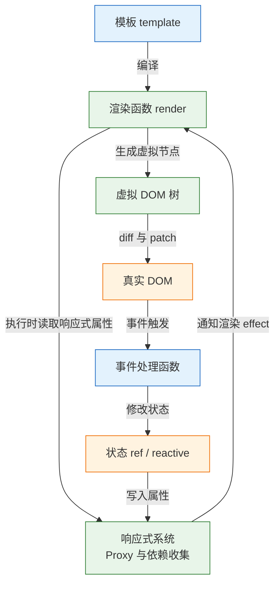
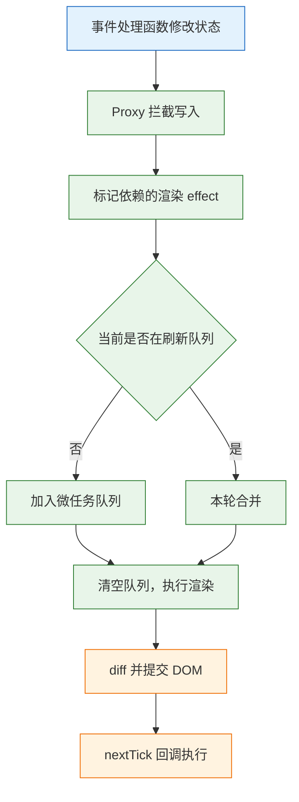
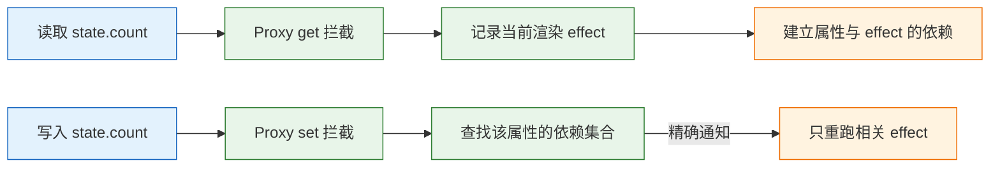

# Vue 对照

---

## 一、Vue 是什么

### 1.1 核心概念

Vue 是一个用于构建用户界面的渐进式框架。它以单文件组件组织结构、逻辑与样式，用响应式系统跟踪状态变化，再通过模板编译生成高效的更新函数。与 React 最大的差异不在语法，而在更新模型：React 依赖不可变快照与重新渲染，Vue 依赖属性访问追踪与精确触发。

本篇以对照视角展开：每个机制先讲 Vue 自身的做法，再指出与 React 的差异，避免把一套框架的习惯直接搬进另一套。对照的目的不是评判优劣，而是让迁移时的行为差异有解释。

| 概念 | 载体 | 作用 |
|---|---|---|
| 单文件组件 | `.vue` 文件 | 模板、逻辑、样式集中管理 |
| 响应式对象 | `ref`、`reactive` | 读写时追踪依赖 |
| 派生状态 | `computed` | 缓存计算结果 |
| 副作用 | `watch`、`watchEffect` | 状态变化后执行逻辑 |
| 组合式函数 | `useXxx` | 复用有状态逻辑 |

Vue 不内置跨端原生渲染、后端接口设计、超大团队的强制规范。它提供的是视图层与配套生态，工程约束仍要团队自己建立。

### 1.2 与相邻技术的关系

- **React**：同为组件化视图库。React 用 JSX 表达结构，更新靠调用 setter 换新引用；Vue 用模板与指令，更新靠代理拦截属性写入。两者都用虚拟 DOM 做差异比较。
- **Vue Router**：官方路由，配置式声明路径与组件，支持 History 与 Hash 两种模式。
- **Pinia**：官方状态库，setup 风格与组合式函数一致，取代 Vuex 成为默认选择。
- **Nuxt**：基于 Vue 的全栈框架，提供文件路由、服务端渲染与数据获取封装，定位对应 Next.js。
- **Vite**：默认构建工具，开发期基于原生 ES 模块，生产期用 Rollup 打包。
- **UI 组件库**：Element Plus、Ant Design Vue、Naive UI 等，只提供组件，不改变响应式模型。

| 技术 | 解决的问题 | 与 Vue 的边界 |
|---|---|---|
| React | 组件与状态模型 | 替代关系，不同时混用 |
| Vue Router | 客户端路由 | 官方配套，非内置 |
| Pinia | 跨组件状态 | 只存客户端状态 |
| Nuxt | 服务端渲染与文件路由 | 应用框架，非必需 |
| Vite | 开发与构建 | 可替换为其他打包器 |

选型时真正起作用的差异集中在四处：

| 维度 | Vue | React |
|---|---|---|
| 上手成本 | 模板接近 HTML，指令直观 | JSX 需要先熟悉表达式 |
| 状态更新 | 直接修改响应式代理 | 换新引用后调用 setter |
| 生态组织 | 官方全家桶，约定统一 | 第三方选择多，需自定规范 |
| 服务端渲染 | Nuxt | Next.js |

团队前端经验参差、项目以表单与后台为主时，Vue 的模板与官方约定能降低协作成本；需要更自由的 JavaScript 表达、复用大量现成组件或使用 React Native 时，React 更合适。两套响应式思维不要混用：在 Vue 里做全量替换，或在 React 里直接改对象，都会把各自的优势变成缺陷。

> **注意**：Vue 3 不再支持 IE11，也不要使用为 Vue 2 编写的插件与语法。`Vue.prototype`、`$on`、过滤器等能力已移除，混用会得到运行时错误而不是兼容降级。

### 1.3 架构组成

Vue 的运行时分成三层：模板编译层把模板转成渲染函数，响应式层追踪依赖并触发更新，渲染层把虚拟节点差异提交到 DOM。三者通过组件的渲染 effect 连接。



| 组成部分 | 职责 | 对应包 |
|---|---|---|
| 编译器 | 解析模板、生成渲染函数 | `@vue/compiler-sfc` |
| 运行时核心 | 组件实例、虚拟 DOM、调度 | `vue` |
| 响应式系统 | 代理、依赖、触发 | `@vue/reactivity` |
| 路由 | 路径匹配与导航守卫 | `vue-router` |
| 状态管理 | 跨组件共享状态 | `pinia` |

编译期能做的优化包括静态节点提升、补丁标记、事件缓存。这些优化发生在构建阶段，运行时只处理会变化的部分；因此模板写法会直接影响更新开销，不是纯粹的语法糖。

---

## 二、环境与最小应用

### 2.1 版本与工具链

> **版本现状（2026-10）**：Vue 3.5 为当前稳定版，`<script setup>` 是推荐写法；`defineModel` 需要 3.4 及以上。

| 工具 | 作用 | 备注 |
|---|---|---|
| Node.js | 运行构建工具 | 20 LTS 及以上 |
| Vite | 开发服务器与构建 | 创建项目的默认选择 |
| TypeScript | 类型检查 | 模板类型检查逐步完善 |
| Vue DevTools | 调试组件与状态 | 浏览器扩展 |
| ESLint | 代码规范 | 配合 `eslint-plugin-vue` |

> **注意**：Vue 3.5 中 `defineProps` 的解构默认保持响应性，旧版本需要额外开启编译选项。升级前确认构建工具链版本，否则可能出现在旧项目里“解构后不更新”而在新项目里正常的分裂现象。

### 2.2 创建项目与目录结构

```bash
# 创建项目，交互式选择 TypeScript、Router、Pinia
npm create vue@latest vue-demo

cd vue-demo
npm install
npm run dev
```

生成的目录约定如下，选择 TypeScript 后脚本扩展名为 `.ts`：

```text
vue-demo/
├── src/
│   ├── main.ts          应用入口，挂载与插件注册
│   ├── App.vue          根组件
│   ├── components/      可复用组件
│   ├── views/           路由页面
│   ├── router/          路由配置
│   ├── stores/          Pinia 状态
│   └── assets/          参与构建的静态资源
├── public/              原样复制的静态文件
├── index.html           页面模板，含挂载节点
├── vite.config.ts       构建与代理配置
└── tsconfig.json
```

`index.html` 是入口页面，里面必须有 `<div id="app"></div>`，由 `main.ts` 挂载。这一点与 Next.js 由布局渲染 `<html>` 不同：Vue 的页面骨架在构建工具层面，不在组件层面。

### 2.3 最小单文件组件

```vue
<!-- src/App.vue -->
<script setup lang="ts">
import { computed, ref } from 'vue';

// ref 包装基础值，脚本里通过 .value 读写
const count = ref(0);
const doubled = computed(() => count.value * 2);
</script>

<template>
  <!-- 模板中 ref 自动解包，直接写 count -->
  <p>{{ count }} × 2 = {{ doubled }}</p>
  <button @click="count++">加一</button>
</template>

<style scoped>
button {
  padding: 0.5rem 1rem;
}
</style>
```

`<script setup>` 里的顶层绑定自动暴露给模板，不需要 `return`。编译后它等价于普通 `setup()` 返回一个对象，导入的组件也一并注册，因此模板里可以直接使用组件名而无需 `components` 选项。`<style scoped>` 给元素加唯一属性并改写选择器，避免污染全局；需要穿透子组件样式时用 `:deep()`。

需要给组件命名或关闭属性继承时，用 `defineOptions`。它只能写在 `<script setup>` 中，且一个组件只能出现一次；多个 `<script>` 块并存时，普通块负责导出选项，setup 块负责逻辑。

```ts
// src/main.ts
import { createApp } from 'vue';
import { createPinia } from 'pinia';
import App from './App.vue';
import router from './router';

const app = createApp(App);

// 插件必须在挂载前注册，组件内才能使用路由与 store
app.use(createPinia());
app.use(router);
app.mount('#app');
```

Pinia 应在任何 `useStore()` 调用之前注册。路由守卫通常会读取 store，因此把 Pinia 放在 router 之前最稳妥；完全缺少注册时，会在首次读取时报“getActivePinia 未调用”。

### 2.4 开发与构建命令

```bash
npm run dev        # 开发服务器，默认 http://localhost:5173
npm run build      # 类型检查 + 生产构建，产物在 dist/
npm run preview    # 本地预览 dist 产物
npm run type-check # 仅做类型检查
```

| 命令 | 作用 | 常见误用 |
|---|---|---|
| `vite` | 开发与热更新 | 用它验证生产构建差异 |
| `vite build` | 产出静态资源 | 忽略 `base` 配置 |
| `vite preview` | 预览构建结果 | 当作生产服务器 |
| `vue-tsc` | 模板与脚本类型检查 | 构建时才首次运行 |

> **注意**：`npm run dev` 走的是未打包的模块加载，生产构建会做压缩、分割与 tree-shaking。动态导入失效、资源路径错误、环境变量缺失，通常只在 `build` 后出现。

---

## 三、模板语法与渲染机制

### 3.1 模板编译与渲染函数

模板不是字符串运行时解析，而是在构建阶段编译成渲染函数。编译器识别静态节点、动态绑定与事件，把不变的部分提升到渲染函数之外，只在更新时处理带补丁标记的节点。

```vue
<script setup lang="ts">
import { ref } from 'vue';
const title = ref('任务');
</script>

<template>
  <!-- 静态部分被提升，动态文本带补丁标记 -->
  <h1 class="page-title">{{ title }}</h1>
</template>
```

等价的手写渲染函数可以说明编译结果的结构：

```ts
import { h, ref } from 'vue';

const title = ref('任务');

// 编译产物近似结构：动态文本作为子节点传入
const render = () => h('h1', { class: 'page-title' }, title.value);
```

| 写法 | 编译处理 | 运行时开销 |
|---|---|---|
| 纯静态节点 | 提升到渲染函数外 | 只创建一次 |
| 文本插值 | 打补丁标记 | 更新时比较文本 |
| `v-if` | 生成分支逻辑 | 切换时创建或销毁 |
| `v-for` | 生成列表片段 | 依赖 `key` 做复用 |
| 动态组件 | 运行时解析 | 比静态分支更贵 |

补丁标记记录的是“这个节点哪一部分可能变化”，例如只变文本、只变 class、只变 props。更新时运行时不再逐属性比较，而是按标记直接定位。副作用是模板里混入过多动态表达式会削弱优化，把稳定结构写成静态节点、把变化集中到少量绑定上，更新路径更短。

编译期优化不等于不需要设计组件粒度。一个组件内状态变化会触发该组件重新渲染，子组件若收到新 props 也会进入更新流程；把高频变化的状态限制在最小叶子组件内，比依赖编译器优化更可靠。

### 3.2 指令与列表渲染

| 指令 | 作用 | 注意 |
|---|---|---|
| `v-if` / `v-else-if` / `v-else` | 条件渲染，销毁重建 | 频繁切换用 `v-show` |
| `v-show` | 切换 `display` | 首次就渲染，初始成本高 |
| `v-for` | 列表渲染 | 必须配稳定 `key` |
| `v-model` | 双向绑定 | 组件上默认 `modelValue` |
| `v-bind` / `:` | 绑定属性 | `:class` 支持对象与数组 |
| `v-on` / `@` | 绑定事件 | 支持 `.prevent`、`.stop`、`.once` |
| `v-html` | 插入 HTML | 只用于可信内容 |

`v-if` 与 `v-for` 不要写在同一个元素上。Vue 3 中 `v-if` 优先级更高，条件表达式拿不到循环变量；正确做法是先用 `computed` 过滤，再 `v-for` 渲染。

```vue
<template>
  <!-- 先过滤再循环，避免 v-if 与 v-for 争用作用域 -->
  <li v-for="task in visibleTasks" :key="task.id">{{ task.title }}</li>
</template>
```

`key` 要用业务主键，不要用数组下标。下标在插入或排序时会错位，导致组件状态复用到错误的行，表现为勾选框跟着数据跑。

`v-model` 的修饰符只改变同步方式：`.number` 尝试转数字，输入为空时仍是空字符串；`.trim` 在输入过程中去掉首尾空格；`.lazy` 改为在 `change` 事件同步。需要严格数值校验时不要依赖 `.number`，在提交前统一转换并校验。

### 3.3 渲染更新流程与批处理

状态变化不会立刻改 DOM。Vue 把更新任务放进微任务队列，同一轮事件里的多次修改合并成一次渲染，这就是异步批处理。



需要在 DOM 更新后读取尺寸或聚焦元素，必须等 `nextTick`：

```ts
import { nextTick, ref } from 'vue';

const visible = ref(false);
const panel = ref<HTMLElement | null>(null);

async function show() {
  visible.value = true;
  // 等待本轮 DOM 更新完成
  await nextTick();
  console.log(panel.value?.offsetHeight);
}
```

React 中对应的约束是“setState 后不能立刻读 DOM”，要靠 `useEffect` 或 `flushSync`。两者都不保证改完立即生效，只是调度方式不同：Vue 合并同一轮更新，React 按优先级调度。

### 3.4 与 JSX 的表达差异

| 维度 | Vue 模板 | React JSX |
|---|---|---|
| 结构表达 | 接近 HTML 的模板 | JavaScript 表达式 |
| 条件渲染 | `v-if` | 三元或逻辑与 |
| 列表渲染 | `v-for` | `map` |
| 更新控制 | 编译期补丁标记 | 运行时比较 |
| 类型检查 | 模板类型推导 | JSX 类型直接 |
| 灵活性 | 受指令约束 | 可任意组合表达式 |

Vue 也支持 JSX 与 `h()` 函数，适合高度动态的结构；日常页面用模板可读性更好。选择标准是结构是否能用模板表达，而不是个人偏好。

模板里只能写单个表达式，不能声明变量或使用语句。需要多步计算时放进 `computed` 或方法：模板中调用方法每次渲染都会执行，`computed` 有缓存。把复杂逻辑塞进模板会放大编译产物，也难以单独测试。

---

## 四、响应式系统

### 4.1 ref 与 reactive

`ref` 可包装任意类型，脚本里通过 `.value` 读写；`reactive` 只能包装对象、数组、`Map`、`Set`，返回 Proxy，直接访问属性。

```ts
import { reactive, ref } from 'vue';

const count = ref(0);
count.value++;

const form = reactive({ title: '', done: false });
form.title = '写文档';
```

| 对比项 | `ref` | `reactive` |
|---|---|---|
| 可包装类型 | 任意类型 | 对象、数组、集合 |
| 脚本访问 | `.value` | 直接属性 |
| 模板访问 | 自动解包 | 自动解包 |
| 整体替换 | 替换 `.value` | 不能重新赋值变量 |
| 解构 | 返回的 ref 仍响应 | 解构成普通值，失去响应 |

`ref` 被放进 `reactive` 对象并作为属性访问时会自动解包，数组元素与集合成员不会。模板只解包顶层 ref，遍历一个存放 ref 的数组时，拿到的仍是 ref 对象，需要显式读取 `.value`。把这类混合结构限制在数据层，组件里统一用普通值，可以少掉一类难查的显示问题。

`reactive` 的解构会丢掉响应性，因为解构得到的是属性值的快照：

```ts
const state = reactive({ count: 0 });
const { count } = state; // 普通数字，后续不再更新
```

需要解构时用 `toRefs(state)` 转成一组 ref，或直接用 `ref` 组织状态。这是 Vue 最高频的错误来源，也是与 React 习惯冲突最明显的地方：React 解构 props 是常态，Vue 解构响应式对象要额外处理。



### 4.2 computed 与 watch

```ts
import { computed, ref, watch } from 'vue';

const keyword = ref('');
const tasks = ref([
  { id: 1, title: '写文档', done: false },
  { id: 2, title: '修缺陷', done: true },
]);

// 派生值：依赖不变时直接返回缓存
const visible = computed(() =>
  tasks.value.filter(task => task.title.includes(keyword.value)),
);

watch(keyword, (next, prev) => {
  console.log(`关键词：${prev} → ${next}`);
});
```

- `computed` 有缓存，依赖不变不重算；不要在内部产生副作用、发请求或改状态。
- `watch` 默认浅比较，监听对象内部变化要 `{ deep: true }`；直接监听 `reactive` 对象会隐式深度监听。
- `watchEffect` 自动收集同步执行期间读到的依赖，`await` 之后的读取不会被收集。
- 需要首次执行时传 `{ immediate: true }`，此时组件尚未挂载，不要读 DOM。

`computed` 与 `watch` 的职责要分开：能由现有状态推导的值一律用 `computed`，不要在 `watch` 里同步一个镜像状态。镜像状态会带来两份真相，任何一处漏更新都会造成显示不一致。

`watch` 可以同时监听多个来源，回调收到的新值与旧值都是数组；异步副作用要用第三个参数注册清理函数，否则先发出的请求可能后返回，把新结果覆盖成旧数据。

```ts
// 任一来源变化都会执行，参数按声明顺序排列
watch([keyword, () => props.page], ([nextKeyword, nextPage]) => {
  console.log(nextKeyword, nextPage);
});

watch(
  () => props.id,
  async (id, _prev, onCleanup) => {
    const controller = new AbortController();
    // 下一次触发或组件卸载时中止上一次请求
    onCleanup(() => controller.abort());
    task.value = await fetchTask(id, { signal: controller.signal });
  },
  { immediate: true },
);
```

清理函数在下一次回调执行前与组件卸载时调用，适合取消请求、清除定时器、断开订阅。只在回调末尾判断“是否仍是最新请求”也能工作，但旧请求仍会占满连接，取消更彻底。

### 4.3 响应性丢失的形态

除了 `reactive` 解构，还有三种常见形态：

```ts
// 1. 整体替换 reactive 变量，新对象不再是代理
let state = reactive({ count: 0 });
state = { count: 1 }; // 视图不再更新

// 2. 把属性值当普通参数传入函数
function double(n: number) {
  return n * 2;
}
double(state.count); // 传进去的是快照

// 3. 解构后重新赋值
const { count } = toRefs(state);
let copy = count.value; // copy 是普通值
```

第一种改用 `Object.assign(state, { count: 1 })`，或用 `ref` 包住整个对象再替换 `.value`；第二种在调用处读取、在需要响应的作用域内计算；第三种保留 ref 本身，不要提前取值。

| 形态 | 原因 | 修复 |
|---|---|---|
| 解构 `reactive` | 得到普通值 | `toRefs` 或直接访问属性 |
| 替换整个变量 | 新对象未被代理 | `Object.assign` 或 `ref` |
| 属性传给函数 | 值传递断开追踪 | 传 getter 或 ref |
| 提前取出 `ref.value` | 取出的是快照 | 保留 ref，在使用处解包 |

> **注意**：把 `ref` 传给函数时不要解包。`fn(count.value)` 传的是当前值，`fn(count)` 传的才是响应式引用；函数内部若要持续读取，应接收 ref 或 getter。

### 4.4 浅层响应与原始值标记

大对象整体替换时，深层代理的开销不必要。`shallowRef` 只追踪 `.value` 的替换，不追踪内部属性；`shallowReactive` 只代理第一层。

```ts
import { markRaw, shallowRef } from 'vue';

// 整表替换的场景，避免深层代理
const rows = shallowRef<Row[]>([]);
rows.value = await fetchRows();

// 第三方实例不应被代理，否则内部逻辑可能被破坏
const chart = markRaw(createChart());
```

| API | 追踪深度 | 适用 |
|---|---|---|
| `ref` | 深层 | 普通对象与小集合 |
| `shallowRef` | 仅 `.value` | 大列表、整体替换 |
| `reactive` | 深层 | 表单等频繁改属性的对象 |
| `shallowReactive` | 第一层 | 配置对象 |
| `markRaw` | 不代理 | 地图、图表、类实例 |

用 `shallowRef` 后必须整体替换 `.value` 才能触发更新，直接改内部属性不会生效。这是有意的取舍，不是缺陷。

需要把响应式对象交给第三方库或做深比较时，用 `toRaw` 取原始对象。直接传代理会让库内部的标识判断失效，也可能把代理引用长期持有；原始对象不再具备响应性，只适合一次性操作。

---

## 五、组件通信与状态管理

### 5.1 props 与事件

```vue
<!-- TaskItem.vue -->
<script setup lang="ts">
// 声明 props 类型，父组件传参时获得检查
const props = defineProps<{ task: { id: number; title: string; done: boolean } }>();

// 声明事件与参数类型
const emit = defineEmits<{ toggle: [id: number] }>();
</script>

<template>
  <li>
    <input
      type="checkbox"
      :checked="props.task.done"
      @change="emit('toggle', props.task.id)"
    />
    {{ props.task.title }}
  </li>
</template>
```

父组件通过 `:task` 传值、`@toggle` 接收事件。数据向下、事件向上，子组件不直接修改父级数据。

| 需求 | Vue | React |
|---|---|---|
| 父传子 | `defineProps` | props |
| 子传父 | `emit('event', payload)` | 父级传入回调 |
| 双向绑定 | `v-model` / `defineModel` | 受控值加 `onChange` |
| 内容分发 | `<slot>` | `children` |
| 跨层注入 | `provide` / `inject` | `createContext` / `useContext` |
| 父调子方法 | 模板 ref + `defineExpose` | `useRef` + `useImperativeHandle` |

`v-model` 在组件上默认展开为 `modelValue` 与 `update:modelValue`，Vue 3.4 起可用 `defineModel` 简化：

```vue
<!-- SearchInput.vue -->
<script setup lang="ts">
// 声明可写模型，父组件用 v-model 绑定
const keyword = defineModel<string>({ required: true });
</script>

<template>
  <input v-model="keyword" placeholder="搜索" />
</template>
```

> **注意**：子组件直接修改 props 会触发警告，且变更不会可靠地同步回父级。需要本地副本时用 `computed` 的 getter/setter，或先 `emit` 再由父级更新。

### 5.2 插槽与跨层注入

```vue
<!-- Card.vue -->
<template>
  <section class="card">
    <header><slot name="title" /></header>
    <!-- 默认插槽承载父级传入的内容 -->
    <slot />
  </section>
</template>
```

```vue
<Card>
  <template #title><h2>本周任务</h2></template>
  <TaskList />
</Card>
```

默认插槽相当于 `children`，具名插槽相当于多个命名节点，作用域插槽把子组件内部数据暴露给父级模板，作用接近 render props。

跨层通信用 `provide` 与 `inject`，避免逐层透传。注入的值默认不是响应式的，传 `ref` 或 `reactive` 对象才会跟随变化；在提供方修改后，使用方读取的是同一个代理。

```ts
import { inject, provide, ref, type InjectionKey, type Ref } from 'vue';

// 用 Symbol 作键，避免字符串命名冲突
const themeKey: InjectionKey<Ref<'light' | 'dark'>> = Symbol('theme');
const theme = ref<'light' | 'dark'>('light');

// 提供方：值可以是任意类型，这里是 ref
provide(themeKey, theme);

// 使用方：没有提供者时回落到默认值
const injected = inject(themeKey, ref('light'));
```

`provide` 与 `inject` 必须在 `setup` 的同步阶段调用，异步回调里调用拿不到当前组件实例。注入不跨应用实例，微前端或多应用挂载的场景要各自提供，不能指望从外层应用继承。

### 5.3 Pinia 状态管理

```ts
// src/stores/tasks.ts
import { defineStore } from 'pinia';
import { computed, ref } from 'vue';

export const useTaskStore = defineStore('tasks', () => {
  const items = ref<Task[]>([]);
  const done = computed(() => items.value.filter(task => task.done));

  async function load() {
    items.value = await fetchTasks();
  }

  return { items, done, load };
});
```

组件里 `const store = useTaskStore()`。直接解构会丢响应性，需要用 `storeToRefs`；方法可以直接解构，因为它们本身不是响应式值。

```ts
import { storeToRefs } from 'pinia';

const store = useTaskStore();
// 状态用 storeToRefs，方法直接取
const { items, done } = storeToRefs(store);
const { load } = store;
```

| 方案 | 适用 | 代价 |
|---|---|---|
| 组件内 `ref` | 局部状态 | 无法跨组件共享 |
| props / emit | 父子通信 | 层级深时透传繁琐 |
| `provide` / `inject` | 跨层主题、上下文 | 来源不直观 |
| Pinia | 跨页面共享状态 | 需要设计生命周期 |

Pinia 的 state 是响应式代理，直接 `store.items.push(...)` 即可，不需要不可变更新。这与 React 必须换新引用相反，迁移时最容易写错的是“为了触发更新而复制整个数组”，在 Vue 里既不必要，也会丢失代理连接。

### 5.4 组合式函数

```ts
// src/composables/useTasks.ts
import { ref } from 'vue';

export function useTasks() {
  const items = ref<Task[]>([]);
  const loading = ref(false);
  const error = ref<string | null>(null);

  async function load() {
    loading.value = true;
    error.value = null;
    try {
      items.value = await fetchTasks();
    } catch (cause) {
      // 统一错误形态，模板只负责展示
      error.value = cause instanceof Error ? cause.message : '未知错误';
    } finally {
      loading.value = false;
    }
  }

  return { items, loading, error, load };
}
```

返回的是 ref 对象，解构后仍保持响应性，这一点与 `reactive` 不同。每次调用都得到独立状态，和 React 自定义 hook 的隔离方式一致。

组合式函数必须在 `setup` 或另一个组合式函数中同步调用，才能绑定当前组件实例。在异步回调里调用 `onMounted` 等生命周期注册会失败，这是“生命周期不执行”的常见原因。

### 5.5 生命周期钩子

组合式 API 把生命周期注册为函数，必须在 `setup` 同步阶段调用。常用钩子与 React 的对应关系如下。

| 时机 | Vue 3 | React |
|---|---|---|
| 挂载后 | `onMounted` | `useEffect(..., [])` |
| 每次更新后 | `onUpdated` | 无依赖数组的 `useEffect` |
| 卸载前 | `onBeforeUnmount` | effect 的清理函数 |
| 卸载后 | `onUnmounted` | 无直接对应 |
| 依赖变化 | `watch(source, cb)` | `useEffect(..., [source])` |
| 后代错误捕获 | `onErrorCaptured` | Error Boundary |

`onMounted` 只在挂载后执行一次，不能替代 `watch`；`watch` 默认不在首次执行，需要时加 `immediate`。取数逻辑通常拆成两段：`onMounted` 负责首次加载，`watch` 负责参数变化后的重新加载。

创建定时器、订阅、事件监听必须在卸载钩子里释放。组件被 `v-if` 销毁或路由切换时不会自动清理这些资源，泄漏会随导航次数累积，表现为内存上涨与重复回调。

---

## 六、路由与数据获取

### 6.1 Vue Router 约定

```ts
// src/router/index.ts
import { createRouter, createWebHistory } from 'vue-router';
import TaskList from '@/views/TaskList.vue';
import TaskDetail from '@/views/TaskDetail.vue';

export const router = createRouter({
  // HTML5 History 模式，需要服务端回退到 index.html
  history: createWebHistory(import.meta.env.BASE_URL),
  routes: [
    { path: '/', component: TaskList },
    // props: true 把路径参数直接变成组件 props
    { path: '/tasks/:id', component: TaskDetail, props: true },
  ],
});
```

`createWebHistory` 依赖服务端配置：直接访问 `/tasks/1` 时，服务器必须返回 `index.html`，否则 404。不能改服务端时用 `createWebHashHistory`，URL 带 `#`，刷新不会请求服务端。

| 模式 | URL 形态 | 服务端要求 |
|---|---|---|
| History | `/tasks/1` | 所有路径回退到 `index.html` |
| Hash | `/#/tasks/1` | 无 |
| 内存 | 不反映到地址栏 | 测试与非浏览器环境 |

路由参数变化不会重建组件实例，`onMounted` 不会再执行。依赖参数取数时要监听 `props.id` 或 `route.params`，否则从详情页跳另一条详情时数据不更新。

需要在进入前校验权限或预取数据时，用全局守卫 `beforeEach`：返回 `false` 取消导航，返回一个路由地址则重定向。组件内的 `onBeforeRouteLeave` 适合未保存提示。守卫位于导航关键路径上，不要在里面做重请求，否则点击后长时间没有反馈。

### 6.2 数据获取位置

Vue 不自带数据获取约定，取数位置由项目决定。常见位置有四类：

| 位置 | 时机 | 适用 |
|---|---|---|
| `onMounted` | 挂载后一次 | 组件首次进入 |
| `watch(..., { immediate: true })` | 参数变化时 | 详情页复用 |
| 路由守卫 | 进入前 | 需要阻塞导航或预取 |
| 服务端渲染 | 请求时 | Nuxt 场景 |

```ts
import { onMounted, watch } from 'vue';

// 只取一次，适合列表页
onMounted(load);

// 参数变化就重取，首次也执行
watch(() => props.id, load, { immediate: true });
```

`immediate: true` 的回调在挂载前执行，此时不要读 DOM；只做请求与状态赋值没有问题。需要操作 DOM 的逻辑仍放 `onMounted`。

请求要处理竞态：快速切换参数时，先发出的请求可能后返回，把新数据覆盖成旧数据。用 `AbortController` 取消旧请求，或记录请求序号只接受最新结果。

```ts
// 只接受最新一次请求的结果
let seq = 0;

async function load(id: number) {
  const current = ++seq;
  const data = await fetchTask(id);
  // 期间已有更新的请求，丢弃本次结果
  if (current !== seq) return;
  task.value = data;
}
```

同一份数据被多个组件请求时，还应在数据层做去重或短时缓存，而不是让每个组件各发一次。去重键由参数与用户身份共同决定，只按参数去重会把上一个用户的数据返回给下一个用户。

### 6.3 Nuxt 的服务端渲染

需要 SEO 或首屏内容时，Vue 的对应框架是 Nuxt。它提供文件路由、服务端取数、SSR 与静态生成。

```vue
<!-- pages/tasks/[id].vue -->
<script setup lang="ts">
// useFetch 在服务端渲染时执行，结果随首屏 HTML 一起返回
const route = useRoute();
const { data: task, error } = await useFetch(`/api/tasks/${route.params.id}`);

if (error.value) {
  throw createError({ statusCode: 404, statusMessage: '任务不存在' });
}
</script>

<template>
  <article v-if="task">
    <h1>{{ task.title }}</h1>
  </article>
</template>
```

Nuxt 的渲染模型仍是 Vue 的响应式系统，组件会在服务端执行一次、在浏览器水合，没有 React Server Components 那种“组件永不进入客户端包”的边界。需要区分服务端与客户端逻辑时，用 `import.meta.server`、`import.meta.client` 或 `onMounted`。

| 渲染模式 | 生成时机 | 适用 |
|---|---|---|
| 服务端渲染 | 每次请求 | 个性化内容加 SEO |
| 静态生成 | 构建时 | 文档、营销页 |
| 客户端渲染 | 浏览器 | 登录后使用的后台 |

静态生成在内容更新后需要重新构建，或配合增量再验证；纯客户端渲染放弃首屏与 SEO 收益。模式按路由配置，不必全站统一。

---

## 七、完整示例：任务筛选

### 7.1 状态设计

示例包含关键词、任务列表、派生筛选结果与子组件事件。状态用 `ref` 按字段组织，不用一个大 `reactive` 对象，避免解构丢响应性。

```ts
// src/composables/useTaskFilter.ts
import { computed, ref } from 'vue';

export type Task = { id: number; title: string; done: boolean };

export function useTaskFilter(initial: Task[]) {
  const keyword = ref('');
  const tasks = ref<Task[]>(initial);

  // 派生结果，依赖变化时自动重算
  const visible = computed(() =>
    tasks.value.filter(task => task.title.includes(keyword.value.trim())),
  );

  function toggle(id: number) {
    // 直接改代理属性即可触发更新，不需要整体替换
    const task = tasks.value.find(item => item.id === id);
    if (task) task.done = !task.done;
  }

  return { keyword, tasks, visible, toggle };
}
```

### 7.2 列表与子组件

```vue
<!-- src/views/TaskList.vue -->
<script setup lang="ts">
import TaskItem from '@/components/TaskItem.vue';
import { useTaskFilter } from '@/composables/useTaskFilter';

const { keyword, visible, toggle } = useTaskFilter([
  { id: 1, title: '写周报', done: false },
  { id: 2, title: '修登录超时', done: true },
]);
</script>

<template>
  <input v-model="keyword" placeholder="搜索任务" />

  <p v-if="visible.length === 0">没有匹配的任务</p>
  <ul v-else>
    <!-- key 用业务主键，勾选状态不会错位 -->
    <TaskItem
      v-for="task in visible"
      :key="task.id"
      :task="task"
      @toggle="toggle"
    />
  </ul>
</template>
```

子组件只负责展示与派发事件，不持有业务状态。父组件收到 `toggle` 后修改列表，派生结果自动更新。

### 7.3 表单与校验

```vue
<!-- src/components/TaskCreate.vue -->
<script setup lang="ts">
import { ref } from 'vue';

const emit = defineEmits<{ create: [title: string] }>();
const title = ref('');
const error = ref('');

function submit() {
  const value = title.value.trim();
  // 前端校验只负责即时反馈，服务端仍要校验
  if (!value) {
    error.value = '标题必填';
    return;
  }
  error.value = '';
  emit('create', value);
  title.value = '';
}
</script>

<template>
  <form @submit.prevent="submit">
    <label for="title">标题</label>
    <input id="title" v-model="title" :aria-invalid="Boolean(error)" />
    <p v-if="error" role="alert">{{ error }}</p>
    <button type="submit">创建</button>
  </form>
</template>
```

`@submit.prevent` 阻止表单默认提交，`v-model` 同步输入。错误信息用 `role="alert"`，读屏软件能即时播报。

### 7.4 验证与检查清单

| 检查项 | 预期 | 失败含义 |
|---|---|---|
| 输入“周报” | 只剩一条 | `computed` 依赖未收集 |
| 清空输入 | 恢复两条 | `v-model` 未绑定 |
| 勾选复选框 | 状态变化且不错位 | `key` 不稳定 |
| 切换路由再返回 | 状态按预期重置或保留 | 组件实例复用判断有误 |
| 构建产物预览 | 与开发表现一致 | 环境变量或路径配置缺失 |

```bash
npm run build
npm run preview
```

组合式函数可以脱离组件单独测试，因为状态逻辑不依赖渲染：

```ts
import { describe, expect, it } from 'vitest';
import { useTaskFilter } from '@/composables/useTaskFilter';

describe('useTaskFilter', () => {
  it('按关键词过滤', () => {
    const { keyword, visible } = useTaskFilter([
      { id: 1, title: '写周报', done: false },
      { id: 2, title: '修缺陷', done: true },
    ]);

    keyword.value = '周报';
    expect(visible.value).toHaveLength(1);
  });
});
```

在组件外调用组合式函数时，`onMounted` 一类的生命周期注册会警告，因为不存在当前实例。示例只测状态与派生逻辑，不涉及生命周期，因此可以直接运行。

---

## 八、构建与部署

### 8.1 构建产物

Vite 把源码打包成 `dist/`，包含入口 HTML、带哈希的 JS 与 CSS、以及原样复制的 `public/` 资源。哈希文件名支持长期缓存，入口 HTML 必须短缓存。

```text
dist/
├── index.html            入口，引用带哈希的资源
├── assets/
│   ├── index-a1b2c3.js   入口与依赖
│   ├── TaskDetail-9f8e7d.js  动态导入产生的 chunk
│   └── index-d4e5f6.css  抽取后的样式
└── favicon.ico           来自 public 的文件
```

懒加载产生的 chunk 与入口共享依赖时，打包器会抽取公共模块，避免重复下载。分包粒度不是越细越好：过多小文件会增加请求数，过少则首屏加载用不到的代码。

| 产物 | 缓存策略 | 原因 |
|---|---|---|
| `index.html` | 不缓存或短缓存 | 引用最新的哈希资源 |
| `assets/*.js` | 长期缓存 | 文件名含内容哈希 |
| `assets/*.css` | 长期缓存 | 同上 |
| `public/` 文件 | 按文件名决定 | 不经过哈希处理 |

```ts
// vite.config.ts
import { defineConfig } from 'vite';
import vue from '@vitejs/plugin-vue';

export default defineConfig({
  plugins: [vue()],
  // 部署在子路径时修改，例如 '/admin/'
  base: '/',
  build: {
    // 生产不生成 source map，避免暴露源码结构
    sourcemap: false,
  },
});
```

路由页面用动态导入做分割，首屏只加载当前路由需要的代码：

```ts
// 动态导入让打包器生成独立 chunk
const TaskDetail = () => import('@/views/TaskDetail.vue');
```

### 8.2 部署形态与 History 回退

| 形态 | 适用 | 注意 |
|---|---|---|
| 静态托管 | 纯前端应用 | 配置 History 回退 |
| Nginx | 自建静态站点 | 资源缓存与回退规则 |
| 容器 | 统一交付 | 构建产物放进镜像 |
| Nuxt 服务端 | 需要 SSR | 需 Node 运行时 |

History 模式必须把未知路径回退到 `index.html`，否则刷新详情页直接 404。

```nginx
server {
    listen 80;
    root /usr/share/nginx/html;

    # 带哈希的资源长期缓存
    location /assets/ {
        expires 1y;
        add_header Cache-Control "public, immutable";
    }

    # 入口文件不缓存，保证引用最新资源
    location = /index.html {
        add_header Cache-Control "no-cache";
    }

    # 未匹配到文件的路径交给前端路由
    location / {
        try_files $uri $uri/ /index.html;
    }
}
```

> **注意**：`try_files` 只对前端路由生效，接口路径要单独代理。把 `/api/` 也回退到 `index.html`，会让接口 404 变成返回一段 HTML，前端解析 JSON 时报语法错误。

容器部署把构建与运行分开，运行镜像只保留静态文件与 Nginx：

```dockerfile
# 构建阶段：安装依赖并产出 dist
FROM node:22-alpine AS builder
WORKDIR /app
COPY package*.json ./
RUN npm ci
COPY . .
RUN npm run build

# 运行阶段：只保留静态产物与上面的回退配置
FROM nginx:stable-alpine
COPY --from=builder /app/dist /usr/share/nginx/html
COPY nginx.conf /etc/nginx/conf.d/default.conf
```

镜像里不要保留 `node_modules` 与源码，它们既增加体积，也扩大泄露面。静态站点的运行镜像通常只有几十 MB。

### 8.3 环境变量

Vite 只把 `VITE_` 前缀的变量注入客户端代码，其余变量仅在构建配置中可读。

```bash
# .env.production
VITE_API_BASE=https://api.example.com
```

```ts
// 构建时被替换成字面量
const base = import.meta.env.VITE_API_BASE;
```

| 变量 | 是否进入客户端 | 用途 |
|---|---|---|
| `VITE_API_BASE` | 是 | 接口地址 |
| `VITE_APP_TITLE` | 是 | 展示名称 |
| `DB_PASSWORD` | 否 | 构建脚本专用 |
| `MODE` | 是 | 当前模式 |

> **安全警告**：`VITE_` 前缀的变量会被写入 JS 文件，任何访问者都能读到。密钥、内部地址、签名盐不能放进去；前端需要鉴权时，用后端签发的短期令牌，而不是内置凭据。

---

## 九、常见错误与排查

### 9.1 故障对照表

| 现象 | 最可能原因 | 处理 |
|---|---|---|
| 解构后界面不更新 | `reactive` 解构成普通值 | `toRefs` 或直接读属性 |
| 列表勾选状态串行 | `key` 使用了数组下标 | 改用业务主键 |
| `ref` 忘了 `.value` | 脚本中按模板写法访问 | 脚本统一 `.value` |
| `watch` 不触发深层变化 | 默认浅比较 | `{ deep: true }` 或监听具体字段 |
| `watchEffect` 漏依赖 | 依赖在 `await` 之后读取 | 改用 `watch` 显式声明 |
| 直接改 props 警告 | 子组件修改父级数据 | `emit` 事件或本地副本 |
| `v-if` 切换后状态丢失 | 销毁重建 | 需要保留时用 `v-show` |
| `v-for` 与 `v-if` 冲突 | `v-if` 优先级更高 | 先 `computed` 过滤 |
| 拿不到子组件方法 | 未 `defineExpose` | 显式暴露并在挂载后访问 |
| 读 DOM 尺寸是旧值 | DOM 尚未更新 | `await nextTick()` |
| `script setup` 顶层 await 报错 | 组件变为异步，缺少边界 | 用 `<Suspense>` 包裹或把请求移到路由层 |
| 刷新详情页 404 | History 模式缺回退 | 配置 `try_files` |
| 构建后接口地址为空 | 变量缺少 `VITE_` 前缀 | 改前缀并重新构建 |
| 大对象渲染卡顿 | 深层代理开销 | `shallowRef` 整体替换或 `markRaw` |

### 9.2 排查顺序

1. 用 Vue DevTools 查看组件 props、setup 状态与 `computed` 值，确认数据是否真的变化。
2. 确认操作的是响应式代理，而不是解构、取值或复制出来的普通变量。
3. 在 `computed` 与 `watch` 内打日志，确认依赖是否被读取、回调是否执行。
4. 看控制台的框架警告：修改 props、缺少 `key`、模板编译错误都会直接提示。
5. 检查路由参数变化是否复用组件实例，必要时监听参数或加 `key` 强制重建。
6. 最后才怀疑构建配置。开发与生产表现不一致时，先跑 `build` 加 `preview` 复现。

> **核心结论**：Vue 的更新模型是代理追踪加精确触发，React 是快照替换加重新渲染。迁移时先改三个习惯：状态按字段用 `ref` 组织、派生值交给 `computed`、副作用按挂载与依赖变化拆开。响应性丢失几乎都源于“取了值却以为还连着代理”。
