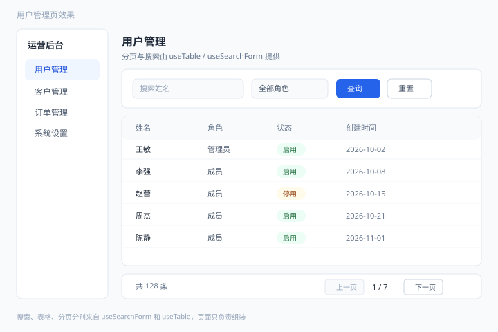

# Vue3组件与组合式API

> 这篇从 Vue 3 的响应式模型讲起，经过 SFC 与 `script setup`、生命周期、组件通信和 Composables 的设计，最后落到一个可复用的后台用户管理面板。
>
> 学完能用组合式 API 写出职责清晰、可复用、可测试的 Vue 3 组件，并把重复逻辑抽成 Composable。

## 一、Vue 3 的定位与边界

Vue 3 的核心是一套**响应式系统**：状态变了，依赖它的视图和计算属性自动更新。组合式 API（Composition API）在这套系统之上提供一种按「逻辑关注点」组织代码的写法，替代 Options API 里 data / methods / watch 分散的问题。

判断一篇该不该用组合式 API：

- 组件里有多个相关但分散的状态（如表单 + 请求 + 分页），组合式 API 更清晰；
- 逻辑要在多个组件之间复用（如分页、防抖、轮询），抽成 Composable；
- 简单的一次性组件，Options API 也能写，不必为了新而新。

与相邻技术的边界：

| 任务 | 用什么 | 不用什么 |
|---|---|---|
| 跨页面共享状态 | Pinia | `provide/inject` 硬塞全局数据 |
| URL 与页面映射 | Vue Router | 手写 `window.location` 判断 |
| 纯展示组件 | 组件库 | 自己封装每个按钮 |
| 服务端渲染 | Nuxt | 手搭 SSR 脚手架 |

> 边界：组合式 API 不是「把 Options API 翻译一遍」。它的价值在于逻辑聚合和复用；一个只有两个状态的组件用 `setup()` 反而更啰嗦。

## 二、环境准备与第一个组件

### 2.1 版本基线

本文所有代码基于 2026-11-13 的版本矩阵：

| 依赖 | 版本 |
|---|---|
| Node | 22 LTS |
| Vite | 7+ |
| Vue | 3.5+ |
| TypeScript | 5.9+（可选） |

### 2.2 创建项目

```bash
# Ubuntu / macOS / Windows 通用；Node 22 已含 npm
npm create vite@latest my-admin -- --template vue-ts
cd my-admin
npm install
npm run dev
```

预期输出：

```text
VITE v7.x.x  ready in 320 ms
➜  Local:   http://localhost:5173/
```

Windows 用户若用 PowerShell，`-- --template` 的双横线不能省；macOS 的 zsh 同理。

本文示例用 `@/` 指向 `src/`。Vite 模板默认没有这个别名，需要在 `vite.config.ts` 的 `resolve.alias` 和 `tsconfig` 的 `paths` 中同时加上 `@ -> src`；只配一处会出现运行时报模块找不到，或 `vue-tsc` 报类型错误。

### 2.3 最小验证：一个响应式组件

把 `src/App.vue` 换成：

```vue
<script setup lang="ts">
// script setup 是编译期语法糖：顶层变量自动暴露给模板，无需 return
import { ref } from 'vue'

const count = ref(0) // ref 包装基础类型，.value 才是真实值
</script>

<template>
  <button @click="count++">点了 {{ count }} 次</button>
</template>
```

预期结果：点击按钮，数字递增。能跑通说明响应式、模板编译和 HMR 都正常，可以继续。

> 边界：`npm create vite` 拉的是模板，不是锁定的版本。上线前用 `npm ls vue` 确认实际安装的 Vue 是 3.5+。

## 三、响应式系统

响应式是 Vue 3 的一切基础。理解「谁会触发更新、谁不会」，能省掉一半调试时间。

### 3.1 ref 与 reactive

```ts
import { ref, reactive, shallowRef } from 'vue'

// ref：包装任意值，基础类型只能用它
const name = ref('订单')
name.value = '客户' // 模板里写 name，脚本里写 name.value

// reactive：把对象变成响应式代理，访问不需要 .value
const form = reactive({ page: 1, size: 20 })
form.page = 2

// shallowRef：只有 .value 整体替换才触发更新，适合大对象/第三方实例
const chart = shallowRef<Chart | null>(null)
chart.value = new Chart(el) // 触发一次；之后 chart.value.setData() 不会触发
```

| API | 适用 | 陷阱 |
|---|---|---|
| `ref` | 基础类型、需要整体替换的值 | 脚本里忘写 `.value` |
| `reactive` | 固定结构的对象 | 解构后失去响应式 |
| `shallowRef` | 大数据、第三方实例 | 深层修改不触发更新 |

> 边界：解构 `reactive` 对象会让属性变成普通值。需要解构时用 `toRefs`。

```ts
import { reactive, toRefs } from 'vue'
const state = reactive({ page: 1, size: 20 })
const { page, size } = toRefs(state) // page/size 仍是 ref，保持响应式
```

### 3.2 computed 与 watch

```ts
import { ref, computed, watch, watchEffect } from 'vue'

const keyword = ref('')
const list = ref<Item[]>([])

// computed：有缓存，依赖不变不重算；必须返回值
const filtered = computed(() =>
  list.value.filter(i => i.name.includes(keyword.value))
)

// watch：显式指定监听源，适合「变化后做副作用」（请求、埋点）
watch(keyword, (val, old) => {
  fetchList(val) // 为什么用 watch 而非 computed：这里要发请求，不是算值
}, { immediate: true }) // immediate 让组件创建时先跑一次

// watchEffect：自动收集依赖，适合「依赖谁就重跑谁」
watchEffect(() => {
  document.title = `${keyword.value} - 后台` // 依赖 keyword，自动追踪
})
```

| | `computed` | `watch` | `watchEffect` |
|---|---|---|---|
| 用途 | 派生值 | 副作用 | 自动依赖副作用 |
| 缓存 | 有 | 无 | 无 |
| 显式声明源 | 否 | 是 | 否 |

> 边界：`computed` 里不要发请求或改状态，会破坏单向数据流，也难测试。副作用交给 `watch`。

### 3.3 响应式失效的三个常见场景

```ts
// 场景一：reactive 解构
const { page } = reactive({ page: 1 }) // page 是普通数字，后续对它的重新赋值不会更新视图

// 场景二：ref 的值被整体替换后，仍持有旧引用
const list = ref([1, 2])
const old = list.value
list.value = [3, 4] // 整体替换，ref 指向新数组
old.push(5) // 改的是旧数组，不会触发视图更新

// 场景三：watch 监听 reactive 的属性而不是对象
const form = reactive({ page: 1 })
watch(() => form.page, v => { /* 这样才能监听到 */ })
// watch(form.page, ...) 是错的，传入的是数字不是响应式源
```

## 四、SFC 与 script setup

单文件组件（Single-File Component，SFC）把结构、逻辑、样式放在一个 `.vue` 文件里。`script setup` 是 Vue 3.2 起的推荐写法。

### 4.1 props 与 emit

```vue
<script setup lang="ts">
// defineProps / defineEmits 是编译器宏，不需要 import
const props = defineProps<{
  title: string
  count?: number // 可选
}>()

const emit = defineEmits<{
  (e: 'change', value: number): void
}>()

function add() {
  emit('change', (props.count ?? 0) + 1) // 为什么用 emit：子组件不改父数据
}
</script>

<template>
  <div class="card">
    <h3>{{ title }}</h3>
    <span>{{ count ?? 0 }}</span>
    <button @click="add">+1</button>
  </div>
</template>
```

### 4.2 defineModel：双向绑定

Vue 3.4 起用 `defineModel` 简化 v-model：

```vue
<script setup lang="ts">
// 父组件 <MyInput v-model="text" /> 直接生效，不用再写 prop + emit 模板
const model = defineModel<string>({ required: true })
</script>

<template>
  <input v-model="model">
</template>
```

> 边界：声明 `required: true` 时父组件必须传 v-model；未绑定时子组件写 model 会告警。没有 `required` 的 `defineModel` 可以在子组件本地先改，再等父组件同步。

### 4.3 插槽

```vue
<!-- Card.vue -->
<template>
  <div class="card">
    <header><slot name="header" /></header> <!-- 具名插槽 -->
    <main><slot /></main>                    <!-- 默认插槽 -->
    <footer><slot name="footer" :tip="'共 3 条'" /></footer> <!-- 带作用域数据 -->
  </div>
</template>
```

父组件使用：

```vue
<Card>
  <template #header><h3>标题</h3></template>
  正文内容
  <template #footer="d"><span>{{ d.tip }}</span></template>
</Card>
```

插槽让组件保留结构、把内容交给使用者，是封装表格、卡片、弹窗的通用手段。

### 4.4 透传属性与 expose

```vue
<script setup lang="ts">
import { ref } from 'vue'

// 默认 script setup 组件是「封闭」的，父组件拿不到内部方法
// 需要暴露时用 defineExpose
const loading = ref(false)
defineExpose({ loading }) // 父组件通过 ref 访问 childRef.value.loading
</script>
```

## 五、生命周期

组合式 API 的生命周期钩子从 `vue` 导入，写在 `setup` 顶层。

| 钩子 | 时机 | 典型用途 |
|---|---|---|
| `onBeforeMount` | 挂载前 | 极少用 |
| `onMounted` | DOM 已就绪 | 请求初始数据、初始化第三方库 |
| `onBeforeUpdate` | 更新前 | 极少用 |
| `onUpdated` | 更新后 | 测量更新后的 DOM |
| `onBeforeUnmount` | 卸载前 | 清理前的收尾 |
| `onUnmounted` | 卸载后 | 清理定时器、取消订阅 |
| `onActivated` / `onDeactivated` | keep-alive 缓存 | 缓存页的刷新/暂停 |

```ts
import { onMounted, onUnmounted } from 'vue'

let timer: number
onMounted(() => {
  timer = window.setInterval(poll, 5000) // 挂载后开始轮询
})
onUnmounted(() => {
  clearInterval(timer) // 为什么必须清理：不清理会在组件销毁后继续发请求
})
```

> 边界：`onMounted` 里操作 DOM 前要确认元素存在；`setup` 顶层代码执行时组件还没挂载，不能直接访问模板里的 DOM。

## 六、组件通信

Vue 的通信是单向的：父传子用 props，子通知父用 emit。跨层和跨页面各有专门机制。

### 6.1 父子：props + emit

```vue
<!-- 子组件 Child.vue -->
<script setup lang="ts">
defineProps<{ value: number }>()
const emit = defineEmits<{ (e: 'update', v: number): void }>()
</script>

<!-- 父组件 -->
<template>
  <Child :value="n" @update="n = $event" />
  <!-- 若子组件改用 defineModel<number>()，父组件可简写为 v-model="n" -->
</template>
```

### 6.2 跨层：provide / inject

```ts
// 祖先组件
import { provide, ref } from 'vue'
const theme = ref('light')
provide('theme', theme) // provide(key, 响应式值)

// 后代组件（任意深度）
import { inject, type Ref } from 'vue'
const theme = inject<Ref<string>>('theme') // 拿到的是同一个 ref
```

用 `InjectionKey` 保证类型安全：

```ts
import type { InjectionKey, Ref } from 'vue'
export const ThemeKey: InjectionKey<Ref<string>> = Symbol('theme')
provide(ThemeKey, theme)
const theme = inject(ThemeKey) // 类型自动推导
```

> 边界：`provide/inject` 适合「依赖注入」（主题、当前租户、i18n 实例），不适合当全局状态库。跨页面共享的业务数据用 Pinia（见 03 篇）。

### 6.3 兄弟与跨页面：提升到父级或状态库

兄弟组件通信优先把状态提升到共同父组件；状态复杂或跨路由时交给 Pinia。不要引入 `mitt` 之类的事件总线散落全局，事件流向不可追踪。

| 关系 | 推荐方式 | 避免 |
|---|---|---|
| 父 → 子 | props | 修改 prop |
| 子 → 父 | emit | 子改父数据 |
| 祖先 → 后代 | provide/inject | 多层 props 透传 |
| 跨路由/全局 | Pinia | 全局事件总线 |

### 6.4 模板 ref 访问子组件

```vue
<script setup lang="ts">
import { ref, onMounted } from 'vue'
import Child from './Child.vue'
const child = ref<InstanceType<typeof Child> | null>(null)
onMounted(() => {
  child.value?.focus() // 只能调用 defineExpose 暴露的成员
})
</script>
<template><Child ref="child" /></template>
```

## 七、Composables 的设计

Composable 是组合式 API 的复用单元：一个函数，封装一段有状态的逻辑，返回响应式数据和方法。

### 7.1 命名与结构

约定以 `use` 开头，返回一个普通对象（不要返回数组，除非像 `toRefs` 那样成对）。

```ts
// usePagination.ts
import { ref, computed } from 'vue'

export function usePagination<T>(fetcher: (page: number, size: number) => Promise<{ list: T[]; total: number }>) {
  const page = ref(1)
  const size = ref(20)
  const total = ref(0)
  const rows = ref<T[]>([])
  const loading = ref(false)

  const pages = computed(() => Math.ceil(total.value / size.value))

  async function load() {
    loading.value = true // 为什么先置 true：让模板能显示 loading 态
    try {
      const data = await fetcher(page.value, size.value)
      rows.value = data.list
      total.value = data.total
    } finally {
      loading.value = false // finally 保证失败也要复位
    }
  }

  function go(p: number) {
    page.value = p
    load()
  }

  return { page, size, total, rows, loading, pages, load, go }
}
```

使用：

```vue
<script setup lang="ts">
import { usePagination } from '@/composables/usePagination'
const { rows, loading, pages, page, load, go } = usePagination(fetchUsers)
load()
</script>
```

### 7.2 副作用与清理

Composable 里注册的全局监听、定时器，必须在返回前提供清理，或自己用 `onUnmounted` 清理。

```ts
import { onUnmounted } from 'vue'

export function useEventListener(target: HTMLElement, event: string, cb: () => void) {
  target.addEventListener(event, cb)
  onUnmounted(() => target.removeEventListener(event, cb)) // 随组件卸载自动清理
}
```

### 7.3 Composable vs 工具函数

| | 工具函数 | Composable |
|---|---|---|
| 有状态 | 否 | 是（内部用 ref） |
| 依赖 Vue 运行时 | 否 | 是 |
| 例子 | 格式化金额 | 分页、轮询、防抖搜索 |

纯格式化、纯计算写成工具函数；一旦内部需要 `ref` / 生命周期，就写成 Composable。

### 7.4 异步数据 Composable

```ts
// useRequest.ts
import { ref } from 'vue'

export function useRequest<T>(fn: () => Promise<T>) {
  const data = ref<T | null>(null)
  const error = ref<Error | null>(null)
  const loading = ref(false)

  async function run() {
    loading.value = true
    error.value = null
    try {
      data.value = await fn()
    } catch (e) {
      error.value = e as Error // 为什么存 error：让模板能显示错误态
    } finally {
      loading.value = false
    }
  }

  return { data, error, loading, run }
}
```

## 八、常见排障

| 现象 | 最可能原因 | 第一条检查 |
|---|---|---|
| 改了数据视图不更新 | 解构了 reactive / 丢了 `.value` | 搜 `reactive(` 后面的解构 |
| `watch` 不触发 | 监听对象而非响应式源 | 改成 `() => obj.prop` |
| 子组件改 prop 报警告 | 直接改 props | 改用 emit 或 `defineModel` |
| 组件卸载后仍发请求 | 没清理定时器/订阅 | 检查 `onUnmounted` |
| 父组件调子组件方法报 undefined | 没写 `defineExpose` | 子组件补 `defineExpose` |
| `provide` 的值不是响应式 | 传了普通值 | 传 `ref` / `reactive` |
| 循环依赖导致 `undefined` | 两个模块互相 import | 把共享逻辑抽到第三个文件 |

## 九、最佳实践案例

### 9.1 案例背景

某内部后台的用户管理页，原来把「表格 + 搜索 + 分页 + 编辑弹窗」全部写在一个 600 行的 Options API 组件里：`data` 里混着列表、表单、loading，`methods` 里混着请求和 UI 控制，另一个「客户管理」页要复用分页逻辑时只能复制粘贴。

目标是把分页、搜索、请求抽成 Composable，把表格页拆成可复用的组件结构，并在新页面验证复用效果。约束：不引入新状态库，只重构前端；接口返回 `{ list, total }` 结构。

### 9.2 案例实操

先抽分页逻辑：

```ts
// src/composables/useTable.ts
import { ref, reactive, computed } from 'vue'

export interface TableQuery { page: number; size: number; [k: string]: any }

export function useTable<T>(fetcher: (q: TableQuery) => Promise<{ list: T[]; total: number }>) {
  const rows = ref<T[]>([])
  const total = ref(0)
  const loading = ref(false)
  const query = reactive<TableQuery>({ page: 1, size: 20 }) // reactive 便于整表单绑定

  const totalPages = computed(() => Math.ceil(total.value / query.size) || 1)

  async function load() {
    loading.value = true
    try {
      const data = await fetcher({ ...query }) // 展开避免把 reactive 引用传出去
      rows.value = data.list
      total.value = data.total
    } finally {
      loading.value = false
    }
  }

  function search() { query.page = 1; load() } // 搜索回到第一页
  function reset() {
    Object.assign(query, { page: 1, size: 20, keyword: undefined })
    load()
  }

  return { rows, total, loading, query, totalPages, load, search, reset }
}
```

再抽搜索表单：

```ts
// src/composables/useSearchForm.ts
import { reactive } from 'vue'
export function useSearchForm<T extends object>(defaults: T) {
  const form = reactive({ ...defaults })
  function resetForm() { Object.assign(form, defaults) } // 为什么展开：避免引用污染默认值
  return { form, resetForm }
}
```

组合成用户管理页：

```vue
<!-- src/views/UserList.vue -->
<script setup lang="ts">
import { useTable } from '@/composables/useTable'
import { useSearchForm } from '@/composables/useSearchForm'
import { fetchUsers, type User } from '@/api/user'

const { rows, loading, query, totalPages, load, search, reset } =
  useTable<User>(fetchUsers)
const { form, resetForm } = useSearchForm({ keyword: '', role: '' })

function onSearch() {
  Object.assign(query, form) // 把筛选条件并入 query，fetcher 拿到的就是完整条件
  search()
}

function onReset() {
  resetForm()
  reset()
}

load()
</script>

<template>
  <div class="page">
    <!-- 搜索区：表单绑定 useSearchForm，按钮触发 useTable.search -->
    <div class="toolbar">
      <input v-model="form.keyword" placeholder="搜索姓名" @keyup.enter="onSearch">
      <select v-model="form.role">
        <option value="">全部角色</option>
        <option value="admin">管理员</option>
        <option value="member">成员</option>
      </select>
      <button class="btn primary" @click="onSearch">查询</button>
      <button class="btn" @click="onReset">重置</button>
    </div>

    <!-- 表格区：loading 由 useTable 维护 -->
    <table>
      <thead>
        <tr><th>姓名</th><th>角色</th><th>状态</th><th>创建时间</th></tr>
      </thead>
      <tbody>
        <tr v-for="u in rows" :key="u.id">
          <td>{{ u.name }}</td>
          <td>{{ u.role }}</td>
          <td><span :class="['tag', u.active ? 'on' : 'off']">
            {{ u.active ? '启用' : '停用' }}</span></td>
          <td>{{ u.createdAt }}</td>
        </tr>
      </tbody>
    </table>

    <!-- 分页：query.page 双向，变更后重新 load -->
    <div class="pager">
      <button :disabled="query.page <= 1" @click="() => { query.page--; load() }">上一页</button>
      <span>{{ query.page }} / {{ totalPages }}</span>
      <button :disabled="query.page >= totalPages" @click="() => { query.page++; load() }">下一页</button>
    </div>
  </div>
</template>
```



### 9.3 案例结果

重构后单页代码从约 600 行降到约 120 行；分页逻辑通过 `useTable` 在用户页、客户页、订单页三处复用，三处不再各维护一份分页状态（示例数据）。

失败模式与复盘：

- 初版 `useTable` 把 `query` 用 `ref` 包，模板里要写 `query.value.page`，改用 `reactive` 后模板更简洁；
- 一开始 `search()` 没有把 `page` 重置为 1，第 5 页搜索会命中空结果，补上重置逻辑；
- `fetcher` 接收展开后的 `{ ...query }`，避免 Composable 内部状态被外部意外修改。

结论：组合式 API 的收益在「同类页面第二次出现」时才真正体现。第一个页面看不出复用价值，从第二个页面起，抽出的 Composable 开始节省重复代码。
