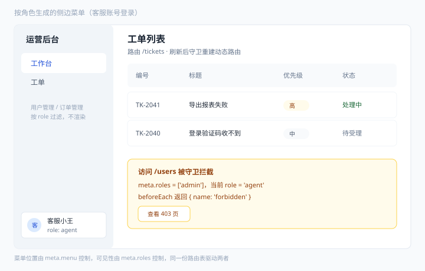

# VueRouter路由与权限

> 这篇从单页应用为什么需要路由讲起，经过路由表与嵌套、动态路由与参数、导航守卫与权限模型、懒加载分包，最后落到一个按角色生成菜单和路由的后台骨架。
>
> 学完能独立设计一个带登录、角色菜单和路由级权限的 Vue 3 后台路由体系，并能定位白屏、404、刷新丢路由这类问题。

## 一、路由的职责与边界

路由解决两个问题：**URL 与组件的映射**，以及**导航过程中的拦截**。前者决定用户看到哪个页面，后者决定用户有没有资格看到。

Vue Router 4 是 Vue 3 的官方路由，与 Vue 3 的响应式系统、`<script setup>`、Teleport 等特性配套。它负责：

- 声明路径、参数、嵌套关系；
- 在导航前执行守卫，做登录校验和权限判断；
- 按需加载路由组件，控制首屏体积；
- 维护 `route` 响应式对象和 `router` 实例。

它不负责：

| 任务 | 应交给 |
|---|---|
| 页面内的数据请求 | 组件或 Composable |
| 登录态存储 | Pinia + 持久化 |
| 按钮级权限 | 自定义指令或组件 |
| 服务端鉴权 | 后端接口校验 |

> 边界：前端路由守卫只解决「用户看不到页面」，不能替代后端鉴权。把权限判断只写在前端，接口仍可被直接调用。

路由模式选择：

| 模式 | 写法 | 适用 |
|---|---|---|
| History | `createWebHistory()` | 现代应用默认，URL 无 `#` |
| Hash | `createWebHashHistory()` | 无法配置服务端回退的静态托管 |
| Memory | `createMemoryHistory()` | SSR、测试 |

> 边界：History 模式要求服务端把所有未知路径回退到 `index.html`。Nginx 缺 `try_files` 时，刷新子路由直接 404。

## 二、环境准备与最小路由

### 2.1 版本基线

| 依赖 | 版本 |
|---|---|
| Node | 22 LTS |
| Vite | 7+ |
| Vue | 3.5+ |
| Vue Router | 4.5+ |

### 2.2 安装

```bash
# 创建项目时选 vue-ts 模板，再装路由
npm create vite@latest router-demo -- --template vue-ts
cd router-demo
npm install vue-router@4
npm run dev
```

Windows PowerShell 与 macOS zsh 下 `--` 后接模板名不能省；Ubuntu 与 Rocky 的 shell 一致。示例中的 `@/` 指向 `src/`，别名配置见 [01 篇 2.2](./01-Vue3组件与组合式API.md)。

### 2.3 最小可运行路由

目录：

```text
src/
  main.ts
  App.vue
  router/index.ts
  views/HomeView.vue
  views/AboutView.vue
```

```ts
// src/router/index.ts
import { createRouter, createWebHistory } from 'vue-router'
import HomeView from '@/views/HomeView.vue'

const router = createRouter({
  history: createWebHistory(import.meta.env.BASE_URL), // 用 Vite 的 base，部署到子路径也不出错
  routes: [
    { path: '/', name: 'home', component: HomeView },
    { path: '/about', name: 'about', component: () => import('@/views/AboutView.vue') },
  ],
})

export default router
```

```ts
// src/main.ts
import { createApp } from 'vue'
import App from './App.vue'
import router from './router'

createApp(App).use(router).mount('#app') // use 之后 router 才会接管导航
```

```vue
<!-- src/App.vue -->
<template>
  <nav>
    <RouterLink to="/">首页</RouterLink>
    <RouterLink to="/about">关于</RouterLink>
  </nav>
  <RouterView /> <!-- 匹配到的组件渲染在这里 -->
</template>
```

预期结果：访问 `/` 显示首页，点击「关于」地址栏变为 `/about` 且页面切换，浏览器前进后退可用。刷新 `/about` 若 404，说明服务端没配回退，见第八节。

## 三、路由表与嵌套

路由表是一棵配置树。嵌套路由把「布局」和「子页面」分开，避免每个页面重复写侧栏和顶栏。

### 3.1 基本结构与命名

```ts
const routes = [
  {
    path: '/users',
    name: 'user-list', // 命名路由便于 router.push({ name }) 和菜单生成
    component: () => import('@/views/users/UserList.vue'),
    meta: { title: '用户管理', icon: 'user' },
  },
]
```

| 字段 | 作用 | 易错点 |
|---|---|---|
| `path` | 匹配路径 | 动态段写 `:id` |
| `name` | 命名路由 | 重名会覆盖 |
| `component` | 渲染组件 | 懒加载要返回 Promise |
| `meta` | 自定义元信息 | 不参与匹配 |
| `children` | 子路由 | 父组件要有 `RouterView` |

### 3.2 嵌套路由与布局

后台常见结构：登录页独立，业务页共享一个 `Layout`。

```ts
const routes = [
  { path: '/login', name: 'login', component: () => import('@/views/Login.vue') },
  {
    path: '/',
    component: () => import('@/layouts/AdminLayout.vue'), // 只负责布局
    redirect: '/dashboard',
    children: [
      { path: 'dashboard', name: 'dashboard', component: () => import('@/views/Dashboard.vue') },
      {
        path: 'users', // 子路由不写前导斜杠，拼成 /users
        name: 'users',
        component: () => import('@/views/users/UserList.vue'),
        children: [
          { path: ':id', name: 'user-detail', component: () => import('@/views/users/UserDetail.vue') },
        ],
      },
    ],
  },
]
```

```vue
<!-- src/layouts/AdminLayout.vue -->
<template>
  <div class="layout">
    <aside><SideMenu /></aside>
    <section class="content">
      <RouterView /> <!-- 子路由在这里渲染 -->
    </section>
  </div>
</template>
```

> 边界：父路由一旦配了 `component`，它的模板里必须有 `RouterView`，否则子路由匹配成功也不显示，页面一片空白。

### 3.3 路由匹配的优先级

Vue Router 4 按**评分**匹配，不按书写顺序。静态段比动态段优先，更长的路径优先。

```ts
// 访问 /users/new 时命中 user-new，而不是 user-detail
{ path: '/users/new', name: 'user-new', component: NewUser },
{ path: '/users/:id', name: 'user-detail', component: UserDetail },
```

不要依赖「把静态路由写在前面」来保证命中，用 `name` 跳转更稳。

### 3.4 重定向与别名

```ts
{ path: '/', redirect: '/dashboard' }, // 重定向改变 URL
{ path: '/home', alias: '/index', component: Home }, // 别名保留 URL
{ path: '/old', redirect: { name: 'dashboard' } }, // 用命名路由避免路径写死
```

重定向适合旧地址迁移；别名适合同一页面多个入口。

## 四、动态路由与参数

参数是页面身份的一部分。选错参数形式，会出现「刷新后参数丢失」或「查询条件无法分享」。

### 4.1 params 与 query

```ts
// 路由定义
{ path: '/users/:id', name: 'user-detail', component: UserDetail, props: true }

// 编程式跳转
router.push({ name: 'user-detail', params: { id: '42' } }) // 路径参数：/users/42
router.push({ path: '/users', query: { page: '2', keyword: '张' } }) // 查询串：/users?page=2&keyword=张
```

| | `params` | `query` |
|---|---|---|
| URL 形式 | `/users/42` | `/users?page=2` |
| 是否必填 | 路由定义决定 | 可选 |
| 刷新保留 | 是 | 是 |
| 适合 | 资源标识 | 筛选、分页、排序 |

> 边界：`params` 只在**命名路由**跳转时可靠传递。用 `path` 跳转时传 `params` 会被忽略；需要携带状态就放 `query`。

### 4.2 组件读取参数

```vue
<script setup lang="ts">
import { computed } from 'vue'
import { useRoute } from 'vue-router'
const route = useRoute()
// route.params.id 是 string，做类型收窄
const id = computed(() => Number(route.params.id))
</script>
```

`useRoute()` 返回响应式对象。子路由切换（`/users/1` → `/users/2`）复用了同一个组件实例，`onMounted` 不会再执行，必须 `watch` 参数：

```ts
watch(() => route.params.id, (id) => {
  if (id) loadUser(Number(id)) // 为什么不写在 onMounted：同组件复用不会重新挂载
}, { immediate: true })
```

### 4.3 props 解耦

`props: true` 把 `params` 作为 props 传入组件，组件不再依赖 `useRoute`，可单测：

```ts
{ path: '/users/:id', component: UserDetail, props: true }
```

```ts
// UserDetail.vue
const props = defineProps<{ id: string }>()
```

需要转换类型时用函数式 props：

```ts
{ path: '/users/:id', component: UserDetail, props: (route) => ({ id: Number(route.params.id) }) }
```

### 4.4 通配与 404

```ts
// 放在最后，匹配所有未命中的路径
{ path: '/:pathMatch(.*)*', name: 'not-found', component: () => import('@/views/NotFound.vue') }
```

> 边界：通配路由的评分最低，Vue Router 4 会把它排在最后，写在哪一行都不会吞掉静态路由；仍建议放在路由表末尾，便于阅读和排查。

### 4.5 replace 与 history 状态

```ts
router.push('/dashboard') // 新增历史记录
router.replace('/login') // 替换当前记录，登录成功后不应能回退到登录页
router.back() // 等价于 history.back()
```

登录跳转、权限失败跳转用 `replace`，避免用户按返回键回到不该停留的页面。

## 五、守卫与权限模型

守卫是导航生命周期中的钩子。权限控制的核心是：**在进入路由前判断，不满足就改道**。

### 5.1 守卫类型

| 守卫 | 注册位置 | 典型用途 |
|---|---|---|
| `beforeEach` | 全局 | 登录校验、权限校验、进度条 |
| `beforeResolve` | 全局 | 等异步路由组件就绪 |
| `afterEach` | 全局 | 埋点、关闭进度条 |
| `beforeEnter` | 单条路由 | 单页特殊校验 |
| `beforeRouteEnter` | 组件内 | 进入前取数据（无 `this`） |
| `beforeRouteUpdate` | 组件内 | 参数变化时校验 |
| `beforeRouteLeave` | 组件内 | 未保存提示 |

### 5.2 全局前置守卫

```ts
// src/router/guard.ts
import type { Router } from 'vue-router'
import { useUserStore } from '@/stores/user'

export function setupGuard(router: Router) {
  router.beforeEach(async (to) => {
    const user = useUserStore()

    // 白名单：登录页、404 不需要登录
    if (to.meta.public) return true

    if (!user.token) {
      // 记录来源，登录后跳回；query 里带 redirect
      return { name: 'login', query: { redirect: to.fullPath } }
    }

    // 已登录但还没拉过用户信息，先拉一次
    if (!user.loaded) {
      await user.fetchProfile()
    }

    // 路由级权限：meta.roles 不包含当前角色则去 403
    const roles = to.meta.roles as string[] | undefined
    if (roles && !roles.includes(user.role)) {
      return { name: 'forbidden' }
    }

    return true // 显式返回 true 才放行
  })
}
```

返回值语义：

| 返回值 | 行为 |
|---|---|
| `undefined` / `true` | 放行 |
| `false` | 中止导航，URL 不变 |
| 路由地址对象 | 重定向 |
| `Error` | 中止并触发 `router.onError` |

> 边界：守卫里调用异步校验时，必须 `return` 或 `await` 它的 Promise；只调用不返回，导航会在校验完成前继续。Vue Router 4 支持 async 守卫，直接 `await`。

### 5.3 登录后的回跳

```ts
// Login.vue
const route = useRoute()
const router = useRouter()

async function submit() {
  await user.login(form)
  const redirect = (route.query.redirect as string) || '/dashboard'
  router.replace(redirect) // 用 replace，登录页不留在历史里
}
```

> 边界：`redirect` 来自 URL，必须校验是否站内路径（以 `/` 开头且不含 `//`），否则会被利用做开放重定向。

### 5.4 按钮级权限

路由守卫只管「页面能不能进」。页面里的「删除」按钮是否显示，用指令或组件：

```ts
// src/directives/permission.ts
import type { Directive } from 'vue'
import { useUserStore } from '@/stores/user'

export const vPermission: Directive<HTMLElement, string> = {
  mounted(el, binding) {
    const user = useUserStore()
    if (!user.permissions.includes(binding.value)) {
      el.parentNode?.removeChild(el) // 无权限直接移除，避免只隐藏仍可被脚本触发
    }
  },
}
```

```vue
<button v-permission="'user:delete'">删除</button>
```

### 5.5 权限模型对比

| 模型 | 粒度 | 实现成本 | 适用 |
|---|---|---|---|
| 角色（RBAC） | 角色 | 低 | 大多数后台 |
| 权限点 | 接口/按钮 | 中 | 精细控制 |
| 数据权限 | 行/字段 | 高 | 多租户、多组织 |

后台起步用 RBAC，角色映射到路由 `meta.roles`；需要按钮级控制时再加权限点。数据权限必须在后端做。

## 六、懒加载与分包

路由懒加载把每个页面拆成独立 chunk，首屏只下载当前页，是后台项目最基本的性能手段。

### 6.1 写法

```ts
// 动态 import 返回 Promise，Vite 自动按路由分包
const UserList = () => import('@/views/users/UserList.vue')

const routes = [{ path: '/users', component: UserList }]
```

对比：

```ts
// 反面：静态 import 会把所有页面打进首屏 bundle
import UserList from '@/views/users/UserList.vue'
```

| 写法 | 首屏体积 | 切换速度 |
|---|---|---|
| 静态 import | 大 | 快（已加载） |
| 动态 import | 小 | 首次略慢，之后缓存 |

### 6.2 分包策略

```ts
// vite.config.ts
export default defineConfig({
  build: {
    rollupOptions: {
      output: {
        manualChunks: {
          vue: ['vue', 'vue-router', 'pinia'], // 框架单独成块，长期缓存
          echarts: ['echarts'], // 大依赖只在图表页用
        },
      },
    },
  },
})
```

> 边界：路由懒加载不等于「按需加载组件库」。Element Plus 的按需引入是另一件事，见 04 篇。

### 6.3 加载态与错误

```ts
router.onError((err) => {
  // 常见原因：发版后旧 chunk 被删，用户点旧链接拿不到文件
  if (/Failed to fetch dynamically imported module/.test(err.message)) {
    window.location.reload() // 兜底刷新，拿到新版本
  }
})
```

---

## 七、菜单生成与权限

菜单不是手写死的，而是从路由表推导：**路由是唯一事实来源**，菜单只是它的视图。

### 7.1 用 meta 描述菜单

```ts
{
  path: '/users',
  name: 'users',
  component: () => import('@/views/users/UserList.vue'),
  meta: { title: '用户管理', icon: 'User', roles: ['admin'], menu: true },
}
```

| meta 字段 | 含义 |
|---|---|
| `title` | 菜单文字、面包屑 |
| `icon` | 菜单图标 |
| `roles` | 可见角色 |
| `menu` | 是否进菜单（详情页设为 `false`） |
| `public` | 免登录 |

### 7.2 过滤与递归

```ts
// src/router/menu.ts
import type { RouteRecordRaw } from 'vue-router'

export interface MenuItem {
  path: string
  title: string
  icon?: string
  children?: MenuItem[]
}

export function buildMenu(routes: RouteRecordRaw[], role: string): MenuItem[] {
  return routes
    .filter(r => r.meta?.menu !== false) // 详情页等不进菜单
    .filter(r => {
      const roles = r.meta?.roles as string[] | undefined
      return !roles || roles.includes(role) // 没写 roles 视为所有角色可见
    })
    .map(r => ({
      path: r.path,
      title: (r.meta?.title as string) ?? r.path,
      icon: r.meta?.icon as string | undefined,
      children: r.children ? buildMenu(r.children, role) : undefined,
    }))
}
```

> 边界：菜单过滤只影响显示，不构成权限。用户仍可直接输入 URL，所以守卫必须再校验一次 `meta.roles`。

### 7.3 面包屑

```ts
const breadcrumb = computed(() =>
  route.matched
    .filter(r => r.meta?.title) // matched 包含父子链
    .map(r => ({ title: r.meta.title as string, path: r.path }))
)
```

`route.matched` 是当前匹配到的路由记录数组，天然带层级，比手动维护面包屑可靠。

### 7.4 动态添加路由

权限来自后端时，前端只有一份完整路由表，登录后按接口返回的权限筛出可访问项：

```ts
export function addRoutes(router: Router, allowed: string[]) {
  const filtered = asyncRoutes.filter(r => allowed.includes(r.name as string))
  filtered.forEach(r => router.addRoute(r)) // 运行时注册
  router.addRoute({ path: '/:pathMatch(.*)*', redirect: '/404' }) // 兜底路由统一注册
}
```

> 边界：`addRoute` 添加的路由在刷新后丢失。生产做法是把「是否有权限」存起来，在守卫里重新 `addRoute`，再 `return { ...to, replace: true }` 重新触发一次导航。

## 八、常见排障

| 现象 | 最可能原因 | 第一条检查 |
|---|---|---|
| 刷新子路由 404 | 服务端未回退到 `index.html` | Nginx `try_files $uri $uri/ /index.html` |
| 页面空白但 URL 正确 | 父路由模板缺 `RouterView` | 检查父组件模板 |
| 所有页面都 404 | 动态路由未注册，只剩通配路由 | 检查登录后 `addRoute` 是否执行 |
| 子路由切换数据不刷新 | 组件复用，`onMounted` 不再执行 | 改 `watch` 参数 |
| 守卫不生效 | 注册在 `app.use(router)` 之后 | 在创建 router 后立即注册 |
| 登录后回跳丢失参数 | 只存了 `path` 没存 `query` | 存 `to.fullPath` |
| 动态路由刷新后消失 | `addRoute` 结果未持久化 | 守卫里按权限重建 |
| 发版后点菜单报 chunk 错误 | 旧 hash 文件已删除 | `router.onError` 兜底刷新 |

Nginx 回退配置：

```nginx
location / {
  root /usr/share/nginx/html;
  try_files $uri $uri/ /index.html; # 找不到文件就交给前端路由
}
```

## 九、最佳实践案例

### 9.1 案例背景

某 SaaS 后台有三个角色：管理员、运营、客服。原来的路由表写死所有页面，侧边栏菜单是手写数组，和路由表各维护一份；客服能直接输入 `/users` 进入用户管理，因为守卫只判断了「是否登录」，没判断角色。

目标是：路由表成为唯一事实来源，菜单按角色自动生成，非法访问统一去 403，并保证刷新后动态路由仍然存在。约束：权限由后端登录接口返回角色和权限点，前端不硬编码用户。

### 9.2 案例实操

第一步，定义带 meta 的路由表：

```ts
// src/router/routes.ts
import type { RouteRecordRaw } from 'vue-router'

export const asyncRoutes: RouteRecordRaw[] = [
  {
    path: '/dashboard',
    name: 'dashboard',
    component: () => import('@/views/Dashboard.vue'),
    meta: { title: '工作台', icon: 'Odometer', menu: true },
  },
  {
    path: '/users',
    name: 'users',
    component: () => import('@/views/users/UserList.vue'),
    meta: { title: '用户管理', icon: 'User', roles: ['admin'], menu: true },
  },
  {
    path: '/orders',
    name: 'orders',
    component: () => import('@/views/orders/OrderList.vue'),
    meta: { title: '订单管理', icon: 'Tickets', roles: ['admin', 'operator'], menu: true },
  },
  {
    path: '/tickets',
    name: 'tickets',
    component: () => import('@/views/tickets/TicketList.vue'),
    meta: { title: '工单', icon: 'Service', roles: ['admin', 'agent'], menu: true },
  },
  {
    path: '/users/:id',
    name: 'user-detail',
    component: () => import('@/views/users/UserDetail.vue'),
    meta: { title: '用户详情', roles: ['admin'], menu: false }, // 详情页不进菜单，但继承用户管理的权限
  },
]

export const constantRoutes: RouteRecordRaw[] = [
  { path: '/login', name: 'login', component: () => import('@/views/Login.vue'), meta: { public: true } },
  { path: '/403', name: 'forbidden', component: () => import('@/views/Forbidden.vue'), meta: { public: true } },
  { path: '/404', name: 'not-found', component: () => import('@/views/NotFound.vue'), meta: { public: true } },
  {
    path: '/',
    name: 'layout', // 命名是为了 addRoute 时能把业务路由挂到布局下
    component: () => import('@/layouts/AdminLayout.vue'),
    redirect: '/dashboard',
    children: [],
  },
]
```

第二步，守卫里注册路由并校验角色：

```ts
// src/router/guard.ts
import type { Router } from 'vue-router'
import { asyncRoutes } from './routes'
import { useUserStore } from '@/stores/user'

export function setupGuard(router: Router) {
  const WHITE_LIST = ['/login', '/403', '/404']

  router.beforeEach(async (to) => {
    const user = useUserStore()

    if (WHITE_LIST.includes(to.path)) return true

    if (!user.token) {
      return { path: '/login', query: { redirect: to.fullPath } }
    }

    if (!user.loaded) {
      await user.fetchProfile() // 只拉一次，刷新时也走这里
    }

    // 登录成功时 loaded 已经是 true，不能再用它判断路由是否注册过
    if (!router.hasRoute('dashboard')) {
      // 全部业务路由先注册，能否访问由下面的 meta.roles 判断；菜单仍按角色过滤
      asyncRoutes.forEach((r) => router.addRoute('layout', r))
      router.addRoute({ path: '/:pathMatch(.*)*', redirect: '/404' }) // 兜底路由统一注册
      return { ...to, replace: true } // 重新匹配，否则当前导航还是旧表
    }

    const roles = to.meta.roles as string[] | undefined
    if (roles && !roles.includes(user.role)) {
      return { name: 'forbidden' }
    }

    return true
  })

  router.afterEach((to) => {
    document.title = to.meta.title ? `${to.meta.title} - 运营后台` : '运营后台'
  })
}
```

第三步，菜单从同一份路由推导：

```vue
<!-- src/layouts/AdminLayout.vue -->
<script setup lang="ts">
import { computed } from 'vue'
import { useRouter } from 'vue-router'
import { buildMenu } from '@/router/menu'
import { useUserStore } from '@/stores/user'

const router = useRouter()
const user = useUserStore()
// 只取 layout 的子路由，避免把登录页渲染进菜单
const layout = router.getRoutes().find((r) => r.name === 'layout')
const menu = computed(() => (layout?.children ? buildMenu(layout.children as any, user.role) : []))
</script>

<template>
  <div class="layout">
    <aside class="side">
      <div class="brand">运营后台</div>
      <nav>
        <RouterLink v-for="m in menu" :key="m.path" :to="m.path" class="menu-item">
          {{ m.title }}
        </RouterLink>
      </nav>
    </aside>
    <main><RouterView /></main>
  </div>
</template>
```

第四步，403 与回跳（角色判断已并入上面的守卫）：

```ts
// 守卫里角色不匹配时
if (roles && !roles.includes(user.role)) return { name: 'forbidden' }
```

```ts
<!-- Login.vue 提交成功后 -->
router.replace((route.query.redirect as string) || '/dashboard')
```



以客服账号登录，侧边栏只剩「工作台 / 工单」；直接访问 `/users` 被守卫改道到 `/403`；刷新 `/tickets` 仍然正常，因为守卫在刷新时重建了动态路由。

### 9.3 案例结果

| 指标 | 改造前 | 改造后 |
|---|---|---|
| 菜单数据源 | 手写数组 | 路由表推导 |
| 非法访问 | 可进入 | 统一 403 |
| 刷新动态路由 | 失效 | 守卫重建 |
| 首屏 JS（示例） | 980 KB | 210 KB |

失败模式与复盘：

- 第一版只在登录成功后 `addRoute`，刷新页面时路由表为空，`/tickets` 直接 404；修正为「守卫里发现 `token` 但没有路由就重建」；
- 第一版 `addRoute` 后没有 `return { ...to, replace: true }`，当前这次导航仍按旧表匹配，页面空白；
- 菜单过滤和路由守卫都从 `meta.roles` 推导，角色判断只保留一份口径，避免两处逻辑漂移。

结论：路由表是权限的唯一事实来源，菜单、面包屑、守卫都从它派生，才不会出现「菜单里没有但 URL 能进」的漏洞。
