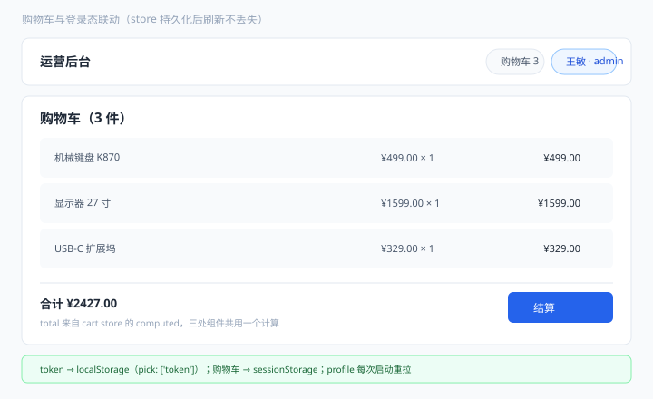

# Pinia状态管理

> 这篇从「什么时候真的需要状态库」讲起，经过实例注册与 Setup Store、state/getters/actions、持久化、跨 store 协作和 SSR，最后落到一个带登录态与购物车的后台前端。
>
> 学完能用 Pinia 3 设计边界清晰、可持久化、可测试的 store，并避免循环依赖、响应式丢失和 SSR 状态串号。

## 一、状态库的职责与边界

Pinia 是 Vue 官方推荐的状态管理库，核心作用是把**跨组件、跨路由共享的状态**收拢到一个可预测的地方，并提供 actions 统一修改入口。

判断是否需要 Pinia：

- 多个页面或多个层级组件读同一份数据（登录用户、权限、购物车、主题）；
- 状态的生命周期长于单个组件；
- 需要调试时看清「谁在什么时候改了它」。

不需要 Pinia：

| 场景 | 更合适的做法 |
|---|---|
| 只在一个组件内用 | `ref` / `reactive` |
| 父子通信 | props / emit |
| 一个局部子树共享 | provide / inject |
| 服务端数据缓存 | TanStack Query / VueQuery |
| 纯格式化 | 工具函数 |

> 边界：把每个接口响应都塞进 store，会让 store 变成「全局变量集合」，反而难维护。远程数据优先用请求库缓存，store 只放真正跨页面的客户端状态。

Pinia 3（2025 起）只支持 Vue 3，移除了 Vue 2 适配；与 Vuex 的关系：

| | Pinia | Vuex 4 |
|---|---|---|
| 模块 | 每个 store 独立 | 嵌套 module |
| 类型推导 | 原生支持 | 需要额外写法 |
| mutation | 无，直接改 state | 必须 commit |
| 组合式写法 | Setup Store | 不支持 |

> 边界：新项目不要再用 Vuex。存量 Vuex 项目迁移时，按 store 逐个替换，不必一次全改。

## 二、安装与第一个 store

### 2.1 版本基线

| 依赖 | 版本 |
|---|---|
| Node | 22 LTS |
| Vue | 3.5+ |
| Pinia | 3.x |
| Vite | 7+ |

### 2.2 安装与注册

```bash
npm create vite@latest pinia-demo -- --template vue-ts
cd pinia-demo
npm install pinia
npm run dev
```

```ts
// src/main.ts
import { createApp } from 'vue'
import { createPinia } from 'pinia'
import App from './App.vue'

const app = createApp(App)
app.use(createPinia()) // 必须在任何 store 被使用前注册
app.mount('#app')
```

示例中的 `@/` 指向 `src/`；Vite 模板默认未配置这个别名，按 [01 篇 2.2](./01-Vue3组件与组合式API.md) 补齐 `vite.config.ts` 和 `tsconfig` 后再运行。

### 2.3 第一个 store

```ts
// src/stores/counter.ts
import { defineStore } from 'pinia'
import { ref, computed } from 'vue'

// Setup Store：第二个参数是函数，内部写法和组件 script setup 一致
export const useCounterStore = defineStore('counter', () => {
  const count = ref(0)
  const double = computed(() => count.value * 2)

  function increment() {
    count.value++ // Setup Store 里直接改 ref，不需要 mutation
  }

  return { count, double, increment }
})
```

```vue
<script setup lang="ts">
import { useCounterStore } from '@/stores/counter'
const counter = useCounterStore()
</script>

<template>
  <button @click="counter.increment()">{{ counter.count }} / {{ counter.double }}</button>
</template>
```

预期结果：点击按钮，`count` 与 `double` 同步变化。能跑通说明实例注册和响应式解包都正常。

> 边界：`useXxxStore()` 必须在 `app.use(createPinia())` 之后调用。在模块顶层直接调用会报「no active Pinia」。

## 三、Setup Store 与 Options Store

Pinia 支持两种写法。新项目统一用 Setup Store，和组合式 API 一致。

### 3.1 Setup Store 结构

```ts
export const useUserStore = defineStore('user', () => {
  // state：ref / reactive 定义
  const token = ref('')
  const profile = ref<Profile | null>(null)
  const loaded = ref(false)

  // getters：computed 定义
  const isLogin = computed(() => Boolean(token.value))
  const displayName = computed(() => profile.value?.name ?? '未登录')

  // actions：普通函数
  async function login(form: LoginForm) {
    const data = await api.login(form)
    token.value = data.token
    profile.value = data.user
    loaded.value = true
  }

  function logout() {
    token.value = ''
    profile.value = null
    loaded.value = false
  }

  return { token, profile, loaded, isLogin, displayName, login, logout }
})
```

### 3.2 Options Store 对照

```ts
export const useCounterStore = defineStore('counter', {
  state: () => ({ count: 0 }),
  getters: {
    double: (state) => state.count * 2,
  },
  actions: {
    increment() { this.count++ },
  },
})
```

| 维度 | Setup Store | Options Store |
|---|---|---|
| 写法 | 组合式 | 选项式 |
| 类型推导 | 好 | 一般 |
| 复用组合逻辑 | 可以 | 不方便 |
| 适合 | 新项目 | 存量迁移 |

> 边界：同一个 store 不要混用两种写法。团队里统一一种，减少阅读成本。

### 3.3 解构会丢响应式

```ts
const user = useUserStore()
const { profile } = user // 错：profile 变成普通值，后续更新不触发

// 正解一：storeToRefs 保留响应式
import { storeToRefs } from 'pinia'
const { profile, token } = storeToRefs(user) // 只包 state/getters

// 正解二：方法直接解构，不需要 storeToRefs
const { login, logout } = user
```

> 边界：`storeToRefs` 只处理 state 和 getters。actions 是普通函数，解构不会丢绑定，因为 Pinia 内部已经绑定 `this`。

## 四、state、getters 与 actions

### 4.1 修改 state 的三种方式

```ts
const user = useUserStore()

user.token = 'abc' // 直接改：简单，适合单个字段
user.$patch({ token: 'abc', loaded: true }) // 批量改：一次触发更新
user.$patch((state) => { state.token = 'abc' }) // 函数式：适合依赖旧值
user.$reset() // Options Store 可用；Setup Store 需要自己实现 reset
```

Setup Store 没有内置 `$reset()`，调用会报错，需要在返回对象里显式实现：

```ts
function reset() {
  token.value = ''
  profile.value = null
  loaded.value = false
}
```

### 4.2 getters 的边界

```ts
const activeUsers = computed(() => users.value.filter(u => u.active))
const count = computed(() => activeUsers.value.length) // getter 可组合 getter

// 需要传参时，返回函数（会失去缓存）
const findById = computed(() => (id: number) => users.value.find(u => u.id === id))
```

| 写法 | 缓存 | 适用 |
|---|---|---|
| `computed(() => ...)` | 有 | 固定派生值 |
| `computed(() => (arg) => ...)` | 无 | 按参数查询 |
| 普通函数 | 无 | 需要副作用或大计算 |

> 边界：getter 里不要改 state，也不要发请求。getter 是纯派生，写入会引发难以追踪的更新循环。

### 4.3 actions 的职责

```ts
async function fetchProfile() {
  if (loaded.value) return // 幂等：多次调用只请求一次
  const data = await api.profile()
  profile.value = data
  loaded.value = true
}

async function updateProfile(patch: Partial<Profile>) {
  const prev = profile.value // 先存旧值，失败可回滚
  profile.value = { ...prev!, ...patch } // 乐观更新，界面立即响应
  try {
    await api.updateProfile(patch)
  } catch (e) {
    profile.value = prev // 失败回滚
    throw e
  }
}
```

action 可以是同步也可以是异步；返回 Promise 时调用方可以 `await`。错误不要吞掉，抛给调用方决定怎么提示。

### 4.4 订阅与调试

```ts
// 开发期观察某个 store 的变化
user.$subscribe((mutation, state) => {
  console.log(mutation.type, mutation.storeId, state.token)
})

// 监听 action 调用
user.$onAction(({ name, args, after, onError }) => {
  console.time(name)
  after(() => console.timeEnd(name))
  onError((e) => console.error(name, e))
})
```

Vue Devtools 里可以直接看到每个 store 的 state 和 action 时间线；生产环境不要保留大量 `$subscribe`。

## 五、持久化

刷新页面后 token 丢失是后台最常见的体验问题。Pinia 本身不持久化，用插件或手写。

### 5.1 插件方案

```bash
npm install pinia-plugin-persistedstate
```

```ts
// src/stores/index.ts
import { createPinia } from 'pinia'
import piniaPluginPersistedstate from 'pinia-plugin-persistedstate'

export const pinia = createPinia()
pinia.use(piniaPluginPersistedstate) // 全局注册，按 store 的 persist 选项生效
```

```ts
export const useUserStore = defineStore('user', () => {
  const token = ref('')
  // ...
  return { token /* ... */ }
}, {
  persist: {
    key: 'app-user',
    pick: ['token'], // 只持久化 token，profile 每次重新拉，避免脏数据
    storage: localStorage,
  },
})
```

> 边界：不要把 `profile`、权限列表整份持久化。角色变更后旧缓存会让用户看到不该看的菜单，正确做法是只存 token，启动时重新拉 profile。

### 5.2 手写持久化

不引入插件时：

```ts
const token = ref(localStorage.getItem('token') ?? '')

watch(token, (v) => {
  if (v) localStorage.setItem('token', v)
  else localStorage.removeItem('token') // 登出必须清理，否则下一个用户继承登录态
}, { flush: 'sync' })
```

| 存储 | 容量 | 生命周期 | 适用 |
|---|---|---|---|
| `localStorage` | 约 5 MB | 永久，需手动清 | token、主题 |
| `sessionStorage` | 约 5 MB | 标签页关闭即清 | 临时筛选 |
| Cookie | 约 4 KB | 可设过期 | 需要随请求发送的会话 |

### 5.3 多标签页同步

`localStorage` 变化不会自动同步到已打开的其他标签页。监听 `storage` 事件：

```ts
window.addEventListener('storage', (e) => {
  if (e.key === 'token' && !e.newValue) {
    useUserStore().logout() // 另一个标签页登出，本页也退出
  }
})
```

---

## 六、跨 store 协作

store 之间可以互相调用，但要控制方向，避免循环依赖。

### 6.1 在 action 里调用另一个 store

```ts
// stores/cart.ts
import { useUserStore } from './user'

export const useCartStore = defineStore('cart', () => {
  const items = ref<CartItem[]>([])

  async function checkout() {
    const user = useUserStore() // 在 action 内部调用，不在模块顶层
    if (!user.isLogin) throw new Error('请先登录')
    await api.checkout({ userId: user.profile!.id, items: items.value })
    items.value = []
  }

  return { items, checkout }
})
```

在函数内部调用而不是模块顶层，是为了避免「A import B、B import A」时拿到 `undefined`。

### 6.2 单向依赖

```text
user  ←  cart      （购物车依赖用户）
user  ←  order     （订单依赖用户）
cart  →  order     （下单后清空购物车，但不反向依赖）
```

依赖必须单向。出现互相调用时，把共享部分抽到第三个 store，或用事件解耦。

### 6.3 用 getter 组合

```ts
// stores/order.ts
import { useCartStore } from './cart'
export const useOrderStore = defineStore('order', () => {
  const cart = useCartStore()
  const total = computed(() =>
    cart.items.reduce((sum, i) => sum + i.price * i.qty, 0)
  )
  return { total }
})
```

> 边界：A 的 getter 依赖 B 的 state 时，B 变了 A 会自动重算；但如果 A、B 互相依赖 getter，会形成环，Vue 会报警告或得到 `undefined`。

## 七、SSR 与测试

### 7.1 SSR 的 store 隔离

服务端渲染时，每个请求必须有自己的 Pinia 实例，否则不同用户的状态会串。

```ts
// server entry（Nuxt 已内置，手写 SSR 时参考）
export async function render(url: string) {
  const pinia = createPinia() // 每个请求新建，不能复用全局实例
  const app = createSSRApp(App)
  app.use(pinia)
  // ...
  return { html, pinia }
}
```

```ts
// 客户端 hydration
const pinia = createPinia()
app.use(pinia)
// 把服务端序列化的 state 灌进来，避免首屏闪烁
pinia.state.value = window.__PINIA_STATE__
```

> 边界：`localStorage` 在服务端不存在。持久化插件在 SSR 下要判断 `typeof window !== 'undefined'`，否则直接报 `localStorage is not defined`。

### 7.2 测试 store

```ts
// tests/user.spec.ts
import { setActivePinia, createPinia } from 'pinia'
import { beforeEach, describe, expect, it, vi } from 'vitest'
import { api } from '@/api'
import { useUserStore } from '@/stores/user'

describe('user store', () => {
  beforeEach(() => {
    setActivePinia(createPinia()) // 每个用例独立实例，避免状态串
  })

  it('login 后 isLogin 为 true', async () => {
    vi.spyOn(api, 'login').mockResolvedValue({ token: 't', user: { id: 1, name: '王敏' } })
    const user = useUserStore()
    await user.login({ username: 'a', password: 'b' })
    expect(user.isLogin).toBe(true)
    expect(user.displayName).toBe('王敏')
  })
})
```

```bash
npx vitest run
```

预期输出：

```text
✓ tests/user.spec.ts (1)
  ✓ user store > login 后 isLogin 为 true
Test Files  1 passed (1)
```

## 八、常见排障

| 现象 | 最可能原因 | 第一条检查 |
|---|---|---|
| `no active Pinia` | 在 `use(createPinia())` 之前调用 | 检查 `main.ts` 顺序 |
| 解构后不更新 | 直接解构 state | 改用 `storeToRefs` |
| 刷新后登录态丢失 | 没持久化或 key 写错 | 看 localStorage 是否有值 |
| 登出后仍能进页面 | 只清了内存没清 storage | 登出同时 `removeItem` |
| 循环依赖得到 undefined | store 顶层互相 import | 改到 action 内部调用 |
| SSR 用户数据串号 | 复用了同一个 pinia 实例 | 每个请求新建 |
| `$reset` 不生效 | Setup Store 没实现 reset | 手写 `reset()` |
| 修改不触发视图 | 替换了整个 reactive 对象 | 用 `$patch` 或改属性 |

## 九、最佳实践案例

### 9.1 案例背景

某电商后台的前端有三块共享状态：登录用户与权限、购物车、主题偏好。原来用 `provide/inject` 加 `localStorage` 手工同步，刷新后权限菜单偶尔闪一下旧角色，两个标签页一个登出另一个还能继续操作。

目标是：用 Pinia 收拢这三块状态，token 持久化、profile 每次重拉、多标签页登出同步，并让购物车金额计算只在 store 里做一次。约束：不引入服务端渲染，先把 CSR 场景做对。

### 9.2 案例实操

用户 store：

```ts
// src/stores/user.ts
import { defineStore } from 'pinia'
import { ref, computed } from 'vue'
import { api } from '@/api'

export const useUserStore = defineStore('user', () => {
  const token = ref('')
  const profile = ref<Profile | null>(null)
  const loaded = ref(false)

  const isLogin = computed(() => Boolean(token.value))
  const role = computed(() => profile.value?.role ?? 'guest')

  async function login(form: { username: string; password: string }) {
    const data = await api.login(form)
    token.value = data.token
    profile.value = data.user
    loaded.value = true
    // 持久化由下面的 persist 配置写入 app-user，不再手写第二个 token 键
  }

  async function fetchProfile() {
    if (loaded.value) return
    profile.value = await api.profile()
    loaded.value = true
  }

  function logout() {
    token.value = ''
    profile.value = null
    loaded.value = false
    // token 清空后，persist 插件会同步更新 app-user，其他标签页靠 storage 事件感知
  }

  return { token, profile, loaded, isLogin, role, login, fetchProfile, logout }
}, {
  persist: { key: 'app-user', pick: ['token'] }, // 只存 token，profile 每次重拉
})
```

购物车 store：

```ts
// src/stores/cart.ts
import { defineStore } from 'pinia'
import { ref, computed } from 'vue'
import { useUserStore } from './user'

export const useCartStore = defineStore('cart', () => {
  const items = ref<Array<{ id: number; name: string; price: number; qty: number }>>([])

  const count = computed(() => items.value.reduce((n, i) => n + i.qty, 0))
  const total = computed(() => items.value.reduce((s, i) => s + i.price * i.qty, 0))

  function add(item: Omit<CartItem, 'qty'>) {
    const hit = items.value.find((i) => i.id === item.id)
    if (hit) hit.qty++ // 已在购物车则加数量，不重复插入
    else items.value.push({ ...item, qty: 1 })
  }

  async function checkout() {
    const user = useUserStore() // action 内部取，避免顶层循环依赖
    if (!user.isLogin) throw new Error('请先登录')
    await api.checkout({ userId: user.profile!.id, items: items.value })
    items.value = []
  }

  return { items, count, total, add, checkout }
}, {
  persist: { key: 'app-cart', storage: sessionStorage }, // 关标签页即清，避免跨会话残留
})
```

页面只负责展示：

```vue
<!-- src/views/Cart.vue -->
<script setup lang="ts">
import { storeToRefs } from 'pinia'
import { useCartStore } from '@/stores/cart'

const cart = useCartStore()
const { items, count, total } = storeToRefs(cart) // state/getters 用 storeToRefs 解构
const { checkout } = cart // action 直接解构
</script>

<template>
  <div class="cart">
    <h2>购物车（{{ count }} 件）</h2>
    <div v-for="i in items" :key="i.id" class="row">
      <span>{{ i.name }}</span>
      <span>¥{{ i.price.toFixed(2) }} × {{ i.qty }}</span>
      <span>¥{{ (i.price * i.qty).toFixed(2) }}</span>
    </div>
    <div class="foot">
      <strong>合计 ¥{{ total.toFixed(2) }}</strong>
      <button :disabled="!count" @click="checkout">结算</button>
    </div>
  </div>
</template>
```

多标签页同步：

```ts
// src/main.ts
window.addEventListener('storage', (e) => {
  // persist 插件的存储键是 app-user，值是 { token } 的 JSON
  if (e.key !== 'app-user' || !e.newValue) return
  try {
    const next = JSON.parse(e.newValue) as { token?: string }
    if (!next.token) useUserStore().logout() // 另一个标签页登出，这边同步退出
  } catch {
    // 损坏的持久化数据直接忽略，避免整个应用启动失败
  }
})
```



### 9.3 案例结果

| 指标 | 改造前 | 改造后 |
|---|---|---|
| 登录态持久化 | 手工同步，偶尔丢失 | 只存 token，启动重拉 profile |
| 角色闪烁 | 有 | 无（profile 就绪后才渲染菜单） |
| 购物车金额计算 | 分散在 3 个组件 | store 内 `total` 一处 |
| 多标签页登出 | 不同步 | `storage` 事件同步 |

失败模式与复盘：

- 第一版把整个 store 持久化，角色变更后旧 `profile.role` 还留在 localStorage，菜单显示了旧权限。改为 `pick: ['token']` 后问题消失；
- 第一版在 `cart.ts` 顶层 `const user = useUserStore()`，构建时报循环依赖，改到 `checkout` 内部调用；
- 结算按钮原来只判断 `items.length`，数量为 0 时仍可点，改为判断 `count`。

结论：Pinia 的价值不只是「共享变量」，而是把状态修改收口到 action、把派生值收口到 getter。持久化要克制：只存最小必要信息，其余在启动时重新拉取。
