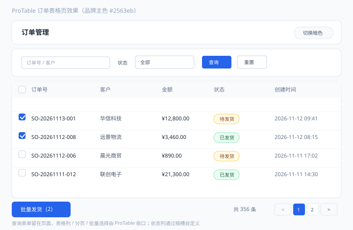

# Vue3组件库与设计体系

> 这篇从组件库与设计体系的区别讲起，经过 Element Plus 的安装、按需引入、选型对比、业务组件二次封装和主题定制，最后落到一个可复用的订单表格页。
>
> 学完能独立选型并落地一套后台组件方案：按需加载、统一封装查询表格、用 CSS 变量切换主题和暗色模式。

## 一、组件库与设计体系的边界

组件库解决「按钮、表单、表格长什么样、怎么交互」；设计体系解决「整个产品为什么这样统一」。前者是代码，后者是规则。

| 层次 | 内容 | 负责方 |
|---|---|---|
| 设计语言 | 色彩、字号、间距、圆角 | 设计 |
| 组件库 | 按钮、表格、弹窗实现 | Element Plus 等 |
| 业务组件 | 查询表格、审批流表单 | 前端团队 |
| 页面 | 具体业务布局 | 业务开发 |

组件库不能替代设计体系。只装 Element Plus 而不定义色彩和间距，做出来的后台会和别人的后台长得一样，却互不一致。

判断引入组件库的时机：

- 团队要做中后台，表单、表格、弹窗是高频需求；
- 需要成熟的可访问性、键盘操作和国际化；
- 没有精力维护基础组件。

不需要组件库：

| 场景 | 替代 |
|---|---|
| 面向 C 端的品牌站 | 自定义组件 + Tailwind |
| 极简落地页 | 原生 HTML/CSS |
| 已有内部设计系统 | 用内部组件 |

> 边界：组件库是起点不是终点。直接在主色上改一个变量就叫「定制主题」，通常不够；真正要统一的是间距、圆角、字号三组 token。

## 二、安装与最小验证

### 2.1 版本基线

| 依赖 | 版本 |
|---|---|
| Node | 22 LTS |
| Vue | 3.5+ |
| Vite | 7+ |
| Element Plus | 2.9+ |
| TypeScript | 5.9+（可选） |

### 2.2 安装

```bash
npm create vite@latest admin-ui -- --template vue-ts
cd admin-ui
npm install element-plus
npm install -D unplugin-vue-components unplugin-auto-import
npm run dev
```

示例中的 `@/` 指向 `src/`；Vite 模板默认未配置这个别名，按 [01 篇 2.2](./01-Vue3组件与组合式API.md) 补齐 `vite.config.ts` 和 `tsconfig` 后再运行。

全量引入（仅用于最小验证，生产不要这样）：

```ts
// src/main.ts
import { createApp } from 'vue'
import ElementPlus from 'element-plus'
import 'element-plus/dist/index.css' // 全量样式，约 300 KB，仅验证用
import App from './App.vue'

createApp(App).use(ElementPlus).mount('#app')
```

```vue
<template>
  <el-button type="primary" @click="ElMessage.success('已保存')">保存</el-button>
</template>
```

预期结果：按钮呈蓝色主色，点击后顶部出现成功提示。能显示说明样式和组件注册正常。

> 边界：全量引入会把所有组件和样式打进首屏。验证通过后必须切到按需引入。

## 三、按需引入

按需引入只打包实际用到的组件和样式，是后台项目的基本配置。

### 3.1 Vite 插件配置

```ts
// vite.config.ts
import { defineConfig } from 'vite'
import vue from '@vitejs/plugin-vue'
import AutoImport from 'unplugin-auto-import/vite'
import Components from 'unplugin-vue-components/vite'
import { ElementPlusResolver } from 'unplugin-vue-components/resolvers'

export default defineConfig({
  plugins: [
    vue(),
    AutoImport({
      resolvers: [ElementPlusResolver()], // 自动导入 ElMessage 等函数式组件
    }),
    Components({
      resolvers: [ElementPlusResolver()], // 模板里的 <el-xxx> 自动注册
    }),
  ],
})
```

配置后模板里直接写 `<el-table>`、脚本里直接用 `ElMessage`，无需手写 import：

```vue
<script setup lang="ts">
// 不需要 import { ElMessage }；插件在编译时注入
function save() {
  ElMessage.success('已保存')
}
</script>

<template>
  <el-table :data="rows">
    <el-table-column prop="name" label="姓名" />
  </el-table>
</template>
```

### 3.2 样式引入的三种方式

| 方式 | 体积 | 适用 |
|---|---|---|
| 全量 `dist/index.css` | 大 | 原型验证 |
| 插件自动按需 | 小 | 默认推荐 |
| 手动 `import 'element-plus/theme-chalk/el-button.css'` | 可控 | 精细优化 |

> 边界：用 `AutoImport` 处理 `ElMessage` 时，它的样式不会自动带上。需要在入口补一行：

```ts
// src/main.ts
import 'element-plus/theme-chalk/el-message.css'
```

否则提示框会出现但没有样式，表现为「白底黑字浮在角落」。

### 3.3 构建体积对比

```bash
npm run build
```

全量引入与按需引入的产物（示例数据）：

| 方案 | JS | CSS |
|---|---|---|
| 全量 | 1.1 MB | 320 KB |
| 按需（8 个组件） | 420 KB | 96 KB |

数字随组件数量变化，但量级差异稳定。

## 四、Element Plus 与 Naive UI 选型

两个库都能做中后台，差别在生态、主题和团队习惯。

| 维度 | Element Plus | Naive UI |
|---|---|---|
| 生态 | 最大，资料和插件多 | 较小，质量高 |
| 主题 | SCSS 变量 + CSS 变量 | 纯 TS 主题对象 |
| 暗色 | 内置 `html.dark` | 内置 `darkTheme` |
| 类型 | 完整 | 完整 |
| 表格能力 | 强，社区封装多 | 强，写法更函数式 |
| 适合 | 常规后台、招人容易 | 追求定制、TypeScript 重度 |

选型判断：

- 团队要快速交付、需要大量现成后台模板，选 Element Plus；
- 设计稿高度定制、希望主题完全可控，选 Naive UI；
- 已有 Ant Design 设计规范，考虑 Ant Design Vue。

> 边界：不要在同一个项目里混用两个组件库。样式变量、弹窗层级、国际化都会互相打架。

## 五、业务组件二次封装

直接在每个页面写 `<el-table>` + 分页 + 查询，会重复几十次。二次封装的目标是：**把重复的结构收进一个组件，把差异留给 props 和插槽。**

### 5.1 查询表格的封装边界

一个 `ProTable` 通常封装：

- 查询表单（字段由配置生成）；
- 表格列（列配置）；
- 分页与请求；
- loading、空状态、错误态。

不封装：

- 具体业务列的内容（用插槽）；
- 特殊交互（行内编辑、拖拽），强行塞进配置会失控。

### 5.2 用配置描述列

```ts
// src/components/ProTable/types.ts
export interface ProColumn<T = any> {
  prop: keyof T & string
  label: string
  width?: number | string
  slot?: string // 有 slot 时用插槽渲染，交给页面自定义
  formatter?: (row: T) => string
}
```

```vue
<!-- src/components/ProTable/ProTable.vue -->
<script setup lang="ts" generic="T extends Record<string, any>">
import { ref, watch } from 'vue'
import type { ProColumn } from './types'

const props = defineProps<{
  columns: ProColumn<T>[]
  request: (params: Record<string, any>) => Promise<{ list: T[]; total: number }>
}>()

const rows = ref<T[]>([])
const total = ref(0)
const loading = ref(false)
const page = ref(1)
const size = ref(20)

async function load() {
  loading.value = true
  try {
    const data = await props.request({ page: page.value, size: size.value })
    rows.value = data.list as T[]
    total.value = data.total
  } finally {
    loading.value = false // 失败也复位，否则表格永远转圈
  }
}

watch([page, size], load, { immediate: true })
</script>

<template>
  <div class="pro-table">
    <div class="toolbar"><slot name="toolbar" /></div>

    <el-table v-loading="loading" :data="rows" border>
      <el-table-column
        v-for="col in columns"
        :key="col.prop"
        :prop="col.prop"
        :label="col.label"
        :width="col.width"
      >
        <!-- 有 slot 时把行数据交给页面；否则用 formatter 或原值 -->
        <template #default="{ row }">
          <slot v-if="col.slot" :name="col.slot" :row="row" />
          <span v-else>{{ col.formatter ? col.formatter(row) : row[col.prop] }}</span>
        </template>
      </el-table-column>
    </el-table>

    <el-pagination
      v-model:current-page="page"
      v-model:page-size="size"
      :total="total"
      layout="total, prev, pager, next, sizes"
    />
  </div>
</template>
```

> 边界：`generic="T extends Record<string, any>"` 是 Vue 3.3+ 的泛型组件语法，能让调用方拿到行类型；不支持时改用 `any` 并补 JSDoc。

### 5.3 表单封装：配置 + 校验

```vue
<!-- src/components/ProForm/ProForm.vue -->
<script setup lang="ts">
import { ref } from 'vue'
import type { FormInstance, FormRules } from 'element-plus'

const props = defineProps<{
  model: Record<string, any>
  rules?: FormRules
  fields: Array<{ prop: string; label: string; type?: 'input' | 'select' }>
}>()

const formRef = ref<FormInstance>()

// 暴露 validate 给页面：提交前统一校验
async function validate() {
  return formRef.value?.validate()
}
defineExpose({ validate })
</script>

<template>
  <el-form ref="formRef" :model="model" :rules="props.rules" label-width="96px">
    <el-form-item v-for="f in fields" :key="f.prop" :prop="f.prop" :label="f.label">
      <el-select v-if="f.type === 'select'" v-model="model[f.prop]" />
      <el-input v-else v-model="model[f.prop]" />
    </el-form-item>
  </el-form>
</template>
```

```vue
<!-- 页面使用 -->
<script setup lang="ts">
const formRef = ref()
const model = reactive({ name: '', role: '' })

async function submit() {
  await formRef.value.validate() // 校验不通过会抛出，不会进入下一步
  await api.save(model)
}
</script>

<template>
  <ProForm ref="formRef" :model="model" :fields="fields" :rules="rules" />
  <el-button type="primary" @click="submit">保存</el-button>
</template>
```

### 5.4 弹窗封装

```vue
<!-- src/components/ConfirmDialog.vue -->
<script setup lang="ts">
const visible = defineModel<boolean>({ default: false })
defineProps<{ title?: string; content?: string }>()
const emit = defineEmits<{ (e: 'confirm'): void }>()
</script>

<template>
  <el-dialog v-model="visible" :title="title ?? '确认'" width="420px">
    <p>{{ content }}</p>
    <template #footer>
      <el-button @click="visible = false">取消</el-button>
      <el-button type="danger" @click="emit('confirm'); visible = false">确定</el-button>
    </template>
  </el-dialog>
</template>
```

> 边界：不要为每个页面复制一份 `el-dialog` 模板。用 `defineModel` 控制显隐，调用方只关心「开关 + 确认回调」。

## 六、主题与暗色模式

Element Plus 2.x 用 CSS 变量暴露主题，改主色不需要重新编译 SCSS。

### 6.1 改主色

```css
/* src/styles/theme.css */
:root {
  --el-color-primary: #2563eb; /* 品牌主色 */
  --el-color-primary-light-3: #5b8def; /* 悬停态 */
  --el-color-primary-light-5: #93b4f5;
  --el-color-primary-light-7: #c7d7fa;
  --el-color-primary-light-8: #dbe4fc;
  --el-color-primary-light-9: #eef3fe;
  --el-color-primary-dark-2: #1d4ed8; /* 按下态 */
}
```

全套 `light-3/5/7/8/9` 都要给，否则按钮的 hover、disabled 会退回默认蓝色。

### 6.2 暗色模式

```ts
// src/composables/useTheme.ts
import { ref, watchEffect } from 'vue'

export function useTheme() {
  const dark = ref(localStorage.getItem('theme') === 'dark')

  watchEffect(() => {
    // Element Plus 的暗色变量挂在 html.dark 上
    document.documentElement.classList.toggle('dark', dark.value)
    localStorage.setItem('theme', dark.value ? 'dark' : 'light')
  })

  function toggle() { dark.value = !dark.value }
  return { dark, toggle }
}
```

```ts
// src/main.ts
import 'element-plus/theme-chalk/dark/css-vars.css' // 暗色变量，必须引入
```

```css
/* 自定义暗色覆盖 */
html.dark {
  --el-bg-color: #0f172a;
  --el-bg-color-overlay: #1e293b;
  --el-text-color-primary: #e2e8f0;
  --el-border-color: #334155;
}
```

| 变量 | 控制 |
|---|---|
| `--el-color-primary` | 主色 |
| `--el-bg-color` | 页面背景 |
| `--el-text-color-primary` | 主文字 |
| `--el-border-color` | 边框 |
| `--el-border-radius-base` | 圆角 |

### 6.3 设计 token 落地

把设计稿的间距、字号抽成项目自己的变量，页面只引用 token：

```css
:root {
  --app-space-1: 4px;
  --app-space-2: 8px;
  --app-space-3: 16px;
  --app-radius: 8px;
  --app-font-sm: 12px;
  --app-font-base: 14px;
}
```

后续换主题只改这一层，页面不用动。

## 七、常见排障

| 现象 | 最可能原因 | 第一条检查 |
|---|---|---|
| 组件显示但没样式 | 按需引入没带样式 | `vite.config.ts` 是否配 resolver |
| `ElMessage` 无样式 | 函数式组件样式未引入 | 补 `el-message.css` |
| 暗色不生效 | 未引入 dark 变量 | 检查 `dark/css-vars.css` |
| 改了主色但悬停还是蓝 | 只改了主色 | 补 `light-3/5/7/9` |
| 弹窗被遮挡 | `z-index` 层级 | 检查自定义定位元素的层级 |
| 表格列不显示 | `prop` 与字段名不符 | 打印第一行数据 |
| 泛型组件报错 | Vue 版本低于 3.3 | 升级 Vue 或用 `any` |
| 国际化文案不生效 | 未配置 `ElConfigProvider` | 检查 locale 包 |

国际化配置：

```vue
<script setup lang="ts">
import zhCn from 'element-plus/es/locale/lang/zh-cn'
</script>

<template>
  <el-config-provider :locale="zhCn">
    <RouterView />
  </el-config-provider>
</template>
```

## 八、最佳实践案例

### 8.1 案例背景

某后台的订单页原来每个页面各写一遍 `<el-form>` 查询区、`<el-table>` 列和 `<el-pagination>`，8 个页面约 2400 行重复模板；主色是 Element Plus 默认蓝，与品牌色不一致；暗色模式只改了背景，表格文字仍是深灰，看不清。

目标是：落地一个配置驱动的 `ProTable`，把查询、分页、loading 收口；统一主色和暗色变量；页面代码只保留业务列。约束：不引入新的 UI 库，只基于 Element Plus 2.9 和现有 Vite 工程。

### 8.2 案例实操

第一步，按需引入配置（同第三节），并补 `ElMessage`、`ElMessageBox` 样式：

```ts
// src/main.ts
import { createApp } from 'vue'
import 'element-plus/theme-chalk/dark/css-vars.css'
import 'element-plus/theme-chalk/el-message.css'
import 'element-plus/theme-chalk/el-message-box.css'
import './styles/theme.css'
import App from './App.vue'

// 组件由 unplugin 按需注入，入口不需要全量注册
createApp(App).mount('#app')
```

第二步，写 `ProTable`（结构见 5.2），再加批量选择能力：

```vue
<script setup lang="ts" generic="T extends Record<string, any>">
import { ref } from 'vue'
import type { ProColumn } from './types'

const props = defineProps<{
  columns: ProColumn<T>[]
  request: (params: Record<string, any>) => Promise<{ list: T[]; total: number }>
  selectable?: boolean
}>()

const selected = ref<T[]>([])
// 为什么暴露 selection：批量操作需要在页面拿到选中的行
function onSelectionChange(rows: T[]) { selected.value = rows }
defineExpose({ selected })
</script>

<template>
  <el-table @selection-change="onSelectionChange">
    <el-table-column v-if="selectable" type="selection" width="48" />
    <!-- 其余列同 5.2 -->
  </el-table>
</template>
```

第三步，订单页只写业务配置：

```vue
<!-- src/views/orders/OrderList.vue -->
<script setup lang="ts">
import { reactive, ref } from 'vue'
import ProTable from '@/components/ProTable/ProTable.vue'
import type { ProColumn } from '@/components/ProTable/types'
import { fetchOrders, shipOrders, type Order } from '@/api/order'

// 泛型组件不能用 InstanceType 推导，按 defineExpose 的实际形状标注
const tableRef = ref<{ selected: Order[] } | null>(null)
const filters = reactive({ keyword: '', status: '' })

const columns: ProColumn<Order>[] = [
  { prop: 'no', label: '订单号', width: 160 },
  { prop: 'customer', label: '客户' },
  { prop: 'amount', label: '金额', width: 120, formatter: (r) => `¥${r.amount.toFixed(2)}` },
  { prop: 'status', label: '状态', width: 110, slot: 'status' },
  { prop: 'createdAt', label: '创建时间', width: 160 },
]

async function batchShip() {
  const rows = tableRef.value?.selected ?? []
  if (!rows.length) return ElMessage.warning('请先选择订单')
  await shipOrders(rows.map((r) => r.id))
  ElMessage.success(`已发货 ${rows.length} 单`)
}
</script>

<template>
  <div class="page">
    <el-form inline :model="filters">
      <el-form-item label="关键词">
        <el-input v-model="filters.keyword" placeholder="订单号 / 客户" clearable />
      </el-form-item>
      <el-form-item label="状态">
        <el-select v-model="filters.status" clearable placeholder="全部">
          <el-option label="待发货" value="pending" />
          <el-option label="已发货" value="shipped" />
        </el-select>
      </el-form-item>
    </el-form>

    <ProTable
      ref="tableRef"
      :columns="columns"
      :request="(p) => fetchOrders({ ...p, ...filters })"
      selectable
    >
      <template #toolbar>
        <el-button type="primary" @click="batchShip">批量发货</el-button>
      </template>
      <template #status="{ row }">
        <el-tag :type="row.status === 'pending' ? 'warning' : 'success'">
          {{ row.status === 'pending' ? '待发货' : '已发货' }}
        </el-tag>
      </template>
    </ProTable>
  </div>
</template>
```

第四步，主题变量（同 6.1、6.2）统一落到 `src/styles/theme.css`，并加一个顶栏切换按钮调用 `useTheme().toggle()`。



### 8.3 案例结果

以下为示例数据：

| 指标 | 改造前 | 改造后 |
|---|---|---|
| 8 个页面重复模板 | 约 2400 行 | 约 480 行（每页约 60 行配置） |
| 首屏 CSS | 320 KB | 96 KB |
| 品牌主色一致性 | 默认蓝 | 统一 `#2563eb` |
| 暗色可读性 | 文字对比不足 | 变量全部覆盖 |

失败模式与复盘：

- 第一版 `ProTable` 把查询表单也塞进配置，字段一多配置就难以表达联动（如「状态为已发货时才显示物流公司」），后来把查询表单留给页面，`ProTable` 只负责表格和分页；
- 第一版只改了 `--el-color-primary`，按钮 hover 仍是默认蓝，补齐全套 `light-*` 后一致；
- 暗色模式最初只改背景，表格斑马纹和文字没改，对比度不足；补齐 `--el-bg-color-overlay` 和 `--el-text-color-primary` 后解决。

结论：组件库的二次封装要克制边界——把「结构重复」收进组件，把「业务差异」留给插槽和配置。主题定制的最小闭环是主色全套变量加暗色变量，而不是改一个颜色就算完成。
