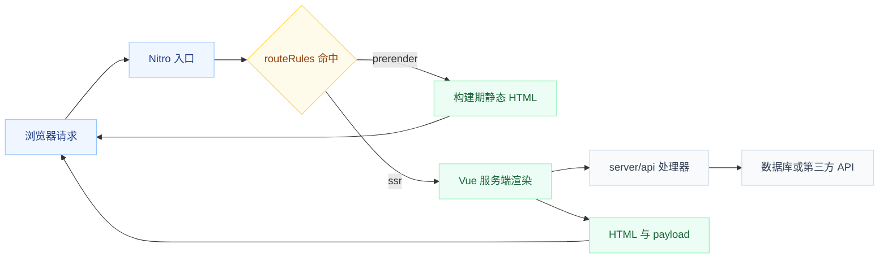
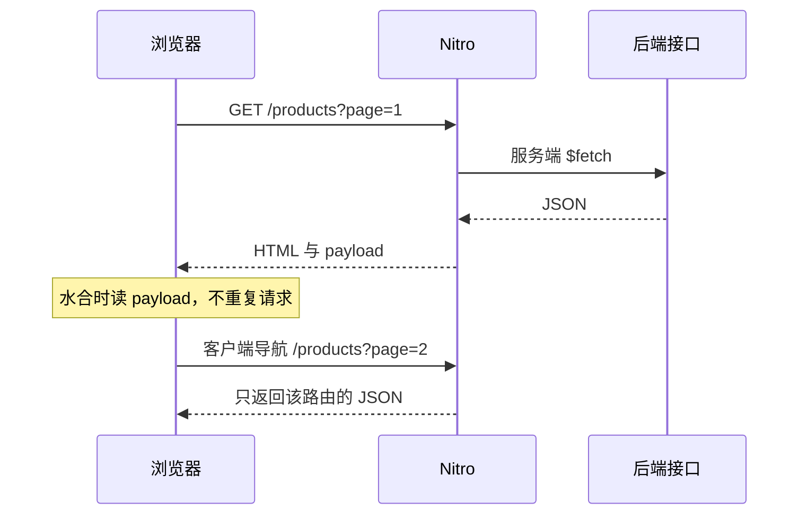
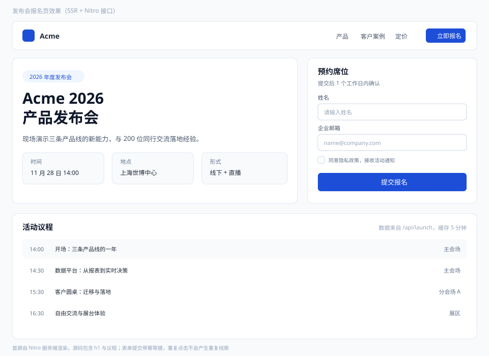

# Nuxt4全栈与Nitro

> 这篇从 Nuxt 4 的全栈职责讲起，经过工程骨架、文件路由、数据获取、Nitro 服务端和渲染模式，最后落到构建部署与线上排障。
>
> 学完能独立搭建一个带 SSR、服务端接口和 SEO 的 Nuxt 4 应用，并把它部署到 Node 服务器。

## 一、Nuxt 4 的全栈职责与适用边界

Nuxt 4 用一套目录约定，把 Vue 3 的组件、路由、数据获取和 Nitro 服务端合成一个可部署的应用。它替代的不是 Vue，而是「Vue + Vue Router + 一个 BFF 层 + 一套构建脚本」这组手工拼装。

| 维度 | 纯 Vue SPA | Nuxt 4 |
|---|---|---|
| 首屏 HTML | 空壳，靠 JS 渲染 | 服务端直出内容 |
| 路由 | 手写 Vue Router 配置 | `app/pages` 目录生成 |
| 接口 | 另起一个后端服务 | `server/api` 同仓部署 |
| SEO | 需要额外预渲染 | 内置 head 与混合渲染 |
| 部署产物 | 静态文件 | Node 或边缘运行时 |

判断要不要用 Nuxt，看三个条件是否同时成立：

- 页面需要被搜索引擎或社交平台抓取到正文；
- 首屏性能受不了一个空 HTML 加 hydration；
- 需要一个轻量的 BFF 聚合后端接口、藏住密钥。

只要有一条不成立，纯 SPA 加 Nginx 更省事。内部报表、登录后的管理后台、Electron 壳页面，都不需要 SSR。

Nitro 的边界也要说清：它适合做 BFF、表单接收、第三方 API 聚合、缓存层和轻量 CRUD。复杂事务、强一致库存、领域模型仍然放在 Java 或 Go 服务里，Nuxt 只做边缘聚合。



图里最关键的一步是 `routeRules`：同一个应用可以首页预渲染、商品页缓存、后台纯客户端渲染，不需要拆成三个项目。

### 1.1 版本基线

| 组件 | 基线 | 约束 |
|---|---|---|
| Node.js | 22 LTS | Nuxt 4 最低 20，生产用 22 |
| Nuxt | 4.x | 当前主线 |
| Vue | 3.5+ | 组合式 API 与 `useTemplateRef` |
| Nitro | 2.x | 随 Nuxt 安装，不单独升级 |
| TypeScript | 5.9+ | 由 `nuxt prepare` 生成配置 |

Node 版本用 `fnm` 或 `nvm` 管理，不要依赖系统自带版本。Ubuntu 22.04 仓库里的 Node 通常过旧。

## 二、环境准备与最小项目

最小闭环的标准是：本地开发服务器能打开页面，`curl` 能看到服务端直出的标题，构建后能用 `node` 启动产物。

安装 Node 22：

```bash
# macOS
brew install fnm && fnm install 22 && fnm use 22

# Ubuntu / Debian
curl -fsSL https://deb.nodesource.com/setup_22.x | sudo -E bash -
sudo apt-get install -y nodejs

# Rocky / CentOS
sudo dnf module reset nodejs -y
sudo dnf module enable nodejs:22 -y
sudo dnf install -y nodejs

# Windows（PowerShell）
winget install OpenJS.NodeJS.LTS
```

验证：

```bash
node -v
# v22.20.0
npm -v
# 10.9.2
```

创建项目：

```bash
npm create nuxt@latest acme-launch
# 交互项选：npm、启用 git、不额外装模块
cd acme-launch
npm install
npm run dev
```

预期输出：

```text
Nuxt 4.x with Nitro 2.x
  ➜ Local:    http://localhost:3000/
  ➜ Network:  use --host to expose
  ➜ DevTools: press shift + alt + d
```

Nuxt 4 与 Nuxt 3 最大的工程差异是源码目录从根目录收进了 `app/`：

| 路径 | 作用 | 是否进客户端包 |
|---|---|---|
| `app/pages` | 文件路由 | 是 |
| `app/layouts` | 布局 | 是 |
| `app/components` | 自动导入组件 | 是 |
| `app/composables` | 自动导入组合函数 | 是 |
| `server/api` | 接口处理器 | 否 |
| `server/utils` | 服务端工具自动导入 | 否 |
| `shared/` | 前后端共享类型与纯函数 | 是 |
| `public/` | 原样拷贝的静态资源 | 不打包 |
| `nuxt.config.ts` | 构建与运行时配置 | — |

`server/`、`public/`、`shared/`、`nuxt.config.ts` 仍在项目根目录，只有前端源码进 `app/`。这样划分的原因很直接：服务端代码不能被打进浏览器包，类型和纯函数放 `shared/` 才能被两端同时引用。

最小配置：

```ts
// nuxt.config.ts
export default defineNuxtConfig({
  compatibilityDate: '2026-11-01', // 锁定 Nitro 行为，避免默认值随版本漂移
  future: {
    compatibilityVersion: 4, // 从 3.x 升级时显式开启；新项目默认即为 4
  },
  devtools: { enabled: true },
  typescript: { strict: true }, // 严格模式必须在项目初期打开，后期成本高
})
```

最小页面：

```vue
<!-- app/app.vue -->
<template>
  <!-- NuxtLayout 读取 layouts/default.vue，NuxtPage 渲染 pages 匹配结果 -->
  <NuxtLayout>
    <NuxtPage />
  </NuxtLayout>
</template>
```

```vue
<!-- app/pages/index.vue -->
<script setup lang="ts">
const title = 'Acme 2026 产品发布会'
</script>

<template>
  <section>
    <h1>{{ title }}</h1>
    <p>11 月 28 日 14:00，上海。</p>
  </section>
</template>
```

验证服务端渲染是否生效：

```bash
curl -s http://localhost:3000 | grep -o '<h1>[^<]*</h1>'
# <h1>Acme 2026 产品发布会</h1>
```

`curl` 拿到的 HTML 里直接有标题，说明 SSR 生效。如果只有 `<div id="__nuxt"></div>`，说明命中了 SPA 回退或请求被中间层改写。

构建与启动：

```bash
npm run build
node .output/server/index.mjs
# ➜ Listening on http://[::]:3000
```

`.output/` 是自包含产物，包含 `server/index.mjs` 和 `public/`，部署时只需要 Node 运行时，不需要 `node_modules`。

> 边界：`npm run dev` 与生产构建的行为不同，尤其在环境变量、缓存和 `routeRules` 上。任何与缓存、鉴权相关的改动，必须在 `npm run build && node .output/server/index.mjs` 下复验一次。

## 三、文件路由与布局

路由由文件位置决定，不写路由表。目录层级就是 URL 层级，文件名的方括号表示动态段。

| 文件 | URL | 说明 |
|---|---|---|
| `pages/index.vue` | `/` | 首页 |
| `pages/about.vue` | `/about` | 静态页 |
| `pages/products/index.vue` | `/products` | 列表 |
| `pages/products/[id].vue` | `/products/1` | 动态段 |
| `pages/blog/[...slug].vue` | `/blog/a/b` | 捕获全部 |
| `pages/(marketing)/about.vue` | `/about` | 分组不影响 URL |

读取参数：

```vue
<!-- app/pages/products/[id].vue -->
<script setup lang="ts">
const route = useRoute()
// route.params.id 在 SSR 和客户端都可用，不要用 window.location 解析
const id = computed(() => String(route.params.id))
</script>
```

页面级配置写在 `definePageMeta` 里，它只在编译期生效，不能读取运行时变量：

```vue
<script setup lang="ts">
definePageMeta({
  layout: 'admin', // 指定布局，省去每个页面手写外壳
  middleware: 'auth', // 命名中间件，进入页面前执行
  validate: (route) => /^\d+$/.test(String(route.params.id)), // 非数字 id 直接 404，避免无效请求打到接口
  alias: ['/p/:id'], // 短链兼容，旧地址不用改
})
</script>
```

`validate` 返回 `false` 时 Nuxt 抛 404；返回对象可以自定义状态码：

```ts
definePageMeta({
  validate: (route) => {
    const ok = /^\d+$/.test(String(route.params.id))
    // 返回对象才能带上自定义状态码，返回 false 只有 404
    return ok ? true : { statusCode: 404, statusMessage: '商品不存在' }
  },
})
```

### 3.1 布局

布局是带 `<slot />` 的外壳，切换布局不会重新挂载页面组件之外的业务逻辑。

```vue
<!-- app/layouts/admin.vue -->
<script setup lang="ts">
const open = ref(true)
</script>

<template>
  <div class="admin">
    <aside :class="{ collapsed: !open }">
      <nav>
        <NuxtLink to="/admin">概览</NuxtLink>
        <NuxtLink to="/admin/orders">订单</NuxtLink>
      </nav>
      <button type="button" @click="open = !open">折叠</button>
    </aside>
    <main>
      <!-- slot 是页面内容；布局自身状态不会因路由切换丢失 -->
      <slot />
    </main>
  </div>
</template>
```

动态布局用 `setPageLayout`，适合在同一路由内根据权限切换外壳：

```ts
const { data: user } = await useFetch('/api/me')
// 在 setup 中调用，切换布局时不触发整页刷新
setPageLayout(user.value?.role === 'admin' ? 'admin' : 'default')
```

### 3.2 中间件

中间件分命名和全局两种。全局中间件每个路由都跑，命名中间件由 `definePageMeta` 触发。

```ts
// app/middleware/auth.ts
export default defineNuxtRouteMiddleware((to) => {
  const token = useCookie('session') // 服务端能读到请求里的 cookie，客户端读 document.cookie
  if (!token.value) {
    // 必须 return navigateTo，否则中间件结束后仍会继续渲染
    return navigateTo(`/login?redirect=${encodeURIComponent(to.fullPath)}`)
  }
})
```

```ts
// app/middleware/admin.global.ts
export default defineNuxtRouteMiddleware((to) => {
  // 只拦 /admin 前缀，其他路由直接放行，减少无谓判断
  if (!to.path.startsWith('/admin')) return
  const { role } = useAuthState()
  if (role.value !== 'admin') {
    return abortNavigation(createError({ statusCode: 403, statusMessage: '无权限' }))
  }
})
```

执行顺序是全局中间件 → 命名中间件 → 页面 `validate`。中间件在服务端首屏和客户端导航时都会执行，所以里面不能直接用 `window`。

> 边界：中间件只做跳转和粗粒度拦截，不能替代接口鉴权。所有 `server/api` 仍要独立校验身份，否则直接请求接口就能绕过页面守卫。

### 3.3 嵌套路由与错误页

父级页面要渲染子路由，必须在父组件里放 `<NuxtPage />`：

```vue
<!-- app/pages/settings.vue -->
<template>
  <div>
    <h1>设置</h1>
    <NuxtPage />
  </div>
</template>
```

```vue
<!-- app/pages/settings/profile.vue -->
<template><p>个人资料</p></template>
```

错误页统一放在 `app/error.vue`，它拿到 `error` 属性，通过 `clearError` 返回正常页面：

```vue
<!-- app/error.vue -->
<script setup lang="ts">
import type { NuxtError } from '#app'
const props = defineProps<{ error: NuxtError }>()
</script>

<template>
  <div>
    <h1>{{ error.statusCode }}</h1>
    <p>{{ error.statusMessage }}</p>
    <button type="button" @click="clearError({ redirect: '/' })">返回首页</button>
  </div>
</template>
```

## 四、数据获取：useFetch 与 useAsyncData

选型只有三条：事件处理用 `$fetch`，组件初始化的 URL 请求用 `useFetch`，多请求组合或需要自定义逻辑用 `useAsyncData`。

| API | 典型场景 | 是否进 SSR payload |
|---|---|---|
| `$fetch` | 表单提交、点击加载 | 否 |
| `useFetch` | 页面初始化拉列表/详情 | 是 |
| `useAsyncData` | 并行聚合、复杂转换 | 是 |

三者的关系是：`useFetch` 等于 `useAsyncData` 加一层 `$fetch` 封装。真正决定 SSR 行为的是 `useAsyncData` 的 key 与 payload 传递。



### 4.1 useFetch 的 key 与去重

`useFetch` 的 key 默认按调用点生成，不会跨组件共享：不同组件请求同一 URL 会各自发一次。需要共享数据和只发一次请求时，给两处传同一个显式 `key`。

```vue
<script setup lang="ts">
const route = useRoute()
const page = computed(() => Number(route.query.page ?? 1))

const { data, status, error, refresh } = await useFetch('/api/products', {
  // 分页必须进 key，否则第二页会命中第一页的缓存
  key: `products:${page.value}`,
  query: { page },
  // 显式 watch 分页参数，路由变化时重新取数
  watch: [page],
  // 把用户 cookie 透传给接口，服务端首屏才能拿到登录态
  headers: useRequestHeaders(['cookie']),
})
</script>

<template>
  <div v-if="status === 'pending'">加载中</div>
  <div v-else-if="error">加载失败：{{ error.message }}</div>
  <ul v-else>
    <li v-for="item in data?.items" :key="item.id">{{ item.name }}</li>
  </ul>
</template>
```

`status` 有四个值，用它替代自己拼 `loading` 布尔值：

| 值 | 含义 |
|---|---|
| `idle` | 尚未开始 |
| `pending` | 请求中 |
| `success` | 成功 |
| `error` | 失败 |

`data` 在 Nuxt 3.5 之后默认是 `shallowRef`，只替换整个对象时性能更好；需要深层响应式要显式 `deep: true`，但那会带来遍历开销。

### 4.2 useAsyncData 组合多个请求

页面要同时拿商品和评价，用 `useAsyncData` 包一层 `Promise.all`，只产生一个 key，避免两个请求各自水合：

```ts
const { data } = await useAsyncData(`product:${id.value}`, async () => {
  // 并行发起，总耗时取决于最慢的一个，而不是两者之和
  const [product, reviews] = await Promise.all([
    $fetch(`/api/products/${id.value}`),
    $fetch(`/api/products/${id.value}/reviews`),
  ])
  // 返回值不能是 undefined，否则 Nuxt 会告警且 payload 为空
  return { product, reviews }
})
```

需要跨页面复用已取数据时，用 `getCachedData` 读 payload，避免返回时重新请求：

```ts
const { data } = await useAsyncData('feed', () => $fetch('/api/feed'), {
  getCachedData: (key, nuxtApp) =>
    // 优先读本次水合的 payload，其次读预渲染静态数据
    nuxtApp.payload.data[key] ?? nuxtApp.static.data[key],
})
```

### 4.3 事件处理与刷新

```vue
<script setup lang="ts">
const keyword = ref('')
const results = ref<{ id: number; name: string }[]>([])

async function search() {
  // 事件处理里不能用 useFetch，它只在 setup/插件上下文有效
  results.value = await $fetch('/api/search', { query: { q: keyword.value } })
}
</script>
```

需要手动刷新时用 `refresh` 或 `execute`：

```ts
const { data, refresh } = await useFetch('/api/orders')

async function pay(id: number) {
  await $fetch(`/api/orders/${id}/pay`, { method: 'POST' })
  // 重新取数，保证列表状态与后端一致
  await refresh()
}
```

> 边界：`useFetch` 不能在 `onMounted`、事件回调、`setTimeout` 里调用。它依赖 Nuxt 的实例上下文和 payload，脱离上下文会直接抛错。这类场景一律用 `$fetch` 加 `ref`。

### 4.4 常见错误

- 用 `$fetch` 在 `setup` 顶层 `await`：首屏会请求两次，一次服务端一次客户端，因为没有 payload。
- 不同参数共用同一个 key：翻页、筛选时数据互相覆盖。
- 在 `useAsyncData` 里返回 `undefined`：payload 丢失，客户端重新请求。
- 传了函数或类实例：payload 序列化失败，服务端渲染直接 500。
- 给 `useFetch` 加了 `server: false` 却期待 SEO 拿到内容：服务端根本没执行。

## 五、Server Routes 与 Nitro

`server/api` 下的文件按路径映射成接口，文件名后缀可以限定 HTTP 方法。这是 Nuxt 作为 BFF 的核心能力。

| 文件 | 接口 | 方法 |
|---|---|---|
| `server/api/leads.post.ts` | `/api/leads` | POST |
| `server/api/products/index.get.ts` | `/api/products` | GET |
| `server/api/products/[id].ts` | `/api/products/:id` | 全部 |
| `server/routes/health.ts` | `/health` | 全部 |
| `server/middleware/trace.ts` | 所有请求前置 | — |

### 5.1 处理器与参数

```ts
// server/api/products/[id].get.ts
export default defineEventHandler(async (event) => {
  const id = getRouterParam(event, 'id') // 路径参数
  const { fields } = getQuery(event) // 查询串，值可能是 string[]

  if (!id) {
    // createError 会被 Nitro 序列化成统一错误响应，不要 throw new Error
    throw createError({ statusCode: 400, statusMessage: '缺少商品 id' })
  }

  const product = await productService.find(id, fields)
  if (!product) {
    throw createError({ statusCode: 404, statusMessage: '商品不存在' })
  }

  // 公开商品允许 CDN 缓存 60 秒，减少回源
  setHeader(event, 'cache-control', 'public, max-age=60, s-maxage=60')
  return product
})
```

写接口：

```ts
// server/api/leads.post.ts
import { z } from 'zod'

const schema = z.object({
  name: z.string().min(2, '姓名至少 2 个字'),
  email: z.email('邮箱格式不正确'),
  company: z.string().max(80).optional(),
  consent: z.literal(true, { message: '必须同意隐私政策' }),
})

export default defineEventHandler(async (event) => {
  const body = await readBody(event)
  const parsed = schema.safeParse(body)

  if (!parsed.success) {
    // data 会原样返回给前端，前端可以按字段回填错误
    throw createError({
      statusCode: 422,
      statusMessage: '参数校验失败',
      data: parsed.error.issues.map((i) => ({ path: i.path.join('.'), message: i.message })),
    })
  }

  const config = useRuntimeConfig(event) // 服务端必须传 event，才能读到运行时环境变量
  await $fetch(`${config.crmBase}/leads`, {
    method: 'POST',
    headers: { authorization: `Bearer ${config.crmToken}` },
    body: parsed.data,
  })

  setResponseStatus(event, 201)
  return { ok: true }
})
```

`useRuntimeConfig(event)` 里的 `event` 不是可选项。不传时在 Node 单实例下可能碰巧能读到，但一旦部署到多环境或多租户，就会拿到构建期的空值。

### 5.2 运行时配置

```ts
// nuxt.config.ts
export default defineNuxtConfig({
  runtimeConfig: {
    crmBase: '', // 私密，只在服务端可见
    crmToken: '',
    public: {
      apiBase: '/api', // 会暴露到客户端，不能放密钥
    },
  },
})
```

对应环境变量是 `NUXT_CRM_BASE`、`NUXT_CRM_TOKEN`、`NUXT_PUBLIC_API_BASE`。规则是前缀 `NUXT_` 加配置路径的大写下划线形式。

| 配置位置 | 是否进客户端 | 典型内容 |
|---|---|---|
| `runtimeConfig` 顶层 | 否 | 数据库、密钥、内部地址 |
| `runtimeConfig.public` | 是 | 站点名、公开 API 前缀 |
| `app.config.ts` | 是 | 主题、功能开关 |

`app.config.ts` 在构建期确定，适合不随环境变化的 UI 配置；`runtimeConfig` 在运行时读取，适合部署差异。

### 5.3 中间件、缓存与存储

服务端中间件对每个请求执行，适合打 trace id、限流、统一鉴权：

```ts
// server/middleware/trace.ts
export default defineEventHandler((event) => {
  // 生成请求 id，日志和上游调用都用它串联
  event.context.traceId = crypto.randomUUID()
  setHeader(event, 'x-trace-id', event.context.traceId)
})
```

缓存整个处理器用 `defineCachedEventHandler`，按 key 命中，支持 stale-while-revalidate：

```ts
// server/api/catalog.get.ts
export default defineCachedEventHandler(
  async () => catalogService.list(),
  {
    maxAge: 300, // 5 分钟内直接返回缓存
    swr: true, // 过期后先返回旧值，同时后台刷新，避免尖峰回源
    getKey: (event) => `catalog:${getQuery(event).category ?? 'all'}`,
  },
)
```

需要跨实例共享缓存时配置存储：

```ts
// nuxt.config.ts
export default defineNuxtConfig({
  nitro: {
    storage: {
      cache: {
        driver: 'redis',
        url: process.env.REDIS_URL,
      },
    },
  },
})
```

```ts
const cache = useStorage('cache')
await cache.setItem('rank:2026-11-13', rows, { ttl: 3600 })
const rows = await cache.getItem<Row[]>('rank:2026-11-13')
```

> 边界：默认内存存储只在单实例有效，扩容后各实例缓存不一致。多副本部署必须换 Redis 或平台提供的 KV，否则会出现「刷新几次数据不一样」。

### 5.4 后台任务与代理

定时清理这类任务放 `server/tasks`，由 Nitro 调度或手动触发：

```ts
// server/tasks/cleanup-drafts.ts
export default defineTask({
  meta: { name: 'cleanup-drafts', description: '清理 30 天前草稿' },
  async run() {
    const removed = await draftService.removeOlderThan(30)
    // 返回值会出现在任务执行结果里，方便日志核对
    return { result: { removed } }
  },
})
```

手动触发可以直接在接口里调用：

```ts
// server/api/admin/cleanup.post.ts
export default defineEventHandler(async (event) => {
  requireAdmin(event) // 后台任务必须自己鉴权，不会继承页面守卫
  return runTask('cleanup-drafts')
})
```

本地联调旧系统时用 `devProxy`，不要在前端代码里写死跨域地址：

```ts
nitro: {
  devProxy: {
    '/legacy': {
      target: 'http://127.0.0.1:8080/api',
      changeOrigin: true,
      prependPath: true,
    },
  },
},
```

## 六、渲染模式与 SEO

渲染模式按路由配置，不是整站二选一。`routeRules` 让首页静态、内容页缓存、后台纯客户端共存。

| 规则 | 行为 | 适用 |
|---|---|---|
| `prerender: true` | 构建时生成 HTML | 首页、文档、落地页 |
| `swr: 600` | 缓存 600 秒，过期后台刷新 | 商品列表、资讯 |
| `isr: 3600` | 平台增量再生 | 内容站，需平台支持 |
| `ssr: false` | 只输出 SPA 壳 | 登录后后台 |
| `cors: true` | 加跨域头 | 对外开放接口 |

```ts
// nuxt.config.ts
export default defineNuxtConfig({
  routeRules: {
    '/': { prerender: true },
    '/pricing': { swr: 3600 },
    '/launch': { swr: 300 },
    '/admin/**': { ssr: false }, // 后台不需要 SEO，关掉 SSR 省服务端渲染开销
    '/api/public/**': { cors: true },
  },
})
```

> 边界：`isr` 依赖部署平台的文件系统或对象存储能力，`node-server` 预设下不会按预期工作。自建 Node 服务器用 `swr` 或 `defineCachedEventHandler`，不要照抄平台文档。

### 6.1 head 与社交分享

`useSeoMeta` 用扁平字段写 title、description、Open Graph，类型安全，拼写错误会直接报错：

```ts
useSeoMeta({
  title: 'Acme 2026 产品发布会',
  description: '11 月 28 日上海，现场演示三条产品线的新能力。',
  ogTitle: 'Acme 2026 产品发布会',
  ogDescription: '现场演示三条产品线的新能力。',
  ogImage: 'https://acme.example.com/og/launch.png',
  ogType: 'website',
  twitterCard: 'summary_large_image',
})
```

canonical 是 `<link>` 而不是 meta 字段，需要时用 `useHead({ link: [{ rel: 'canonical', href: '...' }] })`；启用 `@nuxtjs/seo` 并配好 `site.url` 后，canonical 会自动生成。

值依赖响应式数据时用 `useSeoMeta`；纯静态、希望服务端一次性输出的用 `useServerSeoMeta`，它不参与客户端响应式更新，体积更小。

结构化数据用 `useHead` 注入 JSON-LD：

```ts
useHead({
  script: [
    {
      type: 'application/ld+json',
      // 必须是字符串，直接传对象不会被序列化
      innerHTML: JSON.stringify({
        '@context': 'https://schema.org',
        '@type': 'Event',
        name: 'Acme 2026 产品发布会',
        startDate: '2026-11-28T14:00:00+08:00',
        location: { '@type': 'Place', name: '上海世博中心' },
      }),
    },
  ],
})
```

### 6.2 站点地图与 robots

```ts
// nuxt.config.ts
export default defineNuxtConfig({
  modules: ['@nuxtjs/seo'],
  site: {
    url: 'https://acme.example.com',
    name: 'Acme',
  },
  sitemap: {
    // 只提交可索引页面，后台和带参筛选不进 sitemap
    exclude: ['/admin/**', '/login'],
  },
})
```

`@nuxtjs/seo` 会生成 `/sitemap.xml` 和 `/robots.txt`，并在页面缺 title 时给出构建警告。上线前用 `curl -s https://acme.example.com/sitemap.xml | head` 确认地址是生产域名，不是 `localhost`。

## 七、构建、部署与运行时配置

构建一次、多环境部署，靠的是运行时配置和 preset，不是给每个环境重新打包。

| 命令 | 产物 | 用途 |
|---|---|---|
| `nuxt dev` | 无 | 本地开发 |
| `nuxt build` | `.output/` | Node 或边缘部署 |
| `nuxt generate` | `.output/public/` | 纯静态托管 |
| `nuxt preview` | — | 本地验证构建产物 |

### 7.1 部署到 Node 服务器

Docker 多阶段构建，运行镜像只带产物：

```dockerfile
FROM node:22-alpine AS build
WORKDIR /app
COPY package*.json ./
RUN npm ci
COPY . .
RUN npm run build

FROM node:22-alpine
WORKDIR /app
ENV NODE_ENV=production
# .output 自带 server 与 public，不需要再装依赖
COPY --from=build /app/.output ./.output
EXPOSE 3000
CMD ["node", ".output/server/index.mjs"]
```

```bash
docker build -t acme/launch:2026-11-13 .
docker run -d --name launch -p 3000:3000 \
  -e NUXT_CRM_BASE=https://crm.internal/api \
  -e NUXT_CRM_TOKEN=*** \
  acme/launch:2026-11-13
```

Nginx 反代并给带哈希的静态资源长缓存：

```nginx
server {
  listen 80;
  server_name acme.example.com;

  location /_nuxt/ {
    # 构建产物文件名带 hash，可以放心长缓存
    alias /srv/acme/.output/public/_nuxt/;
    expires 1y;
    add_header Cache-Control "public, immutable";
  }

  location / {
    proxy_pass http://127.0.0.1:3000;
    proxy_set_header Host $host;
    proxy_set_header X-Forwarded-Proto $scheme;
    proxy_set_header X-Real-IP $remote_addr;
  }
}
```

用 systemd 托管进程：

```ini
[Unit]
Description=Acme Nuxt
After=network.target

[Service]
WorkingDirectory=/srv/acme
ExecStart=/usr/bin/node .output/server/index.mjs
Environment=NODE_ENV=production
Environment=NITRO_PORT=3000
EnvironmentFile=/etc/acme/env
Restart=always
User=www-data

[Install]
WantedBy=multi-user.target
```

```bash
sudo systemctl daemon-reload
sudo systemctl enable --now acme-nuxt
curl -s -o /dev/null -w '%{http_code}\n' http://127.0.0.1:3000/
# 200
```

健康检查接口要避开缓存与鉴权：

```ts
// server/routes/health.ts
export default defineEventHandler(() => ({ status: 'ok', ts: Date.now() }))
```

### 7.2 静态托管与边缘预设

`nuxt generate` 适合全站可预渲染的营销站。动态路由需要显式列出：

```ts
nitro: {
  prerender: {
    routes: ['/launch', '/pricing'],
    crawlLinks: true, // 顺着站内链接补齐页面，避免漏页
  },
},
```

换平台只改 preset：

```ts
nitro: { preset: 'vercel' } // 或 netlify、cloudflare-module、aws-lambda
```

> 边界：preset 决定产物入口和缓存实现，本地能跑不代表目标平台能跑。切换 preset 后必须用平台 CLI 本地预演一次，重点看文件系统写入、图片优化和环境变量读取。

## 八、排障与上线检查

线上问题优先看现象能否复现到构建产物，再看是渲染层还是接口层。

| 现象 | 最可能原因 | 第一条命令 |
|---|---|---|
| 页面源码没有正文 | 命中 SPA 规则或 SSR 报错降级 | `curl -s URL \| grep '<h1'` |
| 刷新 404、首页正常 | Nginx 未回退到 Node | `curl -I https://域名/admin` |
| 环境变量为空 | 构建期读取或缺少 `event` | `docker exec 容器 env \| grep NUXT_` |
| 水合警告 | 服务端与客户端首屏不一致 | 看控制台 `Hydration` 文本 |
| 接口 500、本地正常 | 生产缺依赖或密钥 | `docker logs --tail=100 容器` |
| 静态资源 404 | `baseURL` 或 Nginx 路径错 | `curl -I https://域名/_nuxt/` |

### 8.1 水合不一致

典型触发点有三个：`Date.now()`、`Math.random()`、只在客户端存在的 `window` 判断。

```vue
<script setup lang="ts">
// 时间在服务端和客户端必然不同，必须交给客户端渲染
const now = ref('')
onMounted(() => {
  now.value = new Date().toLocaleString('zh-CN')
})
</script>

<template>
  <ClientOnly>
    <span>{{ now }}</span>
    <template #fallback>--</template>
  </ClientOnly>
</template>
```

### 8.2 环境变量不生效

排查顺序固定：

```bash
# 1. 容器里有没有这个变量
docker exec launch env | grep NUXT_CRM

# 2. 变量名是否匹配 runtimeConfig 路径
#    runtimeConfig.crmToken -> NUXT_CRM_TOKEN
#    runtimeConfig.public.apiBase -> NUXT_PUBLIC_API_BASE

# 3. 服务端读取是否传了 event
grep -rn "useRuntimeConfig" server/
```

`public` 下的变量会随 payload 下发到客户端，不能放密钥；顶层变量只在服务端读取。这两类都在运行时读取，改完环境变量重启进程即可；只有 `nuxt generate` 的纯静态产物需要在构建时确定。

### 8.3 接口 500 而页面正常

页面能渲染说明 Nitro 活着，问题在单个处理器。先拿到 trace id，再定位日志：

```bash
curl -i https://acme.example.com/api/leads -X POST -H 'content-type: application/json' -d '{}'
# 响应头里带 x-trace-id
docker logs launch 2>&1 | grep '<trace-id>'
```

最常见的两个根因是：`readBody` 拿到 `undefined`（请求没带 `content-type: application/json`），以及 `createError` 里塞了不可序列化的对象。

### 8.4 上线检查清单

- `npm run build` 后用 `node .output/server/index.mjs` 启动，首页、动态页、接口各验一次；
- `curl` 首页源码能看到主标题，`sitemap.xml` 里是生产域名；
- `runtimeConfig` 的私密项没有出现在浏览器包里，`grep -r 'crmToken' .output/public/` 为空；
- Nginx 对 `/_nuxt/` 长缓存，对 HTML 不缓存；
- 健康检查接口返回 200，systemd 配了 `Restart=always`；
- 多副本部署时缓存存储已换成 Redis，任务调度只在一个实例上跑。

## 九、最佳实践案例

### 9.1 案例背景

Acme 是一家 B2B SaaS 公司，市场部要在两周内上线「2026 产品发布会」报名页。页面需要被搜索引擎收录，社交平台分享时有正确缩略图；报名表单提交到 CRM，重复提交不能产生重复线索；活动信息由运营在后台改，改完五分钟内生效。

约束有三个：团队只有一名前端，没有独立后端排期；服务器是一台 4 核 8G 的 Node 主机，没有 Serverless 平台；市场部会直接在浏览器里改文案，不能要求发版。

现状是一个纯 Vue SPA 落地页，源码里没有正文，SEO 收录为零，表单用 `fetch` 提交且没有防重。

### 9.2 案例实操

第一步，把活动信息做成可缓存接口，运营改完五分钟生效：

```ts
// server/api/launch.get.ts
export default defineCachedEventHandler(
  async (event) => {
    // 缓存处理器里也要传 event，多环境部署时才能读到运行时配置
    const config = useRuntimeConfig(event)
    // 活动信息来自内部 CMS，失败时退回本地兜底，避免整页 500
    try {
      return await $fetch(`${config.cmsBase}/events/acme-2026`)
    } catch {
      return {
        title: 'Acme 2026 产品发布会',
        startAt: '2026-11-28T14:00:00+08:00',
        venue: '上海世博中心',
        agenda: [],
      }
    }
  },
  { maxAge: 300, swr: true, getKey: () => 'launch:acme-2026' },
)
```

第二步，报名接口做校验、幂等和 CRM 转发：

```ts
// server/api/leads.post.ts
import { z } from 'zod'

const schema = z.object({
  name: z.string().min(2),
  email: z.email(),
  company: z.string().max(80).optional(),
  consent: z.literal(true),
})

export default defineEventHandler(async (event) => {
  // 幂等键由前端生成，网络重试不会重复建线索
  const idempotencyKey = getHeader(event, 'idempotency-key')
  if (!idempotencyKey) {
    throw createError({ statusCode: 400, statusMessage: '缺少幂等键' })
  }

  const parsed = schema.safeParse(await readBody(event))
  if (!parsed.success) {
    throw createError({
      statusCode: 422,
      statusMessage: '参数校验失败',
      data: parsed.error.issues.map((i) => ({ path: i.path.join('.'), message: i.message })),
    })
  }

  const cache = useStorage('cache')
  const dedupeKey = `lead:${idempotencyKey}`
  if (await cache.hasItem(dedupeKey)) {
    // 同一请求重复到达，直接返回上次结果
    return { ok: true, duplicated: true }
  }

  const config = useRuntimeConfig(event)
  await $fetch(`${config.crmBase}/leads`, {
    method: 'POST',
    headers: { authorization: `Bearer ${config.crmToken}` },
    body: parsed.data,
  })

  // 记录 24 小时，覆盖网络重试窗口
  await cache.setItem(dedupeKey, true, { ttl: 86400 })
  setResponseStatus(event, 201)
  return { ok: true, duplicated: false }
})
```

第三步，页面用 `useFetch` 取活动信息、`useSeoMeta` 输出分享信息：

```vue
<!-- app/pages/launch.vue -->
<script setup lang="ts">
const { data: event } = await useFetch('/api/launch', {
  key: 'launch:acme-2026',
  // 活动信息不随用户变化，客户端导航时直接用 payload
  getCachedData: (key, nuxtApp) => nuxtApp.payload.data[key] ?? nuxtApp.static.data[key],
})

useSeoMeta({
  title: () => `${event.value?.title ?? '产品发布会'} | Acme`,
  description: () => `时间：${event.value?.startAt ?? ''}，地点：${event.value?.venue ?? ''}`,
  ogImage: 'https://acme.example.com/og/launch.png',
  ogType: 'website',
})

const form = reactive({ name: '', email: '', company: '', consent: false })
const state = ref<'idle' | 'submitting' | 'done'>('idle')
const errors = ref<Record<string, string>>({})
// 页面加载时生成一次，提交重试复用同一个键
const idempotencyKey = crypto.randomUUID()

async function submit() {
  state.value = 'submitting'
  errors.value = {}
  try {
    await $fetch('/api/leads', {
      method: 'POST',
      body: form,
      headers: { 'idempotency-key': idempotencyKey },
    })
    state.value = 'done'
  } catch (err: any) {
    // 422 的字段错误按 path 回填，其他错误给通用提示
    for (const issue of err.data?.data ?? []) {
      errors.value[issue.path] = issue.message
    }
    state.value = 'idle'
  }
}
</script>

<template>
  <main class="launch">
    <h1>{{ event?.title }}</h1>
    <p>{{ event?.venue }} · {{ event?.startAt }}</p>

    <form v-if="state !== 'done'" @submit.prevent="submit">
      <label for="name">姓名</label>
      <input id="name" v-model="form.name" autocomplete="name" required>
      <p v-if="errors.name">{{ errors.name }}</p>

      <label for="email">邮箱</label>
      <input id="email" v-model="form.email" type="email" autocomplete="email" required>
      <p v-if="errors.email">{{ errors.email }}</p>

      <label>
        <input v-model="form.consent" type="checkbox">
        同意隐私政策
      </label>
      <p v-if="errors.consent">{{ errors.consent }}</p>

      <button type="submit" :disabled="state === 'submitting'">
        {{ state === 'submitting' ? '提交中' : '报名' }}
      </button>
    </form>
    <p v-else>报名成功，确认邮件已发送。</p>
  </main>
</template>
```



第四步，路由规则与部署：

```ts
// nuxt.config.ts
export default defineNuxtConfig({
  routeRules: {
    '/launch': { swr: 300 }, // 与接口缓存对齐，避免页面和接口不同步
    '/api/launch': { swr: 300 },
    '/admin/**': { ssr: false },
  },
  nitro: { preset: 'node-server' },
  runtimeConfig: {
    crmBase: '',
    crmToken: '',
    cmsBase: '',
    public: { siteUrl: 'https://acme.example.com' },
  },
})
```

```bash
npm run build
NITRO_PORT=3000 node .output/server/index.mjs
curl -s http://127.0.0.1:3000/launch | grep -o '<h1>[^<]*</h1>'
# <h1>Acme 2026 产品发布会</h1>
```

### 9.3 案例结果

上线后一周的数据如下（示例，来自站点监控与 CRM 统计）：

| 指标 | 改前 | 改后 |
|---|---|---|
| 首页源码含正文 | 否 | 是 |
| TTFB（上海节点） | 380 ms | 120 ms |
| LCP（4G 模拟） | 4.1 s | 1.4 s |
| 报名提交成功率 | 91% | 99.2% |
| 重复线索 | 37 条 | 0 条 |

失败模式有三个值得记录：

- 最初把 `routeRules` 写成 `isr: 300`，Node 预设下不生效，页面仍是每次请求渲染；改成 `swr` 后缓存命中率到 92%。
- 前端在 `onMounted` 里又用 `$fetch` 取了一次活动信息，导致水合后闪一下；删掉后改由 `useFetch` 的 payload 提供数据。
- 报名接口一开始只按邮箱去重，用户换大小写就能重复提交；最终按前端幂等键加服务端邮箱归一化双重处理。

复盘：这次交付的关键不是 SSR 本身，而是把「可缓存的活动信息」和「不可缓存的报名提交」分开。读接口走 `defineCachedEventHandler`，写接口走幂等键，页面只负责渲染和表单状态。三者边界清楚，才敢把缓存时间调到五分钟。
