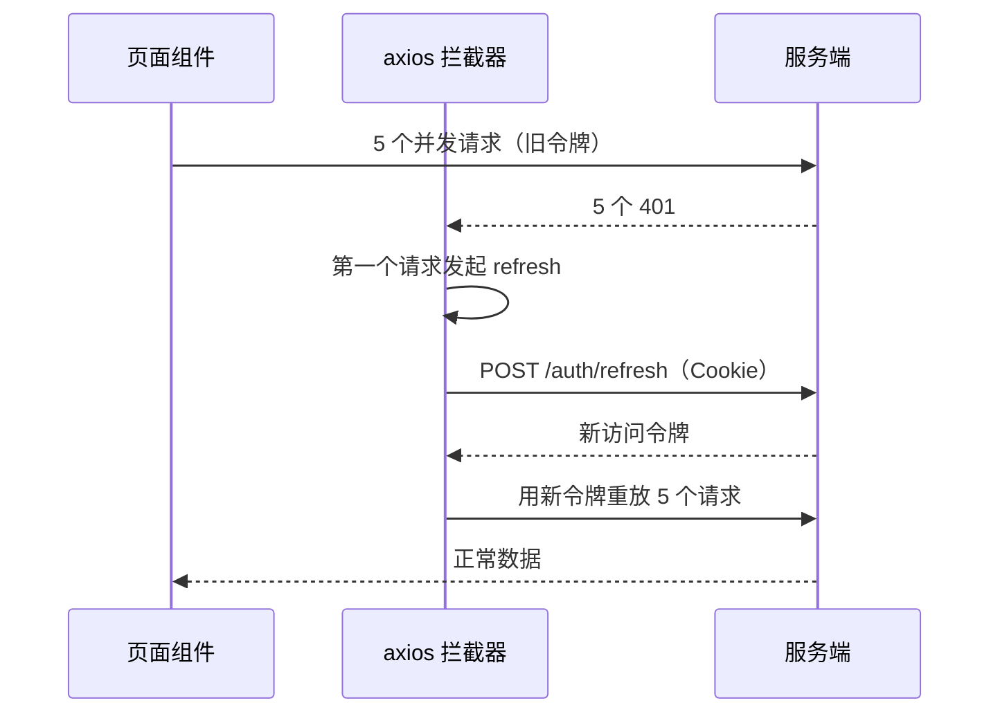
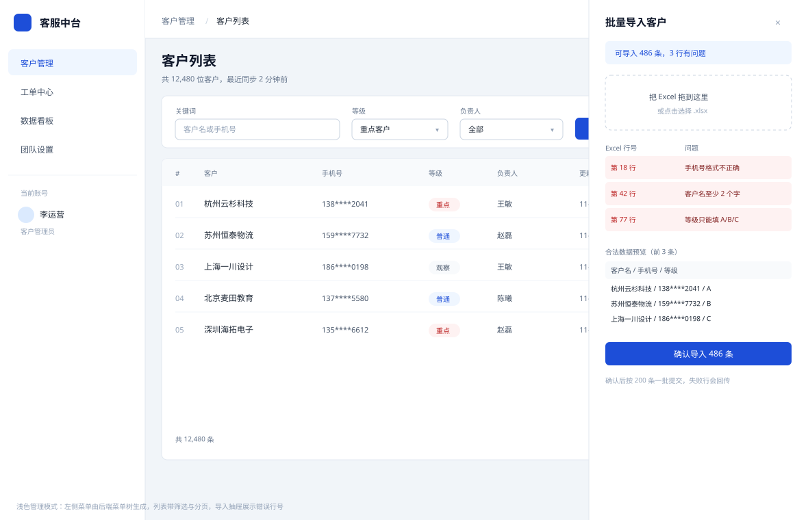

# Vue3管理端项目实战

> 这篇从管理端的交付物讲起，经过工程骨架、登录与 Token、动态路由、布局、查询表格、导入导出和图表，最后落到构建部署与一次完整上线。
>
> 学完能从空目录交付一个带权限、可查询、能导入导出并上线的 Vue 3 管理端模块。

## 一、管理端项目的交付物与工程边界

管理端不是「把接口数据铺在页面上」，而是一套可交付的作业系统：登录后按角色看到不同菜单，列表能筛能翻页，表单能校验，批量数据能进出，关键指标能看，出错能定位。

| 维度 | 管理端 | 面向用户的站点 |
|---|---|---|
| 首屏 | 登录后加载，弱化 SEO | 需要 SSR 与抓取 |
| 交互密度 | 表格、表单、弹窗为主 | 内容与转化为主 |
| 权限 | 菜单、按钮、数据三层 | 通常只有登录态 |
| 性能重点 | 大表格与首包体积 | 首屏渲染与图片 |
| 兼容 | 现代浏览器，固定分辨率 | 多端适配 |

三层权限要分清，混在一起是后期最大的维护成本：

- 菜单权限决定「看不看得到入口」，由后端返回菜单树；
- 按钮权限决定「能不能点」，由权限码控制；
- 数据权限决定「能看到哪些行」，必须由后端在查询里过滤，前端不做过滤。

前端权限只解决体验，不解决安全。任何只靠前端隐藏按钮的保护，都可以用改请求绕过。

### 1.1 技术选型与版本基线

| 组件 | 基线 | 选择理由 |
|---|---|---|
| Vue | 3.5+ | 组合式 API、`defineModel` |
| Vite | 7.x | 冷启动与按需编译 |
| TypeScript | 5.9+ | 接口与路由元信息类型 |
| Element Plus | 2.9+ | 表格、表单、弹窗覆盖管理端 |
| Pinia | 3.x | 鉴权与权限状态 |
| Vue Router | 4.5+ | 动态路由 |
| ECharts | 6.x | 看板图表 |
| ExcelJS | 4.4+ | 导入解析与导出 |

不选 UI 框架自带的请求库，统一用 axios：拦截器生态成熟，取消请求和文件流处理都有现成方案。

## 二、项目骨架与环境准备

骨架的目标是：`npm run dev` 能出登录页，`npm run build` 能出可部署的静态包，类型检查不报错。

```bash
# Node 22，Windows 用 winget，macOS 用 brew，Ubuntu 用 NodeSource
node -v
# v22.20.0

npm create vite@latest admin-console -- --template vue-ts
cd admin-console
npm install
npm install vue-router@4 pinia axios element-plus @element-plus/icons-vue
npm install echarts exceljs zod
npm install -D unplugin-auto-import unplugin-vue-components sass
```

安装后的 `package.json` 关键片段：

```json
{
  "scripts": {
    "dev": "vite",
    "build": "vue-tsc -b && vite build",
    "preview": "vite preview",
    "typecheck": "vue-tsc --noEmit"
  }
}
```

`build` 先跑类型检查再打包。顺序不能反：`vite build` 不做类型检查，先打包会发现不了类型错误，部署后才会在运行时炸。

目录按职责分层，不按文件类型平铺：

```text
src/
  api/            # 接口函数，只做请求与类型
  components/     # 通用组件
  composables/    # useTable、useChart
  directives/     # v-permission
  layouts/        # AdminLayout
  router/         # 路由与守卫
  stores/         # auth、permission、tags
  styles/         # 变量与全局样式
  types/          # 接口与路由元信息
  utils/          # request、download、validate
  views/          # 页面，按业务域分目录
```

```ts
// vite.config.ts
import { defineConfig, loadEnv } from 'vite'
import vue from '@vitejs/plugin-vue'
import AutoImport from 'unplugin-auto-import/vite'
import Components from 'unplugin-vue-components/vite'
import { ElementPlusResolver } from 'unplugin-vue-components/resolvers'
import { fileURLToPath, URL } from 'node:url'

export default defineConfig(({ mode }) => {
  const env = loadEnv(mode, process.cwd())

  return {
    plugins: [
      vue(),
      // 自动导入 api，减少每个文件手写 ref/computed
      AutoImport({ imports: ['vue', 'vue-router'], resolvers: [ElementPlusResolver()] }),
      // 组件按需引入，避免整包 Element Plus 进首屏
      Components({ resolvers: [ElementPlusResolver()] }),
    ],
    resolve: {
      alias: { '@': fileURLToPath(new URL('./src', import.meta.url)) },
    },
    server: {
      port: 5173,
      proxy: {
        // 开发期同源代理，前端代码里始终写 /api，不需要处理跨域
        '/api': { target: env.VITE_PROXY_TARGET, changeOrigin: true },
      },
    },
  }
})
```

`vite.config.ts` 的别名只影响打包和开发服务器；`tsconfig` 里还要有 `"baseUrl": "."` 与 `"paths": { "@/*": ["src/*"] }`，否则 `vue-tsc` 解析不到 `@/` 开头的导入。

```ts
// src/main.ts
import { createApp } from 'vue'
import { createPinia } from 'pinia'
import { ElLoading } from 'element-plus'
// 只手动引入指令与消息的样式，其余组件样式由 resolver 按需注入
import 'element-plus/es/components/loading/style/css'
import 'element-plus/es/components/message/style/css'
import App from './App.vue'
import router from './router'
import { setupPermission } from './directives/permission'

const app = createApp(App)
app.use(createPinia())
app.use(router)
app.use(ElLoading) // 注册 v-loading，模板里才可用
setupPermission(app)
app.mount('#app')
```

环境文件分三份，只提交模板，不提交真实地址：

```bash
# .env.development
VITE_API_BASE=/api
VITE_PROXY_TARGET=http://127.0.0.1:8080

# .env.production
VITE_API_BASE=/api
```

```ts
// src/types/env.d.ts
interface ImportMetaEnv {
  readonly VITE_API_BASE: string
  readonly VITE_PROXY_TARGET: string
}
```

最小验证：`npm run dev` 打开 `http://localhost:5173`，能看到登录页；`npm run build` 输出 `dist/`，`npm run preview` 能打开。此时还没有接口，页面用假数据渲染即可。

## 三、登录、Token 与请求层

Token 方案决定整个应用的安全边界。推荐做法是：访问令牌只放内存，刷新令牌放 `HttpOnly` Cookie，页面刷新时用刷新令牌换新的访问令牌。

| 存储位置 | XSS 可读 | 刷新后保留 | 适用 |
|---|---|---|---|
| 内存（Pinia） | 否 | 否 | 访问令牌 |
| `HttpOnly` Cookie | 否 | 是 | 刷新令牌 |
| `localStorage` | 是 | 是 | 不建议放长期令牌 |

`localStorage` 方案实现最省事，但任何一次 XSS 都能把令牌带走。管理端掌握的是批量客户数据，值得多做一步。

### 3.1 登录页与状态

```vue
<!-- src/views/login/index.vue -->
<script setup lang="ts">
import { reactive, ref } from 'vue'
import { useRoute, useRouter } from 'vue-router'
import { ElMessage, type FormInstance, type FormRules } from 'element-plus'
import { useAuthStore } from '@/stores/auth'

const router = useRouter()
const route = useRoute()
const auth = useAuthStore()

const formRef = ref<FormInstance>()
const loading = ref(false)
const form = reactive({ username: '', password: '', remember: true })

const rules: FormRules = {
  username: [{ required: true, message: '请输入账号', trigger: 'blur' }],
  password: [
    { required: true, message: '请输入密码', trigger: 'blur' },
    // 前端只做长度校验，强度规则以服务端为准
    { min: 8, message: '密码至少 8 位', trigger: 'blur' },
  ],
}

async function submit() {
  // validate 返回 Promise，失败会 reject，必须捕获否则控制台报未处理异常
  const ok = await formRef.value?.validate().catch(() => false)
  if (!ok) return

  loading.value = true
  try {
    await auth.login({ username: form.username, password: form.password })
    // 登录前想去哪个页面就回哪个页面，直接跳首页会丢掉用户意图
    const redirect = typeof route.query.redirect === 'string' ? route.query.redirect : '/'
    await router.replace(redirect)
  } catch {
    ElMessage.error('账号或密码错误')
  } finally {
    loading.value = false
  }
}
</script>

<template>
  <div class="login">
    <el-form ref="formRef" :model="form" :rules="rules" @keyup.enter="submit">
      <h1>运营管理台</h1>
      <el-form-item prop="username">
        <el-input v-model="form.username" placeholder="账号" autocomplete="username" />
      </el-form-item>
      <el-form-item prop="password">
        <el-input v-model="form.password" type="password" show-password
                  placeholder="密码" autocomplete="current-password" />
      </el-form-item>
      <el-button type="primary" :loading="loading" @click="submit">登录</el-button>
    </el-form>
  </div>
</template>
```

### 3.2 Pinia 鉴权状态

```ts
// src/stores/auth.ts
import { defineStore } from 'pinia'
import { ref } from 'vue'
import http from '@/utils/request'
import type { User } from '@/types/user'

export const useAuthStore = defineStore('auth', () => {
  // 访问令牌只存在内存，刷新页面后通过 refresh 接口重新获取
  const accessToken = ref('')
  const user = ref<User | null>(null)

  async function login(payload: { username: string; password: string }) {
    const data = await http.post<{ accessToken: string; user: User }>('/auth/login', payload)
    accessToken.value = data.accessToken
    user.value = data.user
  }

  async function refresh() {
    // 刷新令牌在 HttpOnly Cookie 里，前端读不到，只能由浏览器自动携带
    const data = await http.post<{ accessToken: string }>('/auth/refresh', null, {
      withCredentials: true,
    })
    accessToken.value = data.accessToken
    return data.accessToken
  }

  async function bootstrap() {
    if (accessToken.value) return
    try {
      await refresh()
      user.value = await http.get<User>('/auth/me')
    } catch {
      // 没有有效会话是正常状态，不弹错误
      accessToken.value = ''
    }
  }

  async function logout() {
    await http.post('/auth/logout', null, { withCredentials: true }).catch(() => {})
    accessToken.value = ''
    user.value = null
  }

  return { accessToken, user, login, refresh, bootstrap, logout }
})
```

### 3.3 axios 封装与并发 401

页面同时发五个请求，令牌刚好过期，五个请求都会收到 401。如果各自去刷新，会发出五次刷新请求，服务端可能把刷新令牌轮换掉，导致前四次失效。正确做法是只允许一个刷新在飞，其余请求排队等结果。

```ts
// src/utils/request.ts
import axios, { AxiosError, type AxiosRequestConfig, type InternalAxiosRequestConfig } from 'axios'
import { ElMessage } from 'element-plus'
import { useAuthStore } from '@/stores/auth'

const http = axios.create({
  baseURL: import.meta.env.VITE_API_BASE,
  timeout: 15000,
})

http.interceptors.request.use((config) => {
  const auth = useAuthStore()
  if (auth.accessToken) {
    config.headers.Authorization = `Bearer ${auth.accessToken}`
  }
  return config
})

// 同一时刻只允许一个刷新请求，其余 401 复用这个 Promise
let refreshing: Promise<string> | null = null

http.interceptors.response.use(
  (res) => res.data,
  async (error: AxiosError<{ message?: string }>) => {
    const auth = useAuthStore()
    const config = error.config as InternalAxiosRequestConfig & { _retry?: boolean }
    const status = error.response?.status
    // 登录、刷新和登出接口不能走刷新重放，否则它们自己的 401 会递归
    const isAuthEndpoint = Boolean(
      config?.url?.includes('/auth/login') ||
      config?.url?.includes('/auth/refresh') ||
      config?.url?.includes('/auth/logout'),
    )

    if (status === 401 && !config._retry && !isAuthEndpoint) {
      config._retry = true // 标记已重试，避免刷新失败后无限循环
      try {
        refreshing ??= auth.refresh().finally(() => { refreshing = null })
        const token = await refreshing
        config.headers.Authorization = `Bearer ${token}`
        // 用新令牌重放原请求，调用方无感知
        return http(config)
      } catch {
        await auth.logout()
        // 整页跳转彻底清掉已注入的路由与内存状态，也避免 router 与请求层互相引用
        const current = location.pathname + location.search
        location.assign(`/login?redirect=${encodeURIComponent(current)}`)
        return Promise.reject(error)
      }
    }

    // 业务错误统一提示，但 401 已经处理过，不重复弹
    if (status !== 401) {
      ElMessage.error(error.response?.data?.message ?? '网络异常，请稍后重试')
    }
    return Promise.reject(error)
  },
)

// 拦截器已经把 AxiosResponse 拆成 data，实例类型要同步成直接返回 T
interface ApiClient {
  get<T>(url: string, config?: AxiosRequestConfig): Promise<T>
  post<T>(url: string, data?: unknown, config?: AxiosRequestConfig): Promise<T>
  put<T>(url: string, data?: unknown, config?: AxiosRequestConfig): Promise<T>
  delete<T>(url: string, config?: AxiosRequestConfig): Promise<T>
}

export default http as unknown as ApiClient
```



> 边界：刷新、登录和登出接口不能走这套拦截器，否则 401 会递归刷新。把 `/auth/refresh`、`/auth/login`、`/auth/logout` 排除在拦截逻辑外，或另建一个不带拦截器的裸 axios 实例。

## 四、动态路由与权限

菜单由后端返回，前端把菜单树转成路由记录，登录后 `addRoute` 注入。这样做的好处是新增页面只改后端配置和前端文件，不用发版改路由表。

```ts
// src/types/router.d.ts
import 'vue-router'

declare module 'vue-router' {
  interface RouteMeta {
    title?: string
    icon?: string
    permission?: string
    keepAlive?: boolean
    public?: boolean
    hidden?: boolean
  }
}
```

### 4.1 菜单转路由

```ts
// src/router/dynamic.ts
import type { Component } from 'vue'
import type { RouteRecordRaw } from 'vue-router'
import type { MenuNode } from '@/types/menu'

// glob 是构建期静态分析，路径必须是字面量，不能拼接变量
const views = import.meta.glob('/src/views/**/index.vue') as Record<
  string,
  () => Promise<{ default: Component }>
>

function toRoute(menu: MenuNode): RouteRecordRaw {
  const componentPath = `/src/views${menu.component}/index.vue`
  const loader = views[componentPath]

  if (!loader && menu.type === 'menu') {
    // 后端配了菜单但前端没有对应文件，构建期发现不了，运行期必须显式报错
    console.error(`[router] 缺少页面文件: ${componentPath}`)
  }

  return {
    path: menu.path,
    name: menu.code,
    component: loader ?? (() => import('@/views/error/404.vue')),
    meta: {
      title: menu.name,
      icon: menu.icon,
      permission: menu.permission,
      keepAlive: menu.keepAlive ?? false,
      hidden: menu.hidden ?? false,
    },
    children: menu.children?.map(toRoute),
  }
}

export function buildRoutes(menus: MenuNode[]): RouteRecordRaw[] {
  return menus.map(toRoute)
}
```

`import.meta.glob` 返回的是懒加载函数，只有访问该路由才会下载对应 chunk。用 `import()` 拼变量则会被 Vite 警告，且无法预分析依赖。

### 4.2 守卫与注入时机

```ts
// src/router/index.ts
import { createRouter, createWebHistory } from 'vue-router'
import { useAuthStore } from '@/stores/auth'
import { usePermissionStore } from '@/stores/permission'

const router = createRouter({
  history: createWebHistory(import.meta.env.BASE_URL),
  routes: [
    { path: '/login', name: 'login', component: () => import('@/views/login/index.vue'), meta: { public: true } },
    {
      path: '/',
      name: 'root',
      component: () => import('@/layouts/AdminLayout.vue'),
      redirect: '/dashboard',
      children: [],
    },
  ],
})

router.beforeEach(async (to) => {
  const auth = useAuthStore()
  const permission = usePermissionStore()

  if (to.meta.public) return true

  // 刷新页面后内存令牌丢失，先尝试用 Cookie 换新令牌
  if (!auth.accessToken) {
    await auth.bootstrap()
    if (!auth.accessToken) {
      return { name: 'login', query: { redirect: to.fullPath } }
    }
  }

  if (!permission.loaded) {
    await permission.load()
    // 路由是刚加进去的，当前这次匹配还是旧表，必须重新导航一次
    return { ...to, replace: true }
  }

  return true
})

export default router
```

```ts
// src/stores/permission.ts
import { defineStore } from 'pinia'
import { ref } from 'vue'
import http from '@/utils/request'
import router from '@/router'
import { buildRoutes } from '@/router/dynamic'
import type { MenuNode } from '@/types/menu'

export const usePermissionStore = defineStore('permission', () => {
  const loaded = ref(false)
  const menus = ref<MenuNode[]>([])
  const codes = ref<string[]>([])

  async function load() {
    const data = await http.get<{ menus: MenuNode[]; codes: string[] }>('/auth/menus')
    menus.value = data.menus
    codes.value = data.codes

    for (const route of buildRoutes(data.menus)) {
      // 全部挂到 root 布局下，保证共用侧边栏
      router.addRoute('root', route)
    }

    // 兜底路由统一在这里注册；Vue Router 按评分排序，通配不会覆盖静态路由
    router.addRoute({ path: '/:pathMatch(.*)*', name: 'not-found', component: () => import('@/views/error/404.vue') })
    loaded.value = true
  }

  function reset() {
    loaded.value = false
    menus.value = []
    codes.value = []
  }

  return { loaded, menus, codes, load, reset }
})
```

> 边界：退出登录时必须重置权限 store 并刷新页面，或者逐个 `removeRoute`。只清 Token 不清理已注入的路由，下一个账号会看到上一个账号的菜单。

### 4.3 按钮权限

```ts
// src/directives/permission.ts
import type { App, Directive } from 'vue'
import { usePermissionStore } from '@/stores/permission'

const permission: Directive<HTMLElement, string> = {
  mounted(el, binding) {
    const store = usePermissionStore()
    // 用 removeChild 而不是 display:none，避免用户从 DOM 里改样式恢复按钮
    if (binding.value && !store.codes.includes(binding.value)) {
      el.parentNode?.removeChild(el)
    }
  },
}

export function setupPermission(app: App) {
  app.directive('permission', permission)
}
```

```vue
<el-button v-permission="'customer:export'" @click="exportCsv">导出</el-button>
```

指令只处理首次挂载。权限码在登录后一次性拿到，运行期不变，因此不需要 `updated` 钩子；如果需要动态权限，改按钮的 `v-if` 更直观。

## 五、布局与多页签

布局承担四件事：侧边菜单、顶部面包屑、多页签、内容区缓存。四者都围绕同一个 `router-view`。

```vue
<!-- src/layouts/AdminLayout.vue -->
<script setup lang="ts">
import { computed, ref } from 'vue'
import { useRoute } from 'vue-router'
import { usePermissionStore } from '@/stores/permission'
import { useTagsStore } from '@/stores/tags'
import SideMenu from './SideMenu.vue'

const route = useRoute()
const permission = usePermissionStore()
const tags = useTagsStore()
const collapsed = ref(false)

const breadcrumbs = computed(() =>
  // matched 包含父级布局记录，过滤掉没有标题的项
  route.matched.filter((r) => r.meta.title).map((r) => ({ title: r.meta.title, path: r.path })),
)
</script>

<template>
  <div class="admin" :class="{ collapsed }">
    <aside>
      <SideMenu :menus="permission.menus" :collapsed="collapsed" />
    </aside>

    <section class="main">
      <header>
        <el-breadcrumb separator="/">
          <el-breadcrumb-item v-for="item in breadcrumbs" :key="item.path">{{ item.title }}</el-breadcrumb-item>
        </el-breadcrumb>
        <el-button text @click="collapsed = !collapsed">折叠</el-button>
      </header>

      <nav class="tags">
        <router-link v-for="tag in tags.list" :key="tag.fullPath" :to="tag.fullPath">
          {{ tag.title }}
        </router-link>
      </nav>

      <main>
        <router-view v-slot="{ Component, route: current }">
          <!-- include 按组件 name 匹配，页面必须写 defineOptions({ name }) -->
          <keep-alive :include="tags.cached">
            <!-- 用路由名做 key，翻页改 query 时复用同一实例；需要并排对比时再换 fullPath -->
            <component :is="Component" :key="current.name ?? current.path" />
          </keep-alive>
        </router-view>
      </main>
    </section>
  </div>
</template>
```

页面的组件名必须显式声明，`<script setup>` 默认推断的文件名在压缩后不可靠：

```vue
<script setup lang="ts">
// keep-alive 的 include 读的是组件 name，不写就没有缓存
defineOptions({ name: 'CustomerList' })
</script>
```

页签 store 监听路由变化，只记录需要缓存的页面：

```ts
// src/stores/tags.ts
import { defineStore } from 'pinia'
import { computed, ref } from 'vue'
import type { RouteLocationNormalized } from 'vue-router'

export const useTagsStore = defineStore('tags', () => {
  const list = ref<{ title: string; fullPath: string; name: string }[]>([])
  const cached = computed(() => list.value.map((t) => t.name))

  function add(route: RouteLocationNormalized) {
    if (!route.meta.title || route.meta.public) return
    if (list.value.some((t) => t.fullPath === route.fullPath)) return
    list.value.push({ title: route.meta.title, fullPath: route.fullPath, name: String(route.name) })
  }

  function remove(fullPath: string) {
    list.value = list.value.filter((t) => t.fullPath !== fullPath)
  }

  return { list, cached, add, remove }
})
```

> 边界：`:key` 用 `fullPath` 会让同一路由的不同查询参数各开一个实例，内存随页签增长。列表页翻页不需要新实例，用 `route.name` 更稳；只有需要并排对比不同筛选结果时才用 `fullPath`。

## 六、查询表格

查询表格是管理端使用频率最高的组件，问题也最集中：重复请求、竞态、分页错位、空态缺失。

把重复逻辑收进组合函数，页面只声明列和接口：

```ts
// src/composables/useTable.ts
import { reactive, ref, onBeforeUnmount } from 'vue'
import axios from 'axios'

interface PageResult<T> {
  records: T[]
  total: number
}

export function useTable<T>(
  fetcher: (params: Record<string, unknown>, signal: AbortSignal) => Promise<PageResult<T>>,
  initialQuery: Record<string, any> = {},
) {
  const query = reactive({ ...initialQuery })
  const pagination = reactive({ page: 1, size: 20, total: 0 })
  const rows = ref<T[]>([])
  const loading = ref(false)
  let controller: AbortController | null = null

  async function load() {
    // 取消上一次未完成的请求，避免慢请求覆盖新结果
    controller?.abort()
    const current = new AbortController()
    controller = current
    loading.value = true
    try {
      const data = await fetcher(
        { ...query, page: pagination.page, size: pagination.size },
        current.signal,
      )
      rows.value = data.records
      pagination.total = data.total
    } catch (err) {
      // 主动取消不是错误，不弹提示
      if (!axios.isCancel(err)) throw err
    } finally {
      // 只有仍是最新一次请求时才关 loading，否则会被旧请求提前关掉
      if (controller === current) loading.value = false
    }
  }

  function search() {
    // 条件变化必须回到第一页，否则可能停在一个不存在的页码上
    pagination.page = 1
    return load()
  }

  function reset() {
    Object.assign(query, initialQuery)
    return search()
  }

  onBeforeUnmount(() => controller?.abort())

  return { query, pagination, rows, loading, load, search, reset }
}
```

```vue
<!-- src/views/customer/index.vue -->
<script setup lang="ts">
import { onMounted } from 'vue'
import { getCustomers, type Customer } from '@/api/customer'
import { useTable } from '@/composables/useTable'

defineOptions({ name: 'CustomerList' })

const { query, pagination, rows, loading, load, search, reset } = useTable<Customer>(
  (params, signal) => getCustomers(params, signal),
  { keyword: '', level: '', status: '' },
)

onMounted(load)

const levelText: Record<string, string> = { A: '重点', B: '普通', C: '观察' }
</script>

<template>
  <div class="page">
    <el-form :model="query" inline @submit.prevent="search">
      <el-form-item label="关键词">
        <el-input v-model="query.keyword" placeholder="客户名或手机号" clearable />
      </el-form-item>
      <el-form-item label="等级">
        <el-select v-model="query.level" clearable placeholder="全部">
          <el-option label="重点" value="A" />
          <el-option label="普通" value="B" />
        </el-select>
      </el-form-item>
      <el-button type="primary" native-type="submit">查询</el-button>
      <el-button @click="reset">重置</el-button>
    </el-form>

    <el-table v-loading="loading" :data="rows" row-key="id" stripe>
      <el-table-column type="index" label="#" width="56"
                       :index="(i) => (pagination.page - 1) * pagination.size + i + 1" />
      <el-table-column prop="name" label="客户" min-width="160" show-overflow-tooltip />
      <el-table-column prop="phone" label="手机号" width="140" />
      <el-table-column label="等级" width="100">
        <template #default="{ row }">
          <el-tag :type="row.level === 'A' ? 'danger' : 'info'">{{ levelText[row.level] }}</el-tag>
        </template>
      </el-table-column>
      <el-table-column prop="owner" label="负责人" width="120" />
      <el-table-column prop="updatedAt" label="更新时间" width="170" />
      <template #empty>
        <el-empty description="没有符合条件的客户" />
      </template>
    </el-table>

    <el-pagination
      v-model:current-page="pagination.page"
      v-model:page-size="pagination.size"
      :total="pagination.total"
      :page-sizes="[20, 50, 100]"
      layout="total, sizes, prev, pager, next"
      @current-change="load"
      @size-change="search"
    />
  </div>
</template>
```

接口层只负责拼参数和类型：

```ts
// src/api/customer.ts
import http from '@/utils/request'

export interface Customer {
  id: number
  name: string
  phone: string
  level: 'A' | 'B' | 'C'
  owner: string
  updatedAt: string
}

export function getCustomers(params: Record<string, unknown>, signal: AbortSignal) {
  // 把 signal 传给 axios，组件卸载或新查询时能真正中断连接
  return http.get<{ records: Customer[]; total: number }>('/customers', { params, signal })
}
```

三个细节决定表格好不好用：

- 序号列必须按分页偏移计算，直接用 `index + 1` 每页都从 1 开始；
- 空态用 `#empty` 定制，默认的「暂无数据」在筛选场景下没有信息量；
- `show-overflow-tooltip` 处理长文本，比让列撑开更稳定。

> 边界：前端排序只对当前页有效。需要全量排序时把 `sortBy`、`order` 传给后端，并在切换排序时回到第一页。

## 七、导入导出

导入导出的核心不是文件读写，而是「格式约定、错误定位、大文件不阻塞」。

### 7.1 CSV 导出与 BOM

```ts
// src/utils/download.ts
export function downloadBlob(blob: Blob, filename: string) {
  const url = URL.createObjectURL(blob)
  const a = document.createElement('a')
  a.href = url
  a.download = filename
  a.click()
  // 立即释放会导致部分浏览器下载中断，放到下一轮事件循环
  setTimeout(() => URL.revokeObjectURL(url), 0)
}

export function exportCsv(rows: Record<string, unknown>[], headers: [string, string][], filename: string) {
  const head = headers.map(([, label]) => `"${label}"`).join(',')
  const body = rows
    .map((row) =>
      headers
        // 双引号转义，否则内容里的逗号会把一列拆成两列
        .map(([key]) => `"${String(row[key] ?? '').replace(/"/g, '""')}"`)
        .join(','),
    )
    .join('\n')

  // BOM 让 Excel 在 Windows 下按 UTF-8 打开，否则中文乱码
  const blob = new Blob(['\ufeff' + head + '\n' + body], { type: 'text/csv;charset=utf-8' })
  downloadBlob(blob, filename)
}
```

导出十万行不要在前端拼字符串。改成请求后端生成文件，前端只负责下载：

```ts
export async function exportFromServer(params: Record<string, unknown>) {
  const res = await http.get('/customers/export', {
    params,
    responseType: 'blob', // 不设这个，二进制会被当文本解析，文件损坏
  })
  // 拦截器只返回 data，文件名在这里按日期生成；需要后端文件名时保留原始响应头
  downloadBlob(res as unknown as Blob, `客户列表-${new Date().toISOString().slice(0, 10)}.xlsx`)
}
```

### 7.2 Excel 导入与逐行校验

```ts
// src/utils/importExcel.ts
import ExcelJS from 'exceljs'
import { z } from 'zod'

const rowSchema = z.object({
  name: z.string().min(2, '客户名至少 2 个字'),
  phone: z.string().regex(/^1[3-9]\d{9}$/, '手机号格式不正确'),
  level: z.enum(['A', 'B', 'C']).default('C'),
})

export interface ImportError {
  row: number
  message: string
}

export async function parseCustomers(file: File) {
  const workbook = new ExcelJS.Workbook()
  // arrayBuffer 比 FileReader 简洁，且不会把二进制转成字符串
  await workbook.xlsx.load(await file.arrayBuffer())
  const sheet = workbook.worksheets[0]
  const valid: z.infer<typeof rowSchema>[] = []
  const errors: ImportError[] = []

  sheet.eachRow((row, index) => {
    if (index === 1) return // 跳过表头

    const raw = {
      name: String(row.getCell(1).text).trim(),
      phone: String(row.getCell(2).text).trim(),
      level: String(row.getCell(3).text).trim() || 'C',
    }

    const parsed = rowSchema.safeParse(raw)
    if (parsed.success) {
      valid.push(parsed.data)
    } else {
      // 行号用 Excel 里的真实行号，用户才能直接定位
      errors.push({ row: index, message: parsed.error.issues.map((i) => i.message).join('；') })
    }
  })

  return { valid, errors }
}
```

上传时分批，避免一次几千行把接口打挂：

```ts
async function submitImport(rows: unknown[]) {
  const batchSize = 200
  const failed: ImportError[] = []

  for (let i = 0; i < rows.length; i += batchSize) {
    const batch = rows.slice(i, i + batchSize)
    try {
      await http.post('/customers/batch', { rows: batch })
    } catch (err: any) {
      // 服务端返回具体行号时合并到失败列表，前端不再猜
      failed.push(...(err.response?.data?.errors ?? []))
    }
  }

  return failed
}
```

> 边界：浏览器端解析只适合几千行以内。超过两万行改用「上传文件 → 后端异步任务 → 下载结果」，前端只轮询任务状态，否则主线程会被解析卡住。

## 八、图表与看板

图表在管理端只承担一个职责：让趋势和异常一眼可见。不要为了好看加 3D、渐变和动画。

按需引入，避免整个 ECharts 进首屏：

```ts
// src/utils/echarts.ts
import * as echarts from 'echarts/core'
import { LineChart, BarChart, PieChart } from 'echarts/charts'
import { GridComponent, TooltipComponent, LegendComponent, TitleComponent } from 'echarts/components'
import { CanvasRenderer } from 'echarts/renderers'

echarts.use([LineChart, BarChart, PieChart, GridComponent, TooltipComponent, LegendComponent, TitleComponent, CanvasRenderer])

export { echarts }
```

组合函数负责初始化、尺寸变化和销毁：

```ts
// src/composables/useChart.ts
import { onBeforeUnmount, onMounted, watch, type Ref } from 'vue'
import { echarts } from '@/utils/echarts'
import type { EChartsType } from 'echarts/core'
import type { EChartsOption } from 'echarts'

export function useChart(el: Ref<HTMLElement | null>, option: Ref<EChartsOption>) {
  let chart: EChartsType | null = null
  let observer: ResizeObserver | null = null

  onMounted(() => {
    if (!el.value) return
    chart = echarts.init(el.value)
    chart.setOption(option.value)
    // 侧边栏折叠不会触发 window.resize，必须监听容器自身尺寸
    observer = new ResizeObserver(() => chart?.resize())
    observer.observe(el.value)
  })

  watch(option, (next) => {
    // notMerge 为 true，切换维度时不会残留上一次的系列
    chart?.setOption(next, true)
  }, { deep: true })

  onBeforeUnmount(() => {
    observer?.disconnect()
    // 不 dispose 会保留 canvas 与事件监听，切换页面多次后内存上涨
    chart?.dispose()
    chart = null
  })

  return { getChart: () => chart }
}
```

```vue
<script setup lang="ts">
import { computed, ref } from 'vue'
import type { EChartsOption } from 'echarts'
import { useChart } from '@/composables/useChart'

const props = defineProps<{ trend: { date: string; value: number }[] }>()
const el = ref<HTMLElement | null>(null)

const option = computed<EChartsOption>(() => ({
  grid: { left: 48, right: 16, top: 24, bottom: 32 },
  tooltip: { trigger: 'axis' },
  xAxis: { type: 'category', data: props.trend.map((d) => d.date), axisLine: { lineStyle: { color: '#e2e8f0' } } },
  yAxis: { type: 'value', splitLine: { lineStyle: { color: '#f1f5f9' } } },
  series: [{
    type: 'line',
    smooth: true,
    data: props.trend.map((d) => d.value),
    areaStyle: { color: 'rgba(29,78,216,0.08)' },
    itemStyle: { color: '#1d4ed8' },
  }],
}))

useChart(el, option)
</script>

<template>
  <div ref="el" class="chart" />
</template>
```

> 边界：图表容器必须有明确高度，父级 `height: auto` 时 `echarts.init` 会得到 0 高度，表现为空白但不报错。用 CSS 固定 `height: 320px` 或 `aspect-ratio`。

## 九、构建与部署

构建的目标是首包小、缓存稳、回滚快，不是把产物压缩到最小。

```ts
// vite.config.ts（构建部分）
export default defineConfig({
  build: {
    sourcemap: false, // 生产不开，源码会暴露内部结构；排障用 Sentry 的 sourcemap 上传
    chunkSizeWarningLimit: 800,
    rollupOptions: {
      output: {
        manualChunks(id) {
          if (id.includes('node_modules/echarts')) return 'echarts'
          if (id.includes('node_modules/element-plus')) return 'element'
          if (id.includes('node_modules')) return 'vendor'
        },
      },
    },
  },
})
```

| 产物 | 大小（示例） | 加载时机 |
|---|---|---|
| `index-*.js` | 8 KB | 首屏 |
| `vendor-*.js` | 142 KB | 首屏 |
| `element-*.js` | 268 KB | 首屏 |
| `echarts-*.js` | 312 KB | 进入看板 |
| 单页面 chunk | 12–40 KB | 访问时 |

Nginx 托管静态包，接口反向代理：

```nginx
server {
  listen 80;
  server_name admin.example.com;
  root /srv/admin/dist;

  # history 模式必须有回退，否则刷新子路由 404
  location / {
    try_files $uri $uri/ /index.html;
  }

  location /api/ {
    # 不带末尾斜杠，保留 /api 前缀，后端按完整路径路由
    proxy_pass http://127.0.0.1:8080;
    proxy_set_header Host $host;
    proxy_set_header X-Real-IP $remote_addr;
  }

  # 带 hash 的资源长缓存
  location ~* \.(js|css|woff2|png|svg)$ {
    expires 1y;
    add_header Cache-Control "public, immutable";
  }

  # 入口 HTML 不缓存，保证发版后能拿到新资源
  location = /index.html {
    add_header Cache-Control "no-cache";
  }
}
```

```bash
npm run build
rsync -az --delete dist/ deploy@admin:/srv/admin/dist/
curl -s -o /dev/null -w '%{http_code}\n' https://admin.example.com/customer
# 200
```

> 边界：`try_files` 回退到 `index.html` 只适用于 history 路由。如果应用部署在子路径，必须同时设置 Vite 的 `base`、路由的 `createWebHistory(base)` 和 Nginx 的 `location`，三处缺一就会出现白屏或资源 404。

## 十、排障与验收

管理端的问题大多集中在「登录态、路由、缓存、构建」四类，按现象查比按代码查快。

| 现象 | 最可能原因 | 第一条检查 |
|---|---|---|
| 登录后白屏 | 动态路由注入后未重新匹配 | 看守卫是否返回 `{ ...to, replace: true }` |
| 刷新子路由 404 | Nginx 未回退 index | `curl -I 域名/customer` |
| 接口一直 401 | 刷新接口也被拦截器接管 | 检查刷新是否用裸 axios |
| 菜单重复 | `addRoute` 执行两次 | 看 `permission.loaded` 是否重置 |
| 页签切换丢状态 | 页面没写 `defineOptions name` | 检查 `keep-alive include` |
| 图表空白 | 容器高度为 0 | DevTools 看容器 computed height |
| 导出中文乱码 | CSV 缺 BOM | 检查开头是否有 `\ufeff` |

### 10.1 退出登录后的残留

最常见的线上事故：A 账号退出，B 账号登录，侧边栏还能看到 A 的菜单。原因是路由已经注入，权限 store 没有清。

```ts
async function logout() {
  await auth.logout()
  permission.reset()
  tags.list = []
  // 最稳妥的方式是整页刷新，彻底清掉已注入的路由与缓存
  window.location.assign('/login')
}
```

### 10.2 首屏体积排查

```bash
npm run build
npx vite-bundle-visualizer
# 或直接看 dist/assets 的体积排序
ls -lhS dist/assets | head -10
```

先看最大的三个 chunk，再决定是拆包、换按需引入，还是把整个模块改成异步路由。不要一上来就开 gzip 和 CDN，那只是把问题延后。

### 10.3 上线检查清单

- `npm run typecheck` 与 `npm run build` 均通过；
- 登录、刷新页面、退出、换账号四个动作后菜单正确；
- 列表翻页、筛选、重置后页码回到 1；
- 导入 500 行文件，错误行号与 Excel 一致；
- 导出文件在 Excel 与 WPS 打开均无乱码；
- 看板在侧边栏折叠后图表自适应；
- Nginx 对 HTML 不缓存、对带 hash 资源长缓存；
- 生产环境 `VITE_API_BASE` 指向同源 `/api`，没有硬编码内网地址。

## 十一、最佳实践案例

### 11.1 案例背景

某 SaaS 客服系统原有一个 jQuery 管理后台，客户列表只能按 ID 精确查询，导入靠人工逐条录入，运营每周要花 6 小时整理客户数据。团队决定用 Vue 3 重做「客户管理」模块，要求两周上线，并保留旧系统的账号体系。

约束有四条：后端只提供 REST 接口，不能改协议；客户数据涉及手机号，权限必须做到按钮级；运营电脑多是 8G 内存的 Windows，首屏不能超过 3 秒；旧系统仍在运行，新模块要能独立部署、随时回滚。

目标：列表支持关键词、等级、负责人组合筛选；支持 Excel 批量导入并给出错误行；支持导出当前筛选结果；首页看板展示新增客户趋势。

### 11.2 案例实操

第一步，搭骨架并接通鉴权。登录接口返回访问令牌，刷新令牌写 `HttpOnly` Cookie；axios 拦截器按前文的单飞刷新实现，401 不再并发刷新。

```ts
// src/api/auth.ts
import http from '@/utils/request'

export interface LoginPayload { username: string; password: string }

export function login(payload: LoginPayload) {
  // withCredentials 让浏览器接收服务端下发的刷新 Cookie
  return http.post<{ accessToken: string; user: { id: number; name: string; role: string } }>(
    '/auth/login', payload, { withCredentials: true },
  )
}

export function fetchMenus() {
  return http.get<{ menus: MenuNode[]; codes: string[] }>('/auth/menus')
}
```

第二步，把客户列表抽成 `useTable` 加接口函数。筛选条件与分页一起提交，切换条件回第一页，切换分页保留条件。

```ts
// src/api/customer.ts
import http from '@/utils/request'

export interface CustomerQuery {
  keyword?: string
  level?: string
  owner?: string
  page: number
  size: number
}

export function getCustomers(params: CustomerQuery, signal: AbortSignal) {
  return http.get<{ records: Customer[]; total: number }>('/customers', { params, signal })
}

export function exportCustomers(params: Omit<CustomerQuery, 'page' | 'size'>) {
  // 导出走服务端生成，避免十万行卡死浏览器
  return http.get<Blob>('/customers/export', { params, responseType: 'blob' })
}
```

第三步，实现导入抽屉：选择文件、解析预览、展示错误行、确认后分批提交。

```vue
<!-- src/views/customer/ImportDrawer.vue -->
<script setup lang="ts">
import { ref } from 'vue'
import { ElMessage } from 'element-plus'
import { parseCustomers, type ImportError } from '@/utils/importExcel'
import http from '@/utils/request'

const visible = defineModel<boolean>({ required: true })
const step = ref<'select' | 'preview' | 'done'>('select')
const valid = ref<Awaited<ReturnType<typeof parseCustomers>>['valid']>([])
const errors = ref<ImportError[]>([])
const submitting = ref(false)

async function onFile(file: File) {
  const result = await parseCustomers(file)
  valid.value = result.valid
  errors.value = result.errors
  // 有错误也允许先看预览，但提交时只提交合法行
  step.value = 'preview'
}

async function confirm() {
  submitting.value = true
  try {
    await http.post('/customers/batch', { rows: valid.value })
    step.value = 'done'
    ElMessage.success(`已导入 ${valid.value.length} 条`)
  } finally {
    submitting.value = false
  }
}
</script>

<template>
  <el-drawer v-model="visible" title="批量导入客户" size="560px">
    <el-upload v-if="step === 'select'" drag :auto-upload="false" :show-file-list="false"
               accept=".xlsx" :on-change="(f) => f.raw && onFile(f.raw)">
      <p>把 Excel 拖到这里，或点击选择</p>
      <template #tip>模板列：客户名、手机号、等级（A/B/C）</template>
    </el-upload>

    <template v-else-if="step === 'preview'">
      <el-alert :title="`可导入 ${valid.length} 条，${errors.length} 行有问题`" type="info" :closable="false" />
      <el-table :data="errors" height="280" class="errors">
        <el-table-column prop="row" label="Excel 行号" width="120" />
        <el-table-column prop="message" label="问题" />
      </el-table>
      <el-button type="primary" :loading="submitting" :disabled="!valid.length" @click="confirm">
        确认导入 {{ valid.length }} 条
      </el-button>
    </template>

    <el-result v-else icon="success" title="导入完成" sub-title="可在列表中按更新时间查看" />
  </el-drawer>
</template>
```

第四步，看板用按需引入的 ECharts，趋势接口与列表接口分开缓存：

```ts
// src/api/dashboard.ts
import http from '@/utils/request'

export function getCustomerTrend(days: 7 | 30 | 90) {
  return http.get<{ date: string; value: number }[]>('/dashboard/customer-trend', { params: { days } })
}
```



第五步，构建与发布。`manualChunks` 把 ECharts 拆出首屏，Nginx 对 HTML 不缓存、对 hash 资源长缓存，发布脚本保留上一版目录用于回滚。

```bash
npm run build
ssh deploy@admin 'cp -r /srv/admin/dist /srv/admin/dist.bak'
rsync -az --delete dist/ deploy@admin:/srv/admin/dist/
# 回滚只需把 dist.bak 换回来
```

### 11.3 案例结果

上线两周后的数据（示例，来自前端监控与运营统计）：

| 指标 | 旧后台 | 新模块 |
|---|---|---|
| 首屏可交互 | 4.8 s | 1.9 s |
| 首包体积 | 1.6 MB | 418 KB |
| 单次查询耗时 | 1.2 s | 260 ms |
| 每周录客户耗时 | 6 h | 0.5 h |
| 导入 1000 行失败率 | — | 2.1% |

失败模式与处理：

- 第一版把 `<keep-alive>` 的 `include` 写成路由名，页面始终不缓存；改成组件 `name` 后恢复。
- 导入接口一次提交 1000 行，Nginx 返回 413；改成每批 200 行并调大 `client_max_body_size`。
- 看板在 1366×768 的运营电脑上高度溢出，图表被裁切；容器改用 `height: clamp(240px, 32vh, 360px)`。
- 导出文件在 WPS 里表头乱码，补 BOM 后解决。

复盘：这个模块真正省时间的地方不是 Vue，而是把「查询条件、分页、取消请求」统一进 `useTable`，把「解析、校验、错误行号」统一进导入工具。页面代码因此只剩下列定义和按钮，运营提的新筛选条件可以在半天内加上。权限部分坚持了前端只做体验、后端做过滤，上线后没有出现越权看到客户的情况。
