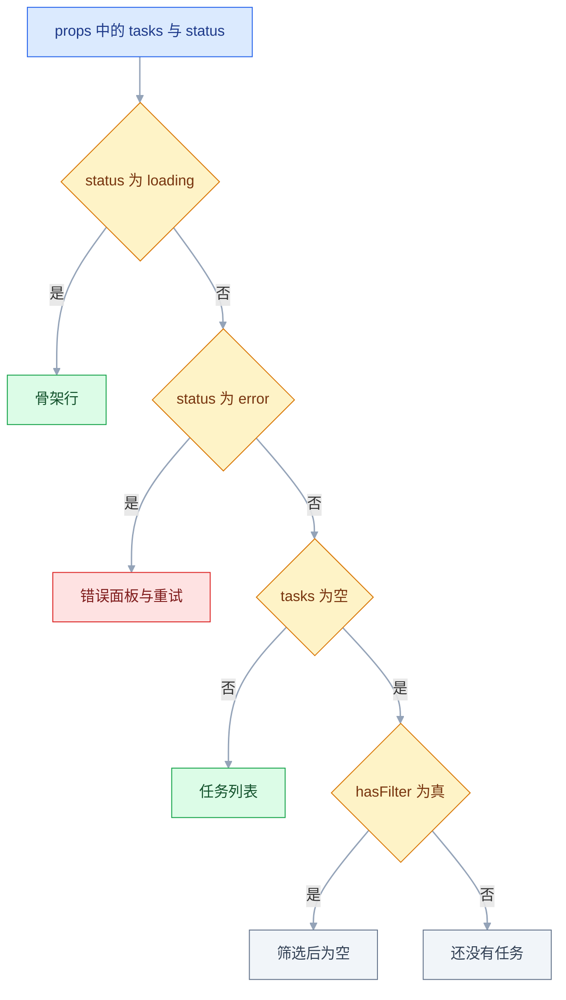
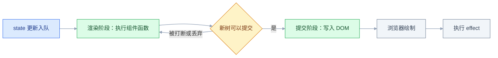

# React 核心

## 一、工程案例：把任务列表页拆成组件并补齐加载、空、错误三态

**场景**：一个 280 行的 `TaskPage.tsx`，请求、筛选、列表、行内编辑全挤在一起。接口慢时白屏，接口挂时整页空白，改一个字段要通读全文。目标是把同一份功能拆开，并让列表在四种情况下都有明确画面：加载中、请求失败、一条数据都没有、筛选后为空。

**产出**：6 个源文件；请求与回滚收进 `useTasks`；勾选采用乐观更新，失败自动恢复；切换筛选不重新请求。

**技术前提**：Vite + React + TypeScript，Node 20.19 以上（Vite 当前版本的下限，以官方文档为准），React 以官方当前稳定版为准。

### 1.1 建项目与目录

```bash
npm create vite@latest task-board -- --template react-ts
cd task-board && npm install && npm run dev
# 终端出现 Local: http://localhost:5173/
```

目录按职责切：`api/tasks.ts` 只管 HTTP，`hooks/useTasks.ts` 管请求与回滚，`components/` 只渲染，`App.tsx` 做组合。样式不在验收范围内，`className` 只作占位，不写 CSS 也能跑通下面的检查项。

### 1.2 类型与接口层

```ts
// src/types.ts
export type Task = { id: number; title: string; completed: boolean };
export type Filter = 'all' | 'active' | 'done';
```

```ts
// src/api/tasks.ts
import type { Task } from '../types';
const BASE = 'https://jsonplaceholder.typicode.com';

export async function fetchTasks(): Promise<Task[]> {
  const res = await fetch(`${BASE}/todos?_limit=8`);
  if (!res.ok) throw new Error(`加载失败：HTTP ${res.status}`);
  const raw = (await res.json()) as Task[];
  return raw.map(({ id, title, completed }) => ({ id, title, completed }));
}

export async function updateTask(id: number, completed: boolean): Promise<void> {
  const res = await fetch(`${BASE}/todos/${id}`, {
    method: 'PATCH',
    headers: { 'Content-Type': 'application/json' },
    body: JSON.stringify({ completed }),
  });
  if (!res.ok) throw new Error(`保存失败：HTTP ${res.status}`);
}
```

这是公开演示接口，写操作返回成功但不会真的落库。验收只看「请求是否发出、界面是否回滚」。

### 1.3 请求与状态：useTasks

```ts
// src/hooks/useTasks.ts
import { useCallback, useEffect, useRef, useState } from 'react';
import { fetchTasks, updateTask } from '../api/tasks';
import type { Task } from '../types';

type Status = 'loading' | 'success' | 'error';

export function useTasks() {
  const [tasks, setTasks] = useState<Task[]>([]);
  const [status, setStatus] = useState<Status>('loading');
  const [error, setError] = useState<string | null>(null);
  const requestId = useRef(0);

  const load = useCallback(async () => {
    const id = ++requestId.current;   // 每次请求领一个递增编号
    setStatus('loading');
    setError(null);
    try {
      const data = await fetchTasks();
      if (id !== requestId.current) return;   // 有更新的请求，本次作废
      setTasks(data);
      setStatus('success');
    } catch (e) {
      if (id !== requestId.current) return;
      setError(e instanceof Error ? e.message : '未知错误');
      setStatus('error');
    }
  }, []);

  useEffect(() => { void load(); }, [load]);

  const toggle = useCallback(async (id: number) => {
    const target = tasks.find((t) => t.id === id);
    if (!target) return;
    const next = !target.completed;
    setError(null);   // 上一次勾选失败留下的提示，重试时清掉
    setTasks((prev) => prev.map((t) => (t.id === id ? { ...t, completed: next } : t)));
    try {
      await updateTask(id, next);
    } catch {
      setTasks((prev) =>
        prev.map((t) => (t.id === id ? { ...t, completed: target.completed } : t)),
      );
      setError('勾选未保存，已恢复原状态');
    }
  }, [tasks]);

  return { tasks, status, error, reload: load, toggle };
}
```

`requestId` 只增不减。请求 A 拿到 1，请求 B 拿到 2；A 晚到时发现编号已过期，就不写状态。这比单个 `ignore` 布尔值更直观，也能覆盖手动重试。

### 1.4 TaskItem：单行的渲染与交互

```tsx
// src/components/TaskItem.tsx
import type { Task } from '../types';

type Props = { task: Task; onToggle: (id: number) => void };

export function TaskItem({ task, onToggle }: Props) {
  return (
    <li className="task-item">
      <label>
        <input type="checkbox" checked={task.completed} onChange={() => onToggle(task.id)} />
        <span className={task.completed ? 'title done' : 'title'}>{task.title}</span>
      </label>
    </li>
  );
}
```

复选框受控：`checked` 来自 props，`onChange` 只上报 id。单行组件不关心请求成败，界面立刻变化由父组件的乐观更新负责。

### 1.5 TaskList：四种画面的分流

```tsx
// src/components/TaskList.tsx
import type { Task } from '../types';
import { TaskItem } from './TaskItem';

type Props = {
  tasks: Task[];
  status: 'loading' | 'success' | 'error';
  error: string | null;
  hasFilter: boolean;
  onRetry: () => void;
  onResetFilter: () => void;
  onToggle: (id: number) => void;
};

export function TaskList({
  tasks, status, error, hasFilter, onRetry, onResetFilter, onToggle,
}: Props) {
  if (status === 'loading') {
    return (
      <ul className="task-list" aria-busy="true">
        {[0, 1, 2].map((i) => <li key={i} className="skeleton" />)}
      </ul>
    );
  }
  if (status === 'error') {
    return (
      <div className="state error" role="alert">
        <p>{error ?? '加载失败'}</p>
        <button onClick={onRetry}>重试</button>
      </div>
    );
  }
  if (tasks.length === 0) {
    return (
      <div className="state">
        <p>{hasFilter ? '当前筛选下没有任务' : '还没有任务'}</p>
        {hasFilter && <button onClick={onResetFilter}>查看全部</button>}
      </div>
    );
  }
  return (
    <ul className="task-list">
      {tasks.map((task) => (
        <TaskItem key={task.id} task={task} onToggle={onToggle} />
      ))}
    </ul>
  );
}
```

四个分支的判定顺序与代码里的 `if` 一一对应：



四个 `return` 的顺序就是优先级：加载压过错误，错误压过空列表，空列表再区分「真的没有」和「筛没了」。顺序固定，就不会出现加载中同时显示空状态。

### 1.6 App：组合与派生数据

```tsx
// src/App.tsx
import { useMemo, useState } from 'react';
import { TaskList } from './components/TaskList';
import { useTasks } from './hooks/useTasks';
import type { Filter } from './types';

const FILTERS: Array<{ key: Filter; text: string }> = [
  { key: 'all', text: '全部' }, { key: 'active', text: '进行中' }, { key: 'done', text: '已完成' },
];

export default function App() {
  const { tasks, status, error, reload, toggle } = useTasks();
  const [filter, setFilter] = useState<Filter>('all');
  const counts: Record<Filter, number> = {
    all: tasks.length,
    active: tasks.filter((t) => !t.completed).length,
    done: tasks.filter((t) => t.completed).length,
  };
  const visible = useMemo(() => {
    if (filter === 'active') return tasks.filter((t) => !t.completed);
    if (filter === 'done') return tasks.filter((t) => t.completed);
    return tasks;
  }, [tasks, filter]);

  return (
    <main className="app">
      <h1>任务看板</h1>
      <p>共 {counts.all} 项，进行中 {counts.active} 项</p>
      {error && status === 'success' && <p className="toast">{error}</p>}
      <div className="filter-bar">
        {FILTERS.map(({ key, text }) => (
          <button key={key} aria-pressed={filter === key}
            className={filter === key ? 'active' : ''} onClick={() => setFilter(key)}>
            {text}（{counts[key]}）
          </button>
        ))}
      </div>
      <TaskList tasks={visible} status={status} error={error}
        hasFilter={filter !== 'all'} onRetry={reload}
        onResetFilter={() => setFilter('all')} onToggle={toggle} />
    </main>
  );
}
```

数据流只有一条：`useTasks` 持有 `tasks`，`App` 算出 `visible` 与 `counts`，`TaskList` 只渲染，`TaskItem` 只上报 id。组件之间没有共享的可变变量。

### 1.7 验收

| # | 检查项 | 命令或检查 | 通过标准 |
|---|---|---|---|
| 1 | 类型检查 | `npx tsc -b` | 无报错，退出码 0 |
| 2 | 生产构建 | `npm run build` | 成功，`dist/` 有产物 |
| 3 | 加载态 | Network 设为 Slow 3G 后刷新 | 先见骨架，再见列表 |
| 4 | 数据条数 | 页面计数或 Network 响应 | 8 条，与接口一致 |
| 5 | 错误态 | 先正常加载，再把 Network 设为 Offline 后点重试 | 出现错误面板与按钮 |
| 6 | 空态 | 临时让 `fetchTasks` 返回 `[]` | 显示「还没有任务」 |
| 7 | 筛选空态 | 切到「已完成」并取消所有勾选 | 显示「当前筛选下没有任务」 |
| 8 | 乐观更新 | 勾选后立即观察 | 无需等待响应即变化 |
| 9 | 失败回滚 | Offline 状态下勾选 | 短暂变化后恢复原值 |
| 10 | key 稳定性 | `grep -n "key=" src/components/TaskList.tsx` | 输出为 `key={task.id}`，不是下标 |

**拆分前后的差别**：请求状态从散落的多个 `useState` 收进一个 Hook；加载与错误从零散判断变成固定优先级；单行交互从直接改父级数据变成只上报 id；筛选从每次渲染重复过滤变成 `useMemo` 派生。副作用是文件数变多，读代码要先找入口，所以目录必须按职责命名。

---

## 二、高频问答：会卡住你的地方，也是面试最常问的

### 2.1 setState 之后同一次事件里读到旧值

**现场**

在 setState 下一行打印一次，再在 `useEffect` 里打印一次，两个值不同。

```tsx
const [count, setCount] = useState(0);
const handle = () => {
  setCount(count + 1);
  console.log(count);        // 0：这次渲染的常量
  setCount(count + 1);       // 仍基于 0，最终只加 1
};
```

**要点**

- 每次渲染里的 state 是常量快照，`setState` 只把新值排进队列，当前函数里的变量不会变。
- 连写两次 `setCount(count + 1)` 都基于同一个 0，最终只加 1。
- 连续累加改用 `setCount((prev) => prev + 1)`。

**追问**

- 为什么两次 setState 只渲染一次？→ 同一次事件里的更新会被批处理合并。
- 什么时候能读到新值？→ 下一次渲染的函数体里。
- 函数式更新为什么能拿到最新值？→ React 按队列顺序把上一个结果传进来。

### 2.2 依赖数组里放对象或数组，effect 每次都跑

**现场**

在 effect 里累加计数器，切换一个无关 state，计数器仍增长。

```tsx
useEffect(() => { load(options); }, [options]);            // options 每次新建
useEffect(() => { load({ page, size }); }, [page, size]);  // 拆成基本类型
const options = useMemo(() => ({ page, size }), [page, size]);
useEffect(() => { load(options); }, [options]);            // 引用稳定
```

**要点**

- 对象字面量每次渲染都是新引用，`Object.is` 判定为不等，effect 自然每次重跑。
- 只盯着「值相同」不够，依赖比较看的是引用。
- 拆成基本类型，或用 `useMemo` 固定引用；函数同理用 `useCallback`。

**追问**

- 为什么 `useMemo` 能解决？→ 依赖不变时返回同一个引用。
- 依赖数组是深比较吗？→ 逐项 `Object.is`，不深入对象内部。
- 漏依赖和多余依赖哪个更危险？→ 漏依赖会读到旧值，多余依赖只是多跑。

### 2.3 effect 里改 state，依赖又包含这个 state

**现场**

Profiler 记录持续增长，控制台日志无限刷。

```tsx
useEffect(() => { setCount(count + 1); }, [count]);          // 死循环
useEffect(() => { setList([...list, 1]); }, [list]);         // 死循环
useEffect(() => { setList((prev) => [...prev, 1]); }, []);   // 只跑一次
```

**要点**

- 渲染 → effect → setState → 再渲染，形成闭环，每次新值都触发下一次。
- 根因是把「同步外部系统」写成了「用 effect 驱动状态」。
- 派生值直接在渲染时算，effect 只做真正的副作用。

**追问**

- `[]` 依赖为什么只跑一次？→ 挂载后不再重新执行。
- 用函数式更新能避免吗？→ 不能，依赖里还有这个 state 就还是循环。
- 什么时候 effect 里必须 setState？→ 订阅外部数据源后同步到界面。

### 2.4 列表 key 用数组下标，删除后输入框串位

**现场**

每行放一个非受控输入框，填不同内容后删除中间一行，看内容是否移动。

**要点**

- 下标 key 在删除后会把「原来的第 2 项」认成「新的第 2 项」，DOM 节点复用，内部状态跟着错位。
- key 不是消除警告的摆设，它是 React 判断「这一项还是不是原来那一项」的依据。
- 只要列表会增删排序，就必须用数据自带的稳定 id。

**追问**

- 为什么用下标会串位？→ 删除后同一位置的 key 变了，React 复用了错误的节点。
- 用随机数行不行？→ 每次渲染都变，整列表重建。
- 组件内部能读 key 吗？→ 不能，key 被 React 消费，需要时另传 `id`。

### 2.5 事件处理器写成函数调用，渲染时立刻执行

**现场**

在 handler 里打印日志，刷新页面就打印，说明渲染阶段已执行。

```tsx
<button onClick={handleDelete(item.id)}>删除</button>        // 渲染时执行
<button onClick={() => handleDelete(item.id)}>删除</button>  // 点击时执行
<button onClick={handleDelete}>删除</button>                 // 无参时传引用
```

**要点**

- `onClick={handleDelete(id)}` 在渲染时求值，把返回值（通常是 `undefined`）交给了 `onClick`。
- JSX 属性值不是「字符串里的代码」，花括号里是表达式，会立即执行。
- 传参要包一层箭头函数，无参时直接传引用。

**追问**

- 为什么无参可以直接传引用？→ 事件触发时 React 才调用它。
- 返回 `undefined` 会怎样？→ 点击时没有可调用的处理函数。
- 需要同时传事件对象和参数怎么办？→ `(e) => handle(e, id)`。

### 2.6 逻辑与渲染出数字 0

**现场**

把 count 设为 0，查看 DOM 里是否出现文本节点 `0`。

**要点**

- `{count && <Badge />}` 在 count 为 0 时返回 0，而 0 是合法子节点，会被渲染。
- `&&` 在这里只负责「短路」，不负责类型转换。
- 条件写成 `count > 0` 或 `!!count`。

**追问**

- 为什么 `""` 不显示？→ 它是合法子节点，但渲染为空字符串。
- `NaN` 呢？→ 同样会被当成文本渲染。
- 三元和 `&&` 怎么选？→ 需要「否则」分支时用三元。

### 2.7 直接修改 state 的对象或数组，界面不动

**现场**

修改前后打印同一个对象，内容已变但组件没有重新执行。

```tsx
user.name = '张三';
setUser(user);                                    // 引用没变，不渲染
setUser({ ...user, name: '张三' });               // 新对象
setList(list.filter((x) => x.id !== id));         // filter 返回新数组
setList([...list].sort(compare));                 // 先复制再排序
```

**要点**

- React 用 `Object.is` 比较新旧值，原地修改后引用没变，判定为「没有变化」。
- state 不是普通可变对象，更新必须产生新引用。
- 数组用 `filter` / `map` / 展开，对象用展开或 `structuredClone`。

**追问**

- 为什么 `setUser({ ...user })` 就渲染了？→ 新对象，引用不同。
- `sort()` 为什么没用？→ 它原地排序并返回同一数组。
- 深嵌套怎么更新？→ 逐层展开，或引入 Immer 这类工具。

### 2.8 StrictMode 下开发环境执行两次

**现场**

生产构建后只执行一次；开发环境去掉 `<StrictMode>` 后也只执行一次。

**要点**

- 开发模式下 React 故意执行两次、模拟挂载与卸载，用来暴露不纯的渲染和缺失的清理。
- 这是开发期检查，不是线上行为。
- 每个 effect 都写清理函数，有清理就不会叠加定时器或监听。

**追问**

- 请求发两遍要紧吗？→ 读请求无所谓，写请求要靠幂等或取消。
- 为什么只在开发环境？→ 生产构建不做这套模拟。
- 渲染阶段有副作用会怎样？→ 两次执行会放大问题，这正是它想暴露的。

### 2.9 定时器或事件监听里读到旧 state

**现场**

回调里打印 state，和界面数字对比，回调里的值停在初始值。

**要点**

- 依赖数组漏了变量（或写成 `[]`），effect 只在挂载时执行，回调捕获的是那次渲染的 state 快照。
- 闭包不会「跟着变量走」，它记住的是创建时的那个值。
- `setSeconds(seconds + 1)` 永远是初始值加一，`setSeconds((s) => s + 1)` 才基于最新值。

**追问**

- 为什么补全依赖能修？→ effect 重建，回调重新捕获新值。
- 不想频繁重建怎么办？→ 用 `useRef` 保存最新值，或函数式更新。
- lint 的 exhaustive-deps 能关吗？→ 能，但忽略前要能说清为什么安全。

### 2.10 受控输入框只给 value 不给 onChange

**现场**

控制台警告：You provided a `value` prop to a form field without an `onChange` handler. This will render a read-only field.

**要点**

- value 被 React 固定住，没有 onChange 就没有新值回写，输入被立刻还原。
- 「受控」不是「只把值显示出来」，而是值和更新函数成对出现。
- 只读展示场景改用 `defaultValue` 或 `readOnly`。

**追问**

- 为什么输入一个字就还原？→ 重渲染又把旧 value 写回去了。
- 受控和非受控怎么选？→ 需要实时校验和联动用受控，文件上传只能用非受控。
- `readOnly` 和 `disabled` 差在哪？→ 前者可聚焦可提交，后者都不行。

### 2.11 组件定义在组件内部，输入框每敲一个字就失焦

**现场**

在子组件里打印「挂载」，每敲一个字都打印一次。

**要点**

- 每次父组件渲染都创建一个新的子组件函数，React 认为是不同类型，卸载重建整棵子树。
- 失焦不是 key 的问题，是组件身份变了。
- 把组件移到模块顶层。

**追问**

- 为什么类型会变？→ 函数引用每次渲染都不同。
- 这样写还有什么代价？→ 子组件 state 丢失，`memo` 也失效。
- 只想传配置怎么办？→ 把配置作为 props，组件本身留在顶层。

### 2.12 快速切换时旧请求覆盖新数据

**现场**

Network 按时间排序，看响应完成顺序与页面最终显示是否一致。

```tsx
useEffect(() => {
  let ignore = false;
  fetchDetail(id).then((data) => {
    if (!ignore) setDetail(data);   // 只接受当前这次 effect 的结果
  });
  return () => { ignore = true; };
}, [id]);
```

**要点**

- 两个请求并发，先发的可能后到，后到的旧响应把新结果覆盖了。
- 不是「后发出的请求一定后返回」。
- effect 清理函数里置 `ignore` 或 `abort()`，只接受当前这次的结果。

**追问**

- `ignore` 和 `AbortController` 选哪个？→ 想省流量用后者，只想忽略结果用前者。
- 为什么清理函数能生效？→ 依赖变化时先跑上一次的清理。
- 服务端要管吗？→ 写请求要幂等，读请求不用。

### 2.13 用 props 初始化 state，父组件换了数据子组件不更新

**现场**

在子组件里同时打印 props 与 state，props 已变、state 停在首次的值。

```tsx
function Editor({ doc }: { doc: Doc }) {
  const [title, setTitle] = useState(doc.title);   // 只取第一次的 doc
  // 父组件换成另一篇时，title 仍是旧标题
}
```

**要点**

- `useState(initial)` 只在首次挂载时读一次初始值，之后父组件传什么都不会重新赋给 state。
- 「初始化」不是「同步」，这是受控与非受控的分界。
- 需要跟随 props 时，优先用 `key={doc.id}` 强制重建，或把 state 提到父级。

**追问**

- `key` 方案有什么代价？→ 整棵子树重建，输入焦点和内部状态都会丢。
- 在 effect 里同步 props 到 state 行不行？→ 会多一次渲染，还容易出现回写循环。
- 为什么不干脆不复制？→ 输入框直接受控于父级数据加回调，单一数据源最稳。

---

## 三、核心知识：从零开始要建立的东西

### 3.1 声明式渲染的输出描述

组件不描述「先创建哪个节点、再改哪个属性」，只描述「给定这份数据，界面是什么样」。原生写法要自己调用 `createElement`、`appendChild`、`removeChild`；React 写法只返回 JSX。

| | 命令式 | 声明式 |
|---|---|---|
| 关注点 | 每一步操作 | 最终结果 |
| 同步责任 | 开发者，改数据后手动更新 DOM | 运行时，状态变化后重新渲染 |
| 典型错误 | 漏更新、重复更新、顺序错乱 | 状态建模不合理 |
| 代码形态 | 选择器加 DOM API | 组件加 JSX |

```tsx
if (items.length === 0) empty.style.display = 'block';   // 命令式
else empty.style.display = 'none';

{items.length === 0 && <p>暂无数据</p>}                   // 声明式
```

边界：声明式并不消灭命令式。聚焦输入框、播放视频、调用地图实例仍需要 `ref` 直接操作 DOM，区别是这类操作被收进少数明确出口。

### 3.2 组件函数与渲染快照

组件就是一个函数，每次渲染完整执行一遍。函数体内声明的普通变量、参数、state 都是那一次执行的常量，执行结束后不再变化。

| 名称 | 跨渲染保留 | 变化触发渲染 |
|---|---|---|
| 普通局部变量 | 否，每次重新创建 | 否 |
| `useState` 的值 | 是，存在组件内部记录里 | 是 |
| `useRef().current` | 是 | 否 |
| props | 由父组件传入，本次渲染只读 | 父组件重渲染时可能变化 |

一次事件中的多次更新会被合并，最后只渲染一次。合并的结果是连续两次 `setCount(count + 1)` 只加一，因为两次都基于同一个快照；需要连续累加时用 `setCount((prev) => prev + 1)`。

> **面试**：常问「为什么 setState 之后立刻读 state 还是旧值？」答：每次渲染里的 state 是常量快照，setState 只把更新排进队列，下一次渲染才变。

### 3.3 JSX 的编译结果

JSX 是函数调用的语法糖。`<h1 className="title">你好</h1>` 会被编译成一次创建元素的调用，参数是一个对象，大致是 `jsx('h1', { className: 'title', children: '你好' })`。理解这一点，很多规则就不用死记。

| JSX 写法 | 原因 |
|---|---|
| `className` 而不是 `class` | 编译后是对象属性名，`class` 是保留字 |
| `htmlFor` 而不是 `for` | 同上 |
| 属性名小驼峰 | 对应 DOM 属性与事件名 |
| 标签必须闭合 | 编译需要明确的子节点边界 |

花括号里只能放表达式，不能放 `if`、`for`、`switch` 语句。需要分支时用三元、逻辑与或提前 `return`；需要循环时用 `map`。

事件也是普通属性：`onClick` 的值必须是函数，传参要包一层箭头函数；回调参数 `e` 是合成事件，`e.target` 是实际触发的元素，`e.currentTarget` 是绑定监听的那个元素。要阻止冒泡或默认行为，分别调用 `e.stopPropagation()` 与 `e.preventDefault()`。

### 3.4 Props、State 与单向数据流

props 是父组件给的输入，state 是组件自己持有的数据。两者的修改权限不同，这是数据流可控的根源。

| | props | state |
|---|---|---|
| 来源 | 父组件 | 组件内部 |
| 谁修改 | 父组件重新传入 | 组件自己调用更新函数 |
| 本次渲染内 | 只读 | 只读，更新排队到下一次 |
| 类比 | 函数参数 | 组件私有的持久变量 |

子组件不直接改数据，只调用父组件给的回调。数据向下、事件向上，任何变化都能沿调用链找到源头。边界：层级很深时逐层传回调会很啰嗦，此时用 Context 传读取能力，但修改数据的地方仍应集中。

### 3.5 列表协调与 key 规则

React 比较新旧树时只做同层比较。类型相同的节点复用，类型不同的节点连同子树销毁重建。列表靠 key 判断「这一项还是不是原来那一项」，写法就是 `<li key={task.id}>`。

| key 选择 | 结果 |
|---|---|
| 数据库 id 或 uuid | 增删排序都能正确复用 |
| 数组下标 | 删除中间项后，后面所有 key 都变，状态错位 |
| 随机数 | 每次渲染都变，整列表重建 |
| 索引加字段拼接 | 字段变化时 key 变化，同样重建 |

key 由 React 自己消费，不会出现在 DOM 属性里；组件内部也不要指望从 props 读 key，需要时另传一个 `id`。需要给 Fragment 加 key 时用完整写法 `<Fragment key={...}>`。

> **面试**：常问「列表 key 为什么不能用数组下标？」答：增删后同一位置的 key 变了，React 会复用错误的节点，导致输入框内容或组件状态错位。

### 3.6 受控组件与非受控组件

受控组件的值由 state 提供，每次输入都走一次「事件 → 更新 → 重渲染」；非受控组件的值留在 DOM 里，需要时用 ref 读取。

```tsx
const [name, setName] = useState('');                        // 受控
<input value={name} onChange={(e) => setName(e.target.value)} />

const inputRef = useRef<HTMLInputElement>(null);             // 非受控
<input ref={inputRef} defaultValue="" />
```

| | 受控 | 非受控 |
|---|---|---|
| 值的来源 | state | DOM 自身 |
| 实时校验 | 容易 | 需要额外监听 |
| 联动与禁用 | 由 state 直接派生 | 需要手动读值 |
| 代码量 | 字段多时偏大 | 较少 |
| 文件上传 | 不适用 | 唯一选择 |

边界：整张表单共用一个 state 对象、字段又很多时，每次敲键都会重渲染整张表单，受控写法的开销才明显。此时用专门的表单库，或把字段拆成独立组件，缩小重渲染范围。

### 3.7 渲染阶段与提交阶段

一次更新分成两段：渲染阶段执行组件函数、算出新树；提交阶段把差异写入真实 DOM。渲染阶段可能被打断、重复执行或丢弃，提交阶段是同步的。



| 阶段 | 可以做的事 | 不能做的事 |
|---|---|---|
| 渲染 | 计算、读取 props 与 state、返回 JSX | 发请求、改 DOM、写 localStorage、订阅 |
| 提交 | 操作 DOM、测量尺寸、执行 effect | 撤销已提交的 DOM 差异；要改只能再触发一次渲染 |

边界：渲染阶段读取 `Date.now()`、`Math.random()` 或浏览器全局对象，会让输出不稳定，服务端渲染时还可能直接报错。这类值放进 effect 或事件回调。

### 3.8 effect 的时机与依赖

effect 在提交阶段之后执行，默认在浏览器绘制后。依赖变化时先执行上一次的清理函数，再执行新的 effect；组件卸载时执行最后一次清理。

| 依赖数组 | 执行时机 |
|---|---|
| 不传 | 每次渲染后都执行 |
| `[]` | 挂载后执行一次，卸载时清理 |
| `[a, b]` | 挂载后执行，a 或 b 变化时再执行 |
| 含对象或数组 | 引用变化就执行，通常比预期频繁 |

依赖比较用 `Object.is`，逐项比较。effect 回调捕获的是创建它那次渲染的变量，依赖数组决定「什么时候重新创建这个回调」。

```tsx
useEffect(() => {
  const onKey = (e: KeyboardEvent) => {
    if (e.key === 'Escape') close(count);   // 捕获本次渲染的 count
  };
  window.addEventListener('keydown', onKey);
  return () => window.removeEventListener('keydown', onKey);
}, [count]);   // count 变化时重新订阅，回调才拿得到新值
```

| 做法 | 适用 |
|---|---|
| 补全依赖 | 默认选择，语义最清楚 |
| 函数式更新 | 只需要旧值算新值 |
| `useRef` 保存最新值 | 回调不能频繁重建，例如订阅 |
| 把函数移到组件外 | 不依赖组件内部数据 |

边界：为了「只跑一次」故意漏依赖，会让回调永远看到初始值。lint 的 exhaustive-deps 警告不是噪音，忽略之前要能说清楚为什么安全。`useLayoutEffect` 在同一轮提交中、绘制前同步执行，适合测量布局；它会阻塞绘制，非必要不用。

> **面试**：常问「useEffect 的依赖数组怎么决定执行时机？」答：每次渲染后逐项用 `Object.is` 比较，有变化才先跑清理再跑 effect，卸载时跑最后一次清理。

### 3.9 请求竞态与清理

同一个 effect 可能因依赖变化执行多次，多个请求同时在飞。清理函数负责让过期请求的结果失效。

```tsx
useEffect(() => {
  const controller = new AbortController();
  fetch(`/api/users/${id}`, { signal: controller.signal })
    .then((res) => res.json())
    .then(setUser)
    .catch((e) => {
      if (e.name !== 'AbortError') setError('加载失败');
    });
  return () => controller.abort();
}, [id]);
```

| 手段 | 作用 |
|---|---|
| `ignore` 布尔标志 | 结果回来时判断这次 effect 是否还有效 |
| `AbortController` | 直接取消网络请求，省流量 |
| 请求编号 | 只接受编号等于当前编号的响应 |

边界：取消请求不等于服务端停止处理。写操作不能用取消来保证幂等，仍需要服务端的幂等键或去重。

> **面试**：常问「effect 里发请求怎么防竞态？」答：清理函数里 `abort()` 或置 `ignore`，只接受当前这次 effect 的结果；请求编号也能做同样的事。

### 3.10 useRef 的持久容器

`useRef` 返回跨渲染稳定的对象，结构是 `{ current: 初始值 }`。修改 `.current` 不会触发渲染。

```tsx
const inputRef = useRef<HTMLInputElement>(null);
const timerRef = useRef<number | null>(null);
const renderCount = useRef(0);
renderCount.current += 1;   // 仅调试用：StrictMode 下会多加一次，不要用它驱动界面
```

| | useState | useRef |
|---|---|---|
| 跨渲染保留 | 是 | 是 |
| 修改触发渲染 | 是 | 否 |
| 本次渲染读到 | 快照 | 最新写入值 |
| 典型用途 | 界面要显示的数据 | DOM 节点、定时器 id、标志位 |

边界：渲染阶段读写 ref 会让结果依赖执行次数，StrictMode 下更容易暴露。ref 的读写放在事件回调或 effect 里。

### 3.11 Context 的传播与重渲染

Context 解决的是「跨多层传值」，不是「全局状态管理」。Provider 的 value 变化时，所有读取该 Context 的组件都会重渲染。

```tsx
const ThemeContext = createContext<'light' | 'dark' | undefined>(undefined);

function ThemeProvider({ children }: { children: React.ReactNode }) {
  const [theme, setTheme] = useState<'light' | 'dark'>('light');
  const value = useMemo(() => ({ theme, setTheme }), [theme]);
  return <ThemeContext.Provider value={value}>{children}</ThemeContext.Provider>;
}

function useTheme() {
  const ctx = useContext(ThemeContext);
  if (!ctx) throw new Error('useTheme 必须在 ThemeProvider 内使用');
  return ctx;
}
```

| 问题 | 处理 |
|---|---|
| value 每次新建对象 | 用 `useMemo` 固定引用 |
| 一个 Context 塞太多字段 | 拆成多个，按读取范围分开 |
| 高频变化的值 | 不放 Context，改用专门的 store |
| 忘记包 Provider | 默认值给 undefined，读取时判空报错 |

React 19 起还可以直接写 `<ThemeContext value={value}>`，旧的 `.Provider` 写法继续可用。

边界：Context 适合变化不频繁、读取范围广的数据，例如主题、语言、当前用户。每秒变化的计时器放 Context，会让整棵子树跟着重渲染。

### 3.12 自定义 Hook 的逻辑复用

自定义 Hook 是以 `use` 开头、内部调用其他 Hook 的函数。它复用的是逻辑，不是状态；每个调用点都有独立的一份状态，例如 `useToggle()` 在两个组件里各调一次，开关互不影响。

| 规则 | 原因 |
|---|---|
| 名字以 `use` 开头 | lint 靠命名识别 Hook，进而检查调用位置 |
| 只在组件或自定义 Hook 顶层调用 | 运行时靠调用顺序对应内部状态 |
| 不在循环、条件、回调里调用 | 顺序变化会导致状态错位 |
| 返回值可以是任意类型 | 常见形式是数组、对象或单个值 |

边界：自定义 Hook 不能共享状态。两个组件各调一次，各自独立；需要共享时把状态提升到共同父级，或放进 Context、外部 store。

### 3.13 记忆化与重渲染成本

`memo` 跳过 props 未变的子组件渲染；`useMemo` 缓存计算结果；`useCallback` 缓存函数引用。三者都是优化手段，不是正确性要求。

```tsx
const Row = memo(function Row({ item, onPick }: RowProps) {
  return <li onClick={() => onPick(item.id)}>{item.name}</li>;
});   // 必须定义在模块顶层

function ProductList({ products, keyword }: Props) {
  const [picked, setPicked] = useState<number | null>(null);
  const visible = useMemo(
    () => products.filter((p) => p.name.includes(keyword)),
    [products, keyword],
  );
  const onPick = useCallback((id: number) => setPicked(id), []);
  return (
    <ul>
      {visible.map((p) => <Row key={p.id} item={p} onPick={onPick} />)}
    </ul>
  );
}
```

把 `Row` 写在 `ProductList` 里面会每次渲染生成新的组件类型，`memo` 完全失效，还会让整行卸载重建。

| 手段 | 省掉什么 | 代价 |
|---|---|---|
| `memo` | 子组件函数执行与子树比较 | 每次渲染多一次 props 浅比较 |
| `useMemo` | 重复的昂贵计算 | 保存依赖与结果，比较依赖 |
| `useCallback` | 函数引用变化导致的下游重渲染 | 同上，且只对 memo 子组件有意义 |

边界：简单加减、字符串拼接、数组长度，缓存成本高于计算成本。先用 Profiler 确认热点，再决定加在哪一层。

---

## 四、冷门知识汇总

| 知识点 | 为什么冷门 | 用到时的关键词 |
|---|---|---|
| `useReducer` | 多数状态用 useState 就够，只有状态机式逻辑才需要 | `dispatch`、`reducer`、动作类型 |
| `useLayoutEffect` | 日常渲染不需要在绘制前同步测量 | 布局测量、避免闪烁、绘制前 |
| `useSyncExternalStore` | 只在订阅 React 之外的数据源时出现 | 外部 store、订阅、快照一致性 |
| `useTransition` | 并发特性，普通列表感受不到差别 | 非紧急更新、`isPending` |
| `useDeferredValue` | 与防抖相似但语义不同，容易混用 | 延迟值、搜索输入、保持输入流畅 |
| `useId` | 只在需要稳定 id 且涉及服务端渲染时必要 | `htmlFor`、`aria-describedby`、水合匹配 |
| `useImperativeHandle` | 大多数场景直接用 ref 就够 | 暴露命令式方法、限制外部访问 |
| `forwardRef` | React 19 起 ref 可直接作为 prop，旧写法仍大量存在 | 转发 ref、函数组件 ref |
| Portal | 弹窗层级问题有 CSS 方案后使用频率下降 | `createPortal`、脱离父级裁剪 |
| `flushSync` | 强制同步刷新是逃生舱，滥用会破坏批处理 | 同步读取布局、第三方 DOM 库 |
| 合成事件 | 平时只写 onClick，不关心事件系统实现 | 事件委托、根容器、原生监听顺序 |
| key 重置组件 | 用 key 强制重建组件是技巧而非主流写法 | 切换用户清空表单、重置内部状态 |
| Context 选择器 | 官方 Context 没有局部订阅，需要额外库 | `use-context-selector`、细粒度订阅 |
| Profiler | 性能问题不常遇到，遇到时需要精确归因 | 提交耗时、重渲染原因、火焰图 |
| `use()` | 较新的读取 Promise 与 Context 的方式，生态仍在跟进 | 读取 Promise、条件调用、Suspense |
| `useOptimistic` | 只在表单或列表的乐观更新里出现 | 临时状态、失败回滚、Action |
| 错误边界 | 多数错误在接口层处理，只有渲染期异常才需要它 | `getDerivedStateFromError`、`componentDidCatch` |
| `Suspense` | 单独使用少，多与框架的数据获取或代码分割配合 | 加载占位、`lazy`、流式渲染 |
| `React.memo` 的 children | children 每次是新元素时，memo 直接失效 | 浅比较、元素引用、包裹层级 |
| 服务端渲染的水合 | 纯客户端项目不会接触 | `hydrateRoot`、不一致、首屏 HTML |
| `useInsertionEffect` | 只服务 CSS-in-JS 库，业务代码基本不碰 | 样式注入、早于布局 effect |
| `useActionState` / `useFormStatus` | React 19 的 Action 配套，普通受控表单用不到 | 表单提交、pending、服务端 Action |
