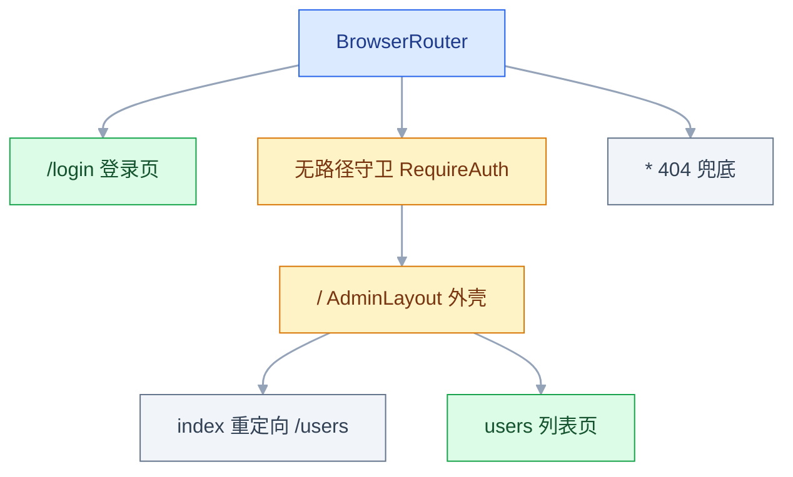
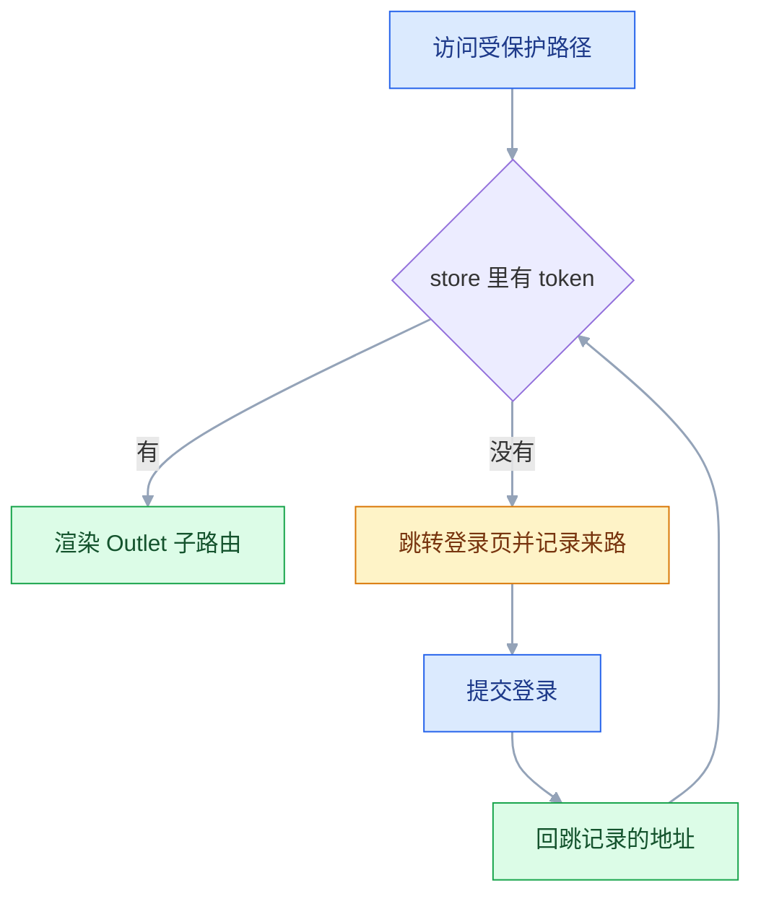
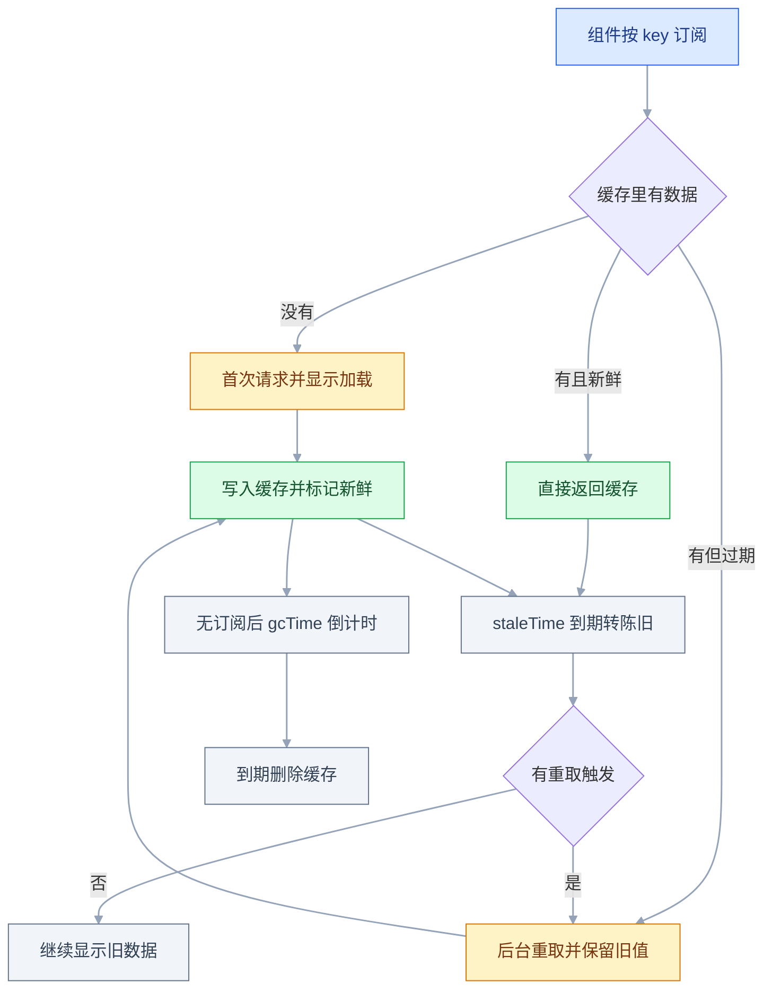

# React 生态

## 一、工程案例：搭一个带登录守卫的用户管理模块

**场景**：一个中后台的用户管理页，需要登录才能进；刷新后登录态不丢；列表支持分页与搜索，且 URL 可以直接分享；新增与编辑共用一个弹窗，字段要校验；删除要二次确认，成功后列表自动更新。

**产出**：一个可运行的前端模块，包含路由守卫、持久化登录态、URL 驱动的列表、缓存失效、表单校验五条链路。数据来自项目内的内存 mock，增删改在本次会话内真实生效，刷新页面后回到初始数据。

**技术前提**：Vite + React + TypeScript，依赖版本以官方当前稳定版为准。路由、全局状态、服务端状态、表单、组件库各选一个库。

### 1.1 依赖与目录

```bash
npm create vite@latest admin-demo -- --template react-ts
cd admin-demo && npm install
npm install react-router-dom zustand @tanstack/react-query react-hook-form zod @hookform/resolvers antd
npm install -D @tanstack/react-query-devtools
npm run dev
```

`-D` 那一行装的是可选的调试工具，不装也能完成验收，用 Network 面板代替即可。

```text
src/
├── api/            ← mock 数据、查询键
├── stores/auth.ts  ← token 与当前用户
├── routes/         ← 守卫、布局
├── features/users/ ← 列表页、弹窗、schema
├── pages/          ← 登录页
└── App.tsx / main.tsx
```

下面的片段按文件路径给出，省略了 `import` 与样式；照路径建文件、补上对应库的具名导入即可运行，组件库统一用 AntD。

### 1.2 mock 接口

```ts
// src/api/mock.ts
export type Role = 'admin' | 'editor' | 'viewer';
export type User = { id: number; name: string; email: string; role: Role };
export type UserInput = Omit<User, 'id'>;

let users: User[] = Array.from({ length: 23 }, (_, i) => ({
  id: i + 1, name: `用户 ${i + 1}`, email: `user${i + 1}@example.com`,
  role: (['admin', 'editor', 'viewer'] as const)[i % 3],
}));
const delay = () => new Promise((resolve) => setTimeout(resolve, 400));

export async function fetchUsers(params: { page: number; pageSize: number; q: string }) {
  await delay();
  const list = params.q
    ? users.filter((u) => u.name.includes(params.q) || u.email.includes(params.q))
    : users;
  const start = (params.page - 1) * params.pageSize;
  return { list: list.slice(start, start + params.pageSize), total: list.length };
}

export async function saveUser(input: UserInput, id?: number) {
  await delay();
  if (id) {
    users = users.map((u) => (u.id === id ? { ...u, ...input } : u));
  } else {
    users = [{ ...input, id: Date.now() }, ...users];
  }
}

export async function deleteUser(id: number) {
  await delay();
  users = users.filter((u) => u.id !== id);
}
```

数据放在模块级变量里，是为了让整条链路不需要后端也能验收。接真实接口时只替换这四个函数，页面代码不动。

### 1.3 登录态与守卫

```ts
// src/stores/auth.ts
import { create } from 'zustand';
import { persist } from 'zustand/middleware';

type AuthState = {
  token: string | null;
  user: { id: number; name: string } | null;
  login: (token: string, user: { id: number; name: string }) => void;
  logout: () => void;
};
export const useAuthStore = create<AuthState>()(persist((set) => ({
  token: null,
  user: null,
  login: (token, user) => set({ token, user }),
  logout: () => set({ token: null, user: null }),
}), { name: 'admin-auth', partialize: (s) => ({ token: s.token, user: s.user }) }));
```

```tsx
// src/routes/RequireAuth.tsx
export function RequireAuth() {
  const token = useAuthStore((s) => s.token);
  const location = useLocation();
  if (!token) {
    const from = `${location.pathname}${location.search}`;
    return <Navigate to="/login" replace state={{ from }} />;
  }
  return <Outlet />;
}
```

守卫没有 `path`，它是一条无路径布局路由，用一次判断包住一组子路由。`replace` 让登录页不进入历史记录。

```tsx
// src/pages/LoginPage.tsx
export default function LoginPage() {
  const navigate = useNavigate();
  const login = useAuthStore((s) => s.login);
  const location = useLocation();
  const from = (location.state as { from?: string } | null)?.from ?? '/users';
  const submit = () => {
    login('demo-token', { id: 1, name: '管理员' });
    navigate(from, { replace: true });
  };
  return (
    <Card title="登录" style={{ width: 340, margin: '120px auto' }}>
      <Form layout="vertical" onFinish={submit}>
        <Form.Item name="username" label="账号" rules={[{ required: true }]}><Input /></Form.Item>
        <Form.Item name="password" label="密码" rules={[{ required: true }]}><Input.Password /></Form.Item>
        <Button type="primary" htmlType="submit" block>登录</Button>
      </Form>
    </Card>
  );
}
```

### 1.4 查询键与列表页

```ts
// src/api/queryKeys.ts
export const userKeys = {
  all: ['users'] as const,
  list: (params: { page: number; pageSize: number; q: string }) =>
    [...userKeys.all, 'list', params] as const,
};
```

```tsx
// src/features/users/UserListPage.tsx
const PAGE_SIZE = 8;

export default function UserListPage() {
  const { message, modal } = App.useApp();
  const queryClient = useQueryClient();
  const [searchParams, setSearchParams] = useSearchParams();
  const page = Math.max(1, Number(searchParams.get('page')) || 1);
  const q = searchParams.get('q') ?? '';
  const [open, setOpen] = useState(false);
  const [editing, setEditing] = useState<User | null>(null);

  const { data, isLoading, isFetching, isError, error } = useQuery({
    queryKey: userKeys.list({ page, pageSize: PAGE_SIZE, q }),
    queryFn: () => fetchUsers({ page, pageSize: PAGE_SIZE, q }),
    placeholderData: (prev) => prev,   // 翻页时保留上一页，避免闪空
  });

  const invalidate = () => queryClient.invalidateQueries({ queryKey: userKeys.all });
  const remove = useMutation({
    mutationFn: deleteUser,
    onSuccess: () => { message.success('删除成功'); invalidate(); },
    onError: (e: Error) => message.error(e.message),
  });

  const columns: ColumnsType<User> = [
    { title: 'ID', dataIndex: 'id', width: 70 },
    { title: '姓名', dataIndex: 'name' },
    { title: '邮箱', dataIndex: 'email' },
    {
      title: '操作', key: 'action', width: 140,
      render: (_, record) => (
        <Space>
          <Button size="small" onClick={() => { setEditing(record); setOpen(true); }}>编辑</Button>
          <Button size="small" danger onClick={() => modal.confirm({
            title: `确认删除「${record.name}」？`,
            okButtonProps: { danger: true },
            onOk: () => remove.mutateAsync(record.id),
          })}>删除</Button>
        </Space>
      ),
    },
  ];

  return (
    <Space direction="vertical" style={{ width: '100%' }} size="middle">
      <Space style={{ justifyContent: 'space-between', width: '100%' }}>
        <Input.Search placeholder="搜索姓名或邮箱" allowClear key={q} defaultValue={q} style={{ width: 260 }}
          onSearch={(v) => setSearchParams(v ? { q: v, page: '1' } : { page: '1' })} />
        <Button type="primary" onClick={() => { setEditing(null); setOpen(true); }}>新增用户</Button>
      </Space>
      {isError && <p style={{ color: '#c00' }}>加载失败：{(error as Error).message}</p>}
      <Table<User> rowKey="id" loading={isLoading} dataSource={data?.list ?? []} columns={columns}
        pagination={{ current: page, pageSize: PAGE_SIZE, total: data?.total ?? 0,
          onChange: (next) => {
            const params = new URLSearchParams();
            if (q) params.set('q', q);
            params.set('page', String(next));
            setSearchParams(params);
          } }} />
      {isFetching && !isLoading && <span style={{ color: '#888' }}>后台刷新中...</span>}
      <UserFormModal open={open} initial={editing} onCancel={() => setOpen(false)}
        onSaved={() => { setOpen(false); invalidate(); }} />
    </Space>
  );
}
```

三个状态各归其位：`page` 与 `q` 在 URL 里，弹窗开关在局部 state，列表数据在 Query 缓存里。任何一处刷新都不会互相覆盖。搜索框用 `key={q}` 强制跟着 URL 重建，否则浏览器后退到上一个关键词时，输入框里还是旧值。

### 1.5 弹窗表单

```ts
// src/features/users/schema.ts
export const userSchema = z.object({
  name: z.string().min(2, '姓名至少 2 个字符').max(20, '姓名最多 20 个字符'),
  email: z.string().email('邮箱格式不正确'),
  role: z.enum(['admin', 'editor', 'viewer']),
});
export type UserFormValues = z.infer<typeof userSchema>;
```

Zod 3 与 4 对 `z.string().email()` 的推荐写法不同（新版另提供顶层 `z.email()`），具体以官方当前稳定版为准；`z.infer` 的推导方式不变。

```tsx
// src/features/users/UserFormModal.tsx
const EMPTY: UserFormValues = { name: '', email: '', role: 'viewer' };

type Props = {
  open: boolean;
  initial: User | null;
  onCancel: () => void;
  onSaved: () => void;
};

export function UserFormModal({ open, initial, onCancel, onSaved }: Props) {
  const { message } = App.useApp();
  const { control, handleSubmit, reset, formState: { errors } } = useForm<UserFormValues>({
    resolver: zodResolver(userSchema), defaultValues: EMPTY,
  });

  useEffect(() => {
    if (!open) return;
    reset(initial ? { name: initial.name, email: initial.email, role: initial.role } : EMPTY);
  }, [open, initial, reset]);

  const save = useMutation({
    mutationFn: (values: UserFormValues) => saveUser(values, initial?.id),
    onSuccess: () => { message.success(initial ? '保存成功' : '创建成功'); onSaved(); },
    onError: (e: Error) => message.error(e.message),
  });

  const field = (name: 'name' | 'email', label: string) => (
    <Form.Item label={label} validateStatus={errors[name] ? 'error' : ''} help={errors[name]?.message}>
      <Controller name={name} control={control} render={({ field: f }) => <Input {...f} />} />
    </Form.Item>
  );

  return (
    <Modal open={open} title={initial ? '编辑用户' : '新增用户'} footer={null}
      onCancel={onCancel}>
      <Form layout="vertical" onFinish={handleSubmit((values) => save.mutate(values))}>
        {field('name', '姓名')}
        {field('email', '邮箱')}
        <Form.Item label="角色" validateStatus={errors.role ? 'error' : ''} help={errors.role?.message}>
          <Controller name="role" control={control}
            render={({ field: f }) => (
              <Select {...f} options={[
                { value: 'admin', label: '管理员' },
                { value: 'editor', label: '编辑' },
                { value: 'viewer', label: '访客' },
              ]} />
            )} />
        </Form.Item>
        <Button type="primary" htmlType="submit" loading={save.isPending} block>保存</Button>
      </Form>
    </Modal>
  );
}
```

弹窗只收集并校验数据，保存后调用 `onSaved`，由列表页统一失效。它因此可以搬到详情页复用，不需要知道自己被谁包着。回填统一走 `reset`，不依赖弹窗关闭时是否销毁内容，也就避开了一个在不同版本里改过名字的 Modal 属性。

### 1.6 路由表与 Provider

守卫只做判断，壳由布局承担：路由表里引用的 `AdminLayout` 必须单独实现，否则 `App.tsx` 指向的是一个不存在的组件。

```tsx
// src/routes/AdminLayout.tsx
export function AdminLayout() {
  const user = useAuthStore((s) => s.user);
  const logout = useAuthStore((s) => s.logout);
  return (
    <>
      <header style={{ display: 'flex', justifyContent: 'space-between',
        padding: '12px 24px', borderBottom: '1px solid #e5e7eb' }}>
        <strong>用户管理</strong>
        <Space>
          <span>{user?.name}</span>
          <Button size="small" onClick={logout}>退出</Button>
        </Space>
      </header>
      <main style={{ padding: 24 }}><Outlet /></main>
    </>
  );
}
```

退出只需清空 store：`RequireAuth` 读的 token 变成 null，下一次渲染就把人送回登录页，不必在按钮里手写跳转。

```tsx
// src/App.tsx
export default function App() {
  return (
    <Routes>
      <Route path="/login" element={<LoginPage />} />
      <Route element={<RequireAuth />}>
        <Route path="/" element={<AdminLayout />}>
          <Route index element={<Navigate to="/users" replace />} />
          <Route path="users" element={<UserListPage />} />
        </Route>
      </Route>
      <Route path="*" element={<p style={{ padding: 40 }}>404</p>} />
    </Routes>
  );
}
```

```tsx
// src/main.tsx
const queryClient = new QueryClient({
  defaultOptions: { queries: { staleTime: 30_000, retry: 1, refetchOnWindowFocus: false } },
});

createRoot(document.getElementById('root')!).render(
  <StrictMode>
    <ConfigProvider locale={zhCN} theme={{ token: { colorPrimary: '#1677ff' } }}><AntdApp>
      <QueryClientProvider client={queryClient}><BrowserRouter><App /></BrowserRouter></QueryClientProvider>
    </AntdApp></ConfigProvider>
  </StrictMode>,
);
```

Provider 之间没有强制的依赖顺序，只有「谁提供、谁才能用」：需要 `App.useApp()` 的组件必须位于 `<AntdApp>` 内，调用 `useQuery` 的组件必须在 `QueryClientProvider` 内，`useNavigate` 必须在路由 Provider 内。示例从外到内按主题、提示上下文、Query、路由排列，只是让依赖关系一眼可见；顺序颠倒时，对应 Hook 会直接抛错，而不是悄悄返回空值。

### 1.7 验收

| # | 检查项 | 命令或检查 | 通过标准 |
|---|---|---|---|
| 1 | 类型检查 | `npx tsc -b` | 无输出、退出码 0 |
| 2 | 构建 | `npm run build` | 成功，产物在 `dist/` |
| 3 | 未登录拦截 | 清空 localStorage 并刷新后访问 `/users` | 跳到 `/login` |
| 4 | 登录回跳 | 从 `/users?page=2` 被拦后登录 | 回到 `/users?page=2` |
| 5 | 刷新保持 | 登录后按 F5 | 仍在 `/users`，localStorage 有 `admin-auth` |
| 6 | URL 分页 | 点第 2 页 | 地址变成 `?page=2`，刷新后仍在第 2 页 |
| 7 | 搜索复位 | 搜索关键词后回车 | URL 为 `?q=...&page=1`，结果匹配 |
| 8 | 新增 | 填合法数据保存 | 弹窗关闭，总数加一 |
| 9 | 校验 | 姓名只输 1 个字 | 红字提示，请求不发出 |
| 10 | 编辑回填 | 点某行编辑 | 三个字段都是该行的值 |
| 11 | 删除 | 点删除并确认 | 提示成功，该行消失，总数减一 |
| 12 | 请求次数 | Network 面板观察删除成功 | 列表 GET 只新增一次，没有重复请求 |
| 13 | 退出 | 点右上角退出 | 回到 `/login`，`admin-auth` 里的 token 为 null |

## 二、高频问答：会卡住你的地方，也是面试最常问的

### 2.1 查询键没带分页参数，翻页不刷新

**现场**

先确认 state 真的变了：把 `page` 打印出来；再打开 React Query Devtools 看 key 是否随页码变化，Network 里是否只请求了一次。

**要点**

- 翻页不刷新不是分页组件坏了，而是 `queryKey` 没带分页参数——key 没变，Query 认为还是同一份缓存。
- 缓存以 key 为唯一标识，所有会改变结果的参数都必须进 key：分页、搜索、排序、筛选。
- 只检查 UI 事件会把人引向组件，实际 state 早就变了，是缓存没换。

**追问**

- 键里漏了参数会怎样？→ 命中旧缓存，翻到第几页都显示第一页的数据。
- 参数对象字段顺序不同算不同 key 吗？→ 按结构比较，顺序不影响。
- 怎么保证键的结构一致？→ 集中在一个 `queryKeys.ts` 里生成。

### 2.2 失效之后列表不动

**现场**

在 Devtools 里点一次 Invalidate 手动试；看该 query 是否真的进入 fetching；再把失效 key 与实际查询 key 的前缀对一遍。

**要点**

- 失效不是「全局刷新」，只对 key 以它开头的查询生效。
- 查 `['users','detail',id]` 却失效 `['user']`，前缀不匹配，什么都不会发生。
- 失效只对还挂载的查询立即重取，未挂载的查询下次使用时才重取。

**追问**

- 怎么只失效第 1 页？→ 键精确到参数，再加 `exact: true`。
- 失效了页面还是旧值？→ 先查 key 前缀，再查该查询是否还挂载。
- 失效和重新请求是一回事吗？→ 不是，失效只是标记，重取发生在还挂载的查询上。

### 2.3 Zustand 选择器返回新对象，组件无限重渲染

**现场**

在组件里打印渲染次数，未操作任何按钮也在增长；把选择器改成单字段再看一次。

```tsx
const { token, user } = useAuthStore((s) => ({ token: s.token, user: s.user })); // 每次新对象
const token = useAuthStore((s) => s.token);                                      // 单字段
const { token, user } = useAuthStore(useShallow((s) => ({ token: s.token, user: s.user })));
```

**要点**

- 选择器每次返回新对象，Zustand 默认按 `Object.is` 比较引用，永远不相等，订阅者被反复通知。
- 选择器不是「只取值」，它的返回值参与比较；多字段要用 `useShallow` 做浅比较。
- 单字段选择器只在那个字段变化时才触发重渲染。

**追问**

- 为什么改成单字段就好了？→ 引用没变，`Object.is` 判等。
- `useShallow` 解决什么？→ 字段都没变就不重渲染。
- 把整个 store 取出来会怎样？→ 任何字段变化都重渲染。

### 2.4 刷新后登录态丢失

**现场**

打开 Application 面板看 localStorage 里有没有 `admin-auth`；再打印 store 的初始值，判断是没存上还是读晚了。

**要点**

- persist 的 `name` 必须与面板里的 key 一致，`partialize` 漏了 token 也等于没存。
- 服务端渲染场景还要等水合完成再读，否则读到的是初始值。
- 只盯着代码里的 `persist` 调用，看不出 key 写错、字段被过滤这类问题。

**追问**

- localStorage 有值、界面还是未登录？→ 水合前就做了判断，或 `partialize` 没带 token。
- 退出后刷新又变回登录态？→ 存储没清，persist 又把旧值读了回来。
- token 该存哪？→ 需要服务端读就放 Cookie，前端 store 里那份只服务体验。

### 2.5 守卫把登录页也包住，无限重定向

**现场**

看地址栏是否在 `/login` 原地闪烁；把路由嵌套层级列出来，确认 `/login` 是否落在守卫内部。

**要点**

- 守卫是布局组件，不是全局中间件；它包住谁，谁就被拦。
- `/login` 与 404 必须放在守卫外面，重定向目标本身也要在守卫外，否则条件永远不满足。
- 地址栏原地闪烁、历史记录越堆越长，就是重定向回到了自己。

**追问**

- 已登录访问 `/login` 怎么处理？→ 在登录页里判断并跳回业务页。
- 前端守卫能当权限边界吗？→ 不能，接口必须在服务端校验 token 与权限。
- 为什么用 `replace`？→ 登录页不进历史记录，后退不会回到被拦地址。

### 2.6 编辑弹窗打开后字段是空的

**现场**

在弹窗里打印 `initial`，有值但输入框为空；再确认 `defaultValues` 的读取时机。

**要点**

- `defaultValues` 只在首次挂载时读取；弹窗一直挂载着，后续 `initial` 变化不会自动回填。
- 回填要显式 `reset(values)`，在 `open` 变为 true 时调用。
- 只查父组件传参，会得出「数据没传进来」的错误结论。

**追问**

- 为什么新增正常、编辑为空？→ 新增用的就是初始值，编辑需要换一份。
- 除了 `reset` 还有什么办法？→ 给弹窗加 `key` 强制重建。
- 回填会覆盖用户草稿吗？→ 会，打开即重置是预期行为。

### 2.7 AntD 的 message 静态方法读不到主题

**现场**

看控制台是否出现「Static function can not consume context」类警告；再确认调用它的组件是否在 `<AntdApp>` 内。

**要点**

- `import { message } from 'antd'` 是静态实例，脱离了 `ConfigProvider` 的上下文。
- 主题、语言、弹层容器都靠 Context 下发，静态方法读不到。
- 改用 `App.useApp()` 取 `message` 与 `modal`，组件必须在 `<AntdApp>` 内。

**追问**

- 为什么反复改 `theme.token` 没用？→ 值没错，是调用点拿不到上下文。
- 组件外要提示怎么办？→ 单独包一层 Provider，或把提示放回组件里。
- `modal.confirm` 也一样吗？→ 一样，同样从 `App.useApp()` 取。

### 2.8 在请求拦截器里调用 Hook 报错

**现场**

报错信息指向 invalid hook call；确认调用点是否在组件渲染过程中。

**要点**

- Hook 只能靠调用顺序工作，必须在组件渲染期间调用。
- 拦截器是普通模块，不在渲染过程中，调 `useXxx` 必然报错。
- 组件外读 store 用 `useAuthStore.getState()`，写用 `setState`。

**追问**

- 换个写法绕过 lint 行不行？→ 不行，运行时照样抛 invalid hook call。
- 拦截器里要拿 token 怎么做？→ `getState()` 读快照，不订阅。
- 拦截器该放什么？→ 纯协议逻辑：加头、剥壳、错误分类。

### 2.9 刷新 `/users` 返回 404

**现场**

直接访问 `/users`，再和「从首页点进去」对比；Network 里那份文档请求就是 404 的来源。

**要点**

- 单页应用只有一张 `index.html`，服务器按真实路径找文件，当然找不到 `/users`。
- 生产环境要回退：Nginx 配 `try_files $uri $uri/ /index.html;`，或部署平台开启 SPA 回退。
- 开发环境 Vite 默认已回退，所以只在线上暴露。

**追问**

- 改成 hash 模式能绕过吗？→ 能，但 URL 会多一个 `#`。
- 回退配了还是 404？→ 检查 location 是否只匹配了静态资源前缀。
- 接口路径也会被回退成 HTML 吗？→ 会，`/api` 要单独反代，别落进 `try_files`。

### 2.10 RHF 与 AntD Form 混用，两套状态打架

**现场**

打印 `form.getFieldsValue()` 与 RHF 的 `getValues()`，两边不一致；再确认 `Form.Item` 是否写了 `name`。

**要点**

- `Form.Item name` 让 AntD 自己管值，`Controller` 又让 RHF 管值，两个来源互相覆盖。
- 二选一：用 RHF 时 AntD 的 `Form` 只做布局，`Form.Item` 不写 `name`，值全走 `Controller`。
- 症状是校验不生效或取不到值，很容易被当成规则写错。

**追问**

- 两套都用会怎样？→ 后渲染的一方覆盖，提交时拿到另一边没同步的值。
- 为什么 `defaultValues` 不生效？→ AntD 的 `initialValues` 与 RHF 的 `defaultValues` 是两套。
- 只用 AntD Form 行不行？→ 行，字段少时更省事；要 schema 校验就用 RHF。

### 2.11 isLoading 与 isFetching 混用，翻页闪空

**现场**

Devtools 里看新 key 是否首次进入 fetching；再看旧数据是否还在。

**要点**

- 翻页换了 key，新 key 没有缓存，`data` 变 `undefined`、`isLoading` 为 true，表格被清空。
- `placeholderData: (prev) => prev` 保留上一页数据，表格就不会闪空。
- `loading` 只绑 `isLoading`，后台刷新用 `isFetching` 单独提示。

**追问**

- `isLoading` 与 `isFetching` 的区别？→ 前者只在新 key 无缓存时 true，后者每次请求都 true。
- 接口不慢为什么也闪？→ 是缓存切换，不是网络问题。
- 保留旧数据会显示错页吗？→ 会短暂错位，用后台刷新提示交代清楚。

### 2.12 Table 缺 rowKey，选择与展开错乱

**现场**

勾选一行后删除，看剩余行的选中状态是否跳到别的行。

**要点**

- 没有稳定 rowKey 时，AntD 退回用索引，删除或排序后行身份错位。
- rowKey 要选唯一且稳定的字段，`id` 合适，`name` 可能重复。
- 这不是组件库的 bug，是行身份没定义。

**追问**

- 为什么用索引会错？→ 删除后下标前移，复用到了别的记录。
- rowKey 能返回对象吗？→ 要字符串或数字，拼出来的复合键也行。
- 要全局唯一吗？→ 当前数据源内唯一且稳定即可。

---

## 三、核心知识：从零开始要建立的东西

### 3.1 客户端状态与服务端状态的边界

服务端状态是「服务器拥有、前端只持有副本」的数据。它会过期、会被别人修改、请求可能失败。客户端状态是「前端拥有」的数据，例如弹窗开关、主题、表单草稿。

| 判据 | 客户端状态 | 服务端状态 |
|---|---|---|
| 数据的唯一来源 | 浏览器 | 服务器 |
| 典型例子 | 主题、侧边栏折叠、当前筛选 | 用户列表、订单详情 |
| 过期问题 | 不存在 | 必须处理 |
| 常用工具 | useState、Context、Zustand | TanStack Query、SWR |
| 放进错误工具的结果 | 缓存逻辑要手写 | 全局 store 越写越像请求库 |

边界：登录 token 的来源是接口，但存下来之后归前端管理，放客户端 store 合理；用户列表即使只读一次，也属于服务端状态，应交请求库缓存。

### 3.2 路由表与嵌套布局

路由表是 URL 与组件的映射。嵌套路由把「始终存在的壳」与「会变化的内容」分开，壳只渲染一次，内容通过 `<Outlet />` 插入。父路由 `path="/"` 配 `index` 指向默认子路由，其余子路由写相对路径。



守卫与外壳各占一层：守卫决定放不放行，外壳负责页头与内容区，列表页只关心自己那一屏。

| 写法 | 作用 |
|---|---|
| `path="/users"` | 绝对路径 |
| `path="users"` | 相对父路由的路径 |
| `index` | 父路径的默认子路由 |
| `<Outlet />` | 子路由的渲染位置 |
| `path="*"` | 兜底，通常放 404 |

边界：布局保持挂载意味着布局里的状态不会因换页丢失，但也不会自动重置。需要在换页时清空的输入，应放在页面组件里，而不是布局里。

### 3.3 URL 作为列表状态的载体

分页、搜索、排序这类「用户希望能分享和后退」的状态，放 URL 比放 state 更合适。URL 变化会触发路由重渲染，Query 的 key 随之变化，数据自动重取。读取用 `searchParams.get('page')`，写入用 `setSearchParams`，搜索时把页码重置为 1。

| 状态 | 放哪 | 原因 |
|---|---|---|
| 当前页码 | URL | 可分享、可刷新 |
| 搜索词 | URL | 同上，且要能后退 |
| 弹窗开关 | 局部 state | 只影响当前页面，不需要分享 |
| 表格列宽 | localStorage | 属于个人偏好，不属于资源定位 |

边界：URL 不适合放高频变化的值，例如鼠标位置、输入框的每次击键。搜索框通常只在回车或点搜索时写 URL，输入过程留在本地 state。

### 3.4 守卫的条件渲染本质

路由守卫不是中间件，而是一个「根据条件决定渲染什么」的布局组件。没有权限时返回 `<Navigate>`，有权限时返回 `<Outlet>`。



循环的边界在「登录页本身不在这张图里」：它不在守卫内部，未登录访问 `/login` 时不会再被拦一次。

| 关注点 | 做法 |
|---|---|
| 未登录 | 重定向到登录页，记住来源 |
| 已登录访问登录页 | 在登录页里判断并跳回业务页 |
| 角色权限 | 再包一层 `RequireRole`，或在一处统一判断 |
| 重定向循环 | 确保登录页不在守卫内部 |

边界：前端守卫只改善体验，不能当安全边界。接口必须在服务端校验 token 与权限，否则改一行 JS 就能绕过。

### 3.5 Zustand 的订阅粒度

Zustand 把状态放在组件树外，组件通过选择器订阅自己关心的字段。选择器返回值的比较方式决定重渲染范围：默认按 `Object.is` 比引用，单字段选择器 `(s) => s.token` 只在 token 变化时重渲染；返回新对象的 `(s) => ({ token: s.token })` 每次都是新引用，需要用 `useShallow` 包一层做浅比较。

| 选择器写法 | 结果 |
|---|---|
| `(s) => s.token` | token 不变就不重渲染 |
| `(s) => ({ token: s.token })` | 每次新对象，`Object.is` 判不等 |
| `useShallow((s) => ({ token, user }))` | 浅比较，字段都没变就不重渲染 |
| `(s) => s.users.filter(...)` | 每次新数组，效果同上 |

边界：Zustand 不解决服务端数据的缓存与失效。把列表放进去，等于自己实现一套请求库；它适合 token、主题、跨页面的 UI 开关这类客户端状态。

> **面试**：常问「Zustand 的选择器为什么会引起重渲染？」答：选择器返回新对象时按引用比较永远不等，单字段或 `useShallow` 浅比较才能收敛。

### 3.6 Redux Toolkit 的约束成本

Redux 要求所有变更通过 action，reducer 是纯函数。约束带来可追踪性，也带来样板代码。RTK 的 `createSlice` 用 Immer 允许在 reducer 里直接改 `state.token`，把展开语法省掉。

| | Zustand | Redux Toolkit |
|---|---|---|
| 代码量 | 一个文件 | slice、store、类型导出 |
| 更新方式 | 直接 `set` | 必须 dispatch action |
| 调试 | 一般 | 时间旅行、action 日志 |
| 中间件 | persist 等少量 | 生态丰富 |
| 适合 | 中小项目、快速迭代 | 多人协作、状态变更需审计 |

边界：项目只有登录态与一个弹窗开关时，Redux 的约束成本高于收益。团队已有规范、或状态变更需要严格审计时，RTK 的价值才显现。

### 3.7 查询键的设计

查询键是缓存的唯一标识。键里必须包含所有会改变结果的参数，且结构要能表达从属关系。

```ts
['users']                                      // 用户域
['users', 'list', { page: 1, q: '' }]          // 某一页列表
['users', 'detail', 123]                       // 某个用户详情
```

| 需求 | 键的写法 |
|---|---|
| 失效整个用户域 | `invalidateQueries({ queryKey: ['users'] })` |
| 只失效第 1 页 | 键精确到参数，加 `exact: true` |
| 详情与列表分开 | 用 `'list'` 与 `'detail'` 区分层级 |
| 避免拼写错误 | 集中在一个 `queryKeys.ts` 里生成 |

边界：键里的对象按结构比较，但字段顺序不影响结果。不要把随机数、当前时间放进去，否则每次都 miss；也不要把无关参数放进去，否则无效请求变多。

> **面试**：常问「查询键怎么设计？」答：所有会改变结果的参数都进键，按域、列表、详情分层，集中生成避免拼写错误。

### 3.8 staleTime 与 gcTime

`staleTime` 决定数据多久算「新鲜」，新鲜期内即使重新挂载、切回标签页也不会重取；`gcTime` 决定没有组件使用后，缓存保留多久再删除。

| 配置 | 含义 | 典型值 |
|---|---|---|
| `staleTime` | 新鲜期 | 列表 30 秒，配置 5 分钟 |
| `gcTime` | 无订阅后的保留期 | 默认 5 分钟 |
| `refetchOnMount` | 挂载时是否重取 | 默认 true，但数据新鲜时不重取 |
| `refetchOnWindowFocus` | 切回标签页是否重取 | 中后台常关 |



`staleTime` 管的是「要不要再请求」，`gcTime` 管的是「没人用了还能留多久」，两条计时互不相干。

边界：`staleTime` 调大减少请求，但数据可能旧；调成 0 表示数据一拿到就算过期，已经开启的触发点（挂载、聚焦、重连）都会重取。它不是「缓存时长」，缓存是否还在由 `gcTime` 与订阅状态决定。

> **面试**：常问「staleTime 和 gcTime 的区别？」答：一个管多久算新鲜、要不要再请求，一个管没人订阅后缓存还能留多久。

### 3.9 变更后的缓存失效

写操作成功后，列表缓存不会自动知道数据变了。常见做法是让相关键失效，触发还挂载着的查询重新请求。

```ts
const queryClient = useQueryClient();
useMutation({
  mutationFn: deleteUser,
  onSuccess: () => queryClient.invalidateQueries({ queryKey: ['users'] }),
});
```

| 策略 | 适用 | 代价 |
|---|---|---|
| 失效整个域 | 关联页面多，数据关系复杂 | 可能多请求几次 |
| 精确失效某页 | 结构简单，键设计清晰 | 容易漏掉其他页面 |
| 直接写缓存 | 已知新数据，想省一次请求 | 要与服务端返回保持一致 |

边界：失效只对还挂载的查询立即重取，未挂载的查询会在下次使用时重取。若发现「失效了但页面没变」，先检查 key 前缀，再检查该查询是否真的在挂载。

### 3.10 乐观更新与回滚

乐观更新在请求发出前先改本地缓存，让界面立刻响应；失败时恢复快照，最后再与服务器对齐。下面是 `useMutation` 的 options 片段，`key` 必须是当前列表正在用的那个键。

```ts
type UserPage = { list: User[]; total: number };
const key = userKeys.list({ page, pageSize: PAGE_SIZE, q }); // 必须与 useQuery 的键完全一致

onMutate: async (id: number) => {
  await queryClient.cancelQueries({ queryKey: userKeys.all });
  const previous = queryClient.getQueryData<UserPage>(key);
  queryClient.setQueryData<UserPage>(key, (old) =>
    old ? { ...old, list: old.list.filter((u) => u.id !== id) } : old);
  return { previous };
},
onError: (_e, _id, ctx) => {
  if (ctx?.previous) queryClient.setQueryData<UserPage>(key, ctx.previous);
},
onSettled: () => queryClient.invalidateQueries({ queryKey: userKeys.all }),
```

快照必须存在与查询相同的键下：键里少了分页参数，回滚时写的是另一份缓存，界面就会停在「删了但没删掉」的中间状态。

| 阶段 | 动作 |
|---|---|
| `onMutate` | 取消在飞请求、保存快照、改缓存 |
| `onError` | 用快照回滚 |
| `onSettled` | 无论成败都失效，最终以服务器为准 |

边界：乐观更新适合成功率高、失败可回滚的操作，例如点赞、勾选、删除。涉及金额、库存扣减时，不要先改界面再等结果，必须以服务端确认为准。

### 3.11 表单的非受控模型

传统受控表单每次击键都更新 state 并重渲染整个表单。React Hook Form 默认让 DOM 自己管值，提交时才统一读取，写法是 `<input {...register('name', { required: '必填' })} />`。

| | 受控 state | RHF 非受控 |
|---|---|---|
| 每次击键重渲染 | 是 | 默认否 |
| 实时联动 | 直接读 state | 用 `watch` |
| 字段多时性能 | 下降明显 | 基本稳定 |
| 与组件库配合 | 直接传 value | 用 `Controller` |

边界：非受控不等于不能校验。规则在 `register` 或 schema 里声明，错误通过 `formState.errors` 读取；需要实时预览的字段用 `watch`，但只订阅那一个字段。

### 3.12 schema 校验与类型推导

把校验规则写成 schema，同时得到运行时校验与静态类型，避免「类型写一遍、规则再写一遍」。例如 `z.object({ name: z.string().min(2) })` 加上 `z.infer<typeof schema>` 就同时得到规则与 `{ name: string }`。

| 能力 | 作用 |
|---|---|
| `z.infer` | 从 schema 推导类型 |
| `safeParse` | 返回成功或错误，不抛异常 |
| `refine` | 跨字段或自定义规则 |
| `transform` | 校验后转换，例如去空格 |

边界：前端 schema 只改善体验，服务端必须再校验一次。两端共用一份 schema 时，注意把只在前端用的规则（例如确认密码）与服务端规则分开。

### 3.13 组件库的主题上下文

组件库的主题、语言、弹层容器都通过 Context 下发。静态方法或脱离 React 树的调用读不到这些上下文。主题与语言由最外层的 `ConfigProvider` 提供，弹层内的 `message` 通过 `App.useApp()` 取得。

| 需求 | 做法 |
|---|---|
| 改主色、圆角 | `theme.token` |
| 改单个组件 | `theme.components` |
| 中文文案 | `locale={zhCN}` |
| 弹层内拿 message | `App.useApp()` |

边界：主题上下文只影响 React 树内的组件。通过 `createRoot` 单独渲染的弹层、或者直接调用的静态方法，需要额外包一层 Provider，否则样式与语言会退回默认。

### 3.14 请求层的集中处理

token 注入、错误码转换、超时、取消，适合放在一个请求实例里，而不是每个调用点重复。请求函数在组件外读取 `useAuthStore.getState().token`，统一加上 `Authorization` 头；遇到 401 时只清登录态，跳转交给守卫，其他非 2xx 直接抛出。

| 关注点 | 放置位置 |
|---|---|
| token 注入 | 请求层统一加头 |
| 401 处理 | 请求层清登录态，跳转交给路由守卫 |
| 业务错误提示 | 调用点或全局错误回调 |
| 请求取消 | 调用点传 `signal` |

边界：请求层不要直接操作页面状态或弹窗。它只负责协议层，把错误抛给调用方，由调用方决定提示还是重试。

### 3.15 生态选型的成本核算

每引入一个库，就多一份学习、升级、排障成本。判断标准是「这个问题是否真实且反复出现」，不是「别人都在用」。

| 问题 | 自建成本 | 用库的信号 |
|---|---|---|
| 多页面路由 | 中，需处理嵌套、参数、回退 | 超过 3 个页面或需要分享 URL |
| 服务端缓存 | 高，竞态、失效、重试都要写 | 任何依赖接口的列表 |
| 全局状态 | 低到中，Context 可撑 | 多个不相邻组件读写同一份数据 |
| 表单校验 | 中，字段一多就重复 | 超过 5 个字段或规则复杂 |
| 组件库 | 高，表格弹窗日期都要造 | 中后台、交付周期紧 |

边界：小工具站只加路由与请求库就够；中后台再补表单与组件库。把所有库一次性装进一个三页项目，构建体积与维护成本都会超过收益。

---

## 四、冷门知识汇总

| 知识点 | 为什么冷门 | 用到时的关键词 |
|---|---|---|
| 路由 `loader` / `action` | 多数项目用组件内取数，数据路由较少见 | 路由级预取、提交、`useLoaderData` |
| `errorElement` | 全局错误边界够用时不会单独配 | 路由级错误、`useRouteError` |
| 基于角色的守卫 | 只有后台权限细分时才需要 | `RequireRole`、权限码、嵌套守卫 |
| Zustand 中间件 | persist 之外很少用 | `immer`、`devtools`、`subscribeWithSelector` |
| Zustand 切片 | 小 store 不需要拆分 | 跨 slice 调用、`get()` |
| RTK Query | 已用 TanStack Query 时不会重复引入 | 服务端状态进 Redux、缓存标签 |
| `useInfiniteQuery` | 列表多为分页，无限滚动是特定交互 | `getNextPageParam`、游标分页 |
| 预取 | 流量不大时优化不明显 | `prefetchQuery`、hover 预取 |
| `useFieldArray` | 动态增减字段是少数表单 | 动态行、数组字段、`append` / `remove` |
| `z.discriminatedUnion` | 只有多种表单形态共用一个入口时才用 | 联合类型、`discriminator`、分支校验 |
| 虚拟表格 | 数据量不到千行不会触发 | `virtual`、固定行高、滚动容器 |
| 微前端 | 组织问题多于技术问题 | qiankun、Module Federation、隔离 |
| MSW | 直连真后端时想不到它，离线开发与测试才用 | 接口 mock、Service Worker、请求断言 |
| 多环境变量 | 只有一个环境时不存在 | `.env.production`、`VITE_` 前缀 |
| 离开页面拦截 | 只有「表单改了一半要离开」才用得上，且依赖数据路由 | `useBlocker`、`beforeunload`、未保存确认 |
