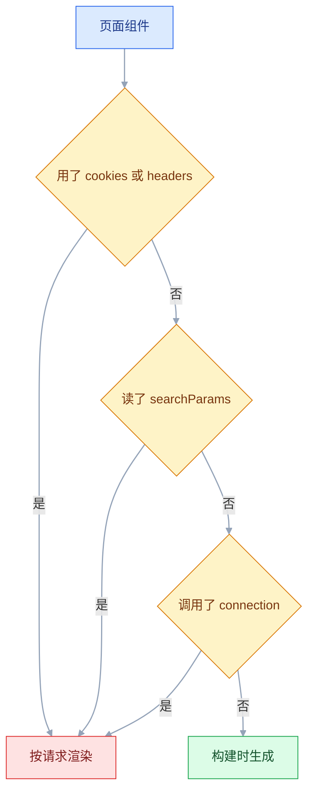

# Next.js

## 一、工程案例：把文章列表页迁到 App Router，做服务端取数、客户端交互与缓存失效

**场景**：一个 Vite + React 博客，列表在浏览器里 `fetch('/api/posts')`，首屏白一下、搜索引擎抓不到正文、发完文章要手动刷新才看见。手上只有 Node 20 和一个 `data/posts.json`，没有独立后端。

**目标**：迁到 App Router 后，列表与详情在服务端出 HTML；搜索和分页写进 URL，可以直接分享；点赞即时反馈；发布后列表立刻更新；`npm run build` 能过，也能部署到普通 Node 服务器。

**产出**：10 个源文件。`/posts` 的标题出现在网页源代码里；`/posts?q=next&page=2` 可复制给任何人；点赞与发布都走 Server Action。

**前提**：Node 20 以上，Next.js 以官方当前稳定版为准，TypeScript 打开。

### 1.1 初始化与目录

```bash
# 中途的 React Compiler、AGENTS.md 等提问按默认回车
npx create-next-app@latest blog-app --typescript --eslint --app --src-dir --import-alias "@/*" --no-tailwind
cd blog-app && npm i server-only
# 先把 data/ 与下面的文件建好，1.6 之后再启动开发服务器
```

新版 `create-next-app` 的推荐默认会开启 Cache Components。本案例为了讲清经典整页缓存模型，先把 `next.config.ts` 换成下面这样；两种模型的差别见 3.6。

```ts
// next.config.ts
import type { NextConfig } from 'next';

const nextConfig: NextConfig = { cacheComponents: false };
export default nextConfig;
```

```text
src/app/layout.tsx / not-found.tsx（可选，没有就用内置 404）
src/app/page.tsx              → /          重定向到 /posts
src/app/posts/page.tsx        → /posts       列表 + 搜索 + 分页
src/app/posts/new/page.tsx    → /posts/new   发布页
src/app/posts/[id]/page.tsx   → /posts/p1    详情
src/components/LikeButton.tsx  'use client'
src/components/PostForm.tsx    'use client'
src/lib/posts.ts               server-only 数据层
src/lib/actions.ts             'use server'
```

`src/app/page.tsx` 换成 `import { redirect } from 'next/navigation'; export default function Home() { redirect('/posts'); }`；`layout.tsx` 用脚手架生成的即可。

### 1.2 只跑在服务端的数据层

`data/posts.json` 先放 7 条，够翻到第 2 页：

```bash
mkdir -p data
cat > data/posts.json <<'JSON'
[
  { "id": "p1", "title": "第一篇文章", "body": "正文一", "likes": 0, "createdAt": "2026-01-01T00:00:00.000Z" },
  { "id": "p2", "title": "第二篇文章", "body": "正文二", "likes": 0, "createdAt": "2026-01-02T00:00:00.000Z" },
  { "id": "p3", "title": "第三篇文章", "body": "正文三", "likes": 0, "createdAt": "2026-01-03T00:00:00.000Z" },
  { "id": "p4", "title": "第四篇文章", "body": "正文四", "likes": 0, "createdAt": "2026-01-04T00:00:00.000Z" },
  { "id": "p5", "title": "第五篇文章", "body": "正文五", "likes": 0, "createdAt": "2026-01-05T00:00:00.000Z" },
  { "id": "p6", "title": "第六篇文章", "body": "正文六", "likes": 0, "createdAt": "2026-01-06T00:00:00.000Z" },
  { "id": "p7", "title": "第七篇文章", "body": "正文七", "likes": 0, "createdAt": "2026-01-07T00:00:00.000Z" }
]
JSON
```

```ts
// src/lib/posts.ts
import 'server-only';                 // 被客户端组件 import 时直接构建失败
import { cache } from 'react';
import { readFile, writeFile } from 'node:fs/promises';
import path from 'node:path';

export type Post = { id: string; title: string; body: string; likes: number; createdAt: string };
const FILE = path.join(process.cwd(), 'data', 'posts.json');
const readAll = async (): Promise<Post[]> => JSON.parse(await readFile(FILE, 'utf8'));
const writeAll = (posts: Post[]) => writeFile(FILE, JSON.stringify(posts, null, 2), 'utf8');

export async function listPosts(q = '', page = 1, size = 5) {
  const all = await readAll();
  const hit = q ? all.filter((p) => p.title.includes(q)) : all;
  const pages = Math.max(1, Math.ceil(hit.length / size));
  const current = Math.min(Math.max(1, page), pages);   // 越界页码夹回最后一页
  return { total: hit.length, page: current, pages, items: hit.slice((current - 1) * size, current * size) };
}

// cache()：同一次请求里 generateMetadata 与页面各调一次，文件只读一次
export const getPost = cache(async (id: string) =>
  (await readAll()).find((p) => p.id === id) ?? null);
export async function addPost(input: { title: string; body: string }) {
  const post: Post = { id: crypto.randomUUID(), ...input, likes: 0, createdAt: new Date().toISOString() };
  await writeAll([post, ...(await readAll())]);
  return post;
}
export async function likePost(id: string) {
  const all = await readAll();
  const hit = all.find((p) => p.id === id);
  if (!hit) throw new Error('文章不存在');
  hit.likes += 1;
  await writeAll(all);
}
```

`server-only` 是这层的门锁。少了它，客户端组件误引 `getPost` 时，报错会是一个难懂的模块解析错误（`node:fs` 无法打包），而不是一句「你越界了」；有它在，构建阶段就会明确拦住。

### 1.3 列表页：搜索与分页写进 URL

```tsx
// src/app/posts/page.tsx
import Link from 'next/link';
import { listPosts } from '@/lib/posts';

type Props = { searchParams: Promise<{ q?: string; page?: string }> };
const SIZE = 5;

export default async function PostsPage({ searchParams }: Props) {
  const sp = await searchParams;                  // ★ 现行稳定版是 Promise
  const q = (sp.q ?? '').trim();
  const { items, total, page, pages } = await listPosts(q, Number(sp.page) || 1, SIZE);

  return (
    <main>
      <h1>文章</h1>
      {/* 原生 GET 表单：不依赖 JS，提交后地址变成 /posts?q=xxx */}
      <form action="/posts" method="get">
        <input name="q" defaultValue={q} placeholder="搜索标题" />
        <button type="submit">搜索</button>
      </form>
      <p>共 {total} 篇，第 {page} / {pages} 页</p>
      <ul>
        {items.map((post) => (
          <li key={post.id}>
            <Link href={`/posts/${post.id}`}>{post.title}</Link>
            <span> ♥ {post.likes}</span>
          </li>
        ))}
      </ul>
      {page > 1 && <Link href={`/posts?q=${encodeURIComponent(q)}&page=${page - 1}`}>上一页</Link>}
      {page < pages && <Link href={`/posts?q=${encodeURIComponent(q)}&page=${page + 1}`}>下一页</Link>}
    </main>
  );
}
```

读 `searchParams` 会让这个路由按请求渲染（经典模型；开启 Cache Components 后只有这个读取点在请求时流式补全）。这是有意的：搜索结果不能被缓存后发给别人，否则 A 搜到的会发给 B。

### 1.4 详情页：404 与元数据

```tsx
// src/app/posts/[id]/page.tsx
import Link from 'next/link';
import { notFound } from 'next/navigation';
import type { Metadata } from 'next';
import { getPost } from '@/lib/posts';
import { LikeButton } from '@/components/LikeButton';

type Props = { params: Promise<{ id: string }> };

export async function generateMetadata({ params }: Props): Promise<Metadata> {
  const post = await getPost((await params).id);
  return post ? { title: post.title, description: post.body.slice(0, 80) } : { title: '文章不存在' };
}

export default async function PostPage({ params }: Props) {
  const { id } = await params;
  const post = await getPost(id);
  if (!post) notFound();                         // 抛异常，交给最近的 not-found.tsx

  return (
    <article>
      <Link href="/posts">← 返回</Link>
      <h1>{post.title}</h1>
      <p>{post.createdAt.slice(0, 10)}</p>
      <div style={{ whiteSpace: 'pre-wrap' }}>{post.body}</div>
      <LikeButton id={post.id} likes={post.likes} />
    </article>
  );
}
```

`notFound()` 不只是画一个 404 页面，它会把 HTTP 状态码设成 404。换成 `return <div>没有</div>`，页面看着一样，搜索引擎和监控看到的都是 200。

### 1.5 点赞：客户端乐观更新

```tsx
// src/components/LikeButton.tsx
'use client';
import { useOptimistic, useTransition } from 'react';
import { likePost } from '@/lib/actions';

export function LikeButton({ id, likes }: { id: string; likes: number }) {
  const [pending, startTransition] = useTransition();
  const [count, addOptimistic] = useOptimistic<number, null>(likes, (n) => n + 1);

  return (
    <button
      disabled={pending}
      onClick={() => startTransition(async () => {
        addOptimistic(null);       // 先把界面改成 +1
        await likePost(id);        // 再发请求
      })}
    >
      ♥ {count}
    </button>
  );
}
```

```ts
// src/lib/actions.ts
'use server';
import { revalidatePath } from 'next/cache';
import { redirect } from 'next/navigation';
import { addPost, likePost as like } from './posts';

export type ActionState = { error?: string };

export async function likePost(id: string): Promise<void> {
  await like(id);
  revalidatePath('/posts');
  revalidatePath(`/posts/${id}`);     // 详情页的缓存一起失效
}

export async function createPost(_prev: ActionState, formData: FormData): Promise<ActionState> {
  const title = String(formData.get('title') ?? '').trim();
  const body = String(formData.get('body') ?? '').trim();
  if (title.length < 2) return { error: '标题至少 2 个字符' };

  const post = await addPost({ title, body });
  revalidatePath('/posts');
  redirect(`/posts/${post.id}`);      // 必须最后调用，它靠抛异常跳转
}
```

弱网下点下去数字立刻变，请求在后台跑；失败时过渡结束，`count` 自动退回服务端给的值。代价是服务端必须真的成功，否则用户会看到数字闪一下又回去。

### 1.6 发布页：表单与 Server Action

```tsx
// src/components/PostForm.tsx
'use client';
import { useActionState } from 'react';
import { createPost, type ActionState } from '@/lib/actions';

export function PostForm() {
  const [state, action, pending] = useActionState(createPost, {} as ActionState);
  return (
    <form action={action}>
      <label>标题<input name="title" required minLength={2} /></label>
      <label>正文<textarea name="body" rows={8} /></label>
      {state.error && <p role="alert">{state.error}</p>}
      <button type="submit" disabled={pending}>{pending ? '发布中…' : '发布'}</button>
    </form>
  );
}
```

页面文件只负责摆放：`src/app/posts/new/page.tsx` 导出 `NewPostPage`，里面渲染 `<h1>写文章</h1>` 和 `<PostForm />`。`useActionState` 的第三个返回值是 `pending`，不必再单独写 `useFormStatus` 子组件。

文件齐了再启动：`npm run dev`（Local: http://localhost:3000），1.7 的 curl 在另一个终端跑。

### 1.7 验收

```bash
curl -s http://localhost:3000/posts | grep -c "第一篇文章"        # ≥ 1
curl -s -o /dev/null -w "%{http_code}\n" http://localhost:3000/posts/not-exist   # 404
curl -s http://localhost:3000/posts/p1 | grep -o "<title>[^<]*</title>"  # <title>第一篇文章</title>
npm run build
# Route (app)
# ┌ ○ /
# ├ ƒ /posts
# ├ ƒ /posts/[id]
# ├ ○ /posts/new
# └ ○ /_not-found
```

| # | 检查项 | 命令或检查 | 通过标准 |
|---|---|---|---|
| 1 | 列表标题进 HTML | `curl -s localhost:3000/posts \| grep -c "第一篇文章"` | 输出 ≥ 1 |
| 2 | 搜索写进 URL | 打开 `/posts?q=第一` | 只剩匹配项，刷新后不变 |
| 3 | 分页可用 | 打开 `/posts?page=2`，再把 page 改成 99 | 第 2 / 2 页、2 条；99 也停在第 2 页 |
| 4 | 详情标题进 head | `curl -s localhost:3000/posts/p1 \| grep -o "<title>[^<]*</title>"` | 含完整 `<title>…</title>` |
| 5 | 不存在的文章 | `curl -s -o /dev/null -w "%{http_code}" localhost:3000/posts/x` | `404` |
| 6 | 点赞即时反馈 | 点击按钮 | 数字立刻 +1，按钮短暂禁用 |
| 7 | 点赞落盘 | 点赞后刷新详情页 | 数字不回退 |
| 8 | 发布后列表更新 | 提交表单，跳到详情后再回 `/posts` | 新文章在第一条，无需手动刷新 |
| 9 | 禁用 JS 仍可读 | 浏览器关闭 JavaScript 后刷新列表，再打开一篇详情 | 列表标题仍在，详情正文也在 |
| 10 | 无水合警告 | 打开控制台 | 没有红色 hydration 报错 |

**边界**：`posts.json` 是演示用的，两个请求同时写会互相覆盖，多实例部署会各写各的。换真实数据库时只改 `src/lib/posts.ts` 的四个函数，页面代码一行不动。另外 `data/` 不会自动进入构建产物，`standalone` 部署要手动带上。

---

## 二、高频问答：会卡住你的地方，也是面试最常问的

### 2.1 服务端组件里写 `useState` 或 `onClick`

**现场**

看报错指向的文件顶部有没有 `'use client'`；再加一行 `console.log(typeof window)`，服务端渲染时会打 `undefined`。

**要点**

- App Router 默认所有组件都是服务端组件，它在服务端渲染出结果，没有组件状态，也没有 DOM 事件可绑。
- 报错通常直接写 `useState only works in a Client Component`，或提示缺少 `'use client'`。
- 纯展示的部分留在服务端，只有需要状态和事件的那一块加指令。

**追问**

- 加了指令就都能用了吗？→ 它划的是模块边界，这个文件及其 import 的模块都进客户端图。
- 服务端组件能用 `async/await` 吗？→ 能，客户端组件不行。
- 为什么不全加指令？→ 客户端 JS 变大，首屏与水合成本都上升。

### 2.2 `'use client'` 加在根布局或页面上

**现场**

`npm run build` 对比该路由的 First Load JS；或在「查看网页源代码」里数 `<script>` 的数量与大小。

**要点**

- `'use client'` 是模块边界，不是开关；这个文件及其 import 的模块都会进客户端图。
- 它不控制是否服务端渲染：首屏 HTML 仍由服务端预渲染，禁 JS 也看得到正文。
- 加在根布局或页面上，会把整棵树拖进客户端图，服务端取数也一起没了。

**追问**

- 为什么加了指令还能看到首屏内容？→ 客户端组件也会在服务端预渲染。
- 边界划在哪最合适？→ 需要状态和事件的最小叶子。
- 服务端组件能 import 客户端组件吗？→ 能，反过来不行。

### 2.3 `params` 或 `searchParams` 直接解构，拿到 undefined

**现场**

`console.log(params)` 打印出 `Promise { <pending> }`；报错常见 `params should be awaited`。

```tsx
// ✘ 旧写法
function Page({ params }: { params: { id: string } }) { return <h1>{params.id}</h1>; }

// ✔ 现行写法
async function Page({ params }: { params: Promise<{ id: string }> }) {
  const { id } = await params;
  return <h1>{id}</h1>;
}
```

**要点**

- 现行稳定版把 `params`、`searchParams`、`cookies()`、`headers()` 都改成异步。
- `params` 是 Promise，直接读 `params.id` 自然是 `undefined`。
- 写法是 `const { id } = await params`，组件本身要是 `async`。

**追问**

- 为什么升级后突然坏了？→ 签名从对象变成 Promise，不是路由没匹配上。
- `cookies()` 也要 await 吗？→ 要，同理。
- 客户端组件里怎么读参数？→ 用 `useParams`，它不靠 props。

### 2.4 数据库改了，页面还是旧数据

**现场**

`npm run build` 输出里看该路由是不是 `○`；改数据后不重新构建，`curl` 一次看是否仍是旧值。

**要点**

- 页面在构建时已经静态生成，HTML 里烘的是构建那一刻的数据。
- `fetch` 默认不缓存，但没有动态 API 的页面仍会被整页缓存，两件事要分开判断。
- 三种改法：`force-dynamic`（每次请求都渲染）、`revalidate = 60`（最多容忍 60 秒旧数据）、写入后 `revalidatePath`。

**追问**

- 怎么确认是整页静态而不是数据库没写进去？→ 改数据文件再 `curl`，值不变就是静态。
- `force-dynamic` 的代价？→ 每次请求都渲染，服务器压力大。
- 开了 Cache Components 呢？→ 这层由 `use cache` 加 `cacheLife` / `cacheTag` 表达。

### 2.5 Server Action 执行完，列表没有变化

**现场**

直接看文件或数据库；Action 里打日志确认执行到；再手动 `router.refresh()`，看新数据是否出现。

```ts
'use server';
import { revalidatePath } from 'next/cache';
import { addPost } from './posts';

export async function savePost(formData: FormData) {
  await addPost({
    title: String(formData.get('title') ?? ''),
    body: String(formData.get('body') ?? ''),
  });
  revalidatePath('/posts');   // 按路径失效，简单直接
  // 读端打了标签时，也可以改用 revalidateTag('posts')，范围更精确
}
```

**要点**

- 写成功了，但列表页的整页缓存和浏览器里的路由缓存还是旧的。
- Action 不会自动知道哪些页面依赖这份数据，要显式 `revalidatePath` 或 `revalidateTag`。
- 服务端新、页面旧就是缓存；服务端也旧才是写入问题。

**追问**

- 路径失效和标签失效怎么选？→ 路径简单范围大；标签精确，但每个读点都要记得打标签。
- 为什么 `router.refresh()` 能看到新数据？→ 它只清当前路由的客户端缓存，不动服务端缓存。
- Action 是内部函数吗？→ 不是，公开端点，必须自己鉴权与校验。

### 2.6 水合不一致：`Hydration failed` 或文本对不上

**现场**

报错会给出两段文本的 diff；把「查看网页源代码」与 Elements 面板对比，差异处就是源头。

```tsx
// ✘ 服务端和客户端各算一次，秒数不一样
<span>{new Date().toLocaleTimeString()}</span>

// ✔ 挂载后再显示
const [now, setNow] = useState<string>();
useEffect(() => setNow(new Date().toLocaleTimeString()), []);
return <span>{now ?? '--:--:--'}</span>;
```

**要点**

- 服务端生成的 HTML 与客户端第一次渲染不同，客户端只能丢弃重来。
- 常见来源：时间、随机数、`toLocaleString` 的时区、`localStorage`、非法 HTML 嵌套。
- 把不确定的值挪进 `useEffect` 挂载后再赋值，或临时换成常量定位。

**追问**

- 为什么 `<div>` 放进 `<p>` 也会触发？→ 浏览器会自动纠正嵌套，两端 DOM 结构就不同了。
- 为什么只有个别用户报？→ 时区、浏览器扩展、本地存储不同。
- 挂载后再显示会闪吗？→ 会有一帧占位，给个默认值即可。

### 2.7 密钥被 `NEXT_PUBLIC_` 带进客户端包

**现场**

`grep -r "sk_live" .next/static | head`；或在浏览器 Sources 面板里搜变量名。

**要点**

- 客户端只能读 `NEXT_PUBLIC_` 前缀，而且这个值是构建时内联进 JS 的。
- 加前缀等于公开发布；`DATABASE_URL` 这类只有服务端能读。
- 构建后搜产物，能搜到就是泄露。

**追问**

- 为什么加了前缀浏览器就能读到？→ 构建时被替换成字面量，写进了 JS。
- 每个环境不同的配置怎么给客户端？→ 服务端读取后当 props 传下去，别用 `NEXT_PUBLIC_`。
- 服务端对象整个传下去有什么问题？→ 序列化进 Payload，私密字段也一起给了客户端。

### 2.8 远程图片报 `hostname is not configured under images`

**现场**

报错里带具体 hostname，和 `next.config` 的 `remotePatterns` 对一遍；把同一地址放进普通 ``，能显示就说明是白名单问题。

**要点**

- `next/image` 只优化白名单里的域名，防止被拿来做图片代理。
- 在 `images.remotePatterns` 补 `{ protocol: 'https', hostname: 'images.example.com' }`，只写域名不写路径。
- 报错既不是图片地址写错，也不是网络不通。

**追问**

- 为什么普通 `` 能显示？→ 它不经过图片优化服务。
- 白名单能写通配吗？→ hostname 支持通配，但范围越宽越容易被滥用。
- 静态导出时呢？→ 图片优化不可用，要 `unoptimized`。

### 2.9 `useSearchParams` 让构建报缺少 Suspense

**现场**

`next build` 报 `useSearchParams() should be wrapped in a suspense boundary`。

**要点**

- 静态页面在构建时没有查询串，读 `useSearchParams` 会让这一段退化成客户端渲染。
- 必须由 Suspense 提供 fallback。
- 这是构建期约束，不是运行时 bug；整个页面本来就按请求渲染时通常不会遇到。

**追问**

- 为什么 dev 不报、build 才报？→ dev 不预生成静态页面。
- 包在哪一层？→ 包住用了这个 Hook 的最小组件，不是整个页面。
- 服务端组件怎么读查询串？→ 读 `searchParams`，但要 await。

### 2.10 `window is not defined`

**现场**

报错栈指向模块顶层而不是事件回调；构建期预渲染或首次请求时出现。

**要点**

- 客户端组件也会在服务端预渲染首屏 HTML，模块顶层的代码同样在 Node 里执行。
- 模块顶层不要碰 `window`，挪进 `useEffect`，或先判 `typeof window !== 'undefined'`。
- 「客户端组件」不等于「只在浏览器执行」。

**追问**

- 第三方库只在浏览器可用怎么办？→ `next/dynamic` 设 `ssr: false`，调用放在客户端组件里。
- 为什么事件回调里访问没问题？→ 回调只在浏览器触发。
- 构建期就报错说明什么？→ 预渲染阶段执行到了这段顶层代码。

### 2.11 `redirect()` 没跳转，或者 `notFound()` 变成 500

**现场**

在 `catch` 里打印 `e.digest`，会看到 `NEXT_REDIRECT` 或 `NEXT_NOT_FOUND`。

```ts
try {
  await save();
} catch {
  return { error: '保存失败' };
}
redirect('/posts');       // ✔ 放 try 外面
```

**要点**

- 这两个函数靠抛异常中断渲染，被 `try/catch` 捕获后就不再向上传播。
- `redirect()` 必须放在 `try` 外面，或在捕获后重新抛出。
- 把它们当普通错误处理，页面会继续往下执行。

**追问**

- 为什么 `notFound()` 变成 500？→ 异常被吞，框架没机会设 404。
- `e.digest` 有什么用？→ 判断是不是框架控制流，是就重新抛。
- `redirect` 之后还能写代码吗？→ 不能，它靠异常中断渲染。

### 2.12 内部链接用 `<a>`，整页刷新

**现场**

点链接看 Network 是否出现 document 请求；页面是否闪白、控制台是否重新初始化。

**要点**

- `<a>` 触发整页请求，客户端状态、滚动位置、路由缓存全丢。
- `<Link>` 只取 RSC Payload 并做局部替换。
- 导航不只是 URL 变化，还关系到布局是否保持挂载。

**追问**

- `<Link>` 里再套 `<a>` 会怎样？→ 嵌套锚点，触发水合错误。
- 外链能用 `<Link>` 吗？→ 不能，外部地址用普通 `<a>`。
- 怎么验证是客户端导航？→ 页面里放个输入框，输入后点链接，内容还在就是。

### 2.13 把函数或类实例当 props 传给客户端组件

**现场**

报错 `Functions cannot be passed directly to Client Components`，或指出某个字段无法序列化。

**要点**

- 跨 RSC 边界的数据要序列化进 Payload，函数、类实例、Symbol 传不过去。
- 字符串、数字、数组、普通对象、`Date` 可以直接传。
- Server Action 是例外，它被编译成引用。

**追问**

- 回调怎么传？→ 在客户端组件里定义，或改成 Server Action。
- 只传需要的字段有什么好处？→ Payload 更小，也少泄露服务端数据。
- 报错该从哪里查？→ 沿报错找到被传下去的那个字段，换成可序列化的值。

---

## 三、核心知识：从零开始要建立的东西

### 3.1 框架分层：React、Next.js 与运行时

React 只负责「把数据变成界面」，它不知道 URL、服务器和打包。Next.js 补了四层：

| 层 | 负责 | 离开框架时 |
|---|---|---|
| 路由 | 文件路径映射成 URL | 自己装 React Router 并维护配置 |
| 渲染 | 服务端生成 HTML，客户端注水 | 自己搭 SSR 服务并处理同构 |
| 服务端 | Server Component、Server Action、Route Handler | 另起一个后端服务 |
| 构建 | 打包、分包、图片与字体优化 | 自己配 Vite/webpack 与 CDN |

运行时默认是 Node.js（边缘运行时已弃用）。服务端组件能读文件、连数据库，但部署目标必须能跑 JavaScript 服务；纯静态托管只能走 `output: 'export'`，并放弃服务端能力。

### 3.2 文件约定与路由树

`app/` 下的文件夹就是 URL 段，文件夹里的 `page.tsx` 才是可访问页面（接口用 `route.ts`），其他文件名是挂在这一段上的钩子。

```text
app/
├── layout.tsx                 → 包住所有页面，必须有 <html> <body>
├── page.tsx                   → /
├── posts/
│   ├── page.tsx               → /posts
│   ├── loading.tsx            → 这一段的加载态
│   ├── error.tsx              → 这一段的错误边界
│   └── [id]/page.tsx          → /posts/:id
├── (marketing)/about/page.tsx → /about，括号不进 URL
└── _components/Card.tsx       → 不产生路由，下划线开头是私有目录
```

| 文件 | 作用 | 常见误区 |
|---|---|---|
| `page.tsx` | 路由页面 | 只有它产生 URL，组件放哪都不会变成页面 |
| `layout.tsx` | 共享外壳，切换子路由保持挂载 | 根布局必须自己写 `<html>` 和 `<body>` |
| `route.ts` | HTTP 接口，不能和 `page.tsx` 同目录 | 导出的函数名就是 HTTP 方法 |
| `[id]` / `[...slug]` | 动态段 / 捕获剩余段 | 同一层不能同时放 `[id]` 和 `[slug]` 两个不同名的动态段 |

一个 URL 只能有一个 `page.tsx`。两个路由组解析出同一路径时构建直接失败——冲突在构建期暴露，比线上随机命中一个要好。

### 3.3 服务端组件与客户端组件的边界

App Router 默认所有组件都是服务端组件。`'use client'` 标在文件顶部，表示这个文件及其 import 的模块属于客户端图。

| 能力 | 服务端组件 | 客户端组件 |
|---|---|---|
| 直接读数据库、读文件 | ✅ | ❌ |
| 读私有环境变量 | ✅ | ❌ |
| `async` 组件里 `await` | ✅ | ❌ |
| `useState` / `useEffect` | ❌ | ✅ |
| `onClick` 等事件 | ❌ | ✅ |
| `window` / `localStorage` | ❌ | ✅ |
| 自己的 JS 进入客户端包 | 否 | 是 |

组合规则只有一条值得背：**服务端可以 import 客户端，客户端不能 import 服务端**。客户端需要服务端内容时，用 `children` 传进去，而不是 import——`<ClientShell><ServerChart /></ClientShell>` 里的图表仍然在服务端渲染。

跨边界传的 props 必须可序列化（见 2.13）：字符串、数字、数组、普通对象、Date、Promise 可以；函数、类实例、Symbol 不行（Server Action 是例外，它被编译成引用）。这不是风格问题，是 RSC Payload 的传输格式决定的。

> **面试**：常问「服务端组件和客户端组件的边界怎么划？」答：默认服务端，只有需要状态、事件和浏览器 API 的叶子加 `'use client'`。

### 3.4 一次页面请求的链路

首次访问与后续导航走的不是同一条路，这解释了「第一次慢、后面快」。


| 阶段 | 发送的内容 | 用户感知 |
|---|---|---|
| 首次请求 | HTML + RSC Payload + 客户端 JS | 先看到完整内容，再变得可交互 |
| 客户端导航 | 主要是 RSC Payload；首次用到的客户端组件再取 JS | 不整页刷新，布局保持挂载 |
| 返回/前进 | 已访问过的段读路由缓存 | 通常瞬时；缓存时长由 `staleTimes` 决定 |

「先看到内容、后能点击」这段空窗期叫注水。服务端组件不参与注水，它们的 JS 根本不下载；只有标了 `'use client'` 的叶子会下载并绑定事件。

### 3.5 静态渲染与动态渲染的判定

构建时 Next.js 会尝试把每个路由预生成成 HTML。经典模型下，一旦用了「每次请求才有的东西」，整条路由就转为按请求渲染。开启 Cache Components 后，判定粒度变成「哪一段要流式补全或 `use cache`」，整条路由转换不再成立；本案例的配置是前者，下面按前者讲。



| 触发条件 | 结果 | 备注 |
|---|---|---|
| 无动态 API、未强制 dynamic | 构建时静态生成 | 读文件、读数据库也会被静态化，数据烘死在 HTML 里 |
| `cookies()` / `headers()` | 按请求渲染 | 登录态、灰度标记常走这条 |
| 读 `searchParams` | 按请求渲染 | 搜索结果不能被整页缓存 |
| `connection()` | 按请求渲染 | 明确要求等到真实请求再渲染 |
| `revalidate = 60` | 静态 + 定时再生 | 先给旧页面，后台再生成新的 |
| `generateStaticParams` | 指定参数预生成 | 没列出的参数按 `dynamicParams` 决定 404 还是按需渲染 |

边界很直接：静态最快最便宜，但数据可能旧；动态最新，但每次请求都要渲染。**能静态就静态，要新鲜度就定时再生，只有必须实时或必须读请求上下文的才动态**。

### 3.6 缓存的分层结构

缓存不是一层，而是四层，生命周期各不相同。下表是经典模型；开启 Cache Components 后，数据缓存与页面片段改用 `use cache` + `cacheLife`/`cacheTag` 描述，整页缓存变成「静态外壳 + 按需补全」，分层思路不变，具体 API 以官方当前稳定版为准。

| 层 | 存在哪 | 生命周期 | 失效方式 |
|---|---|---|---|
| 请求记忆 | 单次渲染的内存 | 请求结束就没 | 自动 |
| 数据缓存 | 服务端（自托管默认在 `.next/cache`，也可接远端 cacheHandler） | 跨请求，直到失效或被清除 | `revalidateTag` / 定时 / 清缓存 |
| 整页缓存 | 服务端（构建产物） | 静态路由一直用，直到失效 | `revalidatePath` / 定时 / 重新构建 |
| 路由缓存 | 浏览器内存 | 本次会话，时长由 `staleTimes` 决定 | `router.refresh()` / 导航失效 |

最常见误解是「`fetch` 默认缓存」。现行稳定版里 `fetch` 默认**不缓存**，但页面本身仍可能是静态的——静态化发生在路由层，不是 `fetch` 层，两者要分开判断。

> **面试**：常问「Next.js 的缓存有哪几层？」答：请求记忆、数据缓存、整页缓存、路由缓存，生命周期和失效方式各不相同。

### 3.7 缓存失效的粒度

| 手段 | 作用范围 | 适合 |
|---|---|---|
| `revalidatePath('/posts')` | 指定页面；传布局路径时含其下所有页面 | 写入后让列表更新，详情另调一次 `/posts/${id}` |
| `revalidateTag('posts')` | 所有打了该标签的数据 | 同一份数据被多个页面复用 |
| `revalidate = 60` | 该路由段；写在布局里则含其下所有页面 | 内容站，能容忍一分钟旧数据 |
| `router.refresh()` | 当前路由的客户端缓存 | 用户手动刷新，不动服务端缓存 |

```ts
// 读：显式进数据缓存并打标签；fetch 默认不缓存，不写 force-cache 标签就没意义
await fetch(url, { cache: 'force-cache', next: { tags: ['posts'] } });
// 写：在 Server Action 或 Route Handler 里按标签失效
revalidateTag('posts');
```

路径失效简单但范围大；标签失效精确，但要求每个读点都记得打标签。更稳的做法是**在数据访问层统一打标签**，写操作只认标签、不认页面路径，新增页面时不会漏掉失效。开启 Cache Components 后，时间维度改由 `cacheLife` 描述，按标签失效仍用 `revalidateTag` 或 `updateTag`。

### 3.8 数据访问的并行与去重

```tsx
// ✘ 串行：两段互不依赖的请求排成一条队，总计约 600ms
const user = await getUser(id);
const posts = await getPosts(id);

// ✔ 并行，约 300ms
const [user, posts] = await Promise.all([getUser(id), getPosts(id)]);
```

`fetch` 在单次渲染里对「相同 URL + 相同配置」自动去重，两个组件请求同一份数据不会真的发两次。数据库查询不走这套机制，要用 `cache()` 包一层：`export const getUser = cache(async (id: string) => db.user.findUnique({ where: { id } }))`。

边界：有依赖的请求不能并行（先拿到用户 id 才能查订单）；并行太多会打满连接池，列表页尤其要注意分页大小。

### 3.9 Server Action 的执行模型

Server Action 是「编译后给客户端留一个引用」的服务端函数。客户端调用时发出一个 POST，参数被序列化，服务端执行完再把结果序列化回来。

| | Server Action | Route Handler |
|---|---|---|
| 调用方式 | 直接当函数调，或绑到 `<form action>` | `fetch('/api/...')` |
| 适合 | 本站表单、按钮触发的写操作 | 给外部系统、App、第三方调的接口 |
| 类型 | 函数签名自带 | 自己定义请求与响应类型 |
| 安全边界 | 公开端点，必须自己鉴权与校验 | 同上 |

一次调用的链路：


```ts
'use server';

export async function deletePost(id: string) {
  const session = await requireUser();       // ★ 每次都要查，不能靠页面藏按钮
  const post = await getPost(id);
  if (!post || post.authorId !== session.userId) throw new Error('无权删除');
  await db.post.delete({ where: { id } });
  revalidatePath('/posts');
}
```

**Server Action 不是内部函数**。它的 ID 会出现在客户端产物里，任何人都能构造请求调用。页面上不显示删除按钮，不等于别人不能调删除接口；鉴权必须写在 Action 内部。

> **面试**：常问「Server Action 和 Route Handler 怎么选？」答：本站表单和按钮写操作用 Action，给外部系统调的接口用 Route Handler，两者都要自己鉴权。

### 3.10 流式渲染与 Suspense 边界

服务端可以先把页面外壳发出去，慢的部分用 Suspense 占位，数据好了再补进同一个响应。`loading.tsx` 就是给整个路由段自动包了一层 Suspense。

```tsx
<Suspense fallback={<p>列表加载中…</p>}>
  <SlowList />        {/* 内部 await 数据 */}
</Suspense>
```

边界：响应一旦开始流式发送，HTTP 状态码就定死了。后面的组件再抛错，只能由 `error.tsx` 在客户端兜底，不能改成 500。对状态码敏感的场景（支付结果、404 判定）要在流开始前完成判断。

### 3.11 元数据与抓取可见性

```tsx
// src/app/layout.tsx：静态部分放在根布局
export const metadata: Metadata = { title: '我的博客', metadataBase: new URL('https://blog.example.com') };

// src/app/posts/[id]/page.tsx：动态部分；同一路由段只能二选一
export async function generateMetadata({ params }: Props): Promise<Metadata> {
  const post = await getPost((await params).id);
  return { title: post?.title ?? '文章不存在' };
}
```

`export const metadata` 是静态对象，读不到请求数据；路由静态时它在构建期写进 `<head>`，动态时随渲染生成。`generateMetadata` 每次渲染时执行，能 `await` 取数据。两者不能从同一个路由段同时导出，客户端组件里导出元数据也会直接构建报错。`metadataBase` 决定相对 URL 的基准，OG 图写相对路径时没它，要么构建报错，要么退到 `localhost`，分享出去就是错的。元数据必须由服务端产出，因为分享卡片抓取器通常不执行 JavaScript。

### 3.12 环境变量与构建产物

| 类型 | 何时读取 | 改值后 |
|---|---|---|
| 服务端变量 | 运行时 | 重启进程即可 |
| `NEXT_PUBLIC_` 变量 | 构建时内联 | 必须重新构建 |
| `.env.local` | 本地开发与构建 | 重启或重新构建（不提交 git） |

```ts
// 启动时校验，别等请求跑到一半才发现缺变量
for (const key of ['DATABASE_URL', 'SESSION_SECRET']) {
  if (!process.env[key]) throw new Error(`缺少环境变量：${key}`);
}
```

| 形态 | 命令/配置 | 得到什么 | 失去什么 |
|---|---|---|---|
| Node 服务器 | `next build` + `next start` | 完整能力 | 要自己保活、反代 |
| standalone | `output: 'standalone'` | 精简运行时目录 | 要手动拷 `.next/static` 与 `public` |
| 静态导出 | `output: 'export'` | 纯 HTML/CSS/JS | Server Action、ISR、未预生成的动态段、图片优化（除非 `unoptimized`） |
| 边缘运行时（已弃用） | `runtime = 'edge'` | 旧项目的低延迟部署 | 新项目不要用；官方已弃用，Cache Components 也不支持 `runtime` 配置 |

standalone 最容易漏静态资源：`cp -r .next/static .next/standalone/.next/` 和 `cp -r public .next/standalone/`。少了这两份，页面能开但样式和图片全 404。另外 `NEXT_PUBLIC_` 用于「每个环境不同」的配置会让同一个镜像无法跨环境复用，这类配置应由服务端读取后传给客户端。

### 3.13 鉴权与中间层

鉴权要分三层看，任何一层单独用都不够：

| 层 | 能做的 | 不适合做的 |
|---|---|---|
| 中间层（现行稳定版为 `proxy.ts`，导出函数为 `proxy` 或默认导出；旧项目常见 `middleware.ts`） | 粗粒度重定向、读 cookie 判断有没有登录 | 查数据库、做细粒度权限（每次请求都跑，且与渲染代码隔离） |
| 布局与页面 | 决定渲染什么、隐藏入口 | 阻止别人直接构造请求 |
| Server Action / Route Handler | 真正的授权与数据校验 | 替前端做体验优化 |

中间层只做「没登录就去登录页」这类粗判断，代码里读 cookie、`Response.redirect` 即可，不查数据库。真正的权限判断放在数据访问处：每次读、每次写都带上当前用户，确认这条记录属于他。Proxy 只覆盖 `matcher` 声明的路径（不写 matcher 则默认全部）；Server Function 是发往所在路由的 POST，路径被排除时也不会经过它，所以它不是授权边界。页面上的隐藏只是 UI。文件与函数命名以官方当前稳定版为准。

---

## 四、冷门知识汇总

| 知识点 | 为什么冷门 | 用到时的关键词 |
|---|---|---|
| `template.tsx` 与布局的差别 | 多数页面用 layout 就够，只有需要每次导航重置状态时才想起它 | 每次挂载、重置、`template.tsx` |
| 并行路由与 `default.tsx` | 只有仪表盘类多面板页面才用，缺默认页时刷新会 404 | `@slot`、`default.tsx`、软导航 |
| 拦截路由 | 图片弹窗、详情抽屉才用，刷新后要还原成独立页面 | `(.)`、`(..)`、模态路由 |
| `global-error.tsx` | 根布局自身出错时才用到，平时 `error.tsx` 就兜住了 | 根布局崩溃、`global-error` |
| `instrumentation.ts` | 只在接监控、启动校验时用一次 | `register()`、OpenTelemetry |
| `after()` | 响应发完之后再执行日志、埋点，平时都直接 await | 响应后任务、非阻塞写入 |
| `connection()` | 强制某段等待真实请求，用于精确控制动态渲染 | 强制动态、`connection()` |
| `cacheLife` / `cacheTag` | 新版缓存模型的细粒度控制，旧项目里见不到 | `use cache`、缓存 profile |
| `updateTag` | 写完要在同一个请求里立刻读到新值时才用，平时 `revalidateTag` 就够 | 立即过期、read-your-writes |
| `next/script` 的加载策略 | 只有接第三方统计、客服脚本时才需要区分 | `beforeInteractive`、`lazyOnload` |
| `next/font` 的本地字体 | 模板一般用在线字体，内网项目才改成本地文件 | 自托管、`localFont`、CLS |
| `metadataBase` | 只有 OG 图用相对路径时才暴露 | 分享卡片、绝对地址 |
| `sitemap.ts` / `robots.ts` | 站点稳定后很少改，新项目常忘记生成 | 站点地图、抓取规则 |
| 静态导出的图片限制 | 只有 `output: 'export'` 的项目才会撞上 | 图片优化不可用、`unoptimized` |
| Edge Runtime 的限制 | 只有维护旧项目才会遇到；官方已弃用，新项目用 Node 运行时 | `runtime = 'edge'`、已弃用 |
| `server-only` 包 | 数据层写好后就不再动，出事时才发现少了它 | 客户端误引、构建期拦截 |
| `Link` 的 `scroll={false}` | 分页、筛选场景才用，默认行为是回到顶部 | 保持滚动位置、`scroll` |
