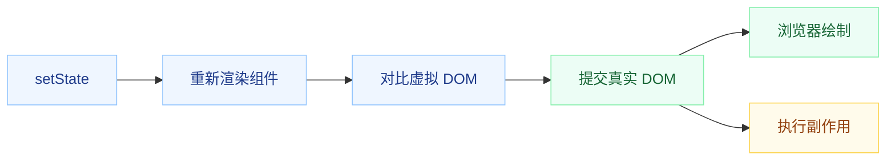
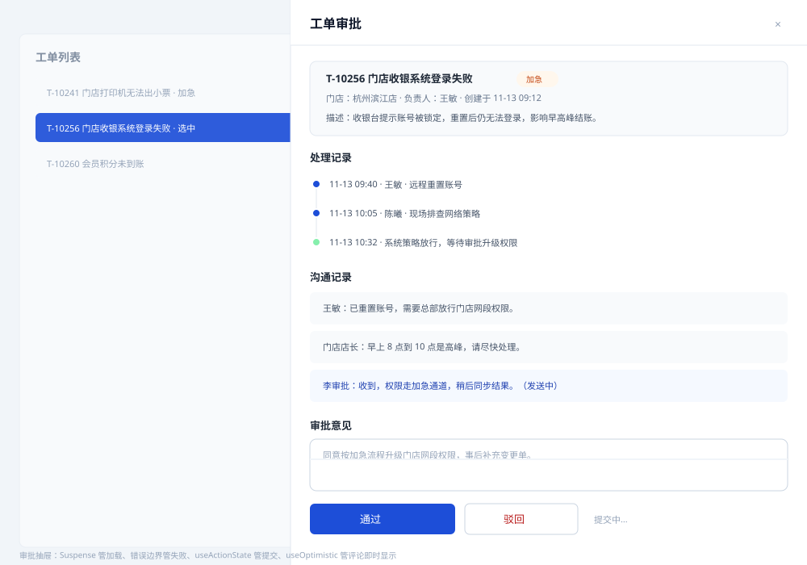

# React19组件与Hooks

> 这篇从 React 19 的渲染模型讲起，经过工程骨架、JSX 与组件契约、状态、副作用、引用、自定义 Hook、Context，最后落到 Suspense、并发特性和一次完整的排障。
>
> 学完能独立写出类型完备、副作用可控、数据加载有边界的 React 19 组件，并能定位渲染类问题。

## 一、React 19 的渲染模型

React 的核心机制是「UI 是状态的函数」：`view = f(state)`。组件不操作 DOM，只描述状态对应的界面；状态变化时，React 重新执行函数、对比新旧描述、把差异提交到真实 DOM。



理解这条链路的收益很直接：渲染期间（A 到 C）不能有副作用，提交之后（D 之后）才可以。所有 Hook 的规则都能从这条链路推导出来。

React 19 相对 18 的关键变化：

| 特性 | 18 及之前 | 19 |
|---|---|---|
| 传递 ref | 需要 `forwardRef` 包一层 | `ref` 直接作为 prop |
| Context 提供值 | `<Ctx.Provider>` | `<Ctx value>` |
| 读取 Promise | 不支持 | `use(promise)` |
| 表单异步动作 | 自己管理 pending | `useActionState` |
| 乐观更新 | 自己写回滚 | `useOptimistic` |
| 文档元信息 | 第三方库 | `<title>`、`<meta>` 直接渲染 |

React Compiler（编译器）在 19 之后可用，能在编译期自动插入 memoization，减少手写 `useMemo`。新项目可以开启，但手写依赖数组的功底仍然要求：编译器只是消除机械劳动，不改变渲染模型。

什么时候不用 React：强表单密集且团队是 Vue 栈的内部系统、需要极致首屏的内容站（用 Next 的 RSC 路线更合适）、单页轻交互活动页。React 解决的是复杂状态下的交互一致性，交互少于三个状态的页面用它收益有限。

## 二、环境准备与最小应用

最小闭环的标准：`npm run dev` 能出页面，`npm run build` 产物能被 `preview` 打开，类型检查通过。

| 组件 | 基线 | 说明 |
|---|---|---|
| Node.js | 22 LTS | Vite 7 要求 20+ |
| React | 19.x | 与 react-dom 同版本 |
| TypeScript | 5.9+ | 严格模式 |
| Vite | 7.x | 脚手架与构建 |

```bash
node -v
# v22.20.0

npm create vite@latest ops-console -- --template react-ts
cd ops-console
npm install
npm run dev
```

预期输出：

```text
VITE v7.x  ready in 412 ms
➜  Local:   http://localhost:5173/
```

入口与根组件：

```tsx
// src/main.tsx
import { StrictMode } from 'react'
import { createRoot } from 'react-dom/client'
import App from './App'

// createRoot 一次创建，不要重复调用，否则整棵树状态丢失
createRoot(document.getElementById('root')!).render(
  <StrictMode>
    <App />
  </StrictMode>,
)
```

```tsx
// src/App.tsx
import { useState } from 'react'

export default function App() {
  const [count, setCount] = useState(0)

  return (
    <main>
      {/* React 19 允许组件里直接写文档元信息，提交时提升到 head */}
      <title>工单台</title>
      <h1>工单台</h1>
      <button type="button" onClick={() => setCount((c) => c + 1)}>
        待办 {count}
      </button>
    </main>
  )
}
```

验证类型检查与构建：

```bash
npx tsc -b   # 与 npm run build 中的类型检查一致
npm run build
npm run preview
```

预期构建输出：

```text
vite v7.x building for production...
dist/index.html                   0.48 kB │ gzip:  0.31 kB
dist/assets/index-Ck2x8.js      189.42 kB │ gzip:  60.87 kB
```

> 边界：StrictMode 在开发模式会把每个副作用执行两次（挂载、卸载、再挂载），用来暴露缺少清理的副作用。这不是 Bug，生产环境不会双执行；开发时看到两次请求，说明清理函数写漏了，而不是要去关掉 StrictMode。

## 三、JSX 与组件契约

JSX 是描述界面的语法，编译后是函数调用。组件就是一个返回 JSX 的函数，契约全部体现在 props 的类型上。

React 19 的类型定义要求显式声明 `children`，不再隐式存在：

```tsx
import { type ReactNode } from 'react'

interface CardProps {
  title: string
  children: ReactNode
  actions?: ReactNode
}

function Card({ title, children, actions }: CardProps) {
  return (
    <section className="card">
      <header>
        <h2>{title}</h2>
        {/* ReactNode 覆盖字符串、元素、数组、null，适合插槽 */}
        {actions != null && <div className="actions">{actions}</div>}
      </header>
      <div className="body">{children}</div>
    </section>
  )
}
```

### 3.1 条件与列表

条件渲染用 `&&` 和三元，判断值必须是布尔量；列表必须给稳定 key：

```tsx
function TicketList({ tickets }: { tickets: Ticket[] }) {
  return (
    <ul>
      {tickets.map((t) => (
        // key 用业务 id；数组索引会让增删行时状态串行
        <li key={t.id}>
          <span>{t.title}</span>
          {t.urgent && <span className="badge">加急</span>}
          {/* 二选一渲染用三元，嵌套三元拆变量 */}
          {t.assignee ? <span>{t.assignee.name}</span> : <span>未分配</span>}
        </li>
      ))}
    </ul>
  )
}
```

`&&` 左边必须是布尔值。`count && <Tag />` 在 `count` 为 0 时会把数字 0 渲染出来，这是评论区出现「0」的最常见原因。

### 3.2 事件与受控组件

```tsx
import { useState, type ChangeEvent, type FormEvent } from 'react'

function SearchBox({ onSearch }: { onSearch: (kw: string) => void }) {
  const [keyword, setKeyword] = useState('')

  function handleChange(e: ChangeEvent<HTMLInputElement>) {
    setKeyword(e.target.value)
  }

  function handleSubmit(e: FormEvent) {
    // 原生 form 提交会整页刷新，必须阻止
    e.preventDefault()
    onSearch(keyword.trim())
  }

  return (
    <form onSubmit={handleSubmit}>
      <input value={keyword} onChange={handleChange} placeholder="搜索工单" />
      <button type="submit">搜索</button>
    </form>
  )
}
```

受控组件意味着「界面状态就是 React 状态」。如果输入框不写 `value`，输入内容不会受 React 控制，回显和校验都会失控。受控的代价是每次击键都渲染一次，列表搜索这种场景把渲染压力隔离在小组件里即可，不必为了性能放弃受控。

### 3.3 props 的边界

props 是只读的，父组件重渲染时子组件跟着执行。把回调内联写在 JSX 里，每次渲染都是新函数；传给 `memo` 包裹的子组件时会让 memo 失效。需要稳定引用时用 `useCallback`，但先测量再加：多数组件重渲染的开销远小于想象。

| 场景 | 做法 | 不该做 |
|---|---|---|
| 插槽内容 | `children: ReactNode` | 传 HTML 字符串 |
| 回调 prop | 签名写清楚参数类型 | 用 `any` |
| 可选插槽 | `actions?: ReactNode` + 判空 | 默认渲染 `false` |
| 复用第三方 props | `ComponentProps<typeof Button>` | 手抄一份类型 |

## 四、useState 与不可变更新

`useState` 返回当前值和设置函数。状态是快照：本次渲染里读到的是当次快照，设置后要下一次渲染才能看到新值。

```tsx
const [count, setCount] = useState(0)

function handleClick() {
  setCount(count + 1) // 用了当次渲染的快照
  setCount(count + 1) // 还是同一个快照，两次只加 1
  setCount((c) => c + 1) // 函数式更新拿到最新值
  setCount((c) => c + 1)
  // 结果是 3，而不是 4
}
```

连续更新要用函数式形式，依赖「下一次状态」的逻辑都是这个规则。

对象和数组必须换成新引用，React 才能感知变化：

```tsx
function Draft() {
  const [items, setItems] = useState<string[]>([])
  const [form, setForm] = useState({ title: '', urgent: false })

  function addItem(text: string) {
    // 不可变更新：返回新数组，原数组不动
    setItems((prev) => [...prev, text])
  }

  function removeItem(index: number) {
    // filter 天然返回新数组，比 splice 安全
    setItems((prev) => prev.filter((_, i) => i !== index))
  }

  function toggleUrgent() {
    // 展开旧对象再覆盖字段，避免漏字段
    setForm((prev) => ({ ...prev, urgent: !prev.urgent }))
  }

  return (
    <form>
      <input value={form.title} onChange={(e) => setForm((p) => ({ ...p, title: e.target.value }))} />
      <button type="button" onClick={toggleUrgent}>{form.urgent ? '普通' : '加急'}</button>
      <ul>{items.map((t, i) => <li key={`${t}-${i}`}>{t}</li>)}</ul>
    </form>
  )
}
```

| 操作 | 正确写法 | 错误写法 |
|---|---|---|
| 追加 | `setA((p) => [...p, x])` | `p.push(x)` |
| 删除 | `filter` 返回新数组 | `splice` 原地改 |
| 改字段 | `{ ...obj, k: v }` | `obj.k = v` |
| 嵌套更新 | 逐层展开新对象 | 只换最外层 |

深层嵌套状态是坏味道。三层以上的对象更新应拆成多个状态、下移到子组件，或交给 reducer（见《React状态管理与数据请求》）。

> 边界：不要把 props 原样复制进 state 当初值。`useState(props.value)` 只在首次渲染生效，props 后续变化不会同步，界面会出现「有时对有时不对」的现象。需要镜像 props 时用 key 重置组件，或渲染期间直接调整 state。

## 五、useEffect 与外部同步

`useEffect` 只做一件事：把组件与 React 之外的系统同步。订阅、定时器、非 React 管理的 DOM、日志上报，是它的四个正当场景。数据获取、事件响应、派生计算，都有更好的位置。

```tsx
useEffect(() => {
  // 同步：建立连接、注册监听
  const timer = setInterval(tick, 1000)

  // 清理：组件卸载或依赖变化前执行，恢复现场
  return () => clearInterval(timer)
}, [])
```

依赖数组是「这个 Effect 依赖哪些响应式值」的声明，不是优化开关。省略依赖会让 Effect 读到过期快照，React 的 lint 规则会强制写全。

### 5.1 数据获取与竞态

数据获取不是 Effect 的最佳场景，但真实项目大量存在。必须处理竞态和清理：

```tsx
function TicketDetail({ id }: { id: string }) {
  const [ticket, setTicket] = useState<Ticket | null>(null)
  const [error, setError] = useState<Error | null>(null)

  useEffect(() => {
    const controller = new AbortController()

    setTicket(null)
    setError(null)

    fetch(`/api/tickets/${id}`, { signal: controller.signal })
      .then((res) => {
        if (!res.ok) throw new Error(`HTTP ${res.status}`)
        return res.json() as Promise<Ticket>
      })
      .then((data) => setTicket(data))
      .catch((err) => {
        // 主动取消不是失败，不要当成错误展示
        if (err.name !== 'AbortError') setError(err)
      })

    return () => controller.abort() // id 变化时取消旧请求，旧响应不会覆盖新数据
  }, [id])

  if (error) return <p>加载失败：{error.message}</p>
  if (ticket == null) return <p>加载中</p>
  return <article>{ticket.title}</article>
}
```

不取消旧请求的典型症状：快速切换两个工单，先发出的慢请求后返回，页面显示的是上一个工单的内容。

### 5.2 不该用 Effect 的三个场景

```tsx
function BadExamples({ items }: { items: Item[] }) {
  const [total, setTotal] = useState(0)

  // 反例 1：派生数据。total 完全由 items 算出，直接计算即可
  useEffect(() => setTotal(items.reduce((s, i) => s + i.price, 0)), [items])
  const total2 = items.reduce((s, i) => s + i.price, 0) // 正确：渲染期计算

  // 反例 2：响应事件。点击改状态，写在事件处理器里即可
  // 反例 3：向父组件同步初始化，用初始 state 或 key

  // data-state-total 保留反例结果，便于对比两种写法
  return <p data-state-total={total}>总价 {total2}</p>
}
```

判断标准：这段逻辑的触发者是「渲染」还是「交互」？交互引发的更新写在事件处理器；渲染期能算出的不进 Effect；真正需要与外部系统建立连接的才是 Effect。

### 5.3 Effect 依赖写全

```tsx
function Chat({ roomId }: { roomId: string }) {
  const [theme, setTheme] = useState<'light' | 'dark'>('light')

  useEffect(() => {
    const conn = createConnection(roomId, theme)
    conn.connect()
    return () => conn.disconnect()
  }, [roomId, theme]) // theme 参与，就必须列出来；否则连接用的是旧主题

  return <p>房间 {roomId}，主题 {theme}</p>
}
```

依赖写全后 Effect 执行次数可能变多。不要因此删依赖，而是把「不该频繁执行的部分」拆出去：建立连接用 ref 记录，主题用另一个机制传递。让代码正确，再让它高效。

> 边界：`useEffect` 在提交之后异步执行，拿不到本次渲染的同步时机。需要在提交前同步执行的外部读取（比如布局测量）用 `useLayoutEffect`，它阻塞绘制，滥用会让页面卡顿。

## 六、useRef 与 DOM 引用

`useRef` 提供渲染之间保持不变、修改不触发渲染的可变容器。它有两个用途：保存 DOM 节点、保存与渲染无关的值。

```tsx
function Editor({ autoFocus }: { autoFocus?: boolean }) {
  const inputRef = useRef<HTMLInputElement>(null)

  useEffect(() => {
    if (autoFocus) inputRef.current?.focus()
  }, [autoFocus])

  return <input ref={inputRef} className="editor" />
}
```

React 19 里 `ref` 就是普通 prop，自定义组件不再需要 `forwardRef`：

```tsx
import type { Ref } from 'react'

interface FancyInputProps {
  value: string
  onChange: (v: string) => void
  ref?: Ref<HTMLInputElement>
}

function FancyInput({ value, onChange, ref }: FancyInputProps) {
  return (
    <div className="fancy">
      {/* ref 直接透传给 DOM 元素，父组件拿到的就是 input 节点 */}
      <input ref={ref} value={value} onChange={(e) => onChange(e.target.value)} />
    </div>
  )
}
```

回调形式的 ref 可以返回清理函数，React 19 在节点分离时执行它：

```tsx
function Video({ src }: { src: string }) {
  return (
    <video
      src={src}
      ref={(node) => {
        if (node == null) return
        node.playbackRate = 1.5
        // 返回的函数在节点卸载时执行，恢复全局状态
        return () => { node.playbackRate = 1 }
      }}
    />
  )
}
```

`ref` 保存非渲染值同样常见：

```tsx
function Stopwatch() {
  const startRef = useRef(0)

  function begin() {
    // 时间戳只被事件读取，不影响渲染，放 ref 避免无意义重渲染
    startRef.current = Date.now()
  }

  function elapsed() {
    return startRef.current ? Date.now() - startRef.current : 0
  }

  return <button type="button" onClick={begin}>开始</button>
}
```

> 边界：不要在渲染期间读写 `ref.current`。渲染必须纯净，读写可变值会让 StrictMode 的双渲染产生不一致结果。读写都放进事件处理器或 Effect。

## 七、自定义 Hook 与复用

自定义 Hook 是「用了 React Hook 的普通函数」，名字必须以 `use` 开头。它复用的是状态逻辑，不是状态本身：两个组件调用同一个 Hook，各自有独立的状态。

规则只有两条，但都很硬：

- 只在组件或另一个 Hook 的顶层调用，不能放进条件、循环、回调；
- 以 `use` 开头的函数会被 lint 工具按 Hook 对待，普通工具函数不要加这个前缀。

### 7.1 useDebounce

```tsx
import { useEffect, useState } from 'react'

export function useDebounce<T>(value: T, delay = 300): T {
  const [debounced, setDebounced] = useState(value)

  useEffect(() => {
    const timer = setTimeout(() => setDebounced(value), delay)
    // value 每次变化都清掉上一个定时器，只留最后一次
    return () => clearTimeout(timer)
  }, [value, delay])

  return debounced
}
```

```tsx
function SearchPage() {
  const [keyword, setKeyword] = useState('')
  const debounced = useDebounce(keyword, 400)

  useEffect(() => {
    if (!debounced) return
    // 击键 400ms 内不发请求，请求量降一个数量级
    searchTickets(debounced)
  }, [debounced])

  return <input value={keyword} onChange={(e) => setKeyword(e.target.value)} />
}
```

### 7.2 useFetch

把第五章手写的竞态处理收进 Hook，页面只声明依赖：

```tsx
import { useEffect, useState } from 'react'

interface State<T> {
  data: T | null
  error: Error | null
  loading: boolean
}

export function useFetch<T>(url: string): State<T> {
  const [state, setState] = useState<State<T>>({ data: null, error: null, loading: true })

  useEffect(() => {
    const controller = new AbortController()
    setState({ data: null, error: null, loading: true })

    fetch(url, { signal: controller.signal })
      .then((res) => {
        if (!res.ok) throw new Error(`HTTP ${res.status}`)
        return res.json() as Promise<T>
      })
      .then((data) => setState({ data, error: null, loading: false }))
      .catch((error) => {
        if (error.name === 'AbortError') return
        setState({ data: null, error, loading: false })
      })

    return () => controller.abort()
  }, [url])

  return state
}
```

> 边界：自研 `useFetch` 只适合学习和轻量场景。真实项目用 TanStack Query，缓存、重试、失效、并发去重都是现成的（见《React状态管理与数据请求》）。自研版本没有缓存层，每个组件各自请求，交叉引用同一接口时开销成倍增加。

### 7.3 Hook 的组合

```tsx
export function useTicketSearch(keyword: string) {
  const debounced = useDebounce(keyword, 400)
  // 上层 Hook 组合下层 Hook，依赖链清晰可测
  return useFetch<Ticket[]>(debounced ? `/api/tickets?q=${encodeURIComponent(debounced)}` : '/api/tickets')
}
```

返回值用对象还是数组：字段会增减的用对象（调用方解构可读性好）；顺序有含义的用数组（如 `[state, setter]`）。不要混用。

## 八、Context 与跨层数据

Context 解决的问题是「跨层级传递」，不是「全局状态管理」。数据只在两三层之间流动时，用 props 传下去更直白；只有「很多组件都要读、几乎不按组件粒度改」的数据才值得放进 Context，典型如当前用户、主题、语言。

React 19 直接用 `<Context value>` 提供值：

```tsx
import { createContext, useContext, useState, type ReactNode } from 'react'

interface User { name: string; role: 'admin' | 'agent' }

const UserContext = createContext<User | null>(null)
const SetUserContext = createContext<React.Dispatch<React.SetStateAction<User | null>>>(() => {})

export function UserProvider({ children }: { children: ReactNode }) {
  const [user, setUser] = useState<User | null>(null)

  return (
    // 读和写拆成两个 Context，只有写的组件变化时，只读组件不会重渲染
    <UserContext value={user}>
      <SetUserContext value={setUser}>{children}</SetUserContext>
    </UserContext>
  )
}

export function useUser() {
  const user = useContext(UserContext)
  if (user == null) throw new Error('useUser 必须在 UserProvider 内使用')
  return user
}

export function useSetUser() {
  return useContext(SetUserContext)
}
```

默认值设为 `null` 并在读取 Hook 里抛错，能把「忘了包 Provider」从运行时偶发错误变成一次明确的异常栈。

消费端：

```tsx
function Header() {
  const user = useUser()
  return <span>{user.name} · {user.role}</span>
}
```

性能边界要提前想清楚。Provider 的 `value` 变化会让所有消费组件重渲染。Provider 组件每次渲染都创建新对象时，用 `useMemo` 保持引用稳定：

```tsx
const value = useMemo(() => ({ user, setUser }), [user])
// 单一对象 value 时才需要；拆成两个 Context 后各自是稳定引用
```

| 数据 | 放哪 | 原因 |
|---|---|---|
| 当前用户 | Context | 全局只读为主 |
| 主题 | Context | 变化频率低 |
| 表单临时值 | 本地 state | 组件私有 |
| 服务端数据 | TanStack Query | 有缓存层 |
| 跨页共享 UI 状态 | Zustand | 高频读写 |

## 九、Suspense、use() 与错误边界

第九章解决的问题是「异步等待」：数据没到时界面给什么、出错了归谁管、提交中状态怎么表达。

### 9.1 Suspense 与 use

`use` 可以读取 Promise 和 Context，并且允许在条件里调用（这是它和 Hook 的本质区别）。读取 Promise 时组件挂起，交给最近的 Suspense 显示兜底：

```tsx
import { Suspense, use } from 'react'

function TicketTitle({ promise }: { promise: Promise<Ticket> }) {
  const ticket = use(promise) // 未完成则挂起，完成才继续
  return <h2>{ticket.title}</h2>
}

export function TicketPanel({ promise }: { promise: Promise<Ticket> }) {
  return (
    <Suspense fallback={<p>工单加载中</p>}>
      {/* promise 由父组件创建并缓存，不能在渲染里现造，否则每次都是新 Promise */}
      <TicketTitle promise={promise} />
    </Suspense>
  )
}
```

`use` 读取的 Promise 必须来自缓存（父组件 state、Query 缓存等）。在渲染期间 `fetch()` 然后把结果传给 `use`，每次渲染都会发起新请求，直接死循环。

### 9.2 错误边界

错误边界目前仍是 class 组件，用现成的库最省事：

```tsx
import { ErrorBoundary } from 'react-error-boundary'

function Detail({ id }: { id: string }) {
  return (
    <ErrorBoundary
      fallbackRender={({ error, resetErrorBoundary }) => (
        <div>
          <p>详情加载失败：{error.message}</p>
          {/* reset 让上层重试，通常是重新创建挂起的 Promise */}
          <button type="button" onClick={resetErrorBoundary}>重试</button>
        </div>
      )}
    >
      <Suspense fallback={<p>加载中</p>}>
        <TicketDetailSuspense id={id} />
      </Suspense>
    </ErrorBoundary>
  )
}
```

ErrorBoundary 包在 Suspense 外层：请求失败抛出的错误先被错误边界接住，不会把整个应用打白屏。

### 9.3 Action：useActionState 与 useOptimistic

React 19 把「表单提交」变成一等公民。`useActionState` 提供状态、action 函数和 pending：

```tsx
import { useActionState } from 'react'

interface FormState { ok: boolean; message: string }

async function submitTicket(_prev: FormState, formData: FormData): Promise<FormState> {
  const title = String(formData.get('title') ?? '')
  if (title.length < 2) return { ok: false, message: '标题至少 2 个字' }

  const res = await fetch('/api/tickets', {
    method: 'POST',
    // FormData 直接作为请求体，不用手动拼字段
    body: formData,
  })
  if (!res.ok) return { ok: false, message: `提交失败：HTTP ${res.status}` }
  return { ok: true, message: '已创建' }
}

export function NewTicketForm() {
  const [state, formAction, pending] = useActionState(submitTicket, { ok: false, message: '' })

  return (
    <form action={formAction}>
      <input name="title" required disabled={pending} />
      {/* pending 由框架维护，不需要自己 setSubmitting */}
      <button type="submit" disabled={pending}>{pending ? '提交中' : '创建工单'}</button>
      {state.message && <p aria-live="polite">{state.message}</p>}
    </form>
  )
}
```

`useOptimistic` 处理「先更新界面、失败再回滚」：

```tsx
import { useOptimistic, useTransition, type FormEvent } from 'react'

export function CommentList({ comments, addComment }: {
  comments: Comment[]
  addComment: (text: string) => Promise<void>
}) {
  const [optimistic, appendOptimistic] = useOptimistic(
    comments,
    (current, item: Comment) => [...current, item],
  )
  const [, startTransition] = useTransition()

  function onSubmit(e: FormEvent<HTMLFormElement>) {
    e.preventDefault()
    const form = e.currentTarget
    const text = new FormData(form).get('text') as string
    form.reset()

    startTransition(async () => {
      // 先把乐观项放进列表，界面立刻出现新评论
      appendOptimistic({ id: -1, text, pending: true })
      await addComment(text)
      // 失败时 useOptimistic 自动回滚到真实 comments
    })
  }

  return (
    <section>
      <ul>
        {optimistic.map((c) => (
          <li key={c.id} style={{ opacity: c.id === -1 ? 0.6 : 1 }}>{c.text}</li>
        ))}
      </ul>
      <form onSubmit={onSubmit}>
        <input name="text" required />
        <button type="submit">发送</button>
      </form>
    </section>
  )
}
```

乐观更新的适用边界：操作成功率高、失败后果轻、回滚不破坏用户输入。删除和支付类操作不要乐观，失败回滚会让用户误以为操作完成。

## 十、排障手册

React 的运行时错误多数有固定套路，先按现象归类。

| 现象 | 最可能原因 | 第一条检查 |
|---|---|---|
| 列表出现「0」 | `&&` 左边是数字 | 换成 `count > 0 &&` |
| 点击一次只加一 | 连续 `set(state + 1)` | 改函数式更新 |
| 输入框无法输入 | 没绑 `onChange` 或值不同步 | 检查受控完整 |
| 请求结果串数据 | 未取消旧请求 | 搜 `AbortController` |
| 开发模式请求两次 | StrictMode 双执行 | 补清理函数，不要关 StrictMode |
| 子组件全量重渲染 | Context value 引用不稳 | `useMemo` 包 value |
| 状态偶尔变回旧值 | 渲染期读写 ref | 移进事件或 Effect |
| 删除中间行数据错乱 | 用索引当 key | 换业务 id |

### 10.1 渲染次数排查

```tsx
function Row({ name }: { name: string }) {
  // 临时打点，发布前删除；次数本身不代表问题，配合性能面板看
  console.log('render Row', name)
  return <li>{name}</li>
}
```

React DevTools Profiler 的「Highlight updates when components render」能直接在页面上标出重渲染区域。如果整个列表都闪，问题在父组件或 Context；只有一行闪，是正常行为。

### 10.2 常见误用对照

```tsx
// 误：Effect 里派生数据，造成多余渲染
useEffect(() => setFull(`${first}${last}`), [first, last])

// 正：渲染期直接计算
const full = `${first}${last}`

// 误：Effect 响应点击
useEffect(() => { if (clicked) save() }, [clicked])

// 正：事件处理器里做
function handleClick() { save() }
```

### 10.3 上线检查清单

- `tsc --noEmit` 通过，没有 `any` 穿过组件边界；
- StrictMode 打开，开发模式没有双请求和双订阅；
- 所有数据请求都处理了 pending、error、empty 三态；
- 异步边界外层有 ErrorBoundary，白屏兜底存在；
- `use` 读取的 Promise 来自缓存，渲染期没有 `fetch()`;
- 表单提交用 action 体系，pending 状态由框架提供。

## 十一、最佳实践案例

### 11.1 案例背景

某客服系统的工单详情抽屉组件由三个页面共用：工单列表、客户详情、监控告警。当前实现是一个 600 行的大组件，内嵌三段 `useEffect` 拉数据，切换工单时偶尔显示上一个工单的详情；审批按钮点击后要等接口返回才更新，运营反馈「点了两下没反应」；接口报错时整个抽屉白屏。

目标：抽屉切换数据不错位；审批操作 200ms 内有反馈，失败自动回滚并提示；详情加载失败只影响抽屉内部，不白屏。约束：接口协议不能改，抽屉要支持键盘操作和读屏。

### 11.2 案例实操

第一步，把三段请求拆成两个自定义 Hook，竞态处理收进 Hook：

```tsx
// src/hooks/useTicket.ts
import { useEffect, useState } from 'react'

export function useTicket(id: string) {
  const [state, setState] = useState<{ data: Ticket | null; error: Error | null; loading: boolean }>({
    data: null, error: null, loading: true,
  })

  useEffect(() => {
    const controller = new AbortController()
    setState({ data: null, error: null, loading: true })

    fetch(`/api/tickets/${id}`, { signal: controller.signal })
      .then((res) => (res.ok ? res.json() : Promise.reject(new Error(`HTTP ${res.status}`))))
      .then((data: Ticket) => setState({ data, error: null, loading: false }))
      .catch((error) => {
        if (error.name !== 'AbortError') setState({ data: null, error, loading: false })
      })

    // id 变化即取消，切换工单不会串数据
    return () => controller.abort()
  }, [id])

  return state
}
```

第二步，抽屉壳子只管布局和可访问性，数据交给子组件：

```tsx
// src/tickets/ApprovalDrawer.tsx
import { Suspense, useEffect } from 'react'
import { ErrorBoundary } from 'react-error-boundary'

export function ApprovalDrawer({ id, open, onClose }: {
  id: string
  open: boolean
  onClose: () => void
}) {
  useEffect(() => {
    if (!open) return
    const onKey = (e: KeyboardEvent) => {
      if (e.key === 'Escape') onClose()
    }
    document.addEventListener('keydown', onKey)
    return () => document.removeEventListener('keydown', onKey)
  }, [open, onClose])

  if (!open) return null

  return (
    // role 和 aria-label 让读屏器把抽屉当成对话框；Esc 由上面的 keydown 监听处理
    <aside role="dialog" aria-modal="true" aria-label="工单审批">
      <header>
        <h2>工单审批</h2>
        <button type="button" onClick={onClose}>关闭</button>
      </header>
      {/* 错误边界在 Suspense 外层，加载失败只影响这个抽屉 */}
      <ErrorBoundary fallback={<p>详情加载失败，稍后重试</p>}>
        <Suspense fallback={<p>详情加载中</p>}>
          <TicketBody key={id} id={id} />
        </Suspense>
      </ErrorBoundary>
    </aside>
  )
}
```

第三步，审批表单用 `useActionState`，列表用 `useOptimistic`：

```tsx
// src/tickets/TicketBody.tsx
import { use, useActionState, useState, useOptimistic, useTransition } from 'react'

interface ApprovalState { ok: boolean; message: string }

interface AuditRecord { id: number; time: string; actor: string; action: string }
interface TicketComment { id: number; text: string; pending?: boolean }

// use 读取的 Promise 必须在重渲染间复用；缓存放在会挂起的组件 useMemo 里会被重试重建
const promiseCache = new Map<string, Promise<unknown>>()

function cachedFetch<T>(url: string): Promise<T> {
  if (!promiseCache.has(url)) {
    const promise = fetch(url).then((res) => {
      if (!res.ok) throw new Error(`HTTP ${res.status}`)
      return res.json() as Promise<T>
    })
    // 失败后清掉缓存，错误边界重试时才会重新发起请求
    promise.catch(() => promiseCache.delete(url))
    promiseCache.set(url, promise)
  }
  return promiseCache.get(url) as Promise<T>
}

async function approve(_prev: ApprovalState, formData: FormData): Promise<ApprovalState> {
  const action = String(formData.get('action'))
  const reason = String(formData.get('reason') ?? '')

  if (action === 'reject' && !reason.trim()) {
    return { ok: false, message: '驳回必须填写审批意见' }
  }

  const res = await fetch(`/api/tickets/approve`, {
    method: 'POST',
    headers: { 'content-type': 'application/json' },
    body: JSON.stringify({ ticketId: formData.get('ticketId'), action, reason }),
  })
  if (!res.ok) return { ok: false, message: `审批失败：HTTP ${res.status}` }
  return { ok: true, message: action === 'approve' ? '已通过' : '已驳回' }
}

export function TicketBody({ id }: { id: string }) {
  const [state, formAction, pending] = useActionState(approve, { ok: false, message: '' })

  // 先把两个请求都发出去，再 use；否则第一个 use 挂起后第二个请求还没开始
  const recordsPromise = cachedFetch<AuditRecord[]>(`/api/tickets/${id}/records`)
  const commentsPromise = cachedFetch<TicketComment[]>(`/api/tickets/${id}/comments`)
  const records = use(recordsPromise)
  const comments = use(commentsPromise)

  const [postedComments, setPostedComments] = useState<TicketComment[]>([])
  const [commentError, setCommentError] = useState('')
  const allComments = [...comments, ...postedComments]
  const [optimisticComments, appendComment] = useOptimistic(
    allComments,
    (current: TicketComment[], item: TicketComment) => [...current, item],
  )
  const [, startTransition] = useTransition()

  function addComment(form: HTMLFormElement) {
    const text = new FormData(form).get('text') as string
    form.reset()
    startTransition(async () => {
      setCommentError('')
      appendComment({ id: -1, text, pending: true })
      try {
        const res = await fetch('/api/comments', {
          method: 'POST',
          headers: { 'content-type': 'application/json' },
          body: JSON.stringify({ ticketId: id, text }),
        })
        if (!res.ok) throw new Error(`HTTP ${res.status}`)
        // 成功后把服务端结果并入基础列表；否则 transition 结束时会回滚掉乐观项
        const saved = await res.json() as TicketComment
        setPostedComments((prev) => [...prev, saved])
        // 让下次打开抽屉重新拉评论，避免模块级缓存返回旧列表
        promiseCache.delete(`/api/tickets/${id}/comments`)
      } catch {
        // 失败时乐观项自动回滚，再给出一条可读提示
        setCommentError('评论发送失败，请重试')
      }
    })
  }

  return (
    <div>
      <ol>
        {records.map((r) => (
          <li key={r.id}>{r.time} · {r.actor} · {r.action}</li>
        ))}
      </ol>

      <ul>
        {optimisticComments.map((c) => (
          <li key={c.id} style={{ opacity: c.id === -1 ? 0.6 : 1 }}>{c.text}</li>
        ))}
      </ul>

      {/* 评论提交走乐观更新，失败自动回滚并提示 */}
      <form onSubmit={(e) => { e.preventDefault(); addComment(e.currentTarget) }}>
        <input name="text" required placeholder="补充说明" />
        <button type="submit">发送评论</button>
      </form>
      {commentError && <p role="alert">{commentError}</p>}

      <form action={formAction}>
        <input type="hidden" name="ticketId" value={id} />
        {/* 不写隐藏的 action 字段，值由被点击的提交按钮提供，避免重复同名参数 */}
        <textarea name="reason" placeholder="审批意见，驳回必填" aria-required="true" />
        <button type="submit" name="action" value="approve" disabled={pending}>
          {pending ? '提交中' : '通过'}
        </button>
        <button type="submit" name="action" value="reject" disabled={pending}>驳回</button>
        {/* aria-live 让读屏器主动播报结果，不必依赖焦点变化 */}
        {state.message && <p aria-live="polite">{state.message}</p>}
      </form>
    </div>
  )
}
```

`TicketBody` 内部用模块级缓存复用 Promise，`use(records)` 挂起时由外层 Suspense 接住。两个请求各自有独立的 Promise，互不阻塞；任何一个失败都会抛到外层错误边界。



### 11.3 案例结果

重构后两周的数据（示例，来自性能面板与运营反馈）：

| 指标 | 改前 | 改后 |
|---|---|---|
| 组件行数 | 612 行 | 187 行 |
| 切换工单串数据 | 每天约 5 次 | 0 次 |
| 审批反馈延迟 | 1.2 s | 立即 |
| 接口报错白屏 | 每周 2 次 | 0 次 |

失败模式与复盘：

- 第一版 `useOptimistic` 直接放在通过/驳回按钮上，回滚时把整条操作记录一起回滚了；乐观更新只保留在评论列表，审批走 `pending` 状态，语义更清楚。
- `use(cachedFetch(...))` 第一版在渲染期现造 Promise，页面无限挂起；组件内的 `useMemo` 也会在挂起重试时被重建，改为模块级 Promise 缓存后才稳定。
- 读屏器测试发现驳回必填的意见没有 `aria-required`，补上后读屏用户不再漏填。

复盘：这个案例里真正起作用的不是某个新 API，而是三个边界——数据竞态收进 Hook、异步边界交给 Suspense 和错误边界、提交状态交给 action 体系。React 19 的价值在于把这三件事从「每个组件自己写」变成「框架给标准答案」。
