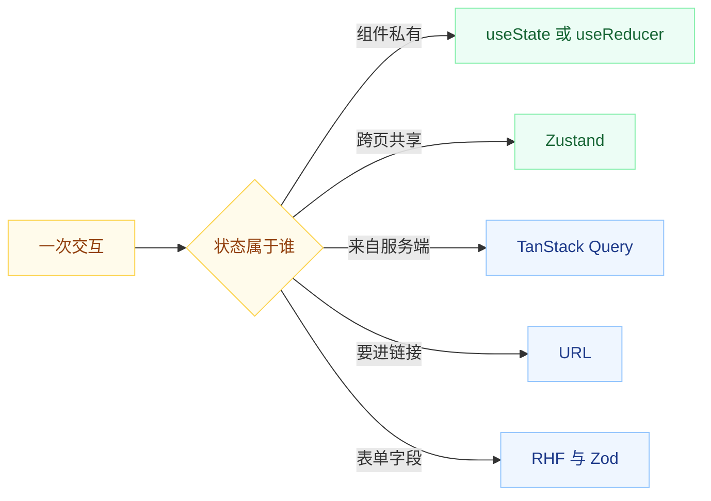
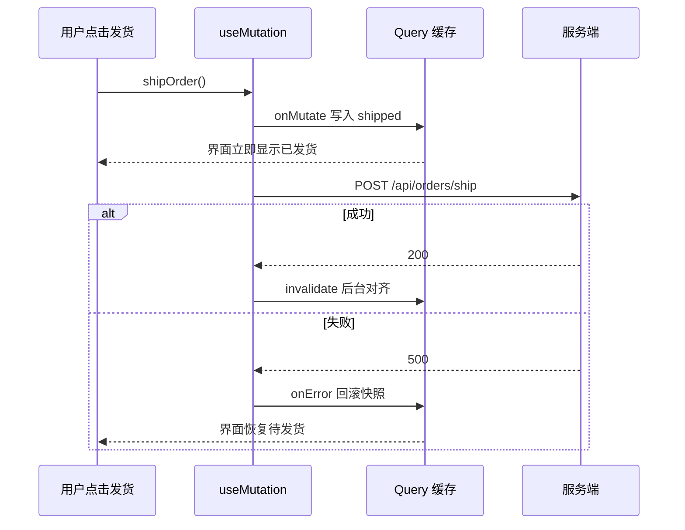
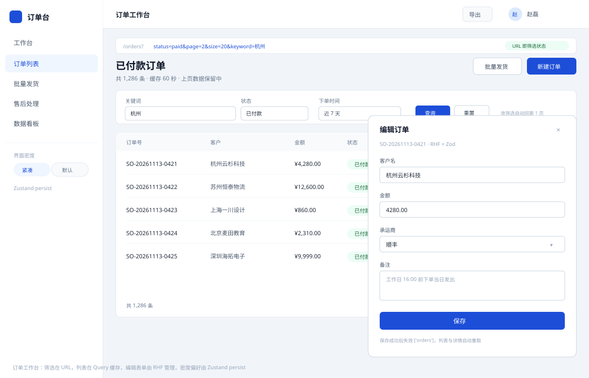

# React状态管理与数据请求

> 这篇从状态的分层与归属讲起，经过 useReducer、Zustand、TanStack Query、RHF 加 Zod 和 URL 状态，最后落到一条完整的读写链路和一次线上排障。
>
> 学完能为中型 React 应用设计出清晰的状态分层，写出带缓存、乐观更新和可分享链接的数据层。

## 一、状态的分层与归属

状态管理失败的项目几乎都是同一个原因：所有状态都放进了同一个地方。选型前先分类，分类决定了工具。按归属可以分成六类。

| 类别 | 例子 | 归属 | 工具 |
|---|---|---|---|
| 组件本地状态 | 输入框草稿、开关 | 组件 | `useState` |
| 复杂本地状态 | 多步表单的状态机 | 组件或其下层 | `useReducer` |
| 全局客户端状态 | 当前用户、主题、侧边栏折叠 | 应用 | Zustand |
| 服务端状态 | 列表、详情、聚合指标 | 缓存层 | TanStack Query |
| 表单状态 | 字段值、校验、脏检查 | 表单引擎 | RHF + Zod |
| 可分享状态 | 筛选、分页、排序 | URL | `useSearchParams` |

服务端状态和客户端状态必须分开，这是本篇最重要的判断。服务端数据天然是缓存：有所有者（服务器）、会过期、可能被别人改。把它放进全局 store，就要自己处理过期、失效、重新验证，最后写出一个残缺的缓存层。



## 二、环境准备与项目骨架

以一个工单台为例，先把数据层依赖装齐，再写第一个带缓存的请求。

| 组件 | 基线 | 角色 |
|---|---|---|
| React | 19.x | 运行时 |
| TanStack Query | 5.x | 服务端状态缓存 |
| Zustand | 5.x | 全局客户端状态 |
| React Hook Form | 7.x | 表单引擎 |
| Zod | 4.x | 校验与类型推导 |
| React Router | 7.x | 路由与 URL 状态 |

```bash
node -v
# v22.20.0

npm create vite@latest order-desk -- --template react-ts
cd order-desk
npm install
npm install @tanstack/react-query zustand react-hook-form @hookform/resolvers zod react-router
npm install -D @tanstack/react-query-devtools
```

QueryClient 挂在入口，默认值在这里定，不在每个组件里重复：

```tsx
// src/main.tsx
import { StrictMode } from 'react'
import { createRoot } from 'react-dom/client'
import { QueryClient, QueryClientProvider } from '@tanstack/react-query'
import App from './App'

const queryClient = new QueryClient({
  defaultOptions: {
    queries: {
      // 默认 60 秒内认为是新鲜数据，切页面回来不发请求
      staleTime: 60_000,
      // 重试一次足够，业务错误重试只会加重后端压力
      retry: 1,
      // 管理后台切窗口不该触发刷新，避免离开回来就闪 loading
      refetchOnWindowFocus: false,
    },
  },
})

createRoot(document.getElementById('root')!).render(
  <StrictMode>
    <QueryClientProvider client={queryClient}>
      <App />
    </QueryClientProvider>
  </StrictMode>,
)
```

```tsx
// src/App.tsx
import { BrowserRouter, Routes, Route } from 'react-router'
import { ReactQueryDevtools } from '@tanstack/react-query-devtools'
import OrderWorkbench from './pages/OrderWorkbench'

export default function App() {
  return (
    <BrowserRouter>
      <Routes>
        <Route path="/orders" element={<OrderWorkbench />} />
      </Routes>
      {/* 仅开发环境渲染；生产构建会把该分支静态移除。要连依赖一起剔除，用 @tanstack/devtools-vite 插件 */}
      {import.meta.env.DEV && <ReactQueryDevtools initialIsOpen={false} />}
    </BrowserRouter>
  )
}
```

验证：`npm run dev` 打开 `/orders`，DevTools 面板里能看到 query 与缓存状态。这个面板是后面所有缓存问题的第一现场。

## 三、useReducer 与复杂本地状态

`useState` 适合独立值，多个值有联动关系时用 `useReducer` 收拢。判断标准：更新逻辑需要读当前多个值、或需要按事件类型走不同分支。

```tsx
import { useReducer } from 'react'

interface Draft {
  title: string
  tags: string[]
  step: 'editing' | 'validating' | 'submitting' | 'done' | 'failed'
  error: string | null
}

type DraftAction =
  | { type: 'changeTitle'; title: string }
  | { type: 'toggleTag'; tag: string }
  | { type: 'startSubmit' }
  | { type: 'succeed' }
  | { type: 'fail'; message: string }

function draftReducer(state: Draft, action: DraftAction): Draft {
  switch (action.type) {
    case 'changeTitle':
      return { ...state, title: action.title }
    case 'toggleTag':
      return {
        ...state,
        // reducer 里保持不可变，切换分支只改自己关心的字段
        tags: state.tags.includes(action.tag)
          ? state.tags.filter((t) => t !== action.tag)
          : [...state.tags, action.tag],
      }
    case 'startSubmit':
      // 进入 submitting 前必须重置错误，否则上次的错误文案会残留
      return { ...state, step: 'submitting', error: null }
    case 'succeed':
      return { ...state, step: 'done' }
    case 'fail':
      return { ...state, step: 'failed', error: action.message }
    default:
      // 新增 action 类型而忘了处理时，这里会编译报错
      return assertNever(action)
  }
}

function assertNever(value: never): never {
  throw new Error(`未处理的动作: ${JSON.stringify(value)}`)
}

export function useDraft(initial?: Partial<Draft>) {
  return useReducer(draftReducer, {
    title: '',
    tags: [],
    step: 'editing',
    error: null,
    ...initial,
  })
}
```

使用：

```tsx
function DraftPanel() {
  const [draft, dispatch] = useDraft()

  async function submit() {
    dispatch({ type: 'startSubmit' })
    try {
      await saveDraft(draft)
      dispatch({ type: 'succeed' })
    } catch (err) {
      dispatch({ type: 'fail', message: err instanceof Error ? err.message : '保存失败' })
    }
  }

  return (
    <div>
      <input value={draft.title} onChange={(e) => dispatch({ type: 'changeTitle', title: e.target.value })} />
      <button type="button" onClick={submit} disabled={draft.step === 'submitting' || draft.step === 'done'}>
        {draft.step === 'submitting' ? '保存中' : draft.step === 'failed' ? '重试保存' : '保存草稿'}
      </button>
      {draft.error && <p role="alert">{draft.error}</p>}
    </div>
  )
}
```

reducer 的收益在改动时体现：加一个 `cancel` 分支只改 reducer 和一个按钮，不会在五处 `setState` 之间打补丁。TypeScript 的穷尽检查保证新增分支时所有调用点都编译不过，提前暴露遗漏。

> 边界：状态没有跨组件共享、也没有复杂联动时，不要提前引入 reducer。三个 `useState` 比一个 reducer 更好读。真正的阈值是「更新逻辑开始读取多个字段」或「事件种类超过四五种」。

## 四、Zustand 全局客户端状态

Zustand 解决的是跨页面共享的客户端状态：当前用户、主题、侧边栏折叠、多页签记录。API 只有 `create` 和 hook 调用，没有 Provider，体积小。

```ts
// src/stores/session.ts
import { create } from 'zustand'
import { persist } from 'zustand/middleware'

interface UiState {
  sidebarCollapsed: boolean
  density: 'compact' | 'default'
  toggleSidebar: () => void
  setDensity: (d: 'compact' | 'default') => void
}

export const useUiStore = create<UiState>()(
  // persist 把这部分状态落 localStorage，刷新后保留 UI 偏好
  persist(
    (set) => ({
      sidebarCollapsed: false,
      density: 'default',
      toggleSidebar: () => set((s) => ({ sidebarCollapsed: !s.sidebarCollapsed })),
      setDensity: (density) => set({ density }),
    }),
    // name 是存储键，改动它等于清空用户偏好，要当成破坏性变更对待
    { name: 'order-desk-ui' },
  ),
)
```

消费必须用选择器，否则任何字段变化都会让组件重渲染：

```tsx
function Sidebar() {
  // 只订阅这一个布尔值，density 变化时侧边栏不渲染
  const collapsed = useUiStore((s) => s.sidebarCollapsed)
  const toggleSidebar = useUiStore((s) => s.toggleSidebar)

  return <aside className={collapsed ? 'collapsed' : ''}>
    <button type="button" onClick={toggleSidebar}>折叠</button>
  </aside>
}
```

一次订阅多个字段时用 `useShallow`，Zustand 5 不再自动做浅比较：

```tsx
import { useShallow } from 'zustand/react/shallow'

function DensitySwitch() {
  // 没有浅比较时每次 set 都返回新对象，组件永远重渲染
  const { density, setDensity } = useUiStore(
    useShallow((s) => ({ density: s.density, setDensity: s.setDensity })),
  )
  return <button type="button" onClick={() => setDensity(density === 'compact' ? 'default' : 'compact')}>
    {density === 'compact' ? '默认密度' : '紧凑密度'}
  </button>
}
```

在 React 之外读状态（比如路由守卫、上报逻辑）用 `getState`：

```ts
if (useUiStore.getState().density === 'compact') {
  report('density-compact')
}
```

### 4.1 store 的拆分

按领域拆文件，不按读写拆。一个 store 里同时有状态和操作它的 action，跨 store 引用通过 `getState`：

```ts
// src/stores/user.ts
import { create } from 'zustand'

interface UserState {
  user: { id: string; name: string; role: 'admin' | 'agent' } | null
  setUser: (u: UserState['user']) => void
  logout: () => void
}

export const useUserStore = create<UserState>((set) => ({
  user: null,
  setUser: (user) => set({ user }),
  logout: () => set({ user: null }),
}))
```

> 边界：登录后的用户资料来自服务端，看似「服务端状态」，但它贯穿全站且在会话内不变，放 Zustand 比每个页面各自 useQuery 更省。判断口径是「这个数据在会话内是否单值且稳定」。

### 4.2 不要放进 Zustand 的东西

- 服务端列表和详情：放 Query 缓存，否则要自己写过期逻辑；
- 表单字段：RHF 的非受控注册性能更好，Zustand 存表单会把每次击键放大成全局更新；
- 路由参数：URL 才是它的家，复制链接时才有意义；
- 一次性的弹窗开关：就在触发它的组件里用 `useState`。

## 五、TanStack Query 服务端状态

TanStack Query 的核心是三层缓存：queryKey 标识缓存条目，`staleTime` 决定多久内不发请求，`gcTime` 决定多久后回收。

| 参数 | 含义 | 默认 | 建议 |
|---|---|---|---|
| `staleTime` | 数据视为新鲜的时间 | 0 | 按数据频率设 30s 到 5min |
| `gcTime` | 不再使用后保留多久 | 5 分钟 | 长列表可到 10 分钟 |
| `retry` | 失败重试次数 | 3 | 内部接口设 1 |
| `refetchOnWindowFocus` | 聚焦时重新验证 | true | 后台类应用可关 |

### 5.1 基本查询

```tsx
// src/api/orders.ts
import { keepPreviousData, useQuery, type UseQueryResult } from '@tanstack/react-query'

export interface OrderFilters {
  keyword: string
  status: string
  page: number
  size: number
}

export interface Order {
  id: string
  customer: string
  amount: number
  status: 'pending' | 'paid' | 'shipped'
  updatedAt: string
}

interface Page<T> { records: T[]; total: number }

async function fetchOrders(filters: OrderFilters, signal: AbortSignal): Promise<Page<Order>> {
  // 显式构造参数，避免把 number 直接塞进 URLSearchParams 的类型断言
  const params = new URLSearchParams({
    keyword: filters.keyword,
    status: filters.status,
    page: String(filters.page),
    size: String(filters.size),
  })
  const res = await fetch(`/api/orders?${params}`, { signal })
  if (!res.ok) throw new Error(`HTTP ${res.status}`)
  return res.json()
}

export function useOrders(filters: OrderFilters) {
  return useQuery({
    // 筛选条件必须全部进 key，条件变化才会重新请求；list 是范围层
    queryKey: ['orders', 'list', filters],
    // signal 由 Query 传入，翻页时旧请求自动取消
    queryFn: ({ signal }) => fetchOrders(filters, signal),
    // 翻页时保留上一页数据渲染，避免整表闪 loading
    placeholderData: keepPreviousData,
    staleTime: 30_000,
  })
}
```

组件里只处理三态：

```tsx
import { useOrders } from '@/api/orders'
import { useOrderFilters } from '@/hooks/useOrderFilters'

function OrderTable() {
  const [filters] = useOrderFilters()
  const { data, isPending, isError, error, isPlaceholderData } = useOrders(filters)

  if (isPending) return <p>加载中</p>
  if (isError) return <p>加载失败：{error.message}</p>

  return (
    <table aria-busy={isPlaceholderData}>
      <tbody>
        {data.records.map((o) => <OrderRow key={o.id} order={o} />)}
      </tbody>
    </table>
  )
}
```

### 5.2 queryKey 的层级

key 是数组，前缀匹配所有子查询。层级按「实体 → 范围 → 条件」设计：

```ts
queryKey: ['orders', 'list', { keyword, status, page, size }]

queryClient.invalidateQueries({ queryKey: ['orders'] })   // 使所有订单失效
queryClient.invalidateQueries({ queryKey: ['orders', 'detail', id] })
```

失效（invalidate）是 Query 的核心操作：标记过期后，正在使用的查询会立刻重新请求，未使用的只是标记，等被再次使用时再请求。新增和修改订单后调一次 `invalidateQueries({ queryKey: ['orders'] })`，列表、详情、统计自动更新。

### 5.3 乐观更新

```tsx
import { useMutation, useQueryClient } from '@tanstack/react-query'

export function useShipOrder() {
  const queryClient = useQueryClient()

  return useMutation({
    mutationFn: (input: { id: string; carrier: string }) =>
      fetch('/api/orders/ship', {
        method: 'POST',
        headers: { 'content-type': 'application/json' },
        body: JSON.stringify(input),
      }).then((res) => {
        if (!res.ok) throw new Error(`HTTP ${res.status}`)
      }),

    onMutate: async (input) => {
      // 只操作列表缓存；用 ['orders'] 会连详情和无限列表一起改，数据形状对不上
      await queryClient.cancelQueries({ queryKey: ['orders', 'list'] })
      const previous = queryClient.getQueriesData({ queryKey: ['orders', 'list'] })

      queryClient.setQueriesData<Page<Order>>({ queryKey: ['orders', 'list'] }, (old) =>
        old
          ? { ...old, records: old.records.map((o) => (o.id === input.id ? { ...o, status: 'shipped' } : o)) }
          : old,
      )
      // 返回的上下文会传给 onError，用于回滚
      return { previous }
    },

    onError: (_err, _input, context) => {
      // 失败回滚到修改前的快照，界面立即恢复
      context?.previous.forEach(([key, data]) => queryClient.setQueryData(key, data))
    },

    onSettled: () => {
      // 无论成败，最后与服务端对齐一次，乐观状态只是过渡
      queryClient.invalidateQueries({ queryKey: ['orders'] })
    },
  })
}
```



乐观更新的边界：操作失败概率高（库存扣减）、不可回滚（支付）、用户依赖真实结果（提交合同）的场景不要用。

### 5.4 无限列表

```tsx
import { useInfiniteQuery } from '@tanstack/react-query'

export function useOrderFeed(filters: Omit<OrderFilters, 'page'>) {
  return useInfiniteQuery({
    queryKey: ['orders', 'feed', filters],
    queryFn: ({ pageParam, signal }) =>
      fetchOrders({ ...filters, page: pageParam, size: 20 }, signal),
    initialPageParam: 1,
    // 最后一页没有 next 时返回 undefined，hasNextPage 即为 false
    getNextPageParam: (lastPage, allPages) =>
      allPages.reduce((n, p) => n + p.records.length, 0) < lastPage.total
        ? allPages.length + 1
        : undefined,
  })
}
```

使用 `data.pages.flatMap((p) => p.records)` 渲染，`fetchNextPage` 由 IntersectionObserver 触发。`pages` 结构保证了每页数据独立，回滚和刷新不需要整表重拉。

> 边界：Query 不做持久化。刷新页面后缓存清空是设计行为，靠 `staleTime` 减少请求，而不是把缓存塞进 localStorage。真需要离线，用 Query 的 persister 插件并明确版本号。

## 六、表单：RHF 与 Zod

表单有自己的生命周期：字段值、校验、脏检查、提交、服务端错误回填。RHF 用非受控注册处理字段值（击键不触发 React 重渲染），Zod 用一份 schema 同时产出校验规则和 TypeScript 类型。

```tsx
// src/forms/orderEdit.ts
import { z } from 'zod'

export const orderEditSchema = z.object({
  customer: z.string().min(2, '客户名至少 2 个字'),
  // coerce 把 input 的字符串转成数字，避免提交 "12" 变成字符串
  amount: z.coerce.number().positive('金额必须大于 0').max(1_000_000, '单笔上限 100 万'),
  carrier: z.enum(['sf', 'ems', 'jd'], { message: '选择承运商' }),
  remark: z.string().max(200).optional(),
})

export type OrderEditValues = z.output<typeof orderEditSchema>
// coerce 的输入类型是 unknown，RHF 的字段类型和提交后的类型要分开标注
export type OrderEditInput = z.input<typeof orderEditSchema>
```

```tsx
// src/forms/OrderEditForm.tsx
import { useForm } from 'react-hook-form'
import { zodResolver } from '@hookform/resolvers/zod'
import { orderEditSchema, type OrderEditInput, type OrderEditValues } from './orderEdit'

export function OrderEditForm({ defaultValues, orderId, onSaved, onSave }: {
  defaultValues: OrderEditValues
  orderId: string
  onSaved: () => void
  // 可选：由外部 mutation 接管保存；不传时走组件内的 PUT
  onSave?: (values: OrderEditValues) => Promise<void>
}) {
  const {
    register,
    handleSubmit,
    setError,
    formState: { errors, isSubmitting, isDirty },
  } = useForm<OrderEditInput, unknown, OrderEditValues>({
    resolver: zodResolver(orderEditSchema),
    defaultValues,
  })

  async function submit(values: OrderEditValues) {
    if (onSave) {
      try {
        await onSave(values)
        onSaved()
      } catch {
        // 错误状态由调用方的 mutation 展示，表单保持打开
      }
      return
    }

    const res = await fetch(`/api/orders/${orderId}`, {
      method: 'PUT',
      headers: { 'content-type': 'application/json' },
      body: JSON.stringify(values),
    })

    if (res.status === 422) {
      // 服务端校验失败时按字段回填，而不是弹一个笼统错误
      const body = await res.json()
      for (const issue of body.issues as { path: string; message: string }[]) {
        setError(issue.path as keyof OrderEditValues, { message: issue.message })
      }
      return
    }

    if (!res.ok) throw new Error(`HTTP ${res.status}`)
    onSaved()
  }

  return (
    <form onSubmit={handleSubmit(submit)} noValidate>
      <label>
        客户名
        {/* register 返回的 ref 直接挂到原生元素，值由 RHF 管理，不走 React 状态 */}
        <input {...register('customer')} />
        {errors.customer && <span role="alert">{errors.customer.message}</span>}
      </label>

      <label>
        金额
        <input type="number" step="0.01" {...register('amount')} />
        {errors.amount && <span role="alert">{errors.amount.message}</span>}
      </label>

      <label>
        承运商
        <select {...register('carrier')}>
          <option value="sf">顺丰</option>
          <option value="ems">EMS</option>
          <option value="jd">京东</option>
        </select>
        {errors.carrier && <span role="alert">{errors.carrier.message}</span>}
      </label>

      <label>
        备注
        <textarea {...register('remark')} />
      </label>

      {/* isDirty 保证没有改动时不能提交，减少无意义的 PUT */}
      <button type="submit" disabled={isSubmitting || !isDirty}>
        {isSubmitting ? '保存中' : '保存'}
      </button>
    </form>
  )
}
```

动态字段列表用 `useFieldArray`，下面是在已有 `useForm` 中接入的片段：

```tsx
// 片段：name 必须在 schema 里声明为数组字段
const { fields, append, remove } = useFieldArray({ name: 'lines', control })
```

`useFieldArray` 的 key 是内部的 `field.id`，不能用业务 id：编辑已有订单时两行数据的业务 id 可能相同，React 会复用错行。

> 边界：跨字段校验（A 依赖 B）写在 schema 层用 `superRefine`，不要在组件里手写。Zod schema 是纯函数，可单测、可在服务端复用同一份。

## 七、URL 即状态

筛选、分页、排序放 URL，而不是放组件状态或 store。收益是硬性的：链接可以直接发给别人、刷新不丢、浏览器前进后退免费可用、埋点里自带上下文。

```tsx
import { useSearchParams } from 'react-router'
import { useMemo } from 'react'
import type { OrderFilters } from '@/api/orders'

export function useOrderFilters(): [OrderFilters, (next: Partial<OrderFilters>) => void] {
  const [searchParams, setSearchParams] = useSearchParams()

  const filters = useMemo<OrderFilters>(() => ({
    keyword: searchParams.get('keyword') ?? '',
    status: searchParams.get('status') ?? 'all',
    page: Math.max(1, Number(searchParams.get('page') ?? 1)),
    size: Number(searchParams.get('size') ?? 20),
  }), [searchParams])

  function setFilters(next: Partial<OrderFilters>) {
    setSearchParams(
      (prev) => {
        // 复制一份再改，避免在状态更新函数里修改传入的 URLSearchParams
        const params = new URLSearchParams(prev)
        const merged = { ...filters, ...next }
        // 改筛选必须回到第一页，否则会停留在不存在的页码
        if (next.page == null) merged.page = 1
        for (const [key, value] of Object.entries(merged)) {
          if (value == null || value === '' || value === 'all') {
            // 空值不留参数，URL 简洁且避免 canonical 问题
            params.delete(key)
          } else {
            params.set(key, String(value))
          }
        }
        return params
      },
      // 翻页用 replace，回退时不逐页返回；改筛选保留 push 语义
      { replace: next.page != null },
    )
  }

  return [filters, setFilters]
}
```

```tsx
function OrderWorkbench() {
  const [filters, setFilters] = useOrderFilters()
  const { data, isPending } = useOrders(filters)

  return (
    <>
      <FilterBar filters={filters} onChange={setFilters} />
      {isPending ? <p>加载中</p> : <OrderRows records={data?.records ?? []} />}
      <button type="button" onClick={() => setFilters({ page: filters.page + 1 })}>
        下一页
      </button>
    </>
  )
}
```

URL 状态与 Query 缓存天然配合：filters 进 queryKey，URL 变化即重新请求，两个系统不需要手动同步。

不适合进 URL 的：临时草稿（包含未保存内容）、敏感过滤条件（按手机号全量搜索）、超长的多选列表（超过 2000 字符有浏览器限制）。这类状态退回 `useState`，配合弹层承载。

## 八、组合：一条完整的读写链路

一个「工单工作台」页把四层状态接起来：URL 持有筛选，Query 持有数据，RHF 持有编辑表单，Zustand 持有界面偏好。

| 状态 | 存放 | 变化触发 |
|---|---|---|
| 筛选与页码 | URL | 用户改筛选 |
| 订单列表 | Query 缓存 | URL 变化或失效 |
| 编辑表单值 | RHF | 打开抽屉初始化 |
| 侧边栏与密度 | Zustand persist | 用户调界面 |

```tsx
function OrderWorkbench() {
  const [filters, setFilters] = useOrderFilters()
  const { data, isPending, isError } = useOrders(filters)
  const [editing, setEditing] = useState<Order | null>(null)
  const density = useUiStore((s) => s.density)

  return (
    <div className={`workbench ${density}`}>
      <FilterBar filters={filters} onChange={setFilters} />

      {isPending && <p>加载中</p>}
      {isError && <p>加载失败</p>}
      {data && (
        <table>
          <tbody>
            {data.records.map((order) => (
              <tr key={order.id}>
                <td>{order.customer}</td>
                <td>{order.amount}</td>
                <td>
                  {/* 打开抽屉时用订单数据做表单初值，RHF 内部管理后续输入 */}
                  <button type="button" onClick={() => setEditing(order)}>编辑</button>
                </td>
              </tr>
            ))}
          </tbody>
        </table>
      )}

      {editing && (
        <Drawer onClose={() => setEditing(null)}>
          {/* key 让不同订单的表单完全重置，不残留上一个订单的值 */}
          <OrderEditForm
            key={editing.id}
            orderId={editing.id}
            defaultValues={toFormValues(editing)}
            onSaved={() => setEditing(null)}
          />
        </Drawer>
      )}
    </div>
  )
}
```

数据流只有一个方向：用户改 URL → Query 重新请求 → 表格更新；用户提交表单 → mutation → 失效 → Query 重新请求。任何「为了省一次请求把列表数据抄进本地 store」的捷径，都会在两周内变成「明明改了为什么界面没变」的现场。

## 九、排障手册

状态层的问题集中在缓存与同步。先按现象定位属于哪一层，再查代码。

| 现象 | 层 | 最可能原因 | 第一条检查 |
|---|---|---|---|
| 改了数据界面不更新 | Query | 没有失效 | 查 mutation 里 `invalidateQueries` |
| 一直 loading | Query | queryKey 写错或函数抛错 | DevTools 看 query 状态 |
| 请求次数异常多 | Query | `staleTime` 为 0 | 查默认值与组件重挂载 |
| 翻页闪 loading | Query | 没设 `placeholderData` | 加 `keepPreviousData` |
| 输入一个字符卡一下 | RHF | 用受控方式注册 | 查是否漏了 `register` |
| 表单回显上一个数据 | RHF | 表单实例复用 | 抽屉内容加 `key` |
| 刷新后筛选丢失 | URL | 状态没进 URL | 看地址栏有没有参数 |
| Zustand 更新不渲染 | Zustand | 没用选择器或对象未浅比较 | 检查 `useShallow` |
| 水合警告 | Zustand persist | 服务端与客户端首屏不一致 | `skipHydration` 后手动补 |

### 9.1 缓存不更新

```tsx
// DevTools 面板直接看：Data 里是旧值，说明失效没做或 key 不匹配
queryClient.invalidateQueries({ queryKey: ['orders'] })
```

失效无效的两种常见情况：mutation 里 `queryKey` 前缀与查询的 key 不一致；查询和失效分属两个 QueryClient（通常是测试或微前端里重复创建）。

### 9.2 请求重复发出

打开 DevTools 的 Network 面板，连续看三次请求的发起时间。同秒内重复的通常是组件重挂载（父组件条件渲染导致）；严格模式下开发环境的双请求是正常现象，生产不会发生。

### 9.3 水合不一致

`persist` 的 localStorage 只有浏览器有，服务端渲染的首屏和客户端不一致会告警。处理方式是渲染挂载后再补状态：

```tsx
export const useUiStore = create<UiState>()(
  persist(
    (set) => ({
      sidebarCollapsed: false,
      density: 'default',
      toggleSidebar: () => set((s) => ({ sidebarCollapsed: !s.sidebarCollapsed })),
      setDensity: (density) => set({ density }),
    }),
    { name: 'order-desk-ui', skipHydration: true },
  ),
)

useEffect(() => {
  // 客户端挂载后再恢复持久化值，首屏两端一致
  useUiStore.persist.rehydrate()
}, [])
```

### 9.4 上线检查清单

- Query 默认值集中在入口，没有组件级 `staleTime: 0` 覆盖；
- 所有 mutation 都有 `onSettled` 失效或明确的 `setQueryData`；
- 乐观更新都有 `onError` 回滚，回滚路径做过故障演练；
- 表单提交后按钮有 pending 状态，重复提交被禁用；
- 筛选条件变化后页码回 1，URL 可直接分享并还原；
- DevTools 只在开发依赖里，生产包没有它。

## 十、最佳实践案例

### 10.1 案例背景

某电商运营的订单工作台原来是一个 900 行的页面组件：筛选条件放在组件 state 里，表格数据用 `useEffect` 加 `useState` 拉取，编辑用同一个 state 的 `editingOrder` 字段。运营反馈三个问题：分享链接给同事打开是空表；改了发货地址回到列表要手动刷新才看到新状态；编辑保存后偶发表格还是旧数据。页面在低端机上击键 3 个字符后有明显卡顿。

目标：链接可分享、操作后列表自动更新、输入流畅。约束：接口不改，两周上线，期间不能影响运营使用。

### 10.2 案例实操

第一步，筛选迁到 URL，列表交给 Query：

```tsx
function OrderWorkbench() {
  const [filters, setFilters] = useOrderFilters()
  const { data, isPending, isPlaceholderData } = useOrders(filters)
  const [editingId, setEditingId] = useState<string | null>(null)

  return (
    <div>
      <FilterBar filters={filters} onChange={setFilters} />
      {/* isPlaceholderData 翻页时给表格加半透明，而不是闪 loading */}
      <table className={isPlaceholderData ? 'stale' : ''}>
        <tbody>
          {data?.records.map((o) => <OrderRow key={o.id} order={o} onEdit={setEditingId} />)}
        </tbody>
      </table>
      <Pagination total={data?.total ?? 0} filters={filters} onChange={setFilters} />
    </div>
  )
}
```

第二步，编辑抽屉换 RHF 表单，保存走 mutation 加失效：

```tsx
// src/mutations/useUpdateOrder.ts
import { useMutation, useQueryClient } from '@tanstack/react-query'
import type { Order } from '@/api/orders'
import type { OrderEditValues } from '@/forms/orderEdit'

export function useUpdateOrder() {
  const queryClient = useQueryClient()

  return useMutation({
    mutationFn: (input: { id: string; values: OrderEditValues }) =>
      fetch(`/api/orders/${input.id}`, {
        method: 'PUT',
        headers: { 'content-type': 'application/json' },
        body: JSON.stringify(input.values),
      }).then((res) => {
        if (!res.ok) throw new Error(`HTTP ${res.status}`)
        return res.json() as Promise<Order>
      }),
    onSuccess: (updated) => {
      // 列表失效触发重取；详情缓存直接写入，少一次请求
      queryClient.invalidateQueries({ queryKey: ['orders'] })
      queryClient.setQueryData(['orders', 'detail', updated.id], updated)
    },
  })
}
```

```tsx
function EditDrawer({ order, onClose }: { order: Order; onClose: () => void }) {
  const update = useUpdateOrder()

  return (
    <Drawer onClose={onClose}>
      <OrderEditForm
        // key 保证切换订单时表单整体重置
        key={order.id}
        orderId={order.id}
        defaultValues={toFormValues(order)}
        onSave={async (values) => {
          // 保存后由 mutation 的 onSuccess 统一失效列表与写入详情缓存
          await update.mutateAsync({ id: order.id, values })
        }}
        onSaved={onClose}
      />
      {update.isError && <p role="alert">保存失败：{update.error.message}</p>}
    </Drawer>
  )
}
```

第三步，批量发货做乐观更新，回滚路径按第五章模板实现，并在测试环境演练服务端 500 的回滚。

第四步，界面偏好（列密度、侧边栏折叠、每页条数）迁到 Zustand persist，`size` 同时进 URL 保证分享链接还原页大小。



### 10.3 案例结果

上线两周后的数据（示例，来自 DevTools 记录与运营统计）：

| 指标 | 改前 | 改后 |
|---|---|---|
| 打开分享链接还原筛选 | 失败 | 成功 |
| 保存后列表更新 | 手动刷新 | 自动 |
| 列表页请求数（每小时） | 820 | 310 |
| 筛选输入到出结果 | 卡顿 400ms+ | 60ms 内 |
| 误判「保存失败」次数 | 每周约 4 次 | 0 次 |

失败模式与复盘：

- 第一版把 `size` 只放 Zustand，分享链接还原了筛选但每页条数不对，用户认为是 Bug；改为 URL 持有、Zustand 只存密度。
- 乐观更新第一版没有 `cancelQueries`，慢的列表响应覆盖了乐观写入，界面闪回旧状态；补上取消后消失。
- 一处列表组件在 `useEffect` 里手动 `refetch()`，和 `staleTime` 打架造成双请求；删除手动刷新，交给失效机制。

复盘：这次重构没有换任何接口，只是把状态放回了各自的层。URL 管可分享、Query 管缓存、RHF 管输入、Zustand 管偏好，每层只做一件事，之前三个反馈的问题分别对应三层放错位置。判断工具的口诀也简单：数据在服务端就交给 Query，在链接里就交给 URL，在用户手上就交给表单，在用户偏好里才交给 Zustand。
