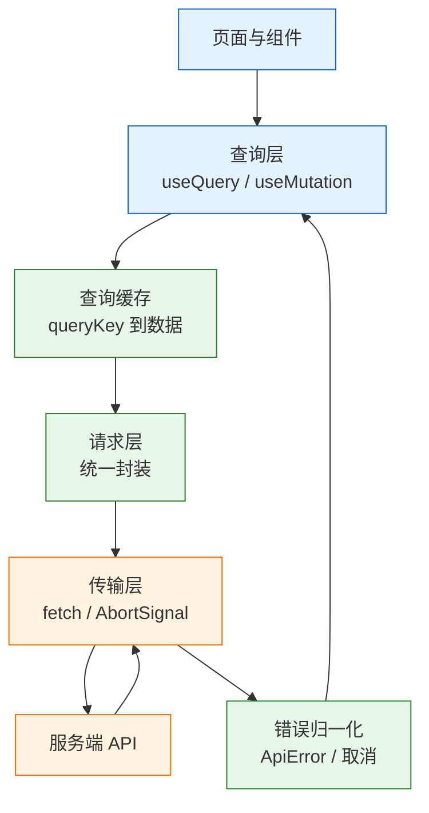
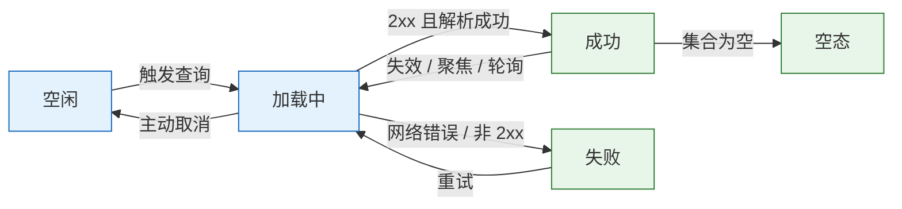
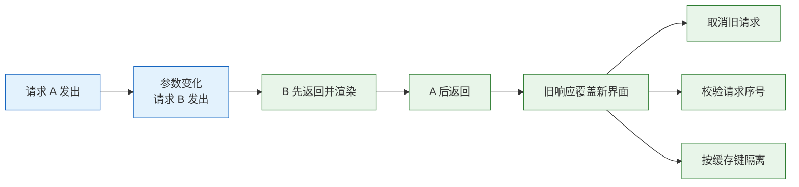

# 数据请求

---

## 一、数据请求是什么

### 1.1 核心概念

数据请求是客户端围绕远端数据完成的一整套动作：组装参数、发出请求、处理加载与失败、把结果写入缓存、在写入后让相关缓存失效。`fetch` 只是其中最底层的一步；页面是否正确，取决于状态与缓存是否被当作一等对象管理。

远端状态与客户端状态必须分开。远端状态的真相在服务端数据库，可能被其他人修改，会过期，需要去重和重试；客户端状态的真相在当前浏览器，只有本地代码会改它。把远端数据复制进全局 store，等于手工维护一份会过期的副本，刷新后不一致大多来自这里。

| 术语 | 含义 | 典型载体 |
|---|---|---|
| 查询 | 读取远端数据，可缓存、可重试 | `useQuery`、`getJSON` |
| 变更 | 修改远端数据，通常不缓存 | `useMutation`、`POST` |
| 缓存键 | 标识一份远端数据的输入组合 | `queryKey` |
| 失效 | 标记缓存过期并触发重取 | `invalidateQueries` |
| 取消 | 主动终止进行中的请求 | `AbortController` |
| 乐观更新 | 响应到达前先改本地缓存 | `onMutate` |

四个状态要收场：加载中、失败、空、有数据。三个时序要处理：重复请求、旧响应覆盖新响应、写完之后缓存没失效。这七件事与 HTTP 协议无关，属于客户端如何管理远端状态的问题。

### 1.2 与相邻技术的关系

HTTP 与 REST 定义报文、方法、状态码和缓存头，数据请求层把状态码翻译成业务语义。客户端状态管理库（Redux、Zustand、Pinia）适合放筛选条件、弹窗开关、草稿，不适合存放列表数据；数据请求库（TanStack Query、SWR）补上的正是缓存、去重、失效和重试。表单库负责字段值与错误，提交动作最终仍落到变更层。SSE 与 WebSocket 负责推送，查询负责首屏与断线后的补偿拉取。

| 技术 | 解决的问题 | 与数据请求的边界 |
|---|---|---|
| HTTP / REST | 报文、方法、缓存 | 只定义传输，不管界面状态 |
| 客户端状态库 | 本地状态共享 | 不负责远端数据的过期与重取 |
| 数据请求库 | 缓存、去重、失效 | 不替代请求层封装 |
| 表单库 | 字段值与校验 | 提交后交给变更层 |
| SSE / WebSocket | 服务端推送 | 不负责首屏与补偿 |

边界清晰之后，选型才有意义。只有一个列表页时，封装一个请求函数加取消逻辑就足够；多个页面共享同一份数据时，才需要引入查询缓存，否则会把复杂度花在没有收益的地方。

### 1.3 架构组成

数据请求在运行时分为五层：视图层发起查询，查询层管理缓存与生命周期，请求层统一协议细节，传输层执行 `fetch`，服务端返回数据。错误归一化横跨请求层与查询层，把网络异常、HTTP 错误和业务错误整理成同一种形状。



| 层 | 职责 | 失效后的表现 |
|---|---|---|
| 视图层 | 渲染四态、触发查询 | 骨架屏不消失、错误无处显示 |
| 查询层 | 缓存、去重、重试、失效 | 数据重复请求或长期不更新 |
| 请求层 | 基地址、鉴权、超时、错误归一 | 每处业务代码各写一套判断 |
| 传输层 | 连接、取消、流式响应 | 旧响应继续写入状态 |
| 服务端 | 数据真相与业务校验 | 客户端无法自行修复 |

分层的判断标准是替换成本：换请求库时只改查询层，换 HTTP 客户端时只改传输层，换后端地址时只改配置。若页面里直接出现 `fetch('/api/...')`，这些替换都要全量搜索。

---

## 二、最小示例与环境准备

### 2.1 运行环境与依赖

> **版本现状（2026-10）**：示例使用 TanStack Query 5 的 API；`fetch`、`AbortSignal.timeout`、`AbortSignal.any` 的行为以目标浏览器为准，Node 当前 LTS 已内置 `fetch`。

浏览器端不需要额外依赖即可发请求。需要缓存、去重与失效时再安装查询库；需要统一拦截与上传进度时可以选择 axios，但不应同时维护两套请求栈。

```bash
# 创建示例工程（Vite + React + TypeScript）
npm create vite@latest fetch-demo -- --template react-ts
cd fetch-demo
npm install

# 安装查询库；版本以安装结果为准，示例只用 5.x 的公开 API
npm i @tanstack/react-query

# 启动开发服务器
npm run dev
```

| 依赖 | 作用 | 引入时机 |
|---|---|---|
| 浏览器 `fetch` | 发起 HTTP 请求 | 始终可用 |
| `AbortController` | 取消请求、合并超时信号 | 有竞态或卸载场景 |
| `@tanstack/react-query` | 缓存、去重、重试、失效 | 多组件共享远端数据 |
| `axios` | 拦截器、上传进度 | 旧项目或明确需要 |

### 2.2 最小可运行示例

先写一个不依赖框架的请求函数。它把四件事固定下来：设置 `Accept`、检查 `res.ok`、处理空响应体、提供默认超时。

```typescript
// get-json.ts：最小请求封装，可直接被组件或脚本复用
export async function getJSON<T>(url: string, init: RequestInit = {}): Promise<T> {
  const headers = new Headers(init.headers);
  headers.set('Accept', 'application/json');

  const res = await fetch(url, {
    ...init,
    headers,
    // 调用方未传 signal 时给一个 5 秒超时；传了则以调用方为准
    signal: init.signal ?? AbortSignal.timeout(5000),
  });

  // fetch 只在网络层失败时 reject，4xx/5xx 仍会 resolve
  if (!res.ok) {
    throw new Error(`HTTP ${res.status} ${res.statusText}`);
  }

  // 204 没有响应体，直接 res.json() 会抛 SyntaxError
  if (res.status === 204) {
    return undefined as T;
  }

  return (await res.json()) as T;
}
```

再写一个 Node 脚本，观察 resolve 与 reject 的真实边界。脚本访问公开测试接口，只用于验证行为，不构成业务依赖。

```javascript
// fetch-demo.mjs：观察 fetch 的成功、404 与连接失败
const ok = await fetch('https://jsonplaceholder.typicode.com/todos/1');
console.log('ok:', ok.status, ok.ok);          // 200 true
const data = await ok.json();
console.log('keys:', Object.keys(data));

// 404 不会抛异常，只会把 ok 置为 false
const missing = await fetch('https://jsonplaceholder.typicode.com/todos/99999');
console.log('missing:', missing.status, missing.ok);

// 连接失败与超时才会进入 catch
try {
  await fetch('http://127.0.0.1:9/nope', { signal: AbortSignal.timeout(1000) });
} catch (err) {
  console.log('network:', err.name);
}
```

### 2.3 结果验证

```bash
node fetch-demo.mjs
```

预期输出类似：

```text
ok: 200 true
keys: [ 'userId', 'id', 'title', 'completed' ]
missing: 404 false
network: TypeError
```

第三行说明连接被拒绝时抛 `TypeError`；如果是超时，`err.name` 为 `TimeoutError`；主动调用 `abort()` 则为 `AbortError`。三者必须分开处理，否则超时会被误报成“用户取消”，取消又会被误报成“网络故障”。

| 异常名 | 触发条件 | 界面处理 |
|---|---|---|
| `TypeError` | DNS、连接拒绝、CORS 失败 | 提示网络不可用，可重试 |
| `TimeoutError` | `AbortSignal.timeout` 到期 | 提示超时，可重试 |
| `AbortError` | 主动取消、组件卸载 | 静默丢弃，不提示 |
| `ApiError` | 非 2xx 响应 | 按状态码分类处理 |

---

## 三、请求状态机与生命周期

### 3.1 四个终端状态

一次查询最终只会落到四种界面：加载中、有数据、空、失败。空态不是独立的网络状态，而是“成功且集合为空”，把它当成失败会让用户看到没有意义的重试按钮。



| 状态 | 界面表现 | 数据来源 |
|---|---|---|
| 加载中 | 骨架屏或局部 spinner | 无，保留旧数据可选 |
| 成功 | 列表或详情 | 缓存中的最新响应 |
| 空 | 空态说明与引导操作 | 成功响应中的空集合 |
| 失败 | 错误说明与重试按钮 | 归一化后的错误对象 |

### 3.2 状态转换与副作用

状态转换不只是改一个布尔值。进入加载要取消同键的旧请求；成功要写入缓存并记录时间戳；失败要区分可重试与不可重试；取消要回到空闲而不是失败。把这些副作用集中在查询层，组件只消费结果。

| 触发源 | 转换 | 必要副作用 |
|---|---|---|
| 首次挂载 | 空闲到加载 | 发起请求、登记取消信号 |
| 参数变化 | 加载到加载 | 取消旧请求、保留旧数据 |
| 响应到达 | 加载到成功 | 写缓存、清除错误 |
| 非 2xx | 加载到失败 | 归一化错误、判断是否重试 |
| 组件卸载 | 加载到空闲 | 取消请求、避免写状态 |
| 窗口聚焦 | 成功到加载 | 按 `staleTime` 决定是否重取 |

> **注意**：在 `useEffect` 里直接 `setState` 而不清理，会在快速切换参数时把旧响应写进新界面。清理函数必须取消请求，仅靠一个 `ignore` 布尔量无法阻止已经进入解析阶段的响应。

### 3.3 缓存生命周期

应用层缓存有两个时间参数。`staleTime` 决定数据多久算新鲜，新鲜期内不会自动重取；`gcTime` 决定没有组件订阅后缓存保留多久。两者混用会让“返回上一页白屏”或“内存持续增长”。

| 参数 | 含义 | 设置过短的后果 | 设置过长的后果 |
|---|---|---|---|
| `staleTime` | 新鲜期，期内不自动重取 | 频繁请求、闪烁 | 看到旧数据 |
| `gcTime` | 无订阅后的保留时间 | 返回页面白屏 | 内存占用升高 |
| `retry` | 失败重试次数 | 瞬时故障直接报错 | 放大服务端压力 |
| `refetchOnWindowFocus` | 聚焦时重取 | 切回页面数据陈旧 | 覆盖未提交的编辑 |

查询库的默认值适合演示，不适合所有业务。列表页可以接受 30 秒新鲜期；订单详情、库存、余额要求更短；配置类数据可以更长。参数要按数据变化频率设定，不能全项目复制同一个值。

---

## 四、请求封装与错误模型

### 4.1 fetch 的行为边界

`fetch` 的四个行为必须记住：只在网络层失败时 reject；`204` 没有响应体；超时需要自己加；`Content-Type` 不会自动设为 JSON。忽略任意一条，都会得到“请求成功但页面报错”或“后端收到空表单”的结果。

| 维度 | `fetch` | `axios` |
|---|---|---|
| 来源 | 浏览器与 Node 内置 | 第三方依赖 |
| 非 2xx | 不 reject，需查 `res.ok` | 默认 reject |
| JSON 解析 | 手动 `res.json()` | 自动 |
| 拦截器 | 无，需自己封装 | 请求与响应拦截器 |
| 上传进度 | 需 XHR 或流 | `onUploadProgress` |
| 取消 | `AbortController` | `AbortController` |
| 适合 | 依赖少、逻辑简单 | 统一拦截、进度、旧项目 |

两者都能用，关键是只封装一层。业务代码里到处写 `fetch`，鉴权头和错误格式会分叉；给 axios 再包三层，排查时要跨四个文件才能看到真实的请求参数。

### 4.2 统一请求层设计

请求层负责基地址、默认头、凭据策略、超时和错误归一。它不负责缓存，也不负责界面提示，保持为纯函数更容易测试。

```typescript
// http.ts：统一请求层
export class ApiError extends Error {
  constructor(
    readonly status: number,
    readonly body: unknown,
    message: string,
  ) {
    super(message);
    this.name = 'ApiError';
  }
}

const BASE = import.meta.env.VITE_API_BASE ?? '/api';

export async function request<T>(path: string, init: RequestInit = {}): Promise<T> {
  const headers = new Headers(init.headers);
  headers.set('Accept', 'application/json');

  // 只给字符串请求体补 JSON 类型；FormData、Blob 由浏览器生成各自的头
  if (typeof init.body === 'string' && !headers.has('Content-Type')) {
    headers.set('Content-Type', 'application/json');
  }

  const res = await fetch(`${BASE}${path}`, {
    ...init,
    headers,
    // 同源请求默认带 Cookie；跨域要显式 include 并由服务端放行
    credentials: 'same-origin',
    signal: init.signal ?? AbortSignal.timeout(10_000),
  });

  if (res.status === 204) return undefined as T;

  const type = res.headers.get('Content-Type') ?? '';
  // application/json 与 application/problem+json 都按 JSON 解析
  const body = type.includes('json') ? await res.json() : await res.text();

  if (!res.ok) {
    throw new ApiError(res.status, body, `HTTP ${res.status}`);
  }
  return body as T;
}
```

统一封装还要解决参数序列化。查询参数用 `URLSearchParams` 生成，避免手工拼接时漏掉 `encodeURIComponent`；数组参数要约定重复键还是逗号分隔，并在请求层一次实现。

```typescript
// 查询参数统一编码，调用方只传对象
export function toQuery(params: Record<string, string | number | boolean | undefined>) {
  const search = new URLSearchParams();
  for (const [key, value] of Object.entries(params)) {
    if (value !== undefined && value !== '') search.set(key, String(value));
  }
  return search.toString();
}
```

### 4.3 错误分类与重试判定

错误要先分类再决定动作。网络错误和 5xx 可以有限重试；4xx 中只有 408、429 值得重试；401 走刷新令牌；403、404、422 不应重试。对 4xx 盲目重试只会把一次失败放大成多次请求。

| 错误类型 | 可重试 | 处理方式 |
|---|---|---|
| 网络中断、超时 | 是 | 指数退避，限制次数 |
| `429` | 是 | 读取 `Retry-After` 后重试 |
| `5xx` | 视幂等性 | 幂等请求有限重试 |
| `401` | 一次 | 刷新令牌后重放 |
| `403` / `404` | 否 | 提示无权限或不存在 |
| `422` | 否 | 映射到表单字段 |

重试的前提是幂等。`GET`、`PUT`、`DELETE` 天然可以重试；`POST` 创建订单、支付、发消息必须带幂等键，否则重试会产生重复数据。退避要加随机抖动，避免大量客户端在同一时刻再次打到服务端。

---

## 五、竞态、取消与去重

### 5.1 竞态的成因

竞态的时间线很固定：请求 A 发出，参数变化后请求 B 发出，B 先返回并渲染，A 随后返回并覆盖。结果不是“慢”，而是界面显示了与当前筛选条件不匹配的数据。



三种手段可以组合使用：取消旧请求、校验请求序号、用缓存键隔离。取消最直接，但只对尚未完成的请求有效；序号校验能兜住已经进入解析阶段的响应；缓存键让不同参数的结果各归各位，从结构上避免互相覆盖。

| 手段 | 原理 | 局限 |
|---|---|---|
| `AbortController` | 终止连接与响应读取 | 已解析完成时无效 |
| 请求序号 | 只接受最新序号 | 需要手动维护 |
| 缓存键隔离 | 不同输入存不同槽位 | 依赖查询层 |
| 防抖 | 减少请求数量 | 不解决返回乱序 |

### 5.2 AbortController 与信号组合

每次参数变化都创建新的控制器，并在下一次变化或卸载时取消上一个。取消触发的拒绝必须被识别，不能进入通用错误提示。

```typescript
let current: AbortController | null = null;

async function search(keyword: string) {
  current?.abort();
  const controller = new AbortController();
  current = controller;

  try {
    const data = await getJSON<Result[]>(
      `/api/search?q=${encodeURIComponent(keyword)}`,
      { signal: controller.signal },
    );
    render(data);
  } catch (err) {
    // 主动取消不是故障，直接返回
    if ((err as Error).name === 'AbortError') return;
    showError(err);
  }
}
```

React 的清理函数是天然的取消点。依赖变化时先执行上一轮的清理，再执行新一轮的查询，顺序由框架保证。

```tsx
useEffect(() => {
  const controller = new AbortController();
  load(keyword, controller.signal)
    .then(setData)
    .catch(err => {
      if (err.name !== 'AbortError') setError(err);
    });
  return () => controller.abort();
}, [keyword]);
```

同时需要业务取消与超时时，用 `AbortSignal.any([controller.signal, AbortSignal.timeout(5000)])` 合并信号。该 API 在较旧的运行时不可用，使用前要确认目标浏览器；不可用时改为在请求层手动计时并调用 `controller.abort()`。

> **注意**：`AbortSignal.timeout` 触发的拒绝名为 `TimeoutError`，与用户取消的 `AbortError` 不同。把两者都当成“取消”会隐藏真实的超时，把两者都当成“失败”会在切换页面时弹出无意义的错误提示。

### 5.3 请求去重与并发控制

两个组件同时需要用户信息，各自写一个 `useEffect` 就会发两次请求。查询库按 `queryKey` 去重；手写时缓存进行中的 Promise，让后到的调用复用同一个结果。

```javascript
// 进行中的请求表：完成后立即删除，失败时所有等待者一起失败
const inflight = new Map();

function getOnce(key, fn) {
  if (!inflight.has(key)) {
    const p = Promise.resolve().then(fn).finally(() => inflight.delete(key));
    inflight.set(key, p);
  }
  return inflight.get(key);
}
```

去重只解决相同输入的重复请求，不解决请求总量。一次发几十个请求会挤占连接数，HTTP/1.1 下浏览器对同源通常只有 6 个并发连接；HTTP/2 多路复用缓解了连接数限制，但服务端仍然有承载上限。批量接口、分页和懒加载比并发池更有效。

| 手段 | 适用 | 代价 |
|---|---|---|
| 进行中 Promise 复用 | 同参数并发 | 无法区分调用方 |
| 查询键去重 | 组件共享数据 | 需要查询层 |
| 防抖 / 节流 | 输入搜索 | 增加响应延迟 |
| 并发池 | 批量任务 | 实现与调度复杂 |

---

## 六、缓存、失效与写操作

### 6.1 两层缓存

HTTP 缓存由浏览器根据响应头决定是否再发请求；应用层缓存由查询库决定组件之间是否共享、何时重取。两层解决不同问题，同时使用并不冲突。

| 维度 | HTTP 缓存 | 应用层缓存 |
|---|---|---|
| 决策者 | 浏览器与响应头 | 查询库与 `queryKey` |
| 粒度 | 单个 URL | 参数组合 |
| 共享范围 | 同一浏览器 | 同一页面会话 |
| 失效方式 | 过期、`ETag` 验证 | `invalidateQueries` |

排查“为什么还是旧数据”时先确认是哪一层：Network 面板显示 `304` 或 `from disk cache`，说明是 HTTP 缓存；Network 根本没有请求，说明应用层缓存仍在新鲜期。

### 6.2 queryKey 设计

`queryKey` 必须包含所有影响响应的输入：筛选、分页、排序、语言、租户。少一个参数，切换条件时就会命中上一份缓存，表现为“点了没反应”。

```typescript
// 键工厂：把层级关系集中定义，避免字符串散落
export const taskKeys = {
  all: ['tasks'] as const,
  list: (filters: Filters) => [...taskKeys.all, 'list', filters] as const,
  detail: (id: number) => [...taskKeys.all, 'detail', id] as const,
};
```

| 规则 | 正确做法 | 常见错误 |
|---|---|---|
| 包含全部输入 | 筛选、分页、排序都进键 | 只放资源名 |
| 层级可失效 | 前缀能覆盖一组查询 | 每处拼不同前缀 |
| 值可序列化 | 普通对象与原始值 | 放函数、类实例 |
| 单一来源 | 用键工厂生成 | 页面里手写数组 |

前缀失效依赖层级设计。`['tasks']` 能覆盖列表与详情，`['tasks','list',{...}]` 只能覆盖单个列表。失效范围要按业务一致性要求选择，过大导致无谓重取，过小导致部分页面不更新。

使用占位数据时，`isPlaceholderData` 为 true 表示当前展示的是上一页副本，而不是新键对应的真实结果。可以据此显示“刷新中”，但不要把它当成新数据写回缓存，否则切页后会把旧内容固化成新键的初始值。

### 6.3 失效与乐观更新

保守做法是写成功后让相关查询失效，由查询层重新拉取。它牺牲一点即时性，换来与服务端的一致。

```tsx
const qc = useQueryClient();

const create = useMutation({
  mutationFn: (input: NewTask) => postTask(input),
  // 成功后让所有任务相关查询过期，列表与统计都会重取
  onSuccess: () => qc.invalidateQueries({ queryKey: taskKeys.all }),
});
```

需要“点了立刻变”的勾选，用乐观更新并在失败时回滚。顺序不能反：先取消进行中的查询，避免旧响应覆盖乐观结果；再保存旧值；失败回滚；最后无论成败都失效，与服务端对齐。

```tsx
type TaskPage = { items: Task[]; total: number };

const toggle = useMutation({
  mutationFn: (id: number) => patchTask(id, { done: true }),
  onMutate: async (id) => {
    // filters 来自当前页面，保证乐观更新落在同一个列表键上
    const key = taskKeys.list(filters);
    // 1. 取消同键请求，防止返回后覆盖本地修改
    await qc.cancelQueries({ queryKey: key });
    // 2. 保存快照，供失败回滚
    const prev = qc.getQueryData<TaskPage>(key);
    qc.setQueryData<TaskPage>(key, old =>
      old && {
        ...old,
        items: old.items.map(t => (t.id === id ? { ...t, done: !t.done } : t)),
      },
    );
    return { prev, key };
  },
  onError: (_err, _id, ctx) => {
    if (ctx?.prev) qc.setQueryData(ctx.key, ctx.prev);
  },
  // 3. 成败都重新对齐服务端
  onSettled: () => qc.invalidateQueries({ queryKey: taskKeys.all }),
});
```

> **注意**：乐观更新只适合失败概率低、回滚代价小的操作。支付、库存扣减、审批提交不应先改界面再等结果，用户看到“已支付”而服务端失败，恢复信任的成本远高于等待一次响应。

### 6.4 浏览器 HTTP 缓存

静态资源与接口的缓存策略要分开。带内容哈希的 JS、CSS 可以长期缓存；`index.html` 必须短缓存或每次验证，否则发版后用户仍加载旧入口。

| 响应头 | 行为 | 适用 |
|---|---|---|
| `Cache-Control: no-store` | 完全不缓存 | 个人信息、订单 |
| `Cache-Control: no-cache` | 可存但每次验证 | 常更新的 HTML |
| `Cache-Control: max-age=3600` | 一小时内用本地副本 | 带哈希的静态资源 |
| `ETag` + `If-None-Match` | 命中返回 304 | JSON、图片 |
| `Vary: Authorization` | 按请求头区分缓存 | 多租户接口 |

调试时勾选 DevTools 的 “Disable cache”，或用 `fetch(url, { cache: 'no-store' })`。给 URL 加随机参数会绕过缓存，但同时让 CDN 与浏览器都无法复用，属于临时手段而不是方案。

---

## 七、认证与令牌刷新

### 7.1 状态码语义

前端要按状态码分工，而不是把所有失败都弹同一个提示。401 表示身份未被识别，403 表示身份已识别但权限不足，二者对应完全不同的用户动作。

| 状态 | 含义 | 前端处理 |
|---|---|---|
| `400` | 请求格式错误 | 展示后端消息，通常是前端缺陷 |
| `401` | 未认证或令牌过期 | 刷新一次令牌，失败后跳登录 |
| `403` | 已认证但无权限 | 提示无权限，不重试登录 |
| `404` | 资源不存在 | 详情页显示不存在 |
| `409` | 冲突 | 刷新数据并提示 |
| `422` | 字段校验失败 | 映射到表单字段 |
| `429` | 限流 | 按 `Retry-After` 退避 |
| `5xx` | 服务端错误 | 幂等请求有限重试 |

### 7.2 刷新单例

多个请求同时收到 401，如果各自刷新，会刷新多次并互相作废。用单例 Promise 合并刷新动作，所有等待者共享同一次结果。

```typescript
let refreshing: Promise<void> | null = null;

function ensureFreshToken() {
  // ??= 只在为空时赋值，后到的调用复用同一个 Promise
  refreshing ??= refreshToken().finally(() => {
    refreshing = null;
  });
  return refreshing;
}

async function requestWithRetry(url: string, init: RequestInit = {}) {
  let res = await fetch(url, init);
  if (res.status !== 401) return res;

  await ensureFreshToken();
  // 用新令牌重放一次；body 必须是字符串或 FormData 才能复用
  return fetch(url, init);
}
```

刷新接口自身也会返回 401，必须走独立分支并直接登出，否则会形成无限循环。重放时如果请求体是 `ReadableStream`，第一次请求已经消费，不能直接复用；在进入请求层之前把 body 转成字符串或 `FormData`。

### 7.3 令牌存储边界

令牌存放位置决定了攻击面。`localStorage` 读取方便，但任何 XSS 都能窃取；`HttpOnly` Cookie 阻止脚本读取，却需要处理 CSRF；内存存储最安全，但刷新页面即丢失，需要配合刷新令牌。

| 存储位置 | 抗 XSS | 抗 CSRF | 适用 |
|---|---|---|---|
| `localStorage` | 否 | 是 | 短生命周期、低敏感场景 |
| `sessionStorage` | 否 | 是 | 单标签页会话 |
| 内存变量 | 是 | 是 | 配合刷新令牌 |
| `HttpOnly` Cookie | 是 | 否，需 Token | 同源 Web 应用 |

> **安全警告**：把长期有效的访问令牌放进 `localStorage`，等于把账号交给每一个第三方脚本。只要页面引入了一个被投毒的依赖，令牌就会被读走。优先使用 `HttpOnly`、`Secure`、`SameSite` Cookie，并配合 CSRF Token；必须用请求头时，把令牌放在内存，刷新令牌放 `HttpOnly` Cookie。

> **安全警告**：CSRF 防护不能靠前端“只发 JSON”来保证。攻击者可以用表单提交简单请求，也可以用跨站脚本绕过同源限制。只要认证依赖 Cookie，服务端就必须校验 CSRF Token 或 `Origin`。

---

## 八、完整示例：任务列表的请求层

### 8.1 需求与结构

示例实现一个任务列表：按状态筛选、分页、查看详情、新建、勾选完成。它覆盖查询键、占位数据、失效、乐观更新和错误归一五条主线，后端接口用占位路径表示。

| 文件 | 职责 |
|---|---|
| `http.ts` | 基地址、超时、错误归一 |
| `tasks.ts` | 任务接口与参数类型 |
| `queries.ts` | 查询键、查询与变更定义 |
| `TaskList.tsx` | 四态渲染与交互 |

### 8.2 请求层实现

```typescript
// tasks.ts：接口层只描述业务语义
export type Task = { id: number; title: string; done: boolean };
export type Filters = { status: 'all' | 'open' | 'done'; page: number };

export function fetchTasks(filters: Filters, signal?: AbortSignal) {
  const query = toQuery({ status: filters.status, page: filters.page });
  return request<{ items: Task[]; total: number }>(`/tasks?${query}`, { signal });
}

export function fetchTask(id: number, signal?: AbortSignal) {
  return request<Task>(`/tasks/${id}`, { signal });
}

export function createTask(input: { title: string }) {
  return request<Task>('/tasks', { method: 'POST', body: JSON.stringify(input) });
}

export function patchTask(id: number, patch: Partial<Task>) {
  return request<Task>(`/tasks/${id}`, {
    method: 'PATCH',
    body: JSON.stringify(patch),
  });
}
```

### 8.3 查询与变更实现

```tsx
// queries.ts：查询键与查询定义放在一起，页面只引用
import { keepPreviousData, queryOptions } from '@tanstack/react-query';

export const taskKeys = {
  all: ['tasks'] as const,
  list: (filters: Filters) => [...taskKeys.all, 'list', filters] as const,
  detail: (id: number) => [...taskKeys.all, 'detail', id] as const,
};

export const taskListQuery = (filters: Filters) =>
  queryOptions({
    queryKey: taskKeys.list(filters),
    queryFn: ({ signal }) => fetchTasks(filters, signal),
    staleTime: 30_000,
    // 新键数据未到时保留上一页，避免翻页闪白
    placeholderData: keepPreviousData,
  });
```

```tsx
// TaskList.tsx：四态渲染，查询参数变化自动取消旧请求
export function TaskList({ filters }: { filters: Filters }) {
  const qc = useQueryClient();
  const { data, isPending, isError, error, isFetching } = useQuery(
    taskListQuery(filters),
  );

  const create = useMutation({
    mutationFn: createTask,
    onSuccess: () => qc.invalidateQueries({ queryKey: taskKeys.all }),
  });

  if (isPending) return <Skeleton rows={5} />;
  if (isError) return <ErrorBox error={error} onRetry={() => qc.invalidateQueries()} />;
  if (data.items.length === 0) return <EmptyState />;

  return (
    <section aria-busy={isFetching}>
      {data.items.map(task => (
        <TaskRow key={task.id} task={task} />
      ))}
      <button onClick={() => create.mutate({ title: '新任务' })}>
        新建任务
      </button>
    </section>
  );
}
```

`queryFn` 的 `signal` 由查询库传入，参数变化或组件卸载时自动取消。这正是手写 `useEffect` 需要自己完成的工作；把取消交给查询层，业务组件只关心数据。

详情查询要防非法参数。路由参数可能是空串或非数字，直接发请求会得到 404 或 400；用 `enabled` 在参数无效时跳过查询，等参数合法后再取数。预取则把用户“即将点击”的详情提前放进缓存，点击后不再等待。

```tsx
const qc = useQueryClient();

// 详情页：id 非法时不发请求
const detail = useQuery({
  queryKey: taskKeys.detail(id),
  queryFn: ({ signal }) => fetchTask(id, signal),
  enabled: Number.isFinite(id),
});

// 列表项悬停时预取，点击后直接命中缓存
<Row
  task={task}
  onMouseEnter={() =>
    qc.prefetchQuery({
      queryKey: taskKeys.detail(task.id),
      queryFn: ({ signal }) => fetchTask(task.id, signal),
    })
  }
/>
```

查询错误在组件内展示，渲染崩溃交给 Error Boundary，两者不要混。请求失败仍能渲染页面，只是某一块显示错误；组件抛异常会让整棵子树卸载，必须由边界兜底。

### 8.4 验证

| 操作 | 预期 |
|---|---|
| 首次进入 | 显示骨架屏，Network 出现一次列表请求 |
| 快速切换筛选 | 旧请求状态为 `canceled`，界面只显示最后一次结果 |
| 翻页 | 保留上一页内容，`isFetching` 为 true |
| 新建任务 | 列表自动刷新，新任务出现 |
| 勾选完成 | 界面立即变化，失败时回滚 |
| 断网后进入 | 显示错误与重试按钮，不显示空态 |

---

## 九、实时通道与轮询

### 9.1 通道对比

实时需求先判断方向与延迟要求。低频通知用轮询足够；只需要服务端推送时用 SSE；确实需要双向通信才上 WebSocket。为一条通知引入双向协议，会增加心跳、重连和鉴权的维护成本。

| 方式 | 方向 | 协议 | 重连 | 适合 |
|---|---|---|---|---|
| 短轮询 | 客户端反复请求 | HTTP | 自己实现 | 低频、容忍延迟 |
| 长轮询 | 服务端挂起到有数据 | HTTP | 自己实现 | 兼容性优先 |
| SSE | 服务端到客户端 | HTTP `text/event-stream` | 浏览器自动 | 通知、日志、进度 |
| WebSocket | 双向 | WS / WSS | 自己实现 | 聊天、协作、游戏 |

### 9.2 SSE 实现

```javascript
// EventSource 自动重连，并记住最近的事件 id
const es = new EventSource('/api/events', { withCredentials: true });

es.onmessage = event => {
  const data = JSON.parse(event.data);
  // 收到事件后让对应查询失效，由查询层决定是否重取
  queryClient.invalidateQueries({ queryKey: ['tasks'] });
};

es.onerror = () => {
  // 浏览器会自动重连；这里只更新连接状态提示
  setRealtimeState('reconnecting');
};
```

`EventSource` 不能自定义请求头，鉴权依赖 Cookie 或 URL 参数；跨域时要设置 `withCredentials`，服务端也要返回对应的 CORS 头。事件流要带心跳注释，避免代理在空闲时断开连接。

> **注意**：SSE 只是通知通道，不保证消息不丢。断线期间的事件需要服务端保留序号，客户端重连后按 `Last-Event-ID` 补发，或者重连后全量刷新一次。只依赖 `onmessage` 会把断线窗口内的变更永久漏掉。

---

## 十、工程实践

### 10.1 分层与目录

目录结构要能看出依赖方向：页面依赖查询，查询依赖接口，接口依赖请求层。反向依赖会让请求层知道业务，最终无法复用。

| 目录 | 内容 | 禁止 |
|---|---|---|
| `api/http.ts` | 基地址、拦截、错误类 | 业务字段 |
| `api/tasks.ts` | 接口函数与类型 | 组件状态 |
| `queries/tasks.ts` | 查询键、查询与变更 | 直接写 `fetch` |
| `pages/tasks/` | 页面与展示组件 | 拼装请求头 |

### 10.2 可观测性

请求层要能回答“慢在哪、错在哪、谁在用”。前端埋点至少记录接口、状态码、耗时、是否命中缓存，并对高频 5xx 与超时设置告警。

| 指标 | 用途 | 采样建议 |
|---|---|---|
| 请求耗时 P95 | 发现慢接口 | 全量或 10% |
| 错误率按状态码 | 区分客户端与服务端问题 | 全量 |
| 取消率 | 发现过度请求 | 低采样 |
| 缓存命中率 | 验证查询键设计 | 开发与预发 |

日志里不能记录完整令牌、Cookie 和请求体中的密码。需要关联时记录请求 ID 与用户 ID 的哈希，既能追踪又不泄露凭据。

### 10.3 选型判断

| 场景 | 方案 | 理由 |
|---|---|---|
| 单页、少量请求 | `fetch` 封装加取消 | 依赖少，逻辑直观 |
| 多页面共享数据 | TanStack Query / SWR | 去重、缓存、失效成熟 |
| 强实时 | SSE / WebSocket 加查询补偿 | 推送与首屏分工 |
| 离线优先 | 本地数据库加同步队列 | 请求库不负责冲突合并 |

选型之后仍要守住三条底线：请求可取消、错误可分类、写入后缓存可失效。缺少任意一条，页面在慢网络和并发操作下都会出现难以复现的错乱。

---

## 十一、常见错误与排查

### 11.1 故障对照表

| 现象 | 最可能原因 | 处理 |
|---|---|---|
| 404 被当成成功 | 没检查 `res.ok` | 统一封装，非 2xx 抛错 |
| 204 解析报错 | 对空响应体调用 `res.json()` | 先判断状态码 |
| 请求发两次 | StrictMode 双挂载或依赖变化 | 加取消清理，不关 StrictMode |
| 旧结果覆盖新结果 | 没取消或没校验序号 | `AbortController` 加键隔离 |
| 切换筛选不刷新 | `queryKey` 少了参数 | 键包含全部影响结果的输入 |
| 返回页面白屏 | `gcTime` 太短 | 调大，或用占位数据 |
| 刷新令牌风暴 | 每个 401 各自刷新 | 单例 Promise 合并 |
| POST 重试重复下单 | 重试了非幂等请求 | 幂等键，或只重试 GET |
| 写完列表不变 | 没失效缓存 | 失效对应前缀 |
| 跨域请求不带 Cookie | `credentials` 为默认同源 | 显式 `include` 并配置 CORS |
| 本地正常线上 CORS | 开发代理绕过跨域 | 生产同源反代或正确配置 |
| JSON 预检失败 | 缺 `Access-Control-Allow-Headers` | 服务端允许对应请求头 |

### 11.2 排查顺序

1. 打开 Network，确认请求是否发出、状态码、响应体与耗时。
2. 检查请求头：`Content-Type`、`Authorization`、`Cookie`、`Origin`。
3. 检查 Console 是否有 CORS、混合内容、CSP 拦截。
4. 查看查询库 Devtools 的键、缓存状态与失效记录。
5. 检查取消链路：旧请求是否真的被中止，响应是否被丢弃。
6. 最后才检查组件渲染。渲染错误通常表现为空白或重复，不会改变网络请求本身。

> **核心结论**：`fetch` 对 4xx 与 5xx 不 reject，先查 `res.ok` 再解析，超时要自己加；每次请求都可取消，旧响应不能写进新界面；远端数据交给查询缓存，键带全参数，写完让相关缓存失效。
