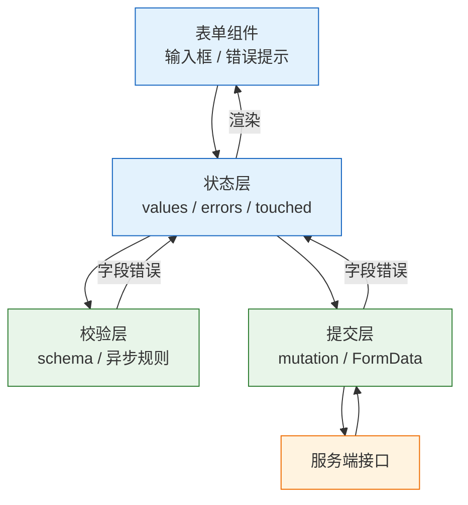
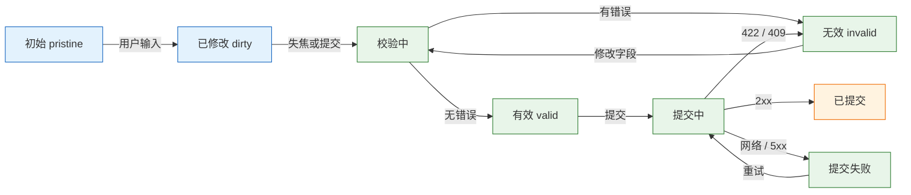

# 表单与校验

---

## 一、表单与校验是什么

### 1.1 核心概念

表单是用户向系统提交结构化数据的界面契约。它同时承担三件事：收集输入、约束输入、把提交结果反馈给用户。校验是其中的约束层，负责判断某个值是否满足规则，并把不满足的原因准确落到字段上。

一个可用的表单要回答五个问题：值从哪里来、什么时候校验、错误显示在哪、提交几次、服务端错误如何映射。把这五件事定清楚，比选择哪个表单库更重要。库只提供状态容器和订阅机制，业务规则与交互时机仍要自己决定。

| 概念 | 含义 | 典型载体 |
|---|---|---|
| 字段值 | 当前输入内容 | `values`、`FormData` |
| 错误 | 字段或表单级失败原因 | `errors`、`aria-invalid` |
| 触碰 | 字段是否失焦过 | `touchedFields` |
| 脏值 | 是否与初始值不同 | `isDirty` |
| 提交态 | 是否正在提交 | `isSubmitting` |
| 校验模式 | 何时触发规则 | `mode`、`reValidateMode` |

表单状态不是一棵独立的树，而是字段状态的集合加一个表单级错误槽。字段状态包含值、错误、触碰、脏值；表单级状态包含提交中、提交失败、整体错误。把服务端整体错误塞进某个字段，会让用户在一个无关的输入框旁看到“网络不可用”。

### 1.2 与相邻技术的关系

表单库解决值与错误的统一管理，schema 库解决规则的单一来源，二者职责不同。原生 HTML 校验提供零代码的即时拦截和无障碍语义；服务端校验提供唯一性、权限、库存这类只有服务端才知道的事实。数据请求层负责把提交发出去，并把状态码翻译成可映射的错误结构。

| 技术 | 解决的问题 | 与表单校验的边界 |
|---|---|---|
| 原生约束校验 | 必填、类型、长度 | 文案与样式不可定制 |
| schema 库 | 规则集中、类型推导 | 可被绕过，不是安全边界 |
| 表单库 | 注册、订阅、错误状态 | 不提供业务规则 |
| 请求层 | 提交与错误归一 | 不决定错误落到哪个字段 |
| 服务端校验 | 可信事实与权限 | 需要把错误结构回传 |

前端校验永远不是安全措施。绕过 JavaScript 直接发请求只需要一条 `curl`，服务端必须独立校验一次。共享 schema 的价值是减少规则漂移，不是把服务端的安全责任转移给浏览器。

### 1.3 架构组成

表单在运行时分为四层：视图层渲染输入与错误，状态层保存值与触碰信息，校验层执行规则，提交层发送请求并处理响应。四层之间通过稳定的数据结构连接，替换任意一层不影响其他层。



| 层 | 职责 | 失效后的表现 |
|---|---|---|
| 视图层 | 绑定字段、展示错误 | 输入无响应、错误不显示 |
| 状态层 | 保存值、触碰、脏值 | 提交空值、离开页面不提示 |
| 校验层 | 同步与异步规则 | 非法值被提交 |
| 提交层 | 序列化、发送、映射错误 | 重复提交、错误只弹提示 |

分层的直接收益是测试。schema 是纯函数，可以脱离组件做单元测试；提交函数只依赖请求层，可以用 mock 覆盖 409、422 与网络失败；组件测试只验证错误是否出现在正确位置。三者分开，规则变更时不需要重写界面测试。

数据流的方向也要固定。用户输入先进入状态层，状态层把值交给校验层，校验层只返回错误而不修改值，提交层读取的是校验通过后的快照。若提交层直接读 DOM，校验层看到的和实际发出的可能是两份不同的数据；若校验层在规则里做格式化，错误路径又会与字段名脱节。保持“输入、校验、提交”单向流动，排查时才能确定问题落在哪一段。

---

## 二、最小示例与环境准备

### 2.1 依赖与版本

> **版本现状（2026-10）**：React Hook Form 7 与 Zod 4；`@hookform/resolvers` 需使用支持 Zod 4 的版本，安装时以 peer 依赖提示为准。

```bash
# 创建工程
npm create vite@latest form-demo -- --template react-ts
cd form-demo
npm install

# 表单库、schema 库与桥接层
npm i react-hook-form zod @hookform/resolvers

# 启动
npm run dev
```

| 依赖 | 作用 | 备注 |
|---|---|---|
| `react-hook-form` | 字段注册、错误状态、提交 | 非受控为主，减少重渲染 |
| `zod` | schema 定义与类型推导 | 前后端可共用 |
| `@hookform/resolvers` | 把 schema 适配为校验器 | 版本需匹配 Zod |
| 原生表单 | 语义、自动填充、无障碍 | 不应被完全绕开 |

### 2.2 最小可运行表单

下面的登录表单包含两个字段、两条格式规则和表单级错误。它使用 `mode: 'onBlur'`，首次校验发生在失焦，之后用户修改时立即消除错误。

```tsx
import { useForm } from 'react-hook-form';
import { zodResolver } from '@hookform/resolvers/zod';
import { z } from 'zod';

// 规则只写一份，类型从 schema 推导
const schema = z.object({
  email: z.email('邮箱格式不正确'),
  password: z.string().min(8, '密码至少 8 位'),
});

type Values = z.infer<typeof schema>;

export default function LoginForm() {
  const {
    register,
    handleSubmit,
    setError,
    formState: { errors, isSubmitting },
  } = useForm<Values>({
    resolver: zodResolver(schema),
    // 首次失焦校验，之后修改即时校验
    mode: 'onBlur',
    reValidateMode: 'onChange',
  });

  async function onSubmit(values: Values) {
    const res = await fetch('/api/login', {
      method: 'POST',
      headers: { 'Content-Type': 'application/json' },
      body: JSON.stringify(values),
    });
    if (!res.ok) {
      // 表单级错误放在 root，不污染具体字段
      setError('root.server', { message: `登录失败（HTTP ${res.status}）` });
    }
  }

  return (
    <form onSubmit={handleSubmit(onSubmit)} noValidate>
      <p>
        <label htmlFor="email">邮箱</label>
        <input
          id="email"
          type="email"
          autoComplete="email"
          aria-invalid={!!errors.email}
          aria-describedby={errors.email ? 'email-error' : undefined}
          {...register('email')}
        />
        {errors.email && (
          <span id="email-error" role="alert">{errors.email.message}</span>
        )}
      </p>

      <p>
        <label htmlFor="password">密码</label>
        <input
          id="password"
          type="password"
          autoComplete="current-password"
          aria-invalid={!!errors.password}
          aria-describedby={errors.password ? 'password-error' : undefined}
          {...register('password')}
        />
        {errors.password && (
          <span id="password-error" role="alert">{errors.password.message}</span>
        )}
      </p>

      <button type="submit" disabled={isSubmitting}>
        {isSubmitting ? '登录中…' : '登录'}
      </button>
      {errors.root?.server?.message && (
        <p role="alert">{errors.root.server.message}</p>
      )}
    </form>
  );
}
```

`noValidate` 关闭浏览器原生气泡，让 schema 统一控制文案；`type="email"`、`autoComplete` 这些语义仍然保留，移动端键盘和密码管理器继续生效。提交时无论 `mode` 是什么，都会执行完整校验。

### 2.3 结果验证

| 操作 | 预期 |
|---|---|
| 直接点登录 | 两个字段下方出现 schema 文案，页面不跳转 |
| 邮箱填 `abc` 后失焦 | 显示“邮箱格式不正确” |
| 改成合法邮箱与 8 位密码 | 点击后只发一次 `POST /api/login` |
| 本地无后端 | 请求返回 404，表单底部显示“登录失败（HTTP 404）” |
| 提交中重复点击 | 按钮禁用，不产生第二个请求 |

> **注意**：`mode: 'onBlur'` 只影响首次校验时机，不影响提交。提交失败后字段被标记为已触碰，后续修改会按 `reValidateMode` 立即校验；如果发现“改了也不消失”，先检查是否把 `reValidateMode` 设成了 `onSubmit`。

演示里没有后端，404 属于预期结果。真实项目要把“网络失败”和“业务失败”分开：前者可以重试，后者需要根据响应体决定落到字段还是表单顶部。若把 404 也当成凭据错误，用户会在网络抖动时被反复引导去改密码，问题反而被掩盖。

---

## 三、表单状态模型

### 3.1 字段状态

每个字段至少有五份信息，它们回答不同问题，不能合并。只存值会让错误无处显示；只存错误会让离开页面的提示失效；没有触碰状态就会一进页面满屏红字。

| 状态 | 含义 | 用途 |
|---|---|---|
| `value` | 当前值 | 提交、联动、格式化 |
| `error` | 错误消息 | 字段旁提示、`aria-invalid` |
| `touched` | 是否失焦过 | 决定何时显示错误 |
| `dirty` | 是否改过 | 离开提示、启用保存 |
| `isSubmitting` | 是否在提交 | 禁用按钮、显示进度 |

表单级还要有 `submitError` 或 `root.server`，用于网络失败、整体拒绝这类不属于任何字段的错误。它应显示在表单顶部或提交按钮附近，并用 `role="alert"` 让读屏立即播报。

### 3.2 受控与非受控

受控组件的值放在 React state，每次输入都触发重渲染；非受控组件的值放在 DOM，提交时通过 `ref` 或 `FormData` 读取。字段少时两者差异不明显，字段多、联动多时差异会被放大。

| 维度 | 受控 | 非受控 |
|---|---|---|
| 值存放 | React state | DOM 自身 |
| 读取方式 | `value` 与 `onChange` | `ref` 或 `FormData` |
| 每次输入 | 组件重渲染 | 不重渲染 |
| 联动与实时校验 | 方便 | 需要额外订阅 |
| 大表单性能 | 字段多时明显下降 | 较好 |
| 典型实现 | 手写、Formik | React Hook Form、原生表单 |

```tsx
// 受控：值由 React 驱动，适合需要即时联动的字段
const [email, setEmail] = useState('');
<input value={email} onChange={e => setEmail(e.target.value)} />

// 非受控：值由 DOM 保存，提交时读取
const emailRef = useRef<HTMLInputElement>(null);
<input ref={emailRef} defaultValue="" />
```

实践里常用混合：表单库以非受控方式注册大多数字段，需要联动的少数字段用 `watch` 订阅。全量受控在几十个字段的页面上会明显卡顿，因为每次按键都要重建整棵组件树。

判断是否需要受控，看这个值有没有“输入过程中的用途”。密码强度、字符计数、根据输入联动下拉选项，需要即时读取；普通姓名、地址、备注只在提交时使用，没有理由让每次按键都触发渲染。把需要联动的字段缩小到最小集合，是大型表单最有效的优化手段。

文件输入是特例。`<input type="file">` 的值不能由代码设置，只能读 `files`，因此它永远是非受控的；给它传 `value` 会被浏览器忽略，传 `defaultValue` 也没有意义。

### 3.3 状态转换

表单状态可以用一条链路描述：初始、已修改、校验中、有效或无效、提交中、已提交或失败。转换的触发点决定了用户看到错误的时机。



提交中要禁用按钮，但仅靠禁用不够。用户可以用回车、脚本或重复点击绕过禁用，服务端仍要使用幂等键或唯一约束。表单层的职责是减少重复请求，不是保证只执行一次。

---

## 四、校验的分层

### 4.1 三层职责

原生校验、客户端 schema、服务端校验构成三层防线。原生负责明显不合法与正确的输入法；schema 负责格式、长度、跨字段规则；服务端负责唯一性、权限、库存和最终可信判断。

| 层 | 示例 | 优点 | 局限 |
|---|---|---|---|
| HTML 原生 | `required`、`type="email"`、`minLength` | 零代码、无障碍支持好 | 文案不可定制、规则有限 |
| 客户端 schema | Zod 对象校验 | 规则集中、可复用、错误统一 | 可被绕过 |
| 服务端 | 唯一性、权限、库存 | 可信、能查库 | 往返慢，需映射回字段 |

三层都保留，但不要让它们互相替代。用 `noValidate` 关掉原生气泡时，仍要保留 `type`、`required`、`autoComplete` 这些语义；把 `required` 删掉换成纯 schema，移动端和读屏会失去一部分提示。

服务端校验的错误结构要在项目一开始就约定。推荐每个字段对应一个消息数组，整体错误单独一个键，HTTP 状态码只表达类别，不承载字段信息。这样前端映射函数可以稳定复用，新增字段时不需要改映射逻辑；反过来，把字段信息混进一句自由文本再让前端解析，语言一换就会失效。

### 4.2 校验时机

校验时机是产品决策，不是库的默认值。边打字边报错会让用户烦躁，只在提交时报错又会让长表单的修改成本变高。

| 时机 | 体验 | 风险 | 适合 |
|---|---|---|---|
| 每次输入 | 反馈最快 | 错误嘈杂、请求多 | 密码强度、字符计数 |
| 失焦 | 输入完再提示 | 未离开字段就提交 | 大多数格式校验 |
| 提交 | 不打扰 | 发现晚 | 短表单、跨字段规则 |
| 触碰后实时 | 折中 | 实现稍复杂 | 长表单 |
| 异步加防抖 | 能查唯一性 | 结果可能乱序 | 用户名、邮箱占用 |

推荐组合是首次失焦校验、修改时实时消除错误。密码强度、剩余字数这类连续反馈可以放在输入时，但不要与“格式错误”混在同一条提示里，否则用户每敲一个字符都会看到红字变化。

### 4.3 规则单一来源

schema 是规则的唯一来源，前端表单、服务端接口、测试用例都引用它。复制一份规则到服务端，短期看是“安全兜底”，长期会变成两套行为：前端允许的字符，服务端拒绝；服务端新增的字段，前端不知道。

```typescript
// shared/register-schema.ts：前后端共用
import { z } from 'zod';

export const registerSchema = z.object({
  username: z.string().min(3, '用户名至少 3 个字符'),
  email: z.email('邮箱格式不正确'),
  password: z.string().min(8, '密码至少 8 位'),
  confirm: z.string(),
}).refine(v => v.password === v.confirm, {
  // 跨字段错误落到 confirm，而不是表单级
  path: ['confirm'],
  message: '两次输入的密码不一致',
});

export type RegisterValues = z.infer<typeof registerSchema>;
```

`refine` 的 `path` 决定错误出现在哪个字段。不写 `path` 会落到表单级，用户只看到顶部一条“密码不一致”，却不知道该改哪一个输入框。

---

## 五、字段注册与错误映射

### 5.1 注册与解析

`register` 把输入框接入表单状态，返回 `name`、`onChange`、`onBlur` 和 `ref`。字段名必须与 schema 的键一致；嵌套字段用点号路径，数组字段用下标路径。

```tsx
// 字段名与 schema 键一致，错误才能自动对应
<input {...register('email')} />
<input {...register('profile.city')} />
<input {...register('contacts.0.name')} />
```

| 问题 | 原因 | 处理 |
|---|---|---|
| 错误不显示 | 字段名与 schema 不一致 | 两边共用类型与常量 |
| 提交值为空 | 输入框没有 `name` | 用 `register` 展开 |
| 数字变成字符串 | 输入框的值本质是字符串 | `valueAsNumber` 或 `z.coerce` |
| 复选框恒为真 | 读了 `value` 而非 `checked` | 用 `register` 的布尔语义 |

### 5.2 服务端错误映射

服务端返回字段错误时，要按字段写回表单，并聚焦第一个错误。整体失败放表单级，字段冲突放字段级，两者不要混。

```tsx
const { handleSubmit, setError, setFocus, reset } = useForm<RegisterValues>({
  resolver: zodResolver(registerSchema),
});

async function onSubmit(values: RegisterValues) {
  const res = await fetch('/api/register', {
    method: 'POST',
    headers: { 'Content-Type': 'application/json' },
    body: JSON.stringify(values),
  });

  if (res.status === 409) {
    const body = (await res.json()) as { message: string };
    // 冲突落到用户名字段，并聚焦过去
    setError('username', { type: 'server', message: body.message });
    setFocus('username');
    return;
  }

  if (!res.ok) {
    setError('root.server', { message: '注册失败，请稍后重试' });
    return;
  }

  reset();
  navigate('/welcome');
}
```

`409` 表示冲突，适合“用户名已存在”；`422` 表示字段校验失败，通常返回 `{ errors: { field: [message] } }`；`400` 多是请求结构错误，应记录日志而不是逐字段展示。映射函数只做结构转换，不根据字段名猜文案。

```typescript
type FieldErrors = Record<string, string[]>;

// 显式白名单：服务端多返回的键不写入表单
const FIELDS = new Set<keyof RegisterValues>([
  'username',
  'email',
  'password',
  'confirm',
]);

function applyServerErrors(
  errors: FieldErrors,
  setError: (field: keyof RegisterValues, error: { type: string; message: string }) => void,
) {
  for (const [field, messages] of Object.entries(errors)) {
    if (FIELDS.has(field as keyof RegisterValues)) {
      setError(field as keyof RegisterValues, {
        type: 'server',
        message: messages[0],
      });
    }
  }
}
```

> **注意**：`setError` 的字段必须已经注册，否则错误不会渲染。动态字段尤其容易踩到：先渲染字段，再写错误；顺序反了，错误会存在状态里但没有输入框消费它。

### 5.3 异步唯一性校验

用户名、邮箱是否被占用只有服务端知道，属于异步规则。异步校验要防两件事：每个字符都发请求，以及旧结果覆盖新结果。

```tsx
<input
  id="username"
  {...register('username', {
    validate: async value => {
      if (value.length < 3) return '至少 3 个字符';
      const res = await fetch(
        `/api/username-available?u=${encodeURIComponent(value)}`,
      );
      if (!res.ok) return '暂时无法校验，请稍后再试';
      const { available } = await res.json();
      return available ? true : '用户名已被占用';
    },
  })}
/>
```

防抖可以放在 `validate` 外层，也可以改成失焦才校验。乱序问题用 `AbortController` 或请求序号解决：只接受与当前输入值对应的结果，早到的旧结果直接丢弃。

| 方案 | 请求量 | 乱序风险 | 实现成本 |
|---|---|---|---|
| 每次输入 | 高 | 高 | 低 |
| 防抖 300ms | 中 | 中 | 低 |
| 失焦校验 | 低 | 低 | 低 |
| 失焦加取消 | 低 | 低 | 中 |

---

## 六、动态字段与文件上传

### 6.1 动态字段数组

“添加一位联系人”这类需求不要手动维护下标。`useFieldArray` 为每行生成稳定 `id`，删除中间行后其余行的值与错误不会错位。

```tsx
type FormValues = {
  contacts: { name: string; phone: string }[];
};

const { control, register, handleSubmit } = useForm<FormValues>({
  defaultValues: { contacts: [{ name: '', phone: '' }] },
});

const { fields, append, remove } = useFieldArray({ control, name: 'contacts' });

return (
  <form onSubmit={handleSubmit(onSubmit)}>
    {fields.map((field, index) => (
      // key 必须用 field.id，不能用 index
      <fieldset key={field.id}>
        <legend>联系人 {index + 1}</legend>
        <input {...register(`contacts.${index}.name`)} />
        <input {...register(`contacts.${index}.phone`)} />
        <button type="button" onClick={() => remove(index)}>删除</button>
      </fieldset>
    ))}
    <button type="button" onClick={() => append({ name: '', phone: '' })}>
      添加联系人
    </button>
    <button type="submit">保存</button>
  </form>
);
```

用 `index` 作 key 时，删除第一行会让 React 复用后面行的 DOM，输入框显示的值与表单状态错位。这个问题在字段少时偶尔看不出来，字段一多就会变成“删了张三，李四的电话跑到王五名下”。

### 6.2 文件输入

文件永远是非受控的，提交时从 `FormData` 读取。不要手动设置 `Content-Type`，浏览器会自动补上带 boundary 的 multipart 头；手写会导致服务端解析失败。

```tsx
async function upload(file: File) {
  if (file.size > 5 * 1024 * 1024) throw new Error('文件不能超过 5MB');

  const body = new FormData();
  body.append('file', file);

  // 不设置 Content-Type，交给浏览器生成 boundary
  const res = await fetch('/api/upload', { method: 'POST', body });
  if (!res.ok) throw new Error(`上传失败：HTTP ${res.status}`);
  return res.json();
}
```

`fetch` 没有广泛可用的上传进度事件。需要进度条时使用 `XMLHttpRequest.upload.onprogress` 或专门的上传库；用 `fetch` 加轮询读取 `Content-Length` 并不可行，响应体要等请求结束才可读。

文件校验不能只看扩展名。`accept` 只是给文件选择器的提示，用户仍然可以选择“所有文件”；真正的类型判断要读 MIME 或文件头，并且必须在服务端再做一次。大小限制同理，前端拦截只减少无效上传，无法阻止直接构造的请求。存储侧还要处理文件名冲突、路径穿越和可执行内容，不能把用户提供的文件名直接拼进服务器路径。

### 6.3 FormData 的值语义

`FormData` 里的值只有字符串和 `File` 两种。数字、布尔、数组都要显式转换，否则服务端收到的是 `"3"` 而不是 `3`，是 `"on"` 而不是 `true`。

| 输入类型 | `get()` 结果 | 处理 |
|---|---|---|
| 文本 | `string` | 直接使用或 `trim()` |
| 数字 | `string` | `Number()` 或 `z.coerce.number()` |
| 复选框未选中 | `null` | 用 `get() !== null` 判断 |
| 多选 | 需要 `getAll()` | 转数组后校验 |
| 文件 | `File` | 检查 `instanceof File` 与大小 |

```typescript
const data = new FormData(form);
const age = Number(data.get('age'));       // 空字符串会变成 0，需先判空
const tags = data.getAll('tag').map(String); // 多选必须 getAll
const agreed = data.get('agree') !== null;   // 未勾选是 null，不是 false
```

### 6.4 原生表单与服务端提交

搜索框、单个开关、筛选条件不需要表单库，原生表单加 `FormData` 更直接。

```tsx
async function handleSubmit(e: React.FormEvent<HTMLFormElement>) {
  e.preventDefault();
  const data = new FormData(e.currentTarget);
  const keyword = String(data.get('q') ?? '').trim();
  await search(keyword);
}
```

服务端渲染框架的写操作可以直接接收 `FormData`。以 Next.js 的 Server Action 为例：

```typescript
'use server';

import { revalidatePath } from 'next/cache';

export async function createTask(formData: FormData) {
  const title = String(formData.get('title') ?? '').trim();
  if (!title) return { error: '标题必填' };
  await db.task.create({ data: { title } });
  revalidatePath('/tasks');
}
```

不引库也能拿到原生校验结果：

| API | 作用 |
|---|---|
| `input.validity` | 各项布尔值：`valueMissing`、`typeMismatch`、`tooShort` |
| `input.checkValidity()` | 校验并返回布尔值，不弹提示 |
| `input.reportValidity()` | 校验并弹出浏览器提示 |
| `input.setCustomValidity(msg)` | 设置自定义错误，空字符串清除 |

```javascript
const field = form.elements.namedItem('email');
if (field instanceof HTMLInputElement) {
  field.setCustomValidity(
    field.value.endsWith('@corp.example') ? '' : '请使用公司邮箱',
  );
}
if (!form.reportValidity()) return;
```

原生提示的文案与样式由浏览器决定，无法统一设计。需要一致体验时用 `noValidate` 关掉气泡，改用 schema 渲染错误，但保留 `type`、`required`、`autocomplete` 这些语义。服务端用同一份 schema 校验，`safeParse` 失败后把 `issues` 转成字段错误，前后端规则才不会漂移。

---

## 七、可访问性与错误提示

### 7.1 ARIA 关联

读屏用户依赖语义关联定位错误。只把边框变红，对他们等于没有任何提示；必须让输入框与错误文本建立 `aria-describedby` 关系，并用 `aria-invalid` 标记状态。

| 做法 | 作用 |
|---|---|
| `<label for>` 绑定输入框 | 读出字段名，点击文字可聚焦 |
| `aria-invalid="true"` | 提示字段无效 |
| `aria-describedby` 指向错误 | 聚焦时读出原因 |
| 错误文案用 `role="alert"` | 出现时立即播报 |
| 提交后聚焦第一个错误 | 键盘用户不用从头查找 |
| 不只用颜色表达错误 | 色盲用户也能分辨 |
| `autocomplete` 写对 | 密码管理器与自动填充可用 |

```tsx
const firstError = Object.keys(errors)[0] as keyof Values | undefined;
if (firstError) setFocus(firstError);
```

### 7.2 焦点管理

提交失败后，焦点应移到第一个错误字段或表单顶部的错误摘要。直接滚动到错误位置不够，键盘用户的焦点仍在提交按钮上，下一次 Tab 会跳走。

错误摘要适合长表单：列出所有错误，点击链接跳到对应字段，摘要本身可聚焦。字段级提示负责“改哪里”，摘要负责“一共有几处”，两者不重复渲染同一条文案。

### 7.3 文案设计

错误文案要写清三件事：哪里错、为什么错、怎么改。“密码至少 8 位，需包含数字”比“密码不合法”可操作；“邮箱格式不正确，例如 name@example.com”比“输入有误”更容易修正。

技术错误不要直接展示给用户。`500`、`ECONNRESET`、堆栈信息应记录到日志，界面只显示“服务暂时不可用，请稍后重试”。需要国际化时，schema 里存 message key，渲染层再翻译，避免把中文写死在共享 schema 里。

国际化还要处理插值。规则里的“至少 8 位”包含数字，直接拼接字符串会让不同语言的语序错乱；把参数随 message key 一起传递，由翻译层决定数字放在哪里。错误结构保持稳定，翻译只改变展示文本，不改变字段路径与错误类型，映射逻辑才不会随语言变化。

> **注意**：`role="alert"` 会在内容出现时立即播报，适合提交失败和字段错误；不要给整个表单加 `aria-live="assertive"`，否则用户每敲一个字符都可能被打断。字段级提示用 `aria-describedby` 就足够。

---

## 八、完整示例：注册表单

### 8.1 结构与规则

示例包含用户名、邮箱、密码、确认密码和联系人。规则集中在 schema，服务端错误按字段映射，提交成功后重置并跳转。

```typescript
// register-schema.ts
import { z } from 'zod';

export const registerSchema = z.object({
  username: z.string().min(3, '用户名至少 3 个字符'),
  email: z.email('邮箱格式不正确'),
  password: z.string().min(8, '密码至少 8 位'),
  confirm: z.string(),
  contacts: z.array(z.object({
    name: z.string().min(1, '姓名必填'),
    phone: z.string().regex(/^1\d{10}$/, '手机号格式不正确'),
  })).min(1, '至少一位联系人'),
}).refine(v => v.password === v.confirm, {
  path: ['confirm'],
  message: '两次输入的密码不一致',
});
```

### 8.2 服务端复用

同一份 schema 在服务端再执行一次。服务端拿到的是 `FormData` 或 JSON，先做类型转换，再调用 `safeParse`，把 `issues` 转成字段错误数组。

```typescript
// server/register.ts
import { registerSchema } from '../shared/register-schema';

export async function handleRegister(formData: FormData) {
  // 动态字段在表单里以重复 name 提交，这里按顺序配对
  const names = formData.getAll('contactName');
  const phones = formData.getAll('contactPhone');
  const contacts = names.map((name, index) => ({
    name: String(name),
    phone: String(phones[index] ?? ''),
  }));

  const parsed = registerSchema.safeParse({
    username: String(formData.get('username') ?? '').trim(),
    email: String(formData.get('email') ?? '').trim(),
    password: String(formData.get('password') ?? ''),
    confirm: String(formData.get('confirm') ?? ''),
    contacts,
  });

  if (!parsed.success) {
    return {
      status: 422,
      errors: parsed.error.issues.map(issue => ({
        field: issue.path.join('.'),
        message: issue.message,
      })),
    };
  }

  // 唯一性等只有服务端能判断的规则
  if (await usernameExists(parsed.data.username)) {
    return { status: 409, errors: [{ field: 'username', message: '用户名已被占用' }] };
  }

  await createUser(parsed.data);
  return { status: 201 };
}
```

### 8.3 客户端提交

```tsx
async function onSubmit(values: RegisterValues) {
  const res = await fetch('/api/register', {
    method: 'POST',
    headers: { 'Content-Type': 'application/json' },
    body: JSON.stringify(values),
  });

  if (res.status === 422 || res.status === 409) {
    const body = (await res.json()) as {
      errors: { field: string; message: string }[];
    };
    for (const item of body.errors) {
      setError(item.field as keyof RegisterValues, {
        type: 'server',
        message: item.message,
      });
    }
    setFocus(body.errors[0].field as keyof RegisterValues);
    return;
  }

  if (!res.ok) {
    setError('root.server', { message: '注册失败，请稍后重试' });
    return;
  }

  reset();
  navigate('/welcome');
}
```

### 8.4 验证

| 场景 | 预期 |
|---|---|
| 用户名两位 | 失焦后显示“用户名至少 3 个字符” |
| 两次密码不同 | 确认密码下方显示不一致，焦点停在确认框 |
| 用户名已存在 | 服务端 409，错误落到用户名字段并聚焦 |
| 手机号格式错误 | 422，联系人对应行显示错误 |
| 提交成功 | 表单重置并跳转，不残留旧值 |
| 连续点击提交 | 只产生一次请求 |

---

## 九、工程实践

### 9.1 目录与复用

表单代码按“规则、字段、页面”三层组织。规则放共享目录，字段组件放组件目录，页面只负责布局与提交动作。这样同一份规则可以被前端、服务端和测试同时引用。

| 目录 | 内容 | 约束 |
|---|---|---|
| `shared/schemas` | Zod schema 与类型 | 不依赖 React 与 DOM |
| `components/form` | 字段、错误提示、表单壳 | 不写业务规则 |
| `pages` | 布局、提交、跳转 | 不重复定义规则 |
| `server` | 同一 schema 的服务端校验 | 不信任客户端输入 |

### 9.2 测试

schema 是纯函数，优先为它写单元测试；提交逻辑用 mock 覆盖状态码；组件测试验证错误出现的位置与焦点。三层测试的边界清楚，规则变更时只需要更新第一层。

端到端测试只保留主流程，不复制单元测试的每个分支。注册、登录、找回密码这类路径要覆盖成功、字段失败、服务端冲突三种结果，并检查焦点是否落在第一个错误上。把所有边界值都塞进端到端测试，会让套件变慢且难以定位；边界值属于 schema 层，界面层只验证它是否被正确渲染。

| 测试层 | 覆盖内容 | 工具 |
|---|---|---|
| schema | 边界值、跨字段、错误路径 | 任意测试框架 |
| 提交函数 | 409、422、网络失败 | mock fetch |
| 组件 | 错误渲染、焦点、禁用态 | Testing Library |
| 端到端 | 注册主流程 | Playwright 等 |

### 9.3 方案判断

| 场景 | 方案 | 理由 |
|---|---|---|
| 搜索框、单个筛选 | 原生表单加 `FormData` | 无需状态容器 |
| 登录、设置、CRUD | React Hook Form 加 Zod | 状态与规则收益明显 |
| 多步向导 | 表单库加显式步骤状态 | 每步单独校验 |
| 动态字段数组 | `useFieldArray` | 稳定 id 避免错位 |
| 服务端渲染写操作 | Server Action 加共享 schema | 少一层接口 |

不要为了统一把所有输入都做成受控，也不要把所有校验都塞进输入事件。校验时机是产品决策：格式错误可以早提示，唯一性适合失焦后查询，跨字段错误适合提交时统一报。把 schema 当纯函数测试，规则改了先跑单测，再改界面。

---

## 十、常见错误与排查

### 10.1 故障对照表

| 现象 | 最可能原因 | 处理 |
|---|---|---|
| 输入框打不了字 | 写了 `value` 没写 `onChange` | 补 `onChange`，或改非受控 |
| 提交时字段为空 | `register` 名称与 schema 不一致 | 共用类型与字段常量 |
| 数字字段拿到字符串 | 输入值与 `FormData` 都是字符串 | `Number()` 或 `z.coerce` |
| 复选框永远为真 | 读了 `value` 而非 `checked` | 用布尔语义或读 `checked` |
| 默认值不显示 | 异步数据晚于首次渲染 | 数据到达后 `reset(data)` |
| 切记录后仍是旧值 | 组件复用，默认值不重算 | 加 `key={id}` 或 `reset` |
| 错误显示但读屏不读 | 缺 `aria-describedby` 与 `role` | 补关联与播报 |
| 服务端错误只弹 toast | 没映射到字段 | `setError` 加 `setFocus` |
| 重复提交 | 只靠按钮禁用 | 服务端幂等键加提交态 |
| 规则前后端不一致 | 各写一份 | 共享 schema |
| Zod 4 与 resolver 不兼容 | 桥接层版本旧 | 升级到支持 Zod 4 的版本 |
| 每敲一个字都请求 | `onChange` 加异步校验 | 改失焦或加防抖 |

### 10.2 排查顺序

1. 用 React DevTools 查看表单库的 `values`、`errors`、`touched` 是否符合预期。
2. 核对 `register` 的名称与 schema 键是否一致，嵌套路径是否写对。
3. 查看提交请求的 body，确认类型、字段与编码方式。
4. 查看服务端状态码与错误结构，确认映射函数是否覆盖。
5. 检查可访问性：`label`、`aria-invalid`、`aria-describedby` 是否成对出现。
6. 最后才怀疑库的版本。版本问题通常表现为解析器报错或类型不匹配，不会只让某一个字段失效。

> **核心结论**：表单状态是值、错误、触碰与提交态的组合；错误必须落到字段，不能只弹全局提示；原生负责即时拦截，schema 负责规则，服务端负责事实，三层都不能省。
