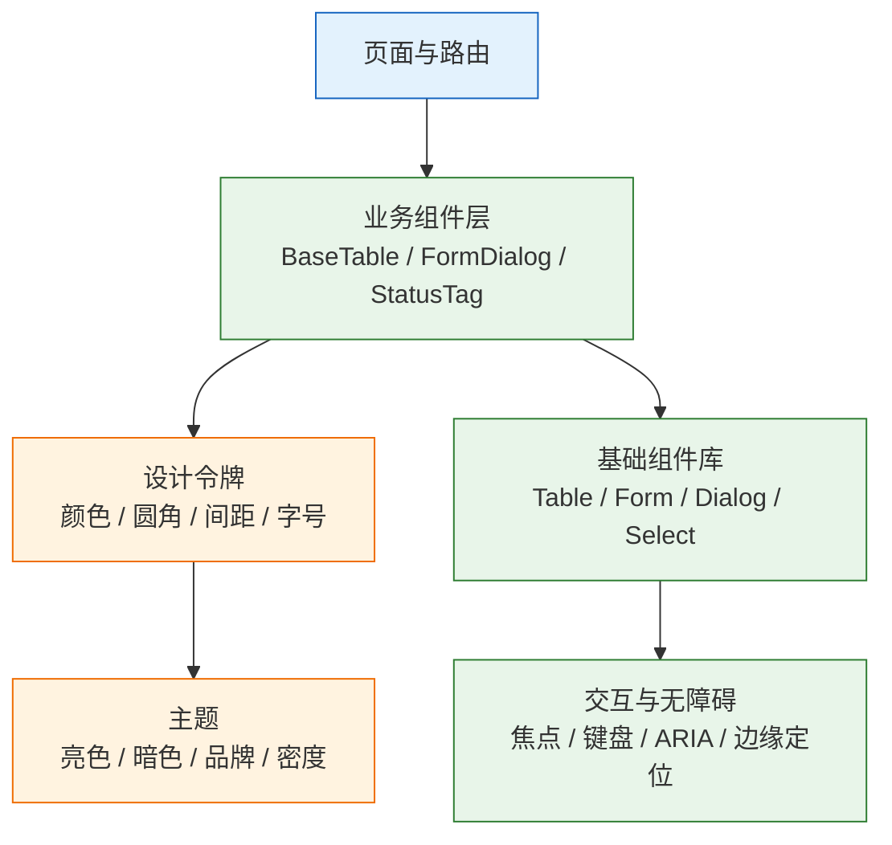
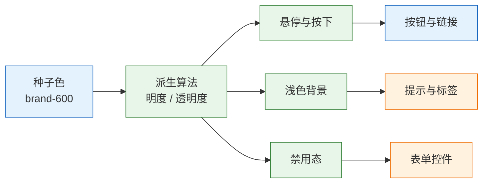
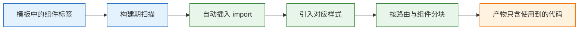

# UI 组件库

---

## 一、UI 组件库是什么

### 1.1 核心概念

UI 组件库是一组可复用的界面控件实现，把按钮、输入框、表格、弹窗、日期选择这些高频交互的视觉、行为和无障碍语义收敛成稳定契约。它提供的不是“少写几个标签”，而是一套已经被大量场景验证过的交互约定。

中后台里大部分代码是表格、表单、弹窗、下拉。这些组件的难点不在样式，而在行为：键盘能否走完整个流程、焦点是否被限制在弹窗内、下拉在屏幕边缘如何翻转、禁用态是否响应点击、暗色下边框对比度是否足够。自己实现一遍，等于把这些细节重新验证一遍。

| 概念 | 含义 | 载体 |
|---|---|---|
| 基础组件 | 无业务语义的控件 | Button、Table、Dialog |
| 设计令牌 | 颜色、间距、圆角等原子值 | CSS 变量、主题对象 |
| 业务组件 | 带业务语义的组合 | `BaseTable`、`FormDialog` |
| 受控状态 | 由使用方决定的值 | `value`、`open`、`selected` |
| 无障碍语义 | 键盘、焦点、ARIA | 组件内部实现 |

组件库不解决业务组件、设计还原、包体积和升级成本。带权限的表格、带审批流的表单、带业务校验的弹窗必须自己封装；品牌色、密度、间距仍要自己决定；全量引入会让首屏多出可观体积；大版本升级仍要做回归。把组件库当设计系统，是选型阶段最常见的误解。

### 1.2 与相邻技术的关系

组件库位于框架与业务之间。框架提供响应式与渲染机制，组件库提供控件，设计系统提供令牌与规范，业务组件提供领域语义。CSS 框架解决样式组织，不提供键盘与焦点管理；headless 库只提供行为，不提供视觉；自研组件库则同时承担三者，成本最高。

| 技术 | 解决的问题 | 与组件库的边界 |
|---|---|---|
| 前端框架 | 渲染与状态 | 不提供控件 |
| 设计系统 | 令牌、规范、品牌 | 组件库是其实现之一 |
| CSS 框架 | 样式组织与原子类 | 不负责焦点与键盘 |
| Headless 库 | 行为与无障碍 | 样式全部自己写 |
| 业务组件 | 领域语义与权限 | 不应透出基础库 API |

选型不是“哪个组件多”，而是“哪一层由谁负责”。没有专职设计时，全家桶把视觉与交互一起接过去，团队只需要定令牌；有设计系统时，headless 把样式自由留给团队，但焦点管理、边缘定位、动画仍要自己接。

还要区分“组件库”和“设计系统”。设计系统包含原则、令牌、组件规范与使用指南，组件库只是其中的代码实现。只引入组件库而不建立令牌，页面会逐渐出现几十种近似色；只建立令牌而没有组件实现，规范无法落到键盘与焦点这些细节上。两者要成对建设，但可以分阶段推进。

### 1.3 架构组成

一个可持续的组件体系分四层：页面、业务组件、基础组件、交互与无障碍原语。令牌横切四层，主题是令牌的一组取值。页面只依赖业务组件，业务组件依赖基础组件与令牌，基础组件依赖原语。



| 层 | 职责 | 替换成本 |
|---|---|---|
| 页面 | 布局、路由、数据接入 | 低 |
| 业务组件 | 业务语义、统一空态与错误态 | 中 |
| 基础组件 | 控件行为与视觉 | 高 |
| 令牌与主题 | 品牌与明暗 | 低到中 |

判断团队有没有组件体系，不看装了什么包，看页面里有没有直接出现基础库的名字。页面直接引入 `ElTable` 或 `Table`，等于把四层压成一层，换库时没有缓冲带。

---

## 二、最小示例与环境准备

### 2.1 依赖与版本

> **版本现状（2026-10）**：示例使用 Vue 3、Vite 与 Element Plus，版本以安装结果和官方文档为准；按需引入依赖 `unplugin-vue-components` 与 `unplugin-auto-import`。

```bash
# 创建 Vue 3 + TypeScript 工程
pnpm create vite component-demo --template vue-ts
cd component-demo
pnpm install

# 组件库与按需引入插件
pnpm add element-plus
pnpm add -D unplugin-vue-components unplugin-auto-import

# 启动
pnpm dev
```

| 依赖 | 作用 | 引入方式 |
|---|---|---|
| `element-plus` | 基础组件 | 按需解析 |
| `unplugin-vue-components` | 自动注册组件与样式 | 构建插件 |
| `unplugin-auto-import` | 自动导入组合式 API | 构建插件 |
| `sass` | 需要编译期生成主题时使用 | 可选 |

### 2.2 最小接入示例

按需引入的核心是解析器。它在编译阶段识别模板里用到的组件，自动补上 `import` 和对应样式，避免全量注册。

```typescript
// vite.config.ts
import { defineConfig } from 'vite';
import vue from '@vitejs/plugin-vue';
import AutoImport from 'unplugin-auto-import/vite';
import Components from 'unplugin-vue-components/vite';
import { ElementPlusResolver } from 'unplugin-vue-components/resolvers';

export default defineConfig({
  plugins: [
    vue(),
    AutoImport({ resolvers: [ElementPlusResolver()] }),
    // 解析器同时处理组件与对应样式
    Components({ resolvers: [ElementPlusResolver()] }),
  ],
});
```

```typescript
// main.ts：只保留全局样式入口，组件由解析器按需引入
import { createApp } from 'vue';
import App from './App.vue';
import './styles/theme.css';
import 'element-plus/theme-chalk/dark/css-vars.css';

createApp(App).mount('#app');
```

```vue
<!-- App.vue：模板里直接使用，解析器负责注册 -->
<script setup lang="ts">
import { ref } from 'vue';

const rows = ref([
  { id: 1, name: '订单 A', status: '待处理' },
  { id: 2, name: '订单 B', status: '已完成' },
]);
</script>

<template>
  <el-table :data="rows" row-key="id" stripe>
    <el-table-column prop="name" label="名称" />
    <el-table-column prop="status" label="状态" />
  </el-table>
  <el-button type="primary">新建</el-button>
</template>
```

### 2.3 结果验证

```bash
# 生产构建，观察产物
pnpm build

# 如需体积报告，可接入可视化分析插件；没有插件时直接看 dist/assets
ls -lh dist/assets
```

| 检查项 | 预期 |
|---|---|
| 页面渲染 | 表格与按钮正常显示，无样式缺失 |
| 构建产物 | 只出现用到的组件相关代码 |
| 控制台 | 无组件未注册、样式缺失警告 |
| 主题变量 | 修改主色后按钮同步变化 |

> **注意**：按需引入后组件没样式，先看解析器是否同时处理了样式，再看是否在业务代码里手动 `import` 了组件却跳过了样式入口。两者混用时，解析器不会替你补已经手动引入的部分。

---

## 三、分层与设计令牌

### 3.1 三层结构

页面、业务组件、基础组件构成稳定的依赖方向。页面不直接调用基础库，业务组件不透出基础库的全部 API，基础库不感知业务字段。方向一旦反转，替换成本会沿着依赖链放大。

| 层 | 可以依赖 | 禁止依赖 |
|---|---|---|
| 页面 | 业务组件、查询、路由 | 基础组件库 |
| 业务组件 | 基础组件、令牌、工具 | 具体页面与路由 |
| 基础组件 | 令牌、无障碍原语 | 业务字段与接口 |
| 令牌 | 无 | 组件与业务 |

### 3.2 设计令牌

设计令牌是视觉决策的变量化表达，分三个层级：原子令牌描述原始值，语义令牌描述用途，组件令牌描述局部覆盖。页面只应引用语义令牌，组件内部才引用原子令牌。

| 层级 | 示例 | 使用方 |
|---|---|---|
| 原子令牌 | `--blue-600: #2f6fed` | 语义层 |
| 语义令牌 | `--color-primary: var(--blue-600)` | 页面与业务组件 |
| 组件令牌 | `--el-color-primary` | 基础库内部 |

```css
/* src/styles/theme.css：先定义语义层，再映射到组件库变量 */
:root {
  --brand-600: #2f6fed;
  --surface: #ffffff;
  --text-primary: #0f172a;

  --color-primary: var(--brand-600);
  --color-bg: var(--surface);
  --color-text: var(--text-primary);

  /* Element Plus 只认自己的变量，需要显式映射 */
  --el-color-primary: var(--color-primary);
  --el-border-radius-base: 8px;
  --el-font-size-base: 14px;
}
```

### 3.3 主题派生

主色不只是一个变量。悬停、按下、禁用、浅色背景分别使用主色的不同明度，组件库通常用派生变量或编译期算法生成。只改基础主色，悬停态仍是旧颜色。



Element Plus 的主色派生变量包括 `--el-color-primary-light-3/5/7/8/9` 与 `--el-color-primary-dark-2`。只写 `--el-color-primary`，按钮悬停、浅色标签和禁用态不会跟着变。两种处理方式：把这些派生变量一起覆盖，或在 SCSS 里通过颜色映射在编译期生成。Ant Design v5 则通过 `ConfigProvider` 的 `theme.token` 设置种子色，由算法派生其余颜色，不应逐个组件覆盖样式。

> **注意**：派生变量要成套修改。只改 `light-3` 不改 `light-5`，会出现悬停正常、禁用态仍是旧色；只改亮色不改暗色，切换主题后局部颜色会跳回默认。

---

## 四、选型维度

### 4.1 技术维度

技术评估只看可验证的指标：框架匹配、样式方案、无障碍基础、产物体积、服务端渲染支持、复杂表格能力。宣传页上的组件数量参考价值有限，真正影响维护的是表格、表单、日期选择这三个最复杂的控件。

| 维度 | 需要确认 | 风险 |
|---|---|---|
| 框架与版本 | 与当前框架主版本匹配 | 锁死旧框架 |
| 样式方案 | CSS 变量、CSS-in-JS 或原子类 | 与现有样式体系冲突 |
| 无障碍 | 键盘路径、焦点管理、ARIA | 后期补成本极高 |
| 产物与 SSR | 按需引入、`document` 访问 | 首屏体积、SSR 报错 |

### 4.2 组织维度

同样的库，在不同团队手里的收益完全不同。有专职设计时，组件库的默认视觉会被大量覆盖；没有设计时，默认视觉反而是资产。维护人力、发布节奏、升级意愿都要纳入判断。

评估时还要看“退出成本”。组件库越深入业务，替换时需要改的文件越多；把基础库限制在业务组件内部，退出成本就从全站缩小到一个目录。选型阶段问一句“如果两年后要换，需要改哪里”，比比较组件数量更有价值。

| 条件 | 倾向 | 原因 |
|---|---|---|
| 无专职设计 | 全家桶 | 默认视觉与交互可直接用 |
| 有设计系统 | headless | 样式与行为解耦 |
| 页面少、复用低 | 原生或轻封装 | 抽象收益不足 |
| 长期多产品 | 自建令牌与业务层 | 品牌与交互需要统一 |

### 4.3 三条路线

| 库 | 框架 | 强项 | 代价 |
|---|---|---|---|
| Ant Design | React | 中后台组件全，表格与表单成熟 | 观感强，定制要跟令牌体系 |
| Element Plus | Vue 3 | Vue 中后台常用，文档完整 | 暗色与主色派生要自己补齐 |
| MUI | React | Material 风格完整，主题系统强 | 非 Material 设计要改很多默认值 |
| Radix UI | React | 无障碍与焦点管理扎实 | 只给行为，样式全自己写 |
| Headless UI | React / Vue | 与 Tailwind 配合好 | 组件少，复杂表格另找 |
| Vuetify | Vue 3 | Material 组件全 | 定制依赖 SASS 编译 |

| 路线 | 代表 | 强项 | 代价 |
|---|---|---|---|
| 全家桶 | Ant Design、Element Plus、MUI | 组件全、开箱即用 | 观感强，深度定制受体系约束 |
| Headless | Radix UI、Headless UI | 无障碍扎实、样式自由 | 复杂表格需另找 |
| 复制源码 | shadcn 类方案 | 改起来自由 | 升级要自己合并 |

没有设计团队、只有几人的中后台，选全家桶并按需引入；有专职设计、要做多端一致的产品，才值得走 headless。不要因为“怕被绑死”就选自研，自研的表格和日期选择器通常第一年就欠下无障碍的债。

许可证和社区活跃度也要提前确认。开源协议是否允许闭源分发、组件库的发布节奏是否稳定、重大缺陷的修复周期，都会在两年后变成实际成本。选型文档里记录版本、协议和退出方案，比只记一句“社区很活跃”更有用。

---

## 五、按需引入与构建

### 5.1 解析器机制

解析器在编译阶段扫描模板标签，匹配到组件名后自动插入导入语句与样式路径。它减少的是手工注册，不是运行时体积；真正的体积控制仍依赖 ESM 与 tree-shaking。



### 5.2 产物验证

构建后直接看 `dist/assets` 的 chunk，比在代码里猜更可靠。只用了表格和表单的页面，不应出现日期选择器、级联选择的代码；如果出现，先检查是否在某处全量注册，或某个入口文件统一 import 了整包。

| 现象 | 原因 | 处理 |
|---|---|---|
| 产物包含全部组件 | 全量注册或整包引入 | 改用解析器或按路径引入 |
| 样式重复 | 组件样式与全局样式各引一次 | 保留一个入口 |
| 首屏 chunk 过大 | 路由未拆分 | 动态导入页面 |
| 图标全量进包 | 全量注册图标 | 按需引入或 SVG symbol |

tree-shaking 依赖 ESM 与无副作用标记。CommonJS 版本、在模块顶层执行副作用的文件、被 `require` 引入的包，都可能让未使用代码无法被删除。选库时确认它提供 ESM 入口，并检查依赖包的 `package.json` 是否正确声明 `sideEffects`。

### 5.3 样式引入顺序

样式冲突多数来自顺序而不是权重。基础重置最先，组件库其次，业务样式最后；业务覆盖使用语义类名或令牌，不用 `!important` 硬压。需要更强隔离时使用 CSS Layers，把第三方样式整体放进低优先级层。

```css
/* 业务覆盖用语义类名，不提升到 !important */
.order-table .cell {
  padding-block: 8px;
}
```

CSS Layers 能固定优先级，但前提是第三方样式确实被放进某一层。只在项目里写一条 `@layer vendor` 声明并不会把组件库样式装进去；用 `@import ... layer(vendor)` 或在构建阶段包裹第三方 CSS，才会改变比较规则。未分层的样式优先级高于任何分层样式，这一点经常被忽略。

> **注意**：在微前端或多人协作项目里，样式顺序由加载时机决定，源码里的 import 顺序不一定等于运行时顺序。需要稳定覆盖时，使用 CSS Layers 或提高选择器语义，不要依赖“碰巧后加载”。

---

## 六、业务组件封装

### 6.1 封装边界

业务组件只暴露业务语义，不透出基础库 API。调用方传 `rows`、`loading`、`onSubmit`，而不是传 `data`、`v-loading`、`before-close`。边界清楚，换库时只改封装层。

| 暴露内容 | 示例 | 不暴露 |
|---|---|---|
| 数据 | `rows`、`total` | 组件内部缓存 |
| 状态 | `loading`、`disabled` | 基础库的布尔组合 |
| 事件 | `submit`、`page-change` | 原生 DOM 事件 |
| 插槽 | 空态、操作列 | 全部内部插槽 |

### 6.2 基础表格封装

```vue
<!-- src/components/BaseTable.vue -->
<script setup lang="ts">
defineProps<{
  rows: Record<string, unknown>[];
  loading?: boolean;
  total?: number;
}>();

defineEmits<{ 'page-change': [page: number] }>();
</script>

<template>
  <el-table
    v-bind="$attrs"
    :data="rows"
    v-loading="loading"
    row-key="id"
    stripe
  >
    <slot />
    <template #empty>
      <slot name="empty">暂无数据</slot>
    </template>
  </el-table>
  <el-pagination
    v-if="total"
    :total="total"
    layout="prev, pager, next"
    @current-change="$emit('page-change', $event)"
  />
</template>
```

三个约定：`v-bind="$attrs"` 让调用方还能传 `height`、`stripe` 这类布局与外观属性，但不暴露整个组件；空态与加载态在封装层统一；业务列通过插槽传入，封装层不猜字段。

### 6.3 弹窗封装

把“打开、关闭、提交中、提交失败”收进 `FormDialog`，页面只传标题和提交函数。“提交中禁用按钮”这类修复只做一次，不会在二十个页面里各修一遍。

```vue
<!-- src/components/FormDialog.vue -->
<script setup lang="ts">
import { ref } from 'vue';

const props = defineProps<{
  title: string;
  submitHandler: () => Promise<void>;
}>();

// 打开状态由父组件控制，弹窗内部只负责提交态与错误
const open = defineModel<boolean>('open', { default: false });
const submitting = ref(false);
const error = ref('');

async function submit() {
  submitting.value = true;
  error.value = '';
  try {
    await props.submitHandler();
    open.value = false;
  } catch (e) {
    // 失败保持打开，保留用户已填内容
    error.value = e instanceof Error ? e.message : '提交失败';
  } finally {
    submitting.value = false;
  }
}
</script>

<template>
  <el-dialog v-model="open" :title="title" :close-on-click-modal="!submitting">
    <slot />
    <p v-if="error" role="alert">{{ error }}</p>
    <template #footer>
      <el-button :disabled="submitting" @click="open = false">取消</el-button>
      <el-button type="primary" :loading="submitting" @click="submit">
        确定
      </el-button>
    </template>
  </el-dialog>
</template>
```

封装时最容易犯的错，是把组件库的受控状态再接一份到自己这里。分页、排序、选中的真相应该只有一份：分页和排序交给服务端，封装层只把变化抛出去；选中项用 `row-key` 维护，翻页后是否保留要明确写出来，不能依赖组件默认行为。

### 6.4 约束落地

约定只写在文档里会失效，要用 lint 和 CI 变成硬约束。禁止页面直接引用基础库，新增违规直接失败，比代码评审时靠记忆可靠。

```javascript
// eslint.config.js 片段
export default [
  {
    rules: {
      'no-restricted-imports': ['error', {
        paths: [{
          name: 'element-plus',
          message: '走 @/components 封装，不要直接引组件库',
        }],
      }],
    },
  },
];
```

约束要留例外通道。确实需要底层能力的页面，用注释显式豁免并在评审中说明；完全禁止会逼着开发者绕过 lint，最后约定形同虚设。

---

## 七、多套组件库的统一

### 7.1 盘点

多套组件库混用时，先统计而不是先重写。按路由列出使用的库、写死的颜色、重复的弹窗与表格，产出一张“页面与依赖”表，才能估算迁移顺序。

| 盘点项 | 记录内容 | 用途 |
|---|---|---|
| 路由 | 页面路径与负责人 | 排迁移批次 |
| 依赖 | 使用的组件库与版本 | 判断重复实例 |
| 硬编码 | 颜色、圆角、间距 | 抽令牌的范围 |
| 交互 | 弹窗、提示、确认方式 | 统一交互规范 |

### 7.2 迁移顺序

迁移按“令牌、封装、新页面、旧页面、约束”推进，全程不停业务。先让旧页面读到同一套变量，再封三个高频业务组件，新页面强制走封装，旧页面按路由逐个替换。

| 阶段 | 动作 | 完成标志 |
|---|---|---|
| 令牌 | 抽出颜色、圆角、间距变量 | 旧页面可读取 |
| 封装 | 实现表格、弹窗、状态标签 | 覆盖主要场景 |
| 新页面 | 强制使用封装层 | 不再新增直引 |
| 旧页面 | 按路由替换并验收 | 直引数量下降 |
| 约束 | lint 与 CI 拦截 | 违规无法合入 |

### 7.3 验收

验收不只看截图。键盘走查、焦点顺序、构建体积、暗色对比度都要检查；只对比静态截图，会漏掉弹窗焦点逃逸、下拉被遮挡这类行为问题。

| 验收项 | 方法 | 通过标准 |
|---|---|---|
| 视觉 | 截图对比 | 间距与颜色一致 |
| 键盘 | Tab、Shift+Tab、Esc | 焦点不逃逸、可关闭 |
| 体积 | 构建产物对比 | 未引入未使用组件 |
| 主题 | 亮暗切换 | 页面与弹层同步 |

---

## 八、性能与主题边界

### 8.1 表格性能

表格卡顿几乎都不是组件库的问题，而是使用方式。一次渲染大量行、每行塞复杂插槽、列宽依赖内容测量，都会让滚动帧率下降。

虚拟滚动不是万能解。它适合行高稳定、列结构固定的长列表；行高随内容变化、单元格需要展开编辑时，虚拟滚动会带来测量与焦点管理的新问题。先用分页把数据量降下来，再评估是否真的需要虚拟化；把五百行改成每页二十行，往往比接入虚拟表格更省事。

| 现象 | 原因 | 处理 |
|---|---|---|
| 滚动卡顿 | 一次渲染数百行 | 服务端分页或虚拟滚动 |
| 输入延迟 | 行内格式化重复计算 | 数据层一次算完 |
| 列宽跳动 | 内容不定长且自动测量 | 固定列宽或省略号 |
| 内存升高 | 缓存了全部行数据 | 只保留当前页 |

### 8.2 暗色主题

暗色不能用 `filter: invert()`，图片和品牌色会一起坏。正确做法是令牌换一套值，并让组件库变量与页面变量共用同一个作用域。

```css
/* 显式主题开关：html 上写 data-theme */
[data-theme='dark'] {
  --color-bg: #0f172a;
  --color-text: #e2e8f0;
  --el-bg-color: #1e293b;
  --el-text-color-primary: #e2e8f0;
  --el-border-color: #334155;
  --el-color-primary: #7cb0ff;
}
```

Element Plus 自带暗色变量文件，先引入 `element-plus/theme-chalk/dark/css-vars.css`，再给 `<html>` 加 `dark` 类。如果项目统一使用 `data-theme`，要让两套选择器都命中；只写其中一套，会出现页面是暗的、弹窗是亮的。

密度用组件的 `size` 属性与间距令牌控制，不要用 `transform: scale()` 整体缩放。缩放会让文字发虚、点击区域与实际布局不一致，弹层定位也会偏移。暗色与密度都属于主题的一部分，切换入口要放在同一个状态里，避免页面、弹层、图表各自维护一套开关。

### 8.3 弹层与层级

弹窗被裁剪、下拉被遮挡，根源通常是父级 `overflow: hidden`、`transform` 创建的层叠上下文，或 z-index 不在同一上下文。解决方式是挂到 `body`，而不是不断加大 z-index。

| 现象 | 原因 | 处理 |
|---|---|---|
| 弹窗被父容器裁剪 | 父级 `overflow: hidden` | `teleport` 或 `append-to-body` |
| 下拉被弹窗挡住 | z-index 不在同一层叠上下文 | 统一挂载点 |
| 弹窗打开后页面仍滚动 | 滚动锁被父级样式破坏 | 用库的锁滚动能力 |
| 打开时焦点仍在背后 | 未做焦点陷阱 | 用组件库默认行为，不手动改 |

> **注意**：`transform`、`filter`、`will-change` 都会创建新的层叠上下文，子元素的 z-index 只在上下文内部比较。遇到“z-index 调到 9999 仍被挡”，先找祖先元素上的这些属性，而不是继续加数字。

焦点管理同样属于组件库的默认能力。弹窗打开时，焦点应移入弹窗，Tab 在内部循环，Esc 关闭后回到触发按钮；这些行为不要自己用全局监听重写。封装层如果为了“统一体验”改掉默认的关闭逻辑，必须同时补回焦点归还，否则键盘用户会在关闭弹窗后丢失位置。

---

## 九、完整示例：中后台组件层

### 9.1 目录结构

```text
src/
├── styles/
│   ├── tokens.css        # 原子与语义令牌
│   └── theme.css         # 组件库变量映射与暗色
├── components/
│   ├── BaseTable.vue     # 表格封装
│   ├── OrderTable.vue    # 订单业务表格
│   ├── FormDialog.vue    # 表单弹窗封装
│   └── StatusTag.vue     # 状态标签封装
└── pages/
    └── orders/
        └── OrderList.vue # 页面只使用业务组件
```

| 目录 | 责任 | 变更频率 |
|---|---|---|
| `styles` | 品牌、明暗、密度 | 低 |
| `components` | 交互统一、空态与错误态 | 中 |
| `pages` | 业务布局与数据 | 高 |

### 9.2 令牌与主题

```css
/* src/styles/tokens.css */
:root {
  --brand-600: #2f6fed;
  --radius-md: 8px;
  --space-3: 12px;
  --font-size-base: 14px;

  --color-primary: var(--brand-600);
  --color-bg: #ffffff;
  --color-text: #0f172a;

  --el-color-primary: var(--color-primary);
  /* 派生值按品牌色调整，缺少任意一项都会让对应状态回到默认色 */
  --el-color-primary-light-3: #6b9af2;
  --el-color-primary-light-5: #97b8f6;
  --el-color-primary-light-7: #c3d5fa;
  --el-color-primary-light-8: #d9e3fc;
  --el-color-primary-light-9: #eef3fe;
  --el-color-primary-dark-2: #2659be;
  --el-border-radius-base: var(--radius-md);
  --el-font-size-base: var(--font-size-base);
}
```

### 9.3 页面接入

业务表格把列定义收在组件内部，页面只传数据与分页事件；弹窗的打开状态由页面控制，提交函数由页面提供。

```vue
<!-- src/components/OrderTable.vue -->
<script setup lang="ts">
import BaseTable from './BaseTable.vue';
import StatusTag from './StatusTag.vue';

type OrderRow = { id: number; name: string; status: string };

defineProps<{ rows: OrderRow[]; total: number; loading: boolean }>();
defineEmits<{ 'page-change': [page: number] }>();
</script>

<template>
  <BaseTable
    :rows="rows"
    :total="total"
    :loading="loading"
    @page-change="$emit('page-change', $event)"
  >
    <el-table-column prop="name" label="订单名称" />
    <el-table-column label="状态">
      <template #default="{ row }">
        <StatusTag :status="row.status" />
      </template>
    </el-table-column>
  </BaseTable>
</template>
```

```vue
<!-- src/pages/orders/OrderList.vue -->
<script setup lang="ts">
import { ref } from 'vue';
import OrderTable from '@/components/OrderTable.vue';
import FormDialog from '@/components/FormDialog.vue';

type OrderRow = { id: number; name: string; status: string };

const rows = ref<OrderRow[]>([]);
const total = ref(0);
const loading = ref(false);
const dialogOpen = ref(false);

async function load(page: number) {
  loading.value = true;
  try {
    const res = await fetch(`/api/orders?page=${page}`);
    if (!res.ok) throw new Error(`加载失败（HTTP ${res.status}）`);
    const body = (await res.json()) as { items: OrderRow[]; total: number };
    rows.value = body.items;
    total.value = body.total;
  } finally {
    loading.value = false;
  }
}

async function createOrder() {
  const res = await fetch('/api/orders', { method: 'POST' });
  // 抛出后由 FormDialog 捕获并显示，弹窗保持打开
  if (!res.ok) throw new Error(`创建失败（HTTP ${res.status}）`);
  // 成功后重新拉取第一页，让新订单出现在列表中
  await load(1);
}

load(1);
</script>

<template>
  <button type="button" class="primary-btn" @click="dialogOpen = true">
    新建订单
  </button>

  <OrderTable
    :rows="rows"
    :total="total"
    :loading="loading"
    @page-change="load"
  />

  <FormDialog
    v-model:open="dialogOpen"
    title="新建订单"
    :submit-handler="createOrder"
  >
    <!-- 表单字段由页面提供，弹窗只负责打开、提交与错误 -->
  </FormDialog>
</template>
```

### 9.4 验证

| 场景 | 预期 |
|---|---|
| 新建成功 | 弹窗关闭，列表按失效策略刷新 |
| 新建失败 | 弹窗保持打开，显示错误文案 |
| 提交中 | 确定按钮进入加载态，取消按钮不可用 |
| 空列表 | 显示统一空态，不出现空白区域 |
| 切换暗色 | 页面、表格、弹窗同步变化 |

---

## 十、工程实践

### 10.1 版本管理

组件库版本要锁，锁的是整个依赖树而不是单个包。多个包各自带一份组件库，会出现样式重复、上下文失效、包体积翻倍。

升级前先读变更说明，再跑视觉回归，最后才合入主分支。小版本也可能调整间距或选择器权重；只跑单元测试无法发现“按钮高度从 32 变成 30”。升级分支要能单独回滚，锁文件与组件封装层的改动分开提交，出问题时才能判断是库的问题还是封装的问题。

| 做法 | 目的 | 命令 |
|---|---|---|
| 锁定版本 | 避免小版本样式漂移 | 提交 lockfile |
| 查重复实例 | 发现多份组件库 | `pnpm why element-plus` |
| 统一主版本 | 避免上下文不共享 | 约束 peer 依赖 |
| 升级前回归 | 捕获间距与颜色变化 | 视觉对比 |

### 10.2 视觉回归

组件库的大版本问题多出在间距、颜色、圆角，不是 API 改名。视觉回归要覆盖默认态、悬停、禁用、错误、暗色和窄屏，而不是只截一张首页。

| 覆盖项 | 检查内容 | 工具 |
|---|---|---|
| 默认态 | 布局、间距、字体 | 截图对比 |
| 交互态 | 悬停、聚焦、禁用 | 截图加键盘脚本 |
| 暗色 | 对比度、弹层一致性 | 双主题截图 |
| 响应式 | 窄屏换行、溢出 | 多视口截图 |

### 10.3 选型判断

| 场景 | 方案 | 理由 |
|---|---|---|
| 无设计系统、中后台为主 | 全家桶加按需引入 | 交互与无障碍成本最低 |
| 有设计系统、组件量有限 | headless | 样式自由，行为可复用 |
| 页面少、复用低 | 原生控件加轻封装 | 抽象收益不足 |
| 多产品、长期维护 | 令牌加业务组件层 | 品牌与交互可统一 |

不要把组件库当设计系统。它给的是零件，令牌和业务组件才是团队资产。升级前先跑视觉回归；先统一交互，再统一视觉，按钮位置、弹窗确认方式、错误提示位置比主色更影响日常效率。

---

## 十一、常见错误与排查

### 11.1 故障对照表

| 现象 | 最可能原因 | 处理 |
|---|---|---|
| 按需引入后组件没样式 | 解析器未处理样式或手动引入 | 用带 resolver 的插件 |
| 改了主色，悬停仍是旧色 | 只改基础主色 | 补齐派生变量或编译期生成 |
| 弹窗被父容器裁剪 | 父级 `overflow` 或 `transform` | 挂到 `body` |
| 全局样式覆盖组件库 | 引入顺序或权重问题 | 调整顺序，使用令牌 |
| 表格滚动卡 | 一次渲染太多行 | 分页或虚拟滚动 |
| 升级小版本后样式错乱 | 依赖未锁或多版本共存 | 锁版本并查重复 |
| SSR 报 `document is not defined` | 模块顶层访问 DOM | 客户端渲染或使用 SSR 入口 |
| 图标全量进包 | 全量注册图标 | 按需引入或 SVG symbol |
| 弹窗打开后页面仍滚动 | 滚动锁被父级样式破坏 | 用库的锁滚动能力 |
| 下拉在弹窗内被挡住 | 层叠上下文不一致 | 统一挂载点 |

### 11.2 排查顺序

1. 先看构建产物里实际进了什么，用 chunk 分析确认是否全量引入。
2. 再看样式是没加载、被覆盖，还是变量没生效，在 DevTools 的 Computed 面板逐项核对。
3. 交互问题先复现键盘路径，确认是组件行为还是封装层改坏了。
4. 检查层叠上下文与挂载点，排除父级 `overflow`、`transform`、z-index 的干扰。
5. 最后才怀疑版本，用 `pnpm why` 查看是否存在多份实例，再对照升级说明。

> **核心结论**：组件库收敛的是交互、无障碍与主题契约；页面只依赖业务组件，业务组件只依赖基础组件与令牌；按需引入要看产物，主题要改整套派生变量，升级要靠视觉回归而不是感觉。
