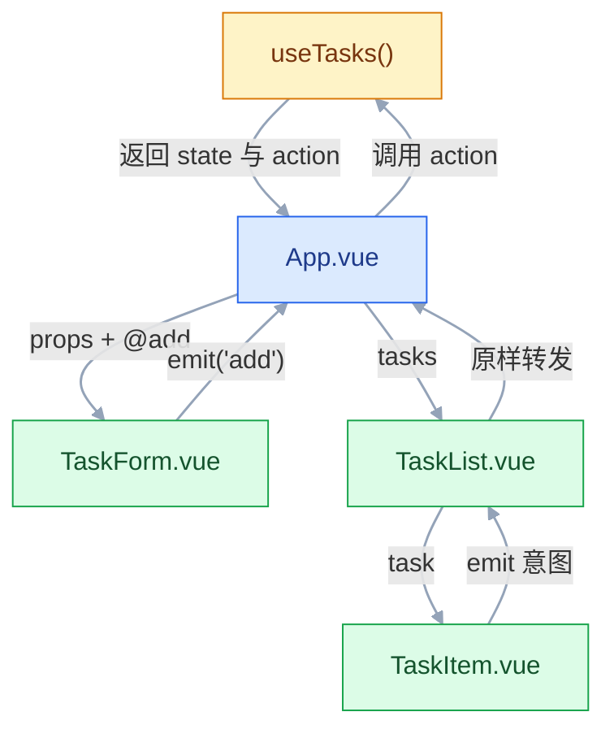
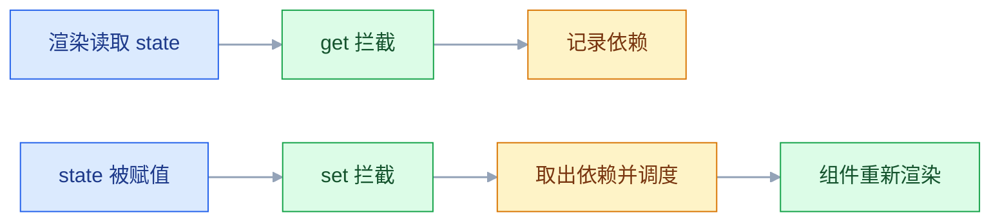
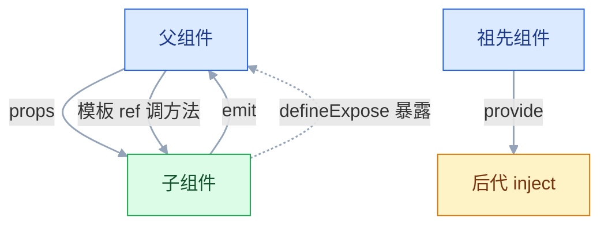

# Vue 3 核心

## 一、工程案例：做一个带筛选、就地编辑与本地持久化的任务面板

**场景**：团队用 Excel 传阅任务，经常两个人改同一份文件、版本对不上。现在要一个单页工具：回车添加、勾选完成、双击标题就地改、按状态筛选、顶部统计，**刷新浏览器数据不丢**。

**交付标准**：`pnpm dev` 能跑、`pnpm build` 能出静态产物；业务规则集中在 `useTasks` 一个文件，组件只负责显示与转发事件。不引入路由和状态库——一个页面用不到它们。

### 1.1 主线（按顺序执行）

**① 建项目并清掉示例文件**

```bash
pnpm create vue@latest task-panel
# TypeScript 选 Yes；Router / Pinia / 测试 / ESLint 全选 No
cd task-panel && pnpm install
rm -f src/components/*.vue src/assets/*.svg
```

示例组件删掉后，`App.vue` 里还留着对它们的 `import`，此时启动会报 `Failed to resolve import`，属预期。先按 ③–⑤ 写完再启动，别在这里查错。

**② 定义类型** `src/types/task.ts`

```ts
export interface Task { id: string; title: string; done: boolean; createdAt: number }
export type FilterType = 'all' | 'active' | 'done'
export interface TaskStats { total: number; done: number; active: number }
```

**③ 业务逻辑收进组合式函数** `src/composables/useTasks.ts`

```ts
import { ref, computed, watch } from 'vue'
import type { Task, FilterType, TaskStats } from '@/types/task'

const STORAGE_KEY = 'task-panel.tasks'

export function useTasks() {
  const tasks = ref<Task[]>(loadFromStorage())
  const filter = ref<FilterType>('all')

  // 深侦听：push、改 done、整体替换都能落盘
  watch(tasks, (val) => localStorage.setItem(STORAGE_KEY, JSON.stringify(val)), { deep: true })

  const stats = computed<TaskStats>(() => {
    const total = tasks.value.length
    const done = tasks.value.filter((t) => t.done).length
    return { total, done, active: total - done }
  })

  const filteredTasks = computed(() => {
    if (filter.value === 'active') return tasks.value.filter((t) => !t.done)
    if (filter.value === 'done') return tasks.value.filter((t) => t.done)
    return [...tasks.value].sort((a, b) => b.createdAt - a.createdAt)
  })

  function addTask(rawTitle: string) {
    const title = rawTitle.trim()
    if (!title) return false
    tasks.value.push({ id: crypto.randomUUID(), title, done: false, createdAt: Date.now() })
    return true
  }
  function toggleTask(id: string) {
    const task = tasks.value.find((t) => t.id === id)
    if (task) task.done = !task.done
  }
  function removeTask(id: string) { tasks.value = tasks.value.filter((t) => t.id !== id) }
  function updateTitle(id: string, rawTitle: string) {
    const title = rawTitle.trim()
    if (!title) return removeTask(id)
    const task = tasks.value.find((t) => t.id === id)
    if (task) task.title = title
  }
  function clearDone() { tasks.value = tasks.value.filter((t) => !t.done) }

  function loadFromStorage(): Task[] {
    try {
      const raw = localStorage.getItem(STORAGE_KEY)
      const parsed = raw ? JSON.parse(raw) : null
      return Array.isArray(parsed) ? parsed : defaultTasks()
    } catch { return defaultTasks() }
  }
  function defaultTasks(): Task[] {
    return [{ id: crypto.randomUUID(), title: '双击这条可以改标题', done: false, createdAt: Date.now() }]
  }

  return { tasks, filter, filteredTasks, stats, addTask, toggleTask, removeTask, updateTitle, clearDone }
}
```

**④ 组件：输入、单行、列表**

```vue
<!-- src/components/TaskForm.vue -->
<script setup lang="ts">
import { ref } from 'vue'
const emit = defineEmits<{ add: [title: string] }>()
const title = ref('')
function submit() {
  if (!title.value.trim()) return
  emit('add', title.value)
  title.value = ''
}
</script>
<template>
  <form class="task-form" @submit.prevent="submit">
    <input v-model.trim="title" placeholder="要做什么？回车添加" maxlength="80" />
    <button type="submit" :disabled="!title.trim()">添加</button>
  </form>
</template>
```

```vue
<!-- src/components/TaskItem.vue -->
<script setup lang="ts">
import { ref, nextTick } from 'vue'
import type { Task } from '@/types/task'
const props = defineProps<{ task: Task }>()
const emit = defineEmits<{ toggle: [id: string]; remove: [id: string]; edit: [id: string, title: string] }>()

const editing = ref(false)
const draft = ref('')
const inputRef = ref<HTMLInputElement | null>(null)

async function startEdit() {
  editing.value = true
  draft.value = props.task.title
  await nextTick()          // 等输入框真的进了 DOM
  inputRef.value?.focus()
  inputRef.value?.select()
}
function commitEdit() {
  if (!editing.value) return
  editing.value = false
  emit('edit', props.task.id, draft.value)
}
function cancelEdit() { editing.value = false }
</script>
<template>
  <li class="task-item" :class="{ done: props.task.done }">
    <input v-if="editing" ref="inputRef" v-model="draft"
      @keyup.enter="commitEdit" @keyup.esc="cancelEdit" @blur="commitEdit" />
    <template v-else>
      <input type="checkbox" :checked="props.task.done" @change="emit('toggle', props.task.id)" />
      <span @dblclick="startEdit">{{ props.task.title }}</span>
      <button title="删除" @click="emit('remove', props.task.id)">✕</button>
    </template>
  </li>
</template>
```

```vue
<!-- src/components/TaskList.vue -->
<script setup lang="ts">
import TaskItem from './TaskItem.vue'
import type { Task } from '@/types/task'
const props = defineProps<{ tasks: Task[]; hasAnyTask: boolean }>()
const emit = defineEmits<{ toggle: [id: string]; remove: [id: string]; edit: [id: string, title: string] }>()
</script>
<template>
  <TransitionGroup v-if="props.tasks.length" name="list" tag="ul">
    <TaskItem v-for="task in props.tasks" :key="task.id" :task="task"
      @toggle="emit('toggle', $event)" @remove="emit('remove', $event)"
      @edit="(id: string, title: string) => emit('edit', id, title)" />
  </TransitionGroup>
  <p v-else>{{ props.hasAnyTask ? '这个筛选条件下没有任务' : '还没有任务，先添加一条' }}</p>
</template>
```

**⑤ 装配根组件** `src/App.vue`

```vue
<script setup lang="ts">
import { useTasks } from '@/composables/useTasks'
import type { FilterType } from '@/types/task'
import TaskForm from '@/components/TaskForm.vue'
import TaskList from '@/components/TaskList.vue'
const { tasks, filter, filteredTasks, stats, addTask, toggleTask, removeTask, updateTitle, clearDone } = useTasks()
const tabs: { v: FilterType; t: string }[] = [
  { v: 'all', t: '全部' }, { v: 'active', t: '未完成' }, { v: 'done', t: '已完成' },
]
</script>
<template>
  <div class="app">
    <header>
      <h1>任务面板</h1>
      <p>共 {{ stats.total }} 条 · 已完成 {{ stats.done }} 条 · 未完成 {{ stats.active }} 条</p>
    </header>
    <TaskForm @add="addTask" />
    <div class="tabs">
      <button v-for="opt in tabs" :key="opt.v" :class="{ active: filter === opt.v }" @click="filter = opt.v">
        {{ opt.t }}
      </button>
      <button v-if="stats.done > 0" @click="clearDone">清除已完成</button>
    </div>
    <TaskList :tasks="filteredTasks" :has-any-task="tasks.length > 0"
      @toggle="toggleTask" @remove="removeTask" @edit="updateTitle" />
  </div>
</template>
```

数据流是单向的：`App` 往下传数据，子组件往上发意图（`add` / `toggle` / `remove` / `edit`）。业务规则只在 `useTasks` 里改一次，叶子组件不知道数据存在哪。



启动：

```bash
pnpm dev
# VITE vX.X.X  ready in 300 ms
# ➜  Local:   http://localhost:5173/
```

### 1.2 关键输出

首屏显示一条欢迎任务，统计为「共 1 条 · 已完成 0 条 · 未完成 1 条」；`pnpm build` 生成 `dist/index.html` 与 `dist/assets/index-*.js`；DevTools 的 Local Storage 里出现 `task-panel.tasks`，组件树中 `TaskItem` 的 props 随勾选即时变化。

### 1.3 验收（8 项全过才算交付）

| # | 检查项 | 命令或检查 | 通过标准 |
|---|---|---|---|
| 1 | 项目可启动 | `pnpm dev` | 打开终端打印的 Local 地址，控制台无报错 |
| 2 | 添加与必填 | 输入「写周报」回车；再只输空格 | 新任务出现在顶部；纯空格时按钮禁用且不新增 |
| 3 | 完成态 | 勾选「写周报」 | 复选框选中，未完成计数减 1，刷新后仍为完成 |
| 4 | 就地编辑 | 双击标题，改完回车；再双击按 Esc | 回车保存并退出编辑；Esc 放弃修改 |
| 5 | 筛选 | 依次点三个标签 | 列表数量与统计一致；无数据时提示文案正确 |
| 6 | 持久化 | 刷新页面 | 任务与完成态都还在 |
| 7 | 构建 | `pnpm build` | 产物在 `dist/`，退出码 0 |
| 8 | 类型检查 | `pnpm type-check` | 无输出、退出码 0 |

> 第 6 项要**真的刷新**，而不是切标签页。`watch` 写盘有异步时机，刷新太快能暴露「最后一次修改没落盘」的问题。

### 1.4 换成真实接口

对外接口不变，只改 `useTasks` 内部，组件一行都不用动。

```ts
import { ref, onMounted } from 'vue'
// fetchTasks / patchTask 换成你的请求层，其余签名不变

const tasks = ref<Task[]>([])
const loading = ref(false)
const error = ref('')

async function load() {
  loading.value = true
  try { tasks.value = await fetchTasks() }
  catch (e) { error.value = e instanceof Error ? e.message : '加载失败' }
  finally { loading.value = false }
}
async function toggleTask(id: string) {
  const task = tasks.value.find((t) => t.id === id)
  if (!task) return
  const next = !task.done
  task.done = next                              // 乐观更新：先动界面
  try { await patchTask(id, { done: next }) }
  catch { task.done = !next }                   // 失败回滚
}
onMounted(load)
```

`onMounted` 能在组合式函数里用，前提是**这个函数在组件 setup 期间同步调用**；它的生命周期跟着调用它的组件走。原来那段 `watch` 落盘可以删掉，或改成在 `patchTask` 成功后写缓存；`loading` / `error` 加进返回对象即可，现有组件不读也不影响。

---

## 二、高频问答：会卡住你的地方，也是面试最常问的

### 2.1 改了数据，页面一动不动

**现场**

`console.log(count)` 打印出 `RefImpl` 对象而不是数字，就是漏了 `.value`；再看 DevTools 里 setup state 是否变化。

```ts
const count = ref(0)
console.log(count)     // ✘ 打印 RefImpl 对象，不是数字
count.value++          // ✔
```

**要点**

- Vue 追踪的是响应式对象，普通变量赋值它收不到。
- 响应式发生在 `.value` 的 getter/setter 上，声明了 ref 不等于变量自动变成响应式。
- 模板里顶层 ref 自动解包，`script` 里必须写 `.value`。

**追问**

- 为什么模板里不用 `.value`？→ 模板只对顶层 ref 自动解包。
- 打印出 `RefImpl` 说明什么？→ 拿到的是 ref 对象，不是值。
- 整体替换对象会怎样？→ `ref` 支持且仍是响应式，`reactive` 换掉根对象就断了。

### 2.2 解构 `reactive` 之后，改属性不更新

**现场**

打印解构出的变量，改它之后看原对象是否变化；同时打印 `state.count` 对照。

```ts
const state = reactive({ count: 0 })
const { count } = state          // ✘ 普通数字
const { count } = toRefs(state)  // ✔ 变成 ref，count.value++
```

**要点**

- `const { count } = state` 取出来的是当时的值，是普通数字，已经和原对象断开。
- 解构做的是取值拷贝，响应式依赖的是属性访问，拷贝之后就没有访问了。
- 要解构就用 `toRefs`，拿到 ref，改 `.value` 才写回原对象。

**追问**

- 为什么 `state.count++` 就行？→ 每次都在做属性访问，代理能拦截。
- `toRefs` 和 `storeToRefs` 是一回事吗？→ 思路相同，后者是给 Pinia 用的。
- 解构 props 会丢响应吗？→ 会，props 也是响应式对象，要用 `toRef` 包一层。

### 2.3 子组件改了 props，控制台报警告

**现场**

看控制台是否出现 `Set operation on key ... failed: target is readonly`；全局搜 `props.xxx =` 确认写入点。

```ts
const localTitle = ref(props.title)                       // 本地副本
watch(() => props.title, (v) => { localTitle.value = v }) // 父变则同步
const upper = computed(() => props.title.toUpperCase())   // 只读派生
```

**要点**

- props 属于父组件，单向数据流；子组件直接改会让「数据从哪来」不可追踪。
- props 更像函数参数，只读；要改就发事件让父组件改。
- 需要本地编辑时用本地副本加 `watch` 同步，或 `computed` 只读派生。

**追问**

- props 是深只读吗？→ 浅只读，改 `props.obj.x` 不报错，但同样不推荐。
- 为什么警告不阻止运行？→ 只读是开发期保护，运行时对象仍可写。
- `v-model` 的本质是什么？→ 一个 prop 加一个 update 事件。

### 2.4 `v-if` 和 `v-for` 写在同一个元素上

**现场**

控制台报 `Cannot read properties of undefined`，且指向模板那一行；把 `v-if` 挪到内层，报错消失即可确认。

```vue
<!-- ✔ 先循环再判断 -->
<template v-for="item in list" :key="item.id">
  <li v-if="item.done">{{ item.title }}</li>
</template>
<!-- ✔ 或先过滤数据，避免模板里反复 filter -->
<li v-for="item in doneList" :key="item.id">
```

**要点**

- Vue 3 里 `v-if` 优先级更高，先求值；此时 `v-for` 的项还不存在。
- 访问 `item.xxx` 直接报错，两个指令不是同时生效。
- 正确写法是外层 `<template v-for>`、内层 `v-if`，或先过滤数据。

**追问**

- 为什么不建议写在同一元素上？→ 语义不清晰，完全依赖编译优先级。
- 为什么先过滤更好？→ 模板里反复 filter 没有缓存，每次重渲染都算一遍。
- 还有别的写法吗？→ 用 `computed` 派生 `doneList`，模板只负责渲染。

### 2.5 列表删除一项后，输入框里的字跑到别的行

**现场**

每行放一个输入框，输入不同内容后删第一行，看内容是否错位；再看 key 是不是用了下标。

```vue
<li v-for="(task, i) in tasks" :key="i">      <!-- ✘ 下标不是身份 -->
<li v-for="task in tasks" :key="task.id">     <!-- ✔ 业务 id 才是 -->
```

**要点**

- `:key="index"` 时删除后下标整体前移，Vue 认为「第 0 项还是第 0 项」，复用 DOM 只换文本。
- key 是 diff 时判断「是不是同一个东西」的唯一依据，不是消除警告的摆设。
- 用业务 id 才是身份，行内输入状态才不会跟着错位。

**追问**

- 为什么用 index 会保留输入状态？→ DOM 被复用，行内状态没销毁。
- key 要全局唯一吗？→ 同层唯一且稳定即可。
- 随机数做 key 行不行？→ 每次渲染都重建，性能最差。

### 2.6 `watch` 侦听对象，内部改了却不触发

**现场**

回调里打日志，分别做「改属性」和「整体替换」对照；只在前者不触发即为浅侦听。

```ts
watch(obj, cb)                      // ✘ ref 对象内部变化不触发
watch(obj, cb, { deep: true })      // ✔
watch(() => obj.value.a, cb)        // ✔ 更精准，开销更小
```

**要点**

- 侦听 `ref` 包的对象时，只有 `.value` 整体替换才触发；内部变化要 `deep: true`。
- `reactive` 对象默认隐式深侦听。
- 「对象是响应式的」不等于「watch 盯着它每一层」，侦听深度是单独配置的。

**追问**

- 深侦听的开销在哪？→ 递归遍历每一层，大对象很明显。
- 更精准的写法？→ `watch(() => obj.value.a, cb)`。
- 为什么改属性没触发、替换触发了？→ 浅侦听只看 `.value` 这个引用。

### 2.7 `onMounted` 里拿到的 DOM 是 `null`

**现场**

`console.log(inputRef.value)`，挂载阶段为 `null`，等一帧后有值；在 `onMounted` 里加 `debugger`，看元素是否已在 document 中。

```ts
async function open() {
  visible.value = true
  await nextTick()              // v-if 刚变 true
  inputRef.value?.focus()
}
```

**要点**

- 「setup 执行完」不等于「DOM 已存在」，DOM 要等挂载和补丁完成。
- 元素被 `v-if` 控制时，挂载时还没渲染，要先改状态再 `await nextTick()`。
- 也可能是 `ref="inputRef"` 与变量名不一致，或子组件没 `defineExpose`。

**追问**

- 为什么 `nextTick` 之后就有了？→ 等这一轮 DOM 补丁完成。
- `v-show` 也会有这个问题吗？→ 不会，元素始终在，只是 `display` 变化。
- 组件 ref 拿到的是什么？→ 组件实例代理，只能访问 `defineExpose` 的内容。

### 2.8 父组件通过 ref 调子组件方法，报不是一个函数

**现场**

`console.log(panelRef.value)` 能看到实例，但方法列表里没有目标方法；确认 `defineExpose` 在 setup 顶层调用。

```ts
defineExpose({ reset, count })   // 子组件
const panelRef = ref<InstanceType<typeof CounterPanel> | null>(null)
panelRef.value?.reset()          // 父组件
```

**要点**

- `<script setup>` 默认封闭，父组件拿到的是组件实例代理，只能访问 `defineExpose` 出去的内容。
- 这不是 ref 没绑上，给子组件加 `id` 也没用。
- 组合式 API 默认不暴露内部变量。

**追问**

- `defineExpose` 能放条件分支里吗？→ 不能，必须在 setup 顶层同步调用。
- 子组件不写 `defineExpose` 会怎样？→ 父组件只有实例本身，拿不到内部方法。
- 什么时候该用模板 ref？→ 命令式调用，属于应急出口，数据仍走 props/emit。

### 2.9 模板里写 `item.value`，反而拿不到值

**现场**

把 `{{ item.value }}` 改成 `{{ item }}`，值出现即为该原因；再打印数据结构，确认 `item` 是 ref 还是普通值。

```vue
<!-- selected 是顶层 ref；obj 是 reactive({ count: ref(0) })；list 是 ref([ref(0)]) -->
<p>{{ selected }}</p>        <!-- ✔ 顶层 ref 自动解包 -->
<p>{{ obj.count }}</p>       <!-- ✔ reactive 的属性自动解包 -->
<p>{{ list[0].value }}</p>   <!-- ✔ 数组元素不解包，写 .value -->
```

**要点**

- 模板只对顶层 ref 自动解包，数组元素、普通对象属性里的 ref 不解包。
- `reactive` 对象的属性会自动解包。
- 自动解包不是递归的。

**追问**

- 为什么 `reactive({ count: ref(0) })` 里不用 `.value`？→ 属性访问时自动解包。
- 数组里的 ref 怎么取？→ 写 `.value`，或先处理成普通值。
- 为什么 `{{ selected }}` 不用 `.value`？→ 它是顶层 ref。

### 2.10 自定义组件上的 `v-model` 不生效，也不报错

**现场**

DevTools 里看子组件收到的是 `modelValue` 还是 `value`；在 emit 处打日志，父组件的值始终不变。

```vue
<!-- 子组件：按默认约定接 -->
<script setup lang="ts">
const props = defineProps<{ modelValue: string }>()
const emit = defineEmits<{ 'update:modelValue': [value: string] }>()
</script>
<template>
  <input :value="props.modelValue"
    @input="emit('update:modelValue', ($event.target as HTMLInputElement).value)" />
</template>
```

**要点**

- 组件上的 `v-model` 默认编译成 `:modelValue` 加 `@update:modelValue`。
- 子组件还按 Vue 2 的习惯写 `value` prop 和 `input` 事件，两边名字对不上，谁也接不到谁。
- 要换名字用 `v-model:title`，较新版本还提供 `defineModel()`。

**追问**

- 为什么手写 `:model-value` 加 `@update:model-value` 就一样？→ `v-model` 只是这对绑定的简写。
- 多个 `v-model` 怎么用？→ `v-model:title` / `v-model:content`，各自一对 prop 和事件。
- `defineModel()` 省掉了什么？→ props 与 emit 的样板代码。

### 2.11 `computed` 里发请求，页面反复刷新

**现场**

在 getter 里计数，动一次源数据看它被执行几次；次数持续增长即为循环。

**要点**

- 计算属性的 getter 必须纯：它同步返回一个值。
- 发请求拿到的是 Promise，模板用不上；在 getter 里顺手改状态，又会让依赖再次变化。
- 轻则重复请求，重则循环刷新。

**追问**

- 异步数据该放哪？→ 先落到 `ref`，再用 `computed` 派生。
- `computed` 什么时候重新求值？→ 依赖变脏后，下次被读取时。
- getter 里能改别的状态吗？→ 不能，会引入新的依赖变化。

### 2.12 `scoped` 样式改不动子组件内部元素

**现场**

DevTools 看目标元素的 `data-v-` 后缀，与父组件根元素是否一致；临时去掉 `scoped`，样式生效即确认。

```vue
<style scoped>
:deep(.el-input__inner) { border-radius: 8px; }  /* 只穿透需要的一层 */
</style>
```

**要点**

- scoped 给选择器加 `[data-v-xxx]`，只匹配当前组件模板里的元素，子组件内部元素带的是自己的 hash。
- 用 `:deep()` 限定范围穿透，尽量只穿一层。
- scoped 不是 CSS 沙箱，不改变层叠规则，也不阻止继承。

**追问**

- 为什么子组件根元素能直接被选中？→ 它同时带父组件的 hash。
- `:deep()` 用多了有什么问题？→ 等于放弃作用域。
- 插槽内容怎么改？→ 用 `:slotted()`。

---

## 三、核心知识：从零开始要建立的东西

### 3.1 单文件组件与模板表达式

一个 `.vue` 文件是**编译期**概念，浏览器不认识它。构建插件把三块拆开：`<template>` 编译成 `render()` 函数，`<script setup>` 编译成组件的 `setup()`，`<style scoped>` 提取成带 `data-v-hash` 的 CSS。

模板里只能写**表达式**，不能写语句。表达式有返回值，语句没有。

| 可以 | 不可以 |
|---|---|
| 三元、逻辑运算、函数调用 | `if (x) {}`、`for (...)` |
| 属性访问、数组下标 | `const y = x`、赋值语句 |
| 白名单全局：`Math`、`Date`、`JSON` | 直接访问 `window`、`document` |

复杂逻辑抽到 `computed` 或普通函数；模板里每调用一次函数，重渲染就执行一次，没有缓存。顶层 `await` 会让组件变成异步组件，必须由 `<Suspense>` 承接。

### 3.2 响应式系统的代理机制

`reactive` 用 `Proxy` 包住对象，读属性时收集「谁在用」，写属性时通知这些使用者重新执行。组件渲染本身就是一个副作用，所以模板里读过的数据一变，组件就重渲染。



边界有三条：原始值（数字、字符串）没法加代理，必须用 `ref`；整体替换根对象会换掉代理，响应式跟着断；`Object.freeze` 的对象不会被追踪。

> **面试**：常问「Vue 3 的响应式是怎么实现的？」答：用 `Proxy` 拦截读写，读时收集依赖，写时通知调度。

### 3.3 ref 与 reactive 的取舍

`ref` 把值装进一个带 getter/setter 的对象，所以任意类型都能响应式；`reactive` 直接代理对象，只在对象上工作。

| 维度 | `ref` | `reactive` |
|---|---|---|
| 支持类型 | 任意值 | 对象、数组、Map、Set |
| 读写方式 | `.value` | 直接属性 |
| 整体替换 | 支持，仍保持响应 | 换掉后原引用失效 |
| 解构 | 传的是 ref 本身，安全 | 直接解构丢响应 |
| 跨函数传递 | 推荐 | 容易在途中被解构 |

```ts
const n = ref(0)
const form = reactive({ name: '', age: 0 })
n.value++
form.name = '小明'
```

工程上默认用 `ref`：它在传递、返回、解构时都不会悄悄失去响应性。`reactive` 留给「固定形状、从不整体替换」的表单对象。

### 3.4 计算属性的缓存条件

`computed` 是惰性的：第一次被读取才求值，之后只要依赖没变就直接返回缓存。依赖变了把标记置脏，下次读取再算。

| | 方法 | `computed` |
|---|---|---|
| 缓存 | 无 | 有 |
| 依赖追踪 | 不追踪 | 自动 |
| 适用 | 需要参数、事件处理 | 从状态派生的值 |
| 模板写法 | `{{ fn() }}` | `{{ total }}` |

```ts
const total = computed(() => price.value * amount.value)
const fullName = computed({
  get: () => `${first.value} ${last.value}`,
  set: (v) => { [first.value, last.value] = v.split(' ') },
})
```

getter 保持纯：不改别的状态、不发请求、不操作 DOM。异步数据先落到 `ref`，再用 `computed` 派生。

> **面试**：常问「computed 和方法的区别？」答：computed 有缓存、自动追踪依赖，方法每次渲染都执行。

### 3.5 侦听器的触发时机

`watch` 显式指定侦听源，能拿到新旧值；`watchEffect` 自动收集回调里用到的响应式数据，创建时立即跑一次，但拿不到旧值。

| | `watch` | `watchEffect` |
|---|---|---|
| 侦听源 | 显式 | 自动 |
| 首次执行 | 默认不执行 | 立即执行 |
| 旧值 | 有 | 无 |
| 适合 | 来源明确、要对比前后值 | 依赖复杂、只关心当前值 |

```ts
watch(keyword, (val, old, onCleanup) => {
  const timer = setTimeout(() => search(val), 300)
  onCleanup(() => clearTimeout(timer))     // 下次触发前清掉上一次
}, { flush: 'post' })
```

`flush` 决定回调相对 DOM 更新的位置：`pre` 是默认，更新前；`post` 是更新后，能读新 DOM；`sync` 同步执行，开销大。侦听 `reactive` 对象默认深侦听；侦听 `ref` 对象要显式 `deep`。

### 3.6 条件渲染的 DOM 代价

`v-if` 编译成三元表达式，条件为假时不创建节点；`v-show` 始终创建，只切换 `display`。

| | `v-if` | `v-show` |
|---|---|---|
| 初次渲染 | 假时省掉 | 总要渲染 |
| 切换成本 | 创建 / 销毁组件 | 改一个样式属性 |
| 内部状态 | 销毁后丢失 | 保留 |
| 搭配 `v-else` | 支持 | 不支持 |
| `<template>` | 支持 | 不支持 |

```vue
<div v-if="isLoggedIn">欢迎回来</div>
<div v-else>请先登录</div>
<div v-show="panelOpen">面板</div>
```

判断标准是切换频率：Tab、折叠面板用 `v-show`；登录态、权限区块用 `v-if`。`v-if` 的兄弟分支必须相邻，中间插别的元素会断掉 `v-else` 链。

### 3.7 列表 diff 与 key 的身份

渲染列表时，Vue 用 key 建立「旧节点 → 新节点」的对应关系。有稳定 key 就能复用正确节点、只做移动；没 key 或 key 用下标，就只能按位置猜。

| key 选择 | 结果 |
|---|---|
| 业务 id | 增删排序都能正确复用 |
| 数组下标 | 删除后状态错位、额外渲染 |
| 随机数 | 每次渲染都重建，性能最差 |
| 不写 | 退化为按位置比对，状态与 DOM 错配且无告警 |

```vue
<li v-for="task in tasks" :key="task.id">{{ task.title }}</li>
<template v-for="task in tasks" :key="task.id">
  <dt>{{ task.title }}</dt><dd>{{ task.done ? '已完成' : '未完成' }}</dd>
</template>
```

key 只要求「同层唯一且稳定」，不要求全局唯一。列表整体替换时，用业务 id 仍然最稳。

> **面试**：常问「为什么不能用数组下标当 key？」答：删除后下标前移，DOM 被错误复用，行内状态会错位。

### 3.8 事件与表单绑定

`@click` 是 `v-on:click` 的简写。值为函数引用时，事件对象作为第一个参数传入；值为调用表达式时，可以显式写 `$event`。

| 修饰符 | 编译结果 | 用途 |
|---|---|---|
| `.stop` | `stopPropagation()` | 阻止冒泡 |
| `.prevent` | `preventDefault()` | 阻止默认行为 |
| `.self` | 判断 `target === currentTarget` | 只响应自身 |
| `.once` | 只绑定一次 | 引导、抽奖 |
| `.passive` | `passive: true` | 滚动性能 |

`v-model` 按控件类型编译成「绑定值 + 监听输入」：文本框是 `:value` + `@input`；单个复选框是 `:checked` + `@change`，值为布尔；多个复选框绑数组；下拉框是 `:value` + `@change`；组件是 `modelValue` + `update:modelValue`。

Vue 3 去掉了 `.native`：未声明的监听器自动落到组件根元素；组件声明了 `emits` 后，同名监听器不再透传，避免一次点击触发两次。`.lazy` 把触发从 `input` 改成 `change`，`.number` 做 `parseFloat`，解析失败保留原字符串。

### 3.9 组件通信的三条通道



| 通道 | 方向 | 适用 |
|---|---|---|
| props | 父 → 子 | 数据展示 |
| emit | 子 → 父 | 用户意图 |
| provide / inject | 祖先 → 后代 | 主题、当前用户、i18n |
| 模板 ref | 父 → 子实例 | 命令式调用，应急出口 |

props 是浅只读：改 `props.obj.x` 不报错，但依然不推荐，数据来源会变模糊。`provide` 传普通值只传一次，要响应式就传 `ref` 或 `reactive`。

### 3.10 插槽的作用域归属

插槽内容在**父组件**的作用域里编译，渲染位置在子组件。所以父组件写的插槽内容访问不到子组件内部状态，除非子组件通过插槽 props 递出来。

```vue
<!-- 子组件 -->
<li v-for="user in users" :key="user.id">
  <slot name="item" :user="user">{{ user.name }}</slot>
</li>
<!-- 父组件 -->
<UserList><template #item="{ user }">{{ user.name }}</template></UserList>
```

| 类型 | 写法 | 场景 |
|---|---|---|
| 默认 | `<slot />` | 内容区 |
| 具名 | `<slot name="header" />` + `#header` | 头、脚、操作区 |
| 作用域 | `<slot :row="row" />` + `#default="{ row }"` | 表格自定义列 |

这条规则解释了一个常见困惑：插槽里能用父组件的数据，不能用子组件的 `ref`；要拿子组件数据，就必须走插槽 props。

### 3.11 生命周期与 setup 上下文

`setup` 先于所有选项式钩子执行；`onMounted` 在 DOM 插入之后；`onUpdated` 在补丁之后；`onBeforeUnmount` 在拆除之前，适合清理定时器与监听。

`onMounted` 用于初始化图表、发首屏请求、读 DOM 尺寸；`onUpdated` 极少用，容易写出循环更新；`onBeforeUnmount` 适合 `clearInterval`、`removeEventListener`、取消请求；`onActivated` 用于被 `KeepAlive` 缓存的组件重新进入。

钩子必须在 setup 期间**同步注册**。放在 `setTimeout`、`await` 之后或条件分支里，Vue 找不到当前实例，钩子不会生效。被缓存过的组件再次进入时触发 `onActivated`，不再触发 `onMounted`。

### 3.12 模板 ref 的可用时机

模板 ref 在挂载前是 `null`，挂载后才有元素或组件实例，所以类型标 `| null` 并用 `?.` 访问。三种常见时序：元素一直在，`onMounted` 直接读；元素由 `v-if` 打开，先改状态再 `await nextTick()`；`v-for` 里的 ref 是数组，顺序不保证与数据一致，优先用函数 ref 或按 id 查找。

组件 ref 只能访问 `defineExpose` 暴露的内容；`useTemplateRef('name')` 是较新的等价写法，类型推导更直接，具体可用性以官方当前稳定版为准。

### 3.13 样式作用域的实现

`scoped` 的编译结果是：给当前组件模板里的元素加 `data-v-hash`，并给每条选择器末尾追加 `[data-v-hash]`。子组件根元素会同时带父组件的 hash，所以父组件能直接选中它。改子组件内部用 `:deep(.inner)`，改插槽内容用 `:slotted(.item)`，全局样式就写不加 `scoped` 的 `<style>`。

```vue
<style scoped>
.card { padding: 12px; }
.card :deep(.title) { font-weight: 600; }
</style>
```

`scoped` 不是沙箱：不阻止继承，也不隔离全局选择器；`:deep()` 用多了等于放弃作用域，尽量只穿透一层。

### 3.14 状态分层与组合式函数

| 状态范围 | 放哪 | 例子 |
|---|---|---|
| 单组件 UI | 组件内 `ref` | 弹窗开关、输入草稿 |
| 同页多组件 | 共同父组件 + props/emit | 筛选条件、选中行 |
| 跨页面 / 持久化 | Pinia 或组合式函数 + 存储 | 登录用户、草稿 |

组合式函数是「把一组状态和相关操作打包」的最小单位：文件名 `useXxx`，内部用 `ref` / `computed` / `watch`，返回 ref 而不是 `reactive`，调用方可以安全解构。典型形状是 `const count = ref(initial)`、`const double = computed(() => count.value * 2)`、`function inc() { count.value++ }`，最后一起 `return`。

边界：内部调 `onMounted` 要求同步执行于 setup；模块级 `const state = ref()` 会让所有调用方共享同一份状态，这是特性也是陷阱。

---

## 四、冷门知识汇总

| 知识点 | 为什么冷门 | 用到时的关键词 |
|---|---|---|
| `shallowRef` / `shallowReactive` | 数据量小时深层代理的开销感知不到 | 大列表、第三方实例、只整体替换 |
| `markRaw` | 只在接入地图、图表、编辑器实例时用 | 跳过代理、性能、类实例 |
| `effectScope` | 组合式函数一般随组件销毁，不需要手动收口 | 批量停止、脱离组件的副作用 |
| `customRef` | 内置 ref 够用，很少自定义读写 | 防抖 ref、与外部状态同步 |
| `triggerRef` | 只和 `shallowRef` 搭配出现 | 手动触发、浅层 ref |
| `readonly` | 团队多用约定而非运行时限制 | 冻结配置、防止下游修改 |
| `inheritAttrs` / `$attrs` | 单根组件自动透传，感知不到 | 多根节点、属性归属、透传第三方组件 |
| `Teleport` | 弹窗用组件库就自带，少手写 | 挂到 body、层级、`to` 目标 |
| `Suspense` | 异步 setup 用得少，且长期标注实验性 | 顶层 await、骨架屏、错误边界 |
| `v-memo` | 编译期优化默认已做不少，手写收益有限 | 大列表局部缓存、依赖数组 |
| `onTrack` / `onTrigger` | 调试响应式依赖时才需要 | 谁读了它、谁改了它 |
| 递归组件 | 树形菜单和评论楼中楼才遇到 | 组件引用自身、`name`、终止条件 |
| 渲染函数与 JSX | 模板能覆盖绝大多数场景 | `h()`、动态结构、库作者 |
