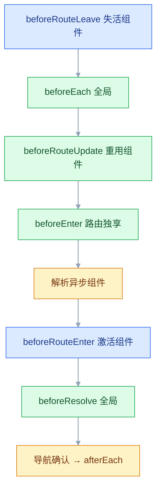
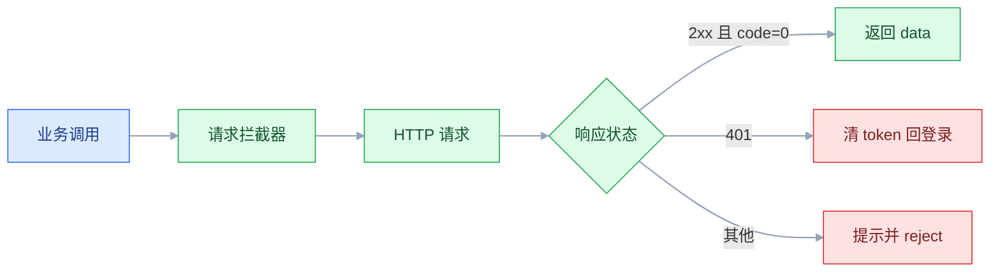

# Vue 生态

## 一、工程案例：做一个带登录守卫、权限与加载态的后台用户列表页

**场景**：公司后台要加「用户管理」。要求：未登录访问任何页面都跳登录并记住原地址；登录后顶栏显示当前用户；列表支持关键词搜索、分页、加载态；新增/编辑共用一个弹窗并做表单校验；删除二次确认；只有 `admin` 能看到并调用写操作。

**技术栈**：Vue 3 + TypeScript + Vite + Vue Router + Pinia + Axios + Element Plus。后端按下面的契约提供接口；本地没有后端时，用 `axios-mock-adapter` 挂到请求实例上按契约返回，接口契约先定死。

**接口契约**：统一响应 `{ code, message, data }`，`code === 0` 表示成功；`GET /users?page=&pageSize=&keyword=` 返回 `{ list, total }`；`POST /users`、`PUT /users/:id`（`password` 为空表示不改密码）、`DELETE /users/:id`。后端把接口挂在 `/api` 前缀下，开发代理原样转发；后端不带前缀时，在代理里加 `rewrite: (p) => p.replace(/^\/api/, '')`。

### 1.1 主线（按顺序执行）

**① 建项目、装依赖**

```bash
pnpm create vue@latest admin-demo
# Router、Pinia、TypeScript 选 Yes，其余按需
cd admin-demo && pnpm install
pnpm add axios element-plus
pnpm add -D unplugin-vue-components unplugin-auto-import axios-mock-adapter
```

**② 环境变量、按需引入与开发代理**

```text
# .env.development
VITE_API_BASE_URL=/api
```

```ts
// vite.config.ts：在原文件上补两个插件与 proxy，vue/defineConfig 的导入保留
import AutoImport from 'unplugin-auto-import/vite'
import Components from 'unplugin-vue-components/vite'
import { ElementPlusResolver } from 'unplugin-vue-components/resolvers'

export default defineConfig({
  plugins: [
    vue(),
    AutoImport({ resolvers: [ElementPlusResolver()] }),
    Components({ resolvers: [ElementPlusResolver()] }),
  ],
  // /api 由开发服务器转发，浏览器看到的是同源请求
  server: {
    proxy: { '/api': { target: 'http://localhost:8080', changeOrigin: true } },
  },
})
```

**③ 类型** `src/types/user.ts`

```ts
export interface User { id: number; username: string; email: string; role: 'admin' | 'user'; status: 0 | 1; createdAt: string }
export interface PageResult<T> { list: T[]; total: number }
export interface UserForm { username: string; email: string; password?: string; role: User['role']; status: number }
```

**④ 请求层** `src/utils/request.ts`：注入 token、剥壳、统一报错、401 回登录

```ts
import axios from 'axios'
import { ElMessage } from 'element-plus'

interface ApiResult<T> { code: number; message: string; data: T }

const service = axios.create({
  baseURL: import.meta.env.VITE_API_BASE_URL || '/api',
  timeout: 15000,
})

service.interceptors.request.use((config) => {
  const token = localStorage.getItem('token')
  if (token) config.headers.Authorization = `Bearer ${token}`
  return config
})

let redirecting = false
service.interceptors.response.use(
  (response) => {
    if (response.config.responseType === 'blob') return response
    const res = response.data as ApiResult<unknown>
    if (res.code === 0) return res.data as never       // 调用方只拿 data
    ElMessage.error(res.message || '请求失败')
    return Promise.reject(new Error(res.message || '请求失败'))
  },
  (error) => {
    const status = error.response?.status
    if (status === 401) {
      localStorage.removeItem('token')
      if (!redirecting && !location.pathname.startsWith('/login')) {
        redirecting = true
        ElMessage.error('登录已过期，请重新登录')
        location.href = `/login?redirect=${encodeURIComponent(location.pathname + location.search)}`
      }
    } else if (status === 403) ElMessage.error('没有权限执行该操作')
    else if (error.code === 'ECONNABORTED') ElMessage.error('请求超时')
    else ElMessage.error(error.message || '网络异常')
    return Promise.reject(error)
  },
)

export const http = {
  get: <T>(url: string, params?: object) => service.get<unknown, T>(url, { params }),
  post: <T>(url: string, body?: object) => service.post<unknown, T>(url, body),
  put: <T>(url: string, body?: object) => service.put<unknown, T>(url, body),
  delete: <T>(url: string) => service.delete<unknown, T>(url),
}

export { service }        // Mock 必须挂在同一个实例上
```

> Mock 要挂在 `service` 这个实例上（所以上面把它导出了）；挂到全局 `axios` 上拦不到它的请求。

**⑤ 登录态** `src/stores/user.ts`

```ts
import { ref, computed } from 'vue'
import { defineStore } from 'pinia'
import { http } from '@/utils/request'

interface LoginResult { token: string; name: string; roles: string[] }

export const useUserStore = defineStore('user', () => {
  const token = ref(localStorage.getItem('token') || '')
  const name = ref(localStorage.getItem('name') || '')
  const roles = ref<string[]>(JSON.parse(localStorage.getItem('roles') || '[]'))
  const isLoggedIn = computed(() => Boolean(token.value))
  const isAdmin = computed(() => roles.value.includes('admin'))

  async function login(username: string, password: string) {
    const data = await http.post<LoginResult>('/auth/login', { username, password })
    token.value = data.token
    name.value = data.name
    roles.value = data.roles
    localStorage.setItem('token', data.token)
    localStorage.setItem('name', data.name)
    localStorage.setItem('roles', JSON.stringify(data.roles))
  }
  function logout() {
    token.value = ''; name.value = ''; roles.value = []
    localStorage.removeItem('token'); localStorage.removeItem('name'); localStorage.removeItem('roles')
  }
  return { token, name, roles, isLoggedIn, isAdmin, login, logout }
})
```

**⑥ 路由与守卫** `src/router/index.ts`

```ts
import { createRouter, createWebHistory } from 'vue-router'
import { useUserStore } from '@/stores/user'
import AdminLayout from '@/layouts/AdminLayout.vue'

const router = createRouter({
  history: createWebHistory(import.meta.env.BASE_URL),
  routes: [
    { path: '/login', component: () => import('@/views/LoginView.vue'), meta: { public: true } },
    {
      path: '/', component: AdminLayout,
      children: [
        { path: '', redirect: '/users' },
        // 整页只要求登录，写操作按钮再按角色隐藏，接口由后端鉴权
        { path: 'users', name: 'users', component: () => import('@/views/UserListView.vue'),
          meta: { title: '用户管理' } },
      ],
    },
    { path: '/:pathMatch(.*)*', component: () => import('@/views/NotFoundView.vue') },
  ],
})

router.beforeEach((to) => {
  const user = useUserStore()
  if (!to.meta.public && !user.isLoggedIn) {
    return { path: '/login', query: { redirect: to.fullPath } }
  }
  if (to.path === '/login' && user.isLoggedIn) return '/'
  const need = to.meta.roles as string[] | undefined
  if (need && !need.some((role) => user.roles.includes(role))) return '/'
})

router.afterEach((to) => {
  const title = to.meta.title as string | undefined
  document.title = title ? `${title} - 管理后台` : '管理后台'
})
export default router
```

`main.ts` 里先 `app.use(createPinia())` 再 `app.use(router)`（完整写法见 ⑧）；登录页只负责表单，成功后 `router.replace((route.query.redirect as string) || '/')`。

**⑦ 列表页** `src/views/UserListView.vue`（核心）

```vue
<script setup lang="ts">
import { ref, reactive, onMounted } from 'vue'
import { ElMessage, ElMessageBox } from 'element-plus'
import type { FormInstance, FormRules } from 'element-plus'
import { http } from '@/utils/request'
import { useUserStore } from '@/stores/user'
import type { User, PageResult, UserForm } from '@/types/user'

const userStore = useUserStore()
const loading = ref(false)
const list = ref<User[]>([])
const total = ref(0)
const query = reactive({ page: 1, pageSize: 10, keyword: '' })

const dialogVisible = ref(false)
const mode = ref<'create' | 'edit'>('create')
const submitting = ref(false)
const editingId = ref<number | null>(null)
const formRef = ref<FormInstance>()
const form = reactive<UserForm>({ username: '', email: '', password: '', role: 'user', status: 1 })

const rules: FormRules<UserForm> = {
  username: [{ required: true, message: '请输入用户名', trigger: 'blur' }],
  email: [
    { required: true, message: '请输入邮箱', trigger: 'blur' },
    { type: 'email', message: '邮箱格式不正确', trigger: 'blur' },
  ],
  password: [{
    validator: (_rule, value, callback) => {
      if (mode.value === 'create' && !value) callback(new Error('请输入初始密码'))
      else callback()
    },
    trigger: 'blur',
  }],
}

async function fetchList() {
  loading.value = true
  try {
    const data = await http.get<PageResult<User>>('/users', query)
    list.value = data.list
    total.value = data.total
  } finally {
    loading.value = false          // 失败也要收掉 loading，否则页面永远转圈
  }
}
function search() { query.page = 1; fetchList() }

function openCreate() {
  mode.value = 'create'; editingId.value = null
  Object.assign(form, { username: '', email: '', password: '', role: 'user', status: 1 })
  dialogVisible.value = true
}
function openEdit(row: User) {
  mode.value = 'edit'; editingId.value = row.id
  Object.assign(form, { username: row.username, email: row.email, password: '', role: row.role, status: row.status })
  dialogVisible.value = true
}

async function submit() {
  const valid = await formRef.value?.validate().catch(() => false)
  if (!valid) return
  submitting.value = true
  try {
    const payload = { ...form }
    if (mode.value === 'edit' && !payload.password) delete payload.password
    if (mode.value === 'create') await http.post('/users', payload)
    else await http.put(`/users/${editingId.value}`, payload)
    ElMessage.success(mode.value === 'create' ? '新增成功' : '修改成功')
    dialogVisible.value = false
    await fetchList()
  } finally { submitting.value = false }
}

async function remove(row: User) {
  try {
    await ElMessageBox.confirm(`确定删除「${row.username}」吗？`, '删除确认', { type: 'warning' })
  } catch { return }                 // 取消不是错误
  await http.delete(`/users/${row.id}`)
  ElMessage.success('删除成功')
  if (list.value.length === 1 && query.page > 1) query.page -= 1
  await fetchList()
}

onMounted(fetchList)
</script>

<template>
  <div>
    <div class="toolbar">
      <el-input v-model.trim="query.keyword" placeholder="搜索用户名" clearable
        @keyup.enter="search" @clear="search" />
      <el-button type="primary" @click="search">搜索</el-button>
      <el-button v-if="userStore.isAdmin" type="success" @click="openCreate">新增用户</el-button>
    </div>

    <el-table v-loading="loading" :data="list" stripe>
      <el-table-column prop="username" label="用户名" />
      <el-table-column prop="email" label="邮箱" />
      <el-table-column label="角色">
        <template #default="{ row }">{{ row.role === 'admin' ? '管理员' : '普通用户' }}</template>
      </el-table-column>
      <el-table-column label="状态">
        <template #default="{ row }">{{ row.status === 1 ? '启用' : '禁用' }}</template>
      </el-table-column>
      <el-table-column prop="createdAt" label="创建时间" width="180" />
      <el-table-column v-if="userStore.isAdmin" label="操作" width="140" fixed="right">
        <template #default="{ row }">
          <el-button link type="primary" @click="openEdit(row)">编辑</el-button>
          <el-button link type="danger" @click="remove(row)">删除</el-button>
        </template>
      </el-table-column>
    </el-table>

    <el-pagination v-model:current-page="query.page" v-model:page-size="query.pageSize"
      :total="total" :page-sizes="[10, 20, 50]" layout="total, sizes, prev, pager, next"
      @current-change="fetchList" @size-change="search" />

    <el-dialog v-model="dialogVisible" :title="mode === 'create' ? '新增用户' : '编辑用户'" width="480px" destroy-on-close>
      <el-form ref="formRef" :model="form" :rules="rules" label-width="70px">
        <el-form-item label="用户名" prop="username"><el-input v-model.trim="form.username" /></el-form-item>
        <el-form-item label="邮箱" prop="email"><el-input v-model.trim="form.email" /></el-form-item>
        <el-form-item label="密码" prop="password">
          <el-input v-model="form.password" type="password" :placeholder="mode === 'edit' ? '留空表示不改' : ''" />
        </el-form-item>
        <el-form-item label="角色" prop="role">
          <el-select v-model="form.role" style="width: 100%">
            <el-option label="管理员" value="admin" />
            <el-option label="普通用户" value="user" />
          </el-select>
        </el-form-item>
        <el-form-item label="状态" prop="status">
          <el-switch v-model="form.status" :active-value="1" :inactive-value="0" />
        </el-form-item>
      </el-form>
      <template #footer>
        <el-button @click="dialogVisible = false">取消</el-button>
        <el-button type="primary" :loading="submitting" @click="submit">确定</el-button>
      </template>
    </el-dialog>
  </div>
</template>
```

**⑧ 补齐其余文件与本地 Mock**

`src/layouts/AdminLayout.vue`（顶栏 + 子路由出口，样式略）：

```vue
<script setup lang="ts">
import { useRouter } from 'vue-router'
import { useUserStore } from '@/stores/user'

const router = useRouter()
const userStore = useUserStore()
async function logout() {
  userStore.logout()
  await router.replace('/login')
}
</script>

<template>
  <div>
    <header class="topbar">
      <strong>管理后台</strong>
      <span>{{ userStore.name }}</span>
      <el-button link @click="logout">退出</el-button>
    </header>
    <main class="content"><RouterView /></main>
  </div>
</template>
```

`src/views/LoginView.vue`：

```vue
<script setup lang="ts">
import { reactive, ref } from 'vue'
import { useRoute, useRouter } from 'vue-router'
import { useUserStore } from '@/stores/user'

const route = useRoute()
const router = useRouter()
const userStore = useUserStore()
const loading = ref(false)
const form = reactive({ username: 'admin', password: 'admin123' })

async function onSubmit() {
  loading.value = true
  try {
    await userStore.login(form.username, form.password)
    await router.replace((route.query.redirect as string) || '/')
  } catch {
    /* 请求层已提示 */
  } finally {
    loading.value = false
  }
}
</script>

<template>
  <el-form :model="form" label-width="70px" style="max-width: 320px; margin: 120px auto">
    <el-form-item label="用户名"><el-input v-model.trim="form.username" /></el-form-item>
    <el-form-item label="密码">
      <el-input v-model="form.password" type="password" @keyup.enter="onSubmit" />
    </el-form-item>
    <el-button type="primary" :loading="loading" style="width: 100%" @click="onSubmit">登录</el-button>
  </el-form>
</template>
```

`src/views/NotFoundView.vue` 放一个 `<el-result title="404" sub-title="页面不存在" />` 即可。`src/mocks/index.ts` 用 `axios-mock-adapter` 按契约返回数据，包含 `admin` 与 `user` 两个账号：

```ts
// src/mocks/index.ts：只在开发环境引入
import MockAdapter from 'axios-mock-adapter'
import { service } from '@/utils/request'
import type { User } from '@/types/user'

const mock = new MockAdapter(service, { delayResponse: 300 })
const users: User[] = Array.from({ length: 23 }, (_, i): User => ({
  id: i + 1,
  username: `user${i}`,
  email: `user${i}@example.com`,
  role: i === 0 ? 'admin' : 'user',
  status: 1,
  createdAt: '2026-01-01 10:00:00',
}))
let nextId = users.length + 1

const ok = (data: unknown): [number, any] => [200, { code: 0, message: 'ok', data }]

const accounts = {
  admin: { password: 'admin123', name: '管理员', roles: ['admin'] },
  user: { password: 'user123', name: '普通用户', roles: ['user'] },
}

mock.onPost('/auth/login').reply((config) => {
  const { username, password } = JSON.parse(config.data as string)
  const account = accounts[username as keyof typeof accounts]
  if (!account || account.password !== password) {
    return [200, { code: 1001, message: '用户名或密码错误', data: null }]
  }
  return ok({ token: `mock-${username}`, name: account.name, roles: account.roles })
})

mock.onGet('/users').reply((config) => {
  const { page = 1, pageSize = 10, keyword = '' } = (config.params ?? {}) as Record<string, string | number>
  const hit = users.filter((u) => u.username.includes(String(keyword)))
  const start = (Number(page) - 1) * Number(pageSize)
  return ok({ list: hit.slice(start, start + Number(pageSize)), total: hit.length })
})

mock.onPost('/users').reply((config) => {
  const body = JSON.parse(config.data as string)
  delete body.password
  users.unshift({ ...body, id: nextId++, createdAt: '2026-01-01 10:00:00' })
  return ok(null)
})

mock.onPut(/\/users\/\d+$/).reply((config) => {
  const body = JSON.parse(config.data as string)
  delete body.password
  const id = Number(config.url?.split('/').pop())
  Object.assign(users.find((u) => u.id === id) ?? {}, body)
  return ok(null)
})

mock.onDelete(/\/users\/\d+$/).reply((config) => {
  const index = users.findIndex((u) => u.id === Number(config.url?.split('/').pop()))
  if (index >= 0) users.splice(index, 1)
  return ok(null)
})
```

```ts
// src/main.ts
async function bootstrap() {
  if (import.meta.env.DEV) await import('./mocks')   // 生产构建里这段会被静态替换掉
  const app = createApp(App)
  app.use(createPinia())
  app.use(router)
  app.mount('#app')
}
bootstrap()
```

**⑨ 启动**

`pnpm dev` 后打开 `http://localhost:5173/`，用 `admin / admin123`（管理员）或 `user / user123`（普通用户）登录。

### 1.2 验收（9 项全过才算交付）

| # | 检查项 | 命令或检查 | 通过标准 |
|---|---|---|---|
| 1 | 未登录拦截 | 直接访问 `/users` | 跳到 `/login?redirect=/users` |
| 2 | 登录回跳 | 输入 admin / admin123 | 回到 `/users`，顶栏显示用户名 |
| 3 | 刷新保持 | 在 `/users` 按 F5 | 仍是登录态，不闪回登录页 |
| 4 | 加载态 | DevTools 网络限速后搜索 | 表格出现 loading，结束后消失 |
| 5 | 分页与搜索 | 搜索 `user1`（共 11 条）后翻到第 2 页，再改每页 20 条 | 回到第 1 页；总数 11 与列表一致 |
| 6 | 校验 | 邮箱填 `abc` 点确定 | 邮箱下方红字，不发请求 |
| 7 | 删除 | 删除当前页最后一条 | 二次确认；自动回上一页 |
| 8 | 角色隐藏 | 退出后用 user / user123 登录 | 列表可见，新增/编辑/删除按钮不渲染 |
| 9 | 构建 | `pnpm build` | `dist/` 生成，路由页面是独立 chunk |

> 第 3 项最容易假通过：SPA 内部跳转不刷新，只有真的按 F5 才会暴露「token 存在但 Pinia 没初始化」和「history 模式服务器没兜底」两类问题。部署时 Nginx 必须有 `try_files $uri $uri/ /index.html`，`/api/` 反代到后端；同域之下天然没有跨域。

---

## 二、高频问答：会卡住你的地方，也是面试最常问的

### 2.1 开发正常，部署后刷新子路由 404

**现场**

从首页点进 `/users` 正常，地址栏回车刷新才 404；`curl -I http://域名/users` 返回 404 即确认。

```nginx
location / { try_files $uri $uri/ /index.html; }
```

**要点**

- history 模式下 `/users` 是前端路由，服务器上并没有这个文件。
- 直接刷新时请求打到 Nginx，找不到就 404；「前端能跳转」不等于「服务器认识这个地址」。
- 修法是回退到 `index.html`，或改用 hash 模式。

**追问**

- 为什么开发环境不报？→ Vite dev server 自带回退。
- `/api` 会被回退成 HTML 吗？→ 会，接口前缀要单独反代。
- hash 模式的代价？→ URL 带 `#`，部分统计和爬虫不友好。

### 2.2 本地接口 404 或 CORS 报错

**现场**

Network 面板看请求 URL：是 `localhost:5173/api/...` 还是 `api.example.com/...`；再 `curl` 直接打后端地址，能通说明是浏览器侧的同源限制。

```ts
// vite.config.ts
server: { proxy: { '/api': { target: 'http://localhost:8080', changeOrigin: true } } }
```

**要点**

- 请求发到了前端 dev server 的源，没配代理；或代理配了但 `baseURL` 写成完整域名，绕过了代理。
- 跨域是浏览器的同源策略，Axios 解决不了。
- 开发靠代理，生产靠同域反代或后端 CORS。

**追问**

- 为什么 `curl` 能通、浏览器不通？→ `curl` 没有同源策略。
- `changeOrigin` 做什么？→ 改请求头里的 Host，按目标服务的域名发。
- 生产也必须代理吗？→ 不一定，同域部署或后端开 CORS 都行。

### 2.3 登录后立刻被踢回登录页，或 401 弹好几次

**现场**

Network 里看 401 的条数；控制台看跳转次数；同时触发两个接口，看是否只跳一次。

```ts
let redirecting = false

service.interceptors.response.use(undefined, (error) => {
  const status = error.response?.status
  if (status === 401 && !redirecting) {
    redirecting = true
    localStorage.removeItem('token')
    location.href = `/login?redirect=${encodeURIComponent(location.pathname)}`
  }
  return Promise.reject(error)
})
```

**要点**

- 只清了 localStorage、没清 Pinia，守卫认为仍是登录态又把人送回首页，来回打转。
- 多个并发请求同时 401，各自弹窗、各自跳转。
- 用 `redirecting` 标志去重，整页跳转顺便清空内存里的登录态。

**追问**

- 为什么整页跳转而不是 `router.push`？→ 顺手重置内存状态，避免和守卫互相打架。
- 标志什么时候复位？→ 登录成功后；不复位的话第二次过期就不再跳。
- 并发 401 只提示一次够吗？→ 够，用户只需要知道一次。

### 2.4 从 Pinia 解构出来的状态不更新

**现场**

解构出的变量与 `store.token` 同时打印，改一个看另一个是否跟随；模板里先用 `store.isLoggedIn`，再换解构值对照。

```ts
const { isLoggedIn, isAdmin } = storeToRefs(userStore)  // ✔ state / getters
const { login, logout } = userStore                     // ✔ actions 是普通函数
```

**要点**

- 直接解构 store 拿到的是当前值，不是响应式引用；state 和 getter 都会失去追踪。
- 用 `storeToRefs` 转 state 与 getter，action 是普通函数，可以照常解构。
- store 是响应式对象，解构等于取值拷贝。

**追问**

- 为什么 action 不用包？→ 它本来就是函数，不需要响应式。
- 解构后再改会怎样？→ 改的是副本，store 不变。
- 为什么模板里直接写 `store.token` 就行？→ 模板访问的是响应式属性。

### 2.5 守卫里 `useUserStore()` 报 no active Pinia

**现场**

报错发生在首屏导航；在守卫里打印 `getActivePinia()`，为 `undefined` 即确认，把 `use(pinia)` 提前后消失。

```ts
const app = createApp(App)
app.use(createPinia())   // 必须先装
app.use(router)
app.mount('#app')
```

**要点**

- `app.use(router)` 在 `app.use(pinia)` 之前，首次导航时 Pinia 还没装好。
- 也可能是 store 在模块顶层被调用。
- `useXxxStore()` 依赖当前应用上下文，不是任何地方都能调。

**追问**

- 为什么组件里调没事？→ 组件渲染时应用上下文已经装好。
- 模块顶层调用会怎样？→ 那时还没有 active pinia，直接抛错。
- 顺序能反过来吗？→ 不能，守卫在首次导航时就会用到 store。

### 2.6 `useRouter` 和 `useRoute` 用反了

**现场**

打印两个对象：一个有 `push`，一个有 `params`；TypeScript 也会直接报「属性不存在」。

```ts
const router = useRouter()   // router.push(...)
const route = useRoute()     // route.params.id
```

**要点**

- `useRouter()` 返回路由器实例，用来跳转。
- `useRoute()` 返回当前路由对象，用来读 `params` / `query` / `path`。
- 两个名字只差一个字母，凭印象写就会混。

**追问**

- `route.params.id` 是什么类型？→ 字符串，数字要自己转。
- 组件外怎么跳转？→ 用导出的 router 实例，不是 Hook。
- `useRoute()` 返回的对象能直接改吗？→ 不要改，跳转走 `router.push`。

### 2.7 Element Plus 表单校验不生效

**现场**

故意留空提交，看该字段是否出现红字；不出现即绑定链断了。再打印 `formRef.value.fields`，看目标字段在不在列表里。

```vue
<el-form ref="formRef" :model="form" :rules="rules">
  <el-form-item prop="username"><el-input v-model="form.username" /></el-form-item>
</el-form>
```

**要点**

- `<el-form>` 没绑 `:model`，或 `<el-form-item>` 的 `prop` 与 `rules` 的键名不一致。
- 校验靠 `prop` 去 model 里取值和找规则，`model`、`prop`、`rules` 三者缺一不可。
- `v-model` 绑上不会自动校验。

**追问**

- `trigger` 什么时候用 `change`？→ 选择类控件，输入类用 `blur`。
- 动态规则怎么清旧错误？→ 数据变化后 `clearValidate()`。
- 只校验一个字段？→ `validateField`。

### 2.8 `validate()` 之后代码不往下走，控制台还有红字

**现场**

控制台出现 `Uncaught (in promise)`，且提交逻辑没跑；在 `await` 后打日志，看失败时是否执行。

```ts
const valid = await formRef.value?.validate().catch(() => false)
if (!valid) return
```

**要点**

- `validate()` 校验失败时返回 rejected Promise，没 `catch` 就是未处理异常。
- 把 `validate()` 当成返回布尔值的同步函数，就会漏掉 `catch`。
- 加 `.catch(() => false)` 后，失败分支才有明确返回值。

**追问**

- 为什么不写 `try/catch` 也行？→ `.catch` 已经接住了 rejection。
- 校验通过返回什么？→ `true`。
- 失败时还会继续提交吗？→ 不会，`if (!valid) return` 挡住。

### 2.9 守卫里 `next()` 和 `return` 混用，页面白屏或死循环

**现场**

控制台出现 `Maximum call stack` 或导航一直 pending；守卫日志反复打印，首行打日志看同一次导航打印几次。

```ts
router.beforeEach((to) => {
  if (!token && !to.meta.public) return { path: '/login' }  // 只 return，不 next
  // 放行：什么都不返回
})
```

**要点**

- 一个守卫里既 `return` 又 `next()`，导航被放行两次或永远不结束。
- 重定向目标又被同一守卫拦截，就形成循环。
- Vue Router 4 用返回值模式，二选一，不要混用 Vue Router 3 的 `next`。

**追问**

- 放行怎么写？→ 什么都不返回，或返回 `true`。
- 登录页要放白名单吗？→ 要，否则重定向到登录页又被拦。
- `false` 和重定向的区别？→ `false` 取消导航，地址不变。

### 2.10 按钮藏起来了，接口还是能调

**现场**

用普通账号的 token 直接 `curl` 写接口，能成功即确认；拿低权限 token 调一次写接口，必须返回 403。

**要点**

- `v-if` 只是不渲染 DOM，用户改前端代码、直接发请求都能绕过。
- 前端权限只负责体验，接口是唯一安全边界。
- 「看不见」不等于「不能做」。

**追问**

- 后端只校验「是不是管理员」够吗？→ 不够，还要校验「能不能操作这条资源」。
- 路由守卫能当权限边界吗？→ 不能，同样是前端判断。
- 前端权限还有什么用？→ 减少误操作，少发无效请求。

### 2.11 快速切页或连点搜索，旧结果覆盖新结果

**现场**

Network 里看请求完成顺序与最终列表内容是否对不上；限速后快速切两次页码，看最终页与高亮页是否一致。

```ts
// 接 1.1 ⑦ 的列表页：只让「最后一次请求」写回结果
let seq = 0
async function fetchList() {
  const current = ++seq
  loading.value = true
  try {
    const data = await http.get<PageResult<User>>('/users', query)
    if (current !== seq) return        // 已有更新的请求，丢弃这次结果
    list.value = data.list
    total.value = data.total
  } finally {
    if (current === seq) loading.value = false
  }
}
```

**要点**

- 并发请求完成顺序不确定，第 1 页的响应比第 2 页晚到，就把新数据覆盖了。
- 「先发的请求先回来」在网络抖动下完全不成立。
- 序号法丢弃过期结果，或用 `AbortController` 取消上一个请求。

**追问**

- 序号法和取消法怎么选？→ 序号法简单，取消法真正省流量，但要区分主动取消。
- 取消后报错要不要提示？→ 不要，`CanceledError` 不是网络异常。
- 组件卸载时要注意什么？→ `abort()`，否则回调还在改已销毁组件的状态。

### 2.12 引入 Element Plus 后包体突然大了几倍

**现场**

构建输出里主 chunk 超过 1 MB；`pnpm build` 后对比按需导入前后的 gzip 体积。

**要点**

- `app.use(ElementPlus)` 加全量 CSS 会把所有组件打进来，哪怕只用了表格和按钮。
- 按需加载靠 `unplugin-auto-import` 与 `unplugin-vue-components` 两个解析器配合。
- 按需导入后不要再用 `import 'element-plus/dist/index.css'`，否则样式又变全量。

**追问**

- 为什么按需后模板里不用写 import？→ 插件自动注册组件并引入对应样式。
- 全量注册什么时候可以接受？→ 临时 Demo。
- 只用几个组件还有更小的做法吗？→ 手动 import，体积最可控。

### 2.13 路由元信息带 `roles`，TypeScript 报类型不存在

**现场**

写 `to.meta.roles` 时编辑器提示「Property 'roles' does not exist」；改完声明后删掉 `as string[]`，不再报错即确认。

```ts
// src/router/meta.d.ts（或任意被 tsconfig 覆盖的 .d.ts）
declare module 'vue-router' {
  interface RouteMeta {
    title?: string
    roles?: string[]
    public?: boolean
  }
}
```

**要点**

- Vue Router 的 `RouteMeta` 是个可扩展的空接口，默认不知道你的自定义字段。
- 需要模块补充声明，写在任意被 tsconfig 覆盖的 `.d.ts` 里。
- `as` 强转能骗过编译器，字段名写错时依然发现不了。

**追问**

- 为什么运行时能跑、类型报错？→ 类型声明和运行时是两套。
- 声明放哪？→ `src/router/meta.d.ts`，只要 tsconfig 覆盖到。
- 能用 `any` 绕过吗？→ 能编译，但失去字段校验，不推荐。

---

## 三、核心知识：从零开始要建立的东西

### 3.1 SPA 路由的运行机制

单页应用只有一张 HTML。路由做的是「把地址映射成组件树」，切换时用 History API 改地址，不向服务器请求新页面。


三个前提：服务器把未知路径回退到 `index.html`；应用启动时用当前地址做一次初始匹配；所有跳转走路由器，而不是 `<a href>`。

### 3.2 history 与 hash 模式

| 对比项 | history | hash |
|---|---|---|
| URL 形态 | `/users/1` | `/#/users/1` |
| 服务器要求 | 未知路径必须回退到 `index.html` | 不需要额外配置 |
| 刷新子路由 | 回退没配对就 404 | 始终正常 |
| 部署到子路径 | 改 `base`，并同步 `BASE_URL` | 同样要改 `base` |
| 对外观感 | 干净，适合正式站点 | 带 `#`，部分爬虫和统计不友好 |

内部后台首选 history + 服务器回退；没有权限改服务器配置（比如托管在只能放静态文件的空间）时退回 hash，代价只是 URL 多一个 `#`。

> **面试**：常问「history 和 hash 模式的区别？」答：一个要服务器把未知路径回退到 `index.html`，一个不用，代价是 URL 带 `#`。

### 3.3 路由表与匹配规则

路由记录由 `path`、`component`、`name`、`children`、`meta`、`props` 组成。动态段用 `:id`，可选段用 `:id?`，重复段用 `+`，兜底用 `:pathMatch(.*)*`。

```ts
{ path: '/users/:id', component: UserDetail, props: true }
{ path: '/:pathMatch(.*)*', component: NotFound }
```

| 写法 | 匹配 |
|---|---|
| `/users/:id` | `/users/1`，`params.id` 是字符串 |
| `/users/:id?` | `/users` 与 `/users/1` |
| `/files/:path(.*)*` | 多级路径 |
| `/:pathMatch(.*)*` | 所有未匹配路径 |

Vue Router 4 按评分排序匹配，静态段优先于动态段，兜底分数最低；把兜底写在最后是可读性约定，不是唯一生效条件（各段的权重以官方当前稳定版为准）。`props: true` 能把 `params` 变成组件 props，减少对 `useRoute` 的依赖。

### 3.4 导航守卫的执行链

一次导航按下图顺序走，任何一个环节返回新的路由地址（重定向），整条链会从第一个守卫重新来一遍。



| 守卫 | 时机 | 典型用途 |
|---|---|---|
| `beforeEach` | 每次跳转前 | 登录、角色、动态标题 |
| `beforeEnter` | 进入某条路由前 | 单页面的额外条件 |
| `beforeRouteLeave` | 离开组件前 | 未保存表单确认 |
| `afterEach` | 导航完成后 | 关闭进度条、埋点 |

返回值有三种：`false` 取消，路由地址重定向，`undefined` / `true` 放行。守卫可以是 async，但不要在里面对同一个目标反复重定向。`beforeRouteEnter` 里拿不到组件实例（`this`），需要访问实例时用它的回调，或改用 `setup` 加 `onMounted`。

### 3.5 路由懒加载与分包

```ts
const UserList = () => import('@/views/UserListView.vue')
```

动态 `import()` 让构建工具把该页面单独打成 chunk，访问时才下载。静态 `import` 会进入入口包，首屏必须等它。

| 写法 | 产物 | 首屏 |
|---|---|---|
| 静态导入 | 入口 chunk | 变大 |
| 动态导入 | 独立 chunk | 变小，按需加载 |

懒加载的边界是「页面级」：一个页面内部的子组件没必要再拆 chunk，否则请求数变多、收益很小。首屏关键页面也不必懒加载。

### 3.6 Pinia 实例与 setup store

Pinia 是挂在应用上的单例，`createPinia()` 只能装一次。每个 `defineStore(id, setup)` 是一个独立 store，第一次调用时创建，之后复用。

```ts
export const useCartStore = defineStore('cart', () => {
  const items = ref<Item[]>([])
  const total = computed(() => items.value.reduce((s, i) => s + i.price, 0))
  function add(item: Item) { items.value.push(item) }
  return { items, total, add }
})
```

`return` 决定公开内容：`ref` 变 state，`computed` 变 getter，函数变 action。没 return 的都是内部实现。store 之间互相调用要放在 action 内部，避免模块顶层循环依赖。

### 3.7 storeToRefs 与响应性

`storeToRefs` 只把 state 和 getter 转成 ref，action 原样返回。这样解构后仍是响应式的，也不会把方法变成 ref。

```ts
const { token, isLoggedIn } = storeToRefs(userStore)
const { login, logout } = userStore
```

模板里可以直接写 `userStore.token`，不需要解构；只有在 `script` 里频繁使用、或要传给组合式函数时才用 `storeToRefs`。

### 3.8 Axios 拦截器链与错误分类

请求拦截器按注册顺序**逆序**执行，响应拦截器按注册顺序执行。多个拦截器时，顺序会影响 header 覆盖和错误处理。



错误至少分四类：网络断开、超时、HTTP 状态码、HTTP 200 但业务码失败。前两类重试有意义，401 要清登录态，403 不要重试，业务失败要把后端消息透给用户。

> **面试**：常问「响应拦截器里怎么处理 401？」答：清登录态并整页跳转，用标志位给并发请求去重，避免弹多次。

### 3.9 环境变量的注入时机

Vite 在**构建时**把 `import.meta.env.VITE_*` 替换成字面量。改 `.env` 必须重启 dev server 或重新构建；没加 `VITE_` 前缀的变量不会进客户端。

| 文件 | 生效场景 |
|---|---|
| `.env` | 所有模式 |
| `.env.development` | `vite dev` |
| `.env.production` | `vite build` |
| `.env.local` | 本地覆盖，通常不进 Git |

前端环境变量会原样出现在产物里，**不能放密钥**。需要保密的配置只能放服务端。

### 3.10 组件库的按需加载

按需加载由两个插件配合：`unplugin-auto-import` 自动导入 `ElMessage` 这类函数，`unplugin-vue-components` 自动注册模板里的 `<el-*>` 组件并引入对应样式（解析器的可配置项以官方当前稳定版为准）。

| 方式 | 体积 | 适用 |
|---|---|---|
| 全量 `app.use` | 最大 | 临时 Demo |
| 按需解析器 | 小 | 生产默认 |
| 手动 import | 最小可控 | 只用几个组件 |

按需导入后不要再用 `import 'element-plus/dist/index.css'`，否则样式又变全量；暗黑主题、全局配置仍可单独引入。

### 3.11 表单校验的模型

表单库的校验是「model + prop + rules」三件套：`prop` 是字段路径，库用它从 `model` 取值，也用它找对应规则。

```ts
const rules: FormRules = {
  username: [{ required: true, message: '请输入用户名', trigger: 'blur' }],
  email: [{ type: 'email', message: '邮箱格式不正确', trigger: 'blur' }],
}
```

`trigger` 决定何时校验：输入类用 `blur`，选择类用 `change`。`validate()` 返回 Promise，失败会 reject；只校验一个字段用 `validateField`。动态规则要在数据变化后 `clearValidate()`，否则旧错误会留在界面上。

### 3.12 权限的分层结构

| 层 | 手段 | 作用 |
|---|---|---|
| 路由 | `meta.roles` + 守卫 | 挡住整页 |
| 菜单 | 按 roles 过滤 | 不显示入口 |
| 按钮 | `v-if` / 自定义指令 | 减少误操作 |
| 接口 | 后端鉴权 | **唯一安全边界** |

```ts
const need = to.meta.roles as string[] | undefined
if (need && !need.some((r) => user.roles.includes(r))) return '/'
```

前端的任何判断都能被绕过，权限必须由后端对每个请求再校验一次，并且校验「这个用户能不能操作这条资源」，而不只是「是不是管理员」。

> **面试**：常问「前端做了按钮权限就安全了吗？」答：没有，`v-if` 只藏 DOM，唯一安全边界是后端对每个请求的校验。

### 3.13 请求竞态与取消

竞态的本质是「响应到达顺序」与「用户操作顺序」不一致，下面两种处理方式选一个。

| 方式 | 做法 | 优点 | 代价 |
|---|---|---|---|
| 序号法 | 每次请求自增序号，回来先比对再写入 | 实现简单、兼容性好 | 旧请求仍占带宽，只是结果被丢弃 |
| 取消法 | 发新请求前 `abort()` 上一个 | 真正省流量 | 要区分「主动取消」和「真实失败」 |

```ts
const controller = new AbortController()
axios.get('/api/users', { params: query, signal: controller.signal })
controller.abort()          // 组件卸载或发起下一次请求
```

取消后错误里是 `CanceledError`，不该弹「网络异常」；组件卸载时记得 `abort()`，否则回调里还会去改已销毁组件的状态（`signal` 需要较新的 axios，以官方当前稳定版为准）。

### 3.14 目录分层与依赖方向

```text
src/
├── api/          # 接口函数，只依赖 request
├── stores/       # 跨页面状态，可依赖 api
├── router/       # 路由表与守卫，依赖 stores
├── layouts/      # 布局壳
├── views/        # 页面，依赖 api / stores / components
├── components/   # 通用组件，不依赖 views
└── utils/        # 无业务倾向的工具
```

依赖只能从上往下：`views` 可以引 `components`，反过来不行；`api` 不要引 `stores`，否则请求层和状态层缠在一起。页面私有的组件放页面同级目录，别一股脑塞进全局 `components`。

---

## 四、冷门知识汇总

| 知识点 | 为什么冷门 | 用到时的关键词 |
|---|---|---|
| 动态注册路由 | 多数后台菜单是静态的，权限只控显隐 | `router.addRoute`、`removeRoute`、退出清理 |
| `import.meta.glob` 批量注册路由 | 路由少时手写更直观，页面多了才划算 | `import.meta.glob('/src/views/**/*.vue')`、`{ eager: false }` |
| 滚动行为 | 默认滚动位置常被忽略，长列表返回才暴露 | `scrollBehavior`、`savedPosition` |
| `KeepAlive` 缓存页面 | 列表页需要保留筛选和滚动位置时才用 | `<RouterView v-slot>`、`include`、`onActivated` |
| 请求重试与退避 | 多数项目失败就提示用户重试 | 指数退避、只重试幂等请求 |
| 表格虚拟滚动 | 数据量上千才需要，普通表格够用 | `el-table-v2`、固定行高 |
| 国际化 | 单语言项目完全用不到 | `vue-i18n`、`ElConfigProvider` 的 locale |
| 部署子路径 | 只有挂在二级目录时才踩 | `base`、`BASE_URL`、Nginx `alias` |
