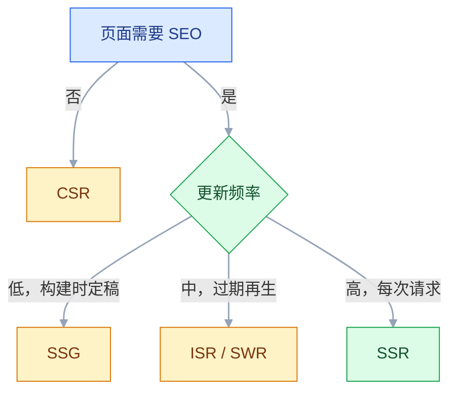

# Nuxt

## 一、工程案例：做一个可预渲染、带动态 SEO 的技术博客

**场景**：给自己写一个技术博客。首页列文章（标题、摘要、日期、分类）；详情页的 `<title>` 与 `description` 跟着文章走，分享时有预览卡片；分类页可过滤；后台写作页不需要 SEO，草稿只在浏览器读写。文章不常改，最终**静态生成**传到 CDN，不养服务器。

**技术栈**：Nuxt + TypeScript，数据先放 `server/api` + 内存数组，之后能平滑换数据库。构建策略用 `routeRules` 按路由分配：内容页预渲染；后台页不需要 SEO，用 `<ClientOnly>` 把草稿留在浏览器。

**接口契约**：`GET /api/posts?category=` 返回文章数组；`GET /api/posts/:id` 返回单篇，不存在返回 404；`GET /api/categories` 返回 `{ name, count }[]`。

### 1.1 主线（按顺序执行）

**① 建项目**

```bash
pnpm dlx nuxi@latest init my-blog
cd my-blog && pnpm install
mkdir -p app/pages/posts app/pages/categories app/pages/admin \
  app/layouts app/components app/composables \
  shared/types server/api/posts server/utils
pnpm dev
# ➜ Local: http://localhost:3000/
```

新版 Nuxt 以 `app/` 为源码根：`pages/`、`components/`、`layouts/`、`composables/` 都在 `app/` 下，`server/`、`public/`、`nuxt.config.ts` 留在根目录。旧教程的根目录布局能被自动探测兼容，但那时 `~` 指向根目录，和新结构混用会找不到文件；新项目统一按 `app/` 写。默认值以官方当前稳定版为准。

**② 类型与数据源** `shared/types/post.ts`、`server/utils/posts.ts`

```ts
// shared/types/post.ts：app 与 server 两边都自动导入
export interface Post {
  id: number; title: string; summary: string; content: string
  category: string; publishedAt: string
}
export interface Category { name: string; count: number }
```

```ts
// server/utils/posts.ts：换数据库时只改这个文件
const posts: Post[] = [
  { id: 1, title: 'SSR 解决的是什么问题', summary: '从 SPA 的空白 HTML 讲起。',
    content: '## 首屏\n\n服务端先渲染……', category: 'Nuxt', publishedAt: '2026-03-01' },
  { id: 2, title: 'useFetch 与 $fetch 的分工', summary: '组合式函数与请求函数的边界。',
    content: '## 取数\n\n初始化用 useFetch……', category: 'Nuxt', publishedAt: '2026-03-05' },
  { id: 3, title: 'TypeScript 泛型的日常用法', summary: '只讲业务里真正会用到的部分。',
    content: '## 泛型\n\n类型也可以当参数……', category: 'TypeScript', publishedAt: '2026-03-10' },
]

export function getAllPosts(category?: string): Post[] {
  const list = category ? posts.filter((p) => p.category === category) : posts
  return [...list].sort((a, b) => b.publishedAt.localeCompare(a.publishedAt))
}
export function getPostById(id: number) { return posts.find((p) => p.id === id) }
export function getCategories(): Category[] {
  const map = new Map<string, number>()
  for (const post of posts) map.set(post.category, (map.get(post.category) ?? 0) + 1)
  return [...map.entries()].map(([name, count]) => ({ name, count }))
}
```

**③ 服务端接口** `server/api/`

```ts
// server/api/posts/index.get.ts
export default defineEventHandler((event) => {
  const { category } = getQuery<{ category?: string }>(event)
  return getAllPosts(category)
})

// server/api/posts/[id].get.ts
export default defineEventHandler((event) => {
  const post = getPostById(Number(getRouterParam(event, 'id')))
  if (!post) throw createError({ statusCode: 404, statusMessage: '文章不存在' })
  return post
})

// server/api/categories.get.ts
export default defineEventHandler(() => getCategories())
```

`server/utils` 里的导出在服务端代码中自动可用，不用 import。`[id].get.ts` 的后缀把文件绑定到 GET，路径参数用 `getRouterParam` 读。

**④ 取数逻辑** `app/composables/usePosts.ts`

```ts
import type { MaybeRefOrGetter } from 'vue'

export function usePostList(category?: MaybeRefOrGetter<string | undefined>) {
  const key = computed(() => `posts-${toValue(category) ?? 'all'}`)
  return useAsyncData(key, () =>
    $fetch<Post[]>('/api/posts', { query: { category: toValue(category) } }))
}
export function usePostDetail(id: MaybeRefOrGetter<string | number>) {
  return useFetch<Post>(() => `/api/posts/${toValue(id)}`, { key: () => `post-${toValue(id)}` })
}
export function useCategoryList() {
  return useFetch<Category[]>('/api/categories', { key: 'categories' })
}
```

key 要能区分不同请求：分类不同、文章 id 不同，缓存就不能共用。`useFetch` 在服务端取到的结果会序列化进 HTML，客户端直接复用，不会重复请求。

**⑤ 外壳、布局与卡片** `app/app.vue`、`app/layouts/default.vue`、`app/components/PostCard.vue`

```vue
<!-- app/app.vue：替换脚手架自带的欢迎页 -->
<template>
  <NuxtRouteAnnouncer />
  <NuxtLayout><NuxtPage /></NuxtLayout>
</template>
```

```vue
<!-- app/layouts/default.vue：页面内容进 <slot /> -->
<script setup lang="ts">
// 布局里不写顶层 await，避免阻塞水合；SSR 仍会等数据
const { data: categories } = useCategoryList()
</script>
<template>
  <div class="shell">
    <header>
      <NuxtLink to="/">我的技术博客</NuxtLink>
      <nav><NuxtLink to="/">首页</NuxtLink><NuxtLink to="/categories">分类</NuxtLink></nav>
    </header>
    <main><slot /></main>
    <footer>
      <NuxtLink v-for="c in categories" :key="c.name" :to="`/categories/${c.name}`">
        {{ c.name }}({{ c.count }})
      </NuxtLink>
    </footer>
  </div>
</template>
```

```vue
<!-- app/components/PostCard.vue：components/ 下自动导入，不用 import -->
<script setup lang="ts">
defineProps<{ post: Post }>()
</script>
<template>
  <article>
    <h2><NuxtLink :to="`/posts/${post.id}`">{{ post.title }}</NuxtLink></h2>
    <p>{{ post.category }} · {{ post.publishedAt }}</p>
    <p>{{ post.summary }}</p>
  </article>
</template>
```

**⑥ 首页与详情页（动态 SEO）**

```vue
<!-- app/pages/index.vue -->
<script setup lang="ts">
const { data: posts, pending, error } = await usePostList()
useSeoMeta({ title: '我的技术博客 - 首页', description: '记录 Nuxt、Vue、TypeScript 的实践。' })
</script>
<template>
  <div>
    <h1>最新文章</h1>
    <p v-if="pending">加载中…</p>
    <p v-else-if="error">加载失败：{{ error.message }}</p>
    <template v-else><PostCard v-for="post in posts" :key="post.id" :post="post" /></template>
  </div>
</template>
```

```vue
<!-- app/pages/posts/[id].vue -->
<script setup lang="ts">
const route = useRoute()
const id = computed(() => route.params.id as string)
const { data: post, error } = await usePostDetail(id)

if (!post.value || error.value) {
  throw createError({ statusCode: 404, statusMessage: '文章不存在', fatal: true })
}
useSeoMeta({
  title: () => `${post.value?.title} - 我的技术博客`,
  description: () => post.value?.summary ?? '',
  ogTitle: () => post.value?.title ?? '',
  ogDescription: () => post.value?.summary ?? '',
  ogType: 'article',
})
</script>
<template>
  <article v-if="post">
    <h1>{{ post.title }}</h1>
    <p>{{ post.category }} · {{ post.publishedAt }}</p>
    <div>{{ post.content }}</div>
  </article>
</template>
```

元信息用函数形式，数据到位后自动更新；`useSeoMeta` 在服务端就把标签注入 HTML。文章不存在时抛 404，而不是渲染一个空页面返回 200。

**⑦ 分类页**

```vue
<!-- app/pages/categories/[name].vue -->
<script setup lang="ts">
const route = useRoute()
const name = computed(() => route.params.name as string)
const { data: posts } = await usePostList(name)
useSeoMeta({ title: () => `${name.value} - 我的技术博客` })
</script>
<template>
  <div>
    <h1>{{ route.params.name }}</h1>
    <PostCard v-for="post in posts" :key="post.id" :post="post" />
  </div>
</template>
```

**⑧ 后台写作页（草稿只在客户端）**

```vue
<!-- app/pages/admin/index.vue -->
<script setup lang="ts">
definePageMeta({ layout: false })
const draft = ref({ title: '', summary: '', content: '', category: 'Nuxt' })
const savedAt = ref('')

onMounted(() => {
  const raw = localStorage.getItem('draft')
  if (raw) draft.value = JSON.parse(raw)
})
function saveDraft() {
  localStorage.setItem('draft', JSON.stringify(draft.value))
  savedAt.value = new Date().toLocaleString()
}
</script>
<template>
  <div>
    <h1>写作</h1>
    <ClientOnly>
      <input v-model="draft.title" placeholder="标题" />
      <textarea v-model="draft.content" rows="12" placeholder="正文" />
      <button @click="saveDraft">保存草稿</button>
      <span v-if="savedAt">上次保存：{{ savedAt }}</span>
      <template #fallback><p>正在加载草稿…</p></template>
    </ClientOnly>
  </div>
</template>
```

`definePageMeta` 没有官方的 `ssr` 选项，自定义 meta 也不会改变渲染方式；它这里只负责 `layout: false`。整页只在浏览器渲染要写 `routeRules` 的 `ssr: false`，那需要 Node 运行时；纯静态部署用 `<ClientOnly>` 把草稿区留到浏览器，HTML 里就不会出现草稿。`localStorage` 只在 `onMounted` 和事件回调里读。

**⑨ 渲染策略** `nuxt.config.ts`

```ts
export default defineNuxtConfig({
  devtools: { enabled: true },
  app: { head: { htmlAttrs: { lang: 'zh-CN' }, title: '我的技术博客' } },
  routeRules: {
    '/': { prerender: true },
    '/posts/**': { prerender: true },
    '/categories/**': { prerender: true },
    '/admin': { prerender: true },   // 只生成空壳，草稿在浏览器里才有
    '/api/**': { cors: true, headers: { 'cache-control': 's-maxage=60' } },
  },
})
```

`prerender` 在构建时生成 HTML。`ssr: false`、`swr`、`isr` 属于混合渲染，需要 Node 服务或支持它们的平台，`nuxt generate` 下不生效，所以后台页用 `<ClientOnly>` 而不是路由规则。`/api/**` 那条只在 `pnpm build` 的 Node 部署里有意义，静态产物中没有接口。

### 1.2 验收（8 项全过才算交付）

第 1–6 项在 `pnpm dev` 下验证；第 7、8 项是构建命令，先停掉 dev server。

| # | 检查项 | 命令或检查 | 通过标准 |
|---|---|---|---|
| 1 | 首页有正文 | `curl -s localhost:3000/ \| grep -c '<article'` | 输出 ≥ 3，说明 HTML 里已有文章 |
| 2 | 动态标题 | `curl -s localhost:3000/posts/1 \| grep '<title>'` | 标题是文章标题，不是站点默认名 |
| 3 | 真 404 | `curl -o /dev/null -s -w '%{http_code}' localhost:3000/posts/999` | 输出 `404` |
| 4 | 分类过滤 | 访问 `/categories/Nuxt` | 只剩 Nuxt 分类文章 |
| 5 | 后台草稿不进 HTML | `curl -s localhost:3000/admin \| grep -c '保存草稿'` | 输出 `0`，HTML 里没有草稿表单 |
| 6 | 水合无警告 | 浏览器控制台 | 无 `Hydration ... mismatch` |
| 7 | 预渲染产物 | `pnpm generate` 后 `ls .output/public/posts/1/index.html` | 文件存在 |
| 8 | 生产构建 | `pnpm build` | 生成 `.output/server/index.mjs` |

> 第 1、2、5 项要用 `curl` 或「查看网页源代码」，不能用 F12 的 Elements 面板。Elements 显示的是浏览器执行 JS 之后的 DOM，SPA 也能通过，验证不出 SSR。

### 1.3 预渲染与部署

`pnpm generate` 会从首页开始爬链接，只能预渲染「能发现」的路由。文章多、有分页、或有页面没被链接时，动态文章页要显式枚举：

```ts
// nuxt.config.ts：构建期直接读数据，别去请求 localhost
import { getAllPosts } from './server/utils/posts'

export default defineNuxtConfig({
  hooks: {
    'prerender:routes'(ctx) {
      getAllPosts().forEach((p) => ctx.routes.add(`/posts/${p.id}`))
    },
  },
})
```

静态产物在 `.output/public`，Nginx 只需要托管文件并给 404 兜底：

```nginx
root /usr/share/nginx/html/blog;
location / { try_files $uri $uri/ =404; }
error_page 404 /404.html;
```

SSR 模式则相反：`pnpm build` 后运行 `node .output/server/index.mjs`，Nginx 把所有请求反代到 Node，不要配 `try_files`，否则动态路由会被静态文件规则截走。

---

## 二、高频问答：会卡住你的地方，也是面试最常问的

### 2.1 `window is not defined`，页面直接 500

**现场**

报错栈指向某个 `.vue` 的 setup 或某个插件；只在刷新首屏时出现。临时把那段包进 `onMounted` 或 `<ClientOnly>`，报错消失即确认。

```ts
// ✘ setup 顶层
const width = window.innerWidth
// ✔ 放进 onMounted，或只在客户端执行
const width = ref(0)
onMounted(() => { width.value = window.innerWidth })
```

**要点**

- 组件在服务端先执行一遍，`window`、`document`、`localStorage` 都不存在。
- setup 顶层直接访问就抛错；「浏览器里能跑」不等于「两端都能跑」。
- 放进 `onMounted`，或只在客户端执行。

**追问**

- 为什么客户端跳转时不报？→ 那时只有浏览器在跑。
- 插件里怎么区分环境？→ `.client.ts` / `.server.ts` 后缀。
- 第三方库只在浏览器可用怎么办？→ 包 `<ClientOnly>`，或写成客户端插件。

### 2.2 控制台报 hydration mismatch，页面闪一下又变回去

**现场**

警告会指出哪个节点不匹配；对比「查看源代码」与 Elements 里的同一段文本。

```ts
const now = ref('')
onMounted(() => { now.value = new Date().toLocaleString() })  // 只在客户端赋值
```

**要点**

- 服务端渲染出的 HTML 与客户端首次渲染结果不一致，客户端要复用服务端 HTML，对不上就只能丢弃重来。
- 时间、随机数、`localStorage` 初始值、按 `window` 分支都会造成差异。
- 把不确定的值挪进 `onMounted`，或给只在客户端出现的部分包 `<ClientOnly>`。

**追问**

- 为什么水合不是「再渲染一次」？→ 它是接管现有 DOM，要求两端一致。
- 为什么只有某个用户看到？→ 时区、浏览器扩展、本地存储不同。
- `data-allow-mismatch` 用在哪？→ 扩展改 DOM 这类无法根治的节点。

### 2.3 页面初始化请求发了两次

**现场**

Network 里看同一接口有两条，一条 initiator 是 document，一条是 JS；换成 `useFetch` 后刷新，应只剩一条文档请求。

```ts
// ✘ setup 顶层
const posts = await $fetch('/api/posts')
// ✔
const { data: posts } = await useFetch('/api/posts')
```

**要点**

- 在 setup 里用 `$fetch` 取数：服务端发一次，客户端水合后又发一次。
- `useFetch` / `useAsyncData` 会把结果随 HTML 传递，客户端不重发。
- `$fetch` 是纯请求函数，`useFetch` 带 SSR 数据传递。

**追问**

- 点击、提交该用哪个？→ `$fetch`，不需要跨端传递。
- `useAsyncData` 和 `useFetch` 的区别？→ 前者是 key 加执行函数，后者是 URL 语法糖。
- 重复请求有什么代价？→ 多打一次后端，首屏更慢。

### 2.4 `pnpm generate` 成功，但文章详情页访问 404

**现场**

`ls .output/public/posts`，只有目录没有 `1/index.html`；再看构建日志里的 `Prerendered N routes` 数量。

```ts
// ✘ 构建机 / CI 上通常没有 localhost:3000 在监听，这个请求多半失败
hooks: {
  async 'prerender:routes'(ctx) {
    const posts = await $fetch<{ id: number }[]>('http://localhost:3000/api/posts')
    posts.forEach((p) => ctx.routes.add(`/posts/${p.id}`))
  },
},
```

**要点**

- 预渲染只生成「爬得到」或「枚举过」的路由。
- `/posts/[id]` 是动态段，靠首页链接去爬；文章一进分页、刚发布还没上列表，就爬不到。
- 正确写法是从构建期就能读到的数据枚举，别去请求 `localhost`。

**追问**

- 为什么构建机上请求 localhost 会失败？→ 那时没有服务在监听。
- 枚举写在哪？→ `prerender:routes` 钩子或 `nitro.prerender.routes`。
- 文章新增后要做什么？→ 重新构建，或改用 ISR/SWR。

### 2.5 改了环境变量，线上完全没变

**现场**

在产物里搜旧值，能搜到说明被内联了；同一个构建产物换一组 `NUXT_*` 启动，值应该跟着变。

```ts
// nuxt.config.ts
runtimeConfig: { apiSecret: '', public: { apiBase: '/api' } }
// 服务端：useRuntimeConfig(event).apiSecret
// 环境变量：NUXT_API_SECRET / NUXT_PUBLIC_API_BASE
```

**要点**

- `import.meta.env.XXX` 在构建时就被替换成字面量，容器里改环境变量不会影响已经打好的产物。
- `runtimeConfig` 是运行时读取，同一份产物可以在不同环境启动。
- 环境变量用 `NUXT_` 前缀映射，点号变下划线。

**追问**

- 密钥该放哪层？→ 顶层，只有服务端可读。
- `public` 里的内容会进客户端吗？→ 会，别放密钥。
- 改完要重新构建吗？→ `runtimeConfig` 不用，`import.meta.env` 要。

### 2.6 源码里没有 title 和 description

**现场**

`curl` 抓 HTML，搜 `<title>` 与 `description`；验证永远用「查看网页源代码」或 `curl`，不要用 Elements 面板。

```ts
useSeoMeta({
  title: () => `${post.value?.title} - 我的技术博客`,
  description: () => post.value?.summary ?? '',
})
```

**要点**

- 在 `onMounted` 里手写 `document.title`，或整页被 `ssr: false` / `<ClientOnly>` 包住，都只发生在浏览器。
- 爬虫拿到的是空壳；浏览器标签页显示对了不代表 SEO 对了。
- 用 `useSeoMeta`，它在服务端就把标签注入 HTML。

**追问**

- 为什么 Elements 面板会骗人？→ 它显示的是执行 JS 之后的 DOM。
- `useHead` 和 `useSeoMeta` 怎么分工？→ 前者写 link、script，后者写标准 meta。
- 值要用函数形式吗？→ 要，函数才会跟随数据变化。

### 2.7 路由中间件里读 `localStorage` 报错

**现场**

首次进入页面就报 `localStorage is not defined`，客户端跳转却正常。

```ts
export default defineNuxtRouteMiddleware((to) => {
  const token = useCookie('token')
  if (!token.value && to.path !== '/login') {
    return navigateTo(`/login?redirect=${to.fullPath}`)
  }
})
```

**要点**

- 中间件在服务端也执行，首次请求时没有 `localStorage`。
- 登录态要放在 Cookie 里，服务端才读得到。
- 「浏览器存储」不是「全局存储」。

**追问**

- 为什么客户端跳转正常？→ 那时只有浏览器在跑。
- `useCookie` 和 `document.cookie` 的区别？→ 前者两端可用，SSR 时读请求头。
- 中间件该做多少事？→ 粗判断，别查数据库。

### 2.8 服务端用 `$fetch` 调自家接口，登录态丢了

**现场**

同一接口浏览器里 200，SSR 日志里 401；在接口里打印 `getHeader(event, 'cookie')`，`useFetch` 有值、裸 `$fetch` 为空。

```ts
// ✘ useAsyncData 里的 $fetch 不带 Cookie
const { data: a } = await useAsyncData(() => $fetch('/api/me'))
// ✔ 直接用 useFetch，或显式取 requestFetch
const { data: b } = await useFetch('/api/me')
const requestFetch = useRequestFetch()
const { data: c } = await useAsyncData(() => requestFetch('/api/me'))
```

**要点**

- SSR 时 `$fetch` 是 Node 发出的另一条请求，不会自动带浏览器的 Cookie。
- `useFetch` 内部走 `useRequestFetch`，默认转发请求头；`useAsyncData` 里裸写的 `$fetch` 不转发。
- 同源不代表自动共享 Cookie。

**追问**

- `useAsyncData` 里要带 Cookie 怎么办？→ `useRequestFetch()` 后再请求。
- 服务端之间能省掉 HTTP 吗？→ 能，直接调函数。
- 为什么浏览器里是 200？→ 浏览器发请求时自动带上了 Cookie。

### 2.9 两个页面数据互相串了

**现场**

给两个请求打印 key，相同即确认；把 key 改成带业务 id 的唯一值，串数据现象应消失。

**要点**

- `useFetch` 的 key 重复，或 `useState` 的 key 重复，同一个 key 在同一请求里指向同一份数据。
- key 不只是调试标签，它同时决定缓存、去重和跨端传递。
- 分类不同、文章 id 不同，缓存就不能共用。

**追问**

- 为什么两个页面会串？→ 共用了一份缓存。
- 自动生成的 key 不够用吗？→ 同 URL 同选项会撞，业务要手动区分。
- `useState` 的 key 冲突会怎样？→ 两个模块读写同一份状态。

### 2.10 用户的购物车串到了别人身上

**现场**

两个浏览器用不同账号同时请求，A 能看到 B 的数据；并发两个账号请求同一页，对比返回的 HTML，出现对方数据即确认。

**要点**

- 把状态放在模块顶层（`const cart = ref([])`），Node 进程内所有请求共用这一份。
- SSR 下这就是跨用户泄漏，「一个用户一个进程」只是浏览器的直觉。
- `useState` 按请求隔离，模块顶层变量不是。

**追问**

- 为什么本地开发发现不了？→ 单用户、串行请求，很少并发。
- `useState` 和 Pinia 怎么选？→ 简单标记用 `useState`，复杂业务用 Pinia。
- 怎么验证修好了？→ 并发两个账号请求同一页，HTML 里不能出现对方数据。

### 2.11 预渲染的文章改了，线上还是旧的

**现场**

本地改数据重新 `generate` 后内容变、线上不变，即为构建产物过期；再看部署产物的构建时间。

```ts
// 需要定期更新就换 ISR/SWR；前提是 Node 或支持它的平台
routeRules: { '/posts/**': { isr: 60 } }
```

**要点**

- `prerender: true` 是构建时生成，内容写死在 HTML 里，不重新构建就不会更新。
- CDN 只是第二层缓存。
- 需要定期更新就换 ISR/SWR，前提是 Node 或支持它的平台。

**追问**

- 为什么刷 CDN 没用？→ 源头的 HTML 就是旧的。
- `isr: 60` 的含义？→ 缓存 60 秒，过期后再生。
- 静态站能自动更新吗？→ 不能，必须重新构建。

### 2.12 部署到子路径后，静态资源全 404

**现场**

Network 里资源 URL 少了 `/blog` 前缀；查看源代码里的 `<script src>`，前缀应与部署路径一致。

```ts
export default defineNuxtConfig({ app: { baseURL: '/blog/' } })
```

**要点**

- 应用被挂在 `/blog/`，但 `baseURL` 还是 `/`，JS/CSS 请求打到了根路径。
- 只改 Nginx 的 `location` 不够，应用自己的基础路径也要改。
- 配 `app.baseURL`。

**追问**

- 为什么首页能开、样式没了？→ HTML 出来了，资源 404。
- 改了 `baseURL` 还要改什么？→ Nginx 的转发前缀要对齐。
- 图片路径也会受影响吗？→ 会，相对路径都基于 `baseURL`。

---

## 三、核心知识：从零开始要建立的东西

### 3.1 元框架与两端执行

Nuxt 在 Vue 之上补了三件事：文件即路由、服务端接口、按路由选择渲染方式。代价是同一份组件代码可能跑在 Node 和浏览器两个环境。


判断一段代码能不能写在顶层，只看它是否依赖 `window`、`document`、`localStorage`、`navigator`。依赖就放进 `onMounted`、`.client` 插件或 `<ClientOnly>`。

### 3.2 渲染模式的选择

| 模式 | HTML 何时生成 | 适合 | 部署 |
|---|---|---|---|
| SSR | 每次请求 | 内容常变、要 SEO | Node 服务 |
| SSG | 构建时 | 博客、文档、官网 | 静态托管 |
| ISR / SWR | 首次请求后缓存，定期或后台再生 | 大部分静态、偶尔更新 | Node 或平台支持 |
| CSR | 不生成，浏览器渲染 | 后台、登录后页面 | 静态托管 |



`routeRules` 让一个项目混用多种模式：营销页预渲染、后台 `ssr: false`、接口加缓存头。注意 `ssr: false`、`swr`、`isr` 需要 Node 服务或平台支持，`nuxt generate` 的纯静态产物里不生效。不要为了统一而全站 SSR，服务端渲染的 CPU 成本比静态文件高得多。

> **面试**：常问「SSR、SSG、ISR 怎么选？」答：看内容更新频率和是否要 SEO，能静态就静态，要新鲜度用 ISR/SWR，必须实时才 SSR。

### 3.3 文件路由映射

`pages/` 目录决定路由，文件名决定路径（下表按当前默认的 `app/` 布局写）。只有 `app.vue` 没有 `pages/` 时没有路由；两者都有时，`app.vue` 是外壳，页面渲染在 `<NuxtPage />`。

| 文件 | 路由 |
|---|---|
| `app/pages/index.vue` | `/` |
| `app/pages/about.vue` | `/about` |
| `app/pages/posts/index.vue` | `/posts` |
| `app/pages/posts/[id].vue` | `/posts/:id` |
| `app/pages/[...slug].vue` | 任意路径，兜底 |

动态参数用 `useRoute().params.id` 读，值是字符串。嵌套路由靠「同名目录 + 父页面」构成，父页面内部要有 `<NuxtPage />`。页面元信息用 `definePageMeta`，它是编译宏，不能访问组件内变量。

### 3.4 布局与页面嵌套

`app/layouts/default.vue` 是所有页面的默认外壳，页面内容进 `<slot />`。`definePageMeta({ layout: 'admin' })` 换布局，`layout: false` 表示不要外壳。布局文件本身就是一个普通组件，导航、页脚这类「每页都有」的东西放这里；页面私有的容器不要塞进布局，否则所有页面都被迫接受。

### 3.5 自动导入的边界

`app/components/`、`app/composables/`、`app/utils/` 以及 Nuxt 内置 API 都自动导入。目录名会拼进组件名：`app/components/blog/PostList.vue` 变成 `<BlogPostList />`。`server/utils/` 只进服务端，不会打包给客户端；`shared/utils`、`shared/types` 两边都自动导入，适合放接口类型和纯函数。

自动导入靠构建期扫描，新建文件后偶尔要重启 dev server。想看实际导入了什么，读 `.nuxt/imports.d.ts` 与 `.nuxt/components.d.ts`；同名导出冲突时显式 import 更安全。

### 3.6 数据获取的两套原语

`useFetch` 是「URL + 选项」的语法糖，`useAsyncData` 是「key + 执行函数」，`$fetch` 是纯请求函数。

| 场景 | 用什么 |
|---|---|
| 页面初始化按 URL 取数 | `useFetch` |
| 组合多个请求、自定义逻辑 | `useAsyncData` |
| 点击、提交等事件回调 | `$fetch` |

```ts
const { data, pending, error, refresh } = await useFetch<Post[]>('/api/posts')
const { data: detail } = await useAsyncData('post-detail', async () => {
  const id = useRoute().params.id
  return { post: await $fetch(`/api/posts/${id}`) }
})
```

`useFetch` 的 key 默认由调用位置、URL 和选项生成，手动传 key 是为了跨组件共享或区分业务。新版返回的 `data` 默认是浅层响应式，直接改嵌套字段可能不触发更新；要么整体替换，要么显式开 `deep`，具体默认值以官方当前稳定版为准。

路由参数变化时页面组件会被复用，setup 不会重跑。把 URL 或 key 写成 getter（`() => \`/api/posts/${route.params.id}\``），或对参数加 `watch` 手动 `refresh()`，否则从文章 1 跳到文章 2 会继续显示旧内容。

> **面试**：常问「`useFetch` 和 `$fetch` 的区别？」答：`$fetch` 是纯请求函数，`useFetch` 带 key、SSR 数据传递和去重。

### 3.7 服务端接口与请求上下文

`server/api/` 下的文件就是接口，`.get.ts` / `.post.ts` 后缀绑定方法。处理函数拿到的 `event` 封装了请求与响应。

| 函数 | 作用 |
|---|---|
| `getQuery(event)` | 查询参数 |
| `getRouterParam(event, 'id')` | 路径参数 |
| `readBody(event)` | JSON 请求体，异步 |
| `getHeader(event, 'cookie')` | 请求头 |
| `setResponseStatus(event, 201)` | 设置状态码 |
| `createError({ statusCode, statusMessage })` | 抛 HTTP 错误 |

```ts
export default defineEventHandler(async (event) => {
  const body = await readBody<{ title: string }>(event)
  if (!body?.title) throw createError({ statusCode: 400, statusMessage: '标题不能为空' })
  setResponseStatus(event, 201)
  return { id: 1, title: body.title }
})
```

`useFetch` 会自动转发当前请求的请求头（内部用 `useRequestFetch`）；用裸 `$fetch` 或在 `useAsyncData` 里写 `$fetch` 时不会。调自家受保护接口要么直接用 `useFetch`，要么 `const requestFetch = useRequestFetch()` 后再请求；服务端之间还可以直接调函数，省掉一次 HTTP。

### 3.8 状态隔离

`useState` 是 Nuxt 内置的跨组件共享状态，按请求隔离：每个 SSR 请求拿到独立的一份，不会把 A 用户的数据给 B。

```ts
export function useCounter() {
  const count = useState('counter', () => 0)   // key 唯一，初始值用工厂
  const double = computed(() => count.value * 2)
  return { count, double, inc: () => count.value++ }
}
```

模块顶层 `const state = ref()` 是进程级单例，在 SSR 下会跨用户泄漏；`useState` 才是请求级。复杂业务、需要 devtools 或持久化插件时再上 Pinia，简单标记用 `useState` 就够。

> **面试**：常问「为什么 SSR 下不能用模块顶层变量存用户状态？」答：Node 进程内所有请求共用一份，会跨用户泄漏，要用按请求隔离的 `useState`。复杂业务、需要 devtools 或持久化插件时再上 Pinia，简单标记用 `useState` 就够。

### 3.9 运行时配置

`runtimeConfig` 分两层：顶层只在服务端可读，`public` 下的前后端都能读。环境变量用 `NUXT_` 前缀映射，点号变下划线。

```ts
runtimeConfig: {
  apiSecret: '',                    // NUXT_API_SECRET
  public: { apiBase: '/api' },      // NUXT_PUBLIC_API_BASE
}
```

`import.meta.env` 是构建期替换，改值要重新构建；`runtimeConfig` 是运行时读取，同一份产物可以在不同环境启动。密钥只能放顶层，`public` 里的内容会进客户端产物。

### 3.10 插件与中间件的执行顺序

| 类型 | 位置 | 执行顺序 | 执行环境 |
|---|---|---|---|
| 服务端中间件 | `server/middleware/` | 1 | 每个请求，最先 |
| 插件 | `app/plugins/` | 2 | 应用创建时；服务端每请求一次，客户端一次 |
| 全局路由中间件 | `app/middleware/*.global.ts` | 3 | 每次路由切换 |
| 命名中间件 | `app/middleware/auth.ts` | 3 | 页面显式引用 |

这个顺序只在首屏 SSR 请求里完整出现；客户端跳转不会再跑服务端中间件和插件，只剩路由中间件。插件用后缀控制环境：`.client.ts` 只在浏览器，`.server.ts` 只在服务端，无后缀两端都跑。路由中间件用 `defineNuxtRouteMiddleware`，返回 `navigateTo(...)` 重定向；服务端中间件拿到的是 H3 `event`，不是路由对象。

### 3.11 水合过程

服务端产出 HTML 后，客户端下载 JS、复用现有 DOM 并挂上事件，这一步叫水合。水合要求两端首次渲染结果一致，否则 Vue 会丢弃服务端 DOM 重新渲染，表现为闪烁与警告。

| 不一致来源 | 处理 |
|---|---|
| `Date.now()` / `Math.random()` | 移到 `onMounted` |
| `localStorage` 初始值 | 默认值渲染，挂载后再读 |
| 按 `window` 分支 | `<ClientOnly>` 或 `.client` 组件 |
| 浏览器扩展改 DOM | 无法根治，用 `data-allow-mismatch` 放行个别节点 |

```vue
<ClientOnly>
  <ChartPanel />
  <template #fallback><p>图表加载中…</p></template>
</ClientOnly>
```

水合不是「再渲染一次」，而是「接管」。理解这一点，就不会把只在客户端成立的值写进首屏。

### 3.12 SEO 元信息注入

`useSeoMeta` 写标准 meta，`useHead` 写 link、script 和非标准标签。两者都在服务端执行时注入 HTML，所以爬虫能读到。

```ts
useSeoMeta({
  title: () => `${post.value?.title} - 博客`,
  description: () => post.value?.summary ?? '',
  ogImage: () => post.value?.cover ?? '/og-default.png',
})
useHead({ link: [{ rel: 'canonical', href: `https://blog.example.com/posts/${id}` }] })
```

值用函数形式才会跟随数据变化；直接传字符串只写一次。全局默认放 `app.head`，页面级覆盖它。验证方式永远是 `curl` 或查看源代码。

### 3.13 预渲染的路由枚举

`prerender: true` 在构建时抓取并生成 HTML。静态路由自动发现；动态路由靠页面链接去爬，爬不到就必须枚举：可以写死列表，也可以用 `prerender:routes` 钩子从接口拉。

```ts
nitro: { prerender: { routes: ['/posts/1', '/posts/2'] } }
```

边界：构建时拿不到的数据不会出现在页面里；文章新增后必须重新构建，或改用 ISR/SWR。预渲染适合「发布即固定」的内容，不适合库存、价格、实时榜单。

### 3.14 构建产物与缓存策略

| 命令 | 产物 | 运行方式 |
|---|---|---|
| `nuxi build` | `.output/server` | `node .output/server/index.mjs` |
| `nuxi generate` | `.output/public` | 任意静态托管，含 `200.html` / `404.html` 兜底 |

`nitro.preset` 决定部署目标：`node-server`、`static`、`vercel`、`cloudflare` 等，换平台通常只改这一项。缓存分三层：CDN 的 `cache-control`、`routeRules` 的 `isr` / `swr`、应用内自己的缓存。静态页给长缓存，接口给短缓存，带登录态的响应不要公共缓存。

---

## 四、冷门知识汇总

| 知识点 | 为什么冷门 | 用到时的关键词 |
|---|---|---|
| `callOnce` | 首屏的副作用只该跑一次，直接写会两端各跑一遍 | SSR 重复执行、初始化埋点 |
| `NuxtLink` 预取 | 默认行为，感受不到，只在弱网时体现 | 视口预取、`no-prefetch` |
| `definePageMeta` 的 `validate` | 参数校验多用中间件，少用页面级校验 | 返回 false、404、路由参数 |
| 服务端中间件 | 多数需求用路由中间件就够了 | `server/middleware`、H3 event |
| `NuxtIsland` | 岛屿架构、局部 SSR 才用 | 服务端组件、独立渲染 |
| 路由规则的通配键 | 简单前缀够用，嵌套与优先级才查 | `'/blog/**'`、规则覆盖顺序 |
| `_payload.json` | 平时看不到，预渲染和客户端跳转时才用上 | payloadExtraction、静态数据陈旧 |
| Nitro 存储层 | 小项目直接读写文件或数据库 | `useStorage`、KV、多环境驱动 |
| 边缘部署 | 国内业务多用 Node 或静态托管 | edge preset、冷启动、运行时限制 |

`swr` 与 `isr` 常被当成同义词，差别在缓存放在哪：

| 项目 | `swr` | `isr` |
|---|---|---|
| 缓存位置 | Node 服务或反向代理 | 平台 CDN |
| 需要的部署 | `node-server` 或自建反代 | Netlify、Vercel 等支持 ISR 的平台 |
| 参数写法 | `swr: 60` | `isr: 60` |
| 数字含义 | 缓存 60 秒，过期后后台再生 | 同左，再生交给平台 |
| 写 `true` | 只加 `stale-while-revalidate`，不设 max-age | 缓存保持到下次部署 |
| 过期之后 | 先返回旧响应，后台再生 | 同左，再生在平台侧 |

两者都是「首次请求才生成」，不能替代构建期预渲染；数据必须在那次请求时取得到。
