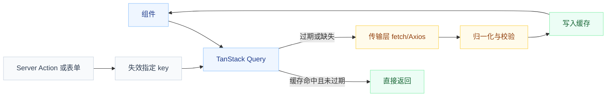
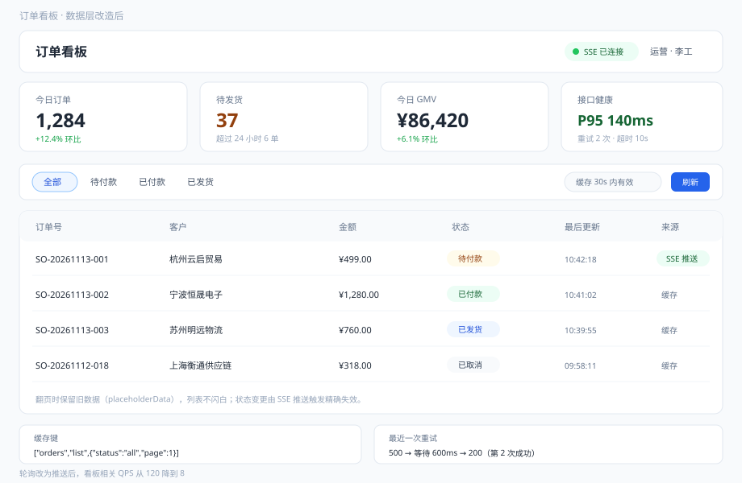

# 数据请求与缓存

> 这篇从请求层要解决的问题讲起，经过 fetch 与 Axios 的封装、取消与重试、TanStack Query 5 的缓存模型、变更与乐观更新、SSE 与 WebSocket 实时通道，最后落到 MSW 测试和线上排障。
>
> 学完能独立设计一个不重复请求、能取消、能重试、断网可恢复的前端数据层，并让缓存失效时机与业务语义对齐。

## 一、请求层的职责与选型

这一章划清“谁来发请求、谁来管缓存、谁来管状态”的边界，选型错了后面每一层都会重复劳动。

前端数据层要处理六件事：发请求、序列化、错误归一、取消、缓存、失效。`fetch` 和 Axios 只解决前两件，缓存与失效要靠 TanStack Query 这类服务端状态库。

### 1.1 三者的分工

| 层 | 负责 | 不负责 |
|---|---|---|
| `fetch` | 浏览器原生请求、流式响应 | 拦截器、超时、自动重试 |
| Axios | 拦截器、超时、统一错误、进度 | 缓存、失效、去重 |
| TanStack Query | 缓存、去重、重试、失效、分页 | 传输细节、请求体构造 |

判断标准：数据需要在多个组件间共享、需要后台刷新、需要失效重取，就用 TanStack Query；只是一次性提交或下载文件，直接 `fetch` 就够。

### 1.2 服务端状态与客户端状态

服务端状态是“别人家的数据”，会过期、会被别人改；客户端状态是“自己的界面状态”，由本端决定。



把服务端数据塞进 Zustand 或 Context 是最常见的错误：状态库不会自动失效，只能靠手写定时器和手动刷新，最后一定会出现“两个页面数据不一致”。

### 1.3 版本基线

| 包 | 版本 | 说明 |
|---|---|---|
| TanStack Query | 5.x | v4 的 `cacheTime` 已改名 `gcTime` |
| Axios | 1.7+ | 支持 `signal` 与 `fetch` 适配器 |
| Zod | 4.x | 运行时校验响应结构 |
| MSW | 2.x | 测试与本地 mock 共用一套 handler |

## 二、环境准备与最小请求

这一章把请求发出去、把结果渲染出来，并确认开发环境和构建产物都能跑。

### 2.1 安装

```bash
# macOS / Ubuntu / Windows PowerShell 通用
npm install @tanstack/react-query axios zod
npm install -D msw@2 @tanstack/react-query-devtools
```

Vite 项目无需额外配置；Next 16 的客户端组件同样适用，服务端组件另有自己的取数方式。

### 2.2 `fetch` 的最小闭环

先确认请求链路通，再叠加重试和缓存。

```ts
// src/api/orders.ts
export type Order = {
  id: string
  customer: string
  amount: number
  status: 'pending' | 'paid' | 'shipped' | 'cancelled'
}

export async function listOrders(signal?: AbortSignal): Promise<Order[]> {
  const res = await fetch('/api/orders', {
    signal,                       // 为什么传 signal：组件卸载或切换筛选时能立刻中断，避免竞态覆盖
    headers: { Accept: 'application/json' },
    credentials: 'include',       // 同源 cookie 会话需要带上
  })

  // fetch 只在网络层失败时 reject，4xx/5xx 仍然是 resolve，必须自己判
  if (!res.ok) {
    throw new Error(`GET /api/orders failed: ${res.status}`)
  }
  return res.json()
}
```

```tsx
// src/App.tsx
import { useQuery } from '@tanstack/react-query'
import { listOrders } from './api/orders'

export default function App() {
  const { data, isPending, isError, error } = useQuery({
    queryKey: ['orders'],
    queryFn: ({ signal }) => listOrders(signal),   // 为什么用 queryFn 的 signal：库会自动在组件卸载时 abort
  })

  if (isPending) return <p>加载中…</p>
  if (isError) return <p role="alert">加载失败：{error.message}</p>

  return (
    <ul>
      {data.map((o) => (
        <li key={o.id}>{o.id} · {o.customer} · ¥{o.amount}</li>
      ))}
    </ul>
  )
}
```

需要在应用根部挂 `QueryClientProvider`：

```tsx
// src/main.tsx
import { QueryClient, QueryClientProvider } from '@tanstack/react-query'
import { ReactQueryDevtools } from '@tanstack/react-query-devtools'

const queryClient = new QueryClient({
  defaultOptions: {
    queries: {
      staleTime: 30_000,      // 为什么 30 秒：后台列表页允许半分钟陈旧，减少切页时的重复请求
      gcTime: 5 * 60_000,     // 为什么 5 分钟：离开页面后缓存保留，返回时不闪加载态
      retry: 2,               // 默认 3 次对 4xx 无意义，改成 2 次并配合下面的判断
      refetchOnWindowFocus: false,  // 后台系统切窗口频繁，默认重取会造成请求风暴
    },
  },
})
```

### 2.3 Axios 实例

项目已有大量接口、需要拦截器统一加 token 时，用 Axios 比手写 `fetch` 封装省事。

```ts
// src/api/client.ts
import axios from 'axios'

export const api = axios.create({
  baseURL: import.meta.env.VITE_API_BASE ?? '/api',
  timeout: 10_000,              // 为什么设超时：默认无超时，弱网下请求会挂到浏览器放弃
  withCredentials: true,
  headers: { 'Content-Type': 'application/json' },
})
```

```ts
// 响应拦截：把 Axios 的错误结构压成统一形状，业务层只认一种
api.interceptors.response.use(
  (res) => res,
  (error) => {
    if (axios.isCancel(error)) return Promise.reject(error)   // 取消不是错误，交给调用方判断

    const status = error.response?.status
    const message =
      status === 401 ? '登录已过期'
      : status === 403 ? '没有权限'
      : status === 429 ? '请求过于频繁'
      : status >= 500 ? '服务暂时不可用'
      : error.message

    return Promise.reject(Object.assign(new Error(message), { status, cause: error }))
  },
)
```

Axios 与 `fetch` 的取消都基于 `AbortSignal`，所以后面的取消方案对两者通用。

### 2.4 预期输出

```text
$ npm run dev
  VITE v7.1.0  ready in 320 ms
  ➜  Local:   http://localhost:5173/

# 浏览器 Network 面板
GET /api/orders  200  42ms  application/json  1.8 kB
```

如果看到 `200` 但页面报错，先看响应体是不是 HTML（后端返回了错误页），`res.json()` 会抛 `Unexpected token '<'`。

## 三、请求的工程化封装

这一章把散落的 `fetch` 收成一个有类型、有校验、可复用的入口。

### 3.1 统一错误模型

业务代码不应该区分“网络错误、HTTP 错误、解析错误”，统一成一个对象再往上抛。

```ts
// src/api/errors.ts
export type ApiErrorKind = 'network' | 'timeout' | 'http' | 'parse' | 'abort'

export class ApiError extends Error {
  constructor(
    message: string,
    readonly kind: ApiErrorKind,
    readonly status?: number,
    readonly requestId?: string,
  ) {
    super(message)
    this.name = 'ApiError'
  }

  get retryable(): boolean {
    // 为什么这样判：网络问题、408/429 与 5xx 可重试，其余 4xx 重试只会重复失败
    return (
      this.kind === 'network' ||
      this.kind === 'timeout' ||
      this.status === 408 ||
      this.status === 429 ||
      (this.status ?? 0) >= 500
    )
  }
}
```

### 3.2 带校验的请求函数

响应结构用 Zod 校验，接口改字段时能在前端立刻报错，而不是渲染出 `undefined`。

```ts
// src/api/request.ts
import { z } from 'zod'
import { ApiError } from './errors'

type Options = {
  method?: 'GET' | 'POST' | 'PUT' | 'DELETE'
  body?: unknown
  signal?: AbortSignal
  timeoutMs?: number
  headers?: Record<string, string>
}

export async function request<T>(path: string, schema: z.ZodType<T>, opts: Options = {}): Promise<T> {
  const { method = 'GET', body, signal, timeoutMs = 10_000, headers } = opts

  // 为什么自己造 AbortController：fetch 没有 timeout 选项，只能靠 abort 实现
  const controller = new AbortController()
  const timer = setTimeout(() => controller.abort(new DOMException('timeout', 'TimeoutError')), timeoutMs)
  signal?.addEventListener('abort', () => controller.abort(signal.reason), { once: true })

  try {
    const res = await fetch(path, {
      method,
      signal: controller.signal,
      credentials: 'include',
      headers: {
        ...(body ? { 'Content-Type': 'application/json' } : {}),
        ...headers,
      },
      body: body ? JSON.stringify(body) : undefined,
    })

    if (!res.ok) {
      const requestId = res.headers.get('x-request-id') ?? undefined
      throw new ApiError(`接口返回 ${res.status}`, 'http', res.status, requestId)
    }

    const json = await res.json().catch(() => {
      throw new ApiError('响应不是合法 JSON', 'parse')
    })

    const parsed = schema.safeParse(json)
    if (!parsed.success) {
      // 为什么在开发环境打印：生产环境只上报，避免把字段结构暴露到控制台
      if (import.meta.env.DEV) console.error(z.treeifyError(parsed.error))
      throw new ApiError('响应结构不符合约定', 'parse')
    }
    return parsed.data
  } catch (err) {
    if (err instanceof ApiError) throw err
    if (err instanceof DOMException && err.name === 'AbortError') {
      throw new ApiError('请求已取消', 'abort')
    }
    if (err instanceof DOMException && err.name === 'TimeoutError') {
      throw new ApiError('请求超时', 'timeout')
    }
    throw new ApiError('网络异常', 'network', undefined, undefined)
  } finally {
    clearTimeout(timer)   // 为什么放在 finally：成功路径也要清，否则定时器会拖住测试进程
  }
}
```

```ts
// src/api/orders.ts
import { z } from 'zod'
import { request } from './request'

const OrderSchema = z.object({
  id: z.string(),
  customer: z.string(),
  amount: z.number().nonnegative(),
  status: z.enum(['pending', 'paid', 'shipped', 'cancelled']),
})

const OrderListSchema = z.object({
  items: z.array(OrderSchema),
  total: z.number().int().nonnegative(),
})

export type Order = z.infer<typeof OrderSchema>

export function listOrders(params: { page: number; size: number }, signal?: AbortSignal) {
  const qs = new URLSearchParams({ page: String(params.page), size: String(params.size) })
  return request(`/api/orders?${qs}`, OrderListSchema, { signal })
}
```

Zod 4 的 `z.treeifyError` 取代了 `error.format()`，返回嵌套树，适合打日志；需要平铺到字段用 `z.flattenError`。

### 3.3 Token 刷新与并发排队

访问令牌过期时，多个并发请求会同时触发刷新，导致令牌互相覆盖。

```ts
// src/api/auth.ts —— 单例刷新，其他请求等待同一个 Promise
let refreshing: Promise<string> | null = null

export async function ensureToken(): Promise<string> {
  const token = localStorage.getItem('access_token')
  if (token && !isExpired(token)) return token

  // 为什么缓存 Promise：5 个请求同时发现过期，只发 1 次刷新，其余等结果
  refreshing ??= fetch('/api/auth/refresh', { method: 'POST', credentials: 'include' })
    .then((r) => (r.ok ? r.json() : Promise.reject(new Error('refresh failed'))))
    .then(({ accessToken }: { accessToken: string }) => {
      localStorage.setItem('access_token', accessToken)
      return accessToken
    })
    .finally(() => { refreshing = null })

  return refreshing
}
```

边界：`finally` 里必须把 `refreshing` 置空，否则刷新失败后所有后续请求都会复用那个已拒绝的 Promise。刷新失败要清空本地会话并跳登录，不能无限重试。

### 3.4 请求去重

同一时刻对同一 URL 的 GET 应该合并成一次，TanStack Query 按 `queryKey` 已经做了，手写层也要兜住。

```ts
const inflight = new Map<string, Promise<unknown>>()

export function dedupe<T>(key: string, fn: () => Promise<T>): Promise<T> {
  const existing = inflight.get(key)
  if (existing) return existing as Promise<T>   // 为什么直接返回：调用方拿到的是同一个结果，不会重复打后端

  const p = fn().finally(() => inflight.delete(key))
  inflight.set(key, p)
  return p
}
```

去重只对幂等的 GET 有意义。POST 去重要靠幂等键（`Idempotency-Key` 头），不能靠内存 Map，因为用户重复点击的时间间隔可能超过请求生命周期。

## 四、取消、超时与重试

这一章解决“请求发出去之后怎么停、失败之后怎么再试”，做不好会出现竞态和请求风暴。

### 4.1 取消的三种触发点

| 触发点 | 实现 | 效果 |
|---|---|---|
| 组件卸载 | `queryFn` 的 `signal` | 离开页面即释放连接 |
| 筛选条件变化 | 新请求前 abort 旧的 | 防止旧结果覆盖新结果 |
| 用户主动取消 | 按钮调 `abort()` | 上传、导出可中断 |

```tsx
// 手写 useEffect 时的正确写法
useEffect(() => {
  const controller = new AbortController()

  listOrders({ page }, controller.signal)
    .then(setData)
    .catch((err) => {
      if (err instanceof ApiError && err.kind === 'abort') return   // 取消不算错误，不要弹提示
      setError(err)
    })

  return () => controller.abort()   // 为什么在清理函数里 abort：依赖变化会先执行清理，天然防竞态
}, [page])
```

常见错误是把 `abort()` 写在 `then` 里，此时请求已经完成，取消无效。

### 4.2 重试策略

重试要满足三个条件：错误可重试、操作幂等、次数有限。

```ts
// src/api/retry.ts
import { ApiError } from './errors'

export async function withRetry<T>(
  fn: (attempt: number) => Promise<T>,
  { retries = 3, baseMs = 300, maxMs = 5_000 } = {},
): Promise<T> {
  let lastError: unknown

  for (let attempt = 0; attempt <= retries; attempt++) {
    try {
      return await fn(attempt)
    } catch (err) {
      lastError = err
      const retryable = err instanceof ApiError ? err.retryable : false
      if (!retryable || attempt === retries) break

      // 指数退避 + 抖动：没有抖动时，服务恢复瞬间会被同一批客户端同时打满
      const backoff = Math.min(maxMs, baseMs * 2 ** attempt)
      const jitter = backoff * (0.5 + Math.random() * 0.5)
      await new Promise((r) => setTimeout(r, jitter))
    }
  }
  throw lastError
}
```

| 状态码 | 是否重试 | 原因 |
|---|---|---|
| 网络中断 | 是 | 瞬时故障 |
| 408 / 429 | 是 | 超时、限流，需读 `Retry-After` |
| 500 / 502 / 504 | 是 | 网关或后端瞬时不可用 |
| 400 / 401 / 403 / 404 | 否 | 重试结果不会变 |
| 409 | 否 | 冲突要用户决策 |

示例的 `withRetry` 只做指数退避；生产环境对 429 应优先读 `Retry-After` 再决定等待时间，不能只按固定倍率重试。

TanStack Query 默认对失败重试 3 次并自带指数退避，但它不区分状态码，所以要在 `retry` 选项里自己判断：

```ts
useQuery({
  queryKey: ['orders', page],
  queryFn: ({ signal }) => listOrders({ page }, signal),
  retry: (failureCount, error) => {
    if (error instanceof ApiError && !error.retryable) return false
    return failureCount < 2
  },
})
```

### 4.3 幂等性

重试的前提是重复执行不产生副作用。GET、PUT、DELETE 天然幂等，POST 不是。

```ts
// 创建订单：客户端生成幂等键，服务端按 key 去重
const idempotencyKey = crypto.randomUUID()

await request('/api/orders', OrderSchema, {
  method: 'POST',
  body: payload,
  headers: { 'Idempotency-Key': idempotencyKey },   // 为什么由客户端生成：同一次提交的重试共用一个 key
})
```

支付、发货这类操作即使有幂等键，也不要在前端自动重试，交由用户确认后再发起。

## 五、TanStack Query 5 的缓存模型

这一章解决“数据什么时候算新、什么时候该重新取”，这是缓存问题的核心。

### 5.1 两个时间参数

`staleTime` 决定数据多久算新鲜，`gcTime` 决定没组件用之后缓存还留多久。两者含义完全不同，配反会出现“一直转圈”或“永远旧数据”。

| 参数 | 含义 | 调大 | 调小 |
|---|---|---|---|
| `staleTime` | 新鲜期，期内不发请求 | 请求更少、数据更旧 | 更实时、请求更多 |
| `gcTime` | 无订阅后的保留期 | 返回页面更快 | 内存占用更低 |
| `refetchOnMount` | 挂载时是否重取 | 数据更新鲜 | 依赖缓存 |
| `refetchInterval` | 轮询间隔 | 更省资源 | 更实时 |

```ts
const queryClient = new QueryClient({
  defaultOptions: {
    queries: {
      staleTime: 30_000,
      gcTime: 5 * 60_000,
      refetchOnWindowFocus: false,
      retry: 2,
    },
  },
})
```

库存、余额这类时效性要求高的数据用 `staleTime: 0` 加 `refetchInterval: 10_000`；配置表这类几乎不变的用 `staleTime: Infinity`，靠发布时刷新。

### 5.2 Query Key 的设计

Key 是缓存的地址，设计错会导致“改了筛选条件还显示旧列表”或“两个页面互相污染”。

```ts
// src/queries/orders.ts
import { queryOptions } from '@tanstack/react-query'
import { listOrders } from '@/api/orders'

export type OrderFilters = { status?: string; page: number; size: number }

// 为什么要工厂函数：key 只在一处拼装，失效时不会因为手写数组拼错而失效不到
export const orderKeys = {
  all: ['orders'] as const,
  lists: () => [...orderKeys.all, 'list'] as const,
  list: (f: OrderFilters) => [...orderKeys.lists(), f] as const,
  detail: (id: string) => [...orderKeys.all, 'detail', id] as const,
}

export const ordersQuery = (filters: OrderFilters) =>
  queryOptions({
    queryKey: orderKeys.list(filters),
    queryFn: ({ signal }) => listOrders(filters, signal),
    placeholderData: (prev) => prev,   // 为什么保留上一页：翻页时列表不闪白，只显示顶部加载条
  })
```

```tsx
const { data, isFetching } = useQuery(ordersQuery({ page, size: 20, status }))
```

`[...orderKeys.all, 'list', filters]` 的前缀设计让 `invalidateQueries({ queryKey: orderKeys.lists() })` 能一次命中所有列表，而不影响详情。

### 5.3 分页与无限滚动

| 场景 | Hook | 关键参数 |
|---|---|---|
| 页码分页 | `useQuery` + `placeholderData` | `keepPreviousData` 语义 |
| 游标分页 | `useInfiniteQuery` | `initialPageParam`、`getNextPageParam` |
| 无限滚动 | `useInfiniteQuery` + `IntersectionObserver` | `hasNextPage` |

```tsx
const {
  data,
  fetchNextPage,
  hasNextPage,
  isFetchingNextPage,
} = useInfiniteQuery({
  queryKey: ['orders', 'infinite', status],
  // fetchOrderPage 是游标接口，返回 { items, nextCursor }；不要复用页码版 listOrders
  queryFn: ({ pageParam, signal }) => fetchOrderPage({ cursor: pageParam, size: 20, status }, signal),
  initialPageParam: null as string | null,       // v5 必须显式给首页参数
  getNextPageParam: (last) => last.nextCursor ?? undefined,  // 返回 undefined 表示到底了
})

const rows = data?.pages.flatMap((p) => p.items) ?? []
```

`getNextPageParam` 返回 `undefined`（或 `null`）后 `hasNextPage` 变 `false`；类型上建议统一返回 `undefined`，不要把空字符串当“没有下一页”。

### 5.4 依赖查询与并行查询

```ts
// 依赖：先拿订单，再用订单 id 拿物流
const { data: order } = useQuery(orderQuery(id))
const { data: shipment } = useQuery({
  ...shipmentQuery(order?.id ?? ''),
  enabled: Boolean(order?.id),   // 为什么加 enabled：没有前置数据时不发空请求
})

// 并行：互不依赖，同时发
const results = useQueries({
  queries: ids.map((id) => orderQuery(id)),
})
```

`useQueries` 的返回数组顺序与 `ids` 一致，但每个结果独立加载，渲染时要各自处理 `isPending`。

## 六、变更、乐观更新与失效

这一章解决“写完之后列表怎么变”，写操作没有正确的失效策略，用户会看到刚改完的旧数据。

### 6.1 `useMutation` 的四个回调

```ts
const mutation = useMutation({
  mutationFn: (input: { id: string; status: Order['status'] }) =>
    request(`/api/orders/${input.id}`, OrderSchema, { method: 'PUT', body: input }),

  onMutate: async (input) => {
    await queryClient.cancelQueries({ queryKey: orderKeys.lists() })  // 为什么先取消：在途的列表请求回来会覆盖乐观结果
    const previous = queryClient.getQueriesData({ queryKey: orderKeys.lists() })

    // 就地改缓存，让界面立刻反映新状态
    queryClient.setQueriesData<{ items: Order[] }>({ queryKey: orderKeys.lists() }, (old) =>
      old ? { ...old, items: old.items.map((o) => (o.id === input.id ? { ...o, status: input.status } : o)) } : old,
    )

    return { previous }   // 返回的上下文会传给 onError，用于回滚
  },

  onError: (_err, _input, ctx) => {
    ctx?.previous.forEach(([key, data]) => queryClient.setQueryData(key, data))  // 失败回滚
  },

  onSettled: () => {
    // 为什么在 settled 而不是 success：失败也要重新对齐服务端，避免本地与后端长期不一致
    queryClient.invalidateQueries({ queryKey: orderKeys.lists() })
  },
})
```

v5 已经移除 `useQuery` 的 `onSuccess`/`onError`，全局错误处理放到 `QueryCache`：

```ts
const queryClient = new QueryClient({
  queryCache: new QueryCache({
    onError: (error) => {
      if (error instanceof ApiError && error.kind === 'abort') return
      toast.error(error.message)
    },
  }),
})
```

### 6.2 失效的粒度

| 写法 | 影响范围 | 使用场景 |
|---|---|---|
| `invalidateQueries({ queryKey: ['orders'] })` | 订单全部 | 新建订单 |
| `invalidateQueries({ queryKey: ['orders', 'list'] })` | 只列表 | 改状态 |
| `queryClient.setQueryData(key, next)` | 单条 | 已知新值，省一次请求 |
| `removeQueries` | 删缓存 | 退出登录清数据 |

失效是“标记过期 + 活跃查询立即重取”，不是立刻删除。页面没挂载时只标记，下次挂载再取。

### 6.3 乐观更新的边界

乐观更新适合“成功率高、延迟可感知”的操作：点赞、改状态、拖拽排序。不适合金额计算、库存扣减这类需要服务端确认的结果。

```tsx
function StatusSelect({ order }: { order: Order }) {
  const { mutate, isPending } = useMutation(updateOrderMutation)

  return (
    <select
      value={order.status}
      disabled={isPending}
      onChange={(e) => mutate({ id: order.id, status: e.target.value as Order['status'] })}
      aria-label={`订单 ${order.id} 状态`}
    >
      <option value="pending">待付款</option>
      <option value="paid">已付款</option>
      <option value="shipped">已发货</option>
    </select>
  )
}
```

失败时 `onError` 回滚缓存，界面会跳回旧值，同时 `toast.error` 给出原因。没有回滚的乐观更新等于骗用户。

## 七、SSE 与 WebSocket

这一章解决“服务端主动推数据”，选错通道会让服务端连接数或运维成本翻倍。

### 7.1 选型

| 维度 | SSE | WebSocket |
|---|---|---|
| 方向 | 服务端 → 客户端 | 双向 |
| 协议 | HTTP 文本流（`text/event-stream`） | 独立协议，需升级 |
| 断线重连 | 浏览器自带 | 需自己实现 |
| 代理兼容 | 好 | 需支持 Upgrade |
| 典型场景 | 通知、进度、行情 | 协作编辑、聊天、游戏 |

只需要“服务端推”、客户端偶尔发请求的场景，SSE 足够且更省事。需要低延迟双向交互才上 WebSocket。

### 7.2 SSE 的实现与重连

```ts
// src/realtime/useOrderEvents.ts
import { useEffect } from 'react'
import { useQueryClient } from '@tanstack/react-query'
import { orderKeys } from '@/queries/orders'

export function useOrderEvents() {
  const queryClient = useQueryClient()

  useEffect(() => {
    // 为什么用 EventSource：自带 Last-Event-ID 重连，浏览器会从断点续传
    const es = new EventSource('/api/orders/stream', { withCredentials: true })

    es.addEventListener('order.updated', (e) => {
      const payload = JSON.parse((e as MessageEvent).data) as { id: string; status: string }
      // 只改对应条目，避免整表重取造成闪烁
      queryClient.setQueryData(orderKeys.detail(payload.id), (old: Order | undefined) =>
        old ? { ...old, status: payload.status as Order['status'] } : old,
      )
      queryClient.invalidateQueries({ queryKey: orderKeys.lists() })
    })

    es.onerror = () => {
      // CLOSED 表示浏览器不再自动重连；这里只做一次延迟失效兜底，恢复推送需重新创建 EventSource
      if (es.readyState === EventSource.CLOSED) {
        setTimeout(() => queryClient.invalidateQueries({ queryKey: orderKeys.all }), 3_000)
      }
    }

    return () => es.close()   // 组件卸载必须关，否则同一页面会累积多条连接
  }, [queryClient])
}
```

服务端要发送心跳注释行，防止中间代理 60 秒空闲断连：

```ts
// 服务端片段（Node / Hono）
let heartbeat: ReturnType<typeof setInterval> | undefined

const stream = new ReadableStream({
  start(controller) {
    const send = (event: string, data: unknown) =>
      controller.enqueue(`event: ${event}\ndata: ${JSON.stringify(data)}\n\n`)

    heartbeat = setInterval(() => controller.enqueue(': ping\n\n'), 15_000)
    // ...订阅业务事件，事件到达时 send('order.updated', payload)
  },
  cancel() {
    if (heartbeat) clearInterval(heartbeat)   // 客户端断开时停掉心跳，避免定时器泄漏
  },
})
```

`EventSource` 不能自定义请求头，鉴权只能用 cookie 或把短期票据放查询参数。放 URL 里的票据要短有效期且一次性，否则会进访问日志。

### 7.3 WebSocket 的心跳与重连

```ts
// src/realtime/socket.ts
export function createSocket(url: string, onMessage: (data: unknown) => void) {
  let ws: WebSocket | null = null
  let retry = 0
  let heartbeat: ReturnType<typeof setInterval> | null = null
  let closedByUser = false

  const connect = () => {
    ws = new WebSocket(url)

    ws.onopen = () => {
      retry = 0
      // 为什么 25 秒：多数负载均衡 60 秒空闲断开，留出余量
      heartbeat = setInterval(() => ws?.send(JSON.stringify({ type: 'ping' })), 25_000)
    }

    ws.onmessage = (e) => {
      const msg = JSON.parse(e.data)
      if (msg.type === 'pong') return   // 心跳回包不交给业务
      onMessage(msg)
    }

    ws.onclose = () => {
      if (heartbeat) clearInterval(heartbeat)
      if (closedByUser) return
      // 指数退避 + 抖动，上限 30 秒，避免服务端重启时全体客户端同步重连
      const delay = Math.min(30_000, 1_000 * 2 ** retry++) * (0.5 + Math.random() * 0.5)
      setTimeout(connect, delay)
    }
  }

  connect()

  return {
    send: (data: unknown) => ws?.readyState === WebSocket.OPEN && ws.send(JSON.stringify(data)),
    close: () => { closedByUser = true; ws?.close() },
  }
}
```

### 7.4 实时数据与缓存的合并

推送只负责“告诉哪里有变化”，最终数据仍以查询结果为准，否则本地会累积无法对账的补丁。

```ts
// 推荐：推送触发精确失效，由 Query 重新取一次
es.addEventListener('order.updated', (e) => {
  const { id } = JSON.parse((e as MessageEvent).data)
  queryClient.invalidateQueries({ queryKey: orderKeys.detail(id) })
  queryClient.invalidateQueries({ queryKey: orderKeys.lists() })
})
```

高频道场景（行情）相反：推送直接写缓存，并关闭该 key 的自动重取，避免推送与轮询互相打架。

## 八、MSW 与请求层测试

这一章解决“接口没好、测试不稳定时怎么开发”，mock 放在网络层比 mock 模块更接近真实。

### 8.1 为什么在网络上 mock

`vi.mock('./api/orders')` 会把整个模块替换掉，测不到请求封装、错误归一、重试逻辑。MSW 拦的是 `fetch`/`XHR`，被测代码完全不感知。

```ts
// src/mocks/handlers.ts
import { http, HttpResponse, delay } from 'msw'
import type { Order } from '@/api/orders'

const db: Order[] = [
  { id: 'SO-001', customer: '杭州云启贸易', amount: 499, status: 'pending' },
  { id: 'SO-002', customer: '宁波恒晟电子', amount: 1280, status: 'paid' },
]

export const handlers = [
  http.get('/api/orders', async ({ request }) => {
    const url = new URL(request.url)
    const status = url.searchParams.get('status')
    await delay(120)   // 为什么加延迟：让加载态和竞态在本地也能复现
    const items = status ? db.filter((o) => o.status === status) : db
    return HttpResponse.json({ items, total: items.length })
  }),

  http.put('/api/orders/:id', async ({ params, request }) => {
    const body = (await request.json()) as Partial<Order>
    const index = db.findIndex((o) => o.id === params.id)
    if (index === -1) return HttpResponse.json({ message: 'not found' }, { status: 404 })
    db[index] = { ...db[index], ...body }
    return HttpResponse.json(db[index])
  }),
]
```

### 8.2 开发与测试两种启动方式

浏览器端先执行 `npx msw init public/ --save` 生成 `mockServiceWorker.js`，否则 `worker.start()` 会请求 404。

```ts
// src/mocks/browser.ts —— 开发环境，Service Worker 拦截
import { setupWorker } from 'msw/browser'
import { handlers } from './handlers'
export const worker = setupWorker(...handlers)
```

```ts
// src/mocks/server.ts —— Vitest / Jest，Node 拦截
import { setupServer } from 'msw/node'
import { handlers } from './handlers'
export const server = setupServer(...handlers)
```

```tsx
// src/main.tsx
async function bootstrap() {
  if (import.meta.env.DEV && import.meta.env.VITE_USE_MOCK === 'true') {
    const { worker } = await import('./mocks/browser')
    await worker.start({ onUnhandledRequest: 'bypass' })  // 为什么 bypass：未 mock 的静态资源放行，否则页面白屏
  }
  createRoot(document.getElementById('root')!).render(<App />)
}
bootstrap()
```

```ts
// vitest.setup.ts
import { beforeAll, afterEach, afterAll } from 'vitest'
import { server } from './src/mocks/server'

beforeAll(() => server.listen({ onUnhandledRequest: 'error' }))  // 为什么 error：漏 mock 的请求要立刻失败，而不是偷偷打真实接口
afterEach(() => server.resetHandlers())
afterAll(() => server.close())
```

### 8.3 测试用例

```tsx
// src/api/orders.test.ts
import { describe, it, expect } from 'vitest'
import { http, HttpResponse } from 'msw'
import { server } from '../mocks/server'
import { listOrders } from './orders'
import { ApiError } from './errors'

describe('listOrders', () => {
  it('解析合法响应', async () => {
    const { items } = await listOrders({ page: 1, size: 20 })
    expect(items).toHaveLength(2)
  })

  it('响应缺字段时抛 parse 错误', async () => {
    server.use(
      http.get('/api/orders', () => HttpResponse.json({ items: [{ id: 'x' }] })),  // 缺 customer 等字段
    )
    await expect(listOrders({ page: 1, size: 20 })).rejects.toMatchObject({ kind: 'parse' })
  })

  it('5xx 可重试，4xx 不可重试', async () => {
    server.use(http.get('/api/orders', () => new HttpResponse(null, { status: 500 })))
    await expect(listOrders({ page: 1, size: 20 })).rejects.toSatisfy(
      (e) => e instanceof ApiError && e.retryable,
    )

    server.use(http.get('/api/orders', () => new HttpResponse(null, { status: 400 })))
    await expect(listOrders({ page: 1, size: 20 })).rejects.toSatisfy(
      (e) => e instanceof ApiError && !e.retryable,
    )
  })
})
```

预期输出：

```text
 ✓ src/api/orders.test.ts (3 tests) 412ms
   ✓ listOrders > 解析合法响应
   ✓ listOrders > 响应缺字段时抛 parse 错误
   ✓ listOrders > 5xx 可重试，4xx 不可重试
```

`toSatisfy` 需要 `expect` 的类型扩展；不支持时改成 `try/catch` 断言。

## 九、请求层的排障

这一章给现象到命令的对照，出问题时按顺序查，不要先改代码。

### 9.1 排障顺序

1. 看 Network 面板的 status、耗时、响应体；
2. 看是否有重复请求（同一 URL 多次）；
3. 看请求是否被取消（`canceled`）；
4. 看缓存是否命中了旧 key；
5. 最后才怀疑代码。

```bash
# 复现线上问题时抓一次完整请求（curl 版）
curl -sS -D - 'https://api.example.com/api/orders?page=1&size=20' \
  -H 'Accept: application/json' \
  -H "Cookie: session=$SESSION" \
  -o /tmp/orders.json -w '\n总耗时 %{time_total}s\n'

# 只看状态与耗时
curl -sS -o /dev/null -w '%{http_code} %{time_total}s\n' https://api.example.com/api/orders
```

### 9.2 现象对照

| 现象 | 最可能原因 | 第一条检查 |
|---|---|---|
| 列表闪一下变空 | 查询 key 变了但没保留旧数据 | 加 `placeholderData: (p) => p` |
| 切页面后重复请求 | `staleTime` 为 0 | 调大或检查 `refetchOnMount` |
| 请求发出但状态不更新 | 组件卸载导致 setState 无效 | 看是否被 abort |
| 401 后无限刷新 | 刷新 Promise 未清空 | 检查 `finally` 是否置空 |
| 上传进度不动 | 用了 `fetch` | 换 XHR 或 Axios 的 `onUploadProgress` |
| SSE 每分钟断开 | 代理空闲超时 | 加 15 秒心跳注释 |

### 9.3 缓存调试

```ts
// 开发环境把缓存打到 window，方便在控制台核对
if (import.meta.env.DEV) {
  ;(window as any).__qc = queryClient
}
// 控制台：__qc.getQueryCache().getAll().map(q => [q.queryKey, q.state.status, q.state.dataUpdatedAt])
```

React Query Devtools 能直接看到每个 key 的 `fresh/stale/inactive` 状态，比读代码快。

## 十、最佳实践案例

### 10.1 案例背景

某 SaaS 的订单看板，前端用自研 `useFetch` Hook：每次筛选都重新请求、没有缓存、切页面回来重新转圈；订单状态用 30 秒轮询，5 个运营同时开着看板时后端 QPS 翻三倍；弱网下请求失败直接白屏，用户只能刷新。

目标是把数据层换成“缓存 + 精确失效 + 推送”，约束是不能动后端接口协议，只能在前端加一层，且必须在两周内上线。

现状指标（示例）：

| 指标 | 现状 | 目标 |
|---|---|---|
| 首屏请求数 | 7 次串行 | ≤3 次并行 |
| 轮询 QPS | 5 人 × 2 次/分钟 | 降到 0 |
| 弱网失败恢复 | 手动刷新 | 自动重试 |

### 10.2 案例实操

第一步，建统一的请求入口，把 HTTP 错误压成一种类型。

```ts
// src/api/request.ts
import { z } from 'zod'
import { ApiError } from './errors'

export async function request<T>(path: string, schema: z.ZodType<T>, init: RequestInit & { timeoutMs?: number } = {}) {
  const { timeoutMs = 10_000, ...rest } = init
  const controller = new AbortController()
  const timer = setTimeout(() => controller.abort(new DOMException('timeout', 'TimeoutError')), timeoutMs)

  try {
    const res = await fetch(path, { ...rest, signal: controller.signal, credentials: 'include' })
    if (!res.ok) throw new ApiError(`HTTP ${res.status}`, 'http', res.status)
    const parsed = schema.safeParse(await res.json())
    if (!parsed.success) throw new ApiError('响应结构不符', 'parse')
    return parsed.data
  } catch (e) {
    if (e instanceof ApiError) throw e
    if (e instanceof DOMException && e.name === 'TimeoutError') throw new ApiError('超时', 'timeout')
    if (e instanceof DOMException && e.name === 'AbortError') throw new ApiError('已取消', 'abort')
    throw new ApiError('网络异常', 'network')
  } finally {
    clearTimeout(timer)
  }
}
```

第二步，按前缀设计 query key，让失效能按范围命中。

```ts
// src/queries/orders.ts
export const orderKeys = {
  all: ['orders'] as const,
  lists: () => [...orderKeys.all, 'list'] as const,
  list: (f: OrderFilters) => [...orderKeys.lists(), f] as const,
  detail: (id: string) => [...orderKeys.all, 'detail', id] as const,
}
```

第三步，列表查询保留旧数据，翻页不闪白。

```tsx
// src/pages/OrdersPage.tsx
const { data, isFetching } = useQuery({
  queryKey: orderKeys.list(filters),
  queryFn: ({ signal }) => listOrders(filters, signal),
  placeholderData: (prev) => prev,
  staleTime: 30_000,
})
```

第四步，用 SSE 替换轮询，只推送“哪个订单变了”。

```ts
// src/realtime/useOrderStream.ts
export function useOrderStream() {
  const qc = useQueryClient()
  useEffect(() => {
    const es = new EventSource('/api/orders/stream', { withCredentials: true })
    es.addEventListener('order.updated', (e) => {
      const { id } = JSON.parse((e as MessageEvent).data) as { id: string }
      qc.invalidateQueries({ queryKey: orderKeys.detail(id) })
      qc.invalidateQueries({ queryKey: orderKeys.lists() })
    })
    return () => es.close()
  }, [qc])
}
```

第五步，用 MSW 补上弱网与失败的回归测试。

```tsx
// src/pages/OrdersPage.test.tsx
it('接口 500 时展示重试，点击后恢复', async () => {
  server.use(http.get('/api/orders', () => new HttpResponse(null, { status: 500 }), { once: true }))
  render(<OrdersPage />, { wrapper: Providers })

  expect(await screen.findByRole('alert')).toHaveTextContent('服务暂时不可用')
  server.use(http.get('/api/orders', () => HttpResponse.json({ items: [], total: 0 })))
  await userEvent.click(screen.getByRole('button', { name: '重试' }))
  expect(await screen.findByText('暂无订单')).toBeInTheDocument()
})
```

上线后的看板：



### 10.3 案例结果

上线两周的观测（示例）：

| 指标 | 改造前 | 改造后 |
|---|---|---|
| 首屏请求数 | 7 次串行 | 3 次并行 |
| 列表切页耗时 | 620ms | 90ms（缓存命中） |
| 看板相关 QPS（全站） | 120 | 8 |
| 弱网白屏率 | 4.1% | 0.3% |

失败模式：

- 第一版 SSE 没有心跳，经过 Nginx 后每 60 秒断一次，浏览器重连导致重复推送。加 `: ping` 后稳定。
- 乐观更新只改了详情缓存没改列表，用户看到列表还是旧状态。改为在 `onMutate` 里同时改 `lists()` 前缀下的所有缓存。
- 幂等键在重试时重新生成，导致重复建单。改为在提交前生成一次，重试复用同一个。

复盘：请求层的问题很少出在“请求发不出去”，多数出在“什么时候该重新发”。把 key 设计、失效粒度、重试条件三件事写成约定，比换任何一个库都管用。
