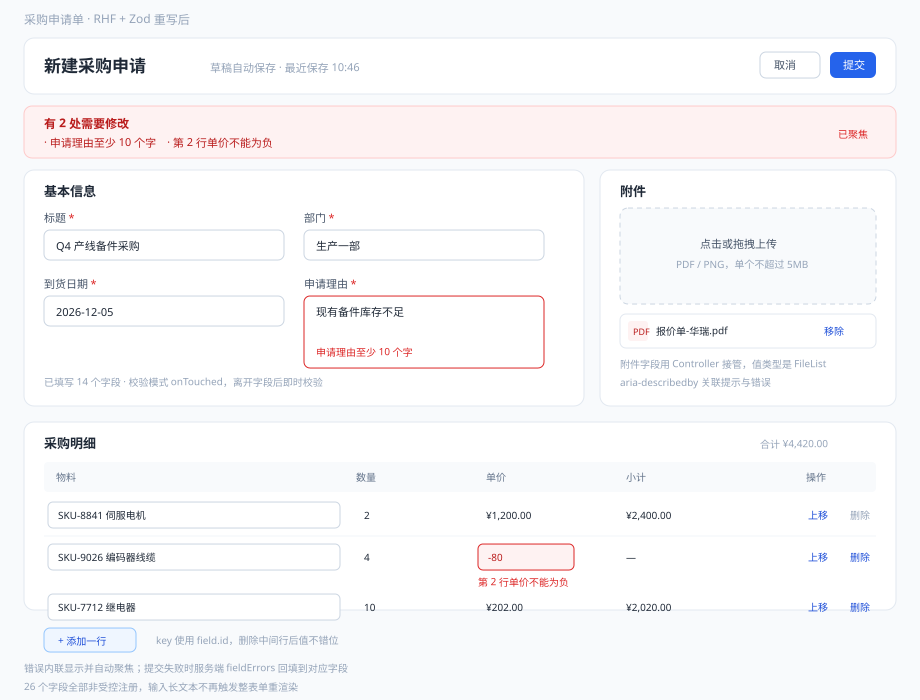

# 表单与校验

> 这篇从表单的两种状态模型讲起，经过 React Hook Form 的注册机制、Zod 4 的 schema 设计、动态字段、文件上传、错误聚焦与可访问性，最后落到前后端校验对齐和排障。
>
> 学完能独立写出一个字段多、可增删、能上传、出错会自动聚焦、读屏器能完整朗读的表单，并让前端校验与后端规则保持一致。

## 一、表单的两种状态模型

这一章决定表单的值存在哪里、由谁驱动，选错模型会让每个字段都变成一次全表单重渲染。

表单只有两种模型：受控（controlled）把值放在 React state 里，每次输入都 `setState`；非受控（uncontrolled）把值放在 DOM 里，提交时再读。React Hook Form（RHF）默认走非受控。

### 1.1 受控与非受控的差别

| 维度 | 受控 | 非受控 |
|---|---|---|
| 值的位置 | React state | DOM 节点 |
| 每次输入 | 触发重渲染 | 不触发 |
| 取值时机 | 实时可读 | 提交时读 |
| 适合字段数 | 少（< 10） | 多（几十上百） |
| 与第三方组件 | 天然适配 | 需要 `Controller` |

```tsx
// 受控：值在 state，输入即重渲染
function ControlledName() {
  const [name, setName] = useState('')
  return <input value={name} onChange={(e) => setName(e.target.value)} />
}
```

```tsx
// 非受控：值在 DOM，用 ref 读
function UncontrolledName() {
  const ref = useRef<HTMLInputElement>(null)
  return <input ref={ref} defaultValue="" />
}
```

判断标准：字段需要“输入时立刻联动别的 UI”（如实时预览、联动下拉）就用受控；只是收集后提交，用非受控。

### 1.2 表单状态的四类数据

一个表单除了值，还有四类状态，混淆它们会导致校验时机错乱。

| 状态 | 含义 | 常见误用 |
|---|---|---|
| `values` | 当前字段值 | 用 state 镜像一份 |
| `errors` | 校验错误 | 用 `alert` 弹窗代替内联 |
| `touched` | 是否被访问 | 未访问就报错 |
| `dirty` | 是否修改过 | 用 `dirty` 判断能否提交 |

“未访问就报错”是最常见的体验问题：用户刚打开表单，满屏红字。正确做法是 `mode: 'onBlur'` 或提交后才展示错误。

### 1.3 版本基线

| 包 | 版本 | 说明 |
|---|---|---|
| react-hook-form | 7.x | 非受控为主，`useForm` 为核心 |
| zod | 4.x | `z.email()` 等顶层 API |
| @hookform/resolvers | 5.x+ | 提供 `zodResolver`，5.x 起支持 Zod 4 |
| TypeScript | 5.9+ | 从 schema 推导表单类型 |

## 二、准备与最小闭环

这一章把 RHF 接进项目，跑通“输入 → 提交 → 拿到类型安全的数据”。

### 2.1 安装

```bash
npm install react-hook-form zod @hookform/resolvers
```

`@hookform/resolvers` 的版本要与 zod 主版本匹配：zod 4 从 resolvers 5.x 起支持，装成 3.x 会在运行时报 `Cannot read properties of undefined (reading 'safeParse')`。

### 2.2 最小可运行表单

```tsx
// src/forms/ProfileForm.tsx
import { useForm } from 'react-hook-form'
import { z } from 'zod'
import { zodResolver } from '@hookform/resolvers/zod'

const Schema = z.object({
  name: z.string().min(2, '姓名至少 2 个字'),
  email: z.email('邮箱格式不正确'),          // Zod 4 推荐 z.email()，字符串上的 .email() 已弃用
})

type FormValues = z.infer<typeof Schema>

export function ProfileForm() {
  const {
    register,
    handleSubmit,
    formState: { errors, isSubmitting, isDirty },
  } = useForm<FormValues>({
    resolver: zodResolver(Schema),
    mode: 'onBlur',            // 为什么用 onBlur：离开字段才校验，输入过程中不打断
    defaultValues: { name: '', email: '' },  // 为什么显式给：undefined 会让受控组件在首次渲染时告警
  })

  const onSubmit = async (values: FormValues) => {
    await new Promise((r) => setTimeout(r, 400))   // 替换为真实提交
    console.log(values)
  }

  return (
    <form onSubmit={handleSubmit(onSubmit)} noValidate>
      {/* noValidate 关闭浏览器原生气泡，统一用自己的错误展示 */}
      <label htmlFor="name">姓名</label>
      <input id="name" {...register('name')} aria-invalid={Boolean(errors.name)} />
      {errors.name && <p role="alert">{errors.name.message}</p>}

      <label htmlFor="email">邮箱</label>
      <input id="email" type="email" {...register('email')} aria-invalid={Boolean(errors.email)} />
      {errors.email && <p role="alert">{errors.email.message}</p>}

      <button type="submit" disabled={isSubmitting || !isDirty}>
        {isSubmitting ? '保存中…' : '保存'}
      </button>
    </form>
  )
}
```

`noValidate` 很关键：浏览器原生校验气泡无法定制样式、不会关联 `aria-describedby`，也无法与 Zod 规则保持一致。关掉它，校验权全部交给 RHF。

### 2.3 预期输出

提交 `{ name: 'A', email: 'bad' }` 时，控制台不会打印，两个字段下方出现错误；提交合法值时：

```text
{ name: '李四', email: 'li@example.com' }
```

`isDirty` 为 `false` 时按钮禁用，避免“什么都没改却触发了写操作”。

## 三、React Hook Form 的注册模型

这一章解释 `register` 做了什么，以及为什么它的性能比受控表单好。

### 3.1 `register` 返回什么

`register('name')` 返回 `{ name, onChange, onBlur, ref }`，RHF 通过 `ref` 直接读写 DOM，不把值放进 state。

```tsx
const { register } = useForm<FormValues>();

<input {...register('name', {
  // 为什么用 setValueAs：input 的值是字符串，空串转 undefined，其余转 number
  // 不要与 valueAsNumber 同用：后者优先，空串会变成 NaN，setValueAs 不生效
  setValueAs: (v) => (v === '' ? undefined : Number(v)),
})} type="number" />
```

`register` 的第二个参数是选项，也能写 `required`、`min` 这类校验规则；项目统一用 Zod 时不要两处都写，否则规则一定漂移。

### 3.2 `formState` 的订阅成本

`formState` 是一个 Proxy，只有读取到的字段才会订阅。解构整个 `formState` 会让组件在任何状态变化时都重渲染。

```tsx
// 差：整个 formState 解构，每次 isValid 变化都重渲染整棵树
const { formState } = useForm()
const { errors } = formState

// 好：用到哪个取哪个
const { formState: { errors, isSubmitting } } = useForm()
```

`isValid` 尤其贵：它需要跑完整 schema。只在需要时读，不要用它控制实时按钮状态，改用 `isSubmitting` 加提交后的错误反馈。

### 3.3 受控组件用 `Controller`

第三方组件（日期选择器、富文本、自定义 Select）没有 `ref` 转发，必须用 `Controller`。

```tsx
import { Controller } from 'react-hook-form'

<Controller
  control={control}
  name="startDate"
  render={({ field, fieldState }) => (
    <>
      {/* 必须透传 onChange，RHF 靠它更新值 */}
      <DatePicker
        value={field.value}
        onChange={field.onChange}
        onBlur={field.onBlur}
        aria-invalid={fieldState.invalid}
      />
      {fieldState.error && <p role="alert">{fieldState.error.message}</p>}
    </>
  )}
/>
```

`field` 里有 `value`、`onChange`、`onBlur`、`ref`、`name`。漏传 `onBlur` 会导致 `touched` 永远为 `false`，错误提示不出现。

### 3.4 默认值与重置

```tsx
const form = useForm<FormValues>({ defaultValues: order ?? { note: '' } })

// 编辑场景：数据异步到达后重置
useEffect(() => {
  if (order) form.reset(toFormValues(order))   // 为什么用 reset 而不是 setValue：reset 会同时清掉 dirty 和 errors
}, [order, form])
```

`defaultValues` 只生效一次。异步数据到达后再改 `defaultValues` 不会更新表单，必须 `reset`。

## 四、Zod 4 的 Schema 设计

这一章解决“规则写在哪里、错误消息怎么给、类型怎么推”，schema 是前后端唯一的事实来源。

### 4.1 基本规则与错误消息

Zod 4 把常用格式校验提到顶层，并统一用 `error` 参数定制消息。

```ts
// src/schemas/order.ts
import { z } from 'zod'

export const OrderFormSchema = z.object({
  customer: z.string().min(2, { error: '客户名称至少 2 个字' }).max(64),
  email: z.email({ error: '邮箱格式不正确' }),
  phone: z.string().regex(/^1[3-9]\d{9}$/, { error: '手机号格式不正确' }),
  quantity: z.number({ error: '数量必须是数字' }).int().min(1, { error: '至少 1 件' }),
  amount: z.number().positive({ error: '金额必须大于 0' }),
  note: z.string().max(200, { error: '备注不超过 200 字' }).optional(),
})

export type OrderFormValues = z.infer<typeof OrderFormSchema>
```

| 旧写法（Zod 3） | 新写法（Zod 4） |
|---|---|
| `z.string().email()` | `z.email()` |
| `z.string().url()` | `z.url()` |
| `z.string().uuid()` | `z.uuid()` |
| `{ message: '...' }` | `{ error: '...' }` |
| `error.format()` | `z.treeifyError(error)` |
| `error.flatten()` | `z.flattenError(error)` |

旧写法在 4 里大多仍能运行，但会走兼容层并打印弃用警告。新项目直接用新 API。

### 4.2 跨字段校验

“确认密码”“结束时间晚于开始时间”这类规则必须看两个字段，用 `.refine` 或 `.superRefine`。

```ts
const PasswordSchema = z
  .object({
    password: z.string().min(8, { error: '至少 8 位' }),
    confirm: z.string(),
  })
  .refine((v) => v.password === v.confirm, {
    error: '两次输入的密码不一致',
    path: ['confirm'],           // 为什么指定 path：错误挂在确认框上，而不是整个表单
  })
```

`.superRefine` 用于一次收集多个错误：

```ts
const PeriodSchema = z
  .object({ start: z.coerce.date(), end: z.coerce.date() })
  .superRefine((v, ctx) => {
    if (v.end <= v.start) {
      ctx.addIssue({ code: 'custom', message: '结束时间必须晚于开始时间', path: ['end'] })
    }
    if (v.end.getTime() - v.start.getTime() > 30 * 864e5) {
      ctx.addIssue({ code: 'custom', message: '周期不能超过 30 天', path: ['end'] })
    }
  })
```

`z.coerce.date()` 会把 `"2026-11-13"` 转成 `Date`，适合从 `input[type=date]` 读值。

### 4.3 条件字段与联合类型

```ts
// 发票类型决定必填字段：用 discriminatedUnion 让类型收窄
const InvoiceSchema = z.discriminatedUnion('type', [
  z.object({ type: z.literal('personal'), title: z.string().min(1) }),
  z.object({ type: z.literal('company'), title: z.string().min(1), taxNo: z.string().length(18) }),
])
```

用 `z.union` 时 Zod 会逐个尝试并给出所有分支的错误，可读性差；`discriminatedUnion` 按判别字段直接命中一个分支。

### 4.4 与 resolver 配合

```tsx
const form = useForm<OrderFormValues>({
  resolver: zodResolver(OrderFormSchema),
  mode: 'onTouched',   // 第一次 blur 后转为 onChange，错误能即时消失
})
```

`zodResolver` 的泛型要对齐：`useForm<z.infer<typeof Schema>>`。写成手写 interface 且与 schema 不一致时，resolver 赋值处会报类型错误，不会悄悄变成 `any`；不要用 `as any` 绕过。

## 五、动态字段

这一章解决“字段数量由用户决定”的表单，增删后不能丢值、不能错位。

### 5.1 `useFieldArray` 的基本用法

```tsx
import { useFieldArray, useForm } from 'react-hook-form'

type FormValues = {
  items: { sku: string; quantity: number; price: number }[]
}

const { control, register, handleSubmit } = useForm<FormValues>({
  defaultValues: { items: [{ sku: '', quantity: 1, price: 0 }] },
})

const { fields, append, remove, move } = useFieldArray({ control, name: 'items' })
```

```tsx
<>
  <ul>
    {fields.map((field, index) => (
      <li key={field.id}>{/* 必须用 field.id，不能用 index：删除中间行时 index 会错位 */}
        <input {...register(`items.${index}.sku` as const)} aria-label={`第 ${index + 1} 行 SKU`} />
        <input
          type="number"
          {...register(`items.${index}.quantity` as const, { valueAsNumber: true })}
          aria-label={`第 ${index + 1} 行数量`}
        />
        <button type="button" onClick={() => remove(index)} aria-label={`删除第 ${index + 1} 行`}>
          删除
        </button>
      </li>
    ))}
  </ul>
  <button type="button" onClick={() => append({ sku: '', quantity: 1, price: 0 })}>
    添加一行
  </button>
</>
```

`field.id` 由 RHF 生成且稳定，`index` 在删除后会变化。用 `index` 做 key 会导致 React 复用错误的 DOM，输入值串行。

### 5.2 嵌套数组与整体校验

```ts
const Schema = z.object({
  items: z
    .array(
      z.object({
        sku: z.string().min(1, { error: 'SKU 必填' }),
        quantity: z.number().int().min(1),
        price: z.number().nonnegative(),
      }),
    )
    .min(1, { error: '至少一行明细' })
    .max(50, { error: '最多 50 行' }),
})
```

数组元素错误在 `errors.items?.[0]?.sku`，渲染时要按 `index` 取。数组级别的错误（如“至少一行”）在 `errors.items?.root?.message` 或 `errors.items?.message`，取决于 Zod 返回结构，调试时先 `console.log(errors)` 确认路径。

### 5.3 排序与计算

```tsx
const total = useWatch({ control, name: 'items' }).reduce(
  (sum, it) => sum + (it.quantity || 0) * (it.price || 0),
  0,
)
```

`useWatch` 只订阅指定字段，比读整个 `formState` 便宜。合计值不要写回表单字段，它是由明细推导的，写回会造成两个数据源。

上移下移用 `move(from, to)`，不要手写 `splice` 改 `fields` 数组，那只是改了渲染列表，表单值没变。

## 六、文件上传

这一章解决“文件怎么进表单、怎么校验、怎么传大文件”，文件是所有表单控件里最特殊的一个。

### 6.1 文件字段的特殊性

`<input type="file">` 的值是只读的 `FileList`，不能 `setValue` 成字符串，也不能用 `defaultValue` 预填（浏览器禁止）。RHF 里通常配合 `Controller` 或独立 state。

```tsx
const Schema = z.object({
  // 为什么加 typeof：Node 22 没有全局 FileList，直接 instanceof 会在 SSR 校验时抛 ReferenceError
  attachments: z
    .custom<FileList>((v) => typeof FileList !== 'undefined' && v instanceof FileList && v.length > 0, { error: '请选择附件' })
    .refine((list) => list[0].size <= 5 * 1024 * 1024, { error: '单个文件不超过 5MB' })
    .refine((list) => ['application/pdf', 'image/png'].includes(list[0].type), {
      error: '只支持 PDF 或 PNG',
    }),
})
```

### 6.2 受控上传组件

```tsx
function AttachmentField({ control }: { control: Control<FormValues> }) {
  return (
    <Controller
      control={control}
      name="attachments"
      render={({ field, fieldState }) => (
        <div>
          <label htmlFor="attachments">附件</label>
          {/* 传 FileList，不是 e.target.value */}
          <input
            id="attachments"
            type="file"
            accept="application/pdf,image/png"
            aria-invalid={fieldState.invalid}
            aria-describedby={fieldState.error ? 'attachments-error' : 'attachments-hint'}
            onChange={(e) => field.onChange(e.target.files)}
          />
          <p id="attachments-hint">PDF 或 PNG，最大 5MB</p>
          {fieldState.error && (
            <p id="attachments-error" role="alert">{fieldState.error.message}</p>
          )}
        </div>
      )}
    />
  )
}
```

用户选错文件后想“取消选择”，`input.value = ''` 是唯一可靠的重置方式，`reset()` 对文件输入无效。

### 6.3 上传进度与大文件

`fetch` 没有上传进度事件，要进度只能用 `XMLHttpRequest`。真正的大文件应该直传对象存储，前端只拿预签名 URL。

```ts
// 小文件（< 10MB）：XHR 带进度
export function uploadWithProgress(file: File, onProgress: (pct: number) => void) {
  return new Promise<{ url: string }>((resolve, reject) => {
    const xhr = new XMLHttpRequest()
    xhr.open('POST', '/api/upload')
    xhr.upload.onprogress = (e) => {
      if (e.lengthComputable) onProgress(Math.round((e.loaded / e.total) * 100))
    }
    xhr.onload = () => (xhr.status < 300 ? resolve(JSON.parse(xhr.responseText)) : reject(new Error(`HTTP ${xhr.status}`)))
    xhr.onerror = () => reject(new Error('网络异常'))

    const body = new FormData()
    body.append('file', file)
    xhr.send(body)   // 不要手动设 Content-Type，浏览器会自动加 boundary
  })
}
```

```ts
// 大文件：先要预签名 URL，再直传，最后回传对象 key
export async function uploadLarge(file: File, onProgress: (pct: number) => void) {
  const { uploadUrl, objectKey } = await fetch('/api/uploads/presign', {
    method: 'POST',
    headers: { 'Content-Type': 'application/json' },
    body: JSON.stringify({ filename: file.name, size: file.size, type: file.type }),
  }).then((r) => r.json())

  await new Promise<void>((resolve, reject) => {
    const xhr = new XMLHttpRequest()
    xhr.open('PUT', uploadUrl)                 // 为什么用 PUT：预签名 URL 绑定方法与签名，改成 POST 会 403
    xhr.setRequestHeader('Content-Type', file.type)
    xhr.upload.onprogress = (e) => e.lengthComputable && onProgress(Math.round((e.loaded / e.total) * 100))
    xhr.onload = () => (xhr.status < 300 ? resolve() : reject(new Error(`S3 ${xhr.status}`)))
    xhr.onerror = () => reject(new Error('网络异常'))
    xhr.send(file)
  })

  return objectKey   // 表单只提交 key，不提交文件本身
}
```

| 文件大小 | 方案 | 原因 |
|---|---|---|
| < 5MB | 随表单 `multipart` 提交 | 简单，一次请求 |
| 5–100MB | 独立上传接口 + 进度 | 避免表单超时 |
| > 100MB / 断点续传 | 预签名 + 分片 | 绕过应用服务器带宽 |

## 七、提交、错误聚焦与可访问性

这一章解决“提交后用户知不知道发生了什么”，错误必须能被看到、被听到、被键盘到达。

### 7.1 提交流程

```tsx
const onInvalid = (errors: FieldErrors<FormValues>) => {
  // RHF 默认会聚焦第一个错误字段（shouldFocusError），但自定义组件不参与，需要手动兜底
  const first = Object.keys(errors)[0] as keyof FormValues | undefined
  if (first) setFocus(first)
}

<form onSubmit={handleSubmit(onSubmit, onInvalid)} noValidate>
  <button type="submit">提交</button>
</form>
```

`handleSubmit(onValid, onInvalid)` 的第二个参数在校验失败时调用。默认 `shouldFocusError: true` 已经能处理原生输入框，但 `Controller` 包裹的组件如果不转发 `ref`，就不会被聚焦。

### 7.2 错误提示的三处配合

```tsx
<>
  <label htmlFor="phone">手机号</label>
  {/* aria-invalid 告诉读屏器状态；aria-describedby 关联说明与错误 */}
  <input
    id="phone"
    type="tel"
    inputMode="tel"
    autoComplete="tel"
    {...register('phone')}
    aria-invalid={Boolean(errors.phone)}
    aria-describedby={errors.phone ? 'phone-error' : 'phone-hint'}
    aria-required
  />
  <p id="phone-hint">用于接收发货通知</p>
  {errors.phone && (
    <p id="phone-error" role="alert">{errors.phone.message}</p>
  )}
</>
```

三处配合缺一不可：`aria-invalid` 告诉状态，`aria-describedby` 把错误关联到控件，`role="alert"` 让错误出现时被朗读。只把文字变红，读屏器用户完全感知不到。

### 7.3 错误摘要

字段多、表单长时，错误可能在视口外。提交失败后滚动到第一个错误，并给一个摘要。

```tsx
function ErrorSummary({ errors }: { errors: FieldErrors<FormValues> }) {
  const list = flattenErrors(errors)
  if (list.length === 0) return null

  return (
    <div role="alert" tabIndex={-1} ref={summaryRef} className="rounded border border-red-200 bg-red-50 p-3">
      <p className="font-medium text-red-700">有 {list.length} 处需要修改</p>
      <ul className="mt-1 list-disc pl-5 text-sm text-red-700">
        {list.map(({ path, message }) => (
          <li key={path}>
            <a href={`#${path}`} onClick={(e) => { e.preventDefault(); setFocus(path as keyof FormValues) }}>
              {message}
            </a>
          </li>
        ))}
      </ul>
    </div>
  )
}
```

摘要容器加 `tabIndex={-1}` 才能在提交后被 `focus()` 聚焦，读屏器会从头朗读整段摘要。

### 7.4 分组与键盘

```tsx
<fieldset>
  <legend>收货信息</legend>
  {/* 单选组必须用 fieldset + legend，读屏器才会念“收货信息，单选组” */}
  <label><input type="radio" value="home" {...register('addressType')} /> 住宅</label>
  <label><input type="radio" value="office" {...register('addressType')} /> 公司</label>
</fieldset>
```

Tab 顺序应等于视觉顺序。用 CSS `order` 或绝对定位改变视觉位置会让键盘顺序错乱，`tabIndex` 大于 0 更不要用。

### 7.5 提交态与防重复

```tsx
<button type="submit" disabled={isSubmitting} aria-busy={isSubmitting}>
  {isSubmitting ? '提交中…' : '提交'}
</button>
```

`disabled` 能挡住重复点击，但也会让按钮失去焦点，提交失败后用户找不到焦点。更好的做法是保留可聚焦、用 `aria-disabled` 加逻辑拦截：

```tsx
<button
  type="submit"
  aria-disabled={isSubmitting}
  onClick={(e) => { if (isSubmitting) e.preventDefault() }}
>
  提交
</button>
```

## 八、服务端校验与错误回填

这一章解决“前端校验过了，后端仍然拒绝”的情况，重点是同一份规则和错误如何回到字段。

### 8.1 共用 Schema

把 schema 放在前后端都能引用的位置，后端用同一份做入参校验。

```text
packages/shared/src/schemas/order.ts   # 前端与 Node 服务共用
```

```ts
// 服务端（Fastify / Express 片段）
import { z } from 'zod'
import { OrderFormSchema } from '@acme/shared'

app.post('/api/orders', async (req, reply) => {
  const parsed = OrderFormSchema.safeParse(req.body)
  if (!parsed.success) {
    return reply.code(422).send({
      code: 'VALIDATION_FAILED',
      fields: z.flattenError(parsed.error).fieldErrors,  // 与前端同构的错误结构
    })
  }
  // ...
})
```

前端不能信任任何客户端校验，服务端必须再跑一遍。共用 schema 保证规则一致，不是省掉服务端校验的理由。

### 8.2 服务端错误回填字段

```ts
const onSubmit = async (values: FormValues) => {
  const res = await fetch('/api/orders', {
    method: 'POST',
    headers: { 'Content-Type': 'application/json' },
    body: JSON.stringify(values),
  })

  if (!res.ok) {
    const { fields } = (await res.json()) as { fields?: Record<string, string[]> }
    // 为什么遍历 fieldErrors：一次性把所有字段错误挂回去，用户不用改一个提交一次
    Object.entries(fields ?? {}).forEach(([name, messages]) => {
      if (messages?.[0]) {
        setError(name as keyof FormValues, { type: 'server', message: messages[0] })
      }
    })
    const first = Object.keys(fields ?? {})[0]
    if (first) setFocus(first as keyof FormValues)
    return
  }

  reset()
  toast.success('已提交')
}
```

`setError` 挂上的错误会参与 `formState.errors`，样式与前端校验完全一致。服务端返回的业务错误（如“库存不足”）也应挂到对应字段，而不是只弹一个全局 toast。

### 8.3 幂等与并发

```ts
import { useState } from 'react'

const [idempotencyKey] = useState(() => crypto.randomUUID())   // 为什么用惰性 state：重渲染不重新生成，同一次提交的所有重试共用
```

提交按钮在 `isSubmitting` 期间禁用只是前端约束，网络重试、用户开两个标签页仍会重复提交。真正的防重在后端用幂等键。

## 九、表单排障

这一章给现象到原因的直接映射，表单问题多数出在“值没进去”和“错误没出来”。

| 现象 | 最可能原因 | 第一条检查 |
|---|---|---|
| 输入框无法输入 | `value` 传了但没 `onChange` | 改用 `defaultValue` 或 `Controller` |
| 提交拿到 `undefined` | `register` 的 `name` 与 schema 字段不一致 | 对照 schema 键名 |
| 错误不显示 | 用了 `mode: 'onSubmit'` 且未提交 | 改 `onBlur`/`onTouched` |
| 数字字段报 NaN | 空字符串进了 `valueAsNumber` | 去掉 `valueAsNumber`，用 `setValueAs` 转 number/undefined |
| 动态行删完值错位 | key 用了 `index` | 改用 `field.id` |
| 文件字段校验不过 | 传了 `e.target.value` | 传 `e.target.files` |
| 服务端错误挂不上 | 字段名用了后端的下划线命名 | 做一层映射 |

```tsx
// 排查第一步：把实时值和错误打出来
const values = useWatch({ control })
useEffect(() => { console.log('values', values, 'errors', errors) }, [values, errors])
```

`useWatch` 不影响渲染，只在开发环境用。生产环境删掉，避免把用户输入打到控制台。

## 十、最佳实践案例

### 10.1 案例背景

某制造企业的采购申请单，字段 26 个，明细行可增删，需要上传 3 类附件（报价单、比价表、审批截图）。原实现是全受控表单：一个 `useState` 存整棵对象，每个字段 `onChange` 都 `setState`，输入 200 字的长文本描述时明显卡顿；校验用零散 `if`，错误用 `alert` 弹出；提交失败后用户不知道哪一行错了。

目标是重写为 RHF + Zod：大表单不卡、错误内联且可聚焦、明细行可增删排序、附件有类型和大小校验。约束是不能改后端接口，后端返回 `{ fields: { [name]: string[] } }`。

现状（示例）：

| 指标 | 现状 | 目标 |
|---|---|---|
| 长文本输入帧率 | 24fps | ≥55fps |
| 提交失败定位 | 弹窗提示 | 字段内联 + 聚焦 |
| 明细行删除 | 值错位 | 值跟随行 |
| 附件校验 | 仅后端 | 前端先拦 |

### 10.2 案例实操

第一步，定义一份前后端共用的 schema。

```ts
// packages/shared/src/schemas/purchase.ts
import { z } from 'zod'

export const PurchaseItemSchema = z.object({
  sku: z.string().min(1, { error: '请选择物料' }),
  quantity: z.number({ error: '数量必须是数字' }).int().min(1, { error: '至少 1 件' }),
  price: z.number().nonnegative({ error: '单价不能为负' }),
})

export const PurchaseFormSchema = z.object({
  title: z.string().min(4, { error: '标题至少 4 个字' }).max(80),
  department: z.string().min(1, { error: '请选择部门' }),
  neededBy: z.coerce.date({ error: '请选择到货日期' }),
  reason: z.string().min(10, { error: '申请理由至少 10 个字' }).max(500),
  items: z.array(PurchaseItemSchema).min(1, { error: '至少一行明细' }).max(50),
  attachments: z
    .custom<FileList>(
      (v) => typeof FileList !== 'undefined' && v instanceof FileList && v.length > 0,
      { error: '请上传报价单' },
    )
    .refine((l) => l[0]?.size <= 5 * 1024 * 1024, { error: '单个文件不超过 5MB' }),
}).refine((v) => v.neededBy.getTime() > Date.now(), {
  error: '到货日期必须晚于今天',
  path: ['neededBy'],
})

export type PurchaseFormValues = z.infer<typeof PurchaseFormSchema>
```

第二步，表单初始化与动态行。

```tsx
// src/forms/PurchaseForm.tsx
export function PurchaseForm() {
  const {
    control, register, handleSubmit, setFocus, setError, reset,
    formState: { errors, isSubmitting },
  } = useForm<PurchaseFormValues>({
    resolver: zodResolver(PurchaseFormSchema),
    mode: 'onTouched',
    defaultValues: {
      title: '', department: '', reason: '',
      neededBy: new Date(Date.now() + 86_400_000), // 为什么是明天：schema 要求晚于今天，默认今天会必然校验失败
      items: [{ sku: '', quantity: 1, price: 0 }],
      attachments: undefined as unknown as FileList,
    },
  })

  const { fields, append, remove, move } = useFieldArray({ control, name: 'items' })
  const items = useWatch({ control, name: 'items' })
  const total = items.reduce((s, it) => s + (it.quantity || 0) * (it.price || 0), 0)
  // ...
}
```

第三步，明细行用 `field.id` 做 key，并给出可读的 aria-label。

```tsx
{fields.map((field, index) => (
  <tr key={field.id}>
    <td>
      <input
        {...register(`items.${index}.sku` as const)}
        aria-label={`第 ${index + 1} 行物料`}
        aria-invalid={Boolean(errors.items?.[index]?.sku)}
      />
      {errors.items?.[index]?.sku && <p role="alert">{errors.items[index]?.sku?.message}</p>}
    </td>
    <td>
      <input
        type="number"
        {...register(`items.${index}.quantity` as const, { valueAsNumber: true })}
        aria-label={`第 ${index + 1} 行数量`}
      />
    </td>
    <td>
      <button type="button" onClick={() => move(index, index - 1)} disabled={index === 0}>
        上移
      </button>
      <button type="button" onClick={() => remove(index)} disabled={fields.length === 1}>
        删除
      </button>
    </td>
  </tr>
))}
```

第四步，提交失败时回填服务端字段错误并聚焦。

```tsx
const onSubmit = async (values: PurchaseFormValues) => {
  const body = new FormData()
  body.set('payload', JSON.stringify({ ...values, attachments: undefined }))
  body.set('quote', values.attachments[0])   // 校验通过后 attachments 一定存在

  const res = await fetch('/api/purchases', { method: 'POST', body })
  if (!res.ok) {
    const { fields } = await res.json() as { fields?: Record<string, string[]> }
    Object.entries(fields ?? {}).forEach(([name, msgs]) => {
      if (msgs?.[0]) setError(name as keyof PurchaseFormValues, { type: 'server', message: msgs[0] })
    })
    const first = Object.keys(fields ?? {})[0]
    if (first) setFocus(first as keyof PurchaseFormValues)   // 让用户直接落到出错字段
    return
  }
  reset()
}
```

第五步，附件区带类型、大小提示与错误关联。

```tsx
<Controller
  control={control}
  name="attachments"
  render={({ field, fieldState }) => (
    <div>
      <label htmlFor="attachments">报价单</label>
      <input
        id="attachments"
        type="file"
        accept="application/pdf,image/png"
        onChange={(e) => field.onChange(e.target.files)}
        aria-invalid={fieldState.invalid}
        aria-describedby="attachments-hint attachments-error"
      />
      <p id="attachments-hint">PDF 或 PNG，单文件不超过 5MB</p>
      {fieldState.error && <p id="attachments-error" role="alert">{fieldState.error.message}</p>}
    </div>
  )}
/>
```

重写后的表单：



### 10.3 案例结果

上线后一周的观测（示例，来自前端埋点与客服工单）：

| 指标 | 重写前 | 重写后 |
|---|---|---|
| 长文本输入帧率 | 24fps | 58fps |
| 平均填写耗时 | 6 分 40 秒 | 4 分 10 秒 |
| 提交失败后二次提交成功率 | 41% | 88% |
| 附件被打回的工单 | 每周 12 件 | 每周 2 件 |

失败模式：

- 第一版把 `attachments` 的默认值写成 `[]`，Zod 用 `instanceof FileList` 判断，永远不通过。默认值必须是 `undefined`，并在 `custom` 里先判空。
- 明细行删除后合计错位，原因是合计从 `fields` 算而不是从 `useWatch` 的值算。`fields` 只是渲染快照，不随输入更新。
- `mode: 'onTouched'` 下，`Controller` 组件忘了透传 `onBlur`，错误提示始终不出现。补上后有 3 个自定义组件都踩了同一个坑，后来封装了一个 `withField` 高阶组件统一处理。

复盘：表单的复杂度不在字段数量，而在“值、错误、焦点、可访问性”四件事要同时对齐。RHF 解决了值和重渲染，Zod 解决了规则单一来源，剩下的错误聚焦和 ARIA 关联必须手写，没法靠库自动完成。
