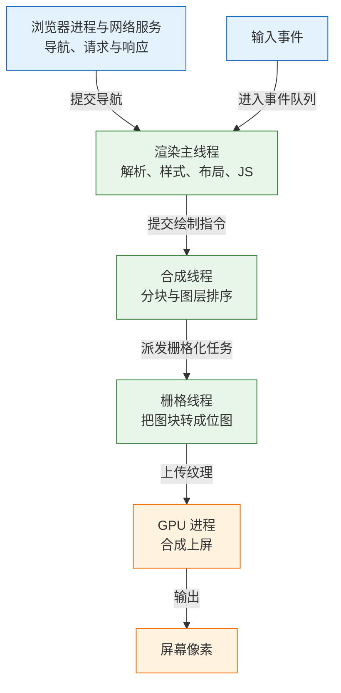
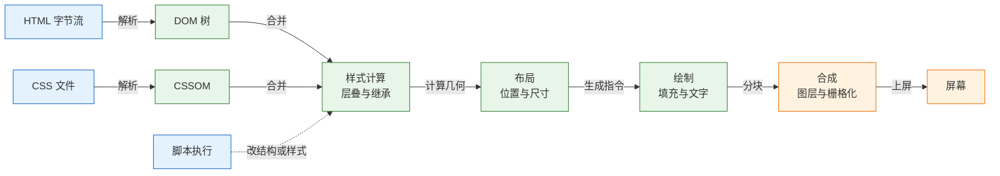
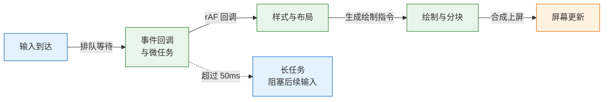
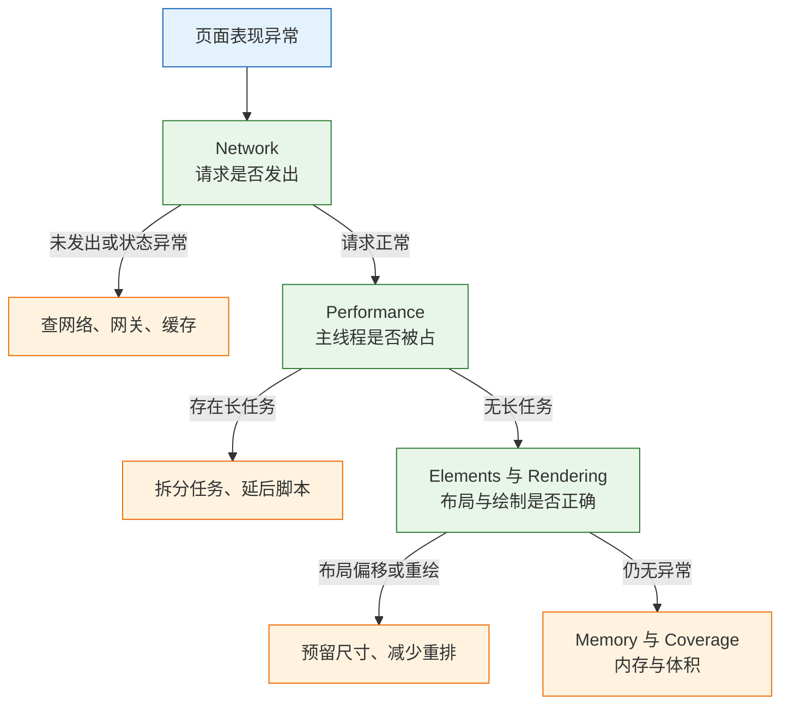

# 浏览器渲染与 DevTools

浏览器渲染是把 HTML、CSS、JavaScript 变成屏幕上可交互像素的过程，横跨网络、解析、样式、布局、绘制、合成六个阶段。任何一段变慢或出错，用户看到的结果都可能是白屏、错位或点击无响应。DevTools 的作用是把这条流水线拆成可观察的轨道，让人判断故障停在哪一段，而不是凭经验猜。
它不解决的问题也要先划清：DevTools 运行在本机，默认无冷缓存、无真实网络抖动、无用户设备差异，测到的是一次抽样，不是用户分布。它适合定位原因，不适合作为验收依据；验收要看现场采集的分位数。

---

## 一、浏览器渲染与 DevTools 是什么

### 1.1 核心概念

浏览器把一次页面访问拆给多个进程：网络进程负责请求，渲染进程负责解析与绘制，GPU 进程负责最终合成。渲染进程内部又分主线程与合成线程，前者执行 JavaScript、计算样式与布局，后者负责分块、栅格化和上屏。理解这条分工，才能理解为什么“JS 很慢”和“滚动很卡”有时不是同一回事。

| 概念 | 职责 | 观测位置 |
|---|---|---|
| 渲染进程 | 承载页面文档、DOM 与样式 | Performance 的 Main 与 Compositor 轨道 |
| 主线程 | 解析、样式、布局、绘制指令、执行 JS | Main 轨道与长任务标记 |
| 合成线程 | 图层分块、栅格化调度、合成上屏 | Compositor 轨道、Layers 面板 |
| 帧 | 一次完整的渲染输出 | Frames 轨道 |
| 长任务 | 占用主线程超过 50ms 的任务 | Main 轨道红色三角 |
| 关键渲染路径 | 从 HTML 到首次像素的必要步骤 | Timings 与 FCP 标记 |
| 图层 | 可独立合成的一块绘制内容 | Layers 面板 |

主线程是单线程的。一段脚本运行时，样式计算、布局、其他事件回调都得排队。60Hz 屏幕一帧约 16.7ms，120Hz 约 8.3ms，超过预算就会掉帧；超过 50ms 的任务被定义为长任务，它会推迟后续输入的处理，直接反映为交互延迟。



### 1.2 与相邻技术的关系

DevTools 不是性能工具的全部。它、Lighthouse、现场监控三者回答的问题不同，混用会得出错误结论。

| 工具 | 数据来源 | 擅长 | 局限 |
|---|---|---|---|
| DevTools | 本机单次会话 | 定位到阶段、任务、源码行 | 不代表真实用户 |
| Lighthouse | 固定设备与节流条件 | 横向对比、规则检查 | 分数随版本波动 |
| 现场监控 RUM | 真实用户上报 | 看分布、看版本回归 | 难以直接定位原因 |
| 框架开发者工具 | 组件树与状态 | 排查渲染与状态问题 | 看不到浏览器底层阶段 |

正确的组合是“现场发现问题，实验室定位原因，改完回到现场验证”。只跑 Lighthouse 容易自欺：本机芯片快、网络稳、缓存热，分数很好看，用户的中端手机完全不是这回事。

浏览器 DevTools 与 Node.js 调试器共用 Sources 面板的界面习惯，但运行时不同。浏览器里的 `window`、DOM、渲染流水线在 Node 中并不存在；反过来，Node 的模块解析与文件系统也不在浏览器里。排障时先确认代码跑在哪个运行时，再选工具。

### 1.3 渲染流水线与面板对应

一次渲染从字节流开始。HTML 被解析成 DOM，CSS 被解析成 CSSOM，两者合并后计算每个节点的最终样式，再由布局算出几何位置，绘制生成填充指令，最后分块、栅格化、合成上屏。脚本可以在任意阶段修改 DOM 或样式，把流水线拉回样式计算。



| 阶段 | 输入与输出 | 主要成本 | 对应面板 |
|---|---|---|---|
| 解析 | 字节流变成 DOM 与 CSSOM | 文档体积、脚本阻塞 | Network、Performance 的 Parse HTML |
| 样式 | 匹配选择器、计算层叠值 | 选择器复杂度、DOM 规模 | Performance 的 Recalculate Style |
| 布局 | 算出每个盒子的位置与尺寸 | 节点数量、读写交替 | Performance 的 Layout |
| 绘制 | 生成填充与文字指令 | 重绘面积、阴影与滤镜 | Rendering 的 Paint flashing |
| 合成 | 分块、栅格化、图层合并 | 图层数量、显存、大面积动画 | Layers、Compositor 轨道 |

流水线并不总是全部执行。改 `color` 通常只重绘，改 `transform` 可能只合成，改 `width` 则会重新布局。判断一次改动触发到哪一层，是渲染优化的基本动作。

---

## 二、导航与资源加载

### 2.1 导航流程与关键节点

在地址栏回车之后，浏览器先处理当前页面的卸载，并判断旧页面能否进入往返缓存，再判断 Service Worker 是否拦截新导航，然后处理重定向。域名需要解析，连接需要 TCP 与 TLS 握手，请求发出后等待首字节，接着才是流式解析 HTML。

| 阶段 | 发生的事 | 观测位置 |
|---|---|---|
| 重定向 | 3xx 让浏览器改请求地址 | Network 的多个文档请求 |
| Service Worker | 脚本决定走缓存还是网络 | Application 的 Service Workers |
| DNS | 域名解析成 IP | Network Timing 的 DNS Lookup |
| 连接与 TLS | TCP 握手、证书校验、密钥协商 | Connection Start 分组 |
| 等待首字节 | 服务端处理并返回第一个字节 | Waiting (TTFB) |
| 内容下载 | 接收 HTML 字节流 | Content Download |

命令行可以把网络段单独摘出来，避免把服务端慢误判成前端慢：

```bash
# ========== 分段计时 ==========
# -o /dev/null 丢弃响应体，只看各阶段耗时
curl -sS -o /dev/null \
  -w 'dns=%{time_namelookup} tcp=%{time_connect} tls=%{time_appconnect} ttfb=%{time_starttransfer} total=%{time_total}\n' \
  https://example.com/
```

判读规则很直接：`ttfb` 高且 `total` 也高，先查服务端、数据库、网关与 CDN 回源；`ttfb` 正常而 `total` 远大于它，问题在 HTML 之后的资源；`dns` 或 `tcp` 高，说明解析或链路成本大，可以考虑 `preconnect` 或更换接入点。

> **注意**：DevTools 的 Waiting (TTFB) 与服务端日志里的“处理耗时”口径不同。前者包含请求到达服务端前的网络时间与服务端排队，后者通常只统计应用内部处理，两者对不上是正常的。

### 2.2 缓存判定与请求来源

Network 面板里同一张图可能显示 `(memory cache)`、`(disk cache)`、`304` 或 `200`，它们代表不同的缓存路径，不能都当成“没有缓存”。

| 显示 | 含义 | 是否产生网络请求 |
|---|---|---|
| `(memory cache)` | 从渲染进程内存取到副本 | 否 |
| `(disk cache)` | 从磁盘缓存取到副本 | 否 |
| `304 Not Modified` | 协商缓存命中，服务端确认未变 | 是，至少一个往返 |
| `200 (from service worker)` | Service Worker 返回响应 | 否，或由脚本决定 |
| `200` | 完整响应 | 是 |

强缓存由 `Cache-Control` 的 `max-age` 与 `immutable` 决定，在有效期内浏览器不再询问服务端。协商缓存由 `ETag` 或 `Last-Modified` 配合 `If-None-Match`、`If-Modified-Since` 完成，命中时返回 304，仍然付出一次往返。往返缓存则把整个页面冻结在内存里，后退时连脚本状态都保留，Network 面板可能完全没有新请求。

> **注意**：Network 面板的 `Disable cache` 只在面板打开期间生效，关掉面板或换窗口就恢复默认。硬刷新会跳过强缓存，但仍可能发起协商请求，看到 304 不等于缓存被禁用。

> **安全警告**：带用户身份、`Set-Cookie` 或个性化内容的响应不要配置 `public` 长缓存，也不要在 CDN 上按 URL 缓存。缓存键缺少用户维度时，一个用户的页面会被发给另一个用户。

### 2.3 资源提示与阻塞关系

资源提示改变的是“何时发现、何时连接”，不改变资源本身的优先级语义。用错会抢带宽，比不加更慢。

| 提示 | 作用 | 适用对象 |
|---|---|---|
| `preconnect` | 提前完成 DNS、TCP、TLS | 确定要连的第三方域 |
| `dns-prefetch` | 只提前解析域名 | 旧浏览器兜底 |
| `preload` | 当前页面高优先级提前下载 | 首屏字体、LCP 图片 |
| `prefetch` | 空闲时低优先级下载 | 下一次导航可能用到的资源 |
| `modulepreload` | 提前获取并解析模块图 | 首屏入口模块 |

脚本的加载方式决定了它是否阻塞解析：

| 写法 | 下载 | 执行时机 | 顺序保证 |
|---|---|---|---|
| `<script>` | 阻塞解析 | 下载完立即执行 | 是 |
| `<script defer>` | 并行下载 | 解析完成后执行 | 是 |
| `<script async>` | 并行下载 | 下载完立即执行 | 否 |
| `<script type="module">` | 并行下载 | 默认相当于 defer | 是 |

CSS 同时阻塞渲染与脚本执行。浏览器必须等 CSSOM 就绪才执行脚本，因为脚本可能读取样式；也必须等 CSSOM 才能确定首帧样式。一个慢 CSS 会同时拖住首屏和 JS，这是“只优化 JS 却不见效”的常见原因。

> **注意**：`preload` 的 `as`、`type`、`crossorigin` 必须与实际请求一致，否则浏览器会重复下载。字体即使同源也要带 `crossorigin`，因为字体请求按 CORS 模式发起。

> **注意**：`async` 不保证顺序，有依赖关系的脚本会随机报错。统计、客服这类无依赖的第三方脚本适合 `async`；业务入口与它的 polyfill 必须用 `defer` 或模块依赖。

---

## 三、渲染流水线各阶段

### 3.1 DOM、CSSOM 与样式计算

HTML 解析器一边接收字节一边构建 DOM，遇到同步脚本就暂停，遇到样式表会等 CSSOM。解析过程中，预加载扫描器会提前发现后面的图片、样式和脚本并启动下载，所以关键资源放在文档前部仍然有意义，但不能拿它替代显式 `preload`。

样式计算为每个元素匹配选择器，处理层叠、继承与单位换算，产出每个节点的最终计算值。选择器从右向左匹配，`div.list li a` 会先找所有 `a` 再向上验证，过度嵌套的选择器在大型 DOM 上成本可观。现代浏览器的样式计算已经很快，真正的成本通常来自 DOM 规模与频繁的结构变更。

| 操作 | 影响 | 更省的做法 |
|---|---|---|
| `innerHTML` 重建子树 | 丢弃原有节点与事件，重新解析 | 局部更新或模板克隆 |
| 频繁插入大量节点 | 多次样式与布局 | `DocumentFragment` 批量插入 |
| 深层嵌套选择器 | 匹配成本上升 | 扁平类名与 BEM |
| 频繁读取计算样式 | 可能强制样式刷新 | 批量读取后再写 |

> **注意**：用 `innerHTML` 拼接用户输入既带来 XSS 风险，也会让浏览器重新解析整段 HTML。文本内容用 `textContent`，结构更新用 DOM API 或框架的 diff。

### 3.2 布局、绘制与合成

布局根据盒模型、书写模式、浮动与定位算出每个盒子的几何信息。布局是全局或局部的：改变一个元素的宽高可能影响兄弟与祖先，浏览器需要重新计算受影响的子树。绘制把布局结果转成填充、文字、阴影等指令，再按图层分块。合成线程把图块栅格化后交给 GPU 合并上屏。

| 改动属性 | 触发的阶段 | 代价 |
|---|---|---|
| `width`、`height`、`top`、`margin` | 布局 → 绘制 → 合成 | 最高 |
| `color`、`background`、`box-shadow` | 绘制 → 合成 | 中 |
| `transform`、`opacity` | 合成 | 低，但依赖图层条件 |
| `filter`、`backdrop-filter` | 绘制或合成 | 高，取决于实现与面积 |

“用 `transform` 就不卡”是半句话。只有当元素已经被提升为独立图层，且这次改动没有连带触发其他属性时，动画才可能完全交给合成线程。给元素加 `will-change: transform` 可以提示浏览器提前分层，但滥用会让每个元素各占一块显存，反而拖慢合成与内存。

> **注意**：`will-change` 是提示不是命令，浏览器可以忽略。用完应移除，长期挂在大量元素上会持续占用图层内存，低端设备上可能触发页面崩溃或频繁回收。

### 3.3 帧时序与长任务

点击之后并不是立刻执行代码。事件先进入队列，等当前任务与微任务跑完；处理函数执行完，浏览器才有机会做样式、布局、绘制，最后上屏。交互延迟因此拆成三段：输入延迟、处理时间、呈现延迟。



| 分段 | 含义 | 观测手段 | 优化手段 |
|---|---|---|---|
| 输入延迟 | 事件在队列里等待 | Event Timing 的 processingStart 减 startTime | 拆分长任务、让出主线程 |
| 处理时间 | 回调本身执行多久 | 回调前后打点、Performance 火焰图 | 减少计算、缓存结果、移入 Worker |
| 呈现延迟 | 处理完到下一帧上屏 | 帧时间轴与绘制耗时 | 降低布局与绘制成本 |

一个常用手法是先让“加载中”上屏，再干重活：

```js
button.addEventListener('click', async () => {
  setLoading(true);
  // 等待下一帧，让加载态先绘制出来
  await new Promise(requestAnimationFrame);
  const data = await fetch('/api/report').then((r) => r.json());
  render(data);
});
```

滚动与触摸监听加 `{ passive: true }`，告诉浏览器不会调用 `preventDefault()`，它才能不等监听器就继续滚动。反过来，在 `touchstart` 里同步做重活，滚动一定会顿。

> **注意**：`requestAnimationFrame` 只保证回调在下一帧渲染前执行，不保证这一帧已经上屏。要让加载态真正可见，通常需要等两次 `requestAnimationFrame`。

### 3.4 强制同步布局与布局抖动

浏览器本来可以批量处理样式与布局，但某些读取 API 要求“现在立刻给出几何结果”。如果此时样式是脏的，浏览器只能立刻完成布局，这就是强制同步布局，也叫布局抖动。

```js
// 反例：读一次、写一次，循环里反复触发布局
for (const el of items) {
  el.style.width = `${el.offsetWidth + 10}px`;
}
```

```js
// 正例：先把要读的值全部读完，再统一写
const widths = items.map((el) => el.offsetWidth);
items.forEach((el, i) => {
  el.style.width = `${widths[i] + 10}px`;
});
```

| 触发读取的 API | 常见场景 | 处理 |
|---|---|---|
| `offsetWidth`、`offsetHeight` | 循环计算尺寸 | 先批量读取 |
| `getBoundingClientRect()` | 滚动监听里判断位置 | 用 `IntersectionObserver` |
| `scrollTop`、`scrollHeight` | 滚动进度计算 | 缓存值或节流 |
| `getComputedStyle()` | 读取最终样式 | 合并读取，避免夹在写操作中 |

> **注意**：把读操作放进 `requestAnimationFrame` 并不自动消除强制布局。只要在同一帧里先改了样式再读几何，浏览器仍然要立刻计算。

---

## 四、渲染性能指标

### 4.1 指标口径

指标是排障的共同语言。没有统一口径，开发说“很快”、用户说“很慢”，双方都无法验证。

| 指标 | 口径 | 良好阈值 | 观测位置 |
|---|---|---|---|
| LCP | 视口内最大内容元素的渲染时间 | ≤ 2.5s | Performance 的 Timings、RUM |
| INP | 交互到下一次绘制的延迟 | ≤ 200ms | Event Timing、RUM |
| CLS | 意外布局偏移的累计分数 | ≤ 0.1 | Performance 的 Layout Shift |
| FCP | 首次绘制任何文本或图像的时间 | ≤ 1.8s | Performance 的 Timings |
| TTFB | 请求发出到首字节到达 | ≤ 800ms | Network 的 Waiting |
| TBT | 长任务超出 50ms 的部分之和 | 按项目预算 | Lighthouse、Performance |

LCP 回答“主要内容什么时候可见”，它和 `load` 不是一回事：图片、字体、接口都可能让 LCP 晚于 `load`。INP 量的是从输入到下一次绘制，包含输入延迟、处理时间与呈现延迟，取代了只量输入延迟的 FID。CLS 只统计非用户预期造成的偏移，用户主动展开内容引起的变化不计入。

### 4.2 指标与流水线的对应

同一个指标变差，可能来自完全不同的阶段。把指标映射回流水线，才能选对工具。

| 指标 | 主要阶段 | 常见原因 | 常见误判 |
|---|---|---|---|
| LCP 晚 | 网络、资源、渲染 | 大图、字体阻塞、JS 插入 | 以为 `load` 晚就是 LCP 晚 |
| INP 差 | 主线程 | 长任务、大 DOM、频繁重渲染 | 只看处理函数，忽略输入排队 |
| CLS 差 | 布局 | 图片无尺寸、广告插入、字体切换 | 把用户点击引起的偏移算进去 |
| FCP 晚 | 解析与首屏资源 | 阻塞 CSS、同步脚本、TTFB 高 | 只压缩 JS，不动 CSS |
| TTFB 高 | 服务端与网络 | 后端慢、CDN 未命中、重定向 | 先改前端 |

> **注意**：LCP 的候选包括 ``、`<image>`、视频封面、带 `url()` 背景图的元素和块级文本。背景图虽然可能成为候选，但发现晚、无法用 `srcset` 适配、也无法被预加载扫描器优先处理，首屏主图仍应使用 ``。

### 4.3 指标之间的关系与取舍

指标之间会互相拉扯。把首屏图片全部懒加载，初始 JS 变小，LCP 却可能更晚；给字体加 `swap`，文字更早可见，字体切换又可能带来 CLS；把代码拆得过碎，首包变小，请求数与调度开销上升，INP 反而变差。

| 手段 | 改善 | 可能伤害 |
|---|---|---|
| 图片懒加载 | 初始下载量 | 首屏 LCP |
| 字体 `swap` | FCP、文字可见性 | CLS |
| 路由级拆包 | 首包体积、LCP | 请求数、INP |
| 虚拟列表 | DOM 规模、INP | 查找与打印 |
| 预加载关键资源 | LCP | 带宽竞争 |

判断取舍的依据是当前最大的一段耗时，而不是手段本身“先进”。优化前先记录基线，改完用同一条件复测，确认改善的指标没有被另一项抵消。

---

## 五、DevTools 面板与采集方法

### 5.1 面板职责划分

| 面板 | 主要看什么 | 对应阶段 |
|---|---|---|
| Elements | DOM、计算样式、盒模型、事件监听 | 样式与布局结果 |
| Console | 运行时错误、警告、手动执行 | JS 执行 |
| Sources | 源码、断点、XHR/Fetch 断点 | JS 执行 |
| Network | 瀑布、状态码、优先级、TTFB、体积 | 导航与资源下载 |
| Performance | 帧、长任务、调用树、LCP 与偏移标记 | 主线程与渲染 |
| Lighthouse | 综合评分与建议 | 汇总，不用于精确定位 |
| Application | Cookie、存储、Cache Storage、Service Worker | 缓存与存储 |
| Rendering | 重绘闪烁、偏移区域、帧率 | 绘制、布局、合成 |
| Memory | 堆快照、分配时间线 | 内存泄漏 |
| Coverage | 未使用的 JS/CSS 字节 | 资源体积 |

使用顺序通常是：Network 判断“有没有拿到”，Performance 判断“拿到后卡在哪”，Elements 与 Rendering 判断“画得对不对”，Memory 判断“是不是越用越慢”。

### 5.2 Network 面板操作步骤

以下步骤可以直接照做，适用于 Chromium 内核浏览器，面板名称以当前稳定版为准。

1. 打开无痕窗口，按 `F12` 或 `Cmd+Option+I` 打开 DevTools，切到 Network。
2. 勾选 `Disable cache`，`Preserve log` 保持关闭，避免跨导航日志混在一起。
3. 在 Throttling 里选一个受限档位，常用 `Fast 4G`；只测本机服务端时可先不节流。
4. 在过滤框输入 `larger-than:100k`，先看体积最大的资源；再清空，按 `Status` 或 `Time` 排序。
5. 点录制圆点变红，刷新页面，等首屏稳定后停止。
6. 选中文档请求，看 Timing 分组的 Queueing、Connection Start、Waiting、Content Download。
7. 切到 Initiator 列，确认资源由谁发起：解析器、脚本、CSS 还是预加载。
8. 右键请求可复制为 cURL，便于在终端复现同一请求。
9. 右键任意请求选择 `Save all as HAR with content`，把整次会话留存，便于离线对比或附到排障记录。

判读标准：

| 现象 | 判断 | 下一步 |
|---|---|---|
| 文档请求 TTFB 高 | 服务端或链路慢 | 查服务端日志、CDN 回源 |
| 多个资源 Stalled 很长 | 连接数不足或优先级低 | 减少同域并发、调优先级 |
| 首屏图片很晚被发现 | 由 JS 插入或 CSS 背景 | 改为 HTML 直出 |
| 关键 CSS 体积大且阻塞 | 关键渲染路径过长 | 拆分关键 CSS、内联首屏样式 |
| 字体请求重复 | `preload` 参数不匹配 | 核对 `crossorigin` 与 `as` |

> **注意**：Network 面板默认按开始时间排列，但瀑布的横条长度包含排队与连接。看到“总时长很长”先看分段，不要直接归因于下载速度。

### 5.3 Performance 面板操作步骤

1. 使用无痕窗口，关闭无关扩展与后台标签页。
2. 打开 Performance，点齿轮，把 CPU 设为 `4x slowdown`；低端机可试 `6x`。
3. 确认 `Disable cache` 已勾选，Network 节流与目标用户网络接近。
4. 点 Record，立即刷新页面，等首屏稳定、没有明显动画后再 Stop。
5. 先看 Frames 轨道找超过 50ms 的帧，再在 Main 轨道找红色三角标记的长任务。
6. 展开 Main 轨道，找最长的任务块，点开看它的子任务：Scripting、Style、Layout、Paint。
7. 切到 Bottom-Up，按 Self Time 排序，找自身耗时最高的函数；再切 Call Tree 看调用链。
8. 看 Timings 轨道上的 FCP、LCP、DCL、Load 标记，确认 LCP 元素是什么。
9. 看 Layout Shift 标记，点开定位发生偏移的元素与时刻。
10. 用 Event Log 按时间顺序核对输入、脚本、渲染的先后关系。
11. 点下载按钮保存 trace，改动前后各留一份，用同一视口与节流条件对比。

判读标准：

| 证据 | 含义 | 处理方向 |
|---|---|---|
| 长任务集中在 Scripting | JS 执行占满主线程 | 拆分、延后、移入 Worker |
| Layout 占比高且次数多 | 频繁布局或强制同步布局 | 读写分离、减少几何变更 |
| Paint 面积大、次数多 | 大面积重绘或阴影滤镜 | 缩小重绘区域、改用合成属性 |
| 关键图片早已下载完，LCP 标记仍很晚 | 主线程或渲染被占用 | 查长任务、渲染阻塞 |
| 帧轨道出现长空隙 | 合成或栅格化等待 | 检查图层、显存与大面积动画 |

> **注意**：Performance 录制本身有开销，录制时间越长、轨道越多，结果越容易失真。一次录制覆盖“刷新到首屏稳定”即可，不要把整段操作录成几分钟。

### 5.4 记录有效性与判读标准

| 条件 | 有效记录 | 无效信号 |
|---|---|---|
| 构建 | 生产构建、压缩后的产物 | 开发构建、带 HMR 的页面 |
| 缓存 | 冷缓存或明确的热缓存 | 缓存状态不明 |
| 设备 | 固定视口、固定 CPU 节流 | 中途改窗口大小 |
| 次数 | 至少三次取中位数 | 单次结果直接下结论 |
| 环境 | 无痕、无扩展、无后台任务 | 多个标签页同时跑动画 |

同一条件下三次结果的离散度也值得看。若 LCP 在 1.8s 到 3.2s 之间大幅波动，说明存在不稳定的资源或第三方脚本，先找波动源，再谈平均值。

### 5.5 辅助面板操作步骤

Performance 与 Network 给出“慢在哪一段”，Rendering、Layers、Coverage 则回答“这一段具体错在哪”。三者配合，能减少反复猜测。

1. 打开 Rendering 面板，勾选 `Paint flashing`，刷新页面，观察绿色闪烁区域。整屏频繁闪烁说明重绘面积过大，局部闪烁才是正常更新。
2. 勾选 `Layout Shift Regions`，进行一次真实交互，蓝色区域即发生偏移的元素；对照 Performance 的 Layout Shift 标记确认时刻。
3. 勾选 `Frame Rendering Stats`，滚动页面，观察帧率与 GPU 内存。帧率下降但主线程空闲时，问题通常在合成或栅格化。
4. 打开 Layers 面板，查看图层数量与提升原因。图层过多、单层面积过大，都会增加显存与合成成本。
5. 打开 Coverage 面板，点录制并刷新，看未被使用的 JS/CSS 字节占比。占比高说明首屏加载了当前路由用不到的内容。
6. 在 Elements 面板右键目标节点，选择 `Break on` 的子树修改或属性变化，复现交互后看调用栈，定位是谁在改 DOM。
7. 打开 Memory 面板，分别在操作前后拍堆快照并对比，确认对象数量是否持续增长；只有持续增长且无法回收，才构成泄漏证据。

| 现象 | 含义 | 处理 |
|---|---|---|
| 整屏持续绿色闪烁 | 大面积重绘 | 缩小更新范围、拆分图层 |
| 滚动时蓝色区域反复出现 | 滚动触发内容插入或尺寸变化 | 预留空间、避免上方插入 |
| 图层数量异常多 | 过度提升或 `will-change` 滥用 | 移除不必要的提示 |
| Coverage 未使用率高 | 首屏带了非当前路由代码 | 路由拆包、按需加载 |
| 断点停在框架内部 | 状态更新触发整树渲染 | 缩小状态粒度、局部订阅 |

> **注意**：Paint flashing 只能说明“发生了重绘”，不能说明重绘是否昂贵。判断成本仍要回到 Performance 的 Paint 耗时与绘制面积。

---

## 六、完整优化案例

以下数字是示例，用来说明归因顺序与验证方法，不代表任何具体项目。

### 6.1 现象与基线

一个内容列表页在移动网络下首屏约 4 秒，图片加载完成后内容还会向下跳一次。先建基线，避免凭感觉改。

| 指标 | 基线 | 目标 | 来源 |
|---|---|---|---|
| LCP | 4.1s | ≤ 2.5s | Lighthouse 移动端三次中位数 |
| FCP | 2.3s | ≤ 1.8s | 同上 |
| CLS | 0.18 | ≤ 0.1 | 同上 |
| INP | 180ms | ≤ 200ms | 现场 p75 |
| 首屏图片体积 | 1.2MB | ≤ 200KB | Network |

现场 LCP p75 为 3.9s，与实验室 4.1s 接近，说明本地可以复现，不需要先怀疑“用户设备太差”。

### 6.2 归因过程

第一步用 `curl` 排除服务端：`ttfb` 约 0.6s，`total` 约 0.7s，服务端不慢，但也不算快。第二步在 Network 里按体积排序，发现首屏主图 1.2MB，且在脚本请求接口之后才插入 DOM；字体文件 280KB，阻塞了标题文字。第三步在 Performance 里看主线程，发现一个约 620ms 的任务，来自图表库初始化。

| 阶段 | 耗时 | 占比 | 证据 |
|---|---|---|---|
| TTFB | 0.6s | 15% | Network 的 Waiting |
| HTML 到 FCP | 1.7s | 41% | 阻塞 CSS 与字体 |
| FCP 到 LCP | 1.8s | 44% | 大图由 JS 插入 |
| 主线程长任务 | 0.62s | 与 LCP 重叠 | Main 轨道的 Scripting |

结论是三个独立问题叠加：图片发现太晚且过大、字体阻塞文字、图表库在首屏同步初始化。它们分别对应网络、关键渲染路径与主线程，不能用同一个手段解决。

归因还要做排他：如果主线程长任务发生在 LCP 之后，它解释不了 LCP 晚；如果图片在 LCP 之前已经下载完成，问题就不在图片体积。把时间轴上的先后关系对齐，才能避免把并发现象当成因果。

### 6.3 改造实施

图片改为 HTML 直出，给出响应式候选与尺寸，首屏图提高优先级：

```html
<!-- 首屏图：给尺寸、给优先级、不要懒加载 -->

```

字体做子集化并预加载，保留 `swap` 保证文字先可见：

```html
<link rel="preload" href="/fonts/sans-subset.woff2" as="font"
      type="font/woff2" crossorigin>
```

```css
@font-face {
  font-family: "Sans";
  src: url("/fonts/sans-subset.woff2") format("woff2");
  font-display: swap;
  size-adjust: 98%;
}
```

图表库改为动态导入，等首屏稳定后再初始化；统计脚本加 `defer`，避免与业务入口争抢主线程：

```js
// 首屏之后加载非关键模块
const { initChart } = await import('./chart.js');
initChart(document.querySelector('#chart'));
```

| 改动 | 针对指标 | 预期效果 | 风险 |
|---|---|---|---|
| 图片直出 + `srcset` + AVIF | LCP | 减少发现延迟与体积 | 编码成本、兼容性回退 |
| 字体子集化 + 预加载 | FCP、LCP | 文字更早可见 | 子集缺字 |
| 图表库动态导入 | INP、TBT | 首屏主线程更空 | 图表出现更晚 |
| 统计脚本 `defer` | INP | 减少首屏竞争 | 统计数据略延迟 |

实施顺序按影响面从大到小：先改图片的发现时机与体积，再处理字体，最后拆 JS。每一步单独发布或至少单独测量，避免相互掩盖。图片通常最快见效，也最容易验证；JS 拆包影响面最广，放在最后。

| 验证项 | 操作 | 通过标准 |
|---|---|---|
| 图片 | Network 过滤文件名，看 Initiator 与 Priority | 由解析器发起、优先级高、尺寸匹配 |
| 字体 | Network 看字体请求，Rendering 看文字 | 与 CSS 同期发起，先显示后备字体 |
| 图表 | Main 轨道看 LCP 之前的任务 | LCP 前没有图表初始化长任务 |
| CLS | Performance 看 Layout Shift 标记 | 首屏图片不再引起偏移 |

> **安全警告**：第三方统计、客服、A/B 测试脚本拥有与页面相同的权限，可以读取 DOM、Cookie 与用户输入。延后加载只能减少性能影响，不能降低信任风险；应限制来源、使用 CSP、定期审计，敏感页面避免接入不受控脚本。

### 6.4 复测与结论

仍用移动端节流、禁用缓存、生产构建，跑三次取中位数。示例结果如下：

| 指标 | 改造前 | 改造后 | 判断 |
|---|---|---|---|
| LCP | 4.1s | 2.2s | 达到目标 |
| FCP | 2.3s | 1.6s | 达到目标 |
| CLS | 0.18 | 0.06 | 达到目标 |
| INP | 180ms | 240ms | 出现回退 |

INP 的回退来自拆包过碎：首屏多出若干小请求，主线程在模块解析与调度上更碎。处理方式是把首屏必需的依赖合并为一个 chunk，只把图表与折叠线以下的内容继续动态导入。再次复测，INP 回到约 190ms。

复测的价值不只是确认变快，更是发现“改 A 伤 B”。一次只改一处、每处都复测，才能把改善归因到具体动作；同时改图片、字体、拆包，即使总时间下降，也无法判断哪一项有效、哪一项只是碰巧。

回归判定同时看三组数：实验室三次中位数、现场同版本 p75、以及关键交互路径的 INP。任意一组明显变差都先回退该次改动，再重新归因；不要用总分掩盖单项退化。

### 6.5 改动记录与回滚

每次上线记录四项：改了什么、针对哪个指标、预期幅度、如何回滚。记录不是流程负担，而是下一次排障的起点。

| 记录项 | 示例 | 用途 |
|---|---|---|
| 改动内容 | 首屏图改 AVIF 并直出 | 定位是哪一次发布引入变化 |
| 针对指标 | LCP 从 4.1s 降至 2.5s 以内 | 判断是否达成目的 |
| 观测证据 | Network 与 Performance 截图 | 复盘时不必重新猜测 |
| 回滚方式 | 关闭图片直出开关或回退版本 | 指标恶化时快速恢复 |

回滚按改动粒度执行，不要整包回退所有优化。图片与字体通常可以独立回退，JS 拆包涉及构建产物，回退前要确认旧 chunk 仍可访问。回滚方案应在发布前演练一次：确认旧版本入口可访问、缓存能刷新、开关能关闭；只在事故时第一次执行，容易在紧张中漏掉步骤。

---

## 七、常见故障与排查

### 7.1 故障对照表

| 现象 | 最可能原因 | 证据 | 处理 |
|---|---|---|---|
| HTML 返回 200 但页面白屏 | JS 运行时报错、挂载节点不存在、路由 base 配错 | Console 第一条错误、Elements 中空容器 | 修错误、核对挂载点与 base |
| 首屏慢且 TTFB 高 | 服务端渲染慢、网关排队、数据库慢 | Network 的 Waiting 很长 | 查服务端与上游耗时 |
| 首屏慢但 TTFB 正常 | 阻塞 CSS/JS、字体、大图 | FCP 前有长条资源 | 拆分关键路径、预加载、压缩 |
| 点击后很久才响应 | 主线程长任务 | Main 轨道超过 50ms 的任务 | 拆分任务、延后脚本 |
| 内容突然向下跳 | 图片或广告无尺寸、字体切换 | Layout Shift 标记 | 预留宽高、字体度量匹配 |
| 改 CSS 不生效 | 缓存、优先级、层叠层、Shadow DOM | Computed 面板显示来源与覆盖 | 禁用缓存、核对来源 |
| 滚动掉帧 | 滚动监听里同步读写布局 | Forced reflow 与 Layout 密集 | 读写分离、改用观察器 |
| 页面越用越卡 | 定时器或监听未清理、detached DOM | Memory 两次快照对比 | 清理引用、移除监听 |
| 本地快、线上慢 | 无网络延迟、热缓存、设备强 | 本地与现场指标差异 | 节流复现、看 RUM |
| 首屏图很晚出现 | 图片由 JS 插入或误用懒加载 | Initiator 指向脚本 | HTML 直出、首屏不懒加载 |
| 字体闪烁明显 | `swap` 后度量差异大 | 字体切换时刻的偏移 | `size-adjust`、`optional` |

### 7.2 排查顺序



| 步骤 | 动作 | 判定 |
|---|---|---|
| 1 | Console 看第一条错误 | 有错误先修，不看最后一条 |
| 2 | Network 看文档状态码与 TTFB | 区分“没到”和“到了没画” |
| 3 | Performance 看长任务与 LCP 标记 | 区分网络慢与主线程忙 |
| 4 | Elements 与 Rendering 看布局与重绘 | 确认几何与图层问题 |
| 5 | Memory 与 Coverage 看泄漏与冗余 | 解释“越用越慢”与体积异常 |
| 6 | 同条件复测三次 | 确认改动有效且无回退 |

上线后一周按版本对比 RUM：LCP p75 是否下降、INP 是否稳定、CLS 是否低于 0.1；再按设备与网络分群，避免平均值被快设备拉低。发现回退先回滚版本，再在实验室复现，不要在生产上反复试改。

### 7.3 排查记录模板

一次排障结束后留下记录，下一次遇到相似现象可以少走弯路。记录按现象、条件、证据、结论四段写，避免只写“已优化”。

| 记录项 | 内容 | 作用 |
|---|---|---|
| 现象与时间 | 哪个页面、什么操作、何时开始 | 与发版记录对齐 |
| 复现条件 | 设备、网络、缓存、构建类型 | 保证他人能复现 |
| 证据 | HAR、trace、截图、关键指标 | 支撑结论而非猜测 |
| 结论与改动 | 根因、改动点、影响指标 | 复盘与回滚依据 |
| 复测结果 | 改造前后同条件对比 | 证明有效或无效 |

记录不必长篇，关键是能让另一个人在同样条件下重跑一遍。只写“图片优化后变快”没有价值，写清图片从哪个入口发起、体积从多少降到多少、LCP 标记前移多少，才是可复核的证据。证据文件与版本号一起归档，回滚时才能快速判断影响范围。

> **注意**：不要同时改三处再测。性能问题的因果链很长，同时改动会让复测结果无法归因，也会掩盖某一项改动带来的退化。

> **运维提示**：把“无痕 + 生产构建 + 固定节流 + 三次中位数”固化成团队约定，比每次凭经验设置更能保证前后数据可比。
