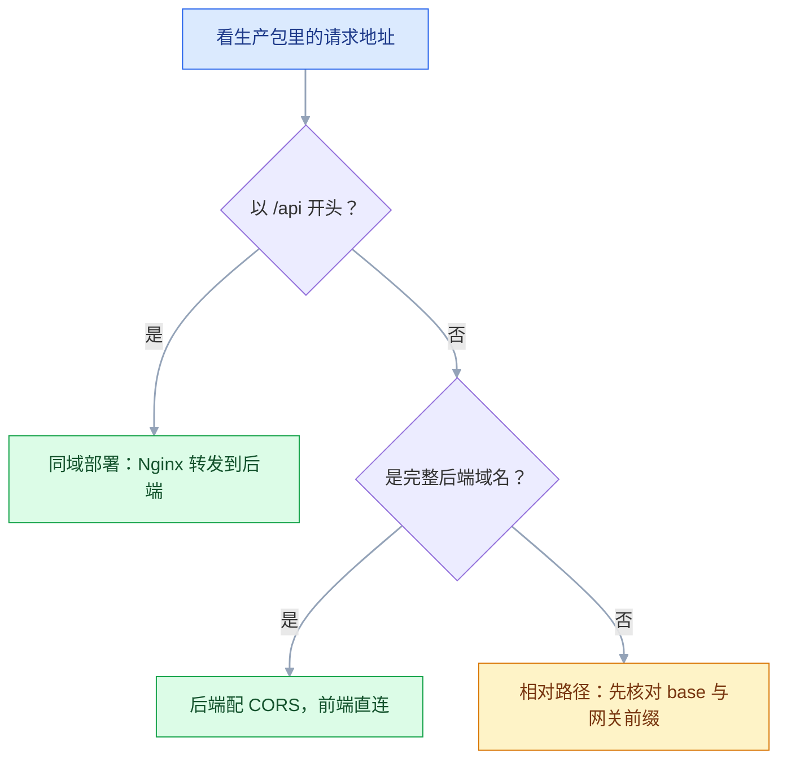
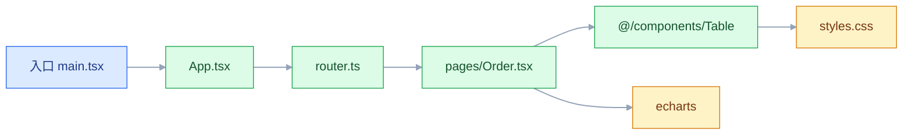

# Vite 与 Webpack

## 一、工程案例：把 2021 年的 Webpack 中后台迁到 Vite

**场景**：一个 2021 年起的 React 17 + TypeScript 后台，Webpack 5 配置 210 行，`src` 下 320 个文件，用了 `babel-loader`、`css-loader`、`MiniCssExtractPlugin`、`HtmlWebpackPlugin`，另有 1 个自研 loader 处理 `*.svg?component`。迁移前实测：`pnpm dev` 冷启动 38 秒，改一行组件 HMR 1.2 秒，`pnpm build` 96 秒，`dist` 4.2 MB（gzip 后 1.1 MB）。

**为什么迁**：开发服务器每次启动都把整张依赖图编译一遍，改一个按钮也要等一秒多；CI 上每次构建接近两分钟。业务代码没变，慢的是「开发时也打包」这套机制。

**目标**：开发启动 3 秒内、HMR 200 毫秒内、生产构建 40 秒内，产物体积不超过原来的 110%，并且保留一条可回退的 Webpack 分支。

**迁移前的账**：

| 指标 | 迁移前 | 迁移后目标 |
|---|---|---|
| `pnpm dev` 冷启动 | 38s | < 3s |
| 单文件 HMR | 1.2s | < 200ms |
| `pnpm build` | 96s | < 40s |
| `dist` 体积 | 4.2 MB | ≤ 4.6 MB |
| 配置文件行数 | 210 行 + `.babelrc` + `postcss.config.js` | 60 行以内 |

### 1.1 先留基线，再动配置

```bash
git checkout -b feat/vite
node -v                       # v20.19.x；Vite 7 起要求 Node 20.19+ 或 22.12+（Vite 8 相同），以官方当前稳定版为准
pnpm build && du -sh dist     # 4.2M
find dist -name '*.js' -exec du -h {} + | sort -rh | head -5
```

把这三个数字写进迁移 PR 的描述。没有基线，迁移完成后无法回答「到底快了没有、产物有没有变大」。同时保留一份 Webpack 构建出的 `dist` 做产物对照，**先不要删 Webpack 依赖**，回退时还要用。

### 1.2 最小可跑的开发环境

```bash
pnpm add -D vite @vitejs/plugin-react
```

旧配置用 `public/index.html` 作 `HtmlWebpackPlugin` 的模板，入口是 `src/index.tsx`；Vite 把 `index.html` 当源码，要求它在项目根目录，并用 `<script type="module">` 指向入口。

```html
<!-- index.html：从 public/ 移到根目录，模板变量全部删掉 -->
<!DOCTYPE html>
<html lang="zh-CN">
  <head><meta charset="UTF-8" /><title>运营后台</title></head>
  <body>
    <div id="root"></div>
    <script type="module" src="/src/main.tsx"></script>
  </body>
</html>
```

`public/` 里的 favicon、`robots.txt` 原样保留。原来模板里的 `<%= htmlWebpackPlugin.options.title %>`、`%PUBLIC_URL%` 全部删掉，改成静态内容或 `import.meta.env.BASE_URL`。

```ts
// vite.config.ts：先只配能跑起来的部分
import { defineConfig, loadEnv } from 'vite'
import react from '@vitejs/plugin-react'
import { fileURLToPath, URL } from 'node:url'

export default defineConfig(({ mode }) => {
  const env = loadEnv(mode, process.cwd(), '')
  return {
    plugins: [react()],
    resolve: { alias: { '@': fileURLToPath(new URL('./src', import.meta.url)) } },
    server: {
      port: 5173,
      proxy: { '/api': { target: env.VITE_PROXY_TARGET || 'http://localhost:8080', changeOrigin: true } },
    },
  }
})
```

```bash
pnpm exec vite --force     # 之前跑过旧配置或依赖有变时加 --force，重建预构建缓存
# 期望：VITE v8.x  ready in 612 ms（版本以本地安装为准）
```

此时页面大概率能打开，但控制台会报错。下面三类错误就是 Webpack 与 Vite 的构建差异，逐个处理。

### 1.3 三个构建差异

#### 差异一：环境变量从编译期替换变成 `import.meta.env`

Webpack 用 `DefinePlugin` 把 `process.env.REACT_APP_API_BASE` 在编译时替换成字符串；Vite 只暴露 `VITE_` 前缀的变量，且必须通过 `import.meta.env` 读取。

```ts
// 旧代码
const base = process.env.REACT_APP_API_BASE
// 新代码
const base = import.meta.env.VITE_API_BASE
```

批量改：

```bash
# macOS 的 sed 需要 -i ''；Linux 用 -i
grep -rl 'process\.env\.REACT_APP_' src \
  | xargs sed -i '' -E 's/process\.env\.REACT_APP_([A-Z0-9_]+)/import.meta.env.VITE_\1/g'
```

`.env.development` 和 `.env.production` 里的键名同步改成 `VITE_` 前缀。**只改代码不改 `.env`，拿到的是 `undefined`，页面表现是请求打到 `undefined/users`。**

`vite.config.ts` 里读环境变量要用 `loadEnv(mode, process.cwd(), '')`，不能直接读 `process.env`：配置文件在 Node 里执行，`.env` 文件不会自动注入 `process.env`。

#### 差异二：CommonJS 与 Node 内置模块

Vite 开发环境直接把源码当 ESM 发给浏览器，浏览器里没有 `require`、`module.exports`、`Buffer`、`global`，也没有 `path`、`fs`。典型报错：

```text
Uncaught ReferenceError: require is not defined
Module "path" has been externalized for browser compatibility.
```

处理顺序：

| 写法 | 处理 |
|---|---|
| `const x = require('./x')` | 改成 `import x from './x'` |
| `require.context('./pages', true, /\.tsx$/)` | 改成 `import.meta.glob('./pages/**/*.tsx')` |
| `path.join`、`fs.readFileSync` | 只应出现在构建配置或 Node 脚本里，移出浏览器代码 |
| `Buffer`、`global` | 换成 `globalThis` 或 `Uint8Array`；确实需要时用 `vite-plugin-node-polyfills` |
| 只被 CommonJS 包引用的 `process.env.NODE_ENV` | Vite 会自动替换；其它 `process.env.X` 需要 `define` |

`require.context` 的替换要保留「批量注册路由」的语义：

```ts
// 旧：const files = require.context('./pages', true, /\.tsx$/)
const modules = import.meta.glob('./pages/**/*.tsx')          // 懒加载
const eager = import.meta.glob('./pages/**/*.tsx', { eager: true })   // 同步拿到模块
```

自研的 `*.svg?component` loader 换成 `vite-plugin-svgr`（`pnpm add -D vite-plugin-svgr`），`plugins: [react(), svgr()]` 即可。

#### 差异三：HTML 入口与资源路径

Webpack 的 `publicPath` 决定运行时资源前缀；Vite 对应 `base`。部署在域名根目录时两者都是 `/`，部署在 `/admin/` 子目录时很容易漏。

```ts
// vite.config.ts：env 来自 1.2 的 loadEnv，不要直接读 process.env
export default defineConfig(({ mode }) => {
  const env = loadEnv(mode, process.cwd(), '')
  return { base: env.VITE_PUBLIC_PATH || '/admin/' }
})
```

代码里拼接 `public` 资源要改用 `BASE_URL`：

```tsx
// 旧：

```

`src/assets` 下的图片不要写绝对路径 `/src/assets/logo.png`，构建后这个路径不存在；改成 `import logo from '@/assets/logo.png'` 再 ``。

动态文件名用 `new URL`，否则打包器不知道要带上哪个文件：

```ts
const url = new URL(`./assets/icons/${name}.svg`, import.meta.url).href
```

### 1.4 生产构建对齐

开发能跑不等于能上线。生产构建要处理分包、source map、兼容性和样式顺序。

```ts
// vite.config.ts：生产部分
build: {
  outDir: 'dist',
  assetsDir: 'assets',
  sourcemap: 'hidden',          // 生成 .map 但不写 sourceMappingURL，交给监控平台上传
  chunkSizeWarningLimit: 800,
  rollupOptions: {
    output: {
      manualChunks(id) {
        if (!id.includes('node_modules')) return
        if (id.includes('react')) return 'vendor-react'
        if (id.includes('echarts') || id.includes('zrender')) return 'vendor-chart'
        return 'vendor'
      },
      entryFileNames: 'assets/[name]-[hash:8].js',
      chunkFileNames: 'assets/[name]-[hash:8].js',
      assetFileNames: 'assets/[name]-[hash:8][extname]',
    },
  },
},
```

`manualChunks` 不要按每个包切得太碎。切出十几个互相引用的 chunk，反而增加请求数，还容易出现重复打包；按「框架、图表、其余」三档就够。

Vite 8 起 `build.rollupOptions` 更名为 `build.rolldownOptions`（旧名仍兼容），对象式 `manualChunks` 已移除、函数式已弃用，官方推荐改用 `output.codeSplitting`；用 Vite 7 及以前则按上面的 `rollupOptions` 写。以官方当前稳定版为准。

```bash
pnpm build
# dist/index.html                      0.62 kB
# dist/assets/vendor-react-a1b2c3d4.js  142.31 kB │ gzip: 45.62 kB
# dist/assets/vendor-chart-e5f6a7b8.js  386.42 kB │ gzip: 118.20 kB
# dist/assets/index-c9d0e1f2.js         512.77 kB │ gzip: 160.11 kB
# ✓ built in 31.42s
```

需要兼容老浏览器时加 `@vitejs/plugin-legacy`（`targets: ['defaults', 'not IE 11']`），它会额外产出一套 SystemJS 版本，构建时间明显增加。Vite 8 的 legacy 构建不再降级到 ES5，IE 11 无法支持；内部后台通常不需要，面向公众的站点先看埋点里的浏览器分布再决定。

### 1.5 验收

迁移不是「页面能打开」就结束。下面 10 项全过，才允许合并。

| # | 检查项 | 命令 | 通过标准 |
|---|---|---|---|
| 1 | 开发启动 | `pnpm dev` | Ready 时间 < 3s，无报错 |
| 2 | 首屏可交互 | 手动打开 `/` | 无控制台 error，按钮可点 |
| 3 | 深链刷新 | 直接访问 `/order/123` | 页面正常，不 404 |
| 4 | 接口代理 | `curl -i http://localhost:5173/api/health` | 返回后端 JSON，不是 Vite 的 404 |
| 5 | 环境变量 | 页面标题与接口域名 | 生产构建用生产域名 |
| 6 | 静态资源 | Network 面板 | 图片、字体全部 200，文件名带 hash |
| 7 | 生产构建 | `pnpm build` | 退出码 0，耗时 < 40s |
| 8 | 产物体积 | `du -sh dist` | ≤ 4.6 MB |
| 9 | 产物预览 | `pnpm preview` | 与线上行为一致，接口走同域 |
| 10 | 回退可用 | 切回迁移前的提交后 `pnpm build:webpack` | Webpack 分支仍能出包 |

第 3 项最容易漏：Vite 开发服务器和 `vite preview` 都自带 SPA 兜底，本地测不出来；上线后由 Nginx 承接，必须配 `try_files $uri $uri/ /index.html`。

第 9 项要真的用 `preview`，不要用 `dev` 冒充生产：`dev` 走 `.env.development`，`preview` 走 `.env.production`；`preview.proxy` 默认继承 `server.proxy`，但两边读到的变量值可能不同。

### 1.6 回退与收尾

迁移期间保留两条命令：

```json
{
  "scripts": {
    "dev": "vite",
    "dev:webpack": "webpack serve --mode development",
    "build": "vite build",
    "build:webpack": "webpack --mode production"
  }
}
```

线上出问题时切回 `build:webpack` 出包，先止血再排查。稳定运行两周后再删 Webpack 相关依赖和配置。

清理清单：

| 删除项 | 原因 |
|---|---|
| `webpack.config.js`、`.babelrc` | Vite 不需要；Babel 只保留测试或特殊语法需要 |
| `html-webpack-plugin`、`mini-css-extract-plugin` | Vite 内置 HTML 与 CSS 抽取 |
| `style-loader`、`css-loader`、`postcss-loader` | Vite 内置 CSS 管线；PostCSS 配置仍可保留 |
| `file-loader`、`url-loader`、`react-scripts` | Vite 内置资源处理；CRA 与 Vite 入口机制冲突 |

保留 `postcss.config.js` 和 `browserslist`：前者继续给 CSS 加前缀，后者被 autoprefixer 读取。

---

## 二、高频问答：会卡住你的地方，也是面试最常问的

### 2.1 改了 `.env`，页面里的值不变

**现场**

先打印整个注入对象，再分辨是「没读到」还是「没重启」：

```bash
# 改完 .env 必须重启 dev server
pnpm dev
```

- `console.log(import.meta.env)` 看当前注入的对象。
- `import.meta.env.MODE` 确认加载了哪个 mode。

**要点**

- 环境变量是启动那一刻的快照，改完 `.env` 必须重启 dev server。
- 只有 `VITE_` 前缀的变量会暴露给前端，其余键不会出现在 `import.meta.env` 里。
- 键不存在先查前缀和 mode（`.env.staging` 只在 `--mode staging` 时加载）；值没变就是没重启。

**追问**

- 为什么改 `.env` 不触发热更新？→ 它在进程启动时被读入，和模块热替换不是一条链路。
- 生产环境还能靠改 `.env` 变吗？→ 不能，构建时已替换进产物。

### 2.2 别名 `@` 构建能过，编辑器一片红线

**现场**

两个解析器各跑一次，一个过一个不过就是只配了单边：

- `pnpm exec tsc --noEmit` 是否报 `Cannot find module '@/...'`
- `pnpm build` 是否通过

```json
// tsconfig.json
{
  "compilerOptions": {
    "baseUrl": ".",
    "paths": { "@/*": ["src/*"] }
  }
}
```

**要点**

- 构建工具和类型检查器是两套解析器，各读各的配置，两边都要配。
- 缺 `tsconfig.json` 的 `paths` 表现为编辑器红线，缺 `resolve.alias` 表现为构建失败。
- `baseUrl` 在旧版 TypeScript 里必填；新版可以省略，`paths` 直接相对 `tsconfig.json` 解析（以官方当前稳定版为准）。

**追问**

- 只配一边会怎样？→ 要么红线但能构建，要么构建失败但编辑器不报。
- `paths` 会影响运行时解析吗？→ 不会，它只给类型检查器看。

### 2.3 开发环境接口正常，打包后 404 或跨域

**现场**

打开生产包 Network，看请求 URL 是前端域名还是后端域名，再按地址分流，不要同时上 Nginx 和 CORS。

```nginx
# 生产同域：由 Nginx 转发，前端仍然请求 /api
location /api/ {
    proxy_pass http://backend:8080/;
    proxy_set_header Host $host;
}
```



**要点**

- `server.proxy` 只存在于开发服务器，打包后一行都不会留下。
- 生产包是静态文件，浏览器直接请求 `VITE_API_BASE`，没有代理这层。
- 产物里还是 `/api` 就交给 Nginx 同域转发，是完整后端域名就后端配 CORS，二选一。

**追问**

- 为什么开发时一切正常？→ 代理是开发服务器的功能，被误当成了应用能力。
- 同域之后还需要 CORS 吗？→ 不需要，浏览器根本不发预检。

### 2.4 生产环境刷新子路由 404

**现场**

`curl -I https://站点/order/123` 看状态码，本地 `pnpm preview` 通常复现不了。

```nginx
location / {
    try_files $uri $uri/ /index.html;
}
```

**要点**

- SPA 只有一个 `index.html`，服务器收到 `/order/123` 会去找同名文件，找不到就 404。
- Vite 和 `vite preview` 默认做了 history 兜底，所以本地测不出来，问题只在上线后出现。
- 修法是 `try_files $uri $uri/ /index.html`；用 hash 路由的项目不会遇到这个问题。

**追问**

- 为什么 preview 复现不了？→ 它自带 SPA 兜底，和 Nginx 的行为不同。
- hash 路由为什么没事？→ 路径在 `#` 后面，服务器只看到 `/`。

### 2.5 构建后图片、字体 404

**现场**

看 `dist/assets` 里有没有该文件，再看 Network 里请求的 URL 前缀。

```tsx
// 静态引用：让打包器处理
import logo from '@/assets/logo.png'
// 运行时拼接：用 new URL，不要用字符串拼 '/src/assets/...'
const icon = new URL(`./icons/${name}.svg`, import.meta.url).href
```

**要点**

- 只有被 `import`、`new URL`、CSS `url()` 引用，或放在 `public/` 的文件才会进产物。
- 三种原因：引用了 `src/assets` 的绝对路径；部署在子目录但 `base` 还是 `/`；文件由运行时字符串拼接引用。
- 静态引用交给打包器，运行时拼接必须用 `new URL`。

**追问**

- `public/` 和 `src/assets` 的区别？→ 前者原样拷贝、不加 hash，后者参与构建。
- 为什么 `find dist` 里根本没有？→ 引用方式不对，文件没被收集进模块图。

### 2.6 打包体积突然翻倍

**现场**

先确认是谁占的体积：

```bash
pnpm add -D rollup-plugin-visualizer
```

配进 `plugins`：`visualizer({ gzipSize: true, filename: 'stats.html' })`，构建后打开 `stats.html` 看最大矩形。

**要点**

- 两个打包器的 Tree Shaking 都依赖 ESM 和 `sideEffects` 声明，换回 Webpack 救不了体积。
- 三个常见原因：引入整包（`import _ from 'lodash'`）、同一依赖装了两份、组件库被全量注册。
- 一个 CJS 包或带副作用的入口，换谁打都小不了；先看最大矩形是谁，再决定换导入方式还是换库。

**追问**

- 怎么确认装了两份？→ `pnpm why <包名>` 看依赖链。
- `sideEffects` 写错会怎样？→ 有副作用的模块可能被误删。

### 2.7 新增依赖后启动报 404，删缓存才好

**现场**

看报错 URL 是否形如 `/node_modules/.vite/deps/xxx.js`，再看 `node_modules/.vite` 的修改时间。

```bash
pnpm exec vite --force          # 强制重新预构建
```

```ts
// monorepo 里显式声明要预构建的包
optimizeDeps: { include: ['@my/ui', 'lodash-es'] }
```

**要点**

- 依赖预构建缓存过期，`pnpm install` 不会清理 `node_modules/.vite`，重装多少次都没用。
- 报错路径里有 `.vite/deps` 就是预构建缓存，`--force` 可以立刻验证。
- monorepo 里的本地包不在扫描范围内，要在 `optimizeDeps.include` 显式列出。

**追问**

- 为什么重装没效果？→ 缓存目录不归 `install` 管。
- `--force` 会重建源码吗？→ 不会，只重建依赖缓存，源码语法错误照旧报。
- 本地 link 的包想调试源码？→ 放进 `optimizeDeps.exclude`。

### 2.8 Webpack 构建越来越慢

**现场**

`webpack --profile` 或 `speed-measure-webpack-plugin` 看各阶段耗时。

```js
const path = require('path')
const isProd = process.env.NODE_ENV === 'production'

module.exports = {
  cache: { type: 'filesystem' },        // 第二次构建只重编译改动模块
  module: {
    rules: [
      { test: /\.(ts|tsx)$/, include: path.resolve(__dirname, 'src'), use: 'babel-loader' },
    ],
  },
  devtool: isProd ? 'source-map' : 'eval-cheap-module-source-map',
}
```

**要点**

- 加机器只能线性缓解，配置问题是数量级的。
- 三个根因：每次全量重编译、loader 扫了 `node_modules`、source map 用了最贵的模式。
- 先开 `cache` 再构建两次，第二次没明显变快，说明瓶颈不在编译缓存。

**追问**

- `include` 为什么能提速？→ 把 `node_modules` 排除在 loader 规则之外。
- 生产为什么不用 `eval-*`？→ 它不产出独立 map，线上排错拿不到源码。

### 2.9 生产环境报 `process is not defined`

**现场**

看报错堆栈指向哪个包，再全局搜 `process.env`。

```ts
// vite.config.ts 内（env 来自 loadEnv）：只补确实需要的键，不要整体注入 process
define: {
  'process.env.API_BASE': JSON.stringify(env.VITE_API_BASE),
}
```

**要点**

- 某个依赖在运行时读了 `process.env.SOMETHING`，而 Vite 只自动替换 `process.env.NODE_ENV`。
- 引入 `process` 的浏览器 polyfill 会把整套 Node 兼容层打进产物。
- 能改就改成 `import.meta.env`，改不了的第三方包才用 `define` 精确补键。

**追问**

- `define` 的值为什么要 `JSON.stringify`？→ 它是文本替换，不序列化会变成裸标识符。
- 只补一个键够吗？→ 看堆栈里那个包实际读了哪些键。

### 2.10 迁移后样式顺序变了，覆盖关系反转

**现场**

对比迁移前后 `dist` 里 CSS 文件的规则顺序，并搜索同一选择器出现在哪几个文件。

```css
/* 用层声明固定优先级，不依赖文件顺序 */
@layer reset, base, components, utilities;
```

**要点**

- 样式最终顺序由模块图的求值顺序决定，两个打包器的遍历顺序不同。
- 依赖 `import` 先后做覆盖的写法本就脆弱，不是稳定契约。
- 改用 `@layer` 或统一入口的显式顺序，不要调 import 位置碰运气。

**追问**

- 开发环境为什么看着正常？→ 按请求顺序注入，和生产打包顺序不是一回事。
- `@layer` 的优先级规则？→ 后声明的层优先，未分层的样式高于所有层。
- 怎么确认是顺序问题？→ 把两版 CSS 展开，按选择器 diff。

---

## 三、核心知识：从零开始要建立的东西

### 3.1 构建工具的四项职责

浏览器只认识特定版本的 HTML/CSS/JS。源码里的 TypeScript 类型、JSX、SCSS、裸模块名、几百个 `import`，都需要在进入浏览器前处理。

| 职责 | 解决什么 | 典型动作 |
|---|---|---|
| 语法转换 | 浏览器不认识新语法或类型 | TS 去类型、JSX 转函数调用、新语法降级 |
| 模块解析 | 裸模块名与请求数量 | 把 `vue` 解析到具体文件，合并或改写导入 |
| 资源处理 | 非 JS 文件如何进页面 | SCSS 转 CSS、图片转 URL 或 base64 |
| 产物优化 | 体积与加载速度 | 压缩、Tree Shaking、代码分割、哈希命名 |

构建工具不改变业务逻辑，它只改变「代码以什么形式到达浏览器」。所以构建问题要分两层看：**源码语义问题**（import 路径、环境变量、Node API）和**产物形态问题**（chunk、hash、兼容性）。

### 3.2 模块图与入口

打包器从入口出发，顺着 `import` / `require` 找依赖，形成一张有向图。图上的每个节点是一个模块，每条边是一次引用。



三个直接推论：

1. **没被图连到的文件不会进产物**（`public/` 里的文件除外，它们只被原样拷贝）。动态拼接的路径、没被 import 的文件都会被漏掉。
2. **入口数量决定产物数量**。多页应用有多个 HTML 入口，每个入口一张子图。
3. **图的形状决定 chunk 怎么切**。被多个入口共享的节点才值得单独拆出来。

### 3.3 原生 ESM 与按需编译

Vite 开发时不打包：浏览器请求 `/src/main.tsx`，开发服务器只编译这一个文件，把其中的裸导入改写成浏览器能请求的 URL，后续模块由浏览器自己发请求。


代价是开发环境的行为与生产不完全一致：开发时每个模块一个请求，生产时是合并后的 chunk；开发时不做完整 Tree Shaking，生产时才做。**「dev 能跑」不能证明「build 能跑」**，原因就在这里。

生产构建的打包器随版本变化：Vite 7 及以前用 Rollup，Vite 8 起改用 Rolldown，以官方当前稳定版为准。所以「Vite 快」主要指开发服务器快，不代表生产构建一定比 Webpack 快；大型项目里两者的构建时间差距远小于冷启动差距。

> **面试**：常问「Vite 为什么开发启动快？」答：浏览器请求到哪个模块才编译哪个，依赖交给预构建，不先打整张图。

### 3.4 依赖预构建

浏览器直接加载 `node_modules` 有两个问题：CommonJS 包不能用 `import` 加载；一个包内部可能拆成几百个文件，浏览器要发几百个请求。

预构建做两件事：

| 动作 | 目的 |
|---|---|
| 把 CJS/UMD 转成 ESM | 浏览器能直接 import |
| 把包内部模块合并成一个文件 | 几百个请求变成一个 |

产物放在 `node_modules/.vite/deps`，并带缓存。缓存键包含 lock 文件、配置和 Vite 版本，任一变化都会触发重建。

```ts
// 自动扫描不到的依赖，手动加入
optimizeDeps: {
  include: ['lodash-es', '@my/ui'],
  exclude: ['@my/local-linked-pkg'],   // 本地包想保留源码调试时排除
}
```

边界：预构建只处理依赖，不处理业务源码；`--force` 只重建依赖缓存，不解决源码里的语法错误。

### 3.5 打包与 chunk

生产构建把模块图切成若干 chunk，每个 chunk 是一个 JS 文件。

| 概念 | 含义 | 影响 |
|---|---|---|
| entry chunk | 入口对应的代码 | 首屏必须加载 |
| vendor chunk | 第三方依赖 | 变化少，可长缓存 |
| async chunk | 动态 `import()` 产生的代码 | 按需加载 |
| runtime chunk | 模块加载与 chunk 映射逻辑 | 分离后 vendor 哈希更稳定 |

表中的 runtime chunk 是 Webpack 的 `optimization.runtimeChunk`；Vite/Rollup 默认把运行时代码并进入口或异步 chunk，不单独产出一个文件。

```ts
// 路由级懒加载：每个页面一个 async chunk
const Order = lazy(() => import('./pages/Order'))
```

切分不是越细越好。每个 chunk 都是一次请求，HTTP/2 下请求成本降低但仍有解析成本；首屏需要的代码拆得太散，反而拖慢首屏。

### 3.6 loader 与 plugin

Webpack 的两个扩展点容易混：

| | loader | plugin |
|---|---|---|
| 处理对象 | 单个文件的内容 | 整个构建流程 |
| 输入输出 | 源码字符串进，转换后的字符串出 | 在钩子上读写编译对象 |
| 配置位置 | `module.rules` | `plugins` 数组 |
| 例子 | `babel-loader`、`css-loader` | `HtmlWebpackPlugin`、`MiniCssExtractPlugin` |

loader 是「管道」，按 `use` 数组**从右到左**执行；plugin 是「监听器」，通过钩子介入编译、生成、输出各阶段。

Vite 的插件接口沿用 Rollup 的钩子（`resolveId`、`load`、`transform`），并扩展了 `configureServer` 等开发服务器钩子；Vite 8 的 Rolldown 仍兼容这套钩子。一个 Webpack loader 不能直接拿到 Vite 里用，通常要换成对应的 Vite 插件或改写成 `transform`。

> **面试**：常问「loader 和 plugin 有什么区别？」答：loader 转换单个文件的内容，plugin 用钩子介入整个构建流程。

### 3.7 资源管线与 public 目录

| 位置 | 是否被构建处理 | 引用方式 | 适合 |
|---|---|---|---|
| `src/assets` | 会：改名、加 hash、小文件内联 | `import`、`new URL`、CSS `url()` | 组件使用的图片、字体 |
| `public/` | 不会：原样拷贝到根路径 | `/xxx`，子目录部署要拼 `BASE_URL` | favicon、`robots.txt`、固定路径文件 |

内联阈值默认 4 KB（`build.assetsInlineLimit`）。小图标内联减少请求，大图内联会撑大 JS 并失去独立缓存。

```ts
build: {
  assetsInlineLimit: 4096,   // 设 0 表示全部输出成文件
}
```

边界：`public/` 里的文件不会加 hash，不能配长缓存；需要缓存控制的资源应放 `src/assets` 并通过 import 引用。

### 3.8 环境变量与 mode

Vite 的 mode 决定加载哪个 `.env` 文件，`NODE_ENV` 决定构建行为（是否压缩、是否保留调试代码），两者不是一回事。

| 命令 | mode | 加载文件 |
|---|---|---|
| `vite` | development | `.env`、`.env.local`、`.env.development`、`.env.development.local` |
| `vite build` | production | `.env`、`.env.local`、`.env.production`、`.env.production.local` |
| `vite build --mode staging` | staging | `.env`、`.env.local`、`.env.staging`、`.env.staging.local` |

优先级从高到低：`.env.[mode].local` > `.env.[mode]` > `.env.local` > `.env`；进程里已存在的环境变量优先级最高，不会被 `.env` 覆盖。`.env.local` 通常进 `.gitignore`。

只有 `VITE_` 前缀的变量会进入前端产物。这不是命名习惯，是安全边界：任何进入产物的变量都等于公开，密钥、数据库口令、内部地址都不该加这个前缀。

### 3.9 开发代理与同源策略

同源要求协议、域名、端口完全一致。`localhost:5173` 请求 `localhost:8080` 端口不同，浏览器就判定跨域。

代理的思路是让浏览器只看见一个源：前端请求 `/api/users`（同源 5173），开发服务器在 Node 侧转发到 8080。服务器之间没有同源策略。

```ts
server: {
  proxy: {
    '/api': {
      target: 'http://localhost:8080',
      changeOrigin: true,                          // 改写 Host 头，虚拟主机场景必需
      rewrite: (p) => p.replace(/^\/api/, ''),      // 后端没有 /api 前缀时
    },
  },
}
```

三个边界：代理只在开发服务器存在，生产必须由 Nginx 或后端 CORS 承接；`rewrite` 去掉前缀后，后端路由必须与剩余路径匹配；WebSocket 要显式 `ws: true`。

### 3.10 Tree Shaking 与副作用声明

Tree Shaking 是「删掉没有被使用的导出」。它依赖三件事：ESM 的静态结构、打包器能证明无副作用、代码没有被动态访问。

```json
// package.json
{ "sideEffects": ["*.css", "./src/polyfill.ts"] }
```

`sideEffects: false` 告诉打包器「这个包的模块被删掉也不影响运行」。如果包里真的有「导入即执行」的代码（注册全局、注入样式），必须列进数组，否则会被误删。

```ts
// 可摇：只保留 debounce
import { debounce } from 'lodash-es'
// 不可摇：整个 lodash 进入产物
import _ from 'lodash'
```

边界：CJS 包的导出是运行时属性，打包器无法静态判断，Tree Shaking 基本失效。这是「换 ESM 版本」比「换打包器」更有效的原因。

> **面试**：常问「Tree Shaking 生效的前提是什么？」答：ESM 的静态结构、打包器能证明无副作用、代码没有被动态访问。

### 3.11 代码分割与缓存

浏览器缓存的关键是文件名。文件名不变，浏览器就可能继续用旧文件；文件名随内容变，才能安全地配长缓存。

| 命名（Webpack 写法） | 变化条件 | 缓存策略 |
|---|---|---|
| `[name].js` | 不变 | 不能长缓存 |
| `[name].[hash].js` | 整次编译的哈希，任一模块变就变 | 可长缓存，但没必要的失效多 |
| `[name].[contenthash].js` | 内容变才变 | 推荐，配合 `immutable` |

`[contenthash]` 是 Webpack 的写法；Vite/Rollup 的 `[hash]` 本身就是内容哈希，所以配置里写 `assets/[name]-[hash:8].js`。

分包的目标是「让不常变的部分不随业务代码失效」：框架和 UI 库单独一个 vendor chunk，业务代码按路由切分。

```nginx
location /assets/ {
    expires 1y;
    add_header Cache-Control "public, immutable";
}
```

边界：`index.html` 不能长缓存，否则用户永远拿不到新的 chunk 引用。通常给它 `no-cache`，让浏览器每次校验。

构建缓存与产物缓存是两回事：前者加速构建（`node_modules/.vite`、Webpack 的 `cache: { type: 'filesystem' }`、CI 缓存包管理器 store），后者加速加载。构建缓存的共同前提是输入可判定——配置、环境变量、依赖版本都要进缓存键，否则会出现「本地是新的、CI 是旧的」。

### 3.12 Source Map

Source Map 把压缩后的行列号映射回源码，是线上排错的必需品。

| 写法 | 归属 | 内容 | 适用 |
|---|---|---|---|
| `eval-cheap-module-source-map` | Webpack `devtool` | 每个模块单独映射，构建较快 | 开发 |
| `source-map` | Webpack `devtool` | 完整映射，独立 `.map` 文件 | 生产，需上传后删除 |
| `true` | Vite `build.sourcemap` | 生成独立 `.map` 并写引用注释 | 生产，需上传后删除 |
| `'hidden'` | Vite `build.sourcemap` | 生成 `.map` 但不写引用注释 | 生产，交给监控平台 |
| `false` | 两者 | 不生成 | 不需要排错的环境 |

生产环境不要把 `.map` 直接部署到公网：它包含完整源码。正确做法是构建时生成、上传到错误监控平台、部署产物里删掉。

### 3.13 语法降级与浏览器目标

「语法转换」和「API 补齐」是两件事：

| 问题 | 例子 | 解决 |
|---|---|---|
| 新语法浏览器不认 | 可选链、类字段、JSX | 转译成旧语法 |
| 新 API 浏览器没有 | `Promise.allSettled`、`Array.at` | core-js 之类的 polyfill |
| 模块加载方式不认 | 不支持原生 ESM 的老浏览器 | legacy 构建 + SystemJS |

目标浏览器由 `browserslist` 声明（如 `["> 0.5%", "last 2 versions", "not dead"]`），Babel、autoprefixer、legacy 插件都读它；Vite 自身的 `build.target` 不读 `browserslist`，默认按 Baseline 取值，要更低目标就显式写 `target`（以官方当前稳定版为准）。

边界：降级越多，产物越大、越慢。内部系统可以只支持现代浏览器；面向公众的产品要先看真实访问数据，而不是凭感觉兼容到 IE。

### 3.14 工具选型边界

| 场景 | 选择 | 理由 |
|---|---|---|
| 新建 Vue/React 应用 | Vite | 默认配置覆盖大多数需求，开发体验好 |
| 2020 年前的存量项目 | 保留 Webpack | 迁移成本主要在自研 loader 和历史兼容 |
| 自研构建流程、特殊多入口 | Webpack | loader/plugin 生态最成熟 |
| 发布组件库 | Vite library mode | 产物干净，ESM/CJS 可控 |
| 极致构建速度 | Vite 8（内置 Rolldown）或 Rspack | Rolldown 已是 Vite 8 默认打包器；Rspack 兼容 Webpack 配置 |

选型不看「谁更先进」，看「团队存量、特殊需求、迁移预算」三件事。一个新项目用 Webpack 不算错，一个深度定制的存量项目硬迁 Vite 也不算对。

---

## 四、冷门知识汇总

| 知识点 | 为什么冷门 | 用到时的关键词 |
|---|---|---|
| 依赖预构建的手动排除 | 多数项目自动扫描足够，只有本地 link 包才需要 | `optimizeDeps.exclude` |
| `import.meta.glob` 的懒/急加载 | 路由自动注册之外很少用 | `import.meta.glob('./dir/**/*.ts', { eager: true })` |
| 多页应用多入口 | 中后台多为单页，MPA 场景少 | `build.rollupOptions.input` 配多个 HTML（Vite 8 为 `build.rolldownOptions.input`） |
| 库模式的 `exports` 条件 | 只在自己发包时暴露 | `build.lib`、`exports.import/require` |
| SSR 构建 | 纯前端项目用不到 | `vite build --ssr`、`ssr.entry` |
| 自定义插件钩子 | 写插件时才查 | `resolveId`、`load`、`transform`、`configureServer` |
| `define` 的表达式替换 | 平时只用环境变量，不知道它能替换任意标识符 | `define: { __DEV__: 'false' }` |
| Webpack Module Federation | 微前端架构才用 | `ModuleFederationPlugin`、`shared` |
| `externals` + CDN | 只对 UMD/IIFE 产物直接有效，ESM 应用还要配 import map | `rollupOptions.external`、`output.globals` |
| `@layer` 控制样式顺序 | 多数团队靠 import 顺序，没遇到过反转 | `@layer reset, base, components` |
| `vite preview` 的代理 | 以为预览另起一套，或以为它不走代理 | `preview.proxy` 默认取 `server.proxy` |
| 构建产物的 `base` 与 `BASE_URL` | 只在子目录部署时暴露 | `base: '/admin/'`、`import.meta.env.BASE_URL` |
| Rolldown 与 Rspack | 打包器更替期，名词容易混 | Vite 8 内置 Rolldown；Rspack 走 Webpack 兼容，`rolldown-vite` 是 Vite 7 的过渡包 |
