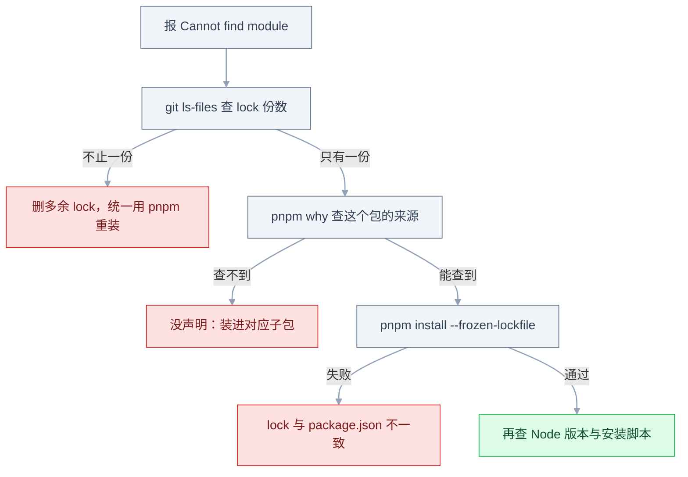
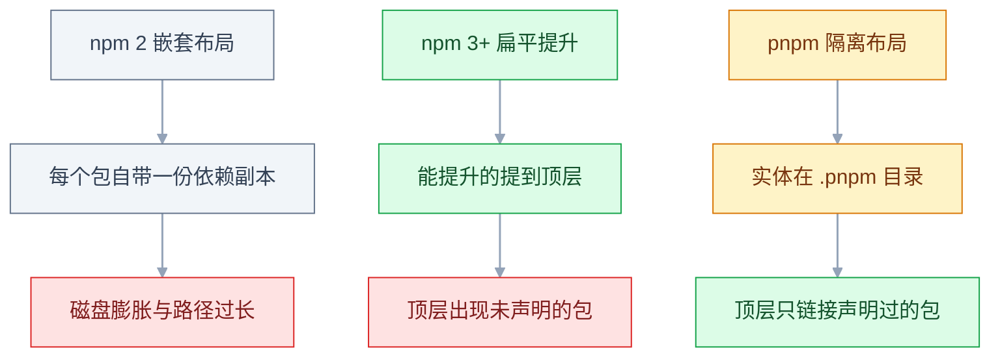

# npm 与 pnpm

## 一、工程案例：把两个仓库和一个复制件收成 pnpm workspace

**场景**：H5 前台 `web` 和运营后台 `admin` 分别在两个 Git 仓库，各自一份 `package-lock.json`；共用的一套按钮、表格、表单组件被复制在两边，改一次要改两处，还经常漏。两边 Vue 一个 3.4、一个 3.5，`dayjs` 一个 1.11.10、一个 1.11.13。每次发版前都要人工对齐依赖。

**目标**：合成一个仓库、三个包，依赖只装一次，共享组件改完两个应用立刻生效，CI 用一份 lock 复现。仓库结构：

```text
acme-frontend/
├── pnpm-workspace.yaml
├── package.json
├── pnpm-lock.yaml
├── apps/
│   ├── web/            → @acme/web（Vue 3 + Vite）
│   └── admin/          → @acme/admin（Vue 3 + Vite + Element Plus）
└── packages/
    └── ui/             → @acme/ui（共享组件，源码直出）
```

**迁移前的账**：

| 项目 | 迁移前 | 迁移后目标 |
|---|---|---|
| 仓库数 | 2 个 + 1 份复制代码 | 1 个 |
| lock 文件 | 2 份，版本各自漂移 | 1 份，根目录 |
| 装依赖 | 两次 `npm install`，约 90s | 一次 `pnpm install`，< 40s |
| 改共享组件 | 改两处，发两个版本 | 改一处，两个应用热更新 |
| CI | 两套流水线 | 一条，`--frozen-lockfile` |

### 1.1 建骨架

```bash
mkdir acme-frontend && cd acme-frontend
git init
pnpm init
mkdir -p apps packages
git add -A && git commit -m "chore: 初始化 workspace"   # subtree 需要一个起始提交
```

```yaml
# pnpm-workspace.yaml
packages:
  - 'apps/*'
  - 'packages/*'
onlyBuiltDependencies:
  - esbuild
```

`onlyBuiltDependencies` 是 pnpm 10 起的安装脚本白名单：默认不执行依赖的 `postinstall`，`esbuild` 这类需要下载二进制的包必须显式放行，否则构建时报「二进制不存在」。具体字段位置以官方当前稳定版为准。

```json
// 根 package.json
{
  "name": "acme-frontend",
  "private": true,
  "packageManager": "pnpm@10.15.0",
  "engines": { "node": ">=22.12.0" },
  "scripts": {
    "dev:web": "pnpm --filter @acme/web dev",
    "build": "pnpm -r --filter './apps/*' build",
    "typecheck": "pnpm -r typecheck"
  },
  "devDependencies": { "typescript": "~5.9.0" }
}
```

`packageManager` 里的版本号按团队实际锁定的版本写，以官方当前稳定版为准；它配合 Corepack，保证所有人用同一个 pnpm 大版本，不会一个生成 `pnpm-lock.yaml`、另一个生成 `package-lock.json`。

### 1.2 收编两个应用

要保留提交历史用 `git subtree`；不要求历史就直接复制目录：

```bash
git subtree add --prefix apps/web   git@git.example.com:fe/web.git main --squash
git subtree add --prefix apps/admin git@git.example.com:fe/admin.git main --squash

# 清掉子仓库带进来的独立依赖与 lock，统一由根目录管理
rm -rf apps/*/node_modules apps/*/package-lock.json apps/*/pnpm-lock.yaml
```

把两个 `package.json` 的 `name` 改成 `@acme/web`、`@acme/admin`，并删掉各自的 `packageManager` 字段——一个仓库只能有一个包管理器版本。两个应用的脚本名保持一致，根目录的递归命令才覆盖得到它们：

```json
// apps/web/package.json（片段，admin 同理）
{
  "name": "@acme/web",
  "private": true,
  "scripts": {
    "dev": "vite",
    "build": "vite build",
    "typecheck": "vue-tsc --noEmit"
  }
}
```

`vite`、`@vitejs/plugin-vue`、`vue-tsc` 留在两个应用自己的 `devDependencies` 里，版本按官方当前稳定版填。

```bash
pnpm install
# Scope: all 4 workspace projects
# Packages: +612
# Progress: resolved 612, reused 598, downloaded 14, added 612, done
```

`Scope: all 4` 是根包加三个子包。`reused` 表示直接复用了全局 store 里的包，没有重新下载。

### 1.3 共享包 @acme/ui

```json
// packages/ui/package.json
{
  "name": "@acme/ui",
  "version": "0.1.0",
  "private": true,
  "type": "module",
  "exports": { ".": "./src/index.ts", "./styles.css": "./src/styles.css" },
  "peerDependencies": { "vue": "^3.5.0" },
  "devDependencies": { "vue": "^3.5.0", "typescript": "~5.9.0" }
}
```

三个关键点：`exports` 指向 `src/index.ts`，应用直接编译源码，改组件不用先构建、不用发版；`peerDependencies` 声明 vue，由使用方提供，避免装出两份；`private: true` 防止误发公共 registry。

```json
// apps/web/package.json（片段）
{ "dependencies": { "@acme/ui": "workspace:*", "vue": "^3.5.0" } }
```

`workspace:*` 表示「用工作区里的这个包」，发布时 pnpm 会替换成包的实际版本号（这里是 `0.1.0`，也就是精确版本）；要让使用者拿到 `^`、`~` 范围，写成 `workspace:^`、`workspace:~`。不要写 `file:../ui`，那样会复制而不是链接。

```bash
pnpm install && ls -l apps/web/node_modules/@acme
# ui -> ../../../../packages/ui
```

### 1.4 清理幽灵依赖

组件收编后第一次构建，`web` 报：

```text
Error [ERR_MODULE_NOT_FOUND]: Cannot find package 'dayjs'
imported from /acme-frontend/apps/web/src/utils/date.ts
```

`dayjs` 在旧项目里能用，是因为 npm 把它从 `element-plus` 提升到了顶层，代码直接 `import 'dayjs'` 也能解析——这就是幽灵依赖。pnpm 的顶层只放声明过的包（布局对比见 3.4），它立刻暴露。

```bash
pnpm --filter @acme/web add dayjs
```

修完再扫一遍源码里的裸导入，确认每个都在对应包的 `dependencies` 里：

```bash
pnpm --filter @acme/web exec depcheck
```

`depcheck` 不是必装工具，用 `grep` 加人工核对也可以。判断标准只有一条：**代码里 import 的包，必须写在自己的 `package.json` 里**，不能靠别人带进来。

### 1.5 统一版本

```bash
pnpm why vue
# vue 3.5.13
#   ├─ @acme/web
#   ├─ @acme/admin
#   └─ @acme/ui
```

如果某个传递依赖出现两个版本且确实冲突，在根 `package.json` 里强制统一：

```json
{
  "pnpm": {
    "overrides": {
      "vue": "^3.5.0"
    }
  }
}
```

`overrides` 只写在根包，子包的会被忽略。范围不要随手写死到补丁号：写死能解决一次冲突，也会让后续安全补丁进不来。

### 1.6 CI 与验收

```yaml
# .github/workflows/ci.yml
name: CI
on: [push, pull_request]
jobs:
  build:
    runs-on: ubuntu-latest
    steps:
      - uses: actions/checkout@v4
      - uses: pnpm/action-setup@v4          # 版本取自 package.json 的 packageManager
      - uses: actions/setup-node@v4
        with: { node-version: 22, cache: pnpm }
      - run: pnpm install --frozen-lockfile
      - run: pnpm -r typecheck
      - run: pnpm build
```

`pnpm/action-setup` 会读 `package.json` 的 `packageManager` 决定装哪个版本，再在 workflow 里写 `with: version` 会被判定为「指定了两处版本」而失败，所以二选一。

`--frozen-lockfile` 的含义是「只按 lock 装，lock 与 `package.json` 不一致就直接失败」。CI 环境里 pnpm 默认就会开启它，显式写出来是为了让意图可见。

| # | 检查项 | 命令 | 通过标准 |
|---|---|---|---|
| 1 | 干净安装 | `rm -rf node_modules && pnpm install` | 无 peer 报错，退出码 0 |
| 2 | 全量构建 | `pnpm build` | 两个应用都产出 `dist` |
| 3 | 共享组件生效 | 改 `packages/ui/src/MyButton.vue` 的圆角 | 两个应用的页面都热更新 |
| 4 | 依赖装对位置 | `pnpm --filter @acme/web list --depth 0` | `dayjs`、`vue` 出现在 web 的依赖里，根 `package.json` 没有运行依赖 |
| 5 | 单一 lock | `git ls-files '*lock*'` | 只有根目录 `pnpm-lock.yaml` |
| 6 | lock 可复现 | 新目录 clone 后 `pnpm install --frozen-lockfile` | 成功，无 lock 变更 |
| 7 | 幽灵依赖清零 | `rm -rf node_modules && pnpm install && pnpm build` | 不出现 `Cannot find package` |
| 8 | 版本一致 | `pnpm why vue` | 只解析出一个 vue 版本，没有重复实例 |
| 9 | Node 版本 | `node -v` | 满足 `engines` 的 `>=22.12.0`，CI 用同一版本 |
| 10 | CI 时长 | Actions 日志 | 安装 + 构建 < 5 分钟 |

第 3 项是 workspace 的核心价值：改共享组件的源码，两个应用立刻看到，不需要「构建 → 发布 → 升级」三步。

第 7 项要真的删掉根 `node_modules` 再装。只删子包的没用，pnpm 的链接结构在根目录。

### 1.7 回退与日常约定

迁移期间保留旧仓库的只读镜像，出问题可以按 tag 回滚。确认两个应用都稳定发布一个迭代后，再归档旧仓库。

| 事项 | 约定 |
|---|---|
| 依赖装在哪 | 默认装到具体子包：`pnpm --filter @acme/web add axios` |
| 根依赖 | 只放所有包共用的工具（TypeScript、Prettier） |
| 跨包引用 | 一律 `workspace:*`，不用相对路径 `../../packages/ui` |
| lock 文件 | 全仓库只有根目录一份，必须提交 |
| 新增子包 | 加进 `pnpm-workspace.yaml` 的匹配范围，再 `pnpm install` |

---

## 二、高频问答：会卡住你的地方，也是面试最常问的

### 2.1 删了 `node_modules` 重装，报错一模一样

**现场**

先看依赖从哪来，再看这次装有没有改动解析结果：

```bash
pnpm why dayjs
pnpm install --lockfile-only      # 只重算 lock，看解析结果会不会变
```

再补两条只读检查：`pnpm why <包名>` 看依赖链，`git diff pnpm-lock.yaml` 看 lock 有没有变。

**要点**

- `node_modules` 是从 lock 推导出来的，删掉是安全的，但也不会改变任何版本决策。
- 真正的因通常是依赖没声明、版本被 lock 钉死、或安装脚本没执行。
- 依赖链和 lock 都没变，问题就在代码或脚本，不在安装。

**追问**

- 为什么重装不会顺便升级依赖？→ 有 lock 时按 lock 复现，不重新解析。
- 删 lock 有用吗？→ 只在需要重算解析结果时有用，代价是一批依赖跟着升级。

### 2.2 本地能跑，同事或 CI 报 `Cannot find module`

**现场**

先跑两条只读命令定位，走完还定位不到，问题才在环境而不在依赖声明：

```bash
git ls-files '*lock*'
# 期望只有 pnpm-lock.yaml
pnpm install --frozen-lockfile
```



**要点**

- Node 版本不一致通常报语法或 API 错误，不会精准地报某个包找不到。
- 三个真因：lock 没提交、依赖装在根而代码在子包、对方用另一个包管理器生成了第二份 lock。
- 先把 `package.json`、lock、`.npmrc` 三者对齐，再看 Node 版本。

**追问**

- 为什么多一份 lock 就会出问题？→ 两个包管理器的解析结果不同。
- `--frozen-lockfile` 失败说明什么？→ lock 与 `package.json` 已经不一致。

### 2.3 幽灵依赖：没声明的包也能 import

**现场**

看 `package.json` 里有没有这个包，再用 `pnpm why` 确认来源是不是别的库：

```bash
# 代码里 import 了 dayjs，但 package.json 没有
pnpm why dayjs
# dayjs 3.x
#   └─ element-plus@2.x
```

**要点**

- Node 的解析规则只保证「声明过的依赖可用」，提升是包管理器的实现细节。
- npm 的扁平化把传递依赖放到顶层，代码沿目录向上查找时「碰巧」找到了它。
- 判断方法：把包从 `package.json` 临时删掉再装，仍然能 import 就是幽灵依赖。

**追问**

- pnpm 为什么能立刻暴露它？→ 顶层只链接声明过的包。
- 风险在哪？→ 上游删掉这个传递依赖，代码立刻崩。
- 怎么批量排查？→ 扫源码里的裸导入，逐个核对 `package.json`。

### 2.4 `npm install` 报 `ERESOLVE could not resolve`

**现场**

报错里会打印「Found」和「Could not resolve」两段，直接读版本范围：

```bash
npm ls vue
npm view element-plus peerDependencies
```

**要点**

- 某个包的 `peerDependencies` 范围与项目里实际装的版本不匹配，npm 7 起把 peer 冲突当错误。
- `--legacy-peer-deps` 不是修复，是把校验整体关掉，问题推迟到运行时。
- 能升宿主就升，不能升就换插件版本，最后才考虑忽略。

**追问**

- 为什么 npm 报错、pnpm 却能装过？→ pnpm 默认对 peer 冲突只告警，开了 `strict-peer-dependencies=true` 才拦。
- peer 和普通依赖的区别？→ peer 由使用方提供，不该被装成第二份。

### 2.5 `pnpm-lock.yaml` 冲突，手动合并后装不上

**现场**

合并后跑一次 `pnpm install --frozen-lockfile`，它会直接告诉你 lock 与 `package.json` 是否一致。

```bash
git checkout --ours pnpm-lock.yaml
pnpm install                 # 按当前 package.json 重新生成
git add pnpm-lock.yaml package.json
```

**要点**

- lock 是解析结果的快照，包含完整性哈希和依赖关系，人工合并几乎必然产生不一致的结构。
- 它不是手写配置，是生成物：选一边的 `package.json`，重新生成 lock，再提交两者。
- 能过 `--frozen-lockfile` 才算解决。

**追问**

- 为什么不能一行行挑冲突？→ 哈希和依赖关系对不上，装的时候才暴露。
- 选 ours 还是 theirs？→ 看哪边的 `package.json` 是想要的，lock 跟着重新生成。

### 2.6 安装很慢，或者卡在某个包不动

**现场**

先看源，再看卡在哪个阶段：

```bash
pnpm config get registry
pnpm install --reporter=append-only
```

**要点**

- 换包管理器不改变网络路径。
- 四个常见原因：走了默认 registry、代理没配、某个包的 `postinstall` 在下载二进制、网络在等超时。
- 日志停在 resolving 是网络问题，停在 building 是安装脚本。

**追问**

- 怎么快速验证源？→ `curl` 一下 registry 的响应时间。
- 换 pnpm 会变快吗？→ 只改安装策略与链接方式，不改网络路径。

### 2.7 装完的版本和 `package.json` 写的不一样

**现场**

`pnpm list` 报的是装出来的版本，和 `package.json` 里那串范围本来就不会逐字相同：

```bash
pnpm list vue --depth 0
# vue 3.5.13
```

再用 `pnpm why vue` 看它是从哪条依赖链进来的。

**要点**

- `^1.2.3` 是范围不是精确版本，lock 记的才是这次实际装的。
- `package.json` 声明「可接受的范围」，lock 记录「这次实际装的」，两者本来就不会逐字相同。
- 要确认直接读 `node_modules/vue/package.json` 的 `version`。

**追问**

- `^` 和 `~` 的差别？→ `^` 锁主版本，`~` 锁到次版本。
- 怎么保证团队装到同一个版本？→ 提交 lock，CI 用 `--frozen-lockfile`。
- 把范围写死到补丁号好不好？→ 锁得住版本，也让后续安全补丁进不来。

### 2.8 pnpm 下依赖的 `postinstall` 没执行

**现场**

安装日志里找 `Ignored build scripts`，再用 `pnpm approve-builds` 列出待批准的包：

```bash
pnpm approve-builds          # 交互式勾选要放行的包
# 或写进 pnpm-workspace.yaml
# onlyBuiltDependencies:
#   - esbuild
```

**要点**

- pnpm 10 起默认不执行依赖的安装脚本，这是防供应链攻击的默认值，不是 bug。
- `esbuild`、`sharp`、`bcrypt` 这类包确实需要执行脚本下载或编译二进制。
- 放行方式只有两种：`pnpm approve-builds` 交互勾选，或写进 `onlyBuiltDependencies`。

**追问**

- 全关安装脚本会怎样？→ `esbuild` 这类包在构建时报「二进制不存在」。
- 白名单放行安全吗？→ 只是把范围缩到具体包，脚本本身仍要信任。

### 2.9 workspace 里的包发布后找不到入口

**现场**

`npm pack --dry-run` 看打包内容里有没有 `src`：

```bash
cd packages/ui && npm pack --dry-run
```

**要点**

- 工作区内直接编译源码，发布后使用者拿到的是 tarball，两者内容不同。
- 两个原因：`exports` 指向 `src/index.ts` 但 `files` 没带上 `src`；或包仍是 `private: true`，根本没发出去。
- 只验证软链接不算验证，`npm pack` 后在临时目录装一次才算。

**追问**

- 为什么本地一直好好的？→ 软链接指到源码目录，绕过了打包清单。
- `files` 不写会怎样？→ 按 `.npmignore` 和默认规则过滤，容易漏文件。

### 2.10 Node 版本不一致导致安装或构建失败

**现场**

对比 `node -v` 与 CI 日志里的版本，再看 `.nvmrc` 是否存在：

```bash
echo "22" > .nvmrc                   # 团队统一大版本
npm config set engine-strict true --location=project   # engines 不满足时直接失败
```

**要点**

- `engines` 在 npm 下只警告不拦截，写了不等于强制。
- 团队成员各用不同大版本，原生模块的编译结果不兼容。
- 统一版本靠 `.nvmrc` 加 CI 固定，必要时开 `engine-strict` 让它直接失败。

**追问**

- 为什么版本不一致报的是编译错误？→ 原生模块按当前 Node 的 ABI 编译。
- pnpm 会拦吗？→ 也只在特定配置下拦截，默认同样是警告。

### 2.11 Windows 上 `pnpm install` 报 `EPERM: operation not permitted, symlink`

**现场**

看报错路径是否在 `node_modules/.pnpm`，再看系统是否开启开发者模式。

```ini
# .npmrc：放弃软链接布局，退回扁平结构
node-linker=hoisted
```

**要点**

- Windows 创建符号链接需要开发者模式或管理员权限，而 pnpm 的隔离布局依赖软链接。
- 长期用管理员终端会把权限问题带进 CI 和别人的机器。
- 先开开发者模式；必须兼容老旧环境时才用 `node-linker=hoisted`，代价是失去严格的幽灵依赖隔离。

**追问**

- 用 `hoisted` 之后还有什么变化？→ 布局退回扁平，幽灵依赖又会藏得住。
- 为什么 CI 的 Linux 不报这个错？→ 建软链接不需要额外权限。

### 2.12 命令行工具版本和项目里的不一致

**现场**

`which` 看路径，`pnpm exec` 看项目里那份的版本：

```bash
pnpm exec vite --version
pnpm dlx create-vite@latest my-app     # 一次性命令，不污染全局
```

**要点**

- 调用的是全局安装的 `vite`/`tsc`，不是 `node_modules/.bin` 里的版本。
- 「命令能跑」不等于用对了版本，全局 CLI 和项目依赖是两套东西。
- 统一加 `pnpm exec` 前缀，一次性命令用 `pnpm dlx`，不装全局。

**追问**

- 全局版本为什么会不同？→ 它是单独装的一份，与项目 lock 无关。
- `npx` 和 `pnpm exec` 的差别？→ `npx` 找不到会去下载，`exec` 只认项目里已装的。

### 2.13 本地装得好好的，CI 报 lock 版本不兼容

**现场**

`pnpm -v` 与 CI 日志里的版本对比，再看 `packageManager` 有没有固定版本：

```bash
pnpm -v
head -3 pnpm-lock.yaml      # lockfileVersion 与本地 pnpm 大版本是否匹配
```

**要点**

- 本地和 CI 的 pnpm 大版本不同，`lockfileVersion` 对不上，老版本读不了新格式的 lock。
- 删 lock 只会在本地生成一份新格式，CI 依旧读不了，还顺带升了一堆依赖。
- 正确做法是先用 `packageManager` 固定大版本，再重新生成 lock 提交。

**追问**

- 为什么升级 pnpm 会改 lock 格式？→ 格式随大版本演进，字段结构会变。
- 能让老版本读新 lock 吗？→ 不能，只能统一版本或降级重生成。

---

## 三、核心知识：从零开始要建立的东西

### 3.1 registry 与包元数据

registry 是一个 HTTP 服务，提供两类资源：包的元数据（所有版本、依赖、`dist-tags`）和 tarball（实际文件）。

| 概念 | 含义 |
|---|---|
| packument | 一个包的全部元数据，包含每个版本的 `dependencies`、`dist.integrity` |
| dist-tag | 版本别名，`latest` 默认指向最新稳定版 |
| tarball | `.tgz` 压缩包，安装时下载的就是它 |
| integrity | tarball 的内容哈希，用于校验 |

```bash
npm view vue version          # 最新版
npm view vue versions --json  # 所有版本
```

包管理器先取元数据、解析出版本组合，再按需下载 tarball。所以「装得慢」可能慢在元数据请求，也可能慢在 tarball 下载，两者的排查方向不同。

### 3.2 SemVer 与版本范围

版本号 `主.次.修订` 的约定：主版本破坏兼容，次版本加功能，修订号只修 bug。

| 写法（当前 1.2.3） | 允许装到 | 适用 |
|---|---|---|
| `1.2.3` | 只有这一个 | 需要绝对锁定时 |
| `~1.2.3` | `1.2.x` | 工具链、构建依赖 |
| `^1.2.3` | `1.x.x` | 应用项目的默认 |
| `>=1.2.3 <2` | 同 `^1.2.3` | 需要显式表达时 |
| `*` / `latest` | 任意版本 | 不应出现在项目里 |

两条边界：

- `^0.2.3` 只允许 `0.2.x`。主版本为 0 时 API 未稳定，次版本也可能破坏兼容。
- 预发布版本（`1.3.0-beta.1`）不会被 `^1.2.3` 匹配，必须显式写。

SemVer 是**约定**，不是强制。上游把破坏性变更发成补丁版本的事故一直有，lock 文件才是最后一道防线。

> **面试**：常问「`^` 和 `~` 的区别？」答：`^` 锁主版本、`~` 锁到次版本；`^0.x` 只允许 `0.x`，预发布版本两个都不匹配。

### 3.3 lock 文件与可复现安装

lock 记录四样东西：精确版本、下载地址、内容哈希，以及谁依赖谁。

以 npm 的 `package-lock.json` 为例（`pnpm-lock.yaml` 是同一套信息的 YAML 写法）：

```json
{ "lockfileVersion": 3,
  "packages": {
    "": { "dependencies": { "vue": "^3.5.13" } },
    "node_modules/vue": {
      "version": "3.5.13",
      "resolved": "https://registry.npmjs.org/vue/-/vue-3.5.13.tgz",
      "integrity": "sha512-..."
    } } }
```

| 命令 | 行为 |
|---|---|
| `npm install` | 按 `package.json` 解析，必要时更新 lock |
| `npm ci` | 只按 lock 装，先删 `node_modules`，不一致直接失败 |
| `pnpm install` | 按 `package.json` 解析，lock 缺失或已过期时更新 |
| `pnpm install --frozen-lockfile` | 只按 lock 装，不一致直接失败 |

可复现的含义是「同样的输入得到同样的依赖树」，不是「同样的版本号」。源地址、完整性哈希、peer 解析规则都参与其中，所以跨包管理器、跨大版本无法保证一致。

### 3.4 node_modules 的三种布局



三种布局解决的是同一个问题：同一个包的不同版本如何共存。嵌套最直观但浪费磁盘；提升最省空间但产生幽灵依赖；隔离用链接兼顾两者，代价是部分不规范的工具会找不到包。

> **面试**：常问「pnpm 的 node_modules 和 npm 有什么不同？」答：实体放在 `.pnpm`，顶层只链接声明过的包，所以没有幽灵依赖。

### 3.5 内容寻址存储与硬链接

pnpm 把下载过的包按内容哈希存进全局 store，项目里的 `node_modules/.pnpm` 通过**硬链接**指向 store 里的文件，顶层再用软链接暴露声明过的包。

两个推论：

- 同一个版本在 10 个项目里只占一份磁盘（同分区时）。跨分区无法硬链接，会退化成复制。
- 删除项目目录不会删 store；store 会随版本累积，用 `pnpm store prune` 清理无人引用的内容。

```bash
pnpm store path      # store 位置
pnpm store prune     # 只删没有项目引用的包
```

边界：硬链接共享的是**文件内容**，不是目录。项目里修改 `node_modules` 中的文件会影响 store 里的同一份内容，所以不要手改依赖源码，用 `pnpm patch`。

> **面试**：常问「pnpm 为什么省磁盘、装得快？」答：全局 store 按内容哈希只存一份，项目里用硬链接指过去，同一个版本在多项目间共享。

### 3.6 依赖分类

| 类型 | 谁会安装 | 典型用途 |
|---|---|---|
| `dependencies` | 使用者安装本包时自动装 | 运行时代码：vue、axios |
| `devDependencies` | 只有本包开发时装 | 构建、测试、lint |
| `peerDependencies` | 由使用者提供 | 插件要求的宿主框架 |
| `optionalDependencies` | 装失败不中断 | 平台相关的二进制 |
| `bundledDependencies` | 随 tarball 一起发布，使用者不再单独下载 | 需要内置的依赖 |

判断方法只有一个：**这个包在产物运行时会被加载吗？** 会，就是 `dependencies`；只在构建、测试、提交时用，就是 `devDependencies`。

放错的代价不对称：运行依赖放进 dev，生产装包时缺失，直接崩；开发依赖放进 deps，镜像变大、安装变慢，但不会崩。

### 3.7 生命周期脚本

安装一个包时，包管理器可能执行它的脚本：

| 脚本 | 时机 |
|---|---|
| `preinstall` | 安装开始前 |
| `install` | 包被安装时 |
| `postinstall` | 安装完成后 |
| `prepare` | 本地安装或打包前（发布前也会跑） |

这些脚本以当前用户权限执行，是供应链攻击的常见入口。防御手段：

```ini
# .npmrc：全局禁用安装脚本
ignore-scripts=true
```

代价是 `esbuild`、`sharp` 这类需要下载二进制的包会失效。更精细的做法是白名单：pnpm 用 `onlyBuiltDependencies`，npm 用 `--ignore-scripts` 配合手动执行必要脚本。

`prepare` 还有一个常见用途：`husky` 靠它在 `install` 后装 Git 钩子。禁用脚本会让钩子静默失效。

### 3.8 依赖解析与提升

解析要做的是：给定一堆版本范围，选出一组满足所有约束的版本。冲突时，npm 的做法是「提升一个版本到顶层，其余嵌套在需要它的包下面」。

```text
node_modules/
├── lodash@4.17.21          ← 被提升的版本，任何代码都能 import
└── some-lib/
    └── node_modules/
        └── lodash@3.10.1   ← 冲突版本，只有 some-lib 能用
```

这带来两个后果：

- **幽灵依赖**：顶层任何包都能被未声明的代码 import。
- **重复实例**：同一个包存在两份，`instanceof`、单例、全局状态会失效。

pnpm 用「每个版本一个独立目录 + 顶层只链接声明过的包」避免前者；用 `pnpm dedupe` 和 `overrides` 缓解后者。

### 3.9 overrides 与去重

`overrides` 强制某个传递依赖使用指定版本，写在根 `package.json`：

```json
{
  "pnpm": { "overrides": { "lodash": "^4.17.21" } }
}
```

npm 的写法是顶层 `"overrides"`，yarn 用 `"resolutions"`。三者的语义相同：**在解析阶段改写版本约束**，而不是安装后替换文件。

| 手段 | 作用 | 风险 |
|---|---|---|
| `overrides` | 强制统一版本 | 上游未适配时运行时报错 |
| `pnpm dedupe` | 在满足范围的前提下合并重复版本 | 可能改变实际版本 |
| `pnpm why` | 查依赖来源 | 只读 |

顺序应该是：先 `why` 找到来源，再尝试升级上游，最后才 `overrides`。直接覆盖版本而不看上游约束，是把冲突从安装期推迟到运行期。

### 3.10 workspace 协议

`workspace:` 是 pnpm 的本地包引用协议：

| 写法 | 含义 |
|---|---|
| `workspace:*` | 链接本地包，发布时写成精确版本（如 `1.2.3`） |
| `workspace:^` | 链接本地包，发布时写成 `^1.2.3` |
| `workspace:~` | 链接本地包，发布时写成 `~1.2.3` |

工作区内的包通过软链接引用，源码改动立即生效。发布时 pnpm 把协议替换成真实版本号，使用者从 registry 安装。

边界：`workspace:*` 只在 workspace 内有效，把包单独复制出去会解析失败。子包必须能被根 `pnpm-workspace.yaml` 匹配到，否则会被当成普通依赖去 registry 找。

### 3.11 缓存与离线安装

| 缓存 | 位置 | 作用 |
|---|---|---|
| 元数据缓存 | 包管理器自己的 cache 目录 | 避免重复请求 packument |
| store | `pnpm store path` | 存放 tarball 解压后的内容 |
| 项目内缓存 | `node_modules/.pnpm` | 硬链接出来的实体 |

```bash
pnpm install --offline          # 只用本地缓存，缺包直接失败
pnpm install --prefer-offline   # 优先缓存，缺了再联网
```

CI 上缓存 store 能显著缩短安装时间，缓存键要用 lock 文件的哈希：lock 不变就命中，lock 一变就重建。缓存 `node_modules` 通常不划算，链接结构对路径敏感，跨机器恢复容易出问题。

### 3.12 私有源与作用域

企业内网通常有一个私有 registry（Verdaccio、Nexus、云厂商制品库），公共包仍然走官方源。

```ini
# .npmrc
registry=https://registry.npmjs.org/
@acme:registry=https://npm.acme.internal/
//npm.acme.internal/:_authToken=${NPM_TOKEN}
```

优先级：项目 `.npmrc` > 用户 `~/.npmrc` > 全局配置；`_authToken` 用环境变量注入，不要写进仓库。排查「为什么走了错误的源」时，从项目目录逐层往上看。

### 3.13 包入口与 exports

`package.json` 的入口字段决定了使用者 `import` 时拿到哪个文件。

| 字段 | 读取方 | 说明 |
|---|---|---|
| `main` | 老工具、CJS | 传统入口 |
| `module` | 部分打包器 | 非标准字段，指向 ESM |
| `types` | TypeScript | 类型声明 |
| `exports` | 现代 Node 与打包器 | 优先级最高，可限定子路径与条件 |

```json
{
  "exports": {
    ".": { "types": "./dist/index.d.ts", "import": "./dist/index.mjs", "require": "./dist/index.cjs" },
    "./styles.css": "./dist/styles.css"
  }
}
```

`exports` 一旦存在，未列出的子路径就不能被导入——这是封装，也是常见的「升级后深层导入失效」的原因。`types` 条件要放在最前面，否则 TypeScript 可能解析不到。

### 3.14 发布与 files

`npm publish` 只上传 `files` 白名单里的内容（没有该字段时按 `.npmignore` 和默认规则过滤）。

```json
{
  "files": ["dist", "README.md", "LICENSE"],
  "publishConfig": { "access": "public" }
}
```

```bash
npm pack --dry-run     # 发布前看清单，最便宜的验证
npm publish --dry-run
```

三个常见错误：把 `src` 和测试一起发上去；漏了 `dist` 导致包是空的；忘了 `private: true`，把内部项目发到公共源。`npm pack --dry-run` 能一次看到全部文件，应该成为发布前的固定动作。

### 3.15 安全审计与供应链

| 风险 | 表现 | 手段 |
|---|---|---|
| 已知漏洞 | `npm audit` 报告 | 升级、`overrides`、替换依赖 |
| 抢注/仿冒 | 包名差一个字母 | 核对官方文档里的包名 |
| 安装脚本作恶 | `postinstall` 读环境变量外传 | `ignore-scripts`、白名单 |
| 依赖投毒 | 维护者账号被盗后发新版本 | lock 固定版本、延迟升级 |
| 私有信息泄露 | `.npmrc` 带 token 提交 | 环境变量注入、密钥扫描 |

```bash
pnpm audit
pnpm audit --prod          # 只看生产依赖
```

审计报告要结合可达性判断：一个只在小工具里用的包有漏洞，和运行时核心依赖有漏洞，优先级完全不同。lock 固定版本能防「上游突然发新版本」，但不能防「你主动升级到被投毒的版本」。

---

## 四、冷门知识汇总

| 知识点 | 为什么冷门 | 用到时的关键词 |
|---|---|---|
| Corepack | 多数人直接全局装 pnpm，不知道 Node 自带版本管理 | `corepack enable`、`packageManager` |
| `.npmrc` 优先级 | 只有换源、配私有库时才查 | 项目 > 用户 > 全局 |
| `pnpm patch` | 临时修第三方 bug，升级后要重放 | `pnpm patch`、`pnpm patch-commit` |
| `pnpm deploy` | 把 workspace 子包单独部署成可运行目录 | `pnpm --filter web deploy out` |
| `bundledDependencies` | 需要把依赖打进 tarball 的离线场景 | `bundleDependencies`（旧别名） |
| `lockfileVersion` | 跨大版本协作时才暴露 | npm v2/v3 结构差异 |
| `publishConfig.directory` | 构建产物在子目录、又想从根发布 | `publishConfig.directory` |
| `npm diff` | 排查「两个版本之间改了什么」 | `npm diff --diff=a@1 --diff=a@2` |
| 全局 bin 目录 | 排查「命令版本不对」时用 | `pnpm bin -g`、`npm ls -g --depth=0` |
| `npm link` | 本地联调两个包，容易留下悬空链接 | `npm link`、`npm unlink -g` |
| 变更范围过滤 | 大型 monorepo 只构建受影响的包 | `pnpm --filter ...[origin/main]` |
| 离线安装 | 内网 CI 或飞机上偶尔用 | `--offline`、`--prefer-offline` |
| `node_modules` 体积 | 排查安装慢、镜像大 | `du -sh node_modules`、`vite-bundle-visualizer` |
| `publishConfig.tag` | 发预发布版本时才会写 | `npm publish --tag next`、`npm dist-tag ls` |
| 许可证清单 | 合规审查时才用 | `pnpm licenses list --prod` |
