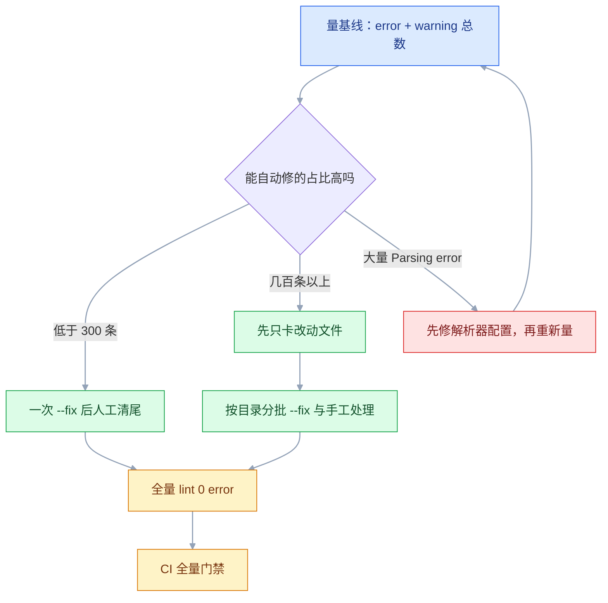
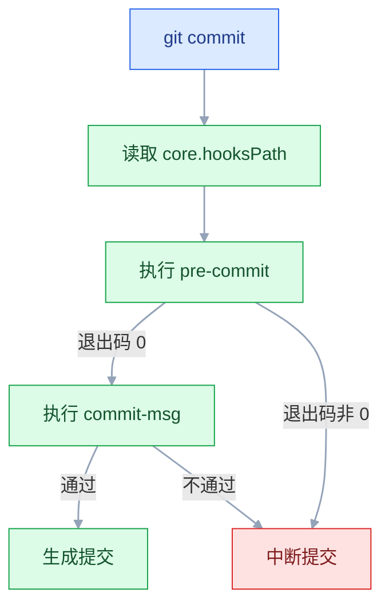

# ESLint 与 Prettier

## 一、工程案例：给 400 个文件的 Vue3 后台接入检查，且不阻塞发版

**场景**：一个 5 人维护的 Vue 3 + TypeScript 后台，`src` 下 400 个文件，此前没有任何 lint。三个具体问题：有人把 `console.log` 带上生产；两个人改同一个文件，diff 里一半是引号和缩进；提交信息是 `update`、`修改`、`fix bug`，发版时没法从记录里整理变更。

**约束**：每周发一次版，不能为了接规范停两周；历史文件的 `git blame` 不能被一次全量格式化毁掉。

**目标**：保存自动格式化、提交前拦截新增问题、CI 兜底；历史问题分批清，不搞「一次修 400 个文件」的大提交。

**三个阶段**：

| 阶段 | 做什么 | 产出 |
|---|---|---|
| 第一周 | 装工具、配规则，只对改动文件强制 | 新代码干净，历史代码照旧 |
| 第二周 | 自动修复能修的，手工处理剩下的 | 全量 `lint` 通过 |
| 之后 | CI 全量门禁，规则按需增补 | 不再回退 |

### 1.1 先划清三种检查的边界

| 工具 | 管什么 | 典型问题 | 会不会改代码 |
|---|---|---|---|
| ESLint | 代码正确性与潜在 bug | 未使用变量、`==`、忘记 `await` | 部分规则可自动修 |
| Prettier | 纯格式 | 缩进、引号、分号、换行 | 几乎全部自动改 |
| `vue-tsc` | 类型 | 参数类型不匹配、属性不存在 | 不改，只报错 |

三者不重叠。把格式交给 ESLint、把类型交给 lint 规则，都会得到更慢、更难维护的配置。

### 1.2 量一次基线

先装依赖，但顺序上「配置」必须早于「基线」：ESLint 9 在目录里找不到 `eslint.config.js` 会直接报错退出，没有配置就没有基线。所以真实执行顺序是先落配置（见 1.3），再回来跑下面这条。

```bash
pnpm add -D eslint @eslint/js typescript-eslint eslint-plugin-vue globals
pnpm exec eslint . -f json -o eslint-report.json || true
node -e "const r=require('./eslint-report.json');console.log(r.reduce((n,f)=>n+f.errorCount+f.warningCount,0))"
# 1842
```

1,842 个问题，其中约 61% 可以用 `--fix` 消掉。这个数字决定了后面是「直接全量修」还是「先只卡新增」——超过几百条就不要一次性摊在业务 PR 里。



判断点只有一个：**问题数里有多少是可自动修复的**。绝大多数是 `Parsing error` 时，说明配置还没对（见 2.3），此时的数字没有参考价值。

### 1.3 配置 flat config

ESLint 9 起默认读取 `eslint.config.js`，旧的 `.eslintrc*` 默认不再生效（旧格式的移除进度以官方当前稳定版为准，涉及 CI 镜像时先用 `eslint -v` 对齐版本）。

```bash
pnpm add -D prettier eslint-config-prettier
```

```js
// eslint.config.js
import js from '@eslint/js'
import tseslint from 'typescript-eslint'
import pluginVue from 'eslint-plugin-vue'
import globals from 'globals'
import eslintConfigPrettier from 'eslint-config-prettier'

export default tseslint.config(
  // 只含 ignores 的对象是全局忽略；和 files 混在一起就只对该组生效
  { ignores: ['dist/**', 'node_modules/**', 'coverage/**', 'public/**'] },

  js.configs.recommended,
  ...tseslint.configs.recommended,
  ...pluginVue.configs['flat/recommended'],

  // .vue 里的 <script lang="ts"> 用 TS 解析；漏了会报 parsing error
  {
    files: ['**/*.vue'],
    languageOptions: { parserOptions: { parser: tseslint.parser } },
  },

  {
    files: ['**/*.{js,ts,vue}'],
    languageOptions: {
      ecmaVersion: 'latest',
      sourceType: 'module',
      globals: { ...globals.browser, ...globals.node },
    },
    rules: {
      'no-undef': 'off',
      'no-unused-vars': 'off',
      '@typescript-eslint/no-unused-vars': ['error', { argsIgnorePattern: '^_' }],
      '@typescript-eslint/no-explicit-any': 'warn',
      'vue/multi-word-component-names': 'off',
      'no-console': ['warn', { allow: ['warn', 'error'] }],
      eqeqeq: ['error', 'always'],
      'prefer-const': 'error',
    },
  },

  { files: ['**/*.{test,spec}.ts'], rules: { '@typescript-eslint/no-explicit-any': 'off' } },

  eslintConfigPrettier,   // 必须最后：关掉上面所有与格式冲突的规则
)
```

几个容易写错的地方：

| 写法 | 原因 |
|---|---|
| `...tseslint.configs.recommended` | 它是配置数组，必须展开 |
| `...pluginVue.configs['flat/recommended']` | 插件提供的扁平配置是数组，`flat/` 前缀区分旧的对象式 `recommended` |
| `no-undef` / `no-unused-vars` 关掉 | TS 已经检查，开着只会误报 |
| `argsIgnorePattern: '^_'` | 约定 `_` 开头的参数是故意不用 |

### 1.4 Prettier 只做格式

```jsonc
// .prettierrc
{
  "printWidth": 100,
  "semi": false,
  "singleQuote": true,
  "trailingComma": "all",
  "endOfLine": "lf"
}
```

```text
# .prettierignore
dist
coverage
pnpm-lock.yaml
public
```

`printWidth` 是「尽量不超过」，不是硬截断；字符串和注释可能超。`endOfLine: "lf"` 是为了避免 Windows 与 macOS 互相产生整文件 diff。

### 1.5 第一周：只卡改动

```jsonc
// package.json（scripts）
{
  "lint": "eslint .",
  "lint:changed": "git diff --name-only --diff-filter=ACMR origin/main...HEAD -- '*.ts' '*.vue' | xargs -I{} eslint {}",
  "format": "prettier --write .",
  "format:check": "prettier --check ."
}
```

`origin/main...HEAD` 是三点，表示「从共同祖先到 HEAD 的改动」；两点会把主分支的新提交也算进来。`--diff-filter=ACMR` 排除删除的文件，否则 `eslint` 会报文件不存在。

两个坑：改动集为空时（比如只改了 Markdown），不加 `-I{}` 的 `xargs` 会执行一次不带参数的 `eslint` 并报错退出；CI 上是浅克隆，拿不到 `origin/main` 的历史，必须 `fetch-depth: 0`（见 1.8）。

CI 第一阶段：

```yaml
- run: pnpm lint:changed     # 改动文件必须过
- run: pnpm lint || true     # 全量只报告，不卡发布
```

`|| true` 是临时手段，必须有个明确的结束时间。等到自动修复和手工清理完成，把它删掉，换成全量门禁。

### 1.6 第二周：批量清理

```bash
pnpm exec eslint . --fix
pnpm exec prettier --write .
pnpm lint
# 剩余 96 个问题，逐个人工处理
```

把「纯格式化」和「逻辑修改」分成两个提交：

```bash
git add -A && git commit -m "style: 全量执行 prettier 与 eslint --fix"
echo "$(git rev-parse HEAD)" >> .git-blame-ignore-revs
git add .git-blame-ignore-revs && git commit -m "chore: 记录格式化提交，供 blame 跳过"
git config blame.ignoreRevsFile .git-blame-ignore-revs
```

`.git-blame-ignore-revs` 让 `git blame` 跳过这次纯格式提交，历史责任仍然指向真正的作者。这个文件必须一起提交进仓库：GitHub 只读仓库里的版本，`git config` 那一行只是让本地 `git blame` 生效。

### 1.7 提交前拦截

```bash
pnpm add -D husky lint-staged
pnpm exec husky init
# 生成的 .husky/pre-commit 里默认是 npm test，要覆盖成下一段的内容
```

```bash
# .husky/pre-commit
pnpm exec lint-staged
```

```bash
# .husky/commit-msg
pnpm exec commitlint --edit "$1"
```

```jsonc
// package.json
{
  "scripts": { "prepare": "husky" },
  "lint-staged": {
    "*.{js,ts,vue}": ["eslint --fix", "prettier --write"],
    "*.{json,css,scss,md,yml,yaml}": ["prettier --write"]
  }
}
```

`lint-staged` 只处理暂存区里的文件。全量 lint 要几十秒，只查改动的三五个文件是几百毫秒。

```bash
pnpm add -D @commitlint/cli @commitlint/config-conventional
```

```js
// commitlint.config.mjs
export default {
  extends: ['@commitlint/config-conventional'],
  rules: {
    'type-enum': [2, 'always', [
      'feat', 'fix', 'docs', 'style', 'refactor',
      'perf', 'test', 'build', 'ci', 'chore', 'revert',
    ]],
    'subject-empty': [2, 'never'],
    'subject-max-length': [2, 'always', 72],
  },
}
```

### 1.8 CI 兜底

```yaml
# .github/workflows/lint.yml
name: Lint
on: [push, pull_request]
jobs:
  lint:
    runs-on: ubuntu-latest
    steps:
      - uses: actions/checkout@v4
        with: { fetch-depth: 0 }        # 三点 diff 需要共同祖先，浅克隆拿不到
      - uses: pnpm/action-setup@v4
        with: { version: 10 }
      - uses: actions/setup-node@v4
        with: { node-version: 22, cache: pnpm }
      - run: pnpm install --frozen-lockfile
      - run: pnpm lint
      - run: pnpm format:check
      - run: pnpm exec vue-tsc --noEmit
```

本地钩子可以被 `git commit --no-verify` 绕过，CI 不能。两者都要有：钩子图的是「改起来便宜」，CI 图的是「不可绕过」。

### 1.9 验收

| # | 检查项 | 命令 | 通过标准 |
|---|---|---|---|
| 1 | 新克隆可用 | `pnpm install` 后跑 `git config core.hooksPath` 与 `ls -l .husky/_/pre-commit` | 指向 `.husky/_` 且入口文件可执行 |
| 2 | 全量 lint | `pnpm lint` | 0 error，warning 有清单 |
| 3 | 格式一致 | `pnpm format:check` | 输出 `All matched files use Prettier code style!` |
| 4 | 提交拦截 | 在 `src` 下留一个未使用的 `const unused = 1` 后提交 | 被 pre-commit 拦下，退出码非 0 |
| 5 | 绕过也会被 CI 抓 | `git commit --no-verify` 后推送 | CI 失败 |
| 6 | 提交信息校验 | `git commit -m "修改"` | 报 `subject-empty` 或 `type-empty` |
| 7 | Vue 里的 TS | 在 `<script setup lang="ts">` 写 `any` | 正常报规则，不是解析错误 |
| 8 | 配置顺序 | `pnpm exec eslint --print-config src/App.vue` | `quotes`、`semi`、`indent` 的值为 `0` 或 `"off"` |
| 9 | 历史未被重排 | `git diff -w <格式化提交>^ <格式化提交> --stat` | 输出近乎为空，没有逻辑改动 |
| 10 | CI 时长 | Actions 日志 | lint + format + 类型检查 < 90s |

第 4 项故意选一条不可自动修复的规则：`prefer-const`、`eqeqeq` 都会被 `eslint --fix` 顺手改掉，钩子照样放行，测不出拦截是否生效。

第 7 项要专门测：`.vue` 的解析链是 `vue-eslint-parser` 先拆 SFC，再把 `<script>` 交给 `tseslint.parser`，少配一层就报 `Parsing error`。

第 8 项是判断「两个工具是否还在打架」的最快方式：只要 ESLint 里还有格式规则是开着的，保存时就可能和 Prettier 来回改。

### 1.10 回退

配置类改动可以整体回退：删掉 `eslint.config.js`、`.prettierrc`、`.husky/`，移除 `prepare` 与 `lint-staged` 字段，CI 里的三个 step 删除。历史代码没有被改坏，回退成本很低。

真正不可逆的是「全量格式化」那次提交。所以它必须单独一个 commit，并且先确认没有未提交的业务改动。

---

## 二、高频问答：会卡住你的地方，也是面试最常问的

### 2.1 保存一次，引号被改回去又改回来

**现场**

打印最终生效配置，而不是看配置文件里写了什么：

```bash
pnpm exec eslint --print-config src/App.vue | grep -E '"(quotes|semi|indent)"'
# 期望值都是 0 或 "off"（不同版本打印形式不同，看严重级别而不是字面量）
```

**要点**

- ESLint 的格式规则（`quotes`、`semi`、`indent`）与 Prettier 同时生效，两者各改一次。
- `eslint-config-prettier` 必须放最后，否则它关掉的规则会被后面的配置重新打开。
- 只要这几条规则还是开的，保存时就可能来回改。

**追问**

- 为什么必须放最后？→ 数组按顺序合并，后写的覆盖前面的。
- `eslint-plugin-prettier` 不行吗？→ 能把 Prettier 当规则跑，但更慢，报错位置更绕。

### 2.2 改了配置完全不生效

**现场**

`--debug` 会打印它加载了哪个配置文件、忽略了哪些路径：

```bash
pnpm exec eslint --debug src/App.vue 2>&1 | head -30
```

**要点**

- flat config 不向上级目录查找，只读当前工作目录的 `eslint.config.js`，和 `.eslintrc` 正好相反。
- 在子目录执行、`--config` 指错文件、文件被 `ignores` 排除，都表现为「改了没反应」。
- 仓库根的命令要在根目录执行，或者在子包里放一份自己的配置。

**追问**

- 文件被 `ignores` 会怎样？→ 静默跳过，连规则都不跑。
- monorepo 怎么组织配置？→ 每个包一份，或从根导出一份共享配置。

### 2.3 `.vue` 文件报 `Parsing error`

**现场**

先看报错里有没有 `parserOptions.parser` 或 `typescript` 字样，再用一个最小的 `.vue` 文件单独跑一次。

```js
{ files: ['**/*.vue'], languageOptions: { parserOptions: { parser: tseslint.parser } } }
```

**要点**

- `vue-eslint-parser` 先拆 SFC，再把 `<script>` 交给 `tseslint.parser`，少配一层就报解析错误。
- 只在 `.vue` 报错、`.ts` 正常，就是 SFC 的第二层解析没配。
- 降级会掩盖配置缺失，还丢掉新规则。

**追问**

- 为什么要两层 parser？→ 外层认 SFC 结构，内层认脚本语言。
- `.vue` 的模板部分谁解析？→ `vue-eslint-parser` 自己处理。

### 2.4 类型规则报「需要类型信息」

**现场**

先看报错原文里有没有 `parserOptions.project` 或 `type information`，再确认 `tsc --noEmit` 能不能覆盖这个文件。

```js
languageOptions: {
  parserOptions: { projectService: true, tsconfigRootDir: import.meta.dirname },
}
```

**要点**

- `no-floating-promises` 这类规则要读类型，必须开启 `projectService` 或 `project`。
- 文件还必须在 tsconfig 的 `include` 里，否则 ESLint 找不到项目。
- 类型感知规则会让 lint 慢一个数量级，只对 `src` 开，不要对全仓库开。

**追问**

- 为什么类型检查覆盖不到就不行？→ ESLint 要顺着 tsconfig 去构造程序，没有项目就无从读类型。
- 生成代码、脚本也开类型规则会怎样？→ 它们常常不在 `include` 里，只会报「找不到项目」。

### 2.5 `git commit` 时钩子完全不跑

**现场**

看 Git 实际读哪个目录，而不是看 `.husky/pre-commit` 在不在：

```bash
git config core.hooksPath        # 期望 .husky/_
pnpm exec husky                  # 重新安装钩子
```

**要点**

- 三个原因：`prepare` 没执行（比如用 `--ignore-scripts` 装依赖）、`core.hooksPath` 被别的工具改过、GUI 客户端没走命令行 Git。
- `core.hooksPath` 不是默认值就说明钩子被劫持。
- 再手动执行一次 `.husky/pre-commit`，看脚本本身是否报错。

**追问**

- 为什么 `--ignore-scripts` 会导致钩子没装？→ `prepare` 不执行，`husky` 没跑起来。
- 换台机器克隆后要做什么？→ `pnpm install` 触发 `prepare`，钩子自然装上。

### 2.6 `lint-staged` 把没暂存的改动也带走了

**现场**

`git status` 看该文件是否同时出现在暂存与未暂存区：

```bash
git add -p src/App.vue        # 先把一个文件拆成多次提交
pnpm exec lint-staged --no-stash   # 调试时关闭 stash
```

**要点**

- 同一个文件既有暂存改动又有未暂存改动时，lint-staged 默认会 stash 未暂存部分。
- 任务失败时恢复 stash 可能出问题，这是部分暂存的固有代价，不是工具缺陷。
- 先把改动拆干净再提交，调试时用 `--no-stash` 关掉 stash。

**追问**

- 它为什么要 stash？→ 要保证跑的是暂存区内容，又不能丢工作区改动。
- 怎么避免这种提交？→ `git add -p` 把文件拆成多次提交。

### 2.7 本地通过，CI 报一堆新错误

**现场**

两边分别跑一次，对比版本：

```bash
pnpm exec eslint -v
pnpm why eslint
```

**要点**

- 本地用了全局 ESLint、CI 用项目依赖，或锁文件没更新导致插件版本不同。
- 版本不一致通常报插件加载失败，不会凭空多出规则错误。
- 让 CI 打印 `eslint -v` 和 `--print-config` 的哈希，配置一致还不同，再查忽略文件与换行符。

**追问**

- 为什么全局那份会惹祸？→ 它不读项目 lock，插件版本对不上。
- 换行符怎么影响 lint？→ `endOfLine` 配了 `lf`，CRLF 文件会被整篇报格式错误。

### 2.8 TS 项目里 `no-unused-vars` 误报

**现场**

看报错里的规则名是 `no-unused-vars`，还是带 `@typescript-eslint/` 前缀：

```js
'no-unused-vars': 'off',
'@typescript-eslint/no-unused-vars': ['error', { argsIgnorePattern: '^_' }],
```

**要点**

- 基础规则不认识 TS 的类型语法（如构造函数参数属性），要用 `@typescript-eslint/no-unused-vars`。
- 直接关掉规则，会连真正的未使用变量一起放过。
- 基础版和 TS 版同时开着时，同一个变量会报两次，所以基础版要设 `off`。

**追问**

- 为什么基础规则认不出参数属性？→ 它按纯 JS 语法解析，不认识 TS 的类型声明。
- `argsIgnorePattern` 做什么？→ 约定 `_` 开头的参数是故意不用。

### 2.9 第一次全量格式化，diff 几万行

**现场**

先看 `git diff --stat` 是否几乎覆盖所有文件，再单独做一次 commit：

```bash
git add -A && git commit -m "style: 全量格式化"
echo "$(git rev-parse HEAD)" >> .git-blame-ignore-revs
```

**要点**

- 格式改动和业务改动混在一个提交里，评审无法看逻辑，`git blame` 全指向这次提交。
- 「只是格式」也有成本：必须独立成一个 commit，并记进 `.git-blame-ignore-revs`。
- `git diff -w` 应该几乎为空；不为空说明 `--fix` 顺带改了语义，必须拆开。

**追问**

- `.git-blame-ignore-revs` 为什么必须提交？→ GitHub 只读仓库里的版本，本地 `git config` 只影响自己。
- 为什么用 `-w` 判断？→ 忽略空白差异，剩下的就是语义改动。

### 2.10 `commitlint` 报 `subject-empty`，但明明写了描述

**现场**

把提交信息贴进去，看解析结果：

```bash
echo "fix：修复登录" | pnpm exec commitlint   # 全角冒号，失败
echo "fix: 修复登录" | pnpm exec commitlint   # 半角冒号，通过
```

**要点**

- 用了中文全角冒号 `：`，解析器认不出 `type:` 的分隔。
- `type` 和描述之间没有空格，同样会失败。
- 去掉规则等于放弃「type 必须存在」的约束，先看解析输出里 `type` 是不是空的。

**追问**

- 为什么全角冒号不行？→ 规范里 `:` 是分隔符，全角字符不算。
- `type` 为什么会是空？→ 分隔符没被识别，整串都被当成了 subject。

### 2.11 ESLint 9 加载旧插件时报错

**现场**

看报错是不是 `config is not iterable` 或 `Cannot read properties of undefined`：

```js
import { FlatCompat } from '@eslint/eslintrc'
const compat = new FlatCompat({ baseDirectory: import.meta.dirname })
export default [...compat.extends('plugin:old-plugin/recommended')]
```

**要点**

- 插件只导出旧格式（`configs.recommended` 是对象），flat config 需要数组或 `FlatCompat` 包装。
- 退 ESLint 8 会把整个生态拖回旧格式。
- 看插件文档有没有 `flat` 配置；没有就用 `FlatCompat` 过渡，同时找替代插件。

**追问**

- 为什么旧格式不能直接用？→ flat config 是数组，逐项合并，对象 spread 不进去。
- `FlatCompat` 算长期方案吗？→ 只是过渡，插件适配后应该换掉。

### 2.12 `pnpm lint` 越来越慢

**现场**

先看哪条规则最耗时，再决定优化方向：

```bash
TIMING=1 pnpm exec eslint . | head -20
pnpm exec eslint . --cache --cache-location node_modules/.cache/eslint
```

**要点**

- 加机器对类型检查的收益很小。
- 三个原因：类型感知规则全量开启、把 `dist`/`coverage` 也扫了、monorepo 每个包各跑一遍全量。
- 先看 `TIMING` 排名，再决定关规则、缩范围，还是只跑改动文件。

**追问**

- `--cache` 解决什么？→ 只省没变文件的重复检查，不降单次成本。
- 为什么类型规则最贵？→ 每条都要构造 TypeScript 程序回答「这个表达式是什么类型」。

---

## 三、核心知识：从零开始要建立的东西

### 3.1 静态分析与 AST

ESLint 不执行代码，它把源码解析成抽象语法树（AST），再让规则遍历这棵树。


由此产生两个重要性质：

- **只能看到语法和有限的语义**。「这个变量运行时会是什么」超出静态分析能力，类型感知规则靠额外读取 TypeScript 类型来补。
- **规则之间互不知情**。它们共享同一棵树，各自报告问题；两条规则改同一段代码时，`--fix` 可能只应用一条。

### 3.2 规则、插件与配置对象

| 概念 | 作用 | 例子 |
|---|---|---|
| rule | 一条检查逻辑 | `no-console`、`eqeqeq` |
| plugin | 一组规则与预设配置的包 | `eslint-plugin-vue` |
| config | 把规则、解析器、文件范围组合起来 | `eslint.config.js` 的数组元素 |
| preset | 别人配好的规则集合 | `js.configs.recommended` |

规则值有三种形态：

```js
'no-console': 'off',                                  // 关闭
'no-console': 'warn',                                 // 警告，退出码仍为 0
'no-console': ['error', { allow: ['warn', 'error'] }], // 带选项
```

`error` 才会让 `eslint` 以非零退出码结束，CI 才会失败。`warn` 适合「先观察一段时间」的规则；如果 CI 想让 warning 也卡住，加 `--max-warnings 0`，而不是把所有规则改成 `error`。

### 3.3 flat config 的查找与合并

flat config 是一个数组，数组元素按顺序合并；后面的对象覆盖前面的同名规则，但只对匹配 `files` 的文件生效。

```js
export default [
  { ignores: ['dist/**'] },              // 全局忽略
  js.configs.recommended,
  { files: ['**/*.ts'], rules: { eqeqeq: 'error' } },
  { files: ['**/*.test.ts'], rules: { eqeqeq: 'off' } },   // 只覆盖测试文件
]
```

四组关键差异（相对 `.eslintrc`）：

| 行为 | 旧格式 | flat config |
|---|---|---|
| 查找方式 | 向上级目录级联 | 只读工作目录的 `eslint.config.js`，不向上查找 |
| 扩展方式 | `extends` 字符串 | 直接 import 对象并展开 |
| 文件范围 | `overrides` | 配置对象里的 `files` |
| 忽略文件 | `.eslintignore` | 只含 `ignores` 的配置对象 |

**全局忽略与局部忽略**：只写 `ignores` 的对象对所有文件生效；同时写 `files` 和 `ignores` 时，忽略只作用于该组。把 `ignores` 放在数组开头是惯例，不是语法要求，但能避免读错。因为数组按顺序合并，把「放宽」的对象写在「收紧」的对象之后，就会覆盖掉前面的规则。

> **面试**：常问「flat config 和 `.eslintrc` 最大的区别？」答：数组按顺序合并、直接 import 展开、不再向上级目录查找配置。

### 3.4 parser 与 languageOptions

parser 决定「源码怎么变成 AST」，`languageOptions` 决定「按什么语言规则解析」。

| 配置 | 作用 |
|---|---|
| `ecmaVersion` | 支持哪一代 JS 语法 |
| `sourceType` | `module` 或 `script` |
| `globals` | 预定义的全局变量（`window`、`process`） |
| `parserOptions.parser` | Vue SFC 内部脚本用哪个 parser |
| `parserOptions.projectService` | 是否读取 TypeScript 类型 |

`globals.browser` 告诉 ESLint「`window` 是已定义的」；不配就会把 `window` 报成 `no-undef`。TS 项目通常把 `no-undef` 关掉，因为类型检查已经覆盖。

### 3.5 类型感知规则的成本

普通规则只看 AST；类型感知规则还要构造 TypeScript 程序，回答「这个表达式的类型是什么」。

```js
// 只有开了类型信息，这条规则才能判断 Promise 有没有被处理
'@typescript-eslint/no-floating-promises': 'error',
```

| 模式 | 速度 | 能查什么 |
|---|---|---|
| 无类型 | 快 | 语法、命名、部分控制流 |
| `projectService` | 慢一个数量级 | 跨文件的类型错误、Promise 误用 |
| 全仓库开启 | 很慢 | 同上，但大多数文件不需要 |

边界：类型感知规则要求文件属于某个 tsconfig。生成代码、配置文件、脚本常常不在 `include` 里，对它们开类型规则只会报「找不到项目」。

### 3.6 自动修复的边界

`--fix` 只应用「有唯一正确答案」的修复：引号、分号、可安全改写的语法。它不会替人做决策。

| 能自动修 | 不能自动修 |
|---|---|
| 把 `var` 改成 `let`/`const` | 函数太长要不要拆 |
| 把 `==` 改成 `===` | 这个 `any` 是否可避免 |
| 删除未使用的 import | 未使用的参数是否该保留 |
| 补分号、调整缩进 | 变量命名是否达意 |

一次 `--fix` 会做多轮：修完一轮可能触发新问题，ESLint 默认最多 10 轮。修不完的会留在输出里，退出码仍可能非零。

### 3.7 Prettier 的打印模型

Prettier 把源码解析成 AST，然后**丢弃原有格式，按自己的规则重新打印**。

这解释了三件事：

- 它几乎能格式化任何东西，因为没有「保留原样」的选项。
- 它不判断代码对错，只保证输出一致。
- 它的选项很少，因为每个选项都要在打印器里实现两套逻辑。

`printWidth` 不是硬限制：一个长字符串、一个长注释、一个无法拆分的表达式，都可能超过它。

> **面试**：常问「Prettier 和 ESLint 该怎么分工？」答：Prettier 只管格式、丢弃原格式重新打印，ESLint 管正确性，格式规则要关掉。

### 3.8 格式规则冲突的根因

两个工具都能改格式，谁后改谁生效，于是保存时来回跳。

| 处理方式 | 结果 |
|---|---|
| ESLint 里保留 `quotes`/`semi`/`indent` | 与 Prettier 冲突 |
| 用 `eslint-config-prettier` 关掉 | 各管各的，推荐 |
| 用 `eslint-plugin-prettier` 把 Prettier 当规则 | 可以，但更慢，报错位置也更绕 |

`eslint-config-prettier` 是一个「只含关闭项」的配置对象，必须放在数组最后。它不会帮你格式化，只负责让 ESLint 闭嘴。

### 3.9 忽略与作用域

| 目的 | 写法 |
|---|---|
| 全局忽略构建产物 | `{ ignores: ['dist/**'] }` |
| 只忽略某类文件的某条规则 | `{ files: ['**/*.test.ts'], rules: { 'no-console': 'off' } }` |
| 忽略单个文件里的某一行 | `// eslint-disable-next-line no-console` |
| 忽略整个文件 | `/* eslint-disable */` 放在文件顶部 |

生效率不是一条链：命中全局 `ignores` 的文件根本不进入检查，文件内的 `eslint-disable` 再无效也没机会执行；没被忽略时，文件内注释覆盖规则配置。**不要用文件内 `eslint-disable` 处理第三方代码**，那是 `ignores` 的职责；注释只该用于「这里确实有例外，并且写明了原因」。

### 3.10 Git hooks 的执行机制



hook 就是一个可执行脚本，靠退出码决定是否放行。husky 做两件事：把 `core.hooksPath` 指向 `.husky/_`，并在那里放一个统一入口去调用 `.husky/` 下的同名脚本。

`--no-verify` 跳过所有 hook，这是 Git 的能力，不是 husky 的漏洞。所以本地钩子只能降低返工成本，不能当门禁。

> **面试**：常问「本地钩子能被绕过，为什么还要装？」答：`--no-verify` 绕得过，所以钩子图改起来便宜，真正的门禁放在 CI。

### 3.11 暂存区与 lint-staged

`git commit` 提交的是**暂存区**，不是工作区。`lint-staged` 的工作流程：

1. 取出暂存区的文件列表。
2. 把未暂存的改动 stash 起来（默认行为）。
3. 对暂存文件跑配置的命令。
4. 把修改后的文件重新 `git add`。
5. 恢复 stash。

这带来两个副作用：任务失败时，工作区可能暂时看不到未暂存的改动；同一个文件被拆成多次提交时，恢复过程容易冲突。理解这一点，就不会把「部分暂存」的异常归咎于工具。

### 3.12 提交信息规范

Conventional Commits 的格式：

```text
<type>(<scope>): <subject>

[optional body]

[optional footer]
```

| type | 含义 | 对版本的影响 |
|---|---|---|
| `feat` | 新功能 | 次版本 +1 |
| `fix` | 修 bug | 修订号 +1 |
| `perf` | 性能优化 | 修订号 +1 |
| `docs` / `style` / `refactor` / `test` / `build` / `ci` / `chore` | 非功能性改动 | 无 |
| `feat!` 或 footer `BREAKING CHANGE:` | 破坏性变更 | 主版本 +1 |

规范的价值不在「好看」，而在可机读：自动生成 CHANGELOG、自动决定版本号、按 type 过滤 `git log`。没有规范时，这些都要靠人回忆。

### 3.13 CI 门禁

| 检查 | 命令 | 失败含义 |
|---|---|---|
| lint | `eslint .` | 有 error，或 warning 超过阈值 |
| format | `prettier --check .` | 有文件未格式化 |
| 类型 | `vue-tsc --noEmit` | 类型不匹配 |
| 单测 | `vitest run` | 行为回归 |

各项分开跑，失败信息更清楚；串在一个 `&&` 里只会看到第一个错误。CI 上还要固定 Node 与包管理器版本，否则「本地过、CI 不过」会反复出现。门禁的目标是「拦住新问题」，不是「让历史问题永远红着」——存量没清完之前，门禁范围要和 1.5 的落地节奏对齐。

### 3.14 编辑器集成

| 插件 | 作用 |
|---|---|
| ESLint（`dbaeumer.vscode-eslint`） | 实时标错、保存时修复 |
| Prettier（`esbenp.prettier-vscode`） | 保存时格式化 |
| Vue - Official | SFC 语法与类型支持 |

```jsonc
// .vscode/settings.json
{
  "editor.formatOnSave": true,
  "editor.defaultFormatter": "esbenp.prettier-vscode",
  "editor.codeActionsOnSave": { "source.fixAll.eslint": "explicit" },
  "eslint.validate": ["javascript", "typescript", "vue"],
  "typescript.tsdk": "node_modules/typescript/lib"
}
```

保存时通常先跑 ESLint 修复（如 import 排序），再交给 Prettier 格式化后落盘；两者的先后由编辑器版本决定，不必死记，关键是别让 ESLint 的格式规则同时生效。把 `.vscode/settings.json` 提交进仓库，团队才有一致行为；只放在个人配置里，新人永远对不齐。`source.fixAll.eslint` 设成 `"explicit"` 而不是 `true`，是为了避免保存时顺带跑那些会改逻辑的修复。

### 3.15 规则治理与存量迁移

规则不是越多越好。一次开 50 条，团队会学会批量加 `eslint-disable`，比不开更糟。

| 阶段 | 做法 |
|---|---|
| 起步 | 只用 `recommended`，加 3-5 条团队真正痛过的规则 |
| 观察 | 新规则先设 `warn`，跑一周看误报 |
| 收紧 | 误报可解释的升 `error`，误报多的调选项或关掉 |
| 存量 | 先只卡改动文件，再批量清理，最后全量门禁 |
| 分层 | 测试、脚本、生成代码用 `files` 放宽，不要全局放宽 |

一条实用判断：**如果一条规则让所有人都加 disable，它就没有在保护代码，只是在制造噪音。**

---

## 四、冷门知识汇总

第二节写的是「卡住时的排查路径」，这一节只记平时用不到、真要用时查一下就够的开关与包。放在这里的东西有个共同点：忘了不影响日常开发，临时搜也能找到。

| 知识点 | 为什么冷门 | 用到时的关键词 |
|---|---|---|
| `--print-config` | 只在排查「规则到底开没开」时用 | `eslint --print-config src/App.vue` |
| `TIMING=1` | 性能排查才用 | `TIMING=1 eslint .` |
| 共享配置包 | 多项目统一规范时才做 | `eslint-config-*`、`@acme/eslint-config` |
| `no-restricted-imports` | 团队禁用某个模块时用 | 禁止 `lodash` 全量导入 |
| 自定义规则 | 业务约束无法用现成规则表达 | `RuleTester`、`context.report` |
| `FlatCompat` | 只在插件未适配 flat config 时用 | `@eslint/eslintrc` |
| `.git-blame-ignore-revs` | 全量格式化后才知道需要 | `blame.ignoreRevsFile` |
| `lint-staged --no-stash` | 调试部分暂存问题 | 关闭 stash |
| Prettier 插件 | Tailwind 类名排序等场景 | `prettier-plugin-tailwindcss` |
| EditorConfig | 跨编辑器统一缩进与换行 | `.editorconfig` |
| `eslint --cache` | 大仓库本地提速 | `--cache-location` |
| `--max-warnings 0` | 想把 warning 也算进 CI 门禁时才用 | `eslint . --max-warnings 0` |
| `--fix-dry-run` | 只想预览 `--fix` 会改什么，不落盘 | `eslint . --fix-dry-run -f json` |
| `--no-error-on-unmatched-pattern` | 脚本匹配不到文件时不想报错 | `eslint --no-error-on-unmatched-pattern 'src/**/*.ts'` |
| `prettier --ignore-unknown` | lint-staged 传来未知扩展名时才用 | 跳过 `.env` 之类不认识的文件 |
| `vue-tsc` 与 `tsc` | Vue 项目类型检查的实际入口 | `vue-tsc --noEmit` |
| 只检查改动文件 | 存量项目落地规范的关键 | `git diff --name-only` + `xargs` |