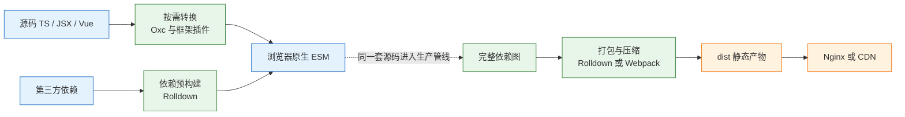
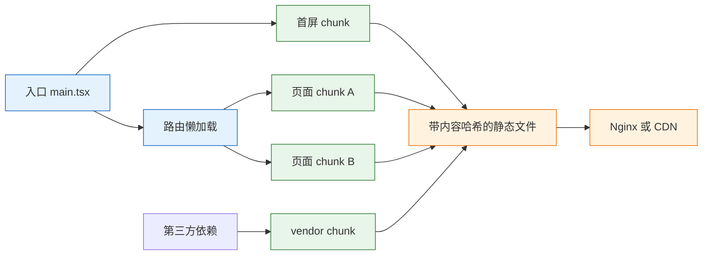

# Vite 与 Webpack

---

## 一、Vite 与 Webpack 是什么

### 1.1 核心概念

前端源码不能直接交给浏览器执行。TypeScript 的类型标注、JSX 的标签语法、Vue 的单文件组件、CSS 的预处理器语法，以及大量以 CommonJS 形式发布的第三方包，都需要先转换成浏览器认识的 JavaScript、CSS 和静态资源 URL。Vite 与 Webpack 都是完成这层转换的**前端构建工具**：它们从入口文件出发建立模块依赖图，在开发阶段提供本地服务器与热更新，在生产阶段把依赖图打包成可部署的静态文件。

构建工具解决三类问题：

- **语法转换**：把 TypeScript、JSX、Vue、SCSS 等源码转换成浏览器可执行的代码。
- **依赖组织**：解析 `import` 语句，把散落在 `node_modules` 与业务目录中的模块合成一张图，处理路径别名、扩展名和条件导出。
- **交付优化**：压缩代码、删除未使用分支、拆分公共依赖、给文件名加内容哈希，让产物适合长期缓存与 CDN 分发。

它不解决代码质量与业务正确性。类型错误、运行时异常、包体积是否合理，仍要由类型检查、测试和依赖治理负责。构建工具只保证“源码按规则变成产物”，不保证产物里的逻辑是对的。

两者的根本差异在**转换时机**。Webpack 在启动开发服务器前先走完整张依赖图，把入口及其全部依赖编译成 bundle，再让浏览器加载；Vite 在开发阶段不提前打包，浏览器通过原生 ESM 逐个请求模块，服务端只转换当前被请求的那一个文件，生产构建时才完整打包。这个差异决定了冷启动曲线、热更新粒度，也决定了它们各自适合的场景。

| 概念 | 含义 | Webpack 对应 | Vite 对应 |
|---|---|---|---|
| 入口 | 依赖图起点 | `entry` | `index.html` 中的模块脚本 |
| 模块图 | 源码与依赖的引用关系 | compilation 的 module graph | 开发期按请求生成，构建期完整生成 |
| 转换器 | 把非 JS 源码变成可执行模块 | loader | 内置转换与框架插件 |
| 扩展点 | 介入构建生命周期 | plugin | 插件，兼容 Rollup 钩子 |
| 热更新 | 替换变更模块而不刷新页面 | HMR Runtime | HMR 基于 ESM 边界 |
| 代码分割 | 把产物拆成多个文件 | `splitChunks`、动态 `import` | 动态 `import`、`manualChunks` |
| 产物优化 | 压缩、摇树、哈希命名 | Terser、Tree Shaking | Rolldown、Tree Shaking |

### 1.2 与相邻技术的关系

构建工具位于源码与浏览器之间，向上承接框架和语言扩展，向下对接部署环境。它与相邻技术的边界需要分清，否则排障时容易把构建问题当成框架问题。

| 相邻技术 | 负责内容 | 与构建工具的关系 |
|---|---|---|
| Node.js | 执行构建脚本、提供文件系统与网络能力 | 构建工具运行在 Node 之上，版本不符会直接启动失败 |
| 包管理器 | 安装依赖、生成 lockfile | 构建工具读取 `node_modules`，不负责版本解析 |
| TypeScript | 类型检查与声明生成 | Vite 只做转译不做检查，检查要单独执行 `tsc --noEmit` |
| 框架插件 | 编译 JSX、Vue SFC、提供 HMR 边界 | 插件把框架语法接入构建管线 |
| 浏览器 | 执行 ESM、加载静态资源 | 开发期直接消费模块，生产期消费打包产物 |
| Nginx / CDN | 托管静态文件、设置缓存与回源 | 构建产物的路径与哈希由 `base` 和输出配置决定 |
| CI 流水线 | 安装、检查、构建、上传产物 | 构建命令必须可重复执行，且不依赖本机缓存 |

`tsc` 与 Vite 的分工经常被混淆。Vite 使用 Oxc 或 esbuild 去掉类型标注，速度很快，但不做类型推断，也不会因为类型错误中断构建。把 `tsc --noEmit` 放进 `build` 脚本或 CI，是保证类型安全的必要步骤。反过来，`tsc` 不负责打包、不处理 CSS、不做代码分割，不能替代构建工具。

包管理器与构建工具同样不能互相替代。`pnpm install` 只保证依赖落盘，`vite build` 才决定哪些依赖进入产物、如何拆分、是否压缩。依赖装错版本会表现为构建报错，但根因在版本范围或 lockfile，不在打包器。

### 1.3 架构组成

两套工具的模块划分不同，但都可以拆成“描述层、转换层、执行层、输出层”。Vite 8 起开发与生产统一到 Rolldown/Oxc 这套 Rust 工具链，开发期按请求转换，生产期完整打包；Webpack 5 由 Compiler 驱动一次或多次 Compilation，loader 负责单文件转换，plugin 通过钩子介入整个过程。



| 组成 | 职责 | 关键行为 |
|---|---|---|
| 描述层 | 读取配置、入口、环境变量 | 解析 `vite.config.ts` 或 `webpack.config.js`，按 `mode` 合并默认值 |
| 转换层 | 把非 JS 模块变成可执行代码 | loader 链从右向左执行；Vite 插件按 `enforce` 排序 |
| 执行层 | 建立依赖图、调度编译与缓存 | Webpack 维护 Compilation；Vite 开发期按请求增量转换 |
| 输出层 | 生成文件、哈希、sourcemap | 决定 `dist` 结构、公共路径、压缩与拆包结果 |

Webpack 的扩展模型是 **loader + plugin**。loader 作用在单个模块上，输入源码字符串或 Buffer，输出转换后的代码；plugin 作用在整个编译过程，通过 `compiler.hooks` 与 `compilation.hooks` 在特定时机执行逻辑。Vite 的扩展模型更接近 Rollup：插件是一组带名称的钩子函数，`config`、`resolveId`、`load`、`transform` 分别介入配置、解析、加载和转换阶段。

理解这套分层后，排障就有了定位坐标：路径解析失败属于描述层或转换层，依赖预构建失败属于执行层，产物路径错误属于输出层。先判断问题落在哪一层，再决定改配置、清缓存还是换插件。

---

## 二、安装与初始化

> **版本现状（2026-10）**：Vite 8 是当前稳定版，开发与生产统一到 Rolldown/Oxc；Webpack 5 仍在维护，存量项目不必为了版本号迁移。Node.js 以当前 LTS 为基线，具体最低版本以 Vite 官方 `engines` 字段为准，安装前用 `npm view vite engines` 核对。

### 2.1 环境与版本基线

构建工具运行在 Node.js 上，Node 版本决定可用的 API、ESM 加载规则和部分依赖的原生模块能否编译。团队应在仓库里固定 Node 版本，而不是依赖每个人机器上的默认版本。

```bash
# ========== 查看当前环境 ==========
# 查看 Node 与包管理器版本
node -v
npm -v
pnpm -v

# 查看 Vite 对 Node 的版本要求，避免凭记忆判断
npm view vite engines

# ========== 固定项目版本 ==========
# 写入 .nvmrc，成员与 CI 用同一版本
node -v > .nvmrc

# 启用 Corepack，按 package.json 的 packageManager 字段选择包管理器版本
corepack enable

# 在项目中声明 pnpm 版本，提交该字段
corepack use pnpm@12
```

| 版本项 | 决定什么 | 配置位置 |
|---|---|---|
| Node 运行时 | 构建工具能否启动、ESM 与原生模块是否可用 | `.nvmrc`、CI 镜像 |
| 包管理器 | 依赖解析结果与 lockfile 格式 | `packageManager` 字段 |
| Vite | 开发服务器与构建管线的行为 | `devDependencies` |
| 框架插件 | JSX、SFC 的编译方式与 HMR 边界 | `devDependencies` |
| 浏览器目标 | 产物语法与 polyfill 需求 | `build.target`、`browserslist` |

> **注意**：`node -v` 与 CI 中的 Node 版本必须一致。Vite 的某些依赖以原生二进制形式发布，Node 大版本切换后 `node_modules` 里的二进制可能不匹配，表现为启动时报找不到模块或二进制加载失败，重新安装依赖才能恢复。

### 2.2 脚手架创建项目

Vite 提供官方脚手架，按模板生成最小工程。模板只包含框架接入与基础配置，业务路由、状态管理、请求库仍要自行安装。

```bash
# ========== 创建项目 ==========
# 使用 react-ts 模板，项目名 admin
pnpm create vite admin -- --template react-ts

# 进入目录并安装依赖
cd admin
pnpm install

# 启动开发服务器，默认 http://localhost:5173/
pnpm dev
```

| 模板 | 生成内容 | 适用场景 |
|---|---|---|
| `react-ts` | React + TypeScript + JSX 转换 | React 后台、管理端 |
| `vue-ts` | Vue 3 + TypeScript + SFC | Vue 业务系统 |
| `svelte-ts` | Svelte + TypeScript | 轻量交互页面 |
| `vanilla-ts` | 原生 TypeScript，无框架 | 库示例、最小复现 |

启动后终端会打印本地地址与网络地址。修改 `src/App.tsx` 并保存，页面不整页刷新但内容更新，说明 HMR 生效。如果保存后整页刷新，通常是该模块没有被任何 HMR 边界接受，Vite 回退到整页刷新，这不一定是故障。

### 2.3 目录结构与入口

Vite 与 Webpack 在入口约定上差异明显。Vite 把根目录的 `index.html` 当作入口，HTML 里的 `<script type="module">` 才是 JavaScript 起点；Webpack 的入口直接写在配置里，HTML 由 `HtmlWebpackPlugin` 生成。

```text
admin/
├── index.html              # Vite 的入口，必须能被开发服务器直接访问
├── package.json            # 脚本、依赖、packageManager
├── pnpm-lock.yaml          # 依赖解析结果，必须提交
├── tsconfig.json           # TypeScript 编译与路径规则
├── vite.config.ts          # 构建配置
├── public/                 # 原样复制到产物根目录的静态文件
├── src/
│   ├── main.tsx            # 应用挂载入口
│   ├── App.tsx             # 根组件
│   └── assets/             # 参与构建的图片、样式
├── node_modules/
│   └── .vite/              # 依赖预构建缓存，可删除重建
└── dist/                   # 构建产物，不提交
```

| 路径 | 作用 | 是否提交 |
|---|---|---|
| `index.html` | 开发服务器入口与产物模板 | 提交 |
| `vite.config.ts` | 插件、代理、构建选项 | 提交 |
| `public/` | 不参与模块图的静态文件 | 提交 |
| `src/assets/` | 参与哈希与优化的资源 | 提交 |
| `node_modules/.vite/` | 预构建缓存 | 不提交，可重建 |
| `dist/` | 构建产物 | 不提交，由 CI 生成 |

`public/` 与 `src/assets/` 的区别在于是否进入模块图。`public/` 下的文件按原文件名复制到产物根目录，适合 `favicon.ico`、`robots.txt`、第三方校验文件；`src/assets/` 下的文件经过导入后会参与哈希、内联判断和压缩，适合业务图片与样式引用的资源。把需要哈希的图片放进 `public/`，缓存策略会失效；把大文件放进 `src/assets/` 并被内联，JS 体积会异常增大。

### 2.4 命令行与脚本

Vite 的命令行接口很薄，日常操作主要落在 `dev`、`build`、`preview` 三个子命令上。参数可以写在命令行，也可以写进 `package.json` 的脚本，团队应统一后者，避免每个人记不同参数。

```bash
# ========== 开发 ==========
# 启动开发服务器
pnpm dev

# 指定端口与监听地址，便于局域网调试
pnpm dev --port 5174 --host 0.0.0.0

# 强制重建依赖预构建缓存，仅在依赖异常时使用
pnpm dev --force

# 指定模式，加载对应的 .env 文件
pnpm dev --mode staging

# ========== 构建与预览 ==========
# 生产构建，产物在 dist/
pnpm build

# 本地静态预览，默认 4173，仅用于验收
pnpm preview

# 构建后直接预览
pnpm build && pnpm preview
```

| 命令 | 作用 | 常见误用 |
|---|---|---|
| `vite` | 启动开发服务器 | 当作生产服务器长期运行 |
| `vite build` | 生产构建 | 以为它会做类型检查 |
| `vite preview` | 本地预览 `dist` | 当作线上静态服务器 |
| `--force` | 重建预构建缓存 | 每次启动都加，拖慢冷启动 |
| `--mode` | 切换环境文件 | 与 `NODE_ENV` 混为一谈 |
| `--host` | 暴露到局域网 | 在不可信网络暴露开发服务器 |

> **注意**：`vite preview` 只把 `dist` 静态托管，没有生产级的并发控制、缓存策略、压缩与安全响应头。上线必须使用 Nginx、CDN 或平台托管，预览通过不代表线上配置正确。

---

## 三、核心配置

### 3.1 配置文件加载

Vite 在项目根目录查找 `vite.config.ts`、`vite.config.js`、`vite.config.mjs` 等文件，用 `defineConfig` 获得类型提示。配置既可以导出对象，也可以导出函数，函数参数包含 `command` 与 `mode`，适合按开发/构建或环境分支。

```ts
// vite.config.ts
import { defineConfig, loadEnv } from 'vite';
import react from '@vitejs/plugin-react';

export default defineConfig(({ command, mode }) => {
  // 第三个参数为空字符串时加载全部变量，供配置文件内部使用
  const env = loadEnv(mode, process.cwd(), '');
  const isBuild = command === 'build';

  return {
    // 部署在子路径时必须是 '/admin/' 这种带首尾斜杠的形式
    base: env.VITE_BASE ?? '/',
    plugins: [react()],
    define: {
      // 构建期静态替换，值必须是字符串化的表达式
      __APP_VERSION__: JSON.stringify(env.VITE_APP_VERSION ?? 'dev'),
    },
    build: {
      sourcemap: isBuild ? 'hidden' : false,
    },
  };
});
```

| 加载来源 | 优先级 | 用途 |
|---|---|---|
| 命令行参数 | 最高 | 临时覆盖端口、模式、输出目录 |
| `vite.config.ts` | 高 | 插件、代理、构建选项 |
| `.env.[mode].local` | 中 | 本机私有变量，不提交 |
| `.env.[mode]` | 中 | 环境共享变量，提交 |
| `.env` | 低 | 所有环境通用的默认值 |

配置函数里可以读取 `process.env`，但只有 `loadEnv` 能读取 `.env` 文件。直接把 `process.env.VITE_API_BASE` 写进配置，在未导出该 shell 变量时会得到 `undefined`，这是常见的“本地能构建、CI 代理地址为空”的原因。

### 3.2 解析与插件

`resolve.alias` 把长相对路径变成稳定别名，`resolve.extensions` 决定省略扩展名时的查找顺序。插件数组的顺序会影响转换结果，Vite 还支持用 `enforce: 'pre'` 或 `'post'` 调整相对顺序，用 `apply: 'serve' | 'build'` 限定生效阶段。

```ts
// vite.config.ts 片段
import { fileURLToPath, URL } from 'node:url';
import react from '@vitejs/plugin-react';
import { defineConfig } from 'vite';

export default defineConfig({
  plugins: [
    // 框架插件负责 JSX 转换与 Fast Refresh 边界
    react(),
  ],
  resolve: {
    alias: {
      // 用 @ 指向 src，避免 ../../.. 形式的相对路径
      '@': fileURLToPath(new URL('./src', import.meta.url)),
    },
    // 省略扩展名时的查找顺序，越靠前优先级越高
    extensions: ['.mjs', '.js', '.mts', '.ts', '.jsx', '.tsx', '.json'],
  },
});
```

| 配置项 | 作用 | 易错点 |
|---|---|---|
| `resolve.alias` | 路径别名 | 别名必须以 `@` 或 `/` 开头，否则会被当作包名 |
| `resolve.extensions` | 省略扩展名时的查找顺序 | 顺序影响同名文件命中结果 |
| `plugins` | 扩展转换与构建行为 | 数组顺序影响 `transform` 执行次序 |
| `enforce` | 插件排序 | `pre` 在核心插件前，`post` 在后 |
| `apply` | 限定生效阶段 | 只在 `serve` 生效的插件不会影响构建 |

> **注意**：别名只影响构建工具，不影响 TypeScript。`vite.config.ts` 里配了 `@`，`tsconfig.json` 还必须配 `compilerOptions.paths`，否则编辑器报“找不到模块”，但构建能通过。两边不一致时，以构建结果和编辑器同时正常为准。

### 3.3 开发服务器

开发服务器的核心配置是监听地址、端口、代理和文件监听。代理用于把浏览器发往同源的 `/api` 请求转发到后端，绕开开发期的跨域限制；它只在开发服务器生效，生产环境仍要由 Nginx 或网关转发。

```ts
// vite.config.ts 片段
export default defineConfig({
  server: {
    // 监听 127.0.0.1 仅本机可访问；团队联调可改 0.0.0.0
    host: '127.0.0.1',
    port: 5173,
    // 端口被占用时直接失败，避免实际端口与文档不一致
    strictPort: true,
    proxy: {
      '/api': {
        target: 'http://127.0.0.1:8080',
        // 修改 Host 头，避免后端按域名做校验时拒绝
        changeOrigin: true,
        // 后端使用 WebSocket 时必须开启
        ws: true,
        // 去掉 /api 前缀，后端路由不带该前缀时使用
        rewrite: (path) => path.replace(/^\/api/, ''),
      },
    },
    // 允许访问项目根目录之外的文件，monorepo 场景常见
    fs: {
      allow: ['..'],
    },
  },
});
```

| 配置项 | 作用 | 常见错误 |
|---|---|---|
| `host` | 监听地址 | 设为 `0.0.0.0` 后暴露到不可信网络 |
| `port` / `strictPort` | 端口与占用策略 | 未开 `strictPort`，实际端口漂移 |
| `proxy` | 开发期请求转发 | 只配了路径前缀，忽略 `rewrite` |
| `proxy.ws` | WebSocket 转发 | 未开启导致热更新或实时通道断开 |
| `fs.allow` | 允许读取的目录 | 范围过大导致开发服务器可读敏感文件 |
| `hmr` | 热更新连接参数 | 反向代理后未配 `clientPort` 或协议 |

> **注意**：代理的 `target` 必须带协议与端口，`http://127.0.0.1:8080` 不能写成 `127.0.0.1:8080`。后端在容器里时，`127.0.0.1` 指向开发服务器所在环境，不是容器内部，应改成容器服务名或宿主机可达地址。

### 3.4 构建选项

构建配置决定产物目录、语法目标、资源内联阈值、sourcemap 和拆包策略。默认值适合大多数项目，改动前要明确目标：是减小首屏体积、提高缓存命中，还是兼容旧浏览器。

```ts
// vite.config.ts 片段
export default defineConfig({
  build: {
    // 产物语法目标，按实际浏览器基线设置，不要盲目降到 es5
    target: 'es2020',
    outDir: 'dist',
    assetsDir: 'assets',
    // 小于该值的资源转 base64，默认约 4KB
    assetsInlineLimit: 4096,
    // 生成 sourcemap 但不在文件末尾写引用注释，供监控平台上传
    sourcemap: 'hidden',
    // CSS 按异步 chunk 拆分，避免首屏加载全部样式
    cssCodeSplit: true,
    // 单个 chunk 超过该值只告警，不失败
    chunkSizeWarningLimit: 800,
    rollupOptions: {
      output: {
        // 按业务边界拆公共包，不要把每个依赖都单独拆一个文件
        manualChunks: {
          vendor: ['react', 'react-dom'],
          charts: ['echarts'],
        },
        entryFileNames: 'assets/[name]-[hash].js',
        chunkFileNames: 'assets/[name]-[hash].js',
        assetFileNames: 'assets/[name]-[hash][extname]',
      },
    },
  },
});
```

| 配置项 | 作用 | 取舍 |
|---|---|---|
| `target` | 产物语法与 API 目标 | 越低体积越大、polyfill 越多 |
| `assetsInlineLimit` | 小资源内联阈值 | 调高减少请求，但增大 JS/CSS |
| `sourcemap` | 是否生成映射文件 | `hidden` 可上传监控，不公开暴露 |
| `cssCodeSplit` | CSS 是否按 chunk 拆分 | 关闭后所有样式合并成一份 |
| `manualChunks` | 手动划分公共 chunk | 粒度过细会增加请求与缓存碎片 |
| `chunkSizeWarningLimit` | 体积告警阈值 | 只影响提示，不解决体积问题 |

> **安全警告**：`sourcemap` 设为 `true` 会把源码映射公开到产物目录，任何人都能还原业务代码与注释。生产环境使用 `hidden`，把 `.map` 文件单独上传到监控平台，并在 Nginx 中拒绝外部访问 `*.map`。

### 3.5 环境变量

Vite 只把 `VITE_` 前缀的变量注入客户端代码，注入发生在构建期，方式是静态文本替换。变量名不合规不会被暴露，这是防止服务端密钥误入前端的默认保护。

```bash
# .env.production
# 所有环境共享的接口前缀
VITE_API_BASE=/api

# 部署子路径，必须以斜杠开头和结尾
VITE_BASE=/admin/

# 应用版本，构建时注入，便于排查线上包
VITE_APP_VERSION=1.8.0
```

```ts
// src/config.ts
// 构建时被替换成字面量，运行时不存在 process.env 读取
export const apiBase = import.meta.env.VITE_API_BASE;
export const isProd = import.meta.env.PROD;
export const mode = import.meta.env.MODE;
```

| 变量 | 来源 | 是否暴露给客户端 |
|---|---|---|
| `VITE_*` | `.env` 文件或 shell | 是，构建期内联 |
| `MODE` | `--mode` 参数 | 是 |
| `BASE_URL` | `base` 配置 | 是 |
| `PROD` / `DEV` | 构建命令 | 是 |
| 无前缀变量 | `.env` 文件 | 否，仅配置文件可读 |

> **安全警告**：任何以 `VITE_` 开头的变量都会进入 JS 产物，包括被压缩后的字符串。API 密钥、数据库口令、私有签名一律不能放在这类变量里；前端需要调用第三方服务时，应通过自有后端代理并做权限校验。

---

## 四、构建机制

### 4.1 依赖预构建

开发阶段浏览器直接请求 ESM，但 `node_modules` 里的包并不都符合这个前提。CommonJS 包没有 `export` 语句，一个包内部可能拆成几百个模块，逐个请求会造成大量往返。Vite 在首次启动时把依赖预构建成单个或少量 ESM 文件，缓存在 `node_modules/.vite`，解决互操作与请求瀑布两个问题。


预构建解决互操作与请求数量，但不改变“开发期按需加载”的事实：首次访问会产生较多细碎请求，HTTP/2 下可接受，HTTP/1.1 下延迟明显。预构建的边界需要会调，但不应把它当成万能开关：

```ts
// vite.config.ts 片段
export default defineConfig({
  optimizeDeps: {
    // 运行时才解析到的包，扫描器发现不了，强制加入预构建
    include: ['lodash-es', 'echarts/core'],
    // 本地 link 的包不要预构建，否则源码改动不会生效
    exclude: ['@acme/ui'],
  },
});
```

| 现象 | 原因 | 配置动作 |
|---|---|---|
| 浏览器报 `require is not defined` | 依赖是 CommonJS，未被预构建 | 加入 `optimizeDeps.include` |
| 依赖内部动态 `require` 解析失败 | 扫描阶段无法静态分析 | 加入 `include`，重启并清缓存 |
| monorepo 本地包改了不生效 | 本地包被当作依赖缓存 | 加入 `exclude` |
| 新装依赖后页面仍旧报错 | 预构建缓存未失效 | `vite --force` 或删除 `.vite` |
| 首次启动特别慢 | 正在预构建大量依赖 | 属正常现象，第二次启动会复用缓存 |

> **注意**：`include` 与 `exclude` 是症状处理，不是性能优化。先确认问题确实发生在预构建层，再改配置；把整个 `node_modules` 都塞进 `include` 只会让冷启动更慢。

### 4.2 模块转换与热更新

开发服务器收到模块请求后，按文件类型选择转换器：TypeScript 去掉类型，JSX 编译成函数调用，Vue SFC 拆成脚本、模板与样式块，CSS 变成注入 `<style>` 的 JS。转换结果带来源映射，浏览器开发者工具里仍能看到原始文件。

热更新沿 `import` 链向上寻找接受者。组件文件通常被框架插件接受，所以修改组件只替换该组件；如果整条链上没有任何模块接受更新，Vite 回退到整页刷新。自定义模块可以显式声明接受逻辑：

```ts
// src/render.ts
if (import.meta.hot) {
  // 模块自身接受更新，回调里拿到新导出
  import.meta.hot.accept((mod) => {
    if (mod) render(mod.default);
  });

  // 模块被替换前清理旧的定时器、事件监听
  import.meta.hot.dispose(() => {
    clearInterval(timer);
  });
}
```

| 行为 | 触发条件 | 结果 |
|---|---|---|
| 模块热替换 | 变更模块被自身或上游接受 | 只更新该模块，保留页面状态 |
| 整页刷新 | 整条链无人接受 | 页面状态丢失 |
| 依赖重新预构建 | lockfile、配置或依赖变化 | 开发服务器短暂重启 |
| 转换报错覆盖层 | 语法或插件转换失败 | 浏览器显示错误位置 |

> **注意**：`import.meta.hot` 代码只在开发期存在，生产构建会被移除。不要在 `accept` 回调里写必须执行的业务初始化，它在生产环境不会运行。

### 4.3 生产打包与代码分割

生产构建从 `index.html` 出发建立完整依赖图，执行 Tree Shaking、压缩、代码分割和资源哈希。Vite 8 使用 Rolldown，兼容 Rollup 的插件 API；Webpack 使用自身的 Compilation 与 `splitChunks`。两者的目标一致：首屏只加载必要代码，公共依赖长期缓存，业务改动只让对应 chunk 的哈希变化。



| 拆分方式 | 写法 | 适用场景 |
|---|---|---|
| 路由级懒加载 | `import('./pages/Order')` | 页面之间互不依赖，首屏不需要 |
| 公共依赖 | `manualChunks` 按框架或图表库分组 | 多个页面共享同一批大依赖 |
| 运行时 chunk | `runtimeChunk`（Webpack） | 长期缓存，减少哈希连锁变化 |
| 按业务域拆分 | 以功能目录为边界 | 大型后台，团队按域维护 |

> **注意**：`manualChunks` 不是越细越好。把每个包拆成独立文件会产生大量小请求，HTTP/1.1 下尤其明显；把全部依赖塞进一个 vendor 又会让任意依赖升级导致整包缓存失效。按“变更频率相近”分组，比按包名分组更稳定。

### 4.4 Webpack 的 loader 与 plugin

Webpack 的配置重心在 `module.rules` 与 `plugins`。loader 链从右向左、从下向上执行，前一个 loader 的输出是后一个的输入；plugin 通过钩子介入编译生命周期，负责生成 HTML、提取 CSS、分析产物体积等跨模块工作。下面的配置假设已安装 `webpack`、`webpack-cli`、`webpack-dev-server`、`ts-loader` 与 `html-webpack-plugin`，示例只展示结构，不替代安装步骤。

```js
// webpack.config.js
const path = require('node:path');
const HtmlWebpackPlugin = require('html-webpack-plugin');

module.exports = (env, argv) => {
  const isProd = argv.mode === 'production';

  return {
    entry: './src/main.tsx',
    output: {
      path: path.resolve(__dirname, 'dist'),
      // 生产用内容哈希，开发用稳定文件名便于调试
      filename: isProd ? 'assets/[name].[contenthash:8].js' : 'assets/[name].js',
      publicPath: '/',
      clean: true,
    },
    resolve: {
      extensions: ['.tsx', '.ts', '.js'],
    },
    module: {
      rules: [
        // ts-loader 负责 TypeScript 转译，类型检查可另开进程
        { test: /\.tsx?$/, exclude: /node_modules/, use: 'ts-loader' },
        // loader 从右向左：先 css-loader 解析，再 style-loader 注入
        { test: /\.css$/, use: ['style-loader', 'css-loader'] },
        {
          test: /\.(png|jpe?g|svg)$/,
          type: 'asset',
          parser: { dataUrlCondition: { maxSize: 4 * 1024 } },
        },
      ],
    },
    plugins: [
      // 以 index.html 为模板注入生成的脚本与样式
      new HtmlWebpackPlugin({ template: './index.html' }),
    ],
    optimization: {
      splitChunks: { chunks: 'all' },
      runtimeChunk: 'single',
    },
    cache: {
      type: 'filesystem',
      // 配置文件变化时让缓存失效
      buildDependencies: { config: [__filename] },
    },
    devServer: {
      port: 5173,
      historyApiFallback: true,
      hot: true,
    },
    devtool: isProd ? 'hidden-source-map' : 'eval-cheap-module-source-map',
  };
};
```

| 对象 | 作用范围 | 典型任务 |
|---|---|---|
| loader | 单个模块 | 转译 TS/JSX、解析 CSS、处理图片 |
| plugin | 整个编译过程 | 生成 HTML、提取 CSS、复制静态文件 |
| `resolve` | 模块解析 | 别名、扩展名、条件导出 |
| `optimization` | 产物组织 | 拆包、压缩、运行时分离 |
| `cache` | 构建缓存 | 文件系统缓存，加速二次构建 |

Webpack 5 的文件系统缓存能显著降低二次构建时间，但它优化的是“第二次及以后”。CI 每次从干净环境开始，缓存收益取决于流水线是否持久化 `.webpack-cache` 之类的目录；冷启动仍要完整走一遍依赖图，这是存量项目迁移 Vite 的主要动机之一。

---

## 五、完整示例

### 5.1 工程结构

从一个空目录建立 React + TypeScript 管理端，覆盖别名、代理、环境变量、拆包、类型检查和 Nginx 部署。依赖安装命令如下，版本由包管理器写入 `package.json`，不在文档里硬编码具体小版本。

```bash
# ========== 创建工程 ==========
pnpm create vite admin -- --template react-ts
cd admin
pnpm install

# ========== 补充依赖 ==========
# 路由与图表库按实际需要安装
pnpm add react-router-dom echarts

# 配置文件里用到 node:url 与 process，需要 Node 类型
pnpm add -D @types/node

# 产物分析插件，只在排查体积时使用
pnpm add -D rollup-plugin-visualizer
```

```text
admin/
├── index.html
├── package.json
├── pnpm-lock.yaml
├── tsconfig.json
├── vite.config.ts
├── .env.production
├── .env.development
├── public/
│   └── favicon.ico
└── src/
    ├── main.tsx
    ├── App.tsx
    ├── config.ts
    ├── router.tsx
    └── pages/
        ├── Dashboard.tsx
        └── Orders.tsx
```

### 5.2 配置全文

```json
{
  "name": "admin",
  "private": true,
  "version": "0.0.0",
  "type": "module",
  "scripts": {
    "dev": "vite",
    "build": "tsc --noEmit && vite build",
    "preview": "vite preview --port 4173",
    "analyze": "vite build --mode analyze"
  }
}
```

```json
{
  "compilerOptions": {
    "target": "ES2020",
    "lib": ["ES2020", "DOM", "DOM.Iterable"],
    "module": "ESNext",
    "moduleResolution": "bundler",
    "jsx": "react-jsx",
    "strict": true,
    "noEmit": true,
    "skipLibCheck": true,
    "baseUrl": ".",
    "paths": {
      "@/*": ["src/*"]
    },
    "types": ["vite/client", "node"]
  },
  "include": ["src", "vite.config.ts"]
}
```

```html
<!doctype html>
<html lang="zh-CN">
  <head>
    <meta charset="UTF-8" />
    <meta name="viewport" content="width=device-width, initial-scale=1.0" />
    <title>管理后台</title>
  </head>
  <body>
    <div id="root"></div>
    <!-- Vite 以根目录 HTML 为入口，模块脚本指向源码 -->
    <script type="module" src="/src/main.tsx"></script>
  </body>
</html>
```

```ts
// vite.config.ts
import { defineConfig, loadEnv } from 'vite';
import react from '@vitejs/plugin-react';
import { visualizer } from 'rollup-plugin-visualizer';
import { fileURLToPath, URL } from 'node:url';

export default defineConfig(({ mode }) => {
  // 加载全部环境变量，代理目标只在配置文件内使用
  const env = loadEnv(mode, process.cwd(), '');

  return {
    // 部署到子路径时必须与实际访问路径一致
    base: env.VITE_BASE ?? '/',
    plugins: [
      react(),
      // 只在 analyze 模式下生成 stats.html，不影响正常构建
      ...(mode === 'analyze'
        ? [visualizer({ filename: 'stats.html', gzipSize: true })]
        : []),
    ],
    resolve: {
      alias: {
        '@': fileURLToPath(new URL('./src', import.meta.url)),
      },
    },
    server: {
      port: 5173,
      strictPort: true,
      proxy: {
        '/api': {
          target: env.VITE_PROXY_TARGET ?? 'http://127.0.0.1:8080',
          changeOrigin: true,
          ws: true,
          rewrite: (path) => path.replace(/^\/api/, ''),
        },
      },
    },
    build: {
      target: 'es2020',
      outDir: 'dist',
      assetsDir: 'assets',
      assetsInlineLimit: 4096,
      sourcemap: 'hidden',
      cssCodeSplit: true,
      rollupOptions: {
        output: {
          manualChunks: {
            vendor: ['react', 'react-dom', 'react-router-dom'],
            // 页面实际 import echarts 后才会生成该 chunk
            charts: ['echarts'],
          },
        },
      },
    },
  };
});
```

```ini
# .env.development
# 开发期代理目标，指向本机后端
VITE_PROXY_TARGET=http://127.0.0.1:8080
VITE_API_BASE=/api
VITE_BASE=/
```

```ini
# .env.production
# 生产环境由 Nginx 转发 /api，构建产物部署在 /admin/
VITE_API_BASE=/api
VITE_BASE=/admin/
VITE_APP_VERSION=1.8.0
```

```ts
// src/config.ts
// 构建期静态替换，运行时直接读取字面量
export const apiBase = import.meta.env.VITE_API_BASE;
export const appVersion = import.meta.env.VITE_APP_VERSION;
```

```tsx
// src/main.tsx
import React from 'react';
import ReactDOM from 'react-dom/client';
import App from './App';
import './index.css';

ReactDOM.createRoot(document.getElementById('root')!).render(
  <React.StrictMode>
    <App />
  </React.StrictMode>,
);
```

```tsx
// src/App.tsx
import { lazy, Suspense } from 'react';
import { BrowserRouter, Route, Routes } from 'react-router-dom';

// 路由级懒加载，订单页不打进首屏 chunk
const Orders = lazy(() => import('./pages/Orders'));

export default function App() {
  return (
    <BrowserRouter basename={import.meta.env.BASE_URL}>
      <Suspense fallback={<p>加载中</p>}>
        <Routes>
          <Route path="/" element={<p>概览</p>} />
          <Route path="/orders" element={<Orders />} />
        </Routes>
      </Suspense>
    </BrowserRouter>
  );
}
```

```nginx
# /etc/nginx/conf.d/admin.conf
server {
    listen 80;
    server_name admin.example.com;

    # 站点根目录；/admin/ 对应其中的 admin 子目录
    root /usr/share/nginx/html;
    index index.html;

    # 带哈希的静态资源长期缓存，前缀与 base 一致
    location /admin/assets/ {
        expires 1y;
        add_header Cache-Control "public, immutable";
    }

    # 单页应用路由回退，避免刷新 404
    location /admin/ {
        try_files $uri $uri/ /admin/index.html;
    }

    # 根路径跳转到应用前缀
    location = / {
        return 302 /admin/;
    }

    # 隐藏 sourcemap，只允许监控平台上传使用
    location ~* \.map$ {
        deny all;
    }

    # 生产期接口转发，替代开发服务器代理
    location /api/ {
        proxy_pass http://127.0.0.1:8080/;
        proxy_set_header Host $host;
        proxy_set_header X-Real-IP $remote_addr;
    }
}
```

### 5.3 构建与验收

```bash
# ========== 开发验收 ==========
# 启动开发服务器，确认首页、路由、接口代理
pnpm dev

# 直接请求接口，确认代理去掉前缀后命中后端
curl -i http://127.0.0.1:5173/api/health

# ========== 构建验收 ==========
# 类型检查与构建在同一条命令里执行
pnpm build

# 查看产物结构与体积，不提交 dist
du -sh dist
find dist -maxdepth 2 -type f | sort

# 本地预览，验证子路径与路由回退
pnpm preview

# ========== 产物分析 ==========
# 生成 stats.html，检查最大的依赖
pnpm analyze
```

`stats.html` 只用于本地分析，应加入 `.gitignore`，不要提交到仓库。分析报告反映的是模块体积占比，压缩后的传输体积还要看 gzip 或 brotli 列。

验收要看四件事：首屏 chunk 是否只包含必要代码，路由页是否确实被拆开，静态资源文件名是否带哈希，`index.html` 中的资源路径是否与 `base` 一致。构建成功但页面空白，多数是 `base` 与部署路径不一致，或路由使用 history 模式而服务器没有回退到 `index.html`。

| 验收项 | 检查方式 | 通过标准 |
|---|---|---|
| 类型检查 | `pnpm build` 前的 `tsc --noEmit` | 无类型错误 |
| 路由拆分 | 产物文件列表与分析报告 | 页面 chunk 独立存在 |
| 资源路径 | 打开 `dist/index.html` | 路径带 `base` 前缀 |
| 缓存策略 | 响应头 | `assets` 长缓存，HTML 不缓存 |
| 接口代理 | `curl` 或浏览器 Network | 请求命中后端而非 5173 |

---

## 六、最佳实践

### 6.1 缓存与产物

构建产物的缓存价值来自内容哈希。文件名随内容变化，浏览器才能对 `assets` 设置一年缓存；HTML 必须短缓存或不缓存，否则用户会一直拿到旧入口。拆包策略应围绕“变更频率”设计，而不是围绕“包的数量”。

| 对象 | 推荐策略 | 原因 |
|---|---|---|
| `assets/*.js`、`assets/*.css` | `max-age` 一年，`immutable` | 文件名带内容哈希，内容变则名变 |
| `index.html` | `no-cache` 或极短缓存 | 入口必须及时指向新资源 |
| `public/` 下文件 | 按文件名与用途单独设置 | 不带哈希，长缓存会阻止更新 |
| sourcemap | 不公开，上传监控平台 | 防止源码泄露 |
| 构建缓存 | CI 持久化并绑定 lockfile 哈希 | 减少重复下载与编译 |

> **运维提示**：发布顺序应是“先上传静态资源，再替换 HTML”。旧 HTML 引用旧资源仍然可用，新 HTML 引用新资源也已就位；反过来先替换 HTML，会在资源上传完成前出现短暂 404。

### 6.2 迁移顺序

存量 Webpack 项目迁移 Vite，不要一次重写全部构建。开发服务器与生产构建是两条管线，先切开发能提前暴露大部分兼容问题，又保留随时回退的路径。

1. **满足前置条件**：Node 版本达到 Vite 要求，`index.html` 位于项目根目录，入口脚本写成 `<script type="module" src="/src/main.tsx">`。
2. **搬配置**：别名、代理、`base`、环境变量前缀逐项对照。`process.env.REACT_APP_*` 改成 `import.meta.env.VITE_*`，用全局搜索一次改完。
3. **处理静态资源**：`public/` 下的文件按原路径引用；`src/` 下的图片用 `import` 或 `new URL('./x.png', import.meta.url)`，不要拼接字符串路径。
4. **处理 CommonJS 依赖**：页面报 `require is not defined` 或某个包解析失败时，把它加入 `optimizeDeps.include`，让预构建处理。
5. **先只切开发**：生产仍用 Webpack，逐页对比渲染、代理、环境变量。此阶段问题可回退，风险最低。
6. **再切生产**：对比产物体积、首屏指标、路由 chunk 划分，保留 Webpack 分支一个迭代，确认无回退后删除。
7. **补类型检查**：`vite build` 不检查类型，CI 增加 `tsc --noEmit`，否则迁移后类型错误会漏到线上。

| 迁移阶段 | 验证对象 | 回退方式 |
|---|---|---|
| 开发服务器 | 页面渲染、HMR、代理 | 保留原 Webpack 配置 |
| 生产构建 | 产物体积、首屏指标、懒加载 | 继续用原构建产物 |
| CI | 安装、检查、构建全链路 | 保留旧流水线一个迭代 |

迁移的验收标准不是“能启动”，而是同一页面在两边渲染一致、代理行为一致、环境变量生效、首屏指标不退化。度量冷启动时各跑三次取中位数；热更新用“保存到画面更新”的秒表，不要凭感觉；第一次启动包含依赖预构建，数据要单独标注，不能与 Webpack 的稳定启动直接比较。

### 6.3 选型边界

| 维度 | Webpack 5 | Vite 8 |
|---|---|---|
| 开发启动 | 随模块量增长，常见几十秒 | 通常秒级，与源码量弱相关 |
| 热更新 | 重建相关 chunk，链路长时变慢 | 按模块边界失效，通常更快 |
| 生产打包 | Webpack 自身 | Rolldown |
| 配置复杂度 | loader 与 plugin 组合多 | 约定多，配置少 |
| 老浏览器 | Babel 与 core-js 成熟 | 需 `@vitejs/plugin-legacy` |
| 特殊资源 | loader 生态完整 | 插件较少，可能要自行编写 |
| Module Federation | 原生支持 | 需额外插件，成熟度较低 |
| 微前端与多入口 | 方案多、案例多 | 可行，但约定不同 |

继续使用 Webpack 的合理场景：存量项目有自研 loader 或 plugin，迁移收益低于风险；必须支持很老的浏览器且已有完整 Babel 配置；微前端依赖 Module Federation 且没有迁移计划；构建流程嵌入特殊处理，Vite 插件需要重写。除此之外，新项目从 Webpack 开始没有明显收益。

> **开发提示**：构建工具只决定“怎么产出”，不决定“产出是否合理”。首屏过大先看依赖选型与拆包边界，换构建工具不会让一个 2MB 的图表库变小。开发启动速度与生产构建速度是两条管线，不能互相代替。先量再迁，把冷启动、保存到上屏、构建时长、产物体积记下来，否则迁移只是换了一套配置，无法证明变好了多少。

---

## 七、常见错误与排查

### 7.1 故障对照表

| 现象 | 最可能原因 | 处理 |
|---|---|---|
| 启动后白屏，控制台报模块解析失败 | 裸模块未预构建、路径或别名错 | 看第一条报错的文件，补 `optimizeDeps.include` |
| `process is not defined` | 代码使用 `process.env` | 改成 `import.meta.env`，或用 `define` 替换 |
| `require is not defined` | 依赖是 CommonJS，未进预构建 | 加入 `optimizeDeps.include`，重启并清缓存 |
| 改代码不热更新，整页刷新 | 模块没有接受 HMR，或文件名大小写不一致 | 查看终端 HMR 日志，统一文件名大小写 |
| 代理不生效，请求仍打到 5173 | 路径前缀不匹配、`rewrite` 写错 | 对照 Network 中的实际 URL 与 proxy key |
| WebSocket 代理断开 | 未开启 `ws: true` | 在对应 proxy 项加 `ws: true` |
| 构建成功但线上空白 | `base` 与部署子路径不一致，路由未回退 | 设置 `base: '/admin/'`，Nginx 配 `try_files` |
| 开发正常，构建报错 | 类型错误、动态导入路径无法静态分析 | CI 跑 `tsc --noEmit`，动态导入用可分析写法 |
| 依赖更新后页面仍是旧代码 | 预构建缓存陈旧 | `vite --force` 重建 |
| monorepo 本地包不更新 | 本地包被当作依赖预构建 | `optimizeDeps.exclude` 排除 |
| 产物中出现大段源码 | sourcemap 被公开部署 | 改 `hidden`，Nginx 拒绝 `.map` |
| 构建内存溢出 | 单个 chunk 过大或并行度过高 | 拆分依赖，限制并发，增加 Node 堆上限 |

### 7.2 排查顺序

1. **读第一条报错**：终端与浏览器控制台的第一条错误通常包含真实模块路径，后面的错误多是连锁反应。
2. **清预构建缓存**：删除 `node_modules/.vite` 后重启，排除缓存陈旧；这一步只做一次，不要形成习惯。
3. **区分开发与构建**：用 `vite build && vite preview` 复现，判断是开发服务器专属还是产物本身有问题。
4. **核对路径与基址**：检查 `base`、路由 `basename`、Nginx 的 `root` 与 `try_files` 是否指向同一层目录。
5. **对比原构建**：迁移项目保留 Webpack 分支，用同一页面、同一接口对比行为，确认问题是否由迁移引入。
6. **最后怀疑插件版本**：框架插件与构建工具存在版本配套关系，升级前先看官方兼容说明，不要同时升级多个环节。

| 错误层 | 典型信息 | 定位手段 |
|---|---|---|
| 解析层 | `Failed to resolve import` | 检查别名、扩展名、包是否安装 |
| 转换层 | 语法错误、插件 transform 异常 | 单独转换该文件，缩小到具体语法 |
| 预构建层 | `require is not defined`、依赖入口错误 | 查看 `.vite` 缓存与 `include` 配置 |
| 产物层 | 白屏、资源 404 | 检查 `base`、`index.html`、Nginx 根目录 |
| 部署层 | 刷新 404、接口 502 | 检查 history 回退与代理目标 |

> **核心结论**：Vite 的快来自“开发期不打包”，Webpack 的稳来自“先构建完整依赖图”。选择哪一种，取决于项目阶段与生态依赖，而不是版本新旧。无论用哪一种，类型检查、产物分析、缓存策略和部署路径都必须单独验证，构建工具不会替这些环节兜底。
