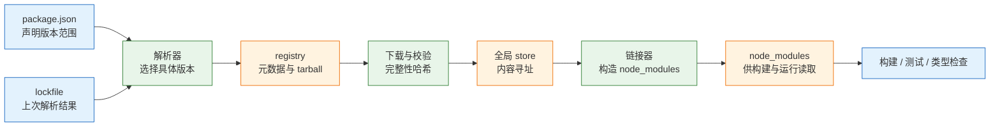
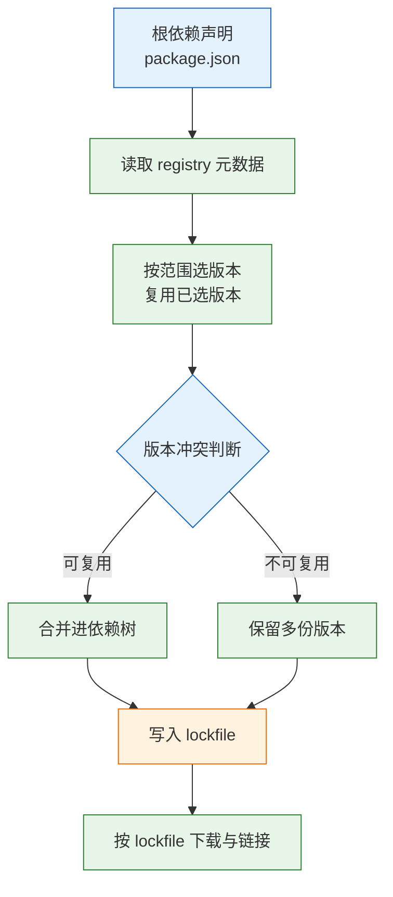
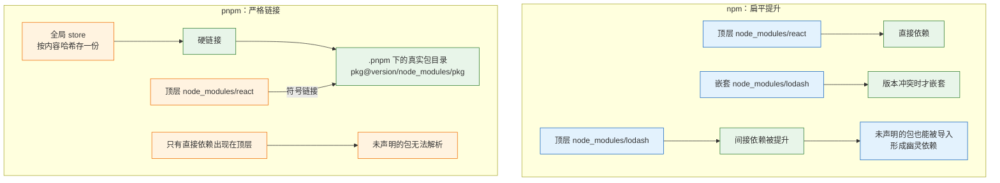
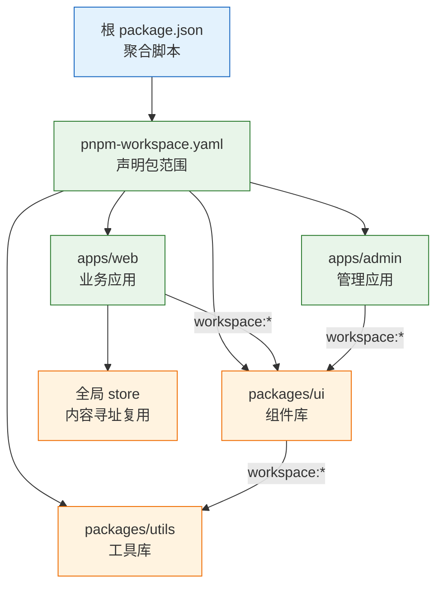

# npm 与 pnpm

---

## 一、npm 与 pnpm 是什么

### 1.1 核心概念

一个现代前端项目的 `package.json` 通常只写几十个直接依赖，实际安装的包却可能上千个。每个包有自己的版本范围、传递依赖、可选依赖和对等依赖，手工下载与对版本无法维护。**包管理器**负责把这份声明解析成一棵确定的依赖树，把树上的每个包下载、校验、解压到 `node_modules`，并把包提供的可执行文件接到 `PATH` 上。

它做三件事：

- **解析**：读取 `package.json` 的版本范围，结合仓库元数据，选出一组满足约束的具体版本。
- **落盘**：把解析结果写入 lockfile，再按 lockfile 下载并布置到 `node_modules`，保证下一次装出同一棵树。
- **执行**：提供 `add`、`remove`、`run`、`audit` 等命令，并管理安装与脚本的生命周期。

它不解决三件事：依赖是否值得引入、运行时行为是否兼容、私有仓库的权限与网络。装一个 2MB 的包只用一个函数，是选型问题；两个 React 实例导致 hooks 报错，是版本对齐问题；401 与超时，是配置问题。包管理器只保证“按声明装出一棵树”，不保证这棵树合理。

npm 与 pnpm 的差异几乎都来自**落盘布局**。npm 尽量把依赖扁平提升到顶层 `node_modules`，兼容性好但会产生幽灵依赖；pnpm 把真实文件放进内容寻址的全局 store，用硬链接复用，再用符号链接为每个包构造严格的依赖视图。布局不同，安装速度、磁盘占用、幽灵依赖暴露方式和工具兼容性都不同。

| 概念 | 含义 | 作用 |
|---|---|---|
| 清单 | `package.json` | 声明项目身份、脚本、直接依赖与版本范围 |
| lockfile | `package-lock.json`、`pnpm-lock.yaml` | 记录解析后的确切版本与完整性校验值 |
| 仓库 | registry | 提供包元数据与 tarball 下载 |
| store | 全局内容寻址存储 | 相同内容只存一份，供多个项目复用 |
| 链接器 | linker | 决定 `node_modules` 的目录结构与链接方式 |
| 工作区 | workspace | 让一个仓库内的多个包互相引用、统一安装 |
| 对等依赖 | peer dependency | 声明宿主必须提供的依赖，常用于插件与组件库 |

### 1.2 与相邻技术的关系

包管理器位于 Node 运行时与构建工具之间。它向上读取项目声明，向下为构建、测试、类型检查提供可解析的模块目录。边界不清时，安装问题会被误判成构建问题。

| 相邻技术 | 负责内容 | 与包管理器的关系 |
|---|---|---|
| Node.js | 提供运行时、`node_modules` 解析算法 | 包管理器随 Node 分发或独立安装，解析规则由 Node 决定 |
| Corepack | 按 `packageManager` 字段切换包管理器版本 | 解决团队成员使用不同版本的问题 |
| registry | 存储元数据与 tarball | 包管理器按配置的源下载并校验完整性 |
| 构建工具 | 解析 `import`、打包产物 | 读取 `node_modules`，不参与版本解析 |
| 类型检查 | 读取类型声明 | 依赖的类型入口由 `package.json` 的 `types` 字段决定 |
| CI 流水线 | 安装、缓存、构建、审计 | 用 frozen 模式保证 lockfile 不被改写 |
| 安全扫描 | 漏洞库、SBOM、许可证 | 读取 lockfile 与依赖树，不替代人工判断 |

Node 的模块解析规则决定了“包能不能被找到”。从当前文件向上逐级查找 `node_modules`，命中 `package.json` 的 `exports` 或 `main` 字段后加载。pnpm 的严格布局正是利用这套规则：只有声明过的依赖才会在包的可见范围内出现符号链接，未声明的包在解析阶段就找不到。

Corepack 解决的是另一类问题：同一份仓库，成员 A 用 npm、成员 B 用 pnpm，会生成两种 lockfile，合并时互相覆盖。`packageManager` 字段把工具与版本写进仓库，Corepack 读取它并代理命令，团队不再依赖口头约定。

### 1.3 架构组成

包管理器的内部可以拆成四层：解析器、下载器、链接器、执行器。npm 与 pnpm 的前两层行为接近，差异主要集中在链接器；pnpm 额外把下载内容放进全局 store，链接器只负责建立引用。



| 组成 | 职责 | 关键行为 |
|---|---|---|
| 解析器 | 把版本范围变成具体版本 | 读取元数据、处理 peer 冲突、写入 lockfile |
| 下载器 | 获取 tarball 并校验 | 校验 integrity、复用缓存、失败重试 |
| 链接器 | 构造 `node_modules` | 扁平提升或严格符号链接 |
| 执行器 | 运行脚本与可执行文件 | 生命周期钩子、`PATH` 注入、退出码传递 |

npm 的链接器以“提升”为核心：能放到顶层的依赖都放顶层，冲突时才嵌套。pnpm 的链接器以“隔离”为核心：每个包只看到自己声明的依赖，真实文件在 `.pnpm` 下按版本存放，顶层只给直接依赖建链接。两者的解析结果可能相同，落盘结构却完全不同，这就是同一个 `package.json` 在不同包管理器下表现不一致的根源。

---

## 二、安装与初始化

> **版本现状（2026-10）**：pnpm 12 是当前稳定版，npm 随 Node 发布。Node 24 LTS 仍自带 Corepack，较新的 Current 版本可能不再内置。两者的 lockfile 不通用，一个仓库只能保留一种。

### 2.1 Node 与包管理器版本

npm 随 Node 一起安装，升级 Node 往往连带升级 npm；pnpm 是独立工具，需要 Corepack 或全局安装。团队应把 Node 与 pnpm 的版本都写进仓库，避免“本机能装、CI 装不上”。

```bash
# ========== 查看环境 ==========
# Node 版本决定 npm 版本与模块解析行为
node -v
npm -v

# pnpm 未安装时命令不存在，属正常现象
pnpm -v

# 查看 Corepack 是否可用
corepack --version

# ========== 固定 Node 版本 ==========
# 写入 .nvmrc，成员与 CI 读取同一版本
node -v > .nvmrc

# 使用版本管理器切换，命令按本机工具替换
nvm use
```

| 版本项 | 决定什么 | 配置位置 |
|---|---|---|
| Node | npm 版本、ESM 与原生模块行为 | `.nvmrc`、CI 镜像 |
| npm | `package-lock.json` 格式与安装行为 | 随 Node，不建议单独降级 |
| pnpm | 布局、lockfile 格式、脚本策略 | `packageManager` 字段 |
| registry | 包来源与认证 | `.npmrc` |
| 引擎约束 | 项目要求的 Node 与包管理器范围 | `engines`、`engineStrict` |

> **注意**：`engines` 字段默认只是提示，npm 要配合 `engine-strict=true` 才会失败，pnpm 12 的 `engineStrict` 写在 `pnpm-workspace.yaml` 而不是 `.npmrc`。只写 `engines` 不写严格模式，版本不符时安装仍会继续，问题会推迟到运行期。

### 2.2 Corepack 启用

Corepack 是 Node 官方提供的包管理器版本代理。它读取 `package.json` 的 `packageManager` 字段，下载对应版本的 pnpm 或 Yarn，并在执行命令时透明切换。

```bash
# ========== 启用 Corepack ==========
# 注册 pnpm、yarn 的代理命令
corepack enable

# 在项目根目录声明并激活 pnpm 12
corepack use pnpm@12

# 确认实际使用的版本
pnpm -v

# ========== 兜底安装 ==========
# 较新的 Node Current 可能不再内置 Corepack
npm install -g corepack

# 重新启用
corepack enable
```

`corepack use` 会改写 `package.json` 的 `packageManager` 字段，这个字段必须提交。成员克隆仓库后执行 `corepack enable`，再运行 `pnpm install`，Corepack 会自动使用声明版本，不需要每个人记版本号。

| 场景 | 命令 | 结果 |
|---|---|---|
| 首次启用 | `corepack enable` | 注册代理命令 |
| 声明项目版本 | `corepack use pnpm@12` | 写入 `packageManager` 并激活 |
| 命令找不到 | `npm i -g corepack` | 补装 Corepack |
| 禁用代理 | `corepack disable` | 移除代理命令 |

> **注意**：`packageManager` 字段与 lockfile 必须匹配。字段写 pnpm 12，仓库里却留着 `package-lock.json`，说明迁移未完成；此时无论谁执行安装，都可能生成第二份 lockfile。

### 2.3 项目初始化

新项目从 `pnpm init` 开始，再按需添加依赖。初始化只生成最小 `package.json`，不会创建目录结构，也不会安装任何包。

```bash
# ========== 初始化 ==========
# 生成 package.json，按提示填写名称与版本
pnpm init

# ========== 添加依赖 ==========
# 运行期依赖写入 dependencies
pnpm add axios

# 开发期依赖写入 devDependencies
pnpm add -D vitest typescript

# 添加指定范围的版本，避免直接落到最新大版本
pnpm add axios@^1

# ========== 日常命令 ==========
# 按 lockfile 安装全部依赖
pnpm install

# 删除依赖并同步 lockfile
pnpm remove axios

# 查看过期依赖
pnpm outdated

# 交互式升级
pnpm update --interactive
```

| 命令 | 作用 | 写入字段 |
|---|---|---|
| `pnpm add <pkg>` | 安装运行期依赖 | `dependencies` |
| `pnpm add -D <pkg>` | 安装开发期依赖 | `devDependencies` |
| `pnpm add -O <pkg>` | 安装可选依赖 | `optionalDependencies` |
| `pnpm add --save-peer <pkg>` | 安装对等依赖 | `peerDependencies` |
| `pnpm remove <pkg>` | 删除依赖 | 同步移除字段与 lockfile |
| `pnpm install` | 按清单与 lockfile 安装 | 可能更新 lockfile |

### 2.4 目录与文件

一个 pnpm 项目的根目录有几类文件：声明、锁、配置、缓存与产物。哪些该提交、哪些该忽略，直接影响团队能否装出同一棵树。

```text
project/
├── package.json           # 清单：脚本、依赖、packageManager
├── pnpm-lock.yaml         # 解析结果，必须提交
├── .npmrc                 # 源、认证、代理，按环境区分
├── .nvmrc                 # Node 版本
├── pnpm-workspace.yaml    # 仅 monorepo 需要
├── node_modules/
│   ├── .pnpm/             # 真实文件与各包的依赖视图
│   └── .bin/              # 可执行文件链接
└── src/
```

| 路径 | 作用 | 是否提交 |
|---|---|---|
| `package.json` | 项目声明 | 提交 |
| `pnpm-lock.yaml` | 依赖解析结果 | 提交 |
| `.npmrc` | 源与认证配置 | 提交模板，凭据用环境变量 |
| `pnpm-workspace.yaml` | 工作区范围与 pnpm 设置 | 提交 |
| `node_modules/` | 安装结果 | 不提交，可重建 |
| 全局 store | 跨项目复用 | 不提交，由 pnpm 管理 |

> **安全警告**：`.npmrc` 中的 `_authToken` 等同于仓库读写凭据。提交到仓库等于把发布权限公开；即使后来删除，历史记录仍然可查。凭据只通过环境变量或 CI Secret 注入，仓库里只保留 `${NPM_TOKEN}` 占位。

---

## 三、核心配置

### 3.1 package.json 字段

`package.json` 既是项目清单，也是 Node 与包管理器的解析入口。字段写错，表现往往不是安装报错，而是运行时找不到入口或类型。

```json
{
  "name": "@acme/web",
  "version": "1.0.0",
  "private": true,
  "type": "module",
  "packageManager": "pnpm@12",
  "engines": {
    "node": ">=20"
  },
  "scripts": {
    "dev": "vite",
    "build": "tsc --noEmit && vite build",
    "lint": "eslint ."
  },
  "dependencies": {},
  "devDependencies": {}
}
```

| 字段 | 作用 | 常见错误 |
|---|---|---|
| `name` | 包名，作用域包带 `@scope/` | 与已有公共包重名，发布被拒 |
| `private` | 禁止发布 | 应用项目漏写，误发布到公共源 |
| `type` | 决定 `.js` 按 ESM 还是 CommonJS 解析 | 与构建输出格式不一致 |
| `exports` | 定义子路径与条件导出 | 漏写类型条件，编辑器找不到声明 |
| `engines` | 声明 Node 与包管理器范围 | 只写不校验，等于注释 |
| `packageManager` | 固定包管理器版本 | 与 lockfile 格式不匹配 |

> **注意**：库项目必须同时提供 `main`、`module`、`types` 与 `exports`，并保证它们指向真实存在的文件。只写 `main` 会让 ESM 构建拿不到模块入口，只写 `types` 而路径错误会让使用方在编辑器里看到类型，构建时却解析失败。

### 3.2 版本范围与依赖类型

版本范围是对兼容性的假设，不是对行为的保证。`^` 只承诺主版本不变，次版本仍可能引入破坏性改动，小包尤其常见。

| 写法 | 含义 | 适用场景 |
|---|---|---|
| `1.2.3` | 精确版本 | 关键依赖、需要完全复现 |
| `~1.2.3` | 允许补丁位变化 | 只收修复，不要新功能 |
| `^1.2.3` | 允许不改变主版本 | 大多数业务依赖的默认 |
| `>=1.2.3 <2` | 显式范围 | 有明确兼容边界 |
| `workspace:*` | 指向工作区内的包 | monorepo |
| `npm:other@1.2.3` | 别名安装 | 同一包多版本并存 |
| `file:../pkg` | 本地路径 | 临时联调，不要提交 |

| 依赖类型 | 安装时机 | 进入运行产物 |
|---|---|---|
| `dependencies` | 生产与开发都装 | 是 |
| `devDependencies` | 仅开发与构建 | 否 |
| `peerDependencies` | 由使用方提供 | 由宿主决定 |
| `optionalDependencies` | 失败不阻断安装 | 视平台而定 |
| `bundledDependencies` | 随包一起发布 | 是 |

`devDependencies` 里的包在构建阶段仍会被使用，只是不随应用发布。把构建工具误放进 `dependencies`，会让生产安装多下载一批不需要的包；反过来把运行期需要的包放进 `devDependencies`，在只安装生产依赖的镜像里会直接缺模块。

### 3.3 registry 与认证

`.npmrc` 是 npm 与 pnpm 共用的配置文件，负责源、作用域、认证、TLS 与代理。pnpm 12 只从 `.npmrc` 读取这几类设置，其余行为配置移到 `pnpm-workspace.yaml`。

```ini
# 默认源，团队可替换为内部代理地址
registry=https://registry.npmjs.org/

# 作用域包走内部源，@acme 下的包不会去公共源查找
@acme:registry=https://npm.example.com/

# 认证令牌从环境变量读取，不写明文
//npm.example.com/:_authToken=${NPM_TOKEN}

# 严格校验 TLS 证书，不要为图方便关闭
strict-ssl=true

# 公司网络需要 HTTP 代理时，http 与 https 都要配置
proxy=http://proxy.example.com:8080
https-proxy=http://proxy.example.com:8080

# 排查供应链问题时临时禁止安装脚本，不要长期开启
# ignore-scripts=true
```

| 配置项 | 作用 | 常见错误 |
|---|---|---|
| `registry` | 默认包源 | 写成不带协议的主机名 |
| `@scope:registry` | 作用域包源 | 作用域拼错，请求落到公共源 |
| `_authToken` | 仓库认证 | 明文提交，或变量未注入 |
| `strict-ssl` | 校验 TLS 证书 | 关闭后易受中间人攻击 |
| `proxy` / `https-proxy` | 通过代理访问外网 | 只配一个，另一协议直连失败 |
| `ignore-scripts` | 禁止生命周期脚本 | 长期开启导致原生依赖缺二进制 |

> **安全警告**：私有源凭据、发布令牌、签名密钥都属于敏感信息。CI 使用独立只读账号安装、独立发布账号上传；令牌按最小权限发放并设置有效期，离职或轮换时立即吊销。公共源与私有源同时存在时，内部包必须使用公共源不会占用的作用域，防止依赖混淆。

### 3.4 workspace 配置

工作区让一个仓库内的多个包共享一次解析与一份 store。pnpm 用 `pnpm-workspace.yaml` 声明包范围，并承载 pnpm 12 的行为配置。

```yaml
# 工作区包范围，支持通配符
packages:
  - 'apps/*'
  - 'packages/*'

# 逐包放行依赖的构建脚本，未列出的包不会执行
allowBuilds:
  esbuild: true
  sharp: true

# 引擎版本不符时直接失败，而不是只告警
engineStrict: true
```

| 配置项 | 作用 | 说明 |
|---|---|---|
| `packages` | 声明工作区目录 | 路径相对仓库根目录 |
| `allowBuilds` | 放行指定依赖的构建脚本 | 逐包批准，不提供全局开关 |
| `engineStrict` | 引擎检查失败即中止 | pnpm 12 写在此文件 |
| `catalog` | 集中管理依赖版本 | 多包共享同一版本范围 |

> **注意**：工作区根目录的 `package.json` 应标记 `"private": true`，避免误发布聚合包。子包之间用 `workspace:*` 引用，发布时会被替换成真实版本号；写成固定版本号会迫使每次改动都手动升级。

---

## 四、依赖解析与落盘机制

### 4.1 解析与 lockfile

解析从直接依赖开始，读取 registry 元数据，按版本范围选出候选，再递归处理候选的依赖。遇到同一包的多个版本，npm 与 pnpm 都尽量复用已选版本，无法复用时保留多份。最终结果写进 lockfile，包含版本、下载地址、完整性哈希和依赖关系。



| 文件 | 包管理器 | 内容 |
|---|---|---|
| `package-lock.json` | npm | 完整依赖树、版本、integrity |
| `pnpm-lock.yaml` | pnpm | 解析结果、peer 后缀、完整性 |
| `yarn.lock` | Yarn | 版本与校验信息 |

lockfile 必须提交，它才是“这次装出来的确切版本”。本地可以用 `install` 更新 lockfile，CI 必须用冻结模式：`npm ci` 或 `pnpm install --frozen-lockfile`。前者发现清单与锁不一致时直接失败，后者不会悄悄改锁。

lockfile 冲突不要手工合并。它是解析结果，不是源码，保留任意一边都可能得到一棵不一致的树。正确做法是取一边的 `package.json`，删除 lockfile，重新安装生成，再单独提交。冲突频繁说明分支生命周期太长，或有人没有提交 lockfile。

> **注意**：`pnpm install` 在 lockfile 与 `package.json` 不一致时会更新 lockfile，这正是 CI 必须用 frozen 模式的原因。CI 里用普通 `install`，会把“忘了提交锁”变成“每次构建都生成不同的锁”，问题被掩盖。

### 4.2 扁平提升与符号链接



npm 的扁平化为了减少重复和路径过长，尽量把依赖提升到顶层。好处是兼容性好、路径短；代价是幽灵依赖：代码里 `import lodash from 'lodash'`，即使 `package.json` 没写，也能跑，因为别的包把它提上来了。哪天那个包升级或删除，构建突然失败。

pnpm 的包真实文件在 `node_modules/.pnpm/<name>@<version>/node_modules/<name>`，顶层只给直接依赖建符号链接。每个包内的 `node_modules` 只包含它自己声明的依赖，因此未声明的包在解析阶段就找不到。这不是 pnpm 的缺陷，而是把幽灵依赖提前暴露。

| 维度 | npm | pnpm |
|---|---|---|
| 顶层内容 | 提升后的依赖 | 直接依赖的符号链接 |
| 真实文件 | 各项目各存一份 | 全局 store，硬链接复用 |
| 幽灵依赖 | 可能出现 | 默认无法解析 |
| 磁盘占用 | 每项目一份 | 多项目共享，明显更低 |
| 工具兼容 | 最好 | 少数不认符号链接的工具需配置 |
| 冲突处理 | 嵌套 `node_modules` | `.pnpm` 下多版本并存 |

少数老工具不识别符号链接，表现为打包器解析不到模块或编辑器索引不到源码。pnpm 提供 `node-linker=hoisted` 退回扁平布局，但这是兼容手段，不是默认推荐。用它掩盖幽灵依赖，等于放弃 pnpm 的主要收益。

> **注意**：`node-linker=hoisted` 只改变布局，不改变解析结果。切换后必须重新安装并清理构建缓存，否则旧的符号链接与新的真实目录会同时存在，出现“同一包两个路径”的诡异问题。

### 4.3 peer 依赖与版本收敛

对等依赖表示“我不自带这个包，使用方必须提供”。组件库声明 `react` 是 peer，意思是复用宿主的 React，避免打包两份。npm 7 起与 pnpm 默认都会自动安装缺失的 peer，但版本冲突时的处理不同：npm 常报 `ERESOLVE`，pnpm 打印警告且不替使用方选择。

| 工具 | 查看引用链 | 强制统一版本 |
|---|---|---|
| npm | `npm explain react` | `overrides` 字段 |
| pnpm | `pnpm why react` | `pnpm.overrides` 字段 |
| Yarn | `yarn why react` | `resolutions` 字段 |

```json
{
  "pnpm": {
    "overrides": {
      "react": "19.0.0",
      "react-dom": "19.0.0"
    }
  }
}
```

项目里出现两份 React，hooks 常报 `Invalid hook call`。先用 `pnpm why react` 找到引用链，确认是哪条依赖引入了另一个大版本，再决定统一范围还是用 `overrides` 收敛。直接加 `overrides` 而不查来源，可能把某个库需要的旧版本强行替换，运行期才暴露不兼容。

> **注意**：`overrides` 是全局强制，影响整棵依赖树。使用后必须重新安装、跑完整测试，并检查 `pnpm why` 是否只剩一个版本。它适合收口，不适合作为日常升级手段。

### 4.4 生命周期脚本与供应链

安装不只是复制文件。许多包依赖 `postinstall` 下载平台二进制或编译原生模块，攻击者也可以利用同一机制执行任意代码。包管理器的脚本策略因此成为供应链防线。

| 钩子 | 触发时机 | 典型用途 |
|---|---|---|
| `preinstall` | 安装开始前 | 环境检查 |
| `install` | 包安装时 | 编译原生模块 |
| `postinstall` | 安装完成后 | 下载二进制、生成缓存 |
| `prepare` | 本地安装与发布前 | 构建产物、安装 Git hooks |
| `pre<script>` | 运行自定义脚本前 | 前置检查 |
| `post<script>` | 运行自定义脚本后 | 清理、通知 |

pnpm 10 起默认拦截依赖包的安装脚本；pnpm 11 起改为 `allowBuilds` 逐包放行，未审核的构建会让安装直接失败并报 `ERR_PNPM_IGNORED_BUILDS`，而不是静默跳过。代价是 esbuild、sharp 这类包必须显式批准。

```bash
# ========== 批准构建脚本 ==========
# 交互式选择需要执行安装脚本的包
pnpm approve-builds

# ========== 临时排查 ==========
# 跳过所有脚本，仅用于定位脚本相关故障
pnpm install --ignore-scripts
```

批准结果写进 `pnpm-workspace.yaml` 的 `allowBuilds`，随仓库提交。团队成员与 CI 使用同一份白名单，不需要每个人重复批准。

> **安全警告**：`postinstall` 是供应链攻击成本最低的入口。不要为了省事全局放开所有构建脚本，也不要在未核对包名与来源时批准。新增依赖后先看它的脚本做什么，再决定是否放行；来源不明或长期不维护的包，宁可不引入。

---

## 五、完整示例

### 5.1 单包项目

从一个空目录建立可安装、可构建、可复现的前端项目。依赖通过命令写入，文档不硬编码第三方小版本。

```bash
# ========== 初始化 ==========
mkdir admin && cd admin
pnpm init

# 声明包管理器版本，提交 packageManager 字段
corepack use pnpm@12

# ========== 安装依赖 ==========
pnpm add react react-dom
pnpm add -D vite @vitejs/plugin-react typescript @types/react @types/react-dom

# ========== 首次安装 ==========
# 生成 pnpm-lock.yaml
pnpm install
```

> **注意**：pnpm 11 起默认拦截依赖的构建脚本。安装 Vite、sharp 这类含原生二进制的包时，若提示构建未获批准，执行 `pnpm approve-builds` 逐包放行，结果写入 `pnpm-workspace.yaml` 的 `allowBuilds`。不要用全局开关绕过。

```json
{
  "name": "admin",
  "version": "1.0.0",
  "private": true,
  "type": "module",
  "packageManager": "pnpm@12",
  "engines": {
    "node": ">=20"
  },
  "scripts": {
    "dev": "vite",
    "build": "tsc --noEmit && vite build",
    "preview": "vite preview"
  }
}
```

```ini
# .npmrc
# 公共源；团队有内部代理时替换为代理地址
registry=https://registry.npmjs.org/

# 认证令牌从环境变量读取，禁止写明文
//registry.npmjs.org/:_authToken=${NPM_TOKEN}

# 保持 TLS 校验
strict-ssl=true
```

```text
# .nvmrc
# 写入当前 LTS 主版本，成员用 nvm use 切换
24
```

单包项目的验收标准很直接：删除 `node_modules` 后执行 `pnpm install --frozen-lockfile`，能完整装回；`pnpm build` 通过；`pnpm why` 查询的版本与 lockfile 一致。

### 5.2 monorepo 工程

工作区把应用与共享库放在同一仓库，依赖只解析一次，共享库改动立即被应用看到。下面是最小结构。

```text
shop/
├── package.json
├── pnpm-lock.yaml
├── pnpm-workspace.yaml
├── .npmrc
├── apps/
│   ├── web/
│   │   └── package.json
│   └── admin/
│       └── package.json
└── packages/
    ├── ui/
    │   └── package.json
    └── utils/
        └── package.json
```

```yaml
# pnpm-workspace.yaml
packages:
  - 'apps/*'
  - 'packages/*'

# 只放行确实需要构建的依赖
allowBuilds:
  esbuild: true

# 引擎不符直接失败
engineStrict: true
```

```json
{
  "name": "shop",
  "private": true,
  "packageManager": "pnpm@12",
  "scripts": {
    "build": "pnpm -r build",
    "dev:web": "pnpm --filter @acme/web dev"
  }
}
```

```json
{
  "name": "@acme/web",
  "private": true,
  "dependencies": {
    "@acme/ui": "workspace:*",
    "@acme/utils": "workspace:*"
  },
  "scripts": {
    "dev": "vite",
    "build": "vite build"
  }
}
```

这份清单只保留工作区引用，React、构建工具等公共依赖由 `pnpm --filter @acme/web add` 写入，避免示例硬编码第三方版本。

```json
{
  "name": "@acme/ui",
  "private": true,
  "dependencies": {
    "@acme/utils": "workspace:*"
  },
  "scripts": {
    "build": "tsc -p tsconfig.build.json"
  }
}
```



```bash
# ========== 安装与构建 ==========
# 在根目录一次装齐所有工作区依赖
pnpm install

# 按拓扑顺序构建全部包，ui 先于依赖它的应用
pnpm -r build

# 只跑 web 的开发服务器
pnpm --filter @acme/web dev

# 只跑有变更的包，范围基于版本控制比较
pnpm --filter "...[origin/main]" build

# ========== 查看工作区 ==========
# 列出所有包及其路径
pnpm list --depth 0 -r

# 查看某个包为何依赖某库
pnpm --filter @acme/web why react
```

| 命令 | 作用 | 使用场景 |
|---|---|---|
| `pnpm -r build` | 递归执行所有包的脚本 | 全量构建 |
| `pnpm --filter @acme/web dev` | 只对指定包执行 | 单应用开发 |
| `pnpm --filter "...[origin/main]" build` | 只对变更包执行 | CI 增量构建 |
| `pnpm list -r --depth 0` | 列出工作区包 | 检查结构 |
| `pnpm --filter @acme/web add axios` | 给指定包加依赖 | 避免装到根目录 |

> **注意**：根目录的 `dependencies` 不会自动出现在子包的解析范围里。子包用到的库必须在自己的 `package.json` 声明，否则 pnpm 的严格布局会直接报找不到模块。公共开发工具放在根目录 `devDependencies`，业务依赖放在子包。

npm 也提供 workspaces，范围写在根 `package.json` 的 `workspaces` 字段，单包命令为 `npm run build -w @acme/web`。能力与 pnpm 接近，优势是不需要额外工具，弱项是过滤语法与磁盘复用。

### 5.3 安装与验收

```bash
# ========== 干净环境复现 ==========
# 删除安装结果，保留 lockfile
rm -rf node_modules

# 冻结模式安装，lockfile 与清单不一致时失败
pnpm install --frozen-lockfile

# ========== 构建 ==========
pnpm -r build

# ========== 依赖核验 ==========
# 确认 React 只有一份
pnpm why react

# 查看顶层依赖树，确认没有多余包
pnpm list --depth 0

# 查看 store 位置与占用
pnpm store path

# 清理未被任何项目引用的缓存
pnpm store prune

# ========== 安全检查 ==========
# 按漏洞库检查依赖
pnpm audit

# 输出许可证清单，供合规审查
pnpm licenses list
```

| 验收项 | 命令 | 通过标准 |
|---|---|---|
| 可复现 | `pnpm install --frozen-lockfile` | 无锁文件变更，安装成功 |
| 依赖唯一 | `pnpm why react` | 只剩一个解析版本 |
| 工作区完整 | `pnpm list -r --depth 0` | 包列表与目录一致 |
| 构建 | `pnpm -r build` | 全部包成功 |
| 安全 | `pnpm audit` | 无高危漏洞或已评估 |

> **运维提示**：CI 缓存的是 pnpm store，不是整个 `node_modules`。缓存键应包含 lockfile 哈希与 Node 版本；命中缓存后安装仍会做链接，但不需要重新下载。缓存损坏时应能回退到全量下载，而不是让流水线永久失败。

---

## 六、最佳实践

### 6.1 CI 与缓存

CI 的安装目标不是“最快”，而是“可复现且失败可见”。冻结模式、固定 Node、缓存 store 是三件必须同时成立的事。

| 对象 | 缓存策略 | 键的组成 |
|---|---|---|
| pnpm store | 缓存目录，跨流水线复用 | lockfile 哈希 + 平台 |
| `node_modules` | 不缓存，安装时重建链接 | 不适用 |
| npm 缓存 | `npm ci` 前恢复 | lockfile 哈希 |
| 构建产物 | 由构建步骤生成，不跨分支复用 | 提交哈希 + 构建参数 |

```bash
# ========== CI 安装流程 ==========
# 1. 按 .nvmrc 切换 Node
nvm use

# 2. 启用 Corepack，读取 packageManager 字段
corepack enable

# 3. 冻结模式安装，锁不一致立即失败
pnpm install --frozen-lockfile

# 4. 构建；有测试脚本时再执行 pnpm -r test
pnpm -r build

# ========== 网络受限环境 ==========
# 优先用缓存，缺失时再联网
pnpm install --frozen-lockfile --prefer-offline

# 完全离线，缓存必须齐全
pnpm install --frozen-lockfile --offline
```

> **注意**：`--prefer-offline` 与 `--offline` 不是加速开关。前者在缓存缺失时仍会联网，后者缺失即失败。CI 首次运行没有缓存，直接加 `--offline` 会让流水线必然失败。

### 6.2 迁移顺序

从 npm 迁到 pnpm，不要直接删 lockfile 重装。按顺序执行能保留已解析版本，减少“升级与迁移同时发生”带来的干扰。

1. **统一环境**：Node 版本写进 `.nvmrc`，registry 写进 `.npmrc`，先确认 `npm ci` 在干净环境能通过。
2. **生成 pnpm 锁**：`pnpm import` 读取 `package-lock.json` 并生成 `pnpm-lock.yaml`，尽量保留原解析版本。
3. **声明包管理器**：`corepack use pnpm@12`，提交 `packageManager` 字段，避免成员用错版本。
4. **安装并放行脚本**：`pnpm install` 后若 esbuild、sharp 报缺二进制或被拦截，用 `pnpm approve-builds` 放行并写入 `allowBuilds`。
5. **修幽灵依赖**：跑构建与测试，报 `Cannot find module` 的包逐个补进 `package.json`。这一步是在还历史债，不要用 `node-linker=hoisted` 掩盖。
6. **改 CI**：缓存 pnpm store，安装改为 `pnpm install --frozen-lockfile`，脚本从 `npm run` 改为 `pnpm run`。
7. **删旧锁并通知团队**：确认 CI 通过后再删 `package-lock.json`，否则成员本地还会生成两份。

| 迁移阶段 | 验证对象 | 失败处理 |
|---|---|---|
| 生成锁 | 版本与 npm 锁一致 | 检查 `pnpm import` 输出 |
| 安装 | 依赖齐全、脚本放行 | 补 `allowBuilds` |
| 构建 | 产物可生成 | 补声明缺失的幽灵依赖 |
| CI | 冻结安装通过 | 提交 lockfile，统一 Node |

验收标准：干净克隆后一条 `pnpm install --frozen-lockfile` 能装齐，构建与测试通过，产物体积与迁移前一致。第一次安装会重建 store，耗时不能与之后的增量安装相比。

### 6.3 选型边界

| 维度 | npm | pnpm | Yarn Berry |
|---|---|---|---|
| 随 Node 附带 | 是 | 否，需 Corepack | 否 |
| `node_modules` | 扁平提升 | 严格符号链接 | 可选 PnP |
| 幽灵依赖 | 可能出现 | 默认暴露 | PnP 下不会 |
| 磁盘占用 | 每项目一份 | 全局 store 去重 | 取决于模式 |
| monorepo | workspaces | workspace + filter | workspaces |
| 安装脚本限制 | 默认执行 | 10 起默认拦截 | 取决于配置 |
| 生态兼容 | 最好 | 好，少数工具需配置 | PnP 下部分工具不兼容 |

新项目用 pnpm 的收益最直接：装得快、磁盘省、幽灵依赖当场暴露。代价是团队要统一，少数老工具需要 `node-linker=hoisted` 兜底。依赖大量只认扁平 `node_modules` 的老构建链，或成员必须使用系统自带 npm 且不能装 Corepack 时，强行统一会让维护成本超过收益。

> **开发提示**：一个仓库只保留一种包管理器与一个 lockfile。混用是“装出来不一样”的首要原因；`package-lock.json`、`pnpm-lock.yaml`、`yarn.lock` 同时存在时，先确认哪一个是唯一事实来源，再删除其余文件。

---

## 七、常见错误与排查

### 7.1 故障对照表

| 现象 | 最可能原因 | 处理 |
|---|---|---|
| `EACCES` 全局安装失败 | 用 sudo 装到系统目录 | 不用 sudo，改用 Corepack 或版本管理器 |
| `ERESOLVE unable to resolve dependency tree` | peer 依赖版本冲突 | 对齐 React 等 peer 版本，必要时用 `overrides` |
| `ETARGET No matching version` | 源不同步、包名拼错、范围写错 | `npm view <pkg> versions` 确认，换回官方源 |
| `404` 但包确实存在 | 作用域源未配置、令牌无权限 | 检查 `@scope:registry` 与登录状态 |
| pnpm 下 `Cannot find module` | 幽灵依赖，未写进 `package.json` | 显式 `pnpm add`，不要关闭严格模式 |
| 安装报 `ERR_PNPM_IGNORED_BUILDS` | 依赖构建脚本未获批准 | `pnpm approve-builds`，或写入 `allowBuilds` |
| CI 报 lockfile 不同步 | 本地 `install` 改了锁但未提交 | 本地重新安装并提交 lockfile |
| 两个 React 实例，hooks 报错 | 依赖提升出多份，或 peer 未对齐 | `pnpm why react`，用 `overrides` 收敛 |
| `node_modules` 重装很慢 | 未命中 store 或网络差 | 检查 store 路径与源，CI 缓存 store |
| Node 版本不符 | `engines` 只是提示 | 加 `.nvmrc`，pnpm 配 `engineStrict` |
| 原生模块加载失败 | 构建脚本被拦截或平台不匹配 | 放行构建脚本，删除对应包后重装 |
| 发布包缺少文件 | `files` 字段或 `.npmignore` 配置错误 | `npm pack --dry-run` 查看清单 |

### 7.2 排查顺序

1. **读完整报错的第一段**：区分“解析失败”“下载失败”“脚本失败”“链接失败”，四类问题的处理完全不同。
2. **确认包管理器与版本**：`pnpm -v`、`packageManager` 字段、lockfile 类型必须一致；不一致时先统一环境，不要继续排查依赖。
3. **查引用链**：解析问题用 `pnpm why` 或 `npm explain`，确认是谁引入了冲突版本，而不是凭 `package.json` 猜测。
4. **查源与认证**：下载问题看 `.npmrc` 的 registry、作用域、代理与令牌，先 `npm view` 验证源可达，再谈清缓存。
5. **查脚本策略**：安装完成但二进制缺失，先看是否被 `allowBuilds` 拦截；不要直接全局放开脚本。
6. **最后清缓存**：删除 `node_modules` 与对应 store 条目，重新安装；清完仍失败，说明问题不在缓存，回到第 1 步。

| 错误层 | 典型信息 | 定位手段 |
|---|---|---|
| 解析层 | `ERESOLVE`、`No matching version` | `pnpm why`、`npm view` |
| 下载层 | `ETIMEDOUT`、`401`、`404` | 检查源、代理、令牌 |
| 脚本层 | `ERR_PNPM_IGNORED_BUILDS` | `approve-builds`、`allowBuilds` |
| 链接层 | `Cannot find module` | 检查依赖是否声明，布局是否被改写 |
| 发布层 | 包内容缺失、版本被拒 | `npm pack --dry-run`、核对 `files` |

> **核心结论**：包管理器的可靠性来自三件事：一个仓库一种工具、一份 lockfile、CI 冻结安装。布局差异决定幽灵依赖与磁盘占用，脚本策略决定供应链边界。先把这三点固定，再谈安装速度与 monorepo 效率；顺序反过来，优化只会让问题更难复现。
