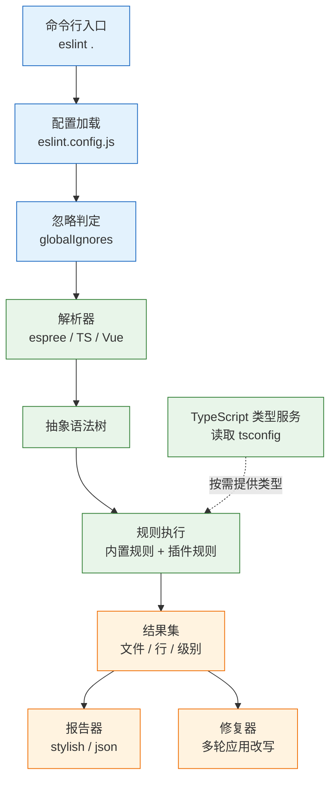

# ESLint 与 Prettier

---

## 一、ESLint 与 Prettier 是什么

### 1.1 核心概念

ESLint 是 JavaScript 与 TypeScript 的**静态分析工具**。它把源文件解析成抽象语法树（AST），按配置逐条执行规则，把命中位置、严重级别和可修复性汇总成结果。规则判断的是代码结构，不执行代码，因此能在提交前发现未处理的 Promise、未使用的变量、错误的 Hook 依赖这类运行时才会暴露的问题。

Prettier 是**代码格式化工具**。它同样解析源码，但只保留语法结构，丢掉原有的空格、换行与引号，再按自己的一套排版规则重新打印。同一份代码无论由谁写成什么样子，输出都完全一致，这种性质称为幂等：连续格式化两次，第二次不产生任何改动。

两者服务的目标不同，评价标准也不同：

| 维度 | ESLint | Prettier |
|---|---|---|
| 判断对象 | 语义与模式 | 排版与空白 |
| 输出 | 文件、行号、规则名、消息 | 重新排版后的文件 |
| 严重级别 | `off` / `warn` / `error` | 只有“符合”与“不符合” |
| 可自动修复 | 部分规则带修复器 | 全部可重写 |
| 失败含义 | 代码可能有问题 | 代码不符合统一版式 |

ESLint 的规则结果带三种能力标记：可修复（fixable）表示 `--fix` 能直接改写；仅建议（suggestion）表示工具能给出改法但不能自动应用；两者皆无则只能人工处理。修复器不是万能的，`--fix` 会做多轮迭代，直到没有新的可修复问题或达到轮次上限；如果两条规则的修复互相触发，最终结果仍可能残留问题，因此修完必须重新跑一次检查。

Prettier 刻意只暴露少量选项：行宽、缩进、引号、分号、尾逗号、换行符。这不是功能缺失，而是设计取舍。可配置项越多，团队就越容易在评审里争论版式；把决定权交给工具，评审才能回到逻辑本身。

> **注意**：ESLint 与 Prettier 都能“改代码”，但改的性质不同。ESLint 的修复可能改变语义（例如自动补 `await`、调整比较运算符），Prettier 的改写保证语义等价。把两者混在一个命令里连续执行，出问题时无法判断是谁改的。

### 1.2 与相邻技术的关系

前端工程里同时存在类型检查、lint、格式化、构建四类检查，它们经常被混为一谈。边界清楚，排障才有方向。

| 技术 | 解决的问题 | 与 ESLint 的边界 |
|---|---|---|
| TypeScript 编译器 | 类型是否自洽 | `tsc --noEmit` 更准更快，不用 lint 替代 |
| 编辑器语言服务 | 实时补全与波浪线 | 复用同一份配置，不另立标准 |
| Git 钩子 | 提交前拦截 | 只处理暂存文件，可被 `--no-verify` 绕过 |
| 打包器 | 模块解析与产物生成 | 不负责代码质量判定 |
| CI | 合入前的统一门禁 | 执行与本地相同的命令，不另写规则 |

**与 TypeScript 的关系**：类型检查回答“这个值能不能赋给那个类型”，lint 回答“这段写法是否可疑”。`no-floating-promises` 需要类型信息才能判断一个表达式是不是 Promise，所以它属于 lint；而“`string` 不能赋给 `number`”属于编译器。用 ESLint 做全量类型检查，速度慢一个数量级，报错位置也更难读。

**与编辑器的关系**：编辑器扩展调用的是项目内安装的 ESLint 与 Prettier，不是全局版本。工作区根目录决定了配置从哪一层开始查找，多根工作区里打开子目录，扩展可能读不到根配置。这类“命令行报错、编辑器不报”的问题，九成出在扩展加载的路径与版本上。

**与 Git 钩子的关系**：钩子是提速手段，不是门禁。它只检查暂存文件，能挡住大部分低级问题，但绕过成本极低。真正的门禁在 CI，钩子只是让开发者更早拿到反馈。

**与 Prettier 的关系**：两者不是竞争关系。社区曾用 `eslint-plugin-prettier` 把格式差异报成 lint 错误，代价是 lint 变慢、输出被格式问题淹没、两个修复器互相覆盖。现行做法是让 Prettier 独立运行，用 `eslint-config-prettier` 关掉 ESLint 中与排版冲突的规则。

> **注意**：`eslint-config-prettier` 只关闭冲突规则，不提供格式化能力。装了它仍然需要单独执行 `prettier --write`，两者缺一不可。

### 1.3 架构组成

ESLint 的一次运行可以拆成六层：入口、配置、解析、规则、类型服务、输出。任何一层出错，表现都不同，按层定位比逐条读规则快。



| 层 | 组件 | 职责 |
|---|---|---|
| 入口 | `eslint` 可执行文件 | 解析参数、收集目标文件、决定退出码 |
| 配置 | flat config 数组 | 按 `files` 匹配，逐层合并出最终配置 |
| 解析 | parser | 把源码转成 AST，决定能识别哪些语法 |
| 规则 | 规则注册表 | 遍历 AST 节点，产出报告 |
| 类型 | TypeScript 程序 | 为类型感知规则提供符号与类型 |
| 输出 | formatter 与 fixer | 生成可读报告，应用安全改写 |

Prettier 的结构更简单：读取配置、选择解析器、生成文档树（Doc）、按行宽打印。它没有规则概念，也没有严重级别，只输出格式化结果。正因如此，Prettier 的速度远快于开启类型感知的 ESLint，适合放进保存动作。

---

## 二、安装与初始化

### 2.1 运行环境与版本现状

> **版本现状（2026-10）**：ESLint 10 为当前稳定版，只支持 flat config，`.eslintrc.*` 已移除；Prettier 3 为当前主版本，配置解析与插件机制沿用 ESM。

| 组件 | 当前状态 | 选择建议 |
|---|---|---|
| ESLint | 10.x 稳定 | 新项目直接使用，不再兼容旧配置 |
| Prettier | 3.x 稳定 | 与 ESLint 独立安装、独立执行 |
| Node.js | 当前 LTS 线 | 以 `.nvmrc` 固定，CI 与本地一致 |
| 包管理器 | pnpm / npm / yarn | 全仓库统一，用锁文件锁定版本 |

Node 版本必须满足工具的最低要求，且本地与 CI 使用同一条 LTS 线。配置文件按 ESM 加载，扩展名要与模块类型匹配：项目本身是 ESM 时用 `.js`，仍是 CommonJS 时用 `.mjs` 后缀把配置单独标记为 ESM，不要依赖默认推断。

### 2.2 依赖安装

```bash
# ========== 核心工具 ==========
# -D 表示开发依赖，不要装进生产依赖
pnpm add -D eslint @eslint/js prettier

# ========== TypeScript 支持 ==========
# typescript-eslint 是解析器与规则集的统一包
pnpm add -D typescript-eslint typescript

# ========== 框架与冲突处理 ==========
# Vue 项目需要插件与模板解析器；React 项目换成 eslint-plugin-react-hooks 等
pnpm add -D eslint-plugin-vue vue-eslint-parser

# 关闭 ESLint 中与 Prettier 冲突的排版规则
pnpm add -D eslint-config-prettier

# ========== 本地钩子 ==========
pnpm add -D husky lint-staged
```

需要理解三件事：

- **`@eslint/js` 提供官方推荐规则集**，不含解析器。没有它，`js.configs.recommended` 无从引入。
- **`typescript-eslint` 是聚合包**，同时导出 parser、plugin 与多套 config，不必再单独安装 `@typescript-eslint/parser`。
- **`vue-eslint-parser` 通常由 `eslint-plugin-vue` 作为依赖带入**，显式安装可以避免版本被提升到不兼容的组合。

依赖版本由锁文件固定，不在 `package.json` 里写模糊范围后再靠运气解析。团队升级 ESLint 主版本时，插件、解析器、共享配置要一起升，混用新旧主版本最常见的症状是“规则找不到”或“配置项不认识”。

> **注意**：不要全局安装 ESLint 或 Prettier。全局版本与项目版本不一致时，编辑器、命令行、CI 会得到三种结果，而报错信息完全相同，极难排查。统一用 `pnpm exec eslint` 调用项目内版本。

### 2.3 初始化与首次运行

新建 `eslint.config.js`，先放最小可用配置：

```js
// eslint.config.js：最小可用版本
import js from '@eslint/js';

export default [
  // 官方推荐规则集，覆盖未定义变量、重复声明等基础问题
  js.configs.recommended,
  {
    // 只对源码目录生效，避免扫描构建产物；TypeScript 解析器在下一节接入
    files: ['src/**/*.js'],
    rules: {
      // 先只开一条，确认链路通了再逐步加规则
      'no-console': 'warn',
    },
  },
];
```

执行并观察输出：

```bash
# 检查整个项目；有 error 时退出码为 1
pnpm exec eslint .

# 只检查指定目录，缩小范围便于定位
pnpm exec eslint src

# 打印某个文件最终生效的配置，排障首选
pnpm exec eslint --print-config src/main.ts
```

退出码有三类：`0` 表示没有 error；`1` 表示存在 error 级问题；`2` 表示配置错误、解析失败或文件无法读取。第三类不是“代码有问题”，而是工具没跑起来，排障方向完全不同。

首次运行常见两种结果。一种是满屏 `no-undef`，说明源码用了浏览器或 Node 全局变量，需要在 `languageOptions.globals` 中声明；另一种是 `Parsing error`，多见于接入 TypeScript 之后仍用默认的 espree 解析 `.ts` 文件。

---

## 三、配置模型与核心选项

### 3.1 Flat Config 的分层与匹配

flat config 导出一个数组，每个元素是一层配置。ESLint 按数组顺序逐层匹配 `files`，命中的层依次合并，后面的覆盖前面的。没有 `files` 的层对所有文件生效，通常用来放全局忽略和共享规则。


```js
// 分层顺序示例：先通用，后特殊
export default [
  // 第 1 层：全局忽略，必须用独立对象声明
  { ignores: ['dist/', 'coverage/'] },

  // 第 2 层：所有 JS 文件的基础规则
  { files: ['**/*.js'], rules: { 'no-var': 'error' } },

  // 第 3 层：测试文件放宽限制，覆盖第 2 层
  { files: ['**/*.test.js'], rules: { 'no-var': 'off' } },
];
```

| 配置键 | 作用 | 常见错误 |
|---|---|---|
| `files` | 限定该层生效的文件 | 写成目录，匹配不到文件 |
| `ignores` | 排除文件，只在纯忽略对象中全局生效 | 与 `files` 混写后误以为全局忽略 |
| `languageOptions` | 解析器、解析选项、全局变量 | 把 parser 写在 `parserOptions` 里 |
| `linterOptions` | 未使用禁用注释、内联配置开关 | 忘记开启，废弃注释长期堆积 |
| `plugins` | 注册插件对象 | 只写规则名不注册插件 |
| `rules` | 规则级别与选项 | 规则名拼错，或插件未启用 |
| `settings` | 传给插件的共享配置 | 与 `rules` 混淆 |

`ignores` 有一个容易踩的规则：只有**不包含其他键**的对象里的 `ignores` 才是全局忽略。一旦和 `files`、`rules` 写在同一个对象里，它只在该层内部生效，`dist` 仍会被其他层扫到。ESLint 10 提供 `globalIgnores()` 辅助函数，把意图写得更明确。

配置合并以层为单位：后一层覆盖前一层的同名键，不同键互不影响；同一条规则出现在多层时，只有最后一层生效。这个模型的好处是可以随时用 `--print-config` 打印出合并结果，不必在脑子里推演继承链。

### 3.2 解析器与插件配置

解析器决定 ESLint 能读懂哪些语法。默认的 espree 只支持标准 JavaScript，遇到类型注解、装饰器、`.vue` 单文件组件就会解析失败。

| 文件类型 | 外层 parser | 内层 parser | 说明 |
|---|---|---|---|
| `.js` / `.mjs` | espree（默认） | 无 | 无需配置 |
| `.ts` / `.tsx` | `typescript-eslint` 的 parser | 无 | 开类型感知时需提供 `tsconfig` |
| `.vue` | `vue-eslint-parser` | TS parser | 外层读模板，内层读 `<script>` |
| `.md` 代码块 | 由 processor 提取 | 按代码语言决定 | 需要额外插件 |

Vue 的配置是典型的两层解析：

```js
{
  files: ['**/*.vue'],
  languageOptions: {
    // 外层解析器负责拆分 template / script / style
    parser: vueParser,
    parserOptions: {
      // 内层解析器只处理 <script lang="ts"> 部分
      parser: tseslint.parser,
      ecmaVersion: 'latest',
      sourceType: 'module',
    },
  },
}
```

两个 `parser` 写反的顺序是最常见的配置错误：外层写成 TS parser，模板部分直接解析失败；内层漏写，`<script lang="ts">` 里的类型语法报 `Unexpected token`。

插件则是规则的集合。flat config 里插件以对象形式注册，规则名由 `插件名/规则名` 组成。注册名可以与包名不同，但必须与 `rules` 中使用的前缀一致，否则报 `Definition for rule ... was not found`。

```js
import vue from 'eslint-plugin-vue';

export default [
  {
    // 注册后，规则写作 vue/multi-word-component-names
    plugins: { vue },
    rules: { 'vue/multi-word-component-names': 'error' },
  },
];
```

### 3.3 Prettier 配置项

Prettier 的配置独立于 ESLint，放在 `.prettierrc.json`、`prettier.config.js` 或 `package.json` 的 `prettier` 字段中，三者只需一处。

```json
{
  "printWidth": 100,
  "tabWidth": 2,
  "useTabs": false,
  "semi": true,
  "singleQuote": true,
  "quoteProps": "as-needed",
  "trailingComma": "all",
  "bracketSpacing": true,
  "arrowParens": "always",
  "endOfLine": "lf"
}
```

| 选项 | 取值 | 影响范围 |
|---|---|---|
| `printWidth` | 80 / 100 / 120 | 换行阈值，不是硬性截断 |
| `singleQuote` | `true` / `false` | JS 字符串引号，JSX 另受 `jsxSingleQuote` 控制 |
| `trailingComma` | `all` / `es5` / `none` | 多行结构的尾逗号 |
| `endOfLine` | `lf` / `crlf` / `auto` | 跨平台协作必须固定为 `lf` |
| `arrowParens` | `always` / `avoid` | 单参数箭头函数是否带括号 |

`printWidth` 常被误解为“超过就强制换行”。Prettier 会在不破坏语义的前提下寻找最佳断点，字符串、模板字面量、注释不会因为超宽被切开，所以实际行宽可能超过设定值。

`endOfLine` 必须显式设为 `lf`。Windows 开发者默认使用 CRLF，若不固定，Git 的换行转换与 Prettier 会反复互相改写，表现为“没改代码却整个文件都变了”。

Prettier 按文件查找最近的配置，从文件所在目录逐级向上，直到仓库根或用户目录。单仓多包项目里这会导致子包读到不同配置，应在根目录放一份配置，子包用 `overrides` 表达差异。

---

## 四、规则选取与写法

### 4.1 规则分类与严重级别

规则不是越多越好。每条 error 级规则都意味着一个必须修的问题，开得过多会让红灯常态化，最终所有人都学会忽略。

| 类别 | 代表规则 | 建议级别 |
|---|---|---|
| 防缺陷 | `no-unused-vars`、`no-floating-promises` | `error`，CI 拦截 |
| 框架约束 | `react-hooks/exhaustive-deps`、`vue/multi-word-component-names` | `error` 或 `warn` |
| 可维护性 | `no-console`、`prefer-const` | `warn`，构建时另行处理 |
| 纯风格 | `max-len`、`no-plusplus`、引号类型 | 不开启，交给 Prettier |
| 已废弃 | 被新规则取代的旧规则 | 移除，不要保留 |

判断一条规则是否值得开启，看三点：能否自动修复、误报率是否可接受、是否有人负责修。能自动修复的规则成本最低，可以多开；误报高的规则会让开发者形成“看到红点就跳过”的习惯，损失远大于收益；没人负责的规则只会长期挂着，把真正的失败淹没。

`no-console` 是典型的取舍案例。设成 `error` 后，调试时到处写 `eslint-disable-next-line`，抑制注释比 `console` 本身更多。更合理的做法是设成 `warn`，由构建工具在生产构建中剔除 `console`，lint 只负责提醒。

### 4.2 类型感知规则的能力与代价

类型感知规则需要 TypeScript 编译器提供符号信息，因此必须知道文件属于哪个 `tsconfig`。开启方式是在对应层引入 `recommendedTypeChecked`，并配置 `projectService`。

```js
{
  files: ['src/**/*.{ts,tsx,vue}'],
  extends: [tseslint.configs.recommendedTypeChecked],
  languageOptions: {
    parserOptions: {
      // 自动查找文件所属的 tsconfig，不必逐个列 project 路径
      projectService: true,
      tsconfigRootDir: import.meta.dirname,
    },
  },
}
```

| 规则 | 能发现的问题 | 无类型信息时 |
|---|---|---|
| `no-floating-promises` | Promise 未 await、未 catch | 无法判断表达式类型 |
| `no-misused-promises` | async 函数传给期望 `void` 的位置 | 只能靠命名猜测 |
| `await-thenable` | 对非 Promise 使用 `await` | 无法识别 |
| `no-unnecessary-condition` | 恒真恒假的条件 | 无法识别 |

代价是启动成本。首次运行要构建 TypeScript 程序，大型仓库可能从几秒涨到几十秒。控制成本有三条：只对 `src` 开类型感知；用 `projectService` 复用项目服务而不是手写路径；按包拆分 `tsconfig`，不要让一个配置覆盖整个单仓多包项目。

类型感知规则报 “was not found in project”，含义是文件不在任何被引用的 `tsconfig` 的 `include` 范围内。正确做法是补 `include` 或为该目录建独立配置，而不是关掉规则。关掉之后，所有依赖类型信息的规则会一起失效，且不会有任何提示。

> **注意**：`recommendedTypeChecked` 依赖解析器与 TypeScript 版本匹配。升级 TypeScript 主版本后，先跑一次全量 lint，确认没有解析异常，再提交业务改动。

### 4.3 抑制、豁免与基线

现实中总有必须豁免的代码：第三方 SDK 没有类型、生成的代码不符合规范、临时兼容旧浏览器。豁免要写清楚范围和原因，否则半年后没人敢删。

```js
// 行级豁免：只影响下一行，必须写明原因与跟踪编号
// eslint-disable-next-line @typescript-eslint/no-explicit-any -- SDK 未提供类型，见 ISSUE-142
const body = response.body as any;

// 块级豁免：用 eslint-disable 与 eslint-enable 包住最小范围
/* eslint-disable no-console -- 该文件是构建脚本，需要输出进度 */
console.log('building...');
/* eslint-enable no-console */
```

配置层可以关闭整类文件：

```js
{
  // 生成代码不参与质量门禁，但仍在版本库中
  files: ['src/generated/**/*.ts'],
  rules: { '@typescript-eslint/no-explicit-any': 'off' },
}
```

存量项目一次性修完不现实，ESLint 提供批量抑制：`eslint . --suppress-all` 把当前所有问题写入 `eslint-suppressions.json`，之后只有新增问题会让 CI 失败。抑制文件必须提交，否则每个人本地生成的基线不同，CI 会时绿时红。

```bash
# 生成基线：规则集固定之后再执行，否则每加一条规则都要重做
pnpm exec eslint . --suppress-all

# 清理已不再命中的条目，建议每季度一次
pnpm exec eslint . --prune-suppressions
```

抑制不是删除。规则仍在运行，只是命中时不报错；等到对应目录清理完成，删掉条目，规则自动恢复为门禁。

> **安全警告**：不要把 `/* eslint-disable */` 放在文件顶部一次性关闭全部规则，也不要用 `// @ts-nocheck` 绕过类型检查。这两种写法会让整个文件脱离质量体系，且不会在评审中显眼。确需豁免时，限定到单条规则、单行范围，并写明原因。

开启 `linterOptions.reportUnusedDisableDirectives: 'error'` 可以自动清理失效的抑制注释。重构之后规则不再命中，旧注释会一直留着，下次有人复制这段代码时会把无关的豁免一起带走。

---

## 五、完整配置示例

### 5.1 工程结构与依赖

以一个 Vue 3 + TypeScript 项目为例，目录结构如下：

```text
web-app/
├── eslint.config.js          # ESLint 唯一配置入口
├── .prettierrc.json          # 排版规则
├── .prettierignore           # 不参与格式化的路径
├── .git-blame-ignore-revs    # 格式化提交，blame 时跳过
├── package.json
├── tsconfig.json             # 应用代码
├── tsconfig.node.json        # 构建脚本
├── .husky/pre-commit
├── .vscode/settings.json
└── src/
    ├── main.ts
    ├── App.vue
    ├── components/RefundForm.vue
    └── utils/money.ts
```

`package.json` 只保留脚本与钩子配置，依赖版本由锁文件固定。各文件职责如下，改配置时先确认应该改哪一层：

| 文件 | 职责 | 修改频率 |
|---|---|---|
| `eslint.config.js` | 规则、解析器、忽略范围 | 加规则时 |
| `.prettierrc.json` | 版式选项 | 极少 |
| `package.json` | 命令入口与钩子配置 | 加脚本时 |
| `.vscode/settings.json` | 保存动作与扩展参数 | 几乎不改 |

`package.json` 中与质量检查相关的脚本与钩子如下：

```json
{
  "name": "web-app",
  "private": true,
  "type": "module",
  "scripts": {
    "dev": "vite",
    "build": "vue-tsc --noEmit && vite build",
    "lint": "eslint .",
    "lint:fix": "eslint . --fix",
    "format": "prettier --write .",
    "format:check": "prettier --check .",
    "typecheck": "vue-tsc --noEmit",
    "prepare": "husky"
  },
  "lint-staged": {
    "*.{js,ts,tsx,vue}": [
      "eslint --fix",
      "prettier --write"
    ],
    "*.{css,scss,md,json,yml,yaml}": [
      "prettier --write"
    ]
  }
}
```

`prepare` 脚本让 `pnpm install` 时自动安装 Git 钩子，新成员克隆仓库后不需要额外步骤。`lint-staged` 的键是 glob，值是依次执行的命令，命令只接收暂存文件。

### 5.2 配置文件全文

```js
// eslint.config.js
import { defineConfig, globalIgnores } from 'eslint/config';
import js from '@eslint/js';
import tseslint from 'typescript-eslint';
import pluginVue from 'eslint-plugin-vue';
import vueParser from 'vue-eslint-parser';
import prettier from 'eslint-config-prettier/flat';

export default defineConfig([
  // ---------- 全局忽略：产物、依赖、覆盖率 ----------
  globalIgnores(['dist/', 'coverage/', 'node_modules/', 'public/']),

  // ---------- 基础规则：所有 JS/TS 文件 ----------
  js.configs.recommended,
  ...tseslint.configs.recommended,

  // ---------- Vue 单文件组件 ----------
  ...pluginVue.configs['flat/recommended'],
  {
    files: ['**/*.vue'],
    languageOptions: {
      // 外层解析器拆模板，内层解析器读 <script lang="ts">
      parser: vueParser,
      parserOptions: {
        parser: tseslint.parser,
        extraFileExtensions: ['.vue'],
        sourceType: 'module',
      },
    },
  },

  // ---------- 业务源码：开启类型感知 ----------
  {
    files: ['src/**/*.{ts,tsx,vue}'],
    extends: [tseslint.configs.recommendedTypeChecked],
    languageOptions: {
      parserOptions: {
        // 自动匹配最近的 tsconfig，避免手写一堆 project 路径
        projectService: true,
        tsconfigRootDir: import.meta.dirname,
      },
    },
    rules: {
      // 未处理的 Promise 是最常见的一类线上静默失败
      '@typescript-eslint/no-floating-promises': 'error',
      // async 函数传给 onClick 等 void 位置，错误不会被捕获
      '@typescript-eslint/no-misused-promises': 'error',
      // 未使用变量允许以 _ 开头，用于显式忽略
      '@typescript-eslint/no-unused-vars': [
        'error',
        { argsIgnorePattern: '^_', varsIgnorePattern: '^_' },
      ],
      // 生产代码不留调试输出，构建阶段另有剔除
      'no-console': ['warn', { allow: ['warn', 'error'] }],
    },
  },

  // ---------- 测试与配置文件：放宽限制 ----------
  {
    files: ['**/*.test.ts', '**/*.spec.ts', 'vite.config.ts'],
    rules: {
      // 测试里允许 any 与 console，避免为类型而类型
      '@typescript-eslint/no-explicit-any': 'off',
      'no-console': 'off',
    },
  },

  // ---------- 必须最后：关闭与 Prettier 冲突的排版规则 ----------
  prettier,
]);
```

```json
// .prettierrc.json
{
  "printWidth": 100,
  "tabWidth": 2,
  "semi": true,
  "singleQuote": true,
  "trailingComma": "all",
  "arrowParens": "always",
  "endOfLine": "lf",
  "overrides": [
    {
      "files": "*.md",
      "options": { "printWidth": 80 }
    }
  ]
}
```

```text
# .prettierignore：只列不需要格式化的路径
dist
coverage
node_modules
pnpm-lock.yaml
public
```

```text
# .vscode/settings.json：保存时先 lint 修复，再格式化
{
  "editor.formatOnSave": true,
  "editor.defaultFormatter": "esbenp.prettier-vscode",
  "editor.codeActionsOnSave": {
    "source.fixAll.eslint": "explicit"
  },
  "eslint.useFlatConfig": true,
  "eslint.workingDirectories": [{ "mode": "auto" }]
}
```

顺序不能反：`source.fixAll.eslint` 先执行，Prettier 后执行。反过来的话，Prettier 排好版，ESLint 的修复又把它改回去，保存一次文件变动两次。

### 5.3 本地验证与 Git 钩子

```bash
# ========== 分步验证 ==========
# 1. 格式检查：只报文件，不改内容，几秒内完成
pnpm format:check

# 2. lint：CI 用 --max-warnings=0，警告也算失败
pnpm lint --max-warnings=0

# 3. 类型检查：最慢，放在最后
pnpm typecheck

# ========== 自动修复 ==========
# 先提交当前改动，再执行修复，便于逐条审阅 diff
pnpm lint:fix

# 只修复指定目录，缩小影响面
pnpm exec eslint src/components --fix
```

预期输出类似：

```text
src/components/RefundForm.vue
  42:9  error  Unsafe assignment of an `any` value  @typescript-eslint/no-unsafe-assignment
  57:5  warning  Unexpected console statement  no-console

✖ 2 problems (1 error, 1 warning)
```

出现 `error` 时命令退出码为 1，CI 直接失败；只有 `warning` 且未加 `--max-warnings=0` 时退出码为 0，这就是警告常年堆积的原因。

Git 钩子只需一行：

```bash
# .husky/pre-commit
pnpm exec lint-staged
```

初始化钩子：

```bash
# 生成 .husky 目录并写入示例钩子
pnpm exec husky init

# 让 git blame 跳过纯格式化提交
git config blame.ignoreRevsFile .git-blame-ignore-revs
```

格式化整个仓库必须单独提交，并把提交哈希写入 `.git-blame-ignore-revs`。否则一次全量格式化会让 `git blame` 的每一行都指向同一个提交，历史追溯彻底失效。

> **注意**：钩子里的 `lint-staged` 只处理暂存文件。若它运行超过十秒，通常是配置里加载了整个仓库的 TypeScript 项目，应缩小类型感知规则的 `files` 范围，而不是给钩子加超时。

---

## 六、CI 集成

### 6.1 执行顺序与门禁设计

四类检查的成本差一个数量级，顺序应按“便宜的先跑”排列。前一步失败就没必要执行后面的步骤，日志也更容易读。

| 步骤 | 命令 | 耗时量级 | 失败含义 |
|---|---|---|---|
| 格式检查 | `prettier --check .` | 秒 | 排版不一致 |
| 静态检查 | `eslint . --max-warnings=0` | 十秒 | 规则命中 |
| 类型检查 | `vue-tsc --noEmit` | 数十秒 | 类型不自洽 |
| 单元测试 | `vitest run` | 分钟 | 行为回归 |

这些命令必须拆成独立步骤，不要用 `&&` 串成一行。串行执行时失败只显示一个退出码，无法从页面上直接看出是哪一类问题；拆开后每一步的结论、日志、耗时都独立可见。

CI 与本地必须使用同一份配置、同一个版本。判断标准很简单：同一次提交，本地 `pnpm lint` 与 CI 的结果应当完全一致。不一致时先查版本与工作目录，不要给 CI 单独加豁免。


### 6.2 工作流全文

```yaml
name: lint

on:
  pull_request:
    branches: [main]
  push:
    branches: [main]

# 同一 PR 的新提交取消旧运行，避免旧结果覆盖新结果
concurrency:
  group: lint-${{ github.event.pull_request.number || github.ref }}
  cancel-in-progress: true

permissions:
  contents: read

jobs:
  quality:
    runs-on: ubuntu-latest
    timeout-minutes: 10
    steps:
      - uses: actions/checkout@v4

      # 固定包管理器大版本，升级时与 lock 文件同步修改
      - uses: pnpm/action-setup@v4
        with:
          version: 10

      - uses: actions/setup-node@v4
        with:
          node-version: 22
          # 缓存 pnpm 存储目录，键由锁文件生成
          cache: pnpm

      # frozen-lockfile 保证 CI 不会偷偷升级依赖
      - name: 安装依赖
        run: pnpm install --frozen-lockfile

      # 最便宜的一步放最前，几秒内给出结论
      - name: 格式检查
        run: pnpm format:check

      # 警告也算失败，防止 warning 长期堆积
      - name: 静态检查
        run: pnpm lint --max-warnings=0

      # 类型检查独立成步，失败时能直接看到类型错误
      - name: 类型检查
        run: pnpm typecheck
```

工作流只做检查，不做修复。CI 里执行 `--fix` 会让构建结果依赖运行顺序，而且修复后的代码没有经过评审就进入主干，属于必须避免的做法。

### 6.3 缓存、并发与版本一致性

| 缓存对象 | 键的组成 | 注意事项 |
|---|---|---|
| pnpm 存储 | 锁文件哈希 | 由 `setup-node` 自动处理 |
| ESLint `--cache` | 锁文件 + 配置哈希 | 只加速，不影响结果 |
| TypeScript 增量信息 | `tsconfig` + 源码 | 跨分支复用可能失真 |
| Prettier | 通常不缓存 | 本身已足够快 |

ESLint 的 `--cache` 在 CI 上收益有限，因为每次运行的源码都不同。它更适合本地反复执行，缓存文件 `.eslintcache` 要加入 `.gitignore`。若在 CI 上启用，键必须包含配置与锁文件，否则规则变了仍读到旧结果，出现“本地报错、CI 通过”的假象。

版本一致性靠两件事：锁文件提交到仓库，CI 用 `--frozen-lockfile` 安装；所有命令通过 `pnpm exec` 或 `package.json` 脚本调用，不使用全局二进制。团队里任何人手动升级全局 ESLint，都可能让本地与 CI 分叉。

> **安全警告**：不要在 `pull_request_target` 事件中检出并执行 PR 分支的代码。该事件能读取仓库 Secrets，执行外部提交的 `package.json` 脚本等同于把凭据交给提交者。需要评论或打标签时，用不执行代码的独立工作流。

---

## 七、常见错误与排查

### 7.1 故障对照表

| 现象 | 最可能原因 | 处理 |
|---|---|---|
| `Parsing error: Unexpected token` | 文件未匹配到对应解析器 | 检查 `files` 与 `languageOptions.parser` |
| `Definition for rule ... was not found` | 插件未注册或版本不匹配 | 显式注册插件，对齐主版本 |
| `Could not find config file` | 工作目录不在项目根 | 在仓库根执行，或指定 `--config` |
| 格式化与 lint 互相改写 | 未引入冲突关闭配置，或顺序错误 | `prettier` 放数组最后，先 lint 后 format |
| `.vue` 模板问题查不出 | 只配了 TS 解析器 | 外层用 `vue-eslint-parser` |
| `eslint .` 扫描 `dist` | 缺少全局忽略 | 用 `globalIgnores` 声明 |
| 类型规则报文件不在 project | 文件不在 `tsconfig.include` | 补 `include`，或移出类型规则范围 |
| 首次 lint 耗时数十秒 | 类型感知范围过大、未开缓存 | 缩小 `files`，本地加 `--cache` |
| 编辑器不报错、命令行报错 | 扩展版本旧或工作目录错误 | 升级扩展，查看输出面板 |
| 本地通过、CI 失败 | 版本或配置不一致 | 锁版本，统一 `pnpm exec` |
| `--fix` 后行为改变 | 规则修复不安全 | 先提交再修复，逐条审阅 diff |
| 抑制注释不生效 | 规则名写错或位置不对 | 用 `--print-config` 核对规则名 |
| 保存后文件反复变动 | ESLint 与 Prettier 顺序颠倒 | 先 `fixAll.eslint`，再格式化 |

### 7.2 排查顺序

1. **区分故障类型**：解析失败、规则找不到、规则命中，三类的成因完全不同。先看报错首行，不要从最后一行开始读。
2. **打印最终配置**：`pnpm exec eslint --print-config src/App.vue`，确认该文件实际启用了哪些解析器与规则，配置写对但没生效的情况很常见。
3. **确认文件是否被忽略**：`pnpm exec eslint --debug src/App.vue` 会输出文件匹配与忽略判定过程。
4. **核对版本**：`pnpm why eslint`、`pnpm why typescript-eslint`，多份实例会导致插件解析到错误的规则集。
5. **检查编辑器路径**：确认工作区根目录、扩展加载的项目版本、是否启用了 flat config。
6. **最后才怀疑规则本身**：规则的行为由选项决定，先读该规则的文档与默认值，不要凭报错猜测。

排查的核心是缩小范围：先用单文件复现，再用 `--print-config` 看生效配置，最后才动规则。跳过前两步直接改配置，往往会把一个问题变成两个。
