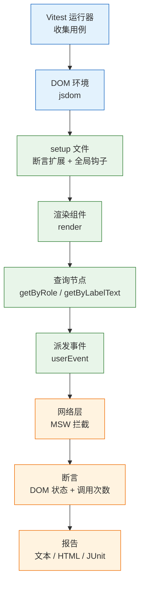
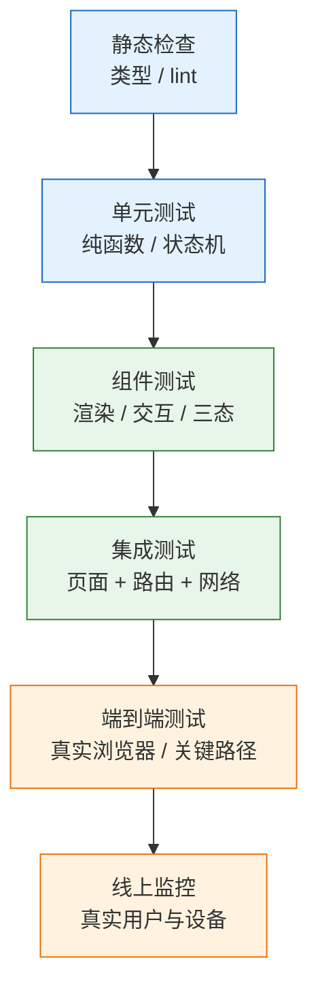
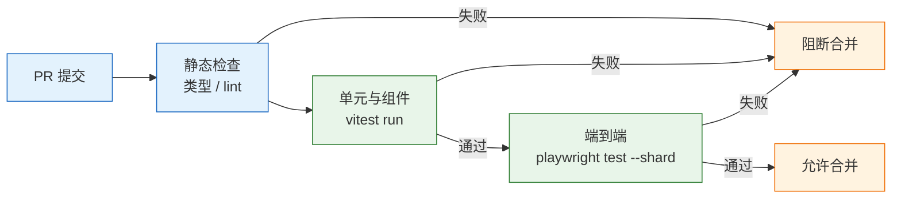

# 前端测试

---

## 一、前端测试是什么

### 1.1 核心概念

前端测试是**用可重复执行的代码验证界面行为**的工程实践。它的价值不在证明某段代码正确，而在改动发生时快速指出哪条路径坏了。一次点击、一次表单校验、一次金额格式化，手工验证都能做，但要在每次发版前把几十条路径重走一遍，人一定会漏，而且越往后越不愿意点。

一条合格的测试具备三个性质：

| 性质 | 含义 | 失效表现 |
|---|---|---|
| 确定性 | 同一输入永远得到同一结果 | 昨天通过、今天失败 |
| 隔离性 | 不依赖其他用例的执行顺序 | 单跑通过、全量失败 |
| 可定位 | 失败能指向具体行为 | 只报“页面打不开” |

测试的结构通常写成“准备、执行、断言”三段：准备渲染组件与数据，执行用户动作，断言界面或调用结果。三段之间不要插入等待真实时间的代码，也不要在断言里比较整个 DOM 字符串，前者让测试变慢且不稳定，后者让任何无关改动都变成失败。

**测试替身**是绕不开的概念。按用途分四类：桩（stub）返回固定值，间谍（spy）记录调用，模拟对象（mock）预设期望，假实现（fake）提供简化版真实逻辑。前端最常用的是桩与间谍：网络请求用桩返回固定响应，回调函数用间谍统计调用次数。替身放在系统边界上才有意义，如果把被测组件内部的模块整体替换，测到的只是替身自己。

**覆盖率**是行、分支、函数、语句被执行的比例，它只能说明“哪些代码没跑过”，不能说明“跑过的代码断言是否正确”。一段没有任何断言的测试同样贡献覆盖率，因此覆盖率是下限指标，不是质量证明。

### 1.2 与相邻技术的关系

前端测试不是单一工具，而是运行器、渲染环境、查询库、网络拦截、浏览器驱动与 CI 的组合。每一层的职责不同，混用会让排障方向偏离。

| 技术 | 解决的问题 | 与测试的边界 |
|---|---|---|
| TypeScript / ESLint | 类型与静态缺陷 | 在测试之前运行，不验证行为 |
| Vitest | 用例组织、断言、模拟 | 提供运行能力，不提供 DOM |
| Testing Library | 按用户视角查询 DOM | 只查询，不渲染 |
| MSW | 在网络层拦截请求 | 不替代业务代码的错误处理 |
| Playwright | 驱动真实浏览器 | 覆盖跨页面流程，不测分支细节 |
| CI | 统一执行与门禁 | 提供环境，不定义用例 |

**与静态检查的关系**：类型检查能发现“传错参数”，发现不了“按钮点两次会重复提交”。静态检查秒级完成，应当放在最前面；测试补的是运行时行为，两者不能互相替代。

**与组件测试、E2E 的关系**：组件测试在 jsdom 中渲染，速度快但环境是模拟的；E2E 在真实浏览器中操作，接近用户但慢且脆。判断标准是“这个行为是否依赖真实浏览器”，滚动、下载、剪贴板、跨域 Cookie 只在真实浏览器中成立，硬塞进 jsdom 只能测到 mock。

**与线上监控的关系**：测试验证已知路径，监控发现未知问题。真实设备、网络抖动、数据分布无法在测试环境完整复现，线上错误监控与性能指标是测试的补充，不是替代。

### 1.3 架构组成

一次组件测试的执行链路是：运行器加载配置，创建 DOM 环境，渲染组件，查询节点，派发事件，拦截网络，断言结果，汇总报告。任何一环配置错误，表现都是“找不到元素”或“断言不通过”，因此需要知道每层由谁负责。



| 层 | 组件 | 职责 |
|---|---|---|
| 运行器 | Vitest | 发现用例、并行调度、生成报告 |
| 环境 | jsdom | 提供 `document`、事件系统等浏览器接口 |
| 渲染 | React Testing Library | 挂载组件、暴露容器 |
| 查询 | 角色、标签、文本 | 按可访问性定位节点 |
| 网络 | MSW | 在 `fetch` 层返回预设响应 |
| 断言 | Jest DOM 扩展 | 提供 `toBeVisible`、`toBeDisabled` 等匹配器 |

E2E 的链路不同：Playwright 启动浏览器进程，通过浏览器调试协议控制页面，应用由真实的 `preview` 服务器提供。它没有 jsdom，也没有模块级 mock，所以能发现构建产物、路由、静态资源的问题。

---

## 二、安装与初始化

### 2.1 运行环境与依赖

> **版本现状（2026-10）**：Vitest 与 Playwright 均按主版本滚动发布，配置项名称以官方文档为准；本项目通过锁文件固定具体版本，不在文档中写死小版本号。

```bash
# ========== 单元与组件测试 ==========
# vitest 是运行器，@vitejs/plugin-react 复用 Vite 的转换管线
pnpm add -D vitest @vitejs/plugin-react jsdom

# ========== 渲染与查询 ==========
pnpm add -D @testing-library/react @testing-library/user-event \
  @testing-library/jest-dom

# ========== 覆盖率 ==========
# 基于 V8 引擎采集覆盖率，无需额外插桩
pnpm add -D @vitest/coverage-v8

# ========== 网络拦截 ==========
# v2 起从 msw/node 导入 setupServer
pnpm add -D msw

# ========== 端到端 ==========
pnpm add -D @playwright/test
```

| 依赖组 | 代表包 | 作用 |
|---|---|---|
| 运行器 | `vitest`、`@vitejs/plugin-react` | 转换 TSX、执行用例 |
| DOM 环境 | `jsdom` | 提供 `document` 与事件系统 |
| 查询断言 | `@testing-library/*` | 渲染、查询、匹配器 |
| 网络拦截 | `msw` | 在 `fetch` 层返回预设响应 |
| 浏览器驱动 | `@playwright/test` | 启动真实浏览器 |

三组依赖的边界要分清：`jsdom` 只提供 DOM，不提供布局与渲染；`@testing-library/react` 依赖 React 与 React DOM，版本必须与项目一致；`@testing-library/jest-dom` 只提供断言匹配器，必须在使用前引入才能获得 `toBeInTheDocument`。

Playwright 的浏览器二进制不在 npm 包里，需要单独安装。CI 的 Linux 镜像还缺系统库，要加 `--with-deps`：

```bash
# 只装 Chromium，减少下载体积；需要跨浏览器时再补 firefox、webkit
pnpm exec playwright install --with-deps chromium
```

> **注意**：`playwright install` 下载的是浏览器二进制，不是 npm 依赖。缓存 `node_modules` 不会缓存浏览器，CI 要么每次安装，要么单独缓存 `~/.cache/ms-playwright`。

### 2.2 测试运行器配置

```ts
// vitest.config.ts
import { defineConfig } from 'vitest/config';
import react from '@vitejs/plugin-react';

export default defineConfig({
  plugins: [react()],
  test: {
    // 组件测试需要 DOM；纯 Node 工具函数可改用 node
    environment: 'jsdom',
    // 每个测试文件执行前加载，注册断言扩展与全局钩子
    setupFiles: './src/test/setup.ts',
    // 只收集源码目录下的测试，避免扫描产物
    include: ['src/**/*.{test,spec}.{ts,tsx}'],
    // 用例之间自动还原 spy，防止跨用例污染
    restoreMocks: true,
    coverage: {
      provider: 'v8',
      reporter: ['text', 'html', 'lcov'],
      // 只统计业务源码，配置与测试文件不计入
      include: ['src/**/*.{ts,tsx}'],
      exclude: ['src/**/*.test.{ts,tsx}', 'src/test/**'],
      thresholds: {
        lines: 80,
        functions: 80,
        branches: 70,
      },
    },
  },
});
```

```ts
// src/test/setup.ts
// 注册 toBeInTheDocument、toBeDisabled 等匹配器
import '@testing-library/jest-dom/vitest';
import { afterAll, afterEach, beforeAll } from 'vitest';
import { server } from './server';

// 未匹配的请求直接失败，避免测试偷偷打到真实网络
beforeAll(() => server.listen({ onUnhandledRequest: 'error' }));

// 每个用例结束后恢复默认 handler，防止用例之间互相影响
afterEach(() => server.resetHandlers());

afterAll(() => server.close());
```

`setupFiles` 在每个测试文件的环境中执行一次，适合放全局钩子、`matchMedia` 之类的补丁。不要在这里放具体的测试数据，数据应属于用例本身。

### 2.3 首个用例与目录约定

```text
src/
├── components/
│   ├── RefundForm.tsx
│   └── RefundForm.test.tsx
├── utils/
│   ├── money.ts
│   └── money.test.ts
├── test/
│   ├── setup.ts
│   ├── server.ts
│   └── fixtures/
└── App.tsx
e2e/
└── refund.spec.ts
```

测试文件与被测文件同目录，命名加 `.test` 后缀。这样重构目录时测试跟着走，不容易变成孤儿文件。跨用例共享的 fixture 放在 `src/test/fixtures/`，按业务场景命名，不要所有用例共用一个巨大对象。

先写一条最小用例，确认运行器、转换、断言三段链路都通了：

```ts
// src/utils/money.test.ts
import { expect, it } from 'vitest';
import { formatAmount } from './money';

it('分转换为两位小数金额', () => {
  expect(formatAmount(1234)).toBe('12.34');
});
```

```bash
# 监听模式：改文件自动重跑，本地开发用
pnpm exec vitest

# 单次执行：CI 与提交前用，跑完退出
pnpm exec vitest run

# 只跑匹配的用例，定位问题时最常用
pnpm exec vitest run src/utils/money.test.ts
pnpm exec vitest run -t "超过可退金额"
```

`vitest` 在交互式终端默认监听文件变化，`vitest run` 只执行一次后退出。脚本里显式写 `run`，不要依赖运行环境自动切换模式。

---

## 三、测试分层与工具选型

### 3.1 分层模型

前端测试按“运行成本”与“定位精度”分层。越靠下越快、越稳定、越能指出具体函数；越靠上越接近真实用户，但越慢、越容易受环境影响。



| 层级 | 工具 | 耗时量级 | 最擅长发现 |
|---|---|---|---|
| 静态检查 | `tsc --noEmit`、ESLint | 秒 | 类型错误、错误依赖 |
| 单元 | Vitest | 毫秒 | 金额、日期、权限、状态机边界 |
| 组件 | Vitest + Testing Library | 百毫秒 | 表单校验、加载/空/错误态 |
| 集成 | Vitest + MSW | 秒 | 页面数据流、请求失败、路由切换 |
| 端到端 | Playwright | 十秒到分钟 | 登录、下单、支付等关键路径 |
| 线上 | 错误监控、RUM | 实时 | 真实设备、网络、数据分布 |

前端更接近“测试奖杯”而不是金字塔：组件测试占大头，因为前端缺陷多出在“数据、交互、渲染”的组合里，纯函数覆盖不到，E2E 又太贵。一个页面的加载、空、错误、成功四种状态，用组件测试跑最快；跨页面的流程才交给 E2E。

### 3.2 工具职责对比

| 工具 | 输入 | 输出 | 不负责 |
|---|---|---|---|
| Vitest | 测试文件 | 通过/失败、覆盖率 | 浏览器渲染 |
| Testing Library | 渲染结果 | 可访问性查询 | 业务正确性判断 |
| user-event | 元素与操作 | 完整事件序列 | 网络请求 |
| MSW | 请求与 handler | 预设响应 | 业务错误处理 |
| Playwright | URL 与选择器 | 浏览器行为断言 | 单元级分支覆盖 |

`user-event` 与直接派发事件的区别值得单独说明。`fireEvent.change` 只触发一次 `change`，而真实用户输入会依次产生 `keydown`、`beforeinput`、`input`、`keyup`，并更新光标位置。受控组件依赖这串事件维护内部状态，用 `fireEvent` 往往得到“值没变”的假失败。`userEvent.type` 按真实序列执行，代价是慢一些。

### 3.3 层级选择判断

| 待测内容 | 推荐层级 | 理由 |
|---|---|---|
| 金额换算、日期格式化 | 单元 | 纯函数，输入输出明确 |
| 表单校验与禁用逻辑 | 组件 | 需要渲染与交互 |
| 请求失败后的提示 | 组件 + MSW | 需要真实错误处理链路 |
| 路由跳转与权限拦截 | 集成 | 需要路由与状态配合 |
| 登录、支付、下单 | 端到端 | 跨页面、依赖真实浏览器 |

判断顺序是：能用纯函数表达就不渲染，能在一个组件内完成就不启路由，需要真实浏览器能力才上 E2E。反过来，把只在 E2E 中成立的行为硬塞进组件测试，写出来的断言只是在验证 mock 的行为。

---

## 四、用例写法与断言设计

### 4.1 纯函数与参数化用例

纯函数测试成本最低，先写它。参数化用例把同一逻辑的多组输入压成一张表，失败时能直接看到是哪一组。

```ts
// src/utils/money.test.ts
import { describe, expect, it } from 'vitest';
import { formatAmount, validateRefund } from './money';

describe('formatAmount', () => {
  it.each([
    { cents: 1234, expected: '12.34' },
    { cents: 0, expected: '0.00' },
    { cents: 5, expected: '0.05' },
    { cents: 100000, expected: '1000.00' },
  ])('分 $cents 格式化为 $expected', ({ cents, expected }) => {
    expect(formatAmount(cents)).toBe(expected);
  });
});

describe('validateRefund', () => {
  it.each([
    { input: '12.34', ok: true },
    { input: '12.345', ok: false },
    { input: 'abc', ok: false },
    { input: '0', ok: false },
    { input: '', ok: false },
  ])('金额 $input 的合法性为 $ok', ({ input, ok }) => {
    expect(validateRefund(input, 100).ok).toBe(ok);
  });

  it('超过可退金额时给出明确原因', () => {
    expect(validateRefund('100.01', 100)).toEqual({
      ok: false,
      reason: '不能超过可退金额',
    });
  });
});
```

金额一律用“分”做整数运算，断言里不要出现浮点相等比较。`12.345` 这条用例专门验证“最多两位小数”，它比十条正常值更能防住回归。

### 4.2 组件交互用例

组件测试按用户能看到的内容查询，不绑定类名与内部状态。查询优先级如下，越靠前越稳定：

| 优先级 | 查询方式 | 适用场景 |
|---|---|---|
| 1 | `getByRole` + 可访问名称 | 按钮、链接、输入框 |
| 2 | `getByLabelText` | 表单字段 |
| 3 | `getByText` | 静态文案与提示 |
| 4 | `getByTestId` | 无语义节点兜底 |

```tsx
// src/components/RefundForm.test.tsx
import { render, screen } from '@testing-library/react';
import userEvent from '@testing-library/user-event';
import { describe, expect, it, vi } from 'vitest';
import { RefundForm } from './RefundForm';

describe('RefundForm', () => {
  it('超过可退金额时提示，且不提交', async () => {
    const user = userEvent.setup();
    const onSubmit = vi.fn(async () => {});
    render(<RefundForm refundable={100} onSubmit={onSubmit} />);

    // 用标签定位输入框，不依赖 name 或 class
    await user.type(screen.getByLabelText('退款金额'), '100.01');
    await user.click(screen.getByRole('button', { name: '提交' }));

    // findBy 会自动等待异步更新，不需要 sleep
    expect(await screen.findByText('不能超过可退金额')).toBeInTheDocument();
    expect(onSubmit).not.toHaveBeenCalled();
  });

  it('提交中禁用按钮，避免重复请求', async () => {
    const user = userEvent.setup();
    // 手动控制的 Promise，用来把界面停在“提交中”
    let finish: () => void = () => {};
    const onSubmit = vi.fn(
      () => new Promise<void>((resolve) => { finish = resolve; }),
    );
    render(<RefundForm refundable={100} onSubmit={onSubmit} />);

    await user.type(screen.getByLabelText('退款金额'), '10');
    await user.dblClick(screen.getByRole('button', { name: '提交' }));

    expect(onSubmit).toHaveBeenCalledTimes(1);
    expect(screen.getByRole('button', { name: '提交中' })).toBeDisabled();

    finish();
    expect(await screen.findByRole('button', { name: '提交' })).toBeEnabled();
  });
});
```

第二条用例测的是“请求进行中”这个状态。如果把 `onSubmit` 换成永远 resolve 的 `vi.fn()`，双击时第一次请求已经结束，按钮恢复可用，bug 根本复现不出来。测试替身必须能停在需要的状态，否则用例只是走个过场。

> **注意**：不要在断言里读组件的内部状态（例如 `wrapper.vm.isSubmitting`）。内部状态改名、拆分、换成状态机，测试都会误报；用户看到的是按钮文案与禁用属性，断言这两者才算测行为。

### 4.3 网络边界与异步等待

组件测试里最容易犯的错，是把被测逻辑一起 mock 掉。测“提交失败要提示”，却把整个 API 模块替换成永远 reject，等于只验证了 `catch` 分支的文案。正确做法是在网络层拦截，让请求构造、序列化、错误映射都真实执行。

```ts
// src/test/server.ts
import { http, HttpResponse } from 'msw';
import { setupServer } from 'msw/node';

export const server = setupServer(
  // 通配 origin：Node 环境的请求通常带绝对地址
  http.post('*/api/refund', async ({ request }) => {
    const body = (await request.json()) as { amount: string };
    if (body.amount === '0') {
      return HttpResponse.json(
        { code: 'INVALID_AMOUNT', message: '金额必须大于 0' },
        { status: 400 },
      );
    }
    return HttpResponse.json({ ok: true, refundId: 'r_1' });
  }),
);
```

测试环境的请求地址必须是绝对 URL，例如 `VITE_API_BASE=http://localhost/api`。Node 的 `fetch` 不接受相对地址，直接写 `/api/refund` 会在到达 MSW 之前抛 `Failed to parse URL`，看起来像“拦截失败”，实际是请求根本没发出去。

单个用例需要特殊响应时，在用例内覆盖：

```ts
import { http, HttpResponse } from 'msw';
import { server } from '../test/server';

it('接口 500 时提示重试，并恢复按钮', async () => {
  // 只影响当前用例，afterEach 的 resetHandlers 会还原
  server.use(
    http.post('*/api/refund', () =>
      HttpResponse.json({ message: '服务异常' }, { status: 500 }),
    ),
  );
  // ...渲染与操作
  expect(await screen.findByText('提交失败，请重试')).toBeInTheDocument();
});
```

异步断言只用 `findBy*` 与 `waitFor`。`findBy*` 内部按间隔轮询直到超时，`waitFor` 适合断言非查询类的条件。不要用 `await new Promise(r => setTimeout(r, 500))`，它让测试变慢，还在慢机器上随机失败。

时间相关的逻辑要注入时钟，而不是读真实时间：

```ts
import { afterEach, beforeEach, vi } from 'vitest';

beforeEach(() => {
  // 固定到某一时刻并接管定时器，日期断言才稳定
  vi.useFakeTimers();
  vi.setSystemTime(new Date('2026-01-15T10:00:00+08:00'));
});

afterEach(() => {
  vi.useRealTimers();
});
```

`userEvent` 与假定时器同时使用时，需要给 `setup` 传 `advanceTimers`，否则输入事件的延时不会被推进，表现为“输入框一直是空的”。

### 4.4 端到端用例

```ts
// playwright.config.ts
import { defineConfig, devices } from '@playwright/test';

export default defineConfig({
  testDir: './e2e',
  // 文件之间并行，文件内部默认串行
  fullyParallel: true,
  // CI 上失败重试两次，本地不重试，避免掩盖问题
  retries: process.env.CI ? 2 : 0,
  reporter: process.env.CI ? [['html'], ['github']] : 'list',
  use: {
    baseURL: 'http://127.0.0.1:4173',
    // 首次重试时录制 trace，失败后可回放
    trace: 'on-first-retry',
    screenshot: 'only-on-failure',
  },
  projects: [{ name: 'chromium', use: { ...devices['Desktop Chrome'] } }],
  webServer: {
    // 用生产构建验证产物，不用开发服务器
    command: 'pnpm build && pnpm preview --port 4173 --strictPort',
    url: 'http://127.0.0.1:4173',
    // 本地复用已启动的服务，CI 每次新建
    reuseExistingServer: !process.env.CI,
    timeout: 120_000,
  },
});
```

```ts
// e2e/refund.spec.ts
import { expect, test } from '@playwright/test';

test('双击提交只产生一笔退款', async ({ page }) => {
  await page.goto('/orders/1');
  await page.getByLabel('退款金额').fill('10');

  const submit = page.getByRole('button', { name: '提交' });
  await submit.dblclick();

  await expect(page.getByText('退款申请已提交')).toBeVisible();
  // 成功提示只能出现一次，重复提交会渲染两条
  await expect(page.getByText('退款申请已提交')).toHaveCount(1);
});
```

Playwright 的定位器自带自动等待：元素出现、可见、可操作后才执行动作，断言也会轮询到超时。因此不要在前面加 `waitForTimeout`，它只会让测试变慢，并在慢环境里继续失败。

多个用例需要登录态时，用 `storageState` 保存一次登录结果并在配置中复用，不要每条用例都重走登录表单。登录流程单独保留一条用例，其余用例直接带入状态；否则登录页一改，几十条用例同时失败，真正的回归信号被淹没。

E2E 只覆盖登录、主流程、支付、权限边界、发版必须走通的几条路径。每个表单的校验分支属于组件测试，放进 E2E 会让整套用例从一分钟涨到二十分钟。

---

## 五、完整示例

### 5.1 缺陷复现流程

客服反馈同一笔订单退了两遍。不要先猜代码，先写一个会失败的测试，顺序如下：

1. **写组件测试**：让 `onSubmit` 停在未完成状态，双击提交，统计调用次数，期望为 1。当前代码得到 2，测试红。
2. **修代码**：进入提交时立刻置位 `submitting` 并返回，按钮文案改为“提交中”并禁用。测试转绿。
3. **补失败路径**：接口返回 500 时提示“提交失败，请重试”，按钮恢复可用。这条用例防止“禁用后忘记恢复”。
4. **补 E2E**：真实浏览器双击，只出现一次成功提示，验证组件测试覆盖不到的浏览器事件合并行为。
5. **进 CI**：`vitest run --coverage` 与 `playwright test` 分成两个作业，E2E 失败保留 trace。

这个顺序的关键是“先红后绿”。测试写完直接通过，说明它没抓住 bug，要么场景没复现，要么断言没落在关键行为上。

### 5.2 配置与用例全文

```text
web-app/
├── vitest.config.ts
├── playwright.config.ts
├── package.json
├── src/
│   ├── components/
│   │   ├── RefundForm.tsx
│   │   └── RefundForm.test.tsx
│   ├── utils/
│   │   ├── money.ts
│   │   └── money.test.ts
│   └── test/
│       ├── setup.ts
│       ├── server.ts
│       └── fixtures/refund.ts
└── e2e/
    └── refund.spec.ts
```

| 文件 | 职责 | 修改时机 |
|---|---|---|
| `vitest.config.ts` | 环境、setup、覆盖率 | 调整测试范围时 |
| `playwright.config.ts` | 浏览器、服务、重试 | 调整 E2E 策略时 |
| `src/test/setup.ts` | 全局钩子与补丁 | 引入新全局能力时 |
| `src/test/server.ts` | 默认网络响应 | 接口新增时 |

`package.json` 的脚本把单次运行、监听、覆盖率与 E2E 分开，便于 CI 单独调用并统计各段耗时：

```json
{
  "scripts": {
    "test": "vitest run",
    "test:watch": "vitest",
    "test:coverage": "vitest run --coverage",
    "test:e2e": "playwright test",
    "test:e2e:ui": "playwright test --ui"
  }
}
```

被测组件保持“提交状态由内部管理、提交动作由外部注入”的结构，测试才能在不启动网络的情况下控制时序。组件测试与网络桩见 4.2、4.3，E2E 用例见 4.4，下面只列生产代码：

```tsx
// src/components/RefundForm.tsx（结构示意，省略样式与 import）
import { validateRefund } from '../utils/money';

export function RefundForm(props: {
  refundable: number;
  onSubmit: (amount: string) => Promise<void>;
}) {
  const [amount, setAmount] = useState('');
  const [submitting, setSubmitting] = useState(false);
  const [error, setError] = useState('');

  async function handleSubmit(event: React.FormEvent) {
    event.preventDefault();

    // 先校验金额，失败时不发请求，也不进入提交中状态
    const result = validateRefund(amount, props.refundable);
    if (!result.ok) {
      setError(result.reason);
      return;
    }

    // 同步置位，赶在 await 之前，双击的第二下会被这里挡住
    if (submitting) return;
    setSubmitting(true);
    setError('');
    try {
      await props.onSubmit(amount);
    } catch {
      setError('提交失败，请重试');
    } finally {
      setSubmitting(false);
    }
  }

  return (
    <form onSubmit={handleSubmit}>
      <label htmlFor="amount">退款金额</label>
      <input id="amount" value={amount} onChange={(e) => setAmount(e.target.value)} />
      {error && <p role="alert">{error}</p>}
      <button type="submit" disabled={submitting}>
        {submitting ? '提交中' : '提交'}
      </button>
    </form>
  );
}
```

`if (submitting) return` 必须放在 `setSubmitting(true)` 之前读取状态，且不能被 `await` 隔开。把判断放到 `await` 之后，两次点击都能通过检查，这正是原 bug 的成因。

测试数据同样要隔离。E2E 每次运行都应创建独立订单，用时间戳或随机后缀生成业务单号，不要复用固定账号里的固定记录；否则并行分片会互相消费对方的数据，表现为随机的 404 或金额不符，且无法稳定复现。

### 5.3 运行结果解读

```bash
# 单次运行全部单元与组件测试
pnpm test

# 生成覆盖率，检查 thresholds 是否通过
pnpm test:coverage

# 只在本地调试某个文件
pnpm exec vitest run src/components/RefundForm.test.tsx
```

输出类似：

```text
 ✓ src/utils/money.test.ts (10 tests) 12ms
 ✓ src/components/RefundForm.test.tsx (2 tests) 186ms

 Test Files  2 passed (2)
      Tests  12 passed (12)
   Duration  1.42s
```

覆盖率不达标时，Vitest 以非零退出码结束，并列出未覆盖的行号：

```text
 % Coverage report from v8
----------|---------|----------|---------|---------|
File      | % Stmts | % Branch | % Funcs | % Lines |
----------|---------|----------|---------|---------|
 money.ts |   92.30 |    85.71 |  100.00 |   92.30 |
----------|---------|----------|---------|---------|
ERROR: Coverage for lines (79.2%) does not meet global threshold (80%)
```

先看未覆盖的行属于哪一类：错误处理、边界分支、还是根本不该统计的配置代码。为凑数字给纯展示代码补空断言，比不测更危险。

---

## 六、CI 集成

### 6.1 分层流水线

| 作业 | 内容 | 目标耗时 | 失败处理 |
|---|---|---|---|
| 静态检查 | 类型、lint、格式 | 2 分钟 | 阻断 |
| 单元与组件 | `vitest run --coverage` | 3 分钟 | 阻断 |
| 集成 | 页面数据流、MSW | 5 分钟 | 阻断 |
| 端到端 | 关键路径、分片 | 10 分钟 | 阻断合并 |
| 全量回归 | 多浏览器、全用例 | 30 分钟 | 建 issue |

单元与组件测试每次提交都跑，几十秒内结束；E2E 放在合并前或夜间，用分片并行。不要把所有测试塞进一个作业，前端测试最贵的是等待浏览器启动，拆开后单元测试能先给出结论。



### 6.2 工作流全文

```yaml
name: test

on:
  pull_request:
    branches: [main]

concurrency:
  group: test-${{ github.event.pull_request.number }}
  cancel-in-progress: true

permissions:
  contents: read

jobs:
  unit:
    runs-on: ubuntu-latest
    timeout-minutes: 10
    steps:
      - uses: actions/checkout@v4
      - uses: pnpm/action-setup@v4
        with:
          version: 10
      - uses: actions/setup-node@v4
        with:
          node-version: 22
          cache: pnpm
      - run: pnpm install --frozen-lockfile

      # 覆盖率阈值在 vitest.config.ts 中定义，不达标即失败
      - name: 单元与组件测试
        run: pnpm test:coverage

      # 失败时也要上传，否则页面只有一行退出码
      - name: 上传覆盖率报告
        if: always()
        uses: actions/upload-artifact@v4
        with:
          name: coverage-${{ github.run_id }}
          path: coverage/
          retention-days: 14

  e2e:
    runs-on: ubuntu-latest
    timeout-minutes: 20
    strategy:
      # 一个分片失败不取消其他分片，便于一次看全问题
      fail-fast: false
      matrix:
        shard: [1, 2, 3, 4]
    steps:
      - uses: actions/checkout@v4
      - uses: pnpm/action-setup@v4
        with:
          version: 10
      - uses: actions/setup-node@v4
        with:
          node-version: 22
          cache: pnpm
      - run: pnpm install --frozen-lockfile

      # 浏览器二进制不在 node_modules 中，必须单独安装
      - name: 安装浏览器
        run: pnpm exec playwright install --with-deps chromium

      - name: 端到端测试
        run: pnpm exec playwright test --shard=${{ matrix.shard }}/4

      # trace 与截图是失败后唯一的现场，必须保留
      - name: 上传测试产物
        if: always()
        uses: actions/upload-artifact@v4
        with:
          name: playwright-${{ matrix.shard }}-${{ github.run_id }}
          path: |
            playwright-report/
            test-results/
          retention-days: 14
```

### 6.3 分片、覆盖率与不稳定测试治理

| 策略 | 做法 | 代价 |
|---|---|---|
| 按文件分片 | `--shard=i/n` | 文件耗时不均时负载失衡 |
| 按项目分片 | 浏览器矩阵 | 作业数成倍增加 |
| 覆盖率阈值 | 略低于当前值 | 定太高会催生空测试 |
| 重试 | 仅限已定位的环境问题 | 掩盖竞态与数据污染 |

分片数不要超过测试文件数，否则必有空片。分片的目标是每片耗时接近，不是数量相同；一个超大用例文件会拖慢整片，应按历史耗时调整。

覆盖率门槛设在“当前值略低一点”，防止倒退即可。一上来定 90%，团队会用无断言的测试凑数，指标上去了，缺陷一个没少。评审时看未覆盖的行是不是错误处理与边界分支，比看总分有用。

不稳定测试按来源分类治理：

| 来源 | 表现 | 处理 |
|---|---|---|
| 真实时间 | 昨天过、今天挂 | 固定系统时间，注入时钟 |
| 随机数 | 偶尔命中边界 | 固定种子或抽成参数 |
| 共享状态 | 单跑过、全量挂 | `beforeEach` 重置，数据加唯一前缀 |
| 动画过渡 | 元素时有时无 | 测试环境禁用动画，用自动等待 |
| 并行冲突 | 端口、数据互相覆盖 | 每 worker 独立数据，或串行该文件 |

处理顺序是：连续跑二十次复现，再看 trace 与日志，最后才考虑加 `retry`。用重试掩盖 flaky，等于把偶发失败换成偶发通过，问题仍然留在主干。

> **安全警告**：E2E 使用的测试账号与支付沙箱凭据必须通过 CI Secrets 注入，不得写进仓库或测试用例。测试环境的密钥一旦泄露，攻击者可以直接操作真实业务数据。

---

## 七、常见错误与排查

### 7.1 故障对照表

| 现象 | 最可能原因 | 处理 |
|---|---|---|
| `toBeInTheDocument is not a function` | 未引入 jest-dom | 在 setup 文件引入 `/vitest` 入口 |
| `act(...)` 警告 | 异步更新未被等待 | 改用 `findBy*`、`waitFor`、`userEvent` |
| 找不到元素 | 查询绑定了实现细节 | `screen.debug()` 后改用角色查询 |
| 输入后值没变 | 用了 `fireEvent.change` | 改用 `userEvent.type` |
| MSW 没拦住请求 | URL 是相对地址或 setup 未执行 | 用绝对 URL，确认 `server.listen` |
| `matchMedia` 不存在 | jsdom 未实现该接口 | 在 setup 中打桩 |
| 假定时器下输入无效 | `userEvent` 未推进定时器 | `setup({ advanceTimers: vi.advanceTimersByTime })` |
| 组件测试过、页面仍坏 | 只测了 mock，未覆盖组合 | 补一条集成或 E2E |
| E2E 本地过、CI 挂 | 端口、时区、资源未就绪 | 看 trace，固定时区，等 `webServer` |
| 覆盖率很高仍出事故 | 断言太弱，只测正常路径 | 补错误分支与边界值 |
| 用例之间互相影响 | 模块级单例、全局状态 | 每例重置，避免共享可变对象 |
| 测试越跑越慢 | E2E 过多、未并行 | 下沉到组件层，按文件分片 |
| CI 作业一直不结束 | 命令进入了监听模式 | 改用 `vitest run`，确认脚本未传 `--watch` |

### 7.2 排查顺序

1. **单跑失败用例**：`vitest run <文件>` 排除并行与共享状态。单跑通过、全量失败，问题在隔离性。
2. **看断言前的现场**：打印 `screen.debug()` 与请求记录，确认 DOM 与网络的实际状态，不要只看 `expected true received false`。
3. **连续运行多次**：区分稳定失败与 flaky。稳定失败是逻辑问题，flaky 是环境或时序问题，处理方式完全不同。
4. **检查异步边界**：确认每个状态更新都被等待，没有裸 `setTimeout`，没有在断言后仍有未完成的请求。
5. **E2E 看 trace**：`playwright show-trace` 能逐步回放动作、DOM 快照与控制台输出，比读日志快。
6. **核对环境**：Node 版本、浏览器版本、时区、`baseURL`、CI 与本地是否一致。
7. **最后才怀疑框架版本**：升级运行器或浏览器后集中出现失败，先回退验证，再逐项排查配置。

测试排障的核心是分清“代码错、用例错、环境错”。代码错要改实现；用例错要改断言或查询方式；环境错要固定版本与时区。三者混在一起修，通常会把一个失败变成三个。
