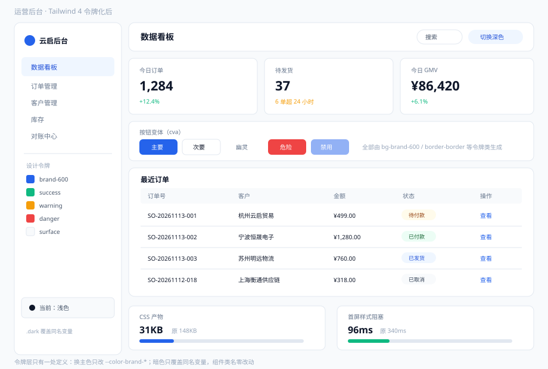

# CSS工程化与Tailwind

> 这篇从样式失控的四个根源讲起，经过 Tailwind 4 的接入与 CSS-first 配置、BEM 与 CSS Modules 的命名边界、`@theme` 设计令牌、响应式与暗色策略，最后落到组件变体、构建体积和样式冲突排障。
>
> 学完能为一套企业后台建立可维护的样式体系：令牌统一、类名不打架、暗色可切换、产物可度量，并能在样式不生效时按层定位原因。

## 一、样式工程要解决的问题

这一章先把“样式为什么会烂”说清，后面每种方案都是在治其中一种病。

样式失控只有四个根源：全局作用域污染、优先级竞争、死代码堆积、设计与实现漂移。选方案就是选在哪一层解决它们。

### 1.1 四个根源的具体表现

| 根源 | 表现 | 后果 |
|---|---|---|
| 全局污染 | 改 A 页面影响 B 页面 | 不敢删旧样式 |
| 优先级竞争 | 到处 `!important` | 改一处崩三处 |
| 死代码 | 删了组件样式还在 | 包体只增不减 |
| 设计漂移 | 十种蓝色、七种圆角 | 界面不像一个产品 |

一个 3 年以上的后台项目，CSS 文件通常有 3000 行以上、`!important` 超过 100 处、没人敢删任何一条规则。这不是能力问题，是缺少约束。

### 1.2 三种方案的定位

| 方案 | 解决什么 | 不解决什么 | 适合 |
|---|---|---|---|
| BEM | 命名可预测、降低污染 | 死代码、优先级 | 传统多页、老项目 |
| CSS Modules | 作用域隔离 | 设计一致性、复用 | 组件库、复杂动效 |
| Tailwind | 一致性、无死代码 | 复杂选择器、动态主题 | 新项目、设计系统 |

三者不是互斥关系。企业项目的常见组合是：Tailwind 承担布局与排版，CSS Modules 承担复杂组件样式，少量全局 CSS 承担重置与第三方覆盖。

### 1.3 版本基线

| 工具 | 版本 | 关键变化 |
|---|---|---|
| Tailwind CSS | 4.x | CSS-first 配置，无需 `tailwind.config.js` |
| Vite | 7.x | 用 `@tailwindcss/vite` 插件 |
| Next.js | 16.x | 用 `@tailwindcss/postcss` |
| tailwind-merge | 3.x | 适配 v4 的类名体系 |
| class-variance-authority | 0.7.x | 组件变体 |

Tailwind 4 的引擎用 Rust 重写（Oxide），全量构建从秒级降到毫秒级，这是它敢去掉配置文件的前提。

## 二、Tailwind 4 的接入

这一章把 Tailwind 跑起来，并确认产物里真的有生成好的 CSS。

### 2.1 安装

```bash
# Vite 项目（macOS / Ubuntu / Windows 通用）
npm install tailwindcss @tailwindcss/vite

# Next 16 项目
npm install tailwindcss @tailwindcss/postcss
```

Vite 配置：

```ts
// vite.config.ts
import { defineConfig } from 'vite'
import react from '@vitejs/plugin-react'
import tailwindcss from '@tailwindcss/vite'

export default defineConfig({
  plugins: [react(), tailwindcss()],   // 为什么用官方插件：省掉 PostCSS 链路，构建更快且自动处理 @import
})
```

Next 16 配置：

```js
// postcss.config.mjs
export default {
  plugins: { '@tailwindcss/postcss': {} },  // v4 的插件名带包作用域，写成 'tailwindcss' 会静默失效
}
```

### 2.2 最小闭环

```css
/* src/index.css */
@import "tailwindcss";   /* 一行引入 preflight、主题变量和全部工具类 */
```

```tsx
export function Badge() {
  return (
    <span className="inline-flex items-center rounded-full bg-emerald-50 px-2.5 py-0.5 text-xs font-medium text-emerald-700 ring-1 ring-emerald-600/20">
      已付款
    </span>
  )
}
```

```bash
npm run build
```

预期输出：

```text
dist/assets/index-4f2a1c.css   28.41 kB │ gzip: 6.12 kB
```

首次构建后 CSS 有几十 KB 是正常的，里面包含 preflight 和用到的工具类。如果只有几百字节，说明内容扫描没找到源文件。

### 2.3 从 v3 迁移的四个断点

| v3 | v4 | 影响 |
|---|---|---|
| `tailwind.config.js` | CSS 里的 `@theme` | 配置不再被读取 |
| `@tailwind base/components/utilities` | `@import "tailwindcss"` | 旧指令报错 |
| `postcss-import` + `autoprefixer` | 内置 | 多余插件会重复处理 |
| `content: [...]` | 自动扫描 + `@source` | 动态拼接的类名可能漏掉 |

迁移时先删 `tailwind.config.js`，再把自定义色板搬进 `@theme`。留着旧配置文件不会生效，也不会报错，这是最容易误判“迁移成功”的地方。

## 三、BEM 与命名约定

这一章解决“类名怎么起”，BEM 的价值在于看到类名就知道它属于哪个块。

### 3.1 BEM 的三段结构

块（Block）、元素（Element）、修饰符（Modifier）：`.order-card`、`.order-card__title`、`.order-card--compact`。

```css
/* 块：独立语义单元，不依赖外部上下文 */
.order-card {
  display: flex;
  flex-direction: column;
  gap: 12px;
  padding: 16px;
  border: 1px solid #e2e8f0;
  border-radius: 8px;
}

/* 元素：只能属于这个块，不单独复用 */
.order-card__title {
  font-size: 15px;
  font-weight: 600;
}

/* 修饰符：改变块或元素的状态/形态，不改结构 */
.order-card--compact {
  padding: 8px;
}

.order-card__title--muted {
  color: #64748b;
}
```

```html
<article class="order-card order-card--compact">
  <h3 class="order-card__title order-card__title--muted">SO-20261113-001</h3>
</article>
```

### 3.2 命名的三条边界

- 元素名不嵌套：`.order-card__title`，不写 `.order-card__header__title`；
- 修饰符只描述状态或形态：`--compact`、`--disabled`，不写 `--blue`；
- 不按页面命名：`.orders-page__card` 会让卡片无法在其他页面复用。

命名里出现颜色、尺寸这类具体值时，主题一换就要改名。用语义名（`--primary`、`--compact`）而不是外观名。

### 3.3 BEM 什么时候不够用

BEM 解决的是“可预测”，不解决“没人用错”。团队里只要有一个人写 `.card .title`，嵌套选择器就会回来。BEM 还需要配套 lint 规则才有效：

```json
{
  "rules": {
    "selector-class-pattern": "^[a-z][a-z0-9]*(-[a-z0-9]+)*(__[a-z0-9]+(-[a-z0-9]+)*)?(--[a-z0-9]+(-[a-z0-9]+)*)?$",
    "selector-max-specificity": "0,2,0",
    "declaration-no-important": true
  }
}
```

`selector-max-specificity` 限制到两个类，`declaration-no-important` 直接禁掉 `!important`。没有 lint 的 BEM 只是命名建议。

## 四、CSS Modules 与作用域

这一章解决“样式不外泄”，它把类名编译成哈希，从根本上消除全局污染。

### 4.1 编译结果

```css
/* OrderCard.module.css */
.card {
  border: 1px solid var(--color-border);
  border-radius: var(--radius-md);
}

.title {
  font-size: 0.9375rem;
  font-weight: 600;
}
```

```tsx
import styles from './OrderCard.module.css'

export function OrderCard({ id }: { id: string }) {
  return (
    <article className={styles.card}>
      <h3 className={styles.title}>{id}</h3>
    </article>
  )
}
```

构建后类名变成 `_card_1a2b3` 这样的哈希。两个组件都写 `.card` 也不会冲突，这是它相对 BEM 的最大优势。

### 4.2 组合与全局

```css
/* 复用另一份样式，编译后只保留一份声明 */
.button {
  composes: base from './base.module.css';
  padding: 0 12px;
}

/* 覆盖第三方组件必须穿透作用域 */
:global(.ant-table-thead > tr > th) {
  background: var(--color-surface-muted);
}
```

`composes` 只能组合类选择器，不能组合标签或复合选择器。`:global` 用多了等于放弃隔离，覆盖第三方组件时应限定在某个模块根节点下：

```css
.root :global(.ant-pagination-item) {
  border-radius: 6px;
}
```

### 4.3 CSS Modules 的四个坑

| 现象 | 原因 | 处理 |
|---|---|---|
| `styles.card` 是 `undefined` | 类名用了连字符，导入后要 `styles['order-card']` | 统一 camelCase |
| 样式不生效 | 选择器里的类名没有从 `styles` 导出 | 只用 `styles` 对象里存在的类名 |
| 覆盖不了组件库 | 优先级不够 | 用 `:global` 加根节点限定 |
| 动态类名丢失 | 模板字符串拼出的键不在 `styles` 导出表里 | 用对象映射显式列出 |

最后一个坑最隐蔽：`className={styles['btn-' + type]}` 这类动态键拼错时返回 `undefined`，TypeScript 也查不到。改成映射表，键名和类型一起校验：

```tsx
const BTN = { primary: styles.primary, ghost: styles.ghost } as const;
<button className={BTN[type]} />
```

## 五、Tailwind 4 的 CSS-first 配置

这一章建立设计令牌，让“颜色、间距、圆角”只有一处定义。

### 5.1 `@theme` 定义令牌

```css
/* src/styles/theme.css */
@import "tailwindcss";

@theme {
  /* 品牌色用 oklch：感知均匀，调亮度不会偏色 */
  --color-brand-50: oklch(0.97 0.014 250);
  --color-brand-100: oklch(0.94 0.03 250);
  --color-brand-500: oklch(0.62 0.17 255);
  --color-brand-600: oklch(0.54 0.18 255);
  --color-brand-700: oklch(0.46 0.16 255);

  --color-surface: #ffffff;
  --color-surface-muted: #f8fafc;
  --color-border: #e2e8f0;
  --color-ink: #0f172a;
  --color-ink-muted: #64748b;
  --color-danger: oklch(0.58 0.22 27);

  /* 间距基准 4px，工具类 p-1 = 0.25rem */
  --spacing: 0.25rem;

  --radius-sm: 4px;
  --radius-md: 8px;
  --radius-lg: 12px;

  --font-sans: "Inter", "PingFang SC", "Microsoft YaHei", sans-serif;
  --font-mono: "JetBrains Mono", ui-monospace, monospace;

  /* 断点会生成 sm: md: lg: 这些变体 */
  --breakpoint-sm: 40rem;
  --breakpoint-md: 48rem;
  --breakpoint-lg: 64rem;
  --breakpoint-xl: 80rem;
}
```

定义完立刻可用：`bg-brand-500`、`text-ink-muted`、`rounded-md`、`font-mono`。不需要任何 JS 配置，也不需要重启开发服务器。

### 5.2 命名空间对应关系

| 前缀 | 生成的工具类 | 示例 |
|---|---|---|
| `--color-*` | `bg-*` `text-*` `border-*` | `--color-brand-500` |
| `--spacing` | `p-*` `m-*` `gap-*` | `--spacing: 0.25rem` |
| `--radius-*` | `rounded-*` | `--radius-md` |
| `--font-*` | `font-*` | `--font-sans` |
| `--breakpoint-*` | `sm:` `md:` 变体 | `--breakpoint-md` |
| `--animate-*` | `animate-*` | `--animate-spin` |

命名必须落在这些命名空间里才会生成工具类。写成 `--brand-primary` 不会产生任何类，这是自定义主题最常见的失效原因。

### 5.3 `@utility` 与 `@apply`

重复出现的组合用 `@utility` 封装，它和内置工具类同级，可被 `hover:`、`md:` 修饰。

```css
@utility card-surface {
  background: var(--color-surface);
  border: 1px solid var(--color-border);
  border-radius: var(--radius-md);
  box-shadow: 0 1px 2px rgb(15 23 42 / 0.04);
}

@utility focus-ring {
  &:focus-visible {
    outline: 2px solid var(--color-brand-500);
    outline-offset: 2px;
  }
}
```

```html
<div class="card-surface focus-ring p-4" tabindex="0">…</div>
```

`@apply` 仍可用，但只建议在需要覆盖第三方库或在 `@layer components` 里复用少量样式时使用。把整段布局写成 `@apply` 会失去 Tailwind 的内联可读性。

### 5.4 内容扫描

Tailwind 4 自动扫描项目文件，但动态拼接的类名扫不到。

```css
/* 显式补充扫描范围：monorepo 里的共享包不会被自动发现 */
@source "../../packages/ui/src/**/*.{ts,tsx}";

/* 明确排除，减少无关扫描 */
@source not "../../legacy/**";
```

```tsx
// 反例：运行时拼接，构建时看不到完整类名
<div className={`bg-${color}-500`} />

// 正例：完整类名出现在源码里
const TONE = { success: 'bg-emerald-500', danger: 'bg-red-500' } as const;
<div className={TONE[tone]} />
```

这是 Tailwind 唯一的硬约束：类名必须是完整字符串字面量。CI 里加一条 `grep -rn "bg-\${" src/` 就能挡住大部分误用。

### 5.5 与原生 CSS 的分层

```css
@import "tailwindcss";

@layer base {
  /* 全局基线：只放真正全局的规则 */
  html { -webkit-text-size-adjust: 100%; }
  body { background: var(--color-surface-muted); color: var(--color-ink); }
}

@layer components {
  /* 复杂组件的多状态样式，用类名承载比一长串工具类好读 */
  .data-table th { position: sticky; top: 0; background: var(--color-surface); }
}

@layer utilities {
  /* 高优先级、必须赢过工具类的少量规则 */
  .no-scrollbar { scrollbar-width: none; }
}
```

层顺序是 `theme → base → components → utilities`。写在 `@layer` 外的规则会排到所有层之后，容易意外覆盖工具类，所以除 `@theme` 外都放进层里。

## 六、响应式与容器查询

这一章解决“同一套组件在不同宽度下怎么变”，移动优先仍是默认，但断点不再是唯一手段。

### 6.1 移动优先的断点

Tailwind 的变体是 `min-width` 语义：`md:flex` 表示“≥768px 才 flex”。

```html
<!-- 移动端纵向堆叠，≥768px 横向 -->
<div class="flex flex-col gap-3 md:flex-row md:items-center md:justify-between">
  <h1 class="text-lg md:text-xl">订单</h1>
  <div class="flex gap-2">…</div>
</div>
```

| 变体 | 最小宽度 | 典型用途 |
|---|---|---|
| `sm:` | 40rem / 640px | 大屏手机横屏 |
| `md:` | 48rem / 768px | 平板 |
| `lg:` | 64rem / 1024px | 笔记本 |
| `xl:` | 80rem / 1280px | 桌面 |
| `2xl:` | 96rem / 1536px | 宽屏 |

`sizes` 与断点要一致：`next/image` 的 `sizes` 写错，下载的图会比实际需要的大一倍。

### 6.2 容器查询

组件放进侧栏和放进主区域时，可用宽度完全不同。按视口写断点会让同一个卡片在两种容器里表现一样，容器查询按父容器宽度响应。

```html
<div class="@container">
  <article class="flex flex-col gap-2 @md:flex-row @md:items-center">
    
    <div class="@md:flex-1">
      <p class="font-medium">杭州云启贸易</p>
      <p class="text-sm text-ink-muted">SO-20261113-001</p>
    </div>
    <span class="text-sm @lg:text-base">¥499.00</span>
  </article>
</div>
```

`@container` 标记容器，`@md:` 读的是容器宽度而不是视口。侧栏 320px 时卡片自动纵向排列，主区域 900px 时自动横向，不需要写两套样式。

### 6.3 现代选择器

```css
/* 表单有错误时整组变红，不用加额外的状态类 */
.field:has(input[aria-invalid="true"]) .field-label {
  color: var(--color-danger);
}

/* 只在支持某特性时增强 */
@supports (text-wrap: balance) {
  .headline { text-wrap: balance; }
}
```

`:has()` 在 2026 年的浏览器里已全面可用，它减少了一大批“由 JS 加状态类”的代码。

## 七、暗色模式与主题切换

这一章解决“同一套令牌出两套配色”，关键是把颜色抽成变量，而不是给每个元素写两遍。

### 7.1 两种策略

| 策略 | 声明 | 适用 |
|---|---|---|
| 跟随系统 | 默认 `prefers-color-scheme` | 内容站 |
| 手动切换 | `@custom-variant dark (&:where(.dark, .dark *))` | 后台、需要记住偏好 |

后台系统通常两者都要：默认跟随系统，允许手动覆盖并持久化。

```css
/* 让 dark: 变体由 .dark 类控制，而不是媒体查询 */
@custom-variant dark (&:where(.dark, .dark *));
```

### 7.2 令牌分两层

```css
@theme {
  --color-surface: #ffffff;
  --color-surface-muted: #f8fafc;
  --color-ink: #0f172a;
  --color-ink-muted: #64748b;
  --color-border: #e2e8f0;
}

/* 覆盖层：只改变量，不改类名 */
.dark {
  --color-surface: #0b1220;
  --color-surface-muted: #0f172a;
  --color-ink: #e2e8f0;
  --color-ink-muted: #94a3b8;
  --color-border: #1e293b;
}
```

这样写的好处是组件里只出现 `bg-surface text-ink border-border`，切主题时零改动。反过来给每个元素写 `dark:bg-slate-900`，一百个组件就要改一百处。

### 7.3 切换不闪烁

```html
<script>
  // 放在 <head> 里同步执行，早于首次绘制，避免亮色闪一下再变暗
  (() => {
    const saved = localStorage.getItem('theme')
    const dark = saved ? saved === 'dark' : matchMedia('(prefers-color-scheme: dark)').matches
    document.documentElement.classList.toggle('dark', dark)
  })()
</script>
```

```tsx
function ThemeToggle() {
  const [dark, setDark] = useState(() => document.documentElement.classList.contains('dark'))

  function toggle() {
    const next = !dark
    setDark(next)
    document.documentElement.classList.toggle('dark', next)
    localStorage.setItem('theme', next ? 'dark' : 'light')  // 记住用户选择，下次直接生效
  }

  return (
    <button onClick={toggle} aria-pressed={dark} aria-label="切换深色模式">
      {dark ? '浅色' : '深色'}
    </button>
  )
}
```

用 React 的 `useEffect` 设置类名会晚于首次绘制，一定会闪。必须用内联脚本在 `<head>` 里同步执行。

### 7.4 对比度

暗色不是把白色反过来。正文与背景的对比度要 ≥ 4.5:1；大字号（≥24px，或 ≥18.66px 粗体）可以放宽到 3:1，非文本 UI 边界也按 3:1。次要文字如果字号小，同样要满足 4.5:1，不能因为是“次要”就降到 3:1。

```bash
# 用浏览器 DevTools 的对比度检查，或命令行算
node -e "const L=h=>{const c=[1,3,5].map(i=>parseInt(h.slice(i,i+2),16)/255).map(v=>v<=.03928?v/12.92:((v+.055)/1.055)**2.4);return .2126*c[0]+.7152*c[1]+.0722*c[2]};const a=L('#94a3b8'),b=L('#0b1220');console.log(((Math.max(a,b)+.05)/(Math.min(a,b)+.05)).toFixed(2))"
# 7.30
```

`#94a3b8` 在 `#0b1220` 上是 7.30:1。若换成 `#475569` 只有 2.47:1，暗色下几乎看不清。次要文字在暗色下要提亮，不能沿用亮色的灰。

## 八、组件变体与设计系统落地

这一章解决“按钮有五种形态、三种尺寸”这类组合爆炸，让变体可枚举、可合并。

### 8.1 `cva` 描述变体

组件变体需要 `cva`、`clsx`、`tailwind-merge`：

```bash
npm install class-variance-authority clsx tailwind-merge
```

```ts
// src/ui/button.ts
import { cva, type VariantProps } from 'class-variance-authority'

export const button = cva(
  // 基础类：所有变体共有，focus-visible 保证键盘可见
  'inline-flex items-center justify-center gap-1.5 rounded-md font-medium transition-colors focus-visible:outline-2 focus-visible:outline-offset-2 focus-visible:outline-brand-500 disabled:pointer-events-none disabled:opacity-50',
  {
    variants: {
      variant: {
        primary: 'bg-brand-600 text-white hover:bg-brand-700',
        secondary: 'border border-border bg-surface text-ink hover:bg-surface-muted',
        ghost: 'text-ink-muted hover:bg-surface-muted hover:text-ink',
        danger: 'bg-red-600 text-white hover:bg-red-700',
      },
      size: {
        sm: 'h-8 px-2.5 text-xs',
        md: 'h-9 px-3 text-sm',
        lg: 'h-10 px-4 text-sm',
      },
    },
    defaultVariants: { variant: 'primary', size: 'md' },
  },
)

export type ButtonProps = VariantProps<typeof button>
```

```tsx
export function Button({ variant, size, className, ...props }: ButtonProps & React.ComponentProps<'button'>) {
  return <button className={cn(button({ variant, size }), className)} {...props} />
}
```

`cva` 的返回值是字符串，`VariantProps` 自动从变体定义推导类型，写错变体名会编译报错。

### 8.2 `tailwind-merge` 解决冲突

```ts
// src/lib/cn.ts
import { clsx, type ClassValue } from 'clsx'
import { twMerge } from 'tailwind-merge'

export function cn(...inputs: ClassValue[]) {
  return twMerge(clsx(inputs))
}
```

没有 `twMerge` 时，`cn('px-4', 'px-6')` 会输出两个类，最终谁赢取决于 CSS 里的顺序，而不是参数顺序。`twMerge` 按 Tailwind 的语义合并，后写的赢：

```ts
cn('px-4 py-2', 'px-6')      // 'py-2 px-6'
cn('bg-red-500', 'bg-brand-600')  // 'bg-brand-600'
```

边界：`twMerge` 只认它认识的类。`@utility` 定义的自定义类不在它的规则表里，冲突时不会被合并，需要 `extendTailwindMerge` 注册。

### 8.3 抽组件还是抽工具类

| 重复程度 | 做法 | 原因 |
|---|---|---|
| 2–3 处、结构相同 | 抽 React 组件 | 有行为、有可访问性 |
| 多处、只是视觉相同 | `@utility` | 无行为，保留内联可调 |
| 跨项目复用 | 独立包 + 令牌 | 版本独立演进 |

判断标准是有没有行为。按钮有 loading、disabled、键盘行为，抽组件；卡片只是边框加圆角，抽 `@utility` 就够，抽成组件反而限制了布局自由。

### 8.4 与原生 CSS 的分工

| 内容 | 用 Tailwind | 用原生 CSS |
|---|---|---|
| 布局、间距、排版 | 是 | 否 |
| 悬停、聚焦、禁用态 | 是 | 否 |
| 复杂动画与关键帧 | 少 | 是 |
| 第三方组件覆盖 | 少 | 是 |
| 打印样式 | 否 | 是 |
| 长文排版（富文本） | 否 | 是 |

富文本内容由后端返回 HTML，无法控制类名，必须用一段带作用域的 CSS 处理：

```css
.prose-order :where(p, ul, ol) { margin-block: 0.75em; }
.prose-order :where(h2, h3) { margin-block: 1.25em 0.5em; font-weight: 600; }
.prose-order :where(table) { width: 100%; border-collapse: collapse; }
```

`:where()` 的特异性为 0，任何工具类都能覆盖它，这是给富文本写样式的正确姿势。

## 九、构建、体积与排障

这一章解决“样式为什么没生效、包为什么这么大”，按层排查比改代码快。

### 9.1 产物检查

```bash
npm run build
ls -lh dist/assets/*.css
```

```text
-rw-r--r--  1 user  staff   28K  dist/assets/index-4f2a1c.css
```

体积判断：

| 体积 | 判断 |
|---|---|
| < 10KB | 可能漏扫，检查 `@source` |
| 20–60KB | 正常后台项目 |
| > 150KB | 有未使用的第三方 CSS 或 `@apply` 重复 |

### 9.2 常见现象

| 现象 | 最可能原因 | 第一条检查 |
|---|---|---|
| 类名写了没效果 | 类名是拼出来的 | 搜源码里是否有完整字面量 |
| 自定义色不生成 | 变量不在 `--color-*` 命名空间 | 看 `@theme` 的键名 |
| 暗色不切换 | 变体没声明，仍在跟随系统 | 检查 `@custom-variant dark` |
| 样式被覆盖 | 规则写在 `@layer` 外 | 挪进 `@layer components` |
| 生产环境样式丢失 | 扫描路径没包含该文件 | 构建后 grep 类名 |
| 开发正常、构建异常 | 动态导入的组件未进扫描 | 加 `@source` |

```bash
# 确认某个类是否进了产物
grep -o 'bg-brand-600' dist/assets/index-*.css | head -1
```

没有输出说明要么没用这个类，要么它只以拼接形式存在。

### 9.3 优先级排障顺序

1. 元素上最终生效的类名是什么（DevTools 的 Styles 面板从上往下看划掉的）；
2. 规则来自哪个文件（面板右侧的源文件链接）；
3. 该文件是否在 `@layer` 里；
4. 是否有 `!important`；
5. 是否是内联样式。

Tailwind 的工具类都在 `utilities` 层，普通写在层外的 CSS 会赢过它们。这是“我明明加了 `p-4` 却被覆盖”的最常见原因。

### 9.4 性能

| 手段 | 效果 |
|---|---|
| 避免 `@apply` 大段复制 | 减少重复声明 |
| 用 `@utility` 替代重复组合 | 产物只出现一次 |
| 拆分第三方 CSS | 首屏只加载必要部分 |
| 关键 CSS 内联 | 减少首屏阻塞 |

Tailwind 4 的增量构建在毫秒级，开发时不需要担心类名数量。真正影响体积的是第三方组件库的整包 CSS，不是工具类。

## 十、最佳实践案例

### 10.1 案例背景

某 SaaS 后台运营三年，样式由三部分组成：一套 2400 行的全局 `app.css`、BEM 命名的业务样式、以及两套 UI 库的覆盖样式。问题是：改一个按钮要全局搜 6 个地方；暗色模式做了一半，只有部分页面生效；设计稿里的主色改了一次，前端漏改 30 多处；构建产物 CSS 148KB，首屏阻塞 340ms。

目标是建立统一的令牌层，把新页面迁到 Tailwind 4，老页面保持可用，并让暗色一次切换全站生效。约束是不能重写全部页面，只有两周时间，且设计稿用的是 `oklch` 色值。

现状（示例）：

| 指标 | 现状 | 目标 |
|---|---|---|
| CSS 产物 | 148KB | < 45KB |
| 主色定义处 | 31 处 | 1 处 |
| 暗色覆盖页面 | 40% | 100% |
| 首屏样式阻塞 | 340ms | < 120ms |

### 10.2 案例实操

第一步，建令牌文件，把设计稿的色值一次性落成变量。

```css
/* src/styles/theme.css */
@import "tailwindcss";

@custom-variant dark (&:where(.dark, .dark *));

@theme {
  --color-brand-50: oklch(0.97 0.014 255);
  --color-brand-100: oklch(0.94 0.03 255);
  --color-brand-500: oklch(0.62 0.17 255);
  --color-brand-600: oklch(0.54 0.18 255);
  --color-brand-700: oklch(0.46 0.16 255);
  --color-danger: oklch(0.58 0.22 27);

  --color-surface: #ffffff;
  --color-surface-muted: #f8fafc;
  --color-ink: #0f172a;
  --color-ink-muted: #64748b;
  --color-border: #e2e8f0;

  --radius-md: 8px;
  --font-sans: "Inter", "PingFang SC", "Microsoft YaHei", sans-serif;

  --breakpoint-md: 48rem;
  --breakpoint-lg: 64rem;
}

.dark {
  --color-surface: #0b1220;
  --color-surface-muted: #0f172a;
  --color-ink: #e2e8f0;
  --color-ink-muted: #94a3b8;
  --color-border: #1e293b;
}

@layer base {
  body {
    background: var(--color-surface-muted);
    color: var(--color-ink);
    font-family: var(--font-sans);
  }
}
```

第二步，把老页面的 31 处硬编码色值按映射表替换成变量，用脚本先扫一遍。

```bash
# 列出所有硬编码的主色，确认替换范围
grep -rn --include='*.css' --include='*.scss' -E '#(1d4ed8|2563eb|3b82f6)' src/ | wc -l
# 31

# 生成替换清单，人工确认后再批量改
grep -rn --include='*.css' -E '#(1d4ed8|2563eb|3b82f6)' src/ > /tmp/color-hits.txt
```

第三步，新页面用工具类，复杂表格用 `@utility` 收敛重复。

```css
@utility data-table {
  width: 100%;
  border-collapse: separate;
  border-spacing: 0;

  & th {
    position: sticky;
    top: 0;
    background: var(--color-surface);
    border-bottom: 1px solid var(--color-border);
    padding: 0.5rem 0.75rem;
    text-align: left;
    font-size: 0.75rem;
    font-weight: 500;
    color: var(--color-ink-muted);
  }

  & td {
    border-bottom: 1px solid var(--color-border);
    padding: 0.625rem 0.75rem;
    font-size: 0.8125rem;
  }
}
```

第四步，按钮用 `cva` 收成五个变体，替换原来的六套 BEM 类。

```ts
// src/ui/button.ts
export const button = cva(
  'inline-flex items-center justify-center gap-1.5 rounded-md font-medium transition-colors focus-visible:outline-2 focus-visible:outline-offset-2 focus-visible:outline-brand-500 disabled:pointer-events-none disabled:opacity-50',
  {
    variants: {
      variant: {
        primary: 'bg-brand-600 text-white hover:bg-brand-700',
        secondary: 'border border-border bg-surface text-ink hover:bg-surface-muted',
        ghost: 'text-ink-muted hover:bg-surface-muted hover:text-ink',
        danger: 'bg-danger text-white hover:opacity-90',
      },
      size: { sm: 'h-8 px-2.5 text-xs', md: 'h-9 px-3 text-sm', lg: 'h-10 px-4 text-sm' },
    },
    defaultVariants: { variant: 'primary', size: 'md' },
  },
)
```

第五步，主题切换在 `<head>` 同步执行，避免闪烁。

```html
<!-- index.html -->
<script>
  (() => {
    const saved = localStorage.getItem('theme')
    const dark = saved ? saved === 'dark' : matchMedia('(prefers-color-scheme: dark)').matches
    document.documentElement.classList.toggle('dark', dark)
  })()
</script>
```

第六步，构建并核对体积与关键类。

```bash
npm run build
ls -lh dist/assets/*.css
grep -c 'data-table' dist/assets/index-*.css
```

```text
-rw-r--r--  1 user  staff   31K  dist/assets/index-7c19ab.css
1
```

迁移后的后台界面：



### 10.3 案例结果

上线三周的观测（示例）：

| 指标 | 改造前 | 改造后 |
|---|---|---|
| CSS 产物 | 148KB | 31KB |
| 首屏样式阻塞 | 340ms | 96ms |
| 主色定义处 | 31 处 | 1 处 |
| 暗色覆盖页面 | 40% | 100% |

失败模式：

- 第一版把品牌色写成 `--brand-500`，没落在 `--color-*` 命名空间，`bg-brand-500` 完全不生成。改成 `--color-brand-500` 后正常，这个错误不会报错，只能靠看产物发现。
- 老页面有一处 `#2563eb` 写在 `@layer` 外的全局选择器里，替换成变量后仍赢过工具类，导致按钮在暗色下是亮蓝。把它挪进 `@layer components` 后解决。
- 暗色切换第一版用 `useEffect` 设置类名，刷新时亮色闪一下。改成 `<head>` 内联脚本后消失。

复盘：CSS 工程化的收益不在“用了 Tailwind”，而在把颜色、间距、圆角收敛成一层令牌，并规定每种样式写在哪一层。令牌统一后，换主题是改变量；分层明确后，覆盖关系是可推理的。工具只是让这两件事更容易坚持。
