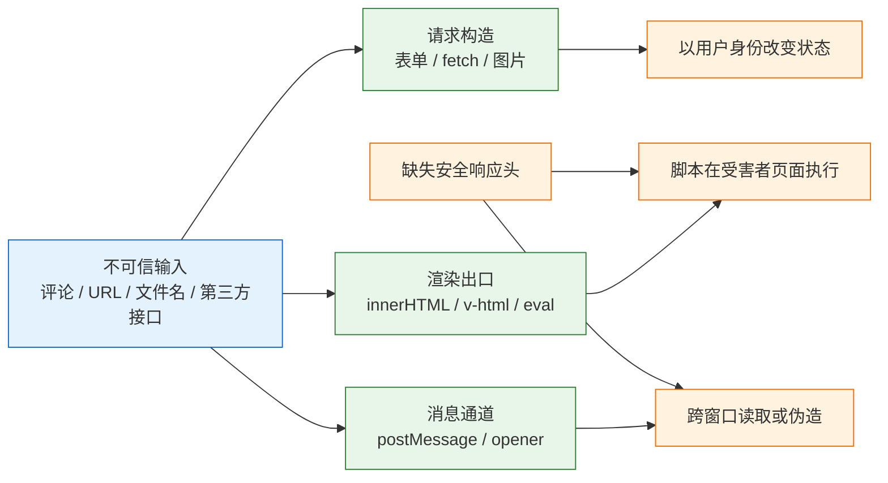
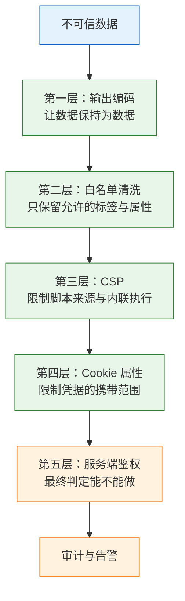
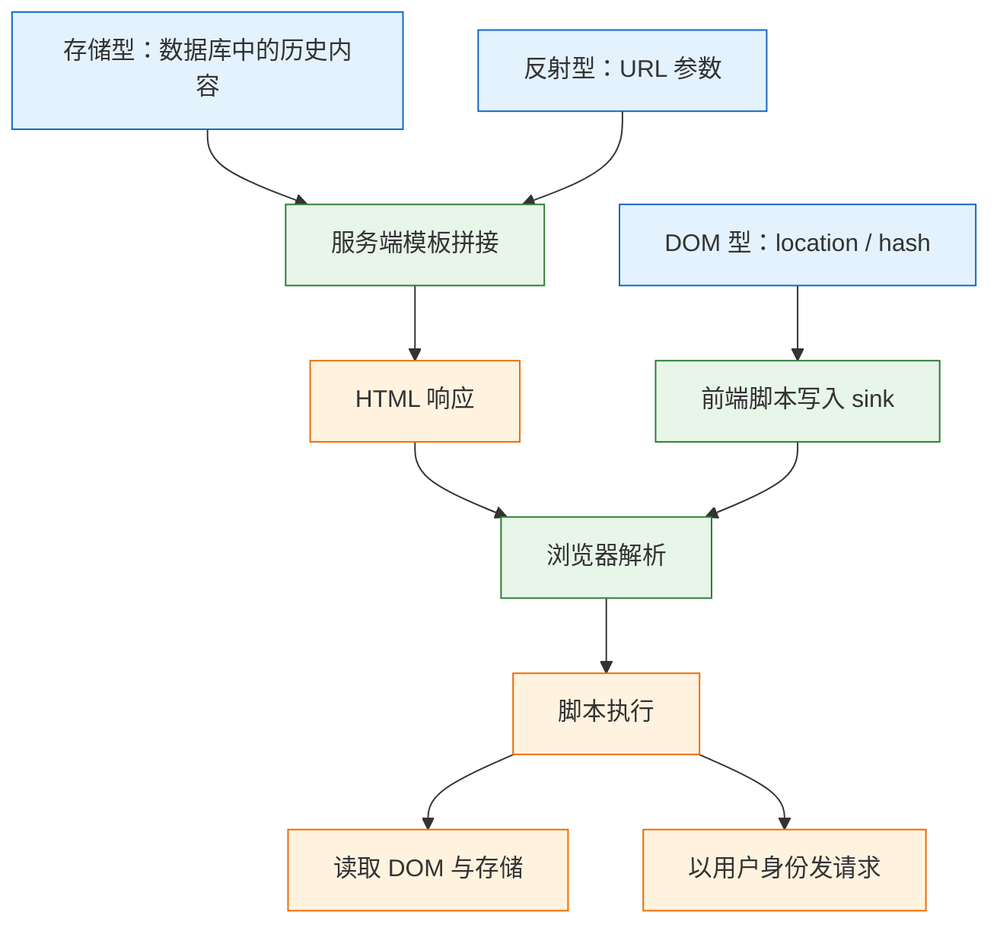
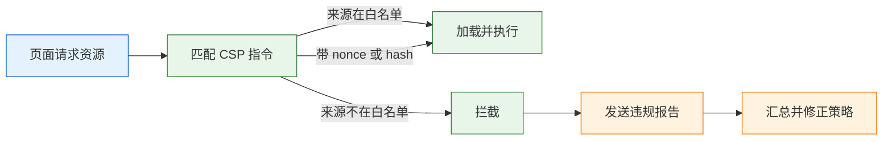

# 前端安全

---

## 一、前端安全是什么

### 1.1 核心概念

> 前端代码运行在用户的机器上，没有秘密可言。安全的目标不是保护代码，而是保证跨越信任边界的数据不被解释成代码，也不让其他页面借用户的身份发起请求。

前端安全指在浏览器执行环境中，对页面代码、页面数据与用户凭据施加的一整套约束。它和服务端安全的根本区别在执行位置：服务端的代码与数据都在自己控制的机器上，前端的代码、DOM、内存中的令牌都落在用户设备上，攻击者可以直接阅读、修改、重放。

需要保护的资产有三类：

- **身份凭据**：会话 Cookie、访问令牌、刷新令牌。拿到它就等于拿到用户的操作权。
- **页面数据**：DOM 中的订单、聊天记录、内部文档，以及接口返回的 JSON。
- **用户信任**：地址栏里的域名。页面被嵌入、被覆盖、被跳转，都会消耗这份信任。

| 资产 | 攻击者目的 | 前端能做的 |
|---|---|---|
| 会话凭据 | 盗取后冒充用户 | 不落可读存储、限制作用域、缩短有效期 |
| 页面数据 | 读取或篡改展示内容 | 输出编码、最小化接口返回、按需渲染 |
| 用户信任 | 钓鱼、覆盖登录框、伪造操作 | 禁止嵌入、校验来源、保持地址栏真实 |

这三类资产分别对应机密性、完整性与可用性的一部分，但前端只能影响其中一部分。真正决定权限的是服务端，前端决定的是“数据以什么形式进入页面”。

### 1.2 与相邻技术的关系

前端安全不是独立学科。它依赖传输层、服务端和浏览器策略三方面配合，任何一层缺位都会让其余层的努力失效。

| 相邻领域 | 关注点 | 与前端的分工 |
|---|---|---|
| 传输安全 | TLS、HSTS、证书 | 保证信道不被窃听和篡改，是 Cookie 属性的前提 |
| 服务端鉴权 | 身份、权限、资源归属 | 判定能不能做，前端只负责不泄露入口 |
| 输入校验与注入 | 数据类型、SQL、命令 | 服务端拒绝畸形数据，前端改善输入体验 |
| 浏览器安全策略 | 同源策略、CSP、沙箱 | 限制脚本能力，前端负责正确配置 |
| WAF 与网关 | 已知 payload、速率 | 兜底检测，不修复代码里的拼接与缺失编码 |

一条常见的错误认知是“前端做了校验，服务端可以放松”。攻击者用 `curl` 直接调接口，不经过任何页面代码，前端校验对他完全不存在。反过来，服务端做了严格校验也不能省掉输出编码，因为合法数据在另一个上下文里仍可能变成代码。

### 1.3 威胁模型

威胁模型先回答四个问题：谁在攻击、从哪个入口进来、拿到什么能力、造成什么后果。前端面对的入口比服务端多，因为浏览器会自动执行、自动携带凭据、自动加载第三方资源。



按攻击者身份拆分，四类人对应四套防线：

| 攻击者 | 前提 | 典型后果 | 主要防线 |
|---|---|---|---|
| 未认证的外部人员 | 能提交内容或构造链接 | 存储型/反射型 XSS、钓鱼跳转 | 输出编码、白名单清洗、CSP |
| 已登录的恶意用户 | 有合法账号 | 越权、批量赋值、CSRF 配合 | 服务端鉴权、令牌校验、审计 |
| 被入侵的第三方脚本 | 页面引用了外部代码 | 读取 DOM、窃取凭据、植入广告 | SRI、CSP、iframe 隔离 |
| 能接触设备的人 | 物理或本地权限 | 读本地存储、改代理、装证书 | 短有效期、设备绑定、二次验证 |

> **注意**：威胁模型不是一次性文档。新增一个第三方 SDK、开放一个嵌入场景、把会话从 Cookie 换成 `localStorage`，都会改变模型，需要重新评估。

---

## 二、浏览器信任边界与攻击面

### 2.1 同源策略的构成

同源策略（Same-Origin Policy）用“协议 + 主机 + 端口”三元组判定来源，三者完全一致才算同源。`https://a.example.com` 与 `http://a.example.com` 不同源，`https://a.example.com:8443` 与默认 443 也不同源。子域名同样算跨源，`admin.example.com` 读不到 `www.example.com` 的 DOM。

同源策略限制的是“读取”，不是“发送”。对表单、图片、脚本这类简单请求，跨源可以照常发出，只是攻击者读不到响应。这个区别是理解 CSRF 与 CORS 的关键。

| 交互方式 | 默认行为 | 放宽手段 |
|---|---|---|
| `fetch` / `XMLHttpRequest` 读响应 | 跨源被拦截 | 服务端返回 CORS 头 |
| 表单提交、图片、`<script>` 加载 | 允许发出，不暴露响应 | 无需放宽，靠其他机制防护 |
| iframe 展示 | 允许展示，禁止读 DOM | `postMessage` 显式通信 |
| Cookie 携带 | 按 `SameSite` 与域判定 | 设置属性，不能跨站任意读取 |
| 存储访问 | 按源隔离 | 无，跨源不可读 |

CORS 是服务端主动放宽读取的机制。非简单请求会先发 `OPTIONS` 预检，服务端返回 `Access-Control-Allow-Origin`、`Allow-Methods`、`Allow-Headers` 后才发真实请求。把 `Access-Control-Allow-Origin` 写成 `*` 同时允许凭据，浏览器会直接拒绝，这不是配置技巧能绕过的。

> **注意**：`document.domain` 已废弃，不要再用它把两个子域改成同源。需要跨子域通信时，用 `postMessage` 并校验 `origin`。

### 2.2 攻击面分类

前端攻击面可以按“数据从哪来、到哪去”划分。入口是用户可控的字符串、URL、文件、第三方响应；出口是 HTML 解析器、JS 引擎、请求构造器、窗口消息通道。漏洞几乎都出现在入口与出口的错配上。

| 攻击面 | 入口 | 典型后果 | 对应防护 |
|---|---|---|---|
| HTML 注入 | 评论、昵称、富文本、导入字段 | XSS、页面结构被改写 | 输出编码、白名单清洗、CSP |
| 请求伪造 | 跨站表单、图片、链接 | 改密码、下单、授权 | SameSite、Origin 校验、CSRF token |
| 框架嵌入 | 第三方页面 iframe | 点击劫持、界面伪装 | `frame-ancestors`、`X-Frame-Options` |
| 窗口通信 | `postMessage`、`opener` | 数据泄露、导航劫持 | 校验 `origin`、`noopener` |
| 依赖与 CDN | npm 包、外链脚本 | 供应链投毒、脚本替换 | 锁版本、SRI、CSP |
| 传输与头 | 明文 HTTP、缺失响应头 | 降级、嗅探、信息泄露 | HTTPS、HSTS、`nosniff` |

攻击面会随功能增长。上线一个“自定义主题”功能，等于开放 CSS 注入面；接入一个客服 SDK，等于把完整 DOM 权限交给第三方。评审新功能时先问“它引入了哪个新出口”，比事后扫漏洞有效。

### 2.3 防御分层

单点防御都会被绕过，可靠的做法是分层。每一层假设前一层已经失效，只负责把影响压到更小。



| 层 | 手段 | 失效后果 |
|---|---|---|
| 编码 | 按上下文转义 | 数据被当成标签或代码 |
| 清洗 | 富文本白名单 | 危险标签与属性残留 |
| CSP | 来源白名单、nonce | 内联脚本与外部加载不受限 |
| 凭据 | `HttpOnly`、`Secure`、`SameSite` | 令牌可读或跨站自动携带 |
| 鉴权 | 服务端逐请求判定 | 越权与业务逻辑漏洞 |
| 观测 | 报告、日志、告警 | 攻击发生却无人知晓 |

> **安全警告**：CSP 只能降低 XSS 的影响，不能修复已经存在的输出缺陷。把 CSP 当唯一防线，等于把页面能否执行脚本交给一份配置清单。

---

## 三、XSS 的成因与输出编码

### 3.1 三类 XSS 的成因

XSS 的本质是一段本应显示为文本的内容，被浏览器当成了 HTML 或 JS。按注入位置分三类，防御手段相同，排查路径不同。

| 类型 | 注入位置 | 触发时机 | 典型场景 |
|---|---|---|---|
| 存储型 | 数据库、对象存储 | 每次读取并渲染时 | 评论、昵称、工单标题、附件名 |
| 反射型 | URL 参数、请求头 | 服务端拼进响应时 | 搜索结果页、错误页、跳转提示 |
| DOM 型 | `location`、`hash`、`storage` | 前端脚本写入 sink 时 | 单页应用的路由参数、主题参数 |

存储型影响最大，因为 payload 留在库里，所有访问者都会中招；清理时要同时处理历史数据和新入口。反射型依赖诱导点击，通常配合短链和钓鱼邮件。DOM 型最容易被忽视，服务端日志里看不到异常，因为恶意内容从未到达服务器。



### 3.2 危险 sink 清单

sink 指接收字符串并交给解释器执行的位置。框架的模板默认转义，所以 `{{ comment }}`、`{comment}` 是安全的；危险的是那些明确“跳过转义”的出口。

```js
// 以下写法把字符串直接交给 HTML 解析器或 JS 引擎
el.innerHTML = userInput;                  // 解析为 HTML，事件属性会执行
el.insertAdjacentHTML('beforeend', html);  // 同上，插入位置不同
el.outerHTML = userInput;                  // 替换整个节点
document.write(userInput);                 // 文档流写入，等同解析
eval(userInput);                           // 执行任意代码
new Function(userInput)();                 // 函数构造器，等同 eval
setTimeout(userInput, 0);                  // 传字符串时按代码执行
setInterval(userInput, 0);
location.href = userInput;                 // javascript: 协议会执行
location.assign(userInput);
```

框架提供的“逃生舱”要逐个登记：

- Vue 的 `v-html`
- React 的 `dangerouslySetInnerHTML`
- Angular 的 `bypassSecurityTrustHtml`、`bypassSecurityTrustUrl`
- 任何把字符串拼进 `innerHTML` 的工具函数、Markdown 渲染器、代码高亮插件

| sink | 风险 | 替代写法 |
|---|---|---|
| `innerHTML` | 解析标签与事件属性 | `textContent` |
| `insertAdjacentHTML` | 同上 | 创建节点后 `append` |
| `eval` / `new Function` | 任意代码执行 | 用数据结构替代动态代码 |
| `setTimeout(string)` | 隐式 eval | 传函数引用 |
| `href` 直接赋值 | `javascript:` 协议 | 校验协议后赋值 |
| `srcdoc` | 内嵌文档执行脚本 | 用 `sandbox` iframe |

> **注意**：`textContent` 也不是万能的。用户输入被拼进 `<style>`、元素属性名、URL 或 SVG 事件属性时，即使没有走 `innerHTML`，仍可能改变页面行为。要按最终所在的上下文判断。

### 3.3 上下文编码规则

输出编码不是“把五个字符换掉”这么简单，而是按数据最终落点选择规则。同一个字符串放进 HTML 文本、属性、JS、URL，需要的处理完全不同。

| 上下文 | 处理方式 | 常见错误 |
|---|---|---|
| HTML 文本 | 转义 `& < > " '` | 只替换 `<script>` |
| HTML 属性 | 属性值加引号并转义 | 无引号属性、事件属性拼接 |
| JS 字符串 | `JSON.stringify` 后嵌入 | 手拼引号与反斜杠 |
| URL 参数 | `encodeURIComponent` | 只编码空格 |
| CSS 值 | 白名单枚举，避免用户可控 | 直接拼进 `style` |
| SVG | 按 XML 规则转义 | 当作普通 HTML 处理 |

一个够用但不应替代成熟库的最小实现：

```js
// escapeHtml：只适用于 HTML 文本与带引号属性值
const HTML_ESCAPE = {
  '&': '&amp;',
  '<': '&lt;',
  '>': '&gt;',
  '"': '&quot;',
  "'": '&#39;',
};

function escapeHtml(value) {
  // 先转字符串，避免 null/undefined 变成 "null" 字样进入页面
  return String(value ?? '').replace(/[&<>"']/g, (ch) => HTML_ESCAPE[ch]);
}

// 插入文本节点，浏览器不会再解析标签
function setText(el, value) {
  el.textContent = value == null ? '' : String(value);
}
```

真正落地时优先用模板引擎的默认转义，其次用框架的文本插值，最后才手写编码函数。手写版本容易漏掉反引号、等号、斜杠等在不同上下文里有意义的字符。

### 3.4 富文本的白名单清洗

评论、工单、知识库需要保留换行和少量格式时，不能自己写正则过滤。用成熟的白名单清洗库，只允许实际用到的标签和属性。

```js
import DOMPurify from 'dompurify';

// 白名单：只保留排版需要的标签，其余一律丢弃
const clean = DOMPurify.sanitize(raw, {
  ALLOWED_TAGS: ['p', 'br', 'strong', 'em', 'code', 'pre', 'a', 'ul', 'ol', 'li', 'blockquote'],
  ALLOWED_ATTR: ['href', 'title', 'rel'],
  ALLOW_DATA_ATTR: false,   // 不保留 data-*，避免前端逻辑被诱导
});

el.innerHTML = clean;
```

白名单的含义是“只允许这些”，不是“去掉 `<script>`”。黑名单永远漏：``、`<svg onload>`、`javascript:`、大小写变形、实体编码、畸形嵌套，枚举不完。

链接还要单独校验协议，因为 `href` 可以写 `javascript:`：

```js
function safeHref(input) {
  try {
    // 以当前源为基准解析，相对路径也能得到绝对 URL
    const url = new URL(input, location.origin);
    // 只放行三种协议，其余（javascript:、data:、file:）统一降级
    return ['http:', 'https:', 'mailto:'].includes(url.protocol) ? url.href : '#';
  } catch {
    return '#';
  }
}
```

清洗之后还要给链接补 `rel="noopener noreferrer"`，避免新窗口通过 `window.opener` 反向操纵原页面。如果整段内容不需要格式，最稳的做法是根本不用 HTML 渲染：文本插值加 `white-space: pre-wrap` 就能保留换行，少一个 sink 就少一类漏洞。

> **安全警告**：不要先插入 DOM 再清洗。脚本在插入的瞬间就可能执行，之后再删除节点已经晚了。清洗必须发生在赋值给 sink 之前。

---

## 四、CSRF 与跨站请求防护

### 4.1 攻击成立条件

CSRF（Cross-Site Request Forgery，跨站请求伪造）利用的是浏览器自动携带 Cookie 的行为。用户登录后访问恶意页面，该页面向目标站发起请求，浏览器附上目标站的 Cookie，服务端看到合法会话就执行了操作。攻击者不需要读到响应，只要请求发出去就够。

三个前提同时成立才会中招：

| 前提 | 说明 | 消除方式 |
|---|---|---|
| Cookie 自动携带 | 跨站请求也带上会话 | `SameSite` 限制携带范围 |
| 参数可预测 | 接口不需要攻击者不知道的值 | CSRF token、一次性随机数 |
| 仅凭 Cookie 判身份 | 服务端只看会话，不看请求来源 | `Origin` 校验、二次确认 |

因此第一条纪律是：**GET 请求绝不改变状态**。`SameSite=Lax` 允许顶层导航的 GET 携带 Cookie，一个 `<a href="https://bank.example.com/transfer?to=evil&amount=100">` 就能完成转账。删除、支付、授权等操作必须用 POST/PUT/DELETE，并配令牌。

### 4.2 Cookie 属性配置

会话 Cookie 的属性决定了它在什么条件下被携带、能否被脚本读取。

```text
Set-Cookie: __Host-session=<opaque-id>; Path=/; Secure; HttpOnly; SameSite=Lax
```

| 属性 | 作用 | 常见错误 |
|---|---|---|
| `Secure` | 只在 HTTPS 下发送 | 内网用 HTTP 调试时被去掉 |
| `HttpOnly` | 禁止 JS 读取 | 为了前端读用户信息而取消 |
| `SameSite=Lax` | 跨站子请求不携带，顶层 GET 携带 | 误以为能挡住所有跨站请求 |
| `SameSite=Strict` | 任何跨站导航都不携带 | 从外部链接进入时显示未登录 |
| `SameSite=None` | 允许跨站携带 | 缺 `Secure` 被浏览器拒绝 |
| `__Host-` 前缀 | 强制 `Secure`、`Path=/`、无 `Domain` | 同时设置 `Domain` 导致前缀失效 |

`SameSite=None` 只用于确实需要跨站嵌入的场景，比如第三方支付回跳、嵌入他站的客服组件。普通同站应用放宽到 `None`，等于主动放弃一层防护。

> **注意**：`SameSite` 是浏览器行为，不是服务端保证。旧客户端、非浏览器调用、同站子域攻击都不受它约束，所以状态变更接口仍要校验 `Origin` 或令牌。

### 4.3 Origin 校验与令牌

服务端在状态变更接口上做两道检查，成本很低，能覆盖绝大多数自动化攻击。

```js
// server/middleware/csrf.js
import crypto from 'node:crypto';

const SAFE_METHODS = new Set(['GET', 'HEAD', 'OPTIONS']);
const ALLOWED_ORIGINS = new Set(['https://admin.example.com']);

export function csrfGuard(req, res, next) {
  if (SAFE_METHODS.has(req.method)) return next();

  const origin = req.get('origin');
  // 浏览器对跨源写请求会带 Origin；带了就必须命中白名单
  if (origin && !ALLOWED_ORIGINS.has(origin)) {
    return res.status(403).json({ code: 'ORIGIN_REJECTED' });
  }

  const sent = req.get('x-csrf-token');
  const expected = req.session?.csrfToken;
  // 定长比较，避免通过响应时间推测令牌
  if (!sent || !expected || !timingSafeEqual(sent, expected)) {
    return res.status(403).json({ code: 'CSRF_TOKEN_INVALID' });
  }
  next();
}

function timingSafeEqual(a, b) {
  const ba = Buffer.from(a);
  const bb = Buffer.from(b);
  return ba.length === bb.length && crypto.timingSafeEqual(ba, bb);
}
```

令牌在会话建立时生成，写进页面供前端读取，再随请求头回传：

```js
// 登录成功后生成，绑定当前会话
req.session.csrfToken = crypto.randomBytes(32).toString('base64url');
```

| 方案 | 强度 | 成本 | 适用 |
|---|---|---|---|
| `SameSite=Lax` | 中，依赖浏览器 | 极低 | 所有新系统的基础配置 |
| `Origin` 白名单 | 中高，覆盖跨源写请求 | 低 | 有明确前端域名的接口 |
| 同步令牌 | 高，与会话绑定 | 中，需要模板注入 | 表单、老系统 |
| 双提交 Cookie | 中高，需签名防篡改 | 中 | 前后端分离、无服务端会话 |
| 二次验证 | 高 | 高，影响体验 | 转账、改密、授权 |

CORS 不防 CSRF：它限制的是“跨源能不能读响应”，不是“能不能发请求”。一个跨站表单可以照常 POST，只是攻击者读不到结果，而 CSRF 本来就不需要读结果。

### 4.4 令牌存储取舍

令牌放在哪里，决定了它主要面对哪类攻击。没有“又防 XSS 又防 CSRF”的免费方案，只有把风险放在哪一边的选择。

| 存储位置 | XSS 可读 | CSRF 风险 | 适用场景 |
|---|---|---|---|
| `HttpOnly` Cookie | 否 | 有，需 `SameSite` + 令牌 | 同源 Web 应用首选 |
| `localStorage` | 是 | 无（不自动携带） | 短期令牌、可控 XSS 风险 |
| 内存变量 | 是（运行时可读） | 无 | 配合刷新令牌的访问令牌 |
| `sessionStorage` | 是 | 无 | 单标签页会话 |
| URL 参数 | 是（日志、Referer） | 有 | 不推荐，仅限一次性回调 |

同源 Web 应用优先用 `HttpOnly; Secure; SameSite=Lax` 的会话 Cookie，再补 CSRF 令牌。前后端分离且跨域部署时，如果坚持用 `Authorization` 头，就要接受 XSS 一旦发生令牌必然泄露，此时应缩短有效期、绑定设备指纹、加强 CSP。

> **安全警告**：不要把长期有效的 JWT 放进 `localStorage`。任何一次 XSS 都能把它读走，且在令牌过期前无法吊销。需要无状态令牌时，用短访问令牌加可撤销的刷新令牌。

---

## 五、点击劫持与跨窗口通信

### 5.1 框架嵌入控制

点击劫持把目标页面嵌进一个透明 iframe，上面盖一层诱导按钮，用户以为点的是“领取奖励”，实际点的是“确认转账”。防御只能靠响应头，JS 检测窗口尺寸不可靠，攻击者可以用 `sandbox` 或双层框架绕过。

```text
Content-Security-Policy: frame-ancestors 'none'
X-Frame-Options: DENY
```

| 指令 | 作用 | 注意 |
|---|---|---|
| `frame-ancestors 'none'` | 禁止任何页面嵌入 | 新标准，优先使用 |
| `frame-ancestors 'self'` | 只允许同源嵌入 | 需要多个来源时逐个列出，不要用通配 |
| `X-Frame-Options: DENY` | 禁止嵌入 | 老浏览器兼容 |
| `X-Frame-Options: SAMEORIGIN` | 允许同源 | 与 CSP 冲突时以 CSP 为准 |

`frame-ancestors` 不能写在 `<meta>` 标签里，只能通过响应头下发。`ALLOW-FROM` 已被主流浏览器放弃，不要再用。两个头同时写时，支持 CSP 的浏览器以 `frame-ancestors` 为准，因此不要把两者配成互相矛盾的值。

### 5.2 postMessage 校验

`postMessage` 是跨源页面之间唯一的受控通信方式，但它的默认行为是“谁都能发”。接收方必须校验来源，发送方必须指定目标源。

```js
// 接收方：先校验 origin，再校验消息结构
window.addEventListener('message', (event) => {
  // 只信任约定的来源，绝不接受 '*'
  if (event.origin !== 'https://trusted.example.com') return;

  // 消息体也要当不可信输入处理，不能直接当对象用
  const data = event.data;
  if (!data || data.type !== 'user-profile') return;
  if (typeof data.name !== 'string') return;

  renderProfile({ name: data.name.slice(0, 64) });
});

// 发送方：明确目标源，不用 '*'
targetWindow.postMessage(
  { type: 'ready' },
  'https://trusted.example.com',
);
```

| 检查项 | 目的 | 漏掉的后果 |
|---|---|---|
| `event.origin` 精确匹配 | 确认发送方身份 | 任意页面可注入消息 |
| `event.source` 比对引用 | 确认是预期的窗口 | 多个 iframe 之间串消息 |
| 消息类型与字段校验 | 防止结构污染 | 原型污染、渲染异常 |
| 发送时指定目标源 | 防止被第三方读取 | 数据泄露给嵌入方 |

> **安全警告**：不要用 `'*'` 接收或发送敏感数据。`'*'` 意味着任何持有窗口引用的页面都能参与通信，令牌、用户信息、内部状态都会暴露。

### 5.3 窗口引用隔离

用 `window.open` 打开第三方页面时，对方可以通过 `window.opener` 把原页面导航到钓鱼站，甚至读取部分属性。`<a target="_blank">` 同样有这个问题。

```js
// 方式一：open 时声明 noopener
const win = window.open('https://partner.example.com', '_blank', 'noopener,noreferrer');

// 方式二：链接加 rel，现代浏览器默认已隐含 noopener，但显式写更可靠
// <a href="https://partner.example.com" target="_blank" rel="noopener noreferrer">合作方</a>
```

| 场景 | 风险 | 措施 |
|---|---|---|
| 新窗口打开外链 | 反向导航、钓鱼 | `noopener`、`noreferrer` |
| 被第三方 iframe 嵌入 | 点击劫持、套取输入 | `frame-ancestors`、`sandbox` |
| 跨源窗口共享进程 | 侧信道、Spectre 类攻击 | `Cross-Origin-Opener-Policy: same-origin` |
| 嵌入他人资源 | 对方读取来源信息 | `Cross-Origin-Resource-Policy`、`Referrer-Policy` |

`Cross-Origin-Opener-Policy: same-origin` 让跨源窗口不再共享浏览上下文组，配合 `Cross-Origin-Embedder-Policy` 还能启用 `SharedArrayBuffer` 等需要隔离的能力。代价是跨源弹窗通信必须走 `postMessage`，不能再直接操作对方窗口。

---

## 六、安全响应头与 CSP

### 6.1 响应头清单

安全响应头成本低、收益稳定，应该作为部署基线，而不是出事后的补丁。

| 响应头 | 作用 | 常见值 |
|---|---|---|
| `Content-Security-Policy` | 限制脚本、样式、连接、嵌入来源 | 见 6.2 |
| `Strict-Transport-Security` | 强制后续请求走 HTTPS | `max-age=31536000; includeSubDomains` |
| `X-Content-Type-Options` | 禁止 MIME 嗅探 | `nosniff` |
| `Referrer-Policy` | 控制 Referer 泄露范围 | `strict-origin-when-cross-origin` |
| `Permissions-Policy` | 关闭不需要的浏览器能力 | `camera=(), microphone=(), geolocation=()` |
| `Cross-Origin-Opener-Policy` | 隔离窗口引用 | `same-origin` |
| `Cross-Origin-Resource-Policy` | 限制资源被跨源读取 | `same-origin` |
| `Cross-Origin-Embedder-Policy` | 要求嵌入资源声明许可 | `require-corp` |

HSTS 一旦下发，浏览器会在 `max-age` 内强制 HTTPS，包括用户手动输入的 `http://`。首次上线先用较短的 `max-age` 验证，确认全站证书与子域都可用后再加长，并考虑提交预加载列表。

### 6.2 CSP 指令结构

CSP（Content Security Policy，内容安全策略）用一组指令声明“哪些来源可以加载哪类资源”。它是最有效也最容易配坏的响应头。

| 指令 | 控制对象 | 示例 |
|---|---|---|
| `default-src` | 其余指令的兜底 | `'self'` |
| `script-src` | JS 来源、内联、eval | `'self' 'nonce-...'` |
| `style-src` | CSS 与内联样式 | `'self' 'unsafe-inline'` |
| `img-src` | 图片与图标 | `'self' data: https://img.example.com` |
| `connect-src` | `fetch`、XHR、WebSocket | `'self' https://api.example.com` |
| `font-src` | 字体文件 | `'self'` |
| `object-src` | `<object>`、`<embed>` | `'none'` |
| `base-uri` | `<base>` 标签 | `'none'` |
| `form-action` | 表单提交目标 | `'self'` |
| `frame-ancestors` | 谁可以嵌入本页 | `'none'` |



一个静态站点的起点：

```nginx
add_header Content-Security-Policy "default-src 'self'; script-src 'self'; style-src 'self' 'unsafe-inline'; img-src 'self' data: https://img.example.com; connect-src 'self' https://api.example.com; font-src 'self'; object-src 'none'; base-uri 'none'; frame-ancestors 'none'; form-action 'self'; upgrade-insecure-requests" always;
```

几个必须知道的限制：

- `script-src 'self'` 会拦掉所有内联 `<script>` 和 `onclick` 属性。构建产物里有内联启动脚本时，用 hash 或 nonce，不要直接加 `'unsafe-inline'`。
- `'unsafe-inline'` 在同时存在 nonce 或 hash 时会被忽略，这是 CSP Level 3 的行为；不要指望两者并存还能放行内联脚本。
- `style-src 'unsafe-inline'` 常常是为了让组件库注入的 `<style>` 生效。能抽出独立 CSS 文件时就把它去掉；去不掉，至少不要同时给 `script-src` 开 `unsafe-inline`。
- `connect-src` 漏掉接口域名，表现为页面能打开但所有请求被拦，控制台报 `Refused to connect`。
- `upgrade-insecure-requests` 会把页面里的 HTTP 资源改写为 HTTPS，适合过渡期，不适合仍有大量 HTTP 内网资源的场景。

### 6.3 nonce 与 hash

内联脚本无法用来源白名单描述，只能用一次性随机数（nonce）或内容哈希（hash）放行。

```js
// server/render.js：每个 HTML 响应生成独立 nonce
import crypto from 'node:crypto';
import express from 'express';

const app = express();

app.use((req, res, next) => {
  const nonce = crypto.randomBytes(16).toString('base64');
  res.locals.nonce = nonce;
  res.setHeader(
    'Content-Security-Policy',
    [
      "default-src 'self'",
      `script-src 'self' 'nonce-${nonce}'`,
      "style-src 'self' 'unsafe-inline'",
      "img-src 'self' data:",
      "connect-src 'self'",
      "object-src 'none'",
      "base-uri 'none'",
      "frame-ancestors 'none'",
    ].join('; '),
  );
  next();
});
```

```html
<!-- 模板里回填同一个 nonce，值必须与响应头一致 -->
<script nonce="<%= nonce %>">
  window.__APP_CONFIG__ = { release: "<%= release %>" };
</script>
```

| 方案 | 适用 | 代价 |
|---|---|---|
| `'self'` | 全部脚本是外部文件 | 无法放行内联启动脚本 |
| nonce | 服务端渲染、每请求生成 HTML | HTML 不能长期缓存，需动态注入 |
| hash | 静态站、内联脚本内容固定 | 内容一变就要改哈希 |
| `'strict-dynamic'` | 由已信任脚本动态加载依赖 | 需理解其忽略主机白名单的行为 |
| `'unsafe-inline'` | 过渡期兜底 | 基本抵消 XSS 防护 |

> **注意**：nonce 必须每次请求不同，且不能被缓存。把 nonce 写进 CDN 缓存的 HTML，等于给攻击者一个长期有效的通行证。纯静态站点做不到每请求 nonce，优先用 hash 或把内联脚本外置。

### 6.4 配置落地与灰度

CSP 直接上正式头，常见结果是白屏。正确顺序是先观察、再收紧、最后强制。

```nginx
server {
    listen 443 ssl;
    server_name www.example.com;

    # 第一步：只报告不拦截，收集真实违规
    add_header Content-Security-Policy-Report-Only "default-src 'self'; script-src 'self'; img-src 'self' data:; connect-src 'self' https://api.example.com; object-src 'none'; base-uri 'none'; frame-ancestors 'none'; report-uri /csp-report" always;

    # 第二步：确认无大规模误伤后，换成正式头
    # add_header Content-Security-Policy "..." always;

    add_header Strict-Transport-Security "max-age=31536000; includeSubDomains" always;
    add_header X-Content-Type-Options "nosniff" always;
    add_header Referrer-Policy "strict-origin-when-cross-origin" always;
    add_header Permissions-Policy "camera=(), microphone=(), geolocation=()" always;
}
```

`Content-Security-Policy-Report-Only` 不会拦截任何资源，只发报告；报告必须配 `report-uri` 或 `report-to`，否则浏览器没有地方投递。`report-uri` 是旧写法，`report-to` 基于 Reporting API，兼容期可以两个都写。

> **注意**：Nginx 的 `add_header` 有继承规则：子级 `location` 一旦定义了自己的 `add_header`，父级的全部 `add_header` 都不再继承。把 CSP 写在 `server` 块、又在某个 `location` 里加了缓存头，安全头会在这个路径上悄悄消失。用 `curl -I` 逐路径核对。

---

## 七、第三方脚本与供应链

### 7.1 依赖锁定与安装脚本

前端依赖的风险不只是“有漏洞就升”，而是不知道哪个包在安装或运行时做了什么。`postinstall` 脚本能以构建用户身份执行任意命令，比运行时的 XSS 更直接。

| 措施 | 命令或配置 | 作用 |
|---|---|---|
| 锁定版本 | 提交 lockfile，CI 用 `pnpm install --frozen-lockfile` | 保证构建可复现，防止版本漂移 |
| 限制构建脚本 | pnpm 的 `allowBuilds` 逐包放行 | 未审核的 `postinstall` 默认不执行 |
| 生产依赖审计 | `pnpm audit --prod` | 只看真正会进产物的依赖 |
| 依赖来源审查 | 检查新增包的维护者、下载量、发布历史 | 识别抢注与投毒 |
| 构建环境隔离 | CI 使用最小权限账号与独立网络 | 降低脚本泄露密钥的影响 |

```bash
# ========== 安装与审计 ==========
# 严格按 lockfile 安装，lockfile 与 package.json 不一致时直接失败
pnpm install --frozen-lockfile

# 只审计生产依赖，开发依赖的漏洞不进产物
pnpm audit --prod

# 查看某个包为什么被安装，评估是否真的需要
pnpm why lodash

# ========== 版本固定 ==========
# 升级后重新生成 lockfile，并提交审查
pnpm update --latest --interactive
```

> **注意**：`pnpm audit` 报告的是“依赖树里存在受影响版本”，不等于“应用真的调用了受影响代码”。升级前看可达性，盲目跳大版本会引入不兼容。

### 7.2 SRI 与 CDN

从第三方 CDN 加载脚本时，浏览器无法判断文件是否被替换。子资源完整性（Subresource Integrity，SRI）用哈希把文件内容钉死。

```html
<script
  src="https://cdn.example.com/lib@1.2.3/dist/lib.min.js"
  integrity="sha384-<base64-hash>"
  crossorigin="anonymous"></script>
```

| 属性 | 作用 | 注意 |
|---|---|---|
| `integrity` | 校验文件哈希 | 支持 `sha256`、`sha384`、`sha512` |
| `crossorigin` | 以 CORS 方式请求，暴露响应给校验 | 缺省时跨源校验会失败 |
| 固定版本路径 | 避免 CDN 自动升级 | 不要用 `latest` |
| 服务端 CORS | 返回允许的来源 | 与 `crossorigin` 配套 |

哈希必须和文件内容完全一致，CDN 换了文件就会加载失败，这正是它的作用。代价是升级要同步改哈希，所以只对少量关键库使用，不要给每个小依赖都加。

计算哈希：

```bash
# 生成 sha384 的 SRI 值，输出可直接粘进 integrity
openssl dgst -sha384 -binary lib.min.js | openssl base64 -A
```

### 7.3 第三方脚本隔离

统计、客服、A/B 测试的脚本在页面里有完整权限，能读 DOM、能发请求、能读同源存储。评估第三方时按“它能做什么”而不是“它是不是大厂”。

| 接入方式 | 权限 | 适用 |
|---|---|---|
| 直接 `<script>` 引入 | 与本站脚本相同 | 极少数必须同步执行的库 |
| `async` 外链 + CSP 白名单 | 相同，但不阻塞渲染 | 统计、监控 |
| `sandbox` iframe | 独立源，无 DOM 访问 | 客服、问卷、广告 |
| Web Worker | 无 DOM，仅有计算与网络 | 数据处理类脚本 |

```html
<!-- 只保留脚本执行与表单提交，去掉同源访问能力 -->
<iframe
  src="https://widget.example.com/chat"
  sandbox="allow-scripts allow-forms"
  referrerpolicy="no-referrer"
  title="在线客服"></iframe>
```

> **安全警告**：`sandbox="allow-scripts allow-same-origin"` 同时出现时，iframe 可以移除自己的沙箱限制，等于没有隔离。除非嵌入的是同源且完全可信的内容，否则不要这样组合。

第三方脚本还要写进 CSP 的 `script-src` 白名单，并在下线时同步移除。白名单只增不减，是 CSP 逐渐失效的主要原因。

---

## 八、完整示例：内容站的安全加固

### 8.1 现状与目标

一个内容站包含评论、登录、后台管理与第三方统计。现状是评论用 `v-html` 渲染、会话 Cookie 没有 `SameSite`、没有 CSP、统计脚本从公共 CDN 加载。逐项确认问题：

| 位置 | 现状 | 风险 |
|---|---|---|
| 评论渲染 | `v-html` 直接输出 | 存储型 XSS |
| 会话 Cookie | `HttpOnly`，无 `SameSite` | 跨站请求自动携带 |
| 后台接口 | 只校验会话 | CSRF |
| 响应头 | 仅 `Content-Type` | 点击劫持、嗅探、信息泄露 |
| 统计脚本 | 公共 CDN，无 SRI | 供应链替换 |
| 富文本链接 | 未校验协议 | `javascript:` 执行 |

目标是：评论只保留排版标签，会话限制在 HTTPS 与同站，状态变更接口校验来源与令牌，CSP 从报告模式起步，第三方脚本固定版本并加完整性校验。

### 8.2 渲染链路改造

把“一个 `v-html` 打天下”拆成两条路径：纯文本走文本插值，富文本走清洗后再插入。

```js
// comment-render.js
import DOMPurify from 'dompurify';

// 纯文本评论：不解析任何标签，换行由 CSS 保留
export function renderPlain(el, text) {
  el.textContent = text ?? '';
  el.classList.add('pre-wrap');   // white-space: pre-wrap
}

// 富文本评论：白名单清洗 + 链接协议校验
export function renderRich(el, html) {
  const clean = DOMPurify.sanitize(html, {
    ALLOWED_TAGS: ['p', 'br', 'strong', 'em', 'code', 'pre', 'a', 'ul', 'ol', 'li', 'blockquote'],
    ALLOWED_ATTR: ['href', 'title', 'rel'],
    ALLOW_DATA_ATTR: false,
  });

  el.innerHTML = clean;

  // 清洗后统一解析链接，只放行明确协议
  el.querySelectorAll('a[href]').forEach((a) => {
    const href = a.getAttribute('href') ?? '';
    let safe = '#';
    try {
      const url = new URL(href, location.origin);
      if (['http:', 'https:', 'mailto:'].includes(url.protocol)) {
        safe = url.href;
      }
    } catch {
      safe = '#';
    }
    a.setAttribute('href', safe);
    a.setAttribute('rel', 'noopener noreferrer');
    a.setAttribute('target', '_blank');
  });
}
```

如果历史数据里已经存了 payload，改渲染只能阻止新访问触发，不能清除内容。上线后要跑一次数据扫描，把含 `<script`、`onerror=`、`javascript:` 的记录标出来，人工确认后清洗或删除。

### 8.3 会话与请求加固

服务端统一设置 Cookie 属性，并在状态变更接口挂上 CSRF 中间件：

```js
// server/session.js
import express from 'express';

const app = express();

app.use(session({
  name: '__Host-sid',
  secret: process.env.SESSION_SECRET,   // 从环境变量读取，不进代码库
  resave: false,
  saveUninitialized: false,
  cookie: {
    httpOnly: true,        // 禁止 JS 读取
    secure: true,          // 仅 HTTPS
    sameSite: 'lax',       // 跨站子请求不携带
    path: '/',
    maxAge: 8 * 60 * 60 * 1000,
  },
}));

// 所有非安全方法先过 CSRF 校验
app.use('/api', csrfGuard);
```

CSP 与其余响应头按 6.4 的配置接入，先开 Report-Only，观察一周的违规报告，确认没有拦掉正常脚本后再切正式头。统计脚本改成固定版本加 SRI：

```html
<script
  src="https://cdn.example.com/analytics@3.4.1/analytics.min.js"
  integrity="sha384-<base64-hash>"
  crossorigin="anonymous"
  defer></script>
```

### 8.4 验证与回归

改完不能只看“页面能打开”，要按攻击面逐条回归。

| 验证项 | 操作 | 预期 |
|---|---|---|
| 存储型 XSS | 评论提交 `` | 显示为字面文本，不弹窗 |
| 富文本 XSS | 提交带 `onclick` 的链接与 `javascript:` | 属性被丢弃，链接降级为 `#` |
| CSRF | 从其他源构造表单 POST 改密接口 | 返回 403，操作未生效 |
| Cookie 属性 | 查看 `Set-Cookie` | 含 `HttpOnly`、`Secure`、`SameSite=Lax` |
| 点击劫持 | 用本地页面 iframe 嵌入 | 浏览器拒绝加载 |
| CSP | 控制台查看违规报告 | 无业务脚本被误拦 |
| SRI | 修改 CDN 文件内容后刷新 | 脚本拒绝执行 |
| 跨窗口 | 第三方页面尝试读 `opener` | 拿到 `null` |

回归时用无痕窗口，避免旧 Cookie 和缓存掩盖问题。CSP 的验证要在 Report-Only 阶段就看报告，而不是等正式头生效后靠用户反馈。

---

## 九、防护边界与取舍

### 9.1 措施的覆盖范围

每种措施都有明确的覆盖范围，超出范围就不该指望它。

| 措施 | 能挡 | 挡不住 |
|---|---|---|
| 输出编码 | 数据被解析为标签或代码 | 业务逻辑漏洞、越权 |
| 富文本清洗 | 危险标签与属性 | 允许标签组合出的钓鱼内容 |
| CSP | 内联脚本、未授权来源 | 已授权的第三方脚本作恶 |
| `SameSite` | 跨站自动携带 Cookie | 同站子域攻击、非浏览器客户端 |
| CSRF token | 跨站伪造请求 | XSS 直接读取令牌 |
| SRI | CDN 文件被替换 | 源站本身被入侵 |
| HTTPS | 信道窃听与篡改 | 服务端漏洞、客户端被控 |

### 9.2 取舍原则

- **转义优先于过滤，白名单优先于黑名单**：能用文本插值就不要用 HTML 渲染。
- **CSP 是兜底，不是修复**：它能降低影响，不能替代正确的输出编码。
- **前端校验只改善体验**：所有权限和金额校验必须在服务端再做一遍。
- **不要自研加密和令牌协议**：用成熟的会话机制，比自己设计“加密 Cookie”安全。
- **第三方脚本按能力评估**：能放 iframe 就不内嵌，能异步就不阻塞，能不用就不用。

> **注意**：安全措施会随业务演化失效。新增嵌入场景、放开 CORS、把会话改成无状态令牌，都要重新过一遍威胁模型，而不是沿用旧结论。

---

## 十、常见故障与排查

### 10.1 故障表

| 现象 | 最可能原因 | 处理 |
|---|---|---|
| 加了 CSP 页面白屏 | 内联脚本/样式被拦，或接口域没进 `connect-src` | 看 Console 的 refused 提示，先用 Report-Only |
| 富文本仍有弹窗 | 没调清洗、配置过宽，或另一处 sink 没改 | 全局搜 sink，逐个确认 |
| `javascript:` 链接可点 | 只过滤了标签，没校验 `href` 协议 | 用 `new URL` 白名单协议 |
| 跨域请求不带 Cookie | `SameSite=None` 缺 `Secure`，或 Domain/Path 不对 | 看 `Set-Cookie` 属性与请求的 credentials |
| 登录态被跨站利用 | 只靠 `SameSite`，没校验 Origin/token | 状态变更接口加 Origin 校验与 token |
| iframe 嵌入报拒绝 | `frame-ancestors` 或 `X-Frame-Options` 限制 | 确认业务是否真需要嵌入，不要直接删头 |
| CDN 脚本突然加载失败 | SRI 哈希与文件不匹配 | 固定版本，升级时同步更新哈希 |
| 收到伪造的 postMessage | 没校验 `origin` | 白名单校验，拒绝 `'*'` |
| 图片在富文本里裂开 | CSP 的 `img-src` 没放行图床 | 精确放行域名，不要用 `https:` 一把梭 |
| 审计报漏洞但升不动 | 大版本不兼容 | 评估可达性，隔离使用，或找替代包 |
| 某个路径安全头消失 | Nginx `location` 覆盖了父级 `add_header` | 在子级重复声明，或统一收敛到入口层 |

### 10.2 排查顺序

1. 先确认是“执行了脚本”还是“显示了文本”，前者是 XSS，后者只是样式问题。
2. 搜所有 HTML sink，确认数据从哪来、经过哪些清洗。
3. 看响应头是否真的下发，逐路径 `curl -I`，注意 CDN 与 Nginx 的覆盖关系。
4. 用 Report-Only 验证 CSP，不要拿生产直接试。
5. 检查 Cookie 属性与请求的 `Origin`、`Sec-Fetch-Site`，区分“没带凭据”和“凭据被跨站利用”。
6. 最后才怀疑框架的转义行为，框架默认转义很少出错，出错的通常是显式跳过转义的那一行。

> **安全警告**：排查时不要在生产环境用真实用户会话测试 payload。用测试账号与独立环境，避免把验证过程变成一次真实的入侵。
