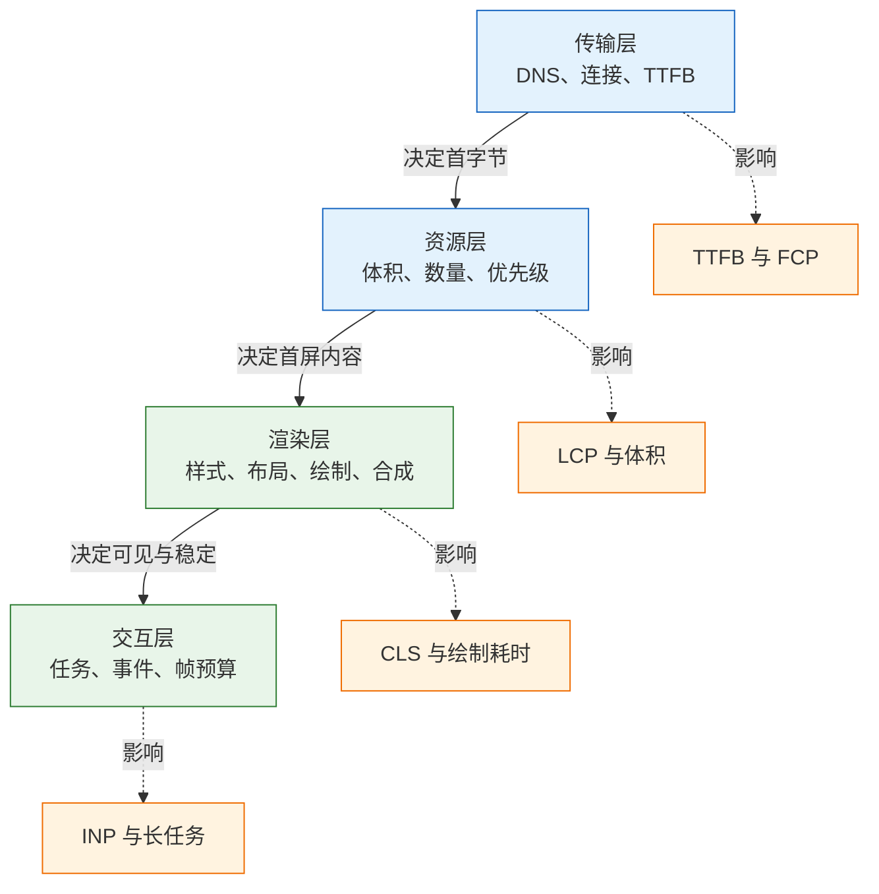
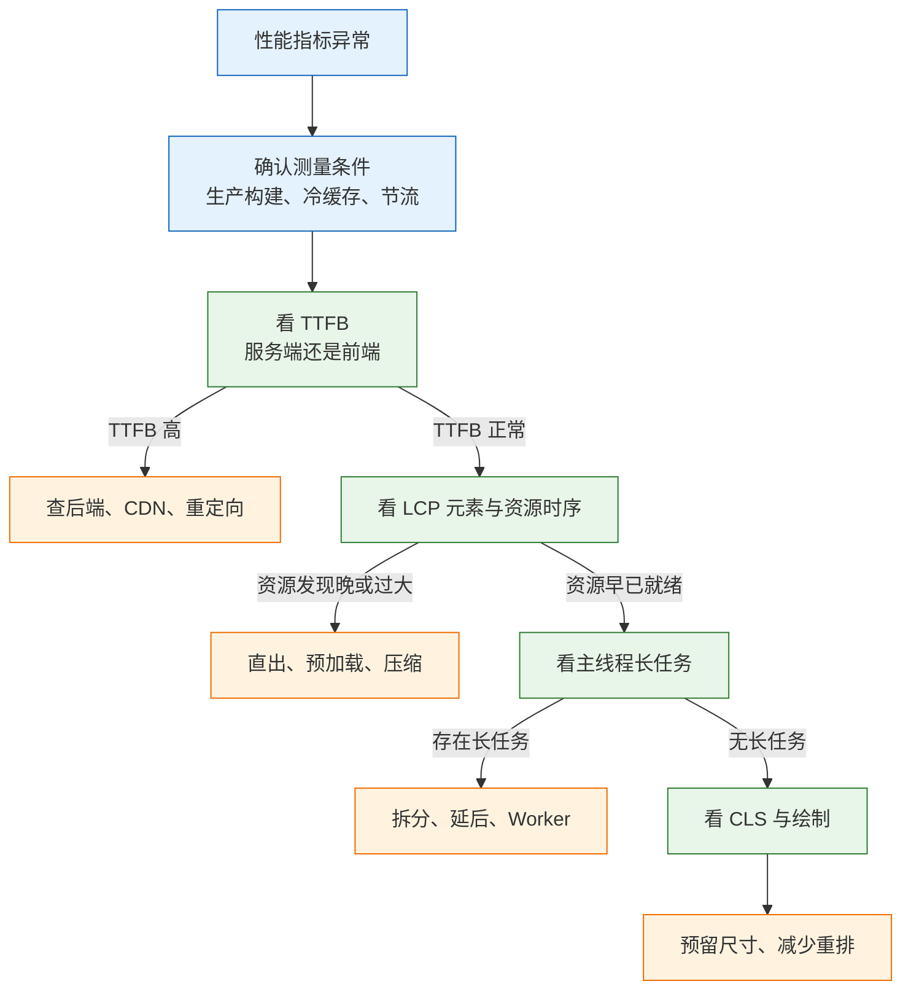

# 前端性能

前端性能不是“把代码改小”，而是让用户在可接受的时间内看到内容并完成操作。它需要先定义指标，再找到瓶颈，最后才选择手段。顺序反过来，压缩了几张图片、删了几个依赖，指标可能一点没动，因为时间花在服务端响应或主线程长任务上。
性能工作也不等于追求满分。实验室分数、现场分位数、业务转化率是三条不同的线；能指导排障的是分段耗时与证据链，不是单次评分。

---

## 一、前端性能是什么

### 1.1 核心概念

用户感知到的“慢”通常分三种：看不到内容、看得到但点不动、内容乱跳。三者分别对应传输与首屏渲染、主线程执行、布局稳定性，修法完全不同。性能工程的任务是把模糊的感受拆成可测量的阶段，再按阶段分配成本。

| 概念 | 含义 | 判定方式 |
|---|---|---|
| 指标 | 对某段用户体验的量化 | LCP、INP、CLS 等 |
| 基线 | 改造前的稳定测量值 | 同条件三次中位数 |
| 瓶颈 | 占总耗时最大或最影响体验的一段 | 分段耗时与火焰图 |
| 预算 | 允许的最大体积或耗时 | CI 阈值、体积上限 |
| 归因 | 把结果映射回具体原因 | 一次只改一个变量 |

性能问题有明显的长尾特征。平均值会被大量快用户拉低，真正需要照顾的是较慢的那部分人，因此站点普遍按第 75 百分位设定目标。一个页面在办公室里打开很快，不代表在中端手机、弱网、冷缓存下可用。

### 1.2 与相邻技术的关系

性能与安全、监控、可用性共享同一套页面，但关注点不同。把它们混在一起，容易出现“为了指标牺牲安全”或“监控数据无法解释”的情况。

| 领域 | 关注点 | 与性能的边界 |
|---|---|---|
| 前端安全 | 注入、越权、供应链 | 安全头与第三方脚本会改变性能 |
| 前端监控 | 错误、请求、用户行为 | 提供现场数据，不直接给优化方案 |
| 可用性 | 功能是否可用、交互是否清晰 | 性能影响等待，不能替代功能正确 |
| 服务端性能 | 接口耗时、数据库、缓存 | TTFB 的上游，前端无法单独解决 |
| 构建工程 | 产物体积、拆包、压缩 | 决定传输与解析成本 |

一个常见误区是把性能当成构建配置问题。构建能解决体积与拆包，但解决不了图片发现太晚、字体阻塞、接口串行、主线程长任务。反过来说，只改业务代码而不看构建产物，也常把依赖整包打进来。

### 1.3 性能分层与指标体系

性能优化按层推进：传输层决定字节到达多快，资源层决定关键资源有多少、何时被发现，渲染层决定像素多快出现，交互层决定输入多快得到响应。每一层都有对应的指标与证据。



| 层次 | 主要成本 | 代表手段 | 主要指标 |
|---|---|---|---|
| 传输 | 往返次数、带宽、服务端处理 | CDN、压缩、连接复用 | TTFB |
| 资源 | 体积、请求数、发现顺序 | 图片格式、拆包、预加载 | LCP、FCP |
| 渲染 | 布局与绘制面积、图层 | 减少重排、合成动画 | CLS、绘制耗时 |
| 交互 | 主线程占用、任务粒度 | 任务拆分、Worker、虚拟列表 | INP、TBT |

层次之间会互相影响。减少首屏 JS 可以改善 LCP，拆得过碎又会增加请求与调度；给图片预留尺寸能改善 CLS，却可能让首屏留白更明显。优化必须带着指标取舍，而不是把某一层做到极致。

---

## 二、导航与加载性能

### 2.1 导航阶段耗时

一次导航从地址栏开始，经过重定向、Service Worker、DNS、TCP、TLS、请求排队、服务端处理、首字节返回，最后才是 HTML 下载与解析。每一段都有独立的成本，不能用总时长代替。

| 阶段 | 典型成本来源 | 优化手段 | 对应指标 |
|---|---|---|---|
| 重定向 | 多一次往返、跨域重定向 | 减少跳转、服务端直出 | TTFB |
| DNS | 域名多、解析慢 | `preconnect`、减少域名 | TTFB |
| TCP 与 TLS | 新建连接、证书链 | 连接复用、HTTP/2、HTTP/3 | TTFB |
| 服务端处理 | 渲染、查询、排队 | 缓存、索引、边缘渲染 | TTFB |
| HTML 下载 | 文档过大、带宽低 | 压缩、流式输出 | FCP |
| 解析 | 同步脚本、样式阻塞 | 调整脚本与样式顺序 | FCP |

命令行分段计时是最快的排除法：

```bash
# ========== 分段计时 ==========
# 只看各阶段耗时，不保存响应体
curl -sS -o /dev/null \
  -w 'dns=%{time_namelookup} tcp=%{time_connect} tls=%{time_appconnect} ttfb=%{time_starttransfer} total=%{time_total}\n' \
  https://example.com/
```

`ttfb` 高说明服务端或链路慢，先查后端、数据库、网关与 CDN 回源；`ttfb` 正常而 `total` 高，问题在文档之后的资源；`dns` 或 `tcp` 高，说明连接建立成本大，优先考虑连接复用与接入点。

> **注意**：TTFB 包含网络往返与服务端排队，服务端日志里的处理耗时通常不含这些。两边数字对不上时，先确认口径，不要直接认定某一方在撒谎。

### 2.2 关键渲染路径

首屏要出现像素，浏览器必须拿到 HTML、构建 DOM、拿到关键 CSS、构建 CSSOM，然后布局与绘制。任何一步被阻塞，首屏就为空。

| 资源 | 是否阻塞渲染 | 是否阻塞解析 | 处理方式 |
|---|---|---|---|
| 关键 CSS | 是 | 阻塞后续脚本 | 内联首屏样式、拆分非关键 CSS |
| 普通脚本 | 间接 | 是 | 移到末尾或加 `defer` |
| `defer` 脚本 | 否 | 否 | 依赖有序的业务入口 |
| `async` 脚本 | 否 | 否 | 无依赖的统计与客服 |
| 字体 | 否，但文字可能不可见 | 否 | 子集化、`swap`、预加载 |
| 首屏图片 | 否 | 否 | 直出、给定尺寸与优先级 |

关键 CSS 的判断标准是“首屏渲染是否用得到”，不是“文件大不大”。把整站样式都内联，HTML 会变大且无法缓存；只内联首屏必要的布局与字体规则，其余样式异步加载，通常更稳。

> **注意**：把非关键 CSS 改成 `media="print"` 再 `onload` 切换，会在切换瞬间触发一次样式重算与布局。首屏结构复杂时，这种技巧可能带来可见闪烁，应先在低端设备验证。

### 2.3 传输层优化

传输层的手段围绕三件事：少往返、少字节、近节点。

| 手段 | 作用 | 适用 | 注意 |
|---|---|---|---|
| Brotli | 文本压缩率高于 gzip | HTML、CSS、JS、SVG | 图片视频不要重复压缩 |
| HTTP/2 | 单连接多路复用 | 多资源站点 | 不必再合并所有资源 |
| HTTP/3 | 基于 QUIC，弱网恢复更好 | 移动端、弱网 | 需要客户端与边缘支持 |
| CDN | 缩短 RTT、分担回源 | 静态资源、可缓存接口 | 缓存键与回源策略要正确 |
| 缓存头 | 减少重复下载 | 带 hash 的静态资源 | HTML 入口不能长缓存 |

```nginx
# ========== 静态资源缓存 ==========
# 文件名带内容哈希，可长期缓存
location /assets/ {
    add_header Cache-Control "public, max-age=31536000, immutable";
}

# HTML 入口每次回源校验，保证发版后拿到新资源
location = /index.html {
    add_header Cache-Control "no-cache";
}
```

`immutable` 让浏览器在有效期内连条件请求都不发；`no-cache` 不是不缓存，而是每次使用前必须校验。两者配合哈希文件名，既能让静态资源长期命中，又能保证入口及时更新。

> **安全警告**：HTML 入口设置长 `max-age` 是最常见的发版事故来源。用户拿着旧 HTML 去请求已经删除的旧 chunk，页面直接白屏；同时，带用户数据的响应若被 CDN 按 URL 公共缓存，会把一个人的页面发给另一个人。

### 2.4 资源层优化

图片通常是首屏最大的资源。格式、尺寸、发现时机三者缺一不可：只换 AVIF 而不改尺寸，收益有限；只改尺寸而不解决 JS 插入，LCP 仍然晚。

```html
<!-- 首屏图：响应式候选、固定尺寸、提高优先级、不要懒加载 -->

```

| 资源 | 优化重点 | 影响指标 | 风险 |
|---|---|---|---|
| 首屏图片 | 格式、`srcset`、尺寸、直出 | LCP、CLS | 过度压缩导致画质下降 |
| 字体 | 子集化、`swap`、预加载 | FCP、CLS | 子集缺字、切换抖动 |
| JS | 路由拆包、按需引入 | LCP、INP | 拆得过碎增加请求 |
| CSS | 关键样式内联、余量异步 | FCP | 内联过多拖大 HTML |
| 第三方脚本 | 延后、自托管、门面替代 | INP、LCP | 功能缺失、数据延迟 |

字体要单独处理。中文字体全量动辄数 MB，必须按字符集子集化；`font-display: swap` 让后备字体先显示，代价是切换时的布局偏移，可用 `size-adjust`、`ascent-override` 让度量接近。

```css
@font-face {
  font-family: "Sans";
  src: url("/fonts/sans-subset.woff2") format("woff2");
  font-display: swap;
  size-adjust: 98%;
}
```

> **注意**：首屏图不要加 `loading="lazy"`。懒加载依赖元素接近视口才触发，首屏图本身就在视口内，加上它只会让下载延后。折叠线以下的图片才适合懒加载。

图片改完要在设备模拟里逐档验证：切换视口宽度，确认 Network 选中的候选与 `sizes` 一致；禁用缓存后刷新，确认首屏图由解析器发起而非脚本；用 Performance 看 LCP 标记是否前移。只改格式不验证候选，常见结果是所有设备都下载了最大尺寸版本。

> **安全警告**：第三方脚本与页面同权，能读取 DOM、Cookie、表单内容，也能再加载其他脚本。`async` 或延后只解决性能，不解决信任；应限制来源、配置 CSP、对可自托管的库自托管，并定期审计。

---

## 三、渲染与交互性能

### 3.1 主线程与长任务

主线程负责解析、样式、布局、绘制指令与 JavaScript。任何超过 50ms 的任务都会推迟后续输入与渲染，任务越长，排队越久。长任务不一定来自“复杂算法”，一次大列表渲染、一次深拷贝、一次同步存储读写都可能超预算。

| 长任务来源 | 识别方式 | 拆分手段 |
|---|---|---|
| 首屏初始化 | Main 轨道的 Scripting 长块 | 延后非关键模块、动态导入 |
| 大列表渲染 | 一次任务内大量 DOM 操作 | 虚拟列表、分批插入 |
| 复杂计算 | 火焰图中单个函数自身耗时高 | Web Worker、缓存结果 |
| 同步存储 | localStorage 大量读写 | 减少体积、异步化 |
| 第三方脚本 | 无源码的匿名长任务 | 延后、门面替代、移除 |

让出主线程的常用写法是把大任务切成小块，每块之后交还控制权：

```js
// 分批处理，每批之后让浏览器有机会渲染与响应输入
async function processInChunks(items, handle, chunkSize = 200) {
  for (let i = 0; i < items.length; i += chunkSize) {
    items.slice(i, i + chunkSize).forEach(handle);
    await new Promise((resolve) => setTimeout(resolve, 0));
  }
}
```

支持 `scheduler.yield()` 的环境可以用它替代 `setTimeout`，让出后优先级更合理；不支持时保留 `setTimeout` 兜底。计算量真正大时，应移到 Web Worker，而不是只在主线程上切碎。

> **注意**：`setTimeout(..., 0)` 不是零成本。频繁切块会增加调度开销，块太小反而让总时长变长。按 50ms 左右的预算切，比按条数切更接近帧预算。

### 3.2 布局稳定性

CLS 由偏移的影响面积与移动距离共同决定，计算公式是影响比例乘以距离比例。只有非预期偏移才计入：用户输入后 500ms 内发生的偏移通常不计入。

| 偏移来源 | 处理方式 | 注意 |
|---|---|---|
| 图片无尺寸 | 写 `width`/`height` 或 `aspect-ratio` | 比例要与真实素材一致 |
| 广告位 | 预留固定容器 | 空容器也要占位 |
| 字体切换 | `size-adjust`、`font-display` | `optional` 可能首访不用自定义字体 |
| 动态插入横幅 | 不要插在已有内容上方 | 改为覆盖层或底部提示 |
| 动画 | 用 `transform` 而非 `top`/`left` | 避免触发布局 |

给图片预留尺寸是最低成本的修复。容器有确定比例后，图片下载完成只是填充已有空间，不会把下方内容顶走。

```css
.hero {
  aspect-ratio: 16 / 9;
  width: 100%;
  background: #f2f2f2;
}

.hero img {
  width: 100%;
  height: 100%;
  object-fit: cover;
}
```

> **注意**：用 `transform` 做动画只影响合成，不改变布局；但如果动画元素改变了尺寸或触发重排，CLS 仍会计入。布局稳定性与动画性能是两件事，不能互相替代。

### 3.3 交互响应

INP 量的是从输入到下一次绘制，包含输入延迟、处理时间与呈现延迟。优化时不能只盯事件处理函数：一个 300ms 的长任务会让后面所有点击一起排队。

| 分段 | 常见原因 | 手段 |
|---|---|---|
| 输入延迟 | 主线程被长任务占用 | 拆分任务、减少首屏脚本 |
| 处理时间 | 回调里同步计算或大量 DOM 操作 | 缓存、批处理、移入 Worker |
| 呈现延迟 | 一次更新触发大面积布局或绘制 | 缩小更新范围、合成动画 |

交互优化还有两个常被忽略的点：事件委托与重渲染粒度。给列表每一行绑定监听会放大内存与调度成本，委托到容器更稳；状态粒度太粗、上下文太大，会让一次点击触发整页更新。

```js
// 事件委托：一个监听处理整张列表
list.addEventListener('click', (event) => {
  const row = event.target.closest('[data-id]');
  if (!row) return;
  select(row.dataset.id);
});
```

> **注意**：滚动与触摸监听默认可能阻塞滚动。声明 `{ passive: true }` 表示不会调用 `preventDefault()`，浏览器可以立即滚动；需要阻止默认行为时才去掉它。

### 3.4 渲染层优化

渲染层的目标是减少每次更新的面积与次数。虚拟列表控制 DOM 规模，`content-visibility` 跳过屏外渲染，`contain` 限制布局影响范围，`will-change` 提示分层。每种手段都有适用边界。

| 手段 | 适用场景 | 风险 |
|---|---|---|
| 虚拟列表 | 长列表、表格 | 查找、打印、无障碍需额外处理 |
| `content-visibility: auto` | 长文档、屏外区块 | 未给 `contain-intrinsic-size` 会跳滚动条 |
| `contain: layout paint` | 独立卡片、组件边界 | 溢出内容可能被裁剪 |
| `will-change` | 少量高频动画元素 | 滥用占用显存 |
| 合成动画 | 位移、透明度变化 | 只改 `transform`/`opacity` 才有效 |

```css
/* 屏外区块跳过渲染，同时给出占位高度，避免滚动条跳动 */
.section {
  content-visibility: auto;
  contain-intrinsic-size: auto 600px;
}
```

> **注意**：`content-visibility: auto` 会让屏外内容暂时不参与渲染，浏览器查找、锚点跳转与打印行为可能变化。上线前要验证这几条路径，而不是只看滚动帧率。

### 3.5 Worker 分流操作

把计算移出主线程的边界是：任务不依赖 DOM、数据可序列化、耗时稳定超过一帧。满足这三条再考虑 Worker，否则通信成本可能超过收益。

```js
// main.js：创建模块 Worker，避免阻塞首屏
const worker = new Worker(new URL('./filter.worker.js', import.meta.url), {
  type: 'module',
});
worker.postMessage({ items, keyword });
worker.onmessage = ({ data }) => render(data.result);
```

```js
// filter.worker.js：只做纯计算，不访问 DOM
self.onmessage = ({ data }) => {
  const result = data.items.filter((item) => item.name.includes(data.keyword));
  self.postMessage({ result });
};
```

| 判断项 | 适合放入 Worker | 不适合 |
|---|---|---|
| DOM 依赖 | 无 | 需要读写节点 |
| 数据规模 | 大且可序列化 | 小且频繁往返 |
| 单次耗时 | 稳定超过一帧 | 几毫秒 |
| 状态 | 可复制或无共享 | 强依赖全局状态 |

Worker 通信本身有序列化成本。数据很大时把 `ArrayBuffer` 放进 `postMessage` 的转移列表，避免复制；需要共享内存时才考虑 `SharedArrayBuffer`，并同时配置跨源隔离头。

---

## 四、性能指标口径

### 4.1 Core Web Vitals

Core Web Vitals 是目前最通用的三组用户指标，分别覆盖加载、交互与视觉稳定。LCP 量视口内最大内容元素的渲染时间，INP 量交互到下一次绘制的延迟，CLS 量意外布局偏移的累计分数。

| 指标 | 良好 | 需改进 | 差 |
|---|---|---|---|
| LCP | ≤ 2.5s | 2.5–4s | > 4s |
| INP | ≤ 200ms | 200–500ms | > 500ms |
| CLS | ≤ 0.1 | 0.1–0.25 | > 0.25 |

LCP 的候选元素包括 ``、`<image>`、视频封面、带 `url()` 背景图的元素与块级文本。它衡量的是“主要内容可见”，不是“页面加载完成”。INP 取代了 FID：FID 只量输入延迟，不量处理与呈现，一个点击后卡 800ms 才更新的页面，FID 可能很好，INP 很差。

### 4.2 辅助指标与派生指标

辅助指标用于定位，不直接作为验收线。它们把 Core Web Vitals 拆成更接近原因的一段。

| 指标 | 口径 | 用途 |
|---|---|---|
| TTFB | 请求到首字节 | 判断服务端与链路 |
| FCP | 首次绘制 | 判断首屏是否开始 |
| TBT | 长任务超过 50ms 的部分之和 | 实验室近似交互阻塞 |
| 长任务数 | 超过 50ms 的任务个数 | 定位主线程碎片化 |
| 资源总体积 | 首屏请求传输字节 | 判断体积瓶颈 |
| 请求数 | 首屏请求个数 | 判断调度与连接压力 |

TTFB 超过 800ms 时，后面的优化空间会被压缩，应先处理服务端与缓存。TBT 主要作为实验室指标使用，不能拿来替代现场 INP；它的价值是把“主线程有多忙”量化成一个可比较的数。

### 4.3 分位数与性能预算

站点指标按访问聚合，常用第 75 百分位。平均值会被快用户拉低，无法代表慢的那部分人；p95 更保守，适合核心转化路径。

| 统计量 | 含义 | 用途 |
|---|---|---|
| 中位数 p50 | 一半用户快于此 | 了解典型体验 |
| p75 | 75% 用户快于此 | Core Web Vitals 常用口径 |
| p95 | 95% 用户快于此 | 识别长尾与极端设备 |
| 平均值 | 所有样本算术平均 | 易被少数快样本拉低，慎用 |

预算要按“当前值加一点余量”定，不要按理想值定。定得太紧，每次需求都要申请豁免，最后没人执行。体积与指标可以同时卡：在 `package.json` 中增加 `size-limit` 字段，按产物路径限制体积。

```json
{
  "size-limit": [
    { "path": "dist/assets/index-*.js", "limit": "200 kB" },
    { "path": "dist/assets/*.css", "limit": "60 kB" }
  ]
}
```

```yaml
# lighthouserc.yml：在 CI 中采集并断言
ci:
  collect:
    staticDistDir: ./dist
    numberOfRuns: 3
  assert:
    assertions:
      'categories:performance': ['error', { minScore: 0.85 }]
      'largest-contentful-paint': ['error', { maxNumericValue: 2500 }]
      'cumulative-layout-shift': ['error', { maxNumericValue: 0.1 }]
```

```bash
# ========== 本地执行预算检查 ==========
pnpm add -D @lhci/cli size-limit @size-limit/file
pnpm exec lhci autorun      # 按 lighthouserc.yml 采集并断言
pnpm exec size-limit        # 按 package.json 的配置检查体积
```

> **注意**：Lighthouse 分数会随版本、设备与网络条件波动。CI 里用固定配置与多次运行取中位数，断言具体指标比断言总分更稳定。

---

## 五、测量与采集方法

### 5.1 实验室与现场测量

实验室与现场回答不同问题，缺一不可。

| 维度 | 实验室 | 现场 |
|---|---|---|
| 数据来源 | 固定设备、固定网络、冷缓存 | 真实用户、真实设备与网络 |
| 工具 | Lighthouse、Performance 面板 | `web-vitals` 上报、监控平台 |
| 优点 | 可复现、能定位到代码 | 代表真实体验、能看分布 |
| 缺点 | 不代表用户、单次波动大 | 只能看到结果，难定位原因 |
| 用途 | 开发找瓶颈、回归对比 | 验收、告警、版本对比 |

正确用法是“现场发现问题，实验室定位原因，改完回到现场验证”。


只跑 Lighthouse 容易自欺：本机芯片快、网络稳、热缓存，分数很好看，用户的中端手机完全不是这回事。

```bash
# ========== 本地生成移动端性能报告 ==========
# 固定只跑性能类别，输出 HTML 并自动打开
npx --yes lighthouse https://example.com \
  --only-categories=performance \
  --output html --output-path ./lh-report.html --view
```

报告里的分数只作参考，具体看 LCP 元素、机会列表与诊断项；同一页面至少跑三次，取中位数再比较。

### 5.2 Performance 面板操作步骤

1. 打开无痕窗口，关闭无关扩展与后台标签页，避免其他页面争抢 CPU。
2. 打开 DevTools 的 Performance 面板，点齿轮，把 CPU 设为 `4x slowdown`；需要模拟更低端设备时用 `6x`。
3. 在 Network 面板勾选 `Disable cache`，节流档位与目标用户网络接近。
4. 点 Record，立刻刷新页面，等首屏稳定、没有明显动画后 Stop。
5. 先看 Frames 轨道找超过 50ms 的帧，再在 Main 轨道找红色三角标记的长任务。
6. 展开 Main 轨道，找最长任务，点开看子任务：Scripting、Style、Layout、Paint。
7. 切到 Bottom-Up，按 Self Time 排序，找自身耗时最高的函数；再切 Call Tree 看调用链。
8. 看 Timings 轨道的 FCP、LCP、DCL、Load 标记，确认 LCP 元素与出现时刻。
9. 看 Layout Shift 标记，点开定位偏移元素与发生时间。
10. 用 Event Log 核对输入、脚本、渲染的先后顺序，必要时保存 trace 供对比。
11. 切到 Summary 看 Loading、Scripting、Rendering、Painting 的占比，先判断哪一类成本最大。
12. 点下载按钮保存 trace，改动前后各留一份，用同一视口与节流条件对比。

判读标准：

| 证据 | 含义 | 处理方向 |
|---|---|---|
| 长任务集中在 Scripting | JS 执行占满主线程 | 拆包、延后、移入 Worker |
| Layout 次数多、占比高 | 频繁布局或强制同步布局 | 读写分离、减少几何变更 |
| Paint 面积大 | 大面积重绘、阴影或滤镜 | 缩小重绘区域、改用合成属性 |
| 关键资源已下载完，LCP 仍晚 | 主线程或渲染阻塞 | 查长任务与渲染成本 |
| 帧轨道出现长空隙 | 合成或栅格化等待 | 检查图层与显存 |

> **注意**：Performance 录制本身有开销，录制时间越长越容易失真。覆盖“刷新到首屏稳定”即可，不要把几分钟的操作全部录进去。

### 5.3 Network 面板操作步骤

1. 打开无痕窗口与 DevTools，切到 Network，勾选 `Disable cache`。
2. 选择与目标用户接近的节流档位；只测本机服务端时可先不节流。
3. 在过滤框输入 `larger-than:100k` 先看大资源，再清空按 `Time` 或 `Status` 排序。
4. 点录制，刷新页面，等首屏稳定后停止。
5. 选中文档请求，展开 Timing，分别看 Queueing、Connection Start、Waiting、Content Download。
6. 切到 Initiator 列，确认资源由解析器、脚本、CSS 还是预加载发起。
7. 检查 Priority 列，首屏关键资源不应被排在末尾。
8. 右键请求复制为 cURL，在终端复现同一请求，排除浏览器状态干扰。

判读标准：

| 现象 | 判断 | 下一步 |
|---|---|---|
| 文档 TTFB 高 | 服务端或链路慢 | 查后端、CDN 回源、重定向 |
| 关键资源 Stalled 长 | 连接数不足或优先级低 | 减少同域并发、调优先级 |
| 首屏图由脚本发起 | 发现太晚 | 改为 HTML 直出 |
| CSS 大且阻塞 | 关键路径过长 | 拆关键 CSS、内联首屏样式 |
| 字体重复下载 | 预加载参数不匹配 | 核对 `crossorigin` 与 `as` |

> **注意**：Network 面板的瀑布横条包含排队与连接，不只代表下载。看到横条很长时先看 Timing 分段，不要直接归因于带宽。

### 5.4 现场数据采集

现场采集要能回答“哪个版本、哪类设备、哪条路由变慢”。只上报一个总分，无法定位。

```js
// 使用 web-vitals 采集 Core Web Vitals，并在页面隐藏时上报
import { onCLS, onINP, onLCP, onTTFB, onFCP } from 'web-vitals';

function report(metric) {
  const body = JSON.stringify({
    name: metric.name,
    value: metric.value,
    rating: metric.rating,
    id: metric.id,
    route: location.pathname,
    release: window.__RELEASE__,
  });
  const blob = new Blob([body], { type: 'application/json' });
  navigator.sendBeacon('/rum', blob);
}

onLCP(report);
onINP(report);
onCLS(report);
onTTFB(report);
onFCP(report);
```

| 字段 | 用途 | 注意 |
|---|---|---|
| 指标名与值 | 计算分位数 | 保留原始值，不只存评级 |
| 路由 | 定位慢页面 | 动态参数要归一化 |
| 版本号 | 对比发版前后 | 与构建产物绑定 |
| 设备与网络 | 分群分析 | 注意隐私与合规 |
| LCP 元素 | 定位候选资源 | 需 attribution 构建 |

采集本身不能拖慢页面。上报用 `sendBeacon` 或空闲时发送，采样率按流量定；高流量站点可以按比例采样，但核心转化路径建议全量。

> **注意**：`sendBeacon` 直接传字符串时按 `text/plain` 发送，部分服务端会拒收。用 `Blob` 指定 `application/json`，并确认接口允许跨域接收。

> **注意**：现场数据受用户设备、网络、缓存与插件影响，单日波动很常见。判断回归要看至少一周的同口径对比，不要用两个小时的数据下结论。

### 5.5 构建产物与覆盖率检查

指标定位到“首屏 JS 太大”之后，还要确认大在哪里：是依赖未摇树、路由未拆分，还是当前页面根本用不到。Coverage 与体积检查给出这一层证据。

1. 用生产模式构建，确认产物已压缩，且 sourcemap 只在需要分析时开启。
2. 打开 Coverage 面板，点录制并刷新页面，等首屏稳定后停止。
3. 按未使用字节排序，记录占比最高的文件；展开可看到具体未执行的代码区间。
4. 对首屏入口执行 `pnpm exec size-limit`，确认传输体积是否超过预算。
5. 用 `pnpm exec lhci autorun` 在固定配置下跑三次，核对 LCP 与 CLS 断言。
6. 改动后重复同一套检查，保存前后产物清单，避免只看总分。

| 检查项 | 工具 | 判定 |
|---|---|---|
| 未使用 JS 占比 | Coverage | 高则按路由或组件拆分 |
| 首屏传输体积 | size-limit | 超过预算即阻断合并 |
| 关键指标回归 | LHCI | 断言失败先归因再放行 |
| 重复依赖 | 构建分析器 | 多版本共存时去重 |
| 第三方体积 | Network 体积列 | 能延后或替换的先处理 |

> **注意**：Coverage 统计的是“本次会话是否执行”，条件分支与错误处理天然不会全部命中。未使用率高不等于可以删除，仍要结合调用链判断。

---

## 六、完整优化案例

以下数字是示例，用来说明归因顺序与验证方法，不代表任何具体项目。

### 6.1 基线与目标

一个内容列表页在移动网络下首屏约 4 秒，图片加载后内容向下跳，点击筛选按钮约 0.4 秒才有反馈。

| 指标 | 基线 | 目标 | 来源 |
|---|---|---|---|
| LCP | 4.0s | ≤ 2.5s | 移动端三次中位数 |
| FCP | 2.2s | ≤ 1.8s | 同上 |
| CLS | 0.16 | ≤ 0.1 | 同上 |
| INP | 380ms | ≤ 200ms | 现场 p75 |
| 首屏 JS | 420KB | ≤ 200KB | Network 传输体积 |

现场 LCP p75 为 3.8s，INP p75 为 360ms，与实验室方向一致，说明本地可以复现主要问题。

### 6.2 归因拆解

先用 `curl` 排除服务端：`ttfb` 约 0.5s，`total` 约 0.6s，服务端不是主因。再在 Network 里看资源：首屏主图 1.1MB，由脚本在接口返回后插入；字体 260KB，阻塞标题；首屏 JS 420KB，其中图表库占约一半。最后在 Performance 里看主线程：筛选按钮的点击回调里有同步过滤与全量重渲染，单次任务约 320ms。

| 阶段 | 耗时 | 证据 | 结论 |
|---|---|---|---|
| TTFB | 0.5s | Network 的 Waiting | 非主因 |
| HTML 到 FCP | 1.7s | 阻塞 CSS 与字体 | 关键路径过长 |
| FCP 到 LCP | 1.8s | 大图由 JS 插入 | 发现与体积问题 |
| 点击到更新 | 0.32s | Main 轨道长任务 | 同步计算与全量重渲染 |
| 布局偏移 | 0.16 | Layout Shift 标记 | 图片无尺寸 |

### 6.3 分阶段改造

第一步处理图片：改为 HTML 直出，提供响应式候选，写死尺寸，首屏图提高优先级。

```html

```

第二步处理字体与 JS：字体子集化并预加载，图表库动态导入，统计脚本延后。

```html
<link rel="preload" href="/fonts/sans-subset.woff2" as="font"
      type="font/woff2" crossorigin>
```

```js
// 首屏稳定后再加载图表
const { initChart } = await import('./chart.js');
initChart(document.querySelector('#chart'));
```

第三步处理交互：筛选改为在 Worker 中计算，结果分页渲染；列表使用虚拟滚动，减少一次性 DOM 数量。

| 改动 | 针对指标 | 预期效果 | 风险 |
|---|---|---|---|
| 图片直出 + `srcset` + AVIF | LCP、CLS | 减少发现延迟与体积 | 编码与兼容成本 |
| 字体子集化 + 预加载 | FCP、LCP | 文字更早可见 | 子集缺字 |
| 图表动态导入 | LCP、INP | 首屏主线程更空 | 图表出现更晚 |
| 筛选移入 Worker | INP | 点击不再阻塞 | 通信与状态同步成本 |
| 虚拟列表 | INP | DOM 规模下降 | 查找与打印行为变化 |

三项改动按顺序落地：先解决图片的发现与体积，再处理字体与首屏 JS，最后调整交互路径。每步单独发布或至少单独测量，否则无法判断哪一步带来改善。图片与字体通常一两天内能看到稳定效果，交互改造需要更长的观察窗口。

| 验证项 | 操作 | 通过标准 |
|---|---|---|
| 图片候选 | 切换视口宽度，看 Network 请求 | 选中宽度与 `sizes` 匹配 |
| 字体显示 | 禁用缓存刷新，观察文字 | 先显示后备字体，切换无偏移 |
| 交互路径 | 点击筛选并录制 Performance | 交互段没有超过 50ms 的任务 |
| CLS | 看 Layout Shift 标记 | 首屏偏移接近零 |

> **安全警告**：性能改造常引入新的第三方依赖与 CDN 资源。每个新来源都要纳入 CSP 与依赖审计；把脚本内联到 HTML 虽能减少请求，却会削弱 CSP 的 `script-src` 保护，需配合 nonce 或 hash 使用。

### 6.4 复测与回归

仍用移动端节流、禁用缓存、生产构建，跑三次取中位数。示例结果：

| 指标 | 改造前 | 改造后 | 判断 |
|---|---|---|---|
| LCP | 4.0s | 2.3s | 达到目标 |
| FCP | 2.2s | 1.5s | 达到目标 |
| CLS | 0.16 | 0.05 | 达到目标 |
| INP | 380ms | 210ms | 接近目标 |
| 首屏 JS | 420KB | 240KB | 仍高于预算 |

INP 仍略高于目标，Performance 显示筛选后的首次渲染还有一次约 120ms 的任务。把首屏依赖合并、减少模块边界后复测，INP 降到约 190ms，但首屏 JS 回升到 270KB。最终按“交互优先”保留合并方案，并把非首屏图表继续拆出。

复测的意义不只是确认变快，还要发现退化。一次只改一处、每处都复测，才能把改善归因到具体动作；同时改图片、字体、拆包，即使总时间下降，也无法判断哪一项有效、哪一项只是碰巧。

上线采用灰度，先放一小部分流量，观察现场 LCP 与 INP 的分位数，再逐步扩大。回滚门槛要提前写清：LCP p75 或 INP p75 超过改造前，或错误率上升，就回退本次改动。回滚按改动粒度执行，并确认旧版本入口与旧 chunk 仍可访问。

### 6.5 发布与回滚记录

案例中的改动分三次上线，每次记录同样的四项，后续复盘才不必依赖记忆。

| 记录项 | 示例 | 判定 |
|---|---|---|
| 改动内容 | 首屏图直出并转 AVIF | 与构建产物版本绑定 |
| 目标指标 | LCP ≤ 2.5s | 以 p75 为准 |
| 观测证据 | Network 与 Performance 记录 | 同条件可复跑 |
| 回滚方式 | 关闭开关或回退版本 | 发布前演练一次 |

记录写清“改了什么、为什么改、怎么证明有效、出问题怎么退”。只有结论没有证据的记录，无法帮助下一次排障，也无法判断回滚是否彻底。

---

## 七、常见故障与排查

### 7.1 故障对照表

| 现象 | 最可能原因 | 证据 | 处理 |
|---|---|---|---|
| LCP 晚但图片早已下载 | 图片由 JS 插入、被懒加载、等接口 | Initiator 指向脚本 | 首屏直出、去掉 lazy |
| LCP 是文本却迟迟不出现 | 字体阻塞、整页等 JS 渲染 | 字体请求晚、HTML 为空壳 | 字体 `swap`、SSR 或预渲染 |
| 点击后很久才响应 | 主线程长任务、大 DOM、重渲染 | Main 轨道超过 50ms | 拆分、虚拟列表、Worker |
| 加载时内容跳动 | 图片或广告无尺寸、字体切换 | Layout Shift 标记 | 预留宽高、度量匹配 |
| 首屏 JS 很大 | 全量引入、未拆路由、第三方 | Coverage 未使用字节高 | 按需引入、动态导入 |
| 改代码指标没变 | 测的是开发构建、缓存未禁、改错瓶颈 | 产物带 HMR、缓存命中 | 生产构建、禁缓存、重新归因 |
| Lighthouse 分高但用户喊慢 | 实验室与现场设备差异 | 现场 p75 明显更差 | 以 RUM 为准分群优化 |
| 滚动列表卡 | 一次渲染太多 DOM | DOM 节点数、长任务 | 分页或虚拟滚动 |
| 字体闪烁明显 | `swap` 后度量差异大 | 字体切换时偏移 | `size-adjust`、`optional` |
| TTFB 高 | 服务端慢、CDN 未命中、重定向 | Network 的 Waiting | 查服务端与缓存命中率 |
| 首屏图很晚出现 | 误用 `loading="lazy"` | 请求在滚动后才发起 | 首屏图去掉懒加载 |

### 7.2 排查顺序



| 步骤 | 动作 | 判定 |
|---|---|---|
| 1 | 确认生产构建、禁用缓存、开启节流 | 条件不对，数据不可比 |
| 2 | 看 TTFB | 高则先查服务端，不改前端 |
| 3 | 确认 LCP 元素与下载时刻 | 晚则查发现时机与体积 |
| 4 | 看主线程长任务 | 有则拆分或移出主线程 |
| 5 | 看 Layout Shift 标记 | 定位偏移元素与时机 |
| 6 | 同条件复测三次并对比现场 | 确认改善且无退化 |

发布后一周按版本对比 RUM：LCP p75 是否下降、INP 是否稳定、CLS 是否低于 0.1；再按设备、网络与路由分群，避免平均值被快设备拉低。若只有某个路由回退，优先查该路由新增的脚本与图片，而不是整体回滚。

> **注意**：一次只改一处。性能问题的因果链很长，同时改图片、字体、拆包，测出提升也无法归因，更无法发现某一项造成的退化。

> **运维提示**：把“生产构建 + 冷缓存 + 固定节流 + 三次中位数 + 现场 p75”固化为发布前检查，比依赖个人经验更能防止指标回退。
