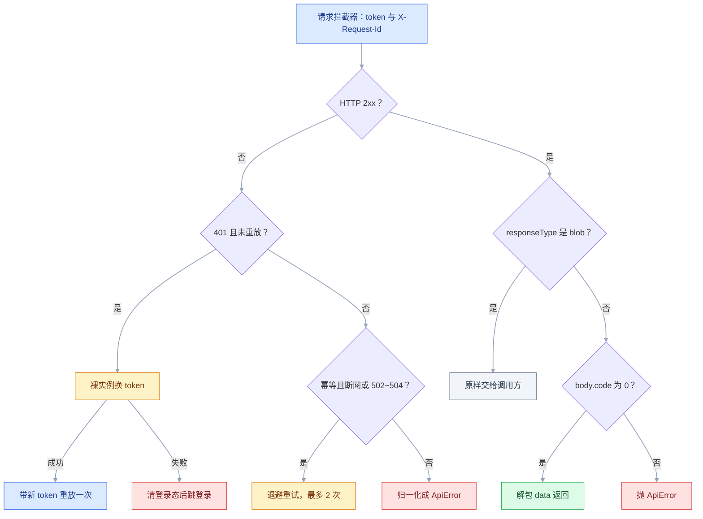
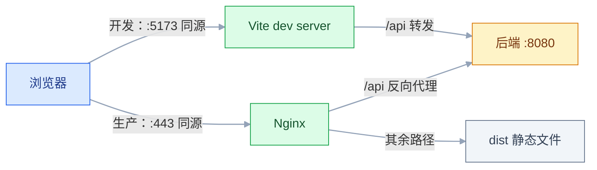

# axios 与 Fetch

## 一、工程案例：把散落各处的请求收敛成一个请求层

**场景**：一个 Vue 3 + TypeScript 后台（`admin-web`）从 3 个页面长到 40 个，请求代码也长成三种写法：有的页面直接 `fetch`，有的 `axios.get`，有的复制了一段带 token 的匿名函数。后端契约是 `{ code, message, data }`，`code: 0` 成功；登录用 `Authorization: Bearer <token>`，accessToken 15 分钟、refreshToken 7 天；导出接口返回二进制，上传接口收 `multipart/form-data`。

**为什么必须做**：请求逻辑一旦散在页面里，每加一个接口就要重抄一遍 token、超时、401、错误提示；后端把错误码从 `40101` 改成 `40102`，要改 40 个文件。收敛之后，页面只描述「要什么数据」，请求层负责「怎么拿、拿不到怎么办」。

**动手前确认**：Node 18+；已有 Vite + TypeScript 项目（没有就按 ① 新建），`tsconfig.json` 能跑 `tsc --noEmit`；本地 8080 端口空闲（验收用的 mock 服务要占用它）；Vite 开发服务器用默认的 5173（mock 的 CORS 白名单写的就是它）；浏览器 DevTools 的 Network 面板能看清请求头与状态码。

### 1.1 主线（按顺序执行，不要跳步）

```bash
# ① 没有现成项目时先建（已有项目只保留后两条命令）
npm create vite@latest admin-web -- --template vue-ts
cd admin-web && npm i
npm i axios
mkdir -p src/shared src/api mock
```

```text
src/
├── shared/http.ts     # 实例、拦截器、错误归一化、类型化方法
├── api/user.ts        # 按业务模块组织的接口函数
└── mock/server.mjs    # 只用于验收的假后端
```

```javascript
// ② mock/server.mjs —— 假后端，专门制造超时、401、503、业务错误
import { createServer } from 'node:http';
let flakyHits = 0;
const json = (res, status, body) => {
  res.writeHead(status, { 'Content-Type': 'application/json' });
  res.end(JSON.stringify(body));
};
const slow = (ms, res, body) => setTimeout(() => {
  if (!res.destroyed) json(res, 200, body);   // 客户端已取消就别再写
}, ms);

createServer((req, res) => {
  res.setHeader('Access-Control-Allow-Origin', 'http://localhost:5173');
  res.setHeader('Access-Control-Allow-Methods', 'GET,POST,OPTIONS');
  res.setHeader('Access-Control-Allow-Headers', 'Authorization, Content-Type, X-Request-Id');
  if (req.method === 'OPTIONS') { res.writeHead(204); return res.end(); }
  const url = new URL(req.url, 'http://localhost');
  const token = (req.headers.authorization || '').replace('Bearer ', '');

  // 刷新接口：没有 refreshToken 就返回 401，用来验收「刷新失败只跳一次」
  if (url.pathname === '/api/auth/refresh' && req.method === 'POST') {
    let raw = '';
    req.on('data', (chunk) => { raw += chunk; });
    return req.on('end', () => {
      let refreshToken = null;
      try { refreshToken = JSON.parse(raw).refreshToken; } catch { /* 空 body */ }
      return refreshToken
        ? json(res, 200, { code: 0, message: 'ok', data: { accessToken: 'fresh-token' } })
        : json(res, 401, { code: 40102, message: 'refresh expired', data: null });
    });
  }

  if (url.pathname === '/api/users') return json(res, 200, { code: 0, message: 'ok', data: { list: [], total: 0, page: 1, size: 10 } });
  if (url.pathname === '/api/biz-error') return json(res, 200, { code: 40001, message: '用户名已存在', data: null });
  if (url.pathname === '/api/slow') return slow(3000, res, { code: 0, message: 'ok', data: null });
  if (url.pathname === '/api/search') return slow(1500, res, { code: 0, message: 'ok', data: { list: [], total: 0 } });
  if (url.pathname === '/api/flaky') {
    flakyHits += 1;
    // 每 3 次里前两次 503：任何一次调用都要重试 2 次才成功，验收可重复
    return flakyHits % 3 === 0
      ? json(res, 200, { code: 0, message: 'ok', data: { hits: flakyHits } })
      : json(res, 503, { code: 50300, message: 'busy', data: null });
  }
  if (url.pathname === '/api/expired') {
    return token === 'fresh-token'
      ? json(res, 200, { code: 0, message: 'ok', data: { ok: true } })
      : json(res, 401, { code: 40101, message: 'token expired', data: null });
  }
  json(res, 404, { code: 40400, message: 'not found', data: null });
}).listen(8080, () => console.log('mock: http://localhost:8080'));
```

```typescript
// ③ src/shared/http.ts —— 契约、错误类型、实例
import axios, {
  type AxiosError, type AxiosInstance, type AxiosRequestConfig,
  type InternalAxiosRequestConfig,
} from 'axios';

export interface ApiResult<T = unknown> { code: number; message: string; data: T }
export const BizCode = { OK: 0, UNAUTHORIZED: 40101 } as const;

/** 所有失败最终都归一化成它，页面只需要认一种错误 */
export class ApiError extends Error {
  constructor(public code: number, message: string, public status?: number, public requestId?: string) {
    super(message);
    this.name = 'ApiError';
  }
}

const BASE_URL = import.meta.env.VITE_API_BASE_URL ?? '/api';

export const http: AxiosInstance = axios.create({
  baseURL: BASE_URL,
  timeout: 10_000,
  headers: { 'X-Client': 'admin-web' },
});

// ④ 请求拦截器：token 与链路 id 一次加好
let seq = 0;
http.interceptors.request.use((config) => {
  const token = localStorage.getItem('admin_token');
  if (token) config.headers.set('Authorization', `Bearer ${token}`);
  config.headers.set('X-Request-Id', `${Date.now().toString(36)}-${++seq}`);
  return config;                    // ⚠️ 不 return，请求直接失败
});
```

```typescript
// ⑤ 401 刷新：独立实例 + 单飞 + 只重放一次
const bare = axios.create({ baseURL: BASE_URL, timeout: 8_000 });
let refreshing: Promise<string> | null = null;
let redirecting = false;

function toLogin() {
  if (redirecting) return;                       // 并发 401 只跳一次
  redirecting = true;
  console.info('[auth] redirect to login');
  localStorage.removeItem('admin_token');
  localStorage.removeItem('admin_refresh_token');
  const back = encodeURIComponent(location.pathname + location.search);
  location.replace(`/login?redirect=${back}`);
}

function refreshAccessToken(): Promise<string> {
  refreshing ??= bare
    .post<ApiResult<{ accessToken: string }>>('/auth/refresh', {
      refreshToken: localStorage.getItem('admin_refresh_token'),
    })
    .then(({ data }) => {
      if (data.code !== BizCode.OK) throw new ApiError(data.code, data.message);
      localStorage.setItem('admin_token', data.data.accessToken);
      return data.data.accessToken;
    })
    .finally(() => { refreshing = null; });
  return refreshing;
}
```

```typescript
// ⑥ 响应拦截器：业务码、HTTP 错误、超时、重试，全在这里收口
type RetryConfig = InternalAxiosRequestConfig & { _retried?: boolean; _attempt?: number };
const IDEMPOTENT = new Set(['get', 'head', 'options']);

const isTimeout = (e: AxiosError) => e.code === 'ECONNABORTED' || e.code === 'ETIMEDOUT';

http.interceptors.response.use(
  (response) => {
    if (response.config.responseType === 'blob') return response;   // 二进制不解包
    const body = response.data as ApiResult | undefined;
    if (!body || typeof body !== 'object' || !('code' in body)) return response;
    if (body.code === BizCode.OK) {
      response.data = body.data;                                    // 调用方少写一层 .data
      return response;
    }
    return Promise.reject(new ApiError(body.code, body.message || '业务失败', response.status));
    // 业务码与 HTTP 状态要分开看：HTTP 401 走下面的刷新重放；
    // HTTP 200 却带非 0 code 是业务失败，刷新 token 解决不了，直接交给调用方分支
  },

  async (error: AxiosError<ApiResult>) => {
    if (axios.isCancel(error)) return Promise.reject(error);        // 取消不是失败
    const config = error.config as RetryConfig | undefined;
    const status = error.response?.status;
    const url = config?.url ?? '';

    // A. 401：换 token 后重放一次；登录/刷新接口自身不参与，避免递归
    if (status === 401 && config && !config._retried && !url.includes('/auth/')) {
      config._retried = true;
      try {
        const token = await refreshAccessToken();
        config.headers.set('Authorization', `Bearer ${token}`);
        return http(config);
      } catch {
        toLogin();
        return Promise.reject(new ApiError(BizCode.UNAUTHORIZED, '登录已过期', 401));
      }
    }

    // B. 重试：只幂等方法、只网络错误与 502/503/504，最多 2 次，指数退避 + 抖动
    //    超时不重试：已经等满了一个 timeout，再试只会让总耗时成倍增加
    const retriable = (!error.response && !isTimeout(error)) || [502, 503, 504].includes(status ?? 0);
    if (config && IDEMPOTENT.has((config.method ?? 'get').toLowerCase())
      && retriable && (config._attempt ?? 0) < 2) {
      config._attempt = (config._attempt ?? 0) + 1;
      const delay = 300 * 2 ** (config._attempt - 1) + Math.random() * 100;
      await new Promise((r) => setTimeout(r, delay));
      return http(config);
    }

    // C. 归一化：页面只处理 ApiError
    const requestId = String(config?.headers.get('X-Request-Id') ?? '');
    if (isTimeout(error)) throw new ApiError(-2, '请求超时，请稍后重试', status, requestId);
    if (!error.response) throw new ApiError(-1, '网络异常，请检查网络', undefined, requestId);
    const body = error.response.data;
    throw new ApiError(body?.code ?? status ?? -1, body?.message || `请求失败（${status}）`, status, requestId);
  },
);
```

```typescript
// ⑦ 类型化方法：调用方拿到的就是业务数据
export async function get<T>(url: string, params?: object, config?: AxiosRequestConfig): Promise<T> {
  const res = await http.get<T>(url, { params, ...config });
  return res.data;
}
export async function post<T>(url: string, data?: unknown, config?: AxiosRequestConfig): Promise<T> {
  const res = await http.post<T>(url, data, config);
  return res.data;
}
```

```typescript
// ⑧ src/api/user.ts —— 页面只看见业务名字
import { get } from '../shared/http';

export interface User { id: number; username: string; email: string; status: 0 | 1 }
export interface PageResult<T> { list: T[]; total: number; page: number; size: number }

export const listUsers = (q: { page: number; size: number; keyword?: string }) =>
  get<PageResult<User>>('/users', q);
```

```typescript
// ⑨ src/main.ts —— 验收用的最小挂载，正式项目里换成页面组件
import { isCancel } from 'axios';
import { get, http } from './shared/http';
import { listUsers } from './api/user';

let searchCtrl: AbortController | null = null;
Object.assign(window, {
  listUsers,
  get,
  http,
  search: (kw: string) => {
    searchCtrl?.abort();                        // 只保留最后一次输入
    searchCtrl = new AbortController();
    return get('/search', { kw }, { signal: searchCtrl.signal })
      .catch((e) => { if (!isCancel(e)) throw e; });
  },
});
```

```typescript
// ⑩ vite.config.ts —— 开发代理：浏览器只跟 5173 同源通信，`/api` 由 dev server 转发
import { defineConfig } from 'vite';
import vue from '@vitejs/plugin-vue';

export default defineConfig({
  plugins: [vue()],
  server: {
    proxy: { '/api': { target: 'http://localhost:8080', changeOrigin: true } },
  },
});
```

```bash
node mock/server.mjs      # 终端 1：假后端，占用 8080
npm run dev               # 终端 2：打开 http://localhost:5173
```

请求从进入到落地只走这一条链：



取消的请求在进入这张图之前就被识别并原样抛回，不参与 401 与重试。

**关键输出**（打开 5173 的页面控制台，对照 Network 面板）：

```text
# 5 个并发请求带着过期 token
GET /api/expired 401 × 5
POST /api/auth/refresh 200 × 1        ← 单飞生效
GET /api/expired 200 × 5              ← 重放成功
# GET /api/flaky（每次调用固定先 503 两次）
503 → 约 300ms → 503 → 约 600ms → 200
# GET /api/slow 且 timeout: 800（超时不进重试）
ApiError { code: -2, message: '请求超时，请稍后重试' }
# 搜索框连续输入后旧请求被取消
Network 面板状态列显示 (canceled)
```

### 1.2 验收（10 项全过才算交付）

| # | 检查项 | 命令或检查 | 通过标准 |
|---|---|---|---|
| 1 | 请求带鉴权头 | `localStorage.admin_token = 'any-token'` 后执行 `await listUsers({ page: 1, size: 10 })`，看 Network → `/api/users` | 有 `Authorization: Bearer any-token` 和 `X-Request-Id` |
| 2 | 业务成功解包 | Console 执行 `await listUsers({ page: 1, size: 10 })` | 直接得到 `data` 内的 `{ list, total, page, size }`，没有外层 `code` |
| 3 | 业务失败可识别 | Console 执行 `await get('/biz-error')` | 抛 `ApiError`，`code` 为 40001，`message` 为「用户名已存在」 |
| 4 | 401 单飞 | `localStorage.admin_refresh_token = 'r'; localStorage.admin_token = 'expired'` 后执行 `await Promise.all(Array.from({ length: 5 }, () => get('/expired')))` | Network 里只有 1 次 `/auth/refresh`，5 次重放全部 200 |
| 5 | 刷新失败只跳一次 | Console 勾选 Preserve log；`localStorage.removeItem('admin_refresh_token'); localStorage.admin_token = 'expired'` 后再并发 5 次 | 只出现 1 次 `[auth] redirect to login`；跳转后两个 token 键都为空 |
| 6 | 超时可控 | `await get('/slow', undefined, { timeout: 800 })` | 约 800ms 抛 `code: -2`，且 Network 里只有 1 次 `/slow`（超时不重试） |
| 7 | 重试有上限 | `await get('/flaky')` 连续做两次 | 每次调用都是 3 个请求（2 次 503 + 1 次 200） |
| 8 | 非幂等不重试 | `await Promise.allSettled([http.post('/flaky'), http.post('/flaky')])` | 只有 2 个请求，POST 不触发自动重试 |
| 9 | 取消可静默 | Console 先 `search('a')`，200ms 内再 `search('ab')` | 第一个 `/api/search` 显示 `(canceled)`，Console 没有报错 |
| 10 | 类型可用 | `npx tsc --noEmit` | 无错误；`listUsers` 返回值可当 `PageResult<User>` 用 |

> 第 4 项需要 `admin_refresh_token` 有值、`admin_token` 是过期值；它跑完会把 `admin_token` 写成 `fresh-token`，重跑前再改回过期值。
> 第 8 项是重试的底线：POST 可能已经落库，重试会造成重复下单、重复扣款。

### 1.3 复制到其他模块

新接口一律先写 `src/api/<模块>.ts`，页面不出现 URL 字符串。迁移老代码按「读多写少」的顺序：先迁查询接口，再迁提交接口，最后迁上传下载。判断有没有漏网：页面里出现 `fetch(`、`http.` 或写死的 `/api/` 路径，就说明还没收口。

| 要加的能力 | 放在哪 | 注意 |
|---|---|---|
| 统一签名、灰度头 | 请求拦截器 | 只依赖 config，不依赖页面状态 |
| 业务错误码文案 | 响应拦截器 | 保留 `ApiError.code` 供页面分支 |
| 某个模块的特殊错误 | 该模块的 api 函数 | 不要为它改全局拦截器 |
| 某个页面的 loading | 页面 / 组合式函数 | `finally` 里关 |
| 接口字段改名 | api 函数 + 类型 | 页面无感 |

---

## 二、高频问答：会卡住你的地方，也是面试最常问的

### 2.1 `fetch` 拿到 500，代码却走进成功分支

**现场**

在 `await fetch(...)` 后面把状态和 `ok` 一起打出来：

```javascript
const res = await fetch('/api/users');
console.log(res.status, res.ok);   // 500 false —— 但上面没有抛异常
if (!res.ok) throw new Error(`HTTP ${res.status}`);
```

**要点**

- `fetch` 只在网络层失败时 reject，4xx/5xx 是「成功收到了响应」，`res.ok` 为 false 但 Promise 已 resolve。
- axios 默认把 4xx/5xx 变成 reject，两者的失败语义不同。
- 每次 fetch 都要自己判 `res.ok`，不判就等于把 HTTP 错误当成功。

**追问**

- 什么时候 fetch 才会 reject？→ 断网、DNS、CORS 这类根本没拿到响应的情况。
- 怎么让 fetch 也自动抛？→ 封装一层，`!res.ok` 时自己 throw。

### 2.2 加了请求拦截器，所有请求都不发了

**现场**

看控制台报的是不是 `Cannot read properties of undefined (reading 'url')` 一类错误，同时确认 Network 里有没有记录。

**要点**

- 拦截器是链条，返回值就是下一环的输入；只做副作用不返回，等于把链条剪断。
- 现象是所有请求都不发，不是某个接口失败。
- 排查看 `use` 回调末尾有没有 `return config`。

**追问**

- 为什么报的是读 `url`？→ 下一环拿到 `undefined`，还要取属性。
- 响应拦截器也要 return 吗？→ 要，成功回调必须把 `response` 交回去。

### 2.3 401 之后无限刷新、无限跳转

**现场**

Network 面板里看 `/auth/refresh` 是不是反复出现，且每次刷新请求本身也是 401。

```typescript
// ✘ 刷新请求用 http，会再次进入 401 分支
const res = await http.post('/auth/refresh', { refreshToken });
// ✔ 用不挂拦截器的裸实例，并给原请求打标记
const bare = axios.create({ baseURL: BASE_URL });
```

**要点**

- 刷新 token 的请求走了同一个带拦截器的实例，刷新接口返回 401 又触发刷新，形成异步循环。
- 要区分「业务请求 401」与「刷新请求 401」。
- 刷新用不挂拦截器的裸实例，再给原请求打 `_retried` 标记，保证只重放一次。

**追问**

- 为什么从 Network 就能一眼看出来？→ 401 的 URL 就是刷新接口本身。
- 只加 `_retried` 够吗？→ 不够，还要把 `/auth/` 排除掉，否则刷新接口自己又进分支。

### 2.4 页面同时发 5 个请求，登录页跳了 5 次

**现场**

在跳转函数里打点，并发触发一次后看计数；同时观察地址栏 `redirect` 参数是否反复变化、页面闪几次。

**要点**

- 每个 401 都独立执行一次跳转，并发时没有共享状态。
- 跳转是每个失败请求各自触发的副作用，必须在请求层做一次性守卫。
- 模块级 `redirecting` 布尔，第一个 401 置位并跳转，其余直接返回。

**追问**

- 路由守卫为什么看着没问题？→ 它只管导航，管不了并发请求的副作用。
- 刷新失败那条路也会跳多次吗？→ 会，同一处守卫要覆盖刷新失败分支。

### 2.5 浏览器报 CORS，后端说「我这边用 Postman 是通的」

**现场**

Console 的报错里写明缺哪个 `Access-Control-Allow-*`，Network 里能看到预检 `OPTIONS`。

```text
Access to fetch at 'http://localhost:8080/api/users' from origin
'http://localhost:5173' has been blocked by CORS policy:
Response to preflight request doesn't pass access control check.
```

**要点**

- 同源策略由浏览器执行，Postman 不是浏览器，不受 CORS 约束。
- 真正要改的是响应头或走同源代理，不是反复改 `Content-Type`。
- 开发期用 Vite 代理绕开，生产期让后端放行明确域名。

**追问**

- 为什么 Postman 通、浏览器不通？→ 服务端之间的调用不执行同源策略。
- 预检失败看哪里？→ Network 里 `OPTIONS` 的状态码和响应头。

### 2.6 上传文件后端收不到，或提示 boundary 丢失

**现场**

看 Request Headers 里的 Content-Type 有没有 `boundary=----...`：

```typescript
const fd = new FormData();
fd.append('file', file);
await http.post('/files', fd);   // ✔ 不手写 Content-Type，boundary 交给浏览器生成
```

**要点**

- 手动写 `Content-Type: multipart/form-data`，会把浏览器自动生成的 `boundary` 覆盖掉。
- boundary 由序列化 FormData 的运行时生成，不该手写。
- 直接传 `FormData`，让运行时补头。

**追问**

- 后端为什么解析失败？→ 没有 boundary 就切不开各个部分。
- JSON 请求也要这样吗？→ 不用，JSON 没有 boundary，但 `Content-Type` 要自己声明。

### 2.7 超时了，但代码判断的是 `error.message`

**现场**

先打印 `code` 和 `message` 一起看：

```typescript
const isTimeout = (e: AxiosError) => e.code === 'ECONNABORTED' || e.code === 'ETIMEDOUT';
```

**要点**

- 超时默认以 `code: 'ECONNABORTED'` 结束；把 `transitional.clarifyTimeoutError` 打开后才变成 `ETIMEDOUT`。
- `message` 是给人读的文案，会随版本、语言变化，不能拿来做分支。
- 两个 `code` 都判，才不依赖某个开关有没有打开。

**追问**

- 文案为什么不可靠？→ 会本地化，也会随版本改。
- XHR 和 fetch 适配器报的 code 一样吗？→ 各触发一次超时对比，别假设只有一种。

### 2.8 搜索框取消请求后弹出「网络异常」

**现场**

`error.code === 'ERR_CANCELED'` 或 `error.name === 'AbortError'`：

```typescript
const ctrl = new AbortController();                        // 输入变化时先 abort 上一次
try { await get('/search', { kw }, { signal: ctrl.signal }); }
catch (e) { if (axios.isCancel(e)) return; throw e; }   // 取消：静默
```

**要点**

- `abort()` 让 Promise 以 `CanceledError` / `AbortError` reject，catch 把它当普通失败提示了。
- 取消是预期行为，不该打扰用户。
- catch 里先 `axios.isCancel(e)`，再决定是否上抛。

**追问**

- fetch 和 axios 的取消错误名一样吗？→ fetch 是 `AbortError`，axios 是 `CanceledError`。
- 取消后的 controller 还能复用吗？→ 不能，下一次请求要新建。

### 2.9 `params` 和 `data` 放反，后端收不到参数

**现场**

Network 里看请求 URL 有没有 query，Request Payload 有没有 JSON，缺哪块就是放错了位置。

```typescript
axios.get('/users', { params: { page: 1 } });     // → /users?page=1
axios.post('/users', { name: '张三' });            // body
axios.post('/users', { name: '张三' }, { params: { from: 'web' } });
```

**要点**

- `axios.get(url, config)` 的第二个参数是配置，查询参数要放在 `config.params`。
- `axios.post(url, data, config)` 的第二个才是请求体。
- 三个方法的签名不一样，把三者的第二个参数当成同一层是根因。

**追问**

- GET 能带 body 吗？→ 没有语义，参数只能在 URL 上。
- 想在 POST 上加查询参数怎么办？→ 第三个参数里写 `params`。

### 2.10 下载的 Excel 打不开，或内容是 `[object Object]`

**现场**

看 `res.data` 是 Blob 还是字符串，再看响应头的 `Content-Type`：

```typescript
const res = await http.get('/users/export', { responseType: 'blob' });
// 拦截器里：if (config.responseType === 'blob') return response;
```

**要点**

- 二进制通道有两个前提：请求声明 `responseType: 'blob'`，拦截器不碰它。
- 没设 `responseType` 时二进制被当文本处理，内容就成了 `[object Object]` 之类。
- 拦截器要先判 `responseType === 'blob'` 再原样返回。

**追问**

- 怎么确认拿到的真是文件？→ 看文件头几个字节是不是 `PK`（xlsx 就是 zip）。
- 下载失败时后端返回 JSON 怎么办？→ 它也会被包成 Blob，要 `text()` 再解析错误信息。

### 2.11 刷新 token 的接口自己也返回 401

**现场**

Network 里 `/auth/refresh` 返回 401；若随后仍出现新的刷新请求，说明排除条件失效。

```typescript
if (status === 401 && !config._retried && !url.includes('/auth/')) { /* 才尝试刷新 */ }
```

**要点**

- refreshToken 也过期或被吊销，这是正常终态，不是异常。
- 代码又进入刷新分支才是要修的地方：缺 `/auth/` 排除，或缺 `_retried` 标记。
- 终态处理是清登录态、跳登录，不是继续重试。

**追问**

- 清掉 refreshToken 再请求，应该看到什么？→ 只跳一次登录，没有刷新循环。
- 为什么不能重试刷新？→ refreshToken 已经是终态，再试结果不会变。

### 2.12 登出后，在途请求又把页面拉回登录态

**现场**

登出后看 Network 是否仍有旧请求完成，以及 localStorage 里是否又出现新 token。

**要点**

- 登出前发出的请求在登出后才返回 401，触发刷新或跳转，覆盖了「已登出」状态。
- 只清存储不够，还要处理并发时序。
- 彻底做法是登出时 abort 所有在途请求，或用递增的会话 epoch 丢弃过期结果。

**追问**

- 怎么确认是时序问题？→ 登出函数和响应拦截器各打一条带时间戳的日志，看旧响应是否晚到。
- 为什么清了 localStorage 还被写回来？→ 旧响应回来时又走了一遍「写 token」的分支。

---

## 三、核心知识：从零开始要建立的东西

### 3.1 HTTP 请求的生命周期

一次请求经过：解析 URL → DNS → TCP/TLS 握手 → 发送请求行与头 → 服务端处理 → 返回状态行、头、体 → 浏览器解析。前端能控制的只有「发什么」和「怎么处理回来的东西」，中间任何一段都可能失败。

| 阶段 | 典型失败 | 前端能否捕获 |
|---|---|---|
| DNS / 连接 | 断网、域名解析失败、证书错误 | 能，axios 的 `error.response` 为空 |
| 等待响应 | 超时、服务端卡死 | 能，`code` 为 `ECONNABORTED` / `ETIMEDOUT` |
| HTTP 状态 | 401、403、404、500 | 能，`error.response.status` |
| 响应解析 | JSON 格式错、编码错 | 能，解析时抛 `SyntaxError` |
| 业务判断 | `code` 非 0 | 能，但 HTTP 层是 200 |

浏览器对同域名并发连接有限制（HTTP/1.1 常见 6 条），大量请求会排队。这是「同时发 20 个请求，后面的很慢」的常见原因，不是代码写错；HTTP/2 多路复用下这条限制基本消失，瓶颈换成服务端并发与网关限流。

### 3.2 Fetch 的 Response 与 Body 流

`fetch` 返回 `Response`，不是数据。状态码在 `status`，是否 2xx 在 `ok`，响应头在 `headers`，正文是一个只能读一次的流。

```javascript
const res = await fetch('/api/users');
const copy = res.clone();          // 要读两次，先克隆再读
const data = res.headers.get('content-type')?.includes('json')
  ? await res.json()
  : await res.text();
```

| 成员 | 用途 | 注意 |
|---|---|---|
| `status` / `ok` | 状态码、是否 2xx | 4xx/5xx 不 reject |
| `headers.get()` | 取响应头 | 头名大小写不敏感 |
| `json()` / `text()` / `blob()` | 解析正文 | 只能调用一次 |
| `body` | `ReadableStream` | 流式读取、下载进度 |
| `clone()` | 复制响应 | 两份 body 都占内存 |

边界：204 或空 body 调 `json()` 会抛 `SyntaxError`，要先判 `status === 204` 或内容长度；`res.body` 一旦被 `getReader()` 锁住，就不能再 `json()`。

### 3.3 axios 的实例与配置合并

axios 的配置按「库默认值 → 实例默认值 → 单次请求」三层合并，后面的覆盖前面的。

```typescript
const api = axios.create({ baseURL: '/api', timeout: 10_000 });
api.get('/users', { timeout: 3_000 });   // 本次 3s，其余继承实例
```

| 配置 | 作用 | 常见误用 |
|---|---|---|
| `baseURL` | 拼在相对 URL 前 | 请求里又写一遍 `/api`，变成 `/api/api` |
| `params` | 序列化进 query | 放进 `data`，GET 收不到 |
| `data` | 请求体 | 放进 `params`，后端读不到 body |
| `timeout` | 毫秒，默认 0 表示不限 | 以为能中断服务端处理 |
| `responseType` | `json` / `blob` / `text` | 下载忘了设 `blob` |
| `withCredentials` | 跨域是否带 Cookie | 与 `Access-Control-Allow-Origin: *` 冲突 |
| `signal` | 取消信号 | 复用已 abort 的 controller |

`baseURL` 只在 URL 是相对路径时拼接；写成完整 URL 会忽略它。`timeout` 只中断浏览器等待，服务端可能仍在执行，所以支付、下单这类接口不能靠超时判断「没成功」。

### 3.4 拦截器的执行顺序

请求拦截器是栈：后注册的先执行。响应拦截器是队列：先注册的先执行。两条请求拦截器依次打印 A、B，输出顺序是 **B → A → 请求发出 → 响应回调按注册顺序**。

```typescript
api.interceptors.request.use((c) => { console.log('A'); return c; });
api.interceptors.request.use((c) => { console.log('B'); return c; });
```


边界：拦截器里抛错会直接进错误链；返回 `Promise.reject` 与 `throw` 等价。`eject` 要保存返回的 id，热更新时重复注册会导致同一请求加多次头。

> **面试**：常问「请求拦截器和响应拦截器的执行顺序？」答：请求是栈、后注册先执行；响应是队列、先注册先执行。

### 3.5 错误的分层与判断

| 层 | 表现 | 判断依据 | 处理 |
|---|---|---|---|
| 网络层 | 断网、DNS、证书 | 没有 `error.response` | 提示检查网络，可重试 |
| HTTP 层 | 400/401/403/404/5xx | `error.response.status` | 按状态码分支 |
| 业务层 | HTTP 200，`code` 非 0 | 响应体 `code` | 提示 `message`，保留 code |
| 解析层 | JSON 语法错、字段类型错 | 解析异常或校验失败 | 记日志，按契约问题排查 |

这四层必须分别判。只判 HTTP 会把「200 + 业务失败」当成功；只判业务码会把 500 当成功；只判网络会把超时当断网。

### 3.6 超时、取消与 AbortSignal

`AbortController` 是浏览器提供的通用中断器：调用 `controller.abort()` 后，所有监听该 `signal` 的异步操作都会以中断错误结束。

```typescript
const c = new AbortController();
const timer = setTimeout(() => c.abort(), 3_000);
try {
  await fetch('/api/slow', { signal: c.signal });
} catch (e) {
  if (e.name === 'AbortError') console.log('超时或被取消');
} finally {
  clearTimeout(timer);          // 成功也要清，否则计时器常驻
}
```

| 场景 | 写法 | 异常特征 |
|---|---|---|
| 手动取消 | `controller.abort()` | fetch 为 `AbortError`；axios 为 `CanceledError` / `ERR_CANCELED` |
| 超时 | `AbortSignal.timeout(3000)` | fetch 为 `TimeoutError`；axios 仍走取消错误 |
| 组合多个信号 | `AbortSignal.any([a, b])` | 任一触发即中断 |
| 判断已取消 | `signal.aborted` | 布尔值 |

边界：一个 controller 只能 abort 一次，取消后不能复用，下一次请求要新建；`abort()` 对已完成的请求无副作用。`AbortSignal.timeout` / `any` 是较新的平台 API，要覆盖旧浏览器就用 `setTimeout` + `abort` 自己拼。fetch 下自己 abort 得到 `AbortError`、`AbortSignal.timeout` 得到 `TimeoutError`；axios 会把两条路径都包成 `CanceledError`，分层时看 `error.code` 并结合「是不是自己调的 abort」（适配器差异以官方当前稳定版为准）。

### 3.7 重试的适用边界

重试不是「失败就再来一次」，它有三个前提：请求幂等、失败可恢复、总时长可接受。

| 条件 | 可重试 | 原因 |
|---|---|---|
| GET / HEAD / OPTIONS | ✅ | 无副作用 |
| POST 创建订单 | ❌ | 可能已落库，重试造成重复 |
| 502 / 503 / 504 | ✅ | 网关或上游临时不可用 |
| 429 | ✅ | 需读 `Retry-After` 放慢节奏，跨域时该头要 expose |
| 400 / 401 / 403 / 404 | ❌ | 结果不会变；401 走刷新后重放，不是重试 |
| 断网 | ✅ | 网络恢复后可能成功 |

```typescript
const delay = base * 2 ** attempt + Math.random() * jitter;
```

指数退避避免雪崩，抖动避免所有客户端同一时刻重试。必须设上限（次数与总 deadline），否则一个挂掉的接口会让页面转很久。非幂等接口若确需重试，要由后端支持幂等键。

> **面试**：常问「什么请求可以重试？」答：幂等且失败可恢复的才行，POST 下单重试会重复，要重试得靠后端幂等键。

### 3.8 鉴权信息的携带方式

| 方式 | 存放 | 优点 | 风险 |
|---|---|---|---|
| `Authorization: Bearer` | localStorage / 内存 | 跨域简单、移动端通用 | XSS 可读，token 可被带走 |
| HttpOnly Cookie | 浏览器自动管理 | JS 读不到，降低 XSS 影响 | 需要 CSRF 防护、跨域要 `SameSite` 配合 |

`localStorage` 的 token 在任何同源脚本里都能读，所以它防不了 XSS；HttpOnly Cookie 防不了 CSRF。两者不是「谁更安全」，而是把风险放在不同位置。跨域带 Cookie 需要 `withCredentials: true`，同时后端不能回 `Access-Control-Allow-Origin: *`，必须写明确来源。

### 3.9 同源策略与 CORS

同源 = 协议、域名、端口三者完全一致。跨源请求的响应默认不能被页面 JS 读取。

| 请求类型 | 是否预检 | 例子 |
|---|---|---|
| 简单请求 | 否 | GET + 少量安全头 |
| 需预检 | 是，先发 `OPTIONS` | 带 `Authorization`、`Content-Type: application/json`、PUT/DELETE |

预检通过要满足：响应带 `Access-Control-Allow-Origin`（明确来源或 `*`）；请求用了非简单方法时，`Access-Control-Allow-Methods` 里要有它；请求带了自定义头（如 `Authorization`）时，`Access-Control-Allow-Headers` 里要有它；带 Cookie 时还要 `Access-Control-Allow-Credentials: true`，且 `Allow-Origin` 不能是 `*`。按来源放行时响应应带 `Vary: Origin`，否则 CDN 可能把一个来源的放行头缓存给另一个来源。

```text
Access-Control-Allow-Origin: https://admin.example.com
Access-Control-Allow-Credentials: true
Access-Control-Expose-Headers: Content-Disposition
Access-Control-Max-Age: 3600
```

`Content-Disposition` 默认不在可读头里，下载要取文件名必须显式 expose。CORS 是浏览器行为，服务端之间的调用不受影响，这也是「Postman 通、浏览器不通」的原因。

> **面试**：常问「CORS 预检什么时候触发？」答：非简单请求才触发，比如带 `Authorization`、JSON 的 `Content-Type`，或用了 PUT/DELETE。

### 3.10 开发代理与生产反向代理

开发期让浏览器请求同源的 dev server，再由 dev server 转发给后端，就绕开了 CORS。

```typescript
// vite.config.ts
import { defineConfig } from 'vite';

export default defineConfig({
  server: {
    proxy: {
      '/api': {
        target: 'http://localhost:8080',
        changeOrigin: true,                              // 改 Host，虚拟主机场景需要
        // rewrite: (p) => p.replace(/^\/api/, ''),      // 后端无 /api 前缀时
      },
    },
  },
});
```

生产用 Nginx 做同样的事，前端静态文件与 `/api` 同域：

```nginx
location /api/ {
    proxy_pass http://backend:8080/;      # 末尾斜杠会剥掉 /api/
    proxy_set_header Host $host;
    proxy_set_header X-Real-IP $remote_addr;
}
```

边界：`proxy_pass` 末尾有没有斜杠，路径重写规则不同；SSE / 流式响应要关 `proxy_buffering`，否则前端收不到分块。



### 3.11 上传与下载的二进制通道

上传用 `FormData`，让浏览器生成 boundary；下载用 `responseType: 'blob'`，再构造临时链接触发保存。

```typescript
// 上传：FormData 让浏览器生成 boundary
const fd = new FormData();
fd.append('file', file);
await http.post('/files', fd, {
  onUploadProgress: (e) => { if (e.total) console.log(Math.round((e.loaded / e.total) * 100)); },
});

// 下载：blob + 临时链接
const res = await http.get('/users/export', { responseType: 'blob' });
const url = URL.createObjectURL(res.data);
const a = document.createElement('a');
a.href = url;
a.download = 'users.xlsx';
document.body.append(a);              // Safari 要求链接在文档里
a.click();
a.remove();
setTimeout(() => URL.revokeObjectURL(url), 1_000);   // 立刻 revoke 可能打断下载
```

要按后端给的文件名保存，读响应头 `Content-Disposition` 并解析 `filename*`（中文名走 RFC 5987）；该头默认不可读，跨域时要 `Access-Control-Expose-Headers` 带上它，走同源代理则不受限。`fetch` 没有上传进度（请求体不可观测），下载进度可以用 `res.body.getReader()` 自己累计。下载失败时后端返回的 JSON 也会被包成 Blob，要 `await blob.text()` 再解析错误信息。

### 3.12 并发编排

| 方法 | 行为 | 适用 |
|---|---|---|
| `Promise.all` | 任一 reject 立刻整体 reject | 缺一不可的数据 |
| `Promise.allSettled` | 等全部结束，逐项给状态 | 部分失败可接受 |
| `Promise.race` | 第一个结束的胜出 | 超时竞速 |
| 手写并发池 | 限制同时进行的数量 | 批量导入、批量请求 |

边界：`Promise.all` 失败后其他请求仍在跑，只是结果被忽略；要真正停下来得给每个请求传同一个 `signal` 并 abort。`Promise.race` 只取第一个结果，输的那次请求还在跑，同样得 abort 才能省下带宽。要逐项拿结果用 `Promise.allSettled`，每项带 `status` 与 `value`/`reason`。无上限地 `Promise.all` 几百个请求会排队、拖慢首屏，也会给后端造成尖峰。

### 3.13 类型声明与运行时校验的边界

`get<PageResult<User>>()` 只是编译期声明。运行时后端返回什么，代码就拿到什么，泛型不会检查。

| 手段 | 检查时机 | 能防什么 |
|---|---|---|
| TS 泛型 / 接口 | 编译期 | 自己代码用错字段 |
| `as` 断言 | 无 | 什么都不防，只是让编译器闭嘴 |
| 运行时 schema 校验 | 请求返回时 | 后端改字段、类型漂移 |

关键接口（用户信息、权限、金额）值得在 api 函数里加一道运行时校验；列表类接口可只抽查前几条，避免大数组的校验开销。

### 3.14 去重、缓存与可观测性

同一时刻多个组件请求同一个 URL，可以合并成一个在途 Promise；GET 还能利用 HTTP 缓存。

```typescript
const inflight = new Map<string, Promise<unknown>>();
function dedupe<T>(key: string, run: () => Promise<T>): Promise<T> {
  const hit = inflight.get(key) as Promise<T> | undefined;
  if (hit) return hit;
  const p = run().finally(() => inflight.delete(key));
  inflight.set(key, p);
  return p;
}
```

| 机制 | 作用 | 注意 |
|---|---|---|
| 在途去重 | 合并同时发出的相同请求 | 只对 GET 安全 |
| `Cache-Control` | 浏览器 / CDN 缓存 | 需要后端配合 |
| `ETag` / `304` | 协商缓存，省流量 | 仍有一次往返 |
| 请求 id + 耗时 | 前后端日志对齐、找慢接口 | 请求拦截器生成，响应时相减 |
| 状态码 / 错误码分布 | 发现 401 突增、业务异常 | 上报要采样 |

去重不能用于 POST/PUT/DELETE：两次「提交」可能是用户有意为之，合并会吞掉一次操作。key 要把 URL 与参数一起算进去，否则不同查询会命中同一份结果。缓存要考虑新鲜度，权限、余额这类数据不适合长时间缓存。页面卸载时的埋点用 `navigator.sendBeacon`，它不受页面关闭影响；日志里不要带 token、手机号、身份证号。

---

## 四、冷门知识汇总

| 知识点 | 为什么冷门 | 用到时的关键词 |
|---|---|---|
| axios `validateStatus` | 默认把 4xx/5xx 判成失败，只有要读错误体时才放行 | `validateStatus: () => true` |
| axios `maxContentLength` / `maxBodyLength` | 只在 Node 端传大文件时撞上 | `maxContentLength ... exceeded` |
| axios `CancelToken`（已废弃） | 老项目遗留写法，新代码用 `AbortController` | `source.cancel()`、迁移到 `signal` |
| axios `withXSRFToken` | 只有 Cookie + CSRF 双保险才需要 | 跨域带 `XSRF-TOKEN` |
| axios `paramsSerializer` | 数组与嵌套对象的格式由后端定 | `ids[]=1&ids[]=2` 与 `ids=1,2` |
| axios `transformRequest` | 默认 JSON 序列化够用 | 自定义签名、加密请求体 |
| axios `adapter` | 只在测试 mock 或小程序端用 | 自定义传输层 |
| `transitional.clarifyTimeoutError` | 默认关闭，超时 `code` 因此有两种 | 统一 `ETIMEDOUT` |
| `fetch` 的 `keepalive` | 只在页面卸载上报时用，且体积极小 | `keepalive: true`、`sendBeacon` |
| `onDownloadProgress` | 浏览器下载进度少有人做 | `e.loaded / e.total` |
| `Content-Disposition` 的 `filename*` | 中文文件名要 RFC 5987 编码 | `filename*=UTF-8''...` |
| 预检缓存 | 每次请求都预检会多一次往返 | `Access-Control-Max-Age` |
| `Vary: Origin` | 多来源放行时漏写，CDN 会串缓存 | 缓存键、命中错误来源 |
| `SameSite=None; Secure` | 跨站 Cookie 的必备组合 | 嵌 iframe、跨域登录 |
| HTTP/2 多路复用 | 开发环境少见，生产由网关决定 | 并发连接数、队头阻塞 |
| `navigator.sendBeacon` | 普通请求用不上 | 页面关闭时可靠上报 |
