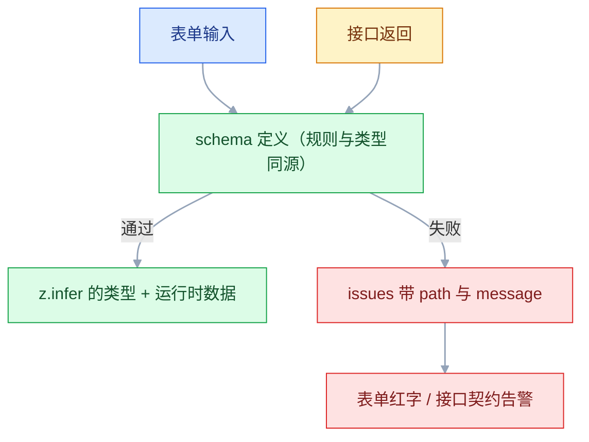
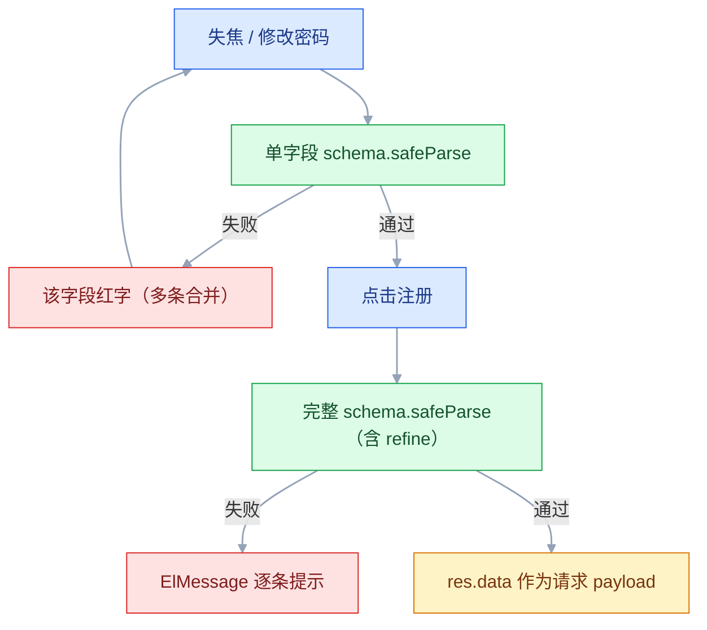

# Zod 数据校验

## 一、工程案例：注册表单与接口返回共用一套 schema

**场景**：一个 Vue 3 + Element Plus 的注册页，字段包括用户名、邮箱、手机号、密码、确认密码、协议勾选。后端同时在改接口：`username` 可能被改成 `user_name`。要求错误提示全中文、失焦即时校验、密码改动后确认密码联动重校验，并且接口返回字段变化时页面不能白屏。

**约束**：

| 约束 | 具体内容 |
|---|---|
| 技术栈 | Vue 3 + TypeScript + Element Plus |
| 校验位置 | 前端负责体验，后端仍须校验安全 |
| 错误提示 | 全中文，定位到具体输入框 |
| 契约风险 | 后端字段改名时要有明确日志，不能只剩 undefined |

**产出**：一份可复用的 `schemas/user.ts`、一个 Zod 与 Element Plus 的适配函数、一个提交时做完整校验的页面，以及一个校验响应体的请求函数。

### 1.1 目录与依赖

```text
src/
├── schemas/user.ts           # schema 与类型都从这里出
├── composables/useZodForm.ts # Zod → Element Plus 适配
├── views/Register.vue        # 页面
├── api/user.ts               # 请求层，校验入参与返回值
├── utils/http.ts             # 最小 fetch 封装，可换成项目现有封装
└── main.ts                   # 注册 Element Plus
```

```bash
npm create vite@latest zod-demo -- --template vue-ts
cd zod-demo && npm install
npm install zod element-plus
npm run dev
```

Element Plus 的组件是全局注册的，漏了 `main.ts` 这一步，`<el-form>` 会渲染成未知标签：

```typescript
// src/main.ts
import { createApp } from 'vue';
import ElementPlus from 'element-plus';
import 'element-plus/dist/index.css';
import App from './App.vue';

createApp(App).use(ElementPlus).mount('#app');
```

再把模板生成的 `App.vue` 指到注册页，否则启动后看到的还是 Vite 默认页：

```vue
<!-- src/App.vue -->
<script setup lang="ts">
import Register from './views/Register.vue';
</script>

<template>
  <Register />
</template>
```

后文一律用相对路径引入（`../schemas/user`），Vite 模板默认没有 `@` 别名，直接写 `@/` 会找不到模块。

**版本说明**：示例按 Zod 3.x 的写法给出（`z.string().email()`、`.strict()`、`required_error`、`z.ZodIssueCode` 等）。新版调整了其中一部分 API（如 `z.email()`、`z.strictObject()` / `z.looseObject()`、统一的 `error` 参数、`z.flattenError()`），升级时以官方当前稳定版为准；`parse` / `safeParse`、`refine`、`transform`、`z.infer` 的语义不受影响。

### 1.2 定义 schema

```typescript
// src/schemas/user.ts
import { z } from 'zod';

export const UsernameSchema = z.string()
  .trim()
  .min(4, '用户名至少 4 个字符')
  .max(20, '用户名最多 20 个字符')
  .regex(/^[a-zA-Z0-9_]+$/, '只能包含字母、数字和下划线')
  .refine((v) => !/^\d+$/.test(v), { message: '用户名不能是纯数字' });

export const PhoneSchema = z.string()
  .regex(/^1[3-9]\d{9}$/, '请输入正确的手机号');

// 长度用 min，字符种类用 superRefine；每条规则都会产出独立的 issue，
// 展示时要合并（见 1.3），否则只能看到第一条
export const PasswordSchema = z.string()
  .min(8, '密码至少 8 位')
  .superRefine((val, ctx) => {
    if (!/[a-z]/.test(val)) ctx.addIssue({ code: z.ZodIssueCode.custom, message: '需包含小写字母' });
    if (!/[A-Z]/.test(val)) ctx.addIssue({ code: z.ZodIssueCode.custom, message: '需包含大写字母' });
    if (!/\d/.test(val)) ctx.addIssue({ code: z.ZodIssueCode.custom, message: '需包含数字' });
  });

export const RegisterBaseSchema = z.object({
  username: UsernameSchema,
  email: z.string().trim().email('邮箱格式不正确'),
  phone: PhoneSchema,
  password: PasswordSchema,
  confirmPassword: z.string().min(1, '请再次输入密码'),
  agreed: z.boolean().refine((v) => v === true, { message: '请先阅读并同意用户协议' }),
});

// 跨字段规则只挂在完整 schema 上，表单适配层用上面的 Base
export const RegisterSchema = RegisterBaseSchema.refine(
  (d) => d.password === d.confirmPassword,
  { message: '两次输入的密码不一致', path: ['confirmPassword'] },
);

export type RegisterForm = z.infer<typeof RegisterSchema>;
export type RegisterFormInput = z.input<typeof RegisterSchema>;
```



### 1.3 写表单适配层

`el-form` 的规则要求 `{ validator, trigger }`，所以给每个字段生成一个只校验自己的函数：

```typescript
// src/composables/useZodForm.ts
import type { FormItemRule } from 'element-plus';
import { z } from 'zod';

export function zodToElRules<T extends z.ZodObject<z.ZodRawShape>>(
  schema: T,
  trigger: 'blur' | 'change' = 'blur',
): Record<string, FormItemRule[]> {
  const rules: Record<string, FormItemRule[]> = {};
  for (const key of Object.keys(schema.shape)) {
    const fieldSchema = schema.shape[key];
    rules[key] = [{
      trigger,
      validator: (_rule, value, callback) => {
        const res = fieldSchema.safeParse(value);
        if (res.success) callback();
        // 同一字段的多条规则合成一行，避免只看到第一条
        else callback(new Error(res.error.issues.map((i) => i.message).join('；')));
      },
    }];
  }
  return rules;
}
```

**关键限制**：入参必须是 `z.object` 本身。`.refine()` 之后整体已经不是普通对象 schema，取不到 `.shape`（Zod 3 下会直接报错），所以跨字段规则要拆到完整 schema 上，适配层只拿 Base。单字段校验也看不到兄弟字段，确认密码这种联动只能在页面用闭包补一条规则（见 1.4），提交时再由完整 schema 兜底。另外适配层只做校验，不把 `.trim()` 这类转换的结果写回 `model`；要干净数据就用提交后的 `res.data`。

### 1.4 页面：单字段校验 + 提交时完整校验

```vue
<script setup lang="ts">
import { reactive, ref, watch } from 'vue';
import { ElMessage } from 'element-plus';
import type { FormInstance } from 'element-plus';
import { RegisterSchema, RegisterBaseSchema, type RegisterFormInput } from '../schemas/user';
import { zodToElRules } from '../composables/useZodForm';
import { register } from '../api/user';

const formRef = ref<FormInstance>();
const form = reactive<RegisterFormInput>({
  username: '', email: '', phone: '',
  password: '', confirmPassword: '', agreed: false,
});

// 必须传 refine 之前的 Base，带 refine 的 schema 没有 shape
const rules = zodToElRules(RegisterBaseSchema, 'blur');

// schema 里的 refine 感知不到兄弟字段的实时输入，这里用闭包补一条
rules.confirmPassword.push({
  trigger: 'blur',
  validator: (_rule, value, callback) => {
    if (!value) callback(new Error('请再次输入密码'));
    else if (value !== form.password) callback(new Error('两次输入的密码不一致'));
    else callback();
  },
});

// 密码一变，确认密码重新校验
watch(() => form.password, () => {
  if (form.confirmPassword) formRef.value?.validateField('confirmPassword');
});

const submitting = ref(false);
async function handleSubmit() {
  const fieldValid = await formRef.value?.validate().catch(() => false);
  if (!fieldValid) return;

  // 完整 schema 兜底：即使绕过表单，跨字段与协议也在这里拦住
  const res = RegisterSchema.safeParse(form);
  if (!res.success) {
    for (const issue of res.error.issues) ElMessage.error(issue.message);
    return;
  }

  submitting.value = true;
  try {
    const data = res.data;
    await register({
      username: data.username,
      email: data.email,
      phone: data.phone,
      password: data.password,
    });
    ElMessage.success('注册成功，请前往登录');
  } finally {
    submitting.value = false;
  }
}
</script>
```

模板按字段绑定 `prop`，错误才能落到对应输入框：

```vue
<el-form ref="formRef" :model="form" :rules="rules" label-width="90px">
  <el-form-item label="用户名" prop="username">
    <el-input v-model="form.username" placeholder="4-20 位字母/数字/下划线" />
  </el-form-item>
  <el-form-item label="邮箱" prop="email">
    <el-input v-model="form.email" />
  </el-form-item>
  <el-form-item label="手机号" prop="phone">
    <el-input v-model="form.phone" />
  </el-form-item>
  <el-form-item label="密码" prop="password">
    <el-input v-model="form.password" type="password" show-password />
  </el-form-item>
  <el-form-item label="确认密码" prop="confirmPassword">
    <el-input v-model="form.confirmPassword" type="password" show-password />
  </el-form-item>
  <el-form-item prop="agreed">
    <el-checkbox v-model="form.agreed">我已阅读并同意用户协议</el-checkbox>
  </el-form-item>
  <el-form-item>
    <el-button type="primary" :loading="submitting" @click="handleSubmit">注册</el-button>
  </el-form-item>
</el-form>
```

两层校验的分工：



### 1.5 请求层校验返回值

先补一个最小请求封装，项目里已有的话直接换成自己的：

```typescript
// src/utils/http.ts
const BASE = import.meta.env.VITE_API_BASE ?? '/api';

async function request<T>(path: string, init?: RequestInit): Promise<T> {
  const res = await fetch(`${BASE}${path}`, {
    headers: { 'Content-Type': 'application/json' },
    ...init,
  });
  if (!res.ok) throw new Error(`HTTP ${res.status}`);
  return res.json() as Promise<T>;
}

export const get = <T>(path: string) => request<T>(path);
export const post = <T>(path: string, body: unknown) =>
  request<T>(path, { method: 'POST', body: JSON.stringify(body) });
```

```typescript
// src/api/user.ts
import { z } from 'zod';
import { post, get } from '../utils/http';

export const RegisterPayloadSchema = z.object({
  username: z.string().min(4),
  email: z.string().email(),
  phone: z.string().regex(/^1[3-9]\d{9}$/),
  password: z.string().min(8),
});
export type RegisterPayload = z.infer<typeof RegisterPayloadSchema>;

export const UserProfileSchema = z.object({
  id: z.number(),
  username: z.string(),
  email: z.string().email(),
  avatar: z.string().url().nullable(),
  role: z.enum(['admin', 'user']),
  createdAt: z.string(),
});
export type UserProfile = z.infer<typeof UserProfileSchema>;

export async function register(payload: RegisterPayload) {
  const checked = RegisterPayloadSchema.parse(payload);
  return post<{ id: number }>('/auth/register', checked);
}

export async function getProfile(): Promise<UserProfile> {
  const raw = await get<unknown>('/users/me');
  const res = UserProfileSchema.safeParse(raw);
  if (!res.success) {
    console.error('[API 契约变更] GET /users/me', { issues: res.error.issues, raw });
    throw new Error('用户信息格式异常');
  }
  return res.data;
}
```

后端把 `username` 改成 `user_name` 时，控制台会直接给出字段、期望类型、实际值和原始响应：

```text
[API 契约变更] GET /users/me {
  issues: [ { code: 'invalid_type', expected: 'string', received: 'undefined',
              path: [ 'username' ], message: 'Required' } ],
  raw: { id: 1, user_name: '张三', email: 'zhang@example.com', role: 'user' }
}
```

### 1.6 验收

| 检查项 | 怎么验 | 通过标准 |
|---|---|---|
| 启动 | `npm run dev` 打开页面 | 六个字段与「注册」按钮都渲染，控制台无报错 |
| 用户名长度 | 输入 `abc` 后失焦 | 红字「用户名至少 4 个字符」 |
| 用户名格式 | 输入 `1234` 后失焦 | 红字「用户名不能是纯数字」 |
| 密码强度 | 输入 `abc` 后失焦 | 红字里同时包含「密码至少 8 位」「需包含大写字母」「需包含数字」 |
| 两次密码一致 | 两次输入不同，让确认框失焦 | 红字「两次输入的密码不一致」 |
| 联动 | 改密码后看确认密码框 | 红字自动刷新，不需要再点一次 |
| 协议 | 不勾选直接点「注册」 | 勾选框下红字「请先阅读并同意用户协议」 |
| 接口契约 | 把 `getProfile` 里的 `raw` 临时换成 `{ id: 1, user_name: '张三', email: 'zhang@example.com', role: 'user' }` | 控制台出现契约变更日志，函数抛出「用户信息格式异常」，页面不白屏 |
| 类型安全 | 把 `RegisterPayloadSchema.phone` 临时改成 `z.number()`，运行 `npm run build` | 在 `register({ ... })` 调用处报类型错误，改回后构建通过 |

### 1.7 复制到其他模块

1. 先写 `schemas/<模块>.ts`，把请求、响应、表单三种形状分开命名。
2. 表单用 `zodToElRules` 校验 `refine` 之前的对象 schema，提交时再跑一次完整 schema。
3. 请求层只对关键接口（用户、权限、金额、订单列表）做响应校验。
4. 契约变更时先改 schema，让编译错误把受影响的地方暴露出来。

## 二、高频问答：会卡住你的地方，也是面试最常问的

### 2.1 后端改字段名，页面白屏但没有提示

**现场**

在请求返回处打印 `Object.keys(raw)`，和 schema 的字段逐个对比。

**要点**

- 报错栈永远指向前端使用数据的地方，而问题出在数据进入的位置。
- 响应体没有运行时校验，`as User` 只是骗过编译器，字段缺失时仍然是 undefined。
- 在 API 层加一次 `safeParse`，让错误在边界处暴露。

**追问**

- 为什么 TypeScript 拦不住？→ 类型编译后被擦除，运行时不做检查。
- 加了校验页面就不白屏了吗？→ 边界处抛明确异常，比页面上某处 `.toUpperCase()` 崩掉好定位。

### 2.2 数字输入框提交后全是字符串，校验全挂

**现场**

`typeof form.age` 打印一次；或换成 `z.coerce.number()` 后重试。

**要点**

- `<input>` 的值天生是字符串，`"20"` 不是 `20`。
- TS 里写 `age: number` 不会改变输入框的值，类型声明不是运行时转换。
- 真正的数字字段用 `z.coerce.number()`，或提交前显式 `Number()`。

**追问**

- `coerce` 有什么代价？→ 它宽松，边界值会转出意料之外的结果。
- 空串会怎样？→ 变成 0，数字字段还要单独处理（见 2.3）。

### 2.3 空字符串被转成 0，价格变成免费

**现场**

`z.coerce.number().safeParse('')`，看是否返回 success。

用 `preprocess` 把空串转成 `undefined`，再交给必填校验：

```typescript
const PriceSchema = z.preprocess(
  (v) => (v === '' || v === null ? undefined : v),
  z.coerce.number().min(0, '价格不能为负'),
);
```

**要点**

- `Number('') === 0`，`z.coerce.number()` 会把空串转成 0 并通过校验。
- 只考虑「填错」不够，还要考虑「没填」。
- 空串、`null` 要先归一成 `undefined`，再交给必填规则判断。

**追问**

- 为什么价格字段尤其危险？→ 0 是合法值，页面表现就是「免费」。
- `coerce` 还会吃进哪些值？→ `"0"`、`false` 都会转换，结果要先想清楚。

### 2.4 接口多返回了字段，结果被静默丢掉

**现场**

对同一份数据分别用 `.strip()`、`.strict()`、`.passthrough()` 试一次。

**要点**

- `z.object()` 默认是 strip 模式，未知字段会被删除。
- 这是清洗而不是保真：要透传用 `.passthrough()`，要发现契约变化用 `.strict()`。
- 只是清洗表单数据，默认 strip 正合适。

**追问**

- strict 的代价是什么？→ 联调期后端多加字段就报错，容易误伤。
- 生产环境怎么选？→ 核心业务接口用 strict，日志类接口用 strip。

### 2.5 跨字段校验的错误挂不到输入框

**现场**

`console.log(res.error.issues[0].path)`，看是不是 `[]`。

**要点**

- `refine` 没写 `path`，错误挂在根对象上，`path` 是空数组。
- 表单靠 `path` 定位红字，只关心 message 不够。
- 跨字段规则必须写 `path: ['confirmPassword']`。

**追问**

- 为什么 `validateField` 看起来没反应？→ 它按字段取错误，挂在根对象上的错误不属于任何字段。
- 多个字段都可能错怎么办？→ 每条规则各写自己的 `path`。

### 2.6 单字段校验过了，提交仍然失败

**现场**

单独对当前字段的 schema 跑 `safeParse`，看是否能触发 refine。

**要点**

- 单字段 validator 只按当前字段的 schema 校验，跨字段的 `refine` 根本不在里面。
- 「每个字段都过了，整体就一定过」是错的。
- 提交时必须用完整 schema 再跑一遍，两层校验各司其职。

**追问**

- 那为什么还要单字段校验？→ 即时反馈，不用等到点提交。
- 两层 schema 能混用吗？→ 不能，带 refine 的取不到 `shape`。

### 2.7 用了 `as` 就以为类型安全了

**现场**

把接口 mock 成 `{}`，看页面是否在运行时炸。

**要点**

- 类型在编译后被擦除，`as` 不产生任何检查。
- 外部数据（接口、localStorage、URL 参数）进入应用时都要过一次 schema。
- 编译期约束和运行期保证是两件事。

**追问**

- `as` 到底有什么用？→ 只是让编译器闭嘴。
- 哪些接口最该校验？→ 用户信息、权限、金额这类关键接口。

### 2.8 只做前端校验，接口被直接调用

**现场**

用 curl 或 Postman 直接发一条不合规的数据，看后端是否接受。

**要点**

- 请求可以绕过页面直接发，前端校验只是体验。
- 后端校验保证安全，两份都要有。
- 把「用户不会这么做」当成「做不到」，是判断错误。

**追问**

- 前端校验还有意义吗？→ 有，它负责即时反馈和提示。
- 两边的规则怎么保持一致？→ 文案和规则各自维护，但字段级提示要对得上。

### 2.9 `transform` 之后接 `.min()` 报类型错误

**现场**

把 `.min()` 挪进 `.pipe(z.string().min(...))`，能通过就说明是顺序问题。

**要点**

- `transform` 返回的是转换后的另一条 schema，链上已经没有字符串的 `.min()`。
- 它会改变输出类型，不只是加工值。
- 先转换再校验要用 `.pipe()`。

**追问**

- 为什么类型推导也报错？→ 输出类型已经不是 `string`。
- `z.input` 和 `z.output` 的区别？→ 有 transform 或 default 时两端类型不同。

### 2.10 密码规则只显示了第一条

**现场**

打印 `res.error.issues.length` 和 `issues.map(i => i.message)`，对比页面显示了几条。

**要点**

- `issues` 里通常已经有多条，是展示层只取了 `issues[0]`。
- 表单项一次只渲染一条，也会看起来像「只报了一条」。
- 适配层先把多条 message 合并成一行，不要为了迁就展示删规则。

**追问**

- 为什么密码强度要用 `superRefine`？→ 一次能追加多条 issue。
- 合并成一行还是拆多个提示位？→ 看表单布局，关键是别丢信息。

### 2.11 异步校验用了 `safeParse`，结果直接抛错

**现场**

把 `safeParse` 换成 `safeParseAsync` 并 `await`，看结果是否变化。

**要点**

- 同步方法不等待 Promise，遇到异步规则会抛错并提示改用异步方法，不会静默放行。
- 只要 schema 里有异步 `refine`，整条链路的调用方都要改成 async。
- `parse` / `safeParse` 都得换成 `parseAsync` / `safeParseAsync`。

**追问**

- 什么场景会需要异步规则？→ 用户名是否已存在这类要查接口的判断。
- 忘了换会怎样？→ 直接抛错，不会被误判成通过。

### 2.12 写了中文提示，报错还是英文

**现场**

给某字段传 `null` 或删掉这个 key 再 `safeParse`，看提示是不是英文的 `Required` / `Invalid input`。

**要点**

- 只有命中你写 message 的那条规则才是中文；必填、类型不符、枚举不匹配等默认规则仍走 locale。
- 单条 message 不等于全局文案。
- 统一中文化要在应用入口设置一次错误映射，或在边界把 `issues` 翻译成自己的文案。

**追问**

- 为什么联调时突然冒出英文？→ 命中了没写 message 的默认规则。
- 翻译放在哪一层？→ 表单或请求边界统一映射，别在每个字段重复写。

## 三、核心知识：从零开始要建立的东西

### 3.1 schema 与运行时校验

schema 是一份「数据应该长什么样」的描述，既是校验规则，也是类型来源。它解决的是外部数据不可信的问题：表单输入、接口响应、URL 参数、localStorage 都可能在运行时不符合预期。

**边界**：schema 只描述形状与约束，不描述业务权限。字段合法不代表这个用户有权改它。

### 3.2 parse 与 safeParse

| 方法 | 失败行为 | 适用 |
|---|---|---|
| `parse` | 抛 `ZodError` | 脚本、启动时配置校验 |
| `safeParse` | 返回 `{ success, data/error }` | 业务代码，推荐 |
| `parseAsync` | 返回 Promise，失败 reject | 含异步规则 |
| `safeParseAsync` | 返回 Promise 结果对象 | 含异步规则的业务代码 |

`safeParse` 的价值是控制流清晰：不用 try/catch，也不会把校验失败和真正的异常混在一起。

### 3.3 基础类型与 coerce

| 写法 | 含义 | 注意 |
|---|---|---|
| `z.string()` / `z.number()` / `z.boolean()` | 基础类型 | `number` 不接受 `NaN`；`Infinity` 等边界随版本，以官方当前稳定版为准 |
| `z.date()` | Date 对象 | 字符串要 `z.coerce.date()` |
| `z.literal('a')` / `z.enum(['a','b'])` | 字面量 / 枚举 | 枚举值变化时类型同步变 |
| `z.array()` / `z.object()` / `z.record()` / `z.tuple()` | 容器类型 | 嵌套越深，校验成本越高 |
| `z.optional()` / `z.nullable()` / `z.nullish()` | 可缺失 / 可 null / 两者皆可 | 三者语义不同，别混用 |

`z.coerce.*` 会先做类型转换再校验。它适合表单和 URL 参数，但也意味着「宽松」：空串、`"0"`、`false` 的转换结果要先想清楚。

### 3.4 字符串与数字的链式约束

```typescript
z.string().trim().min(2).max(20).email();
z.number().int().nonnegative().multipleOf(5);
```

`.trim()` 的位置会改变结果：`z.string().min(2).safeParse('   ')` 会通过，因为空格长度是 3；先 `.trim()` 才会失败。

自定义错误信息有两种粒度：

```typescript
z.string().min(2, '至少 2 个字符');
z.string({ required_error: '不能为空', invalid_type_error: '必须是文本' });
```

`required_error` / `invalid_type_error` 是 Zod 3 的写法，新版统一成 `{ error: ... }`，以官方当前稳定版为准。

### 3.5 对象的三种未知字段策略

| 模式 | 写法 | 未知字段 | 适用 |
|---|---|---|---|
| strip | 默认 | 静默删除 | 清洗表单数据 |
| strict | `.strict()` | 报错 | 校验接口契约 |
| passthrough | `.passthrough()` | 原样保留 | 中间层透传 |

**取舍**：strict 最容易发现后端加字段，但也最容易在联调期误伤；生产环境的日志接口可以用 strip，核心业务接口用 strict。新版这两个方法改成了 `z.strictObject()` / `z.looseObject()` 的写法，以官方当前稳定版为准；`z.object()` 默认仍是 strip。

> **面试**：常问「strip、strict、passthrough 怎么选？」答：清洗表单数据用 strip，校验接口契约用 strict，中间层透传用 passthrough。

### 3.6 pick、omit、extend 与 partial

```typescript
const Base = z.object({ id: z.number(), name: z.string(), password: z.string() });
const Create = Base.omit({ id: true });
const Update = Base.omit({ id: true }).partial();
const Login = Base.pick({ name: true, password: true });
const WithRole = Base.extend({ role: z.enum(['admin', 'user']) });
```

一份基础 schema 派生多个场景，字段改动只改一处。**边界**：派生出来的 schema 是新的对象，后续对 Base 的修改不会自动同步到已经创建的子 schema。

### 3.7 联合类型与可辨识联合

普通 union 会逐个分支尝试，错误信息可能很散：

```typescript
const Id = z.union([z.string(), z.number()]);
```

可辨识联合要求每个成员有一个字面量字段，先看这个字段再选分支：

```typescript
const Message = z.discriminatedUnion('type', [
  z.object({ type: z.literal('text'), content: z.string() }),
  z.object({ type: z.literal('image'), url: z.string().url() }),
  z.object({ type: z.literal('file'), fileName: z.string() }),
]);
```

它的错误更准、性能更好，前提是辨识字段必须存在且取值唯一。

### 3.8 refine 与 superRefine

| 能力 | refine | superRefine |
|---|---|---|
| 返回 | boolean 或 Promise | 通过 `ctx.addIssue` 主动追加 |
| 单条规则报几条 | 一次一条 | 一次多条 |
| 适用 | 密码一致、时间先后 | 密码强度清单、复杂组合规则 |

跨字段规则必须写 `path`，否则错误挂在根对象上，表单无法定位：

```typescript
.refine((d) => d.end > d.start, { message: '结束必须晚于开始', path: ['end'] })
```

`refine` 的回调返回 Promise 时，整条 schema 就变成异步的，调用方必须换成 `parseAsync` / `safeParseAsync`（见 2.11）。

> **面试**：常问「refine 和 superRefine 有什么区别？」答：refine 一次只报一条，superRefine 能通过 `ctx.addIssue` 一次追加多条。

### 3.9 transform 与 pipe

`transform` 在校验通过后加工数据，适合把接口的下划线字段转成驼峰、把字符串转成 Date。

```typescript
const Price = z.string()
  .transform((s) => s.replace(/[￥,]/g, ''))
  .pipe(z.coerce.number().min(0));
```

**顺序**：先清洗再校验用 `pipe`；直接 `transform` 之后不能再接原类型的校验方法。转换会让输出类型变化，`z.input` 与 `z.output` 就是用来区分这两端的。

### 3.10 z.infer 与输入输出类型

```typescript
type RegisterForm = z.infer<typeof RegisterSchema>;       // 输出类型，等价 z.output
type RegisterFormInput = z.input<typeof RegisterSchema>;  // 输入类型（有 default 的字段可省略）
```

有 `default()` 或 `transform()` 时，输入和输出类型不同。表单绑定用 input 类型，提交后的数据用 output 类型，混用会在编译期报错（见 1.2、1.4）。

### 3.11 issues 结构与错误映射

`error.issues` 是一个数组，每项包含：

| 字段 | 含义 |
|---|---|
| `code` | 错误类型，如 `invalid_type`、`too_small`、`custom` |
| `path` | 出错路径，如 `['address','city']` |
| `message` | 错误文案 |

`error.flatten().fieldErrors` 直接给出「字段 → 错误数组」，适合喂表单；`format()` 给出嵌套结构，适合深层对象。新版对应 `z.flattenError(error)` 与 `z.treeifyError(error)`，以官方当前稳定版为准。

```typescript
function toFieldMap(error: z.ZodError) {
  const map: Record<string, string> = {};
  for (const issue of error.issues) {
    const key = issue.path.join('.');
    if (key && !map[key]) map[key] = issue.message;
  }
  return map;
}
```

### 3.12 表单库适配

React Hook Form 有官方适配器：

```bash
npm i react-hook-form @hookform/resolvers zod
```

```typescript
import { useForm } from 'react-hook-form';
import { zodResolver } from '@hookform/resolvers/zod';

useForm({ resolver: zodResolver(LoginSchema) });
```

Vue + Element Plus 没有官方适配，需要自己写十几行：遍历 `schema.shape`，为每个字段生成 validator（实现见 1.3）。**共同点**：单字段校验负责即时反馈，完整 schema 负责提交前的跨字段规则，两层的 schema 不能混用。

### 3.13 请求层的契约校验

请求函数里的核心几行（完整实现见 1.5）：

```typescript
const raw = await get<unknown>('/users/me');
const res = UserProfileSchema.safeParse(raw);  // 定义见 1.5
if (!res.success) {
  console.error('[API 契约变更]', res.error.issues, raw);
  throw new Error('数据格式异常');
}
return res.data;
```

三条实践：

1. 只对关键接口做（用户、权限、金额、订单），不要全量。
2. 失败要「报错 + 日志」，不要静默放行。
3. 生产环境可以降级：记录日志后用原始数据继续，避免整页不可用。

> **面试**：常问「有了 TypeScript，为什么还要运行时校验？」答：类型编译后被擦除，接口响应和用户输入只能在运行时验证。

### 3.14 校验边界与性能

| 数据来源 | 是否校验 | 原因 |
|---|---|---|
| 用户表单 | 是 | 体验与提示 |
| 接口响应 | 关键接口 | 契约变化防御 |
| URL / localStorage | 是 | 可被手工修改 |
| 内部函数入参 | 通常不 | 编译期已约束，成本不划算 |
| 上千条列表 | 抽样或只校验首条 | 全量深校验会卡顿 |

**边界**：运行时校验不是越多越好。每加一处 `safeParse` 都增加维护成本和性能开销，先问「这份数据不可信吗、出错的代价大吗」。

## 四、冷门知识汇总

| 知识点 | 为什么冷门 | 用到时的关键词 |
|---|---|---|
| `z.preprocess` | 多数人直接用 coerce，不知道空串要单独清洗 | 空串转 undefined、字符串转数组 |
| `z.pipe` | 只在「先转换再校验」时用得到 | transform 后继续校验 |
| `z.brand` | 给同为基础类型的 ID 加语义区分 | UserId 与 OrderId 混用 |
| `z.lazy` | 只有树形结构、嵌套评论才需要递归 schema | 递归、自引用 |
| `z.instanceof` | 校验类实例时才会碰 | Date、自定义类 |
| `z.coerce.boolean()` | 不是按字面转换，字符串 `'false'` 也会变成 `true` | 开关、URL 参数 |
| refine 之后的 `.shape` | Zod 3 的 refine 返回另一层 schema，取不到 shape 与 pick（新版类型行为有变，以官方当前稳定版为准） | 拆 base 对象再 refine |
| `.catch()` | 校验失败要兜底值时用 | 容错默认值 |
| `safeParseAsync` | 只有异步 refine 才需要 | 用户名是否已存在 |
| `z.input` / `z.output` | 有 default 或 transform 时两者不同 | 表单类型与提交类型 |
| `z.setErrorMap` | 全局中文化只做一次，平时想不起来 | 多语言、统一文案 |
| `zod-openapi` | 从 schema 生成接口文档时才用 | 契约先行、文档同步 |
| `z.discriminatedUnion` 的辨识键 | 普通 union 也能用，但错误更散 | 消息类型、事件类型 |
| Zod 与 valibot 的取舍 | 只在包体积敏感的场景才比较 | 边缘运行时、包大小 |
